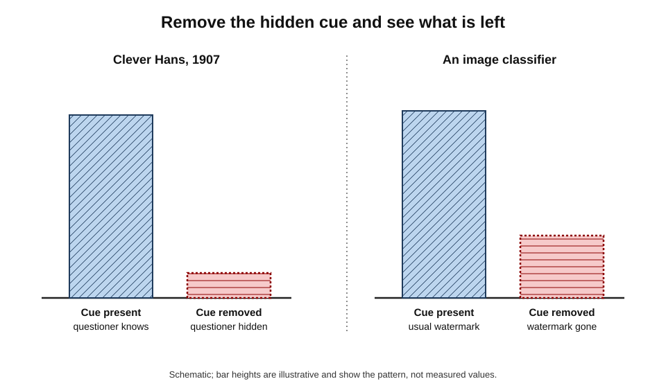
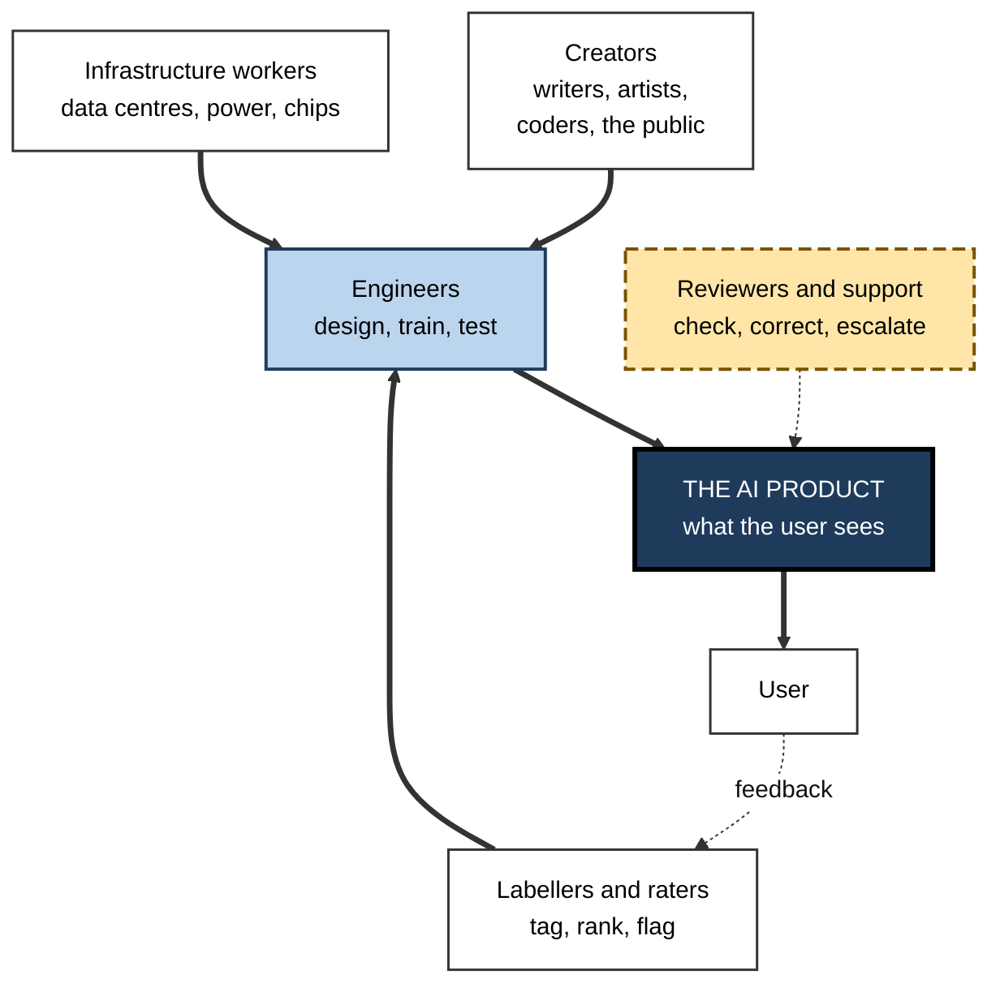
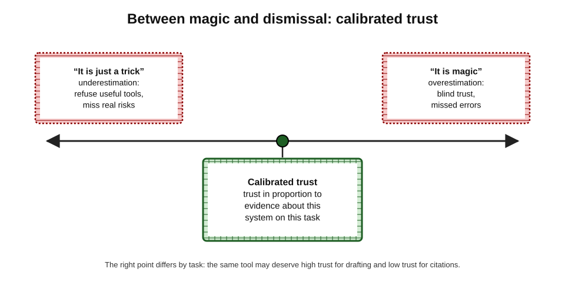
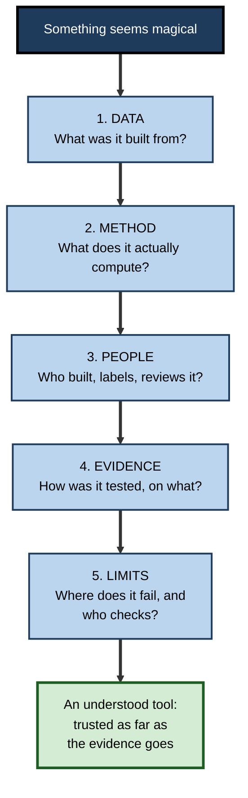
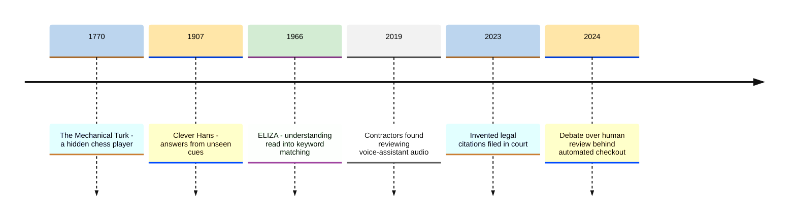

# A.10. Common myths about AI being magic

A program writes a sonnet in two seconds, paints a picture from a sentence, answers a legal question in fluent paragraphs and speaks in a warm, natural voice. To many people it feels like **magic** — and the science-fiction writer Arthur C. Clarke's line that "any sufficiently advanced technology is indistinguishable from magic" is quoted constantly.

But magic is exactly the wrong frame. Every AI output is produced by **computation over data that people collected, using methods people designed, on machines people built and paid for**, often with people quietly working behind the scenes. Believing otherwise leads to trusting AI where it should be checked, fearing it where it should be understood, and missing the human choices that shape it.

> **Definition — Magical thinking about AI:** treating AI systems as if their outputs arise from mysterious, self-sufficient or all-knowing powers, rather than from identifiable data, methods, people and resources.

> **Definition — Myth (in this sense):** a widely held belief about AI that is false or seriously misleading, and that shapes how people use, trust or govern it.

**Why debunking the magic matters**

- **Trust** — magical beliefs lead people to accept outputs without checking, or to reject useful tools out of fear.
- **Accountability** — if AI is magic, no one seems responsible; if it is a product, its makers and users are.
- **Fair credit and fair pay** — the hidden human labour behind AI is easy to ignore when the product appears self-sufficient.
- **Better use** — people who understand the mechanism, even roughly, use tools more effectively and spot failures sooner.

---

## Why AI Feels Like Magic

### The ingredients of the illusion

- **A hidden mechanism** — the computation happens on distant servers; the user sees only the result.
- **Fluency** — smooth, confident language is the strongest cue humans use to judge competence.
- **Speed** — results that would take a person hours appear in seconds.
- **Personification** — names, voices, avatars and "I" statements invite people to treat software as a someone.
- **Selective demonstrations** — launches show the best examples; failures are not on stage.
- **Cultural stories** — decades of films and novels have primed audiences to expect thinking machines.
- **The ELIZA effect** — the long-observed tendency to read understanding into even simple conversational programs.

> **Key point:** the feeling of magic is a fact about **human perception**, not about the technology. The same features that make AI feel magical — hidden workings and fluency — are those that make its errors hard to detect.

### Old illusions, new machines

**Study card — the Mechanical Turk (1770–1854)**

- **What it was:** a chess-playing "automaton" built by Wolfgang von Kempelen for the Habsburg court in 1770 — a cabinet with a turbaned figure that moved the pieces.
- **What people saw:** it beat many challengers on tours of Europe and America over decades; accounts report games against Napoleon Bonaparte.
- **The secret:** a skilled human chess player hid inside the cabinet, operating the figure; the doors were opened in sequence to show apparently empty machinery.
- **End:** the machine was destroyed by fire in Philadelphia in 1854.
- **Legacy:** the name lives on in Amazon's "Mechanical Turk" platform, where people perform small online tasks — often to label data for AI.
- **Lesson:** a dazzling machine may depend on **hidden people**. The question "who is inside the cabinet?" is still worth asking.

**Study card — Clever Hans (Berlin, early 1900s)**

- **What happened:** a horse named Hans appeared to answer arithmetic questions by tapping its hoof, impressing audiences and a scientific commission.
- **Investigation:** the psychologist Oskar Pfungst showed in 1907 that Hans succeeded only when the questioner **knew the answer** and was **visible**.
  - Hans was responding to tiny, unconscious changes in posture and expression as the count approached the right number.
- **Lesson for AI:** a system can produce correct answers for the **wrong reasons**, using cues no one intended.
  - **Documented example:** a 2019 study of image classifiers found one that appeared to recognise horses but was in fact relying largely on a copyright watermark that appeared on many horse photographs in its training set — the researchers called such systems "Clever Hans" predictors.

**Figure 1.** The Clever Hans test: performance collapses when the hidden cue is removed.

> **In practice:** test an AI system the way Pfungst tested Hans — **remove the cues it might be exploiting** (change formats, sources, names and orderings) and see whether performance survives.

---

## What AI Knows, and How

### "AI knows everything"

- **The belief:** a chatbot has read the whole internet and therefore holds the facts.
- **The reality:**
  - a generative model stores **statistical patterns**, not a list of verified facts; it **reconstructs** answers each time;
  - knowledge has a **cut-off** date and gaps — local, recent, specialist and private information may be missing;
  - when it lacks information, it can produce **fluent, specific and false** statements — often called **hallucinations**.
- **Why it matters:** fluency is not evidence of accuracy.

> **Definition — Hallucination (in AI):** a confident, plausible-sounding output that is false or unsupported by the system's sources.

**Study card — Mata v. Avianca (New York, 2023)**

- **Situation:** lawyers in a personal-injury case against the airline Avianca filed a brief citing several earlier court decisions.
- **Problem:** the decisions did not exist; one lawyer had used ChatGPT for research, and it had produced plausible but invented cases, complete with quotations.
- **Escalation:** when challenged, the lawyer asked the chatbot whether the cases were real; it said they were.
- **Outcome:** in June 2023 the federal judge sanctioned the lawyers and their firm, ordering a $5,000 penalty.
- **Lesson:** the tool did not "lie" or "know" — it generated text that resembled legal citations. The failure was treating it as an **oracle** rather than a **drafting aid** whose claims need checking.

### "AI is objective"

- **The belief:** a machine has no opinions, so its judgements are neutral.
- **The reality:**
  - AI systems learn from data produced by people and institutions, and absorb the **patterns — including biases —** in that data;
  - people choose the objective, the data, the labels and the thresholds.
- **Documented example:** in 2018 Reuters reported that Amazon had abandoned an experimental recruiting tool after finding it downgraded CVs containing the word "women's", having learned from a decade of applications dominated by men.

> **Watch out:** "the algorithm decided" is never a full explanation. Behind every algorithmic decision are human choices about **what to optimise, which data to use and what error rates to accept**.

### "AI understands what it says"

- **The belief:** fluent answers mean the system grasps the meaning as a person would.
- **The reality:** whether, and in what sense, current systems understand is a **live scientific debate**. What is clear is that fluency can coexist with errors no understanding person would make — such as confidently contradicting itself within a page.
- **Practical stance:** treat outputs as **useful drafts from a system of uncertain understanding**, and verify accordingly.

---

## Who and What Makes AI Work

### "AI works by itself"

- **The belief:** AI systems run without people — the machine does it all.
- **The reality:** large amounts of human work sit behind AI products:
  - **data creation** — the writing, photographs, code and conversations of millions of people;
  - **data labelling** — workers tagging images, rating answers, marking harmful content;
  - **feedback** — people comparing and rating outputs to train assistants;
  - **review and correction** — staff checking outputs in live services;
  - **engineering and operations** — the teams who build, monitor and maintain systems.

> **Definition — Ghost work:** the anthropologist Mary Gray and computer scientist Siddharth Suri's term (2019) for the hidden, often low-paid human labour that keeps automated services running.

- **Documented examples:**
  - **Content labelling (2023):** a *TIME* investigation reported that workers in Kenya, employed through an outsourcing firm, were paid under two US dollars an hour to label disturbing text so that ChatGPT could be trained to avoid it.
  - **Voice assistants (2019):** reports revealed that contractors for several major companies listened to samples of users' voice-assistant recordings to improve recognition, prompting policy changes.

**Figure 2.** The people behind an AI product.

### Case study: "Just Walk Out" checkout

- **Situation:** from 2018 Amazon opened stores in which shoppers took items and simply left; cameras and sensors, the company said, tracked what each person took and charged them automatically.
- **The reports:** in 2024 technology journalists reported that the system relied on a large team of about **1,000 workers in India** who reviewed video, and that a high proportion of transactions were checked by people — far more than the company's internal target.
- **Amazon's response:** the company disputed the characterisation, stating that the workers mainly **annotated video to improve the underlying models** and that most transactions did not require human review.
- **Outcome:** in April 2024 Amazon said it would replace Just Walk Out in its large US grocery stores with smart shopping trolleys, while continuing to offer the technology to other retailers.
- **What is clear and what is contested:**
  - **clear:** a substantial human workforce supported the system;
  - **contested:** how much of each transaction depended on people in real time.
- **Lesson:** "fully automated" claims should prompt the Mechanical Turk question — **where are the people, and what are they doing?** — and organisations should be open about the human role in their AI services.

### "AI lives in the cloud and costs nothing"

- **The belief:** AI is weightless software.
- **The reality:** training and running large models requires **data centres, specialised chips, electricity and cooling water**.
  - The International Energy Agency estimated in 2025 that data centres used roughly 1.5 % of the world's electricity in 2024, with AI a fast-growing share.
- **Why it matters:** cost, environmental impact and supply constraints are real considerations in choosing when to use AI.

---

## How AI Behaves Over Time

### "AI learns from every conversation"

- **The belief:** the assistant gets smarter each time anyone talks to it, and remembers everything.
- **The reality:**
  - most deployed models are **fixed after training**; they do not change their underlying parameters during a conversation;
  - many products add **memory features** that store notes about a user, and conversations may be **used to train future versions** depending on the provider's policy and the user's settings;
  - improvements arrive as **new versions**, not continuously.
- **Why it matters:** correcting a chatbot in one conversation usually does not fix the error for anyone else — and what users type may be retained, so confidential information needs care.

### "There is a magic prompt"

- **The belief:** secret phrases unlock hidden powers.
- **The reality:** clear instructions, context and examples improve results — the same things that help a human colleague. Specific "tricks" often stop working when models are updated.
- **Practical stance:** treat prompting as **clear communication**, not incantation.

### "AI is one thing"

- **The belief:** "the AI" is a single entity, like a brain in the cloud.
- **The reality:** spam filters, fraud scores, face recognition, route planners and chat assistants are **different systems**, built differently, with different strengths and failure modes.

### "Neural networks are digital brains"

- **The belief:** AI works the way the human brain does.
- **The reality:** artificial neural networks were **loosely inspired** by neurons, but they differ profoundly in structure, learning, energy use and embodiment; similarities in behaviour do not imply similar mechanisms.

| | The magical belief | The reality | The practical consequence |
|---|---|---|---|
| Knowledge | It knows everything | It reconstructs patterns; it can be fluently wrong | Verify facts, citations and figures |
| Objectivity | It is neutral | It reflects data and design choices | Ask what it optimises and on what data |
| Autonomy | It works by itself | Human labour sits behind it | Ask who is involved and how they are treated |
| Cost | It is weightless | It consumes energy, chips and water | Use it where the value justifies the cost |
| Learning | It learns from every chat | Usually fixed between versions; data may be kept | Do not rely on in-chat correction; protect confidential data |
| Control | A magic prompt unlocks it | Clear instructions and context help | Write as to a capable colleague |
| Nature | It is one brain | Many different systems | Judge each system on its own evidence |

> **Mnemonic — "KOALA CL":** the seven magical beliefs — **K**nows everything, **O**bjective, **A**utonomous, **L**ightweight, **A**lways learning, **C**ontrolled by magic words, **L**ike one brain.

---

## Two-Sided Errors

### Magic and its mirror image

- **Overestimation** — "it is magic, so it must be right": blind trust, missed errors, outsourced judgement.
- **Underestimation** — "it is just a trick, so it is useless": refusing tools that could save time, missing real risks such as convincing scams.
- **Calibration** — the goal: trust in proportion to **evidence about this system on this task**.

**Figure 3.** Between "it is magic" and "it is a trick": calibrated trust.

> **Watch out:** "it is just autocomplete" and "it is basically a mind" are **both** myths. Each contains a grain of truth — the systems do predict text; they do produce outputs that look like reasoning — but neither is a sound basis for decisions.

---

## Replacing Magic With Questions

### Five questions that dissolve the magic

**Figure 4.** Five questions to ask of any AI system that seems magical.

> **Mnemonic — "Do Magicians Perform Every Lie?":** Data, Method, People, Evidence, Limits.

### Worked example (illustrative): demystifying a vendor demonstration

A sales team is shown a "magical" AI that reads a customer's emails and instantly drafts the perfect reply.

| What looked magical | Question asked | What was found |
|---|---|---|
| It "knew" the customer's history | Data — what does it draw on? | It retrieves the last ten emails and CRM notes and includes them in its input |
| Replies were always on-brand | Method — what does it compute? | It is instructed with a style guide and three example replies |
| It never made mistakes | Evidence — how was it tested? | The demo used 20 hand-picked emails; no error rate on real traffic was available |
| It "learned" from corrections | Method — does it change? | Corrections are logged for monthly review; the model itself does not change |
| It runs "automatically" | People — who is involved? | A vendor team reviews flagged drafts in another time zone |

*Illustrative example.*

1. **Every "magical" feature mapped to an ordinary mechanism** — retrieval, instructions, examples, logging, human review.
2. **The evidence gap was the real finding** — no error rate on realistic emails.
3. **Decision:** run a four-week pilot on real traffic, measure the share of drafts sent without edits, and confirm where customer data is processed and who can see it.

> **Key point:** demystifying a tool does not make it less useful. It makes clear **what to rely on, what to check and what to ask for**.

---

## A Short History of Machine Illusions

**Figure 5.** Recurring episodes in which machines appeared more capable or self-sufficient than they were.

- **The pattern:** in each case, audiences credited the machine with powers that actually belonged to **hidden people**, **unintended cues** or **their own interpretation**.
- **The constant:** human readiness to see agency and mind wherever behaviour is fluent and the mechanism is hidden.

---

## How Stories Shape Expectations

### Fiction's thinking machines

- **HAL 9000** in *2001: A Space Odyssey* (1968) — calm, conversational and lethal; the template for the machine with hidden intentions.
- **The Terminator** (1984) — AI as an unstoppable military threat.
- **Samantha** in *Her* (2013) — an operating system that becomes a romantic companion.
- **What they share:** fictional AIs are almost always **unified minds with desires** — a single someone. Real AI systems are collections of software components with objectives set by their makers.

> **Watch out:** fiction is not irrelevant — it inspires engineers and frames public debate — but its machines are **characters**, written to have motives. Importing that picture into real decisions leads both to unwarranted fear and to unwarranted trust.

### The language of news and marketing

- **Verbs of mind** — "the AI decided", "it wants", "it learned to deceive" — turn statistical behaviour into intentions.
- **Superlatives** — "revolutionary", "human-level", "superhuman" — usually rest on narrow benchmarks.
- **Brain imagery** — glowing brains and humanoid robots illustrate stories about software that has neither.
- **Selective anecdotes** — the astonishing success and the spectacular failure both travel further than the typical case.

| | Magical framing | Accurate framing |
|---|---|---|
| Headline style | "AI learns to read minds" | "Model predicts which image a person viewed from brain scans, for a few trained volunteers" |
| Verb | "decides", "wants", "knows" | "outputs", "is optimised to", "was trained on" |
| Scope | "AI can now diagnose cancer" | "A model matched specialists on one type of scan in one study" |
| Agent | "The AI" | "The developer's system", "the bank, using a model" |

*Illustrative examples.*

---

## How Magical Thinking Shows Up at Work

### Symptoms

- **"The AI said so"** — outputs accepted in reports, emails or decisions without checking.
- **Unvetted figures** — numbers, citations or quotations copied from a chatbot into client documents.
- **Shadow AI** — staff using unapproved public tools with confidential data, assuming nothing is stored.
- **Procurement by demonstration** — buying on the strength of a showcase without testing on the organisation's own cases.
- **Fear-driven bans** — prohibiting all use because the tool is imagined as uncontrollable, which drives use underground.
- **Abdicated responsibility** — "the system rejected the application" offered as an explanation to a customer.

### Remedies

- **Teach the mechanism in outline** — even a rough picture (patterns learned from data, outputs generated afresh each time, people behind the scenes) changes behaviour.
- **Make checking normal** — require sources for factual claims and verification of figures before external use.
- **Publish approved tools and data rules** — so staff know what is safe.
- **Test before buying** — on representative internal cases, with error rates reported.
- **Keep a named human owner** for every AI-assisted decision.

> **In practice:** a useful team norm is to describe every AI output as a **draft from a fallible assistant** — never as an answer from an authority — until it has been checked by someone accountable for it.

### Case study (illustrative): the confident market report

- **Situation:** a consulting team under deadline asked a chatbot for market-size figures for a client presentation.
- **What happened:** the tool produced precise figures with named sources; the team pasted them into slides.
- **Discovery:** the client's analyst recognised that one cited report did not exist and that another gave a figure a third of the size quoted.
- **Diagnosis:**
  - the team treated the tool as a **search engine and database** rather than a text generator;
  - specific, sourced-looking numbers **felt** authoritative;
  - no step required verifying figures before external use.
- **Actions:**
  1. corrected the figures from primary sources and apologised to the client;
  2. introduced a rule that every external number needs a checked primary source;
  3. switched to a tool that retrieves and links real documents for research tasks, still with human verification.
- **Lesson:** magical thinking is not ignorance but **misplaced trust in fluency**. Process — not only training — is what keeps it out of client work.

---

## A Plain Account in Place of Magic

A chat assistant's answer can be described, in outline and without any mystery, as a sequence of ordinary steps.

1. **Input is assembled** — the user's message is combined with the provider's instructions, the organisation's settings and, sometimes, documents retrieved from a search or a company's files.
2. **Text becomes numbers** — the combined input is broken into small pieces and converted into numbers a computer can process.
3. **A very large calculation runs** — the numbers pass through a mathematical model whose billions of settings were fixed earlier by training on large amounts of text and by people's feedback.
4. **A likely continuation is chosen** — the calculation scores possible next pieces of text; one is chosen, partly at random, and the process repeats piece by piece until the answer is complete.
5. **Filters and checks apply** — automated rules may block or modify certain outputs; in some services, people review samples.
6. **The answer appears** — fluent, fast and confident, whether or not it is correct.

> **Key point:** nothing in this account is magical, and nothing in it guarantees truth. Fluency comes from step 4; accuracy depends on whether the patterns learned and the documents retrieved happen to support a correct answer.

- **What the account explains:**
  - why answers can vary when the same question is asked twice (the partly random choice in step 4);
  - why up-to-date or private information is missing unless retrieved (step 1);
  - why the system can sound equally sure when right and when wrong (nothing in steps 2–4 checks facts);
  - why organisations can shape behaviour (instructions and filters in steps 1 and 5).

> **In practice:** being able to give this six-step account to a colleague is usually enough to dissolve the magic — and to explain why checking remains necessary.

---

## Open Questions

- **How much hidden human labour do AI services rely on, and how should it be disclosed?**
  - Companies rarely publish figures; working conditions vary widely.
- **Can interfaces be designed to reduce magical thinking without making tools harder to use?**
  - Disclosures, confidence indicators and source citations help in some studies; their effect on behaviour is mixed.
- **How do people's beliefs about AI change with experience?**
  - Some evidence suggests familiarity reduces awe but can also increase over-reliance.
- **How should environmental costs be counted and communicated?**
  - Estimates vary with assumptions; per-query figures are contested.

---

## Summary

- **AI is not magic**: every output comes from computation over data, designed methods, physical infrastructure and human work. The feeling of magic arises from **hidden mechanisms, fluency, speed, personification and selective demos**.
- History repeats the illusion: the **Mechanical Turk** (a hidden human), **Clever Hans** (unintended cues — now a term for AI that is right for the wrong reasons), **ELIZA** (meaning read into simple patterns).
- **"It knows everything"** — false: models reconstruct patterns and can **hallucinate**, as **Mata v. Avianca** showed.
- **"It is objective"** — false: it reflects data and design choices.
- **"It works by itself"** — false: **ghost work** — labelling, rating, reviewing — sits behind it; the **Just Walk Out** debate shows the importance of transparency.
- **"It is weightless"**, **"it learns from every chat"**, **"there is a magic prompt"**, **"it is one brain"**, **"it is a digital brain"** — all misleading.
- Both **overestimation** and **underestimation** are myths; the goal is **calibrated trust**.
- Dissolve the magic with five questions: **data, method, people, evidence, limits**.

---

## Self-Check

1. Define magical thinking about AI and give two reasons it is harmful.
2. List five features of AI products that create the feeling of magic.
3. What was the secret of the Mechanical Turk, and what question does it suggest for AI?
4. How did Pfungst expose Clever Hans, and what is a "Clever Hans" predictor in AI?
5. Why can a generative model state false facts fluently? Use Mata v. Avianca to illustrate.
6. Why is "the algorithm is objective" a myth? Give an example.
7. What is ghost work? Name three kinds.
8. Summarise what is agreed and what is contested about Just Walk Out.
9. Does correcting a chatbot in a conversation fix the error for other users? Explain.
10. Why are "it's just autocomplete" and "it's basically a mind" both myths?
11. Name the five questions for demystifying an AI system.
12. In the vendor-demo example, what was the most important finding, and why?
13. A colleague pastes confidential client data into a public chatbot, saying "it forgets everything anyway". Respond.
14. Design a simple "Clever Hans" test for an AI tool that classifies customer complaints by urgency.

### Answer Key

1. Treating AI outputs as arising from mysterious, self-sufficient or all-knowing powers. Harmful because it leads to unchecked trust (or irrational fear) and obscures responsibility and the human labour involved.
2. Hidden mechanism, fluency, speed, personification, selective demonstrations (also cultural stories and the ELIZA effect).
3. A human chess master hidden inside operated the figure. Question: who is inside the cabinet — what hidden human work supports an apparently automatic system?
4. He showed Hans answered correctly only when the questioner knew the answer and was visible, because Hans read unconscious cues. A Clever Hans predictor is an AI system that is right for the wrong reasons — *e.g.* recognising "horses" from a watermark.
5. It stores statistical patterns and reconstructs answers, so it can generate plausible text unsupported by facts. In Mata v. Avianca it produced invented court decisions with quotations; the lawyer filed them without checking and was sanctioned.
6. Systems learn patterns from human data and people choose objectives and thresholds. Amazon's experimental recruiting tool learned to downgrade CVs mentioning "women's".
7. Hidden, often low-paid human labour behind automated services: data labelling, rating outputs for training, content moderation, live review of outputs.
8. Agreed: a large human team (about 1,000 workers in India were reported) supported the system. Contested: how many transactions required real-time human review — Amazon said the workers mainly annotated video to improve the models.
9. Usually not. Most models are fixed after training; corrections may be stored in a user's memory or logged for future versions but do not change the model for everyone immediately.
10. Each holds a grain of truth (models predict text; outputs resemble reasoning) but both mislead: the first underestimates real capability, the second overestimates understanding and reliability. Neither supports sound decisions; calibrated trust based on evidence does.
11. Data, method, people, evidence, limits.
12. That there was no error rate on realistic emails — the demo used hand-picked examples. Without evidence on real traffic, the tool's reliability is unknown, so a measured pilot is needed.
13. The model may not change, but conversations can be retained, reviewed or used for training depending on the service and settings; confidential data may leave the organisation's control and breach client agreements or data-protection law. Use an approved tool with suitable data protections, or remove identifying details.
14. Vary cues unrelated to urgency while keeping the facts constant: rewrite urgent complaints politely and non-urgent ones angrily, change customer names, remove capital letters and exclamation marks, alter email length and channel. If classifications change with tone or formatting rather than the actual impact described, the tool is relying on Clever Hans cues.

---

## Glossary

| Term | Meaning |
|---|---|
| Calibrated trust | Trust in a system in proportion to evidence about its performance on the task. |
| Clever Hans predictor | An AI system that gives correct answers by relying on unintended cues. |
| ELIZA effect | Attributing understanding to a program because of human-like responses. |
| Ghost work | Hidden human labour that keeps automated services running. |
| Hallucination | A confident, plausible output that is false or unsupported. |
| Magical thinking about AI | Treating AI as mysterious, self-sufficient or all-knowing. |
| Mechanical Turk | An eighteenth-century chess "automaton" secretly operated by a hidden human. |
| Memory feature | A product feature that stores information about a user across conversations. |
| Myth | A widely held false or misleading belief that shapes behaviour. |
| Personification | Presenting software as if it were a person, through names, voices or "I" statements. |
| Training cut-off | The date after which a model has no information from its training data. |
