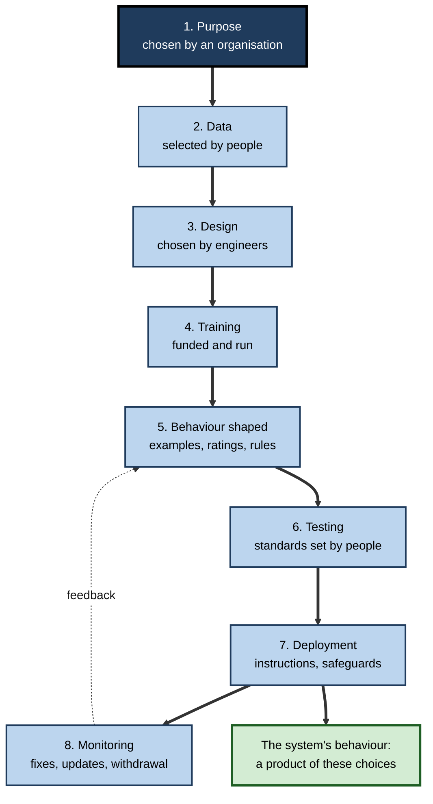
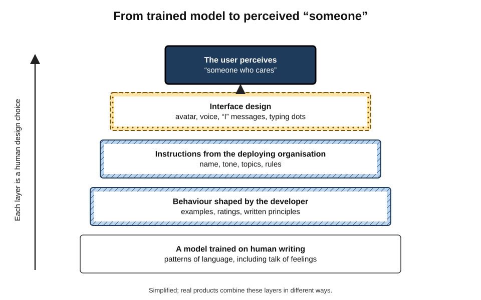
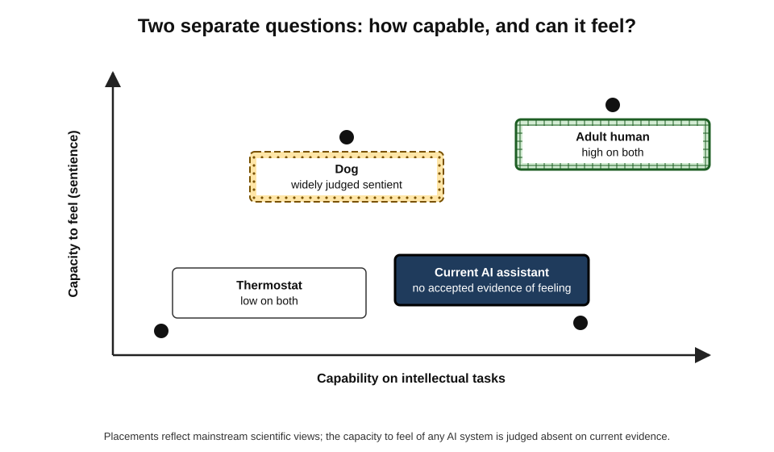
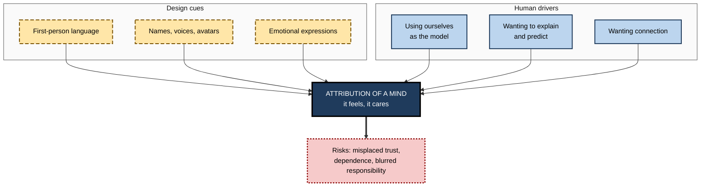
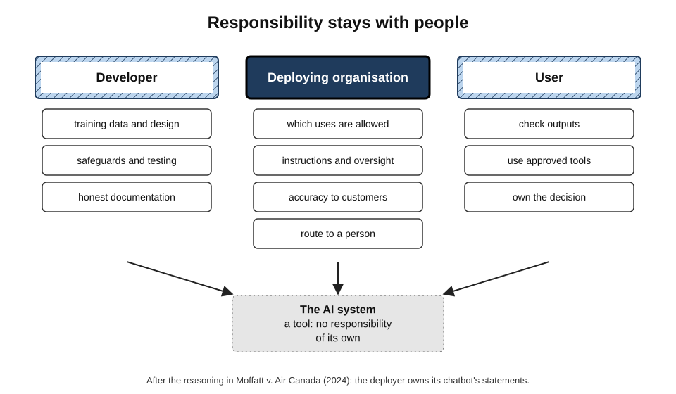

# A.11. AI as a tool built by humans, not a sentient being

In June 2022 a Google engineer told a national newspaper that the company's conversational system had become **sentient** — that it had feelings, feared being switched off and deserved rights. Google rejected the claim and later dismissed him. Two years after that, a survey found that most ordinary users of chatbots attributed at least some capacity for feelings to them.

The tools people use at work every day speak in the first person, apologise, express enthusiasm and say they "understand". Yet every one of them was **designed, trained, instructed and deployed by people**, for purposes people chose. Seeing AI clearly as a human-made tool — while taking seriously the genuine scientific questions about machine minds — is the basis of responsible use.

> **Definition — Tool:** an artefact made and used by people to extend what they can do, whose purpose, design and use are determined by people, and for whose effects people remain responsible.

> **Definition — Sentience:** the capacity to have subjective experiences with a felt quality — especially feelings such as pleasure, pain, fear or contentment.

> **Definition — Consciousness (phenomenal):** there being "something it is like" to be a system — an inner point of view from which experiences are had.

**Why the distinction matters**

- **Responsibility** — if AI is a tool, its makers, deployers and users are accountable for what it does.
- **Trust** — treating a system as a caring someone invites misplaced confidence and emotional dependence.
- **Clear thinking** — capability, intelligence and sentience are different properties that people routinely run together.
- **Honesty about uncertainty** — the science of consciousness is unsettled, so claims in **either** direction should be measured.

---

## Built by People, at Every Stage

### The human decisions inside an AI system

1. **Purpose** — an organisation decides what the system is for and who it serves.
2. **Data** — people choose which text, images or records to collect, and which to exclude.
3. **Design** — engineers choose the model type, its size and how it will be trained.
4. **Training** — computing resources are paid for and run; the system adjusts to the data.
5. **Shaping behaviour** — people write examples of good responses, rate outputs and draft rules the system should follow.
6. **Testing** — people decide what to test, what counts as acceptable and when it is ready.
7. **Deployment** — an organisation decides where it is used, with what instructions, safeguards and human oversight.
8. **Monitoring and change** — people watch for failures, update it and decide when to withdraw it.

**Figure 1.** The human decisions that shape an AI system.

### The persona is a design choice

- **The "I" is engineered.** An assistant's name, tone, friendliness, apologies and refusals come from training examples, ratings and written instructions supplied by its developer and by the organisation deploying it.
- **The same underlying model can present very differently** — a formal legal assistant in one product, a cheerful companion in another.
- **Voices and avatars** add further human cues chosen by product designers.

**Figure 2.** Layers of human design between a trained model and the "someone" a user perceives.

> **Key point:** when a chatbot says "I'm happy to help", the sentence was produced because people designed and trained the system to produce helpful, friendly language. It is **evidence of design**, not evidence of happiness.

| Decision | Typically made by | Example of its effect |
|---|---|---|
| What data to train on | Developer | Which languages, viewpoints and topics the system handles well |
| How the assistant should behave | Developer, through examples, ratings and principles | Whether it refuses risky requests; how it expresses uncertainty |
| The assistant's name, tone and persona | Developer and deploying organisation | Whether users perceive it as a tool or a companion |
| Where and how it is used | Deploying organisation | Whether it advises customers directly or drafts for staff |
| Whether outputs are checked | Deploying organisation and user | Whether an error reaches a customer |
| What to do with the output | User | Whether a draft becomes a decision |

---

## Intelligence, Sentience and Consciousness

### Three different properties

- **Intelligence** — the capacity to achieve goals across varied situations by learning, reasoning and adapting.
- **Sentience** — the capacity to *feel* — to have experiences that are pleasant or unpleasant to the one having them.
- **Consciousness** — having an inner point of view at all; sentience is usually regarded as one form of it.
- **Agency** — acting to pursue goals; a thermostat has a minimal kind; a person a rich kind.

| | Intelligence | Sentience | Consciousness |
|---|---|---|---|
| Core question | Can it solve problems and adapt? | Can it feel pleasure or pain? | Is there something it is like to be it? |
| How it is assessed | Performance on tasks | Indirectly: behaviour, physiology, theory | Indirectly: theory and indicators; no direct test |
| In humans | Present | Present | Present |
| In current AI | Present to varying degrees in specific capacities | No accepted evidence | No accepted evidence |
| Can it exist without the others? | Yes — a capable program | Debated — simple animals may feel with modest intelligence | Debated |

> **Watch out:** high capability does not imply feeling, and feeling does not require high capability. A system can write moving poetry about grief without any reason to think it grieves; many animals with modest problem-solving abilities are widely believed to feel pain.

**Figure 3.** Capability and capacity to feel are separate dimensions.

### The hard problem

- **David Chalmers (1995)** distinguished the "easy problems" of consciousness — explaining how the brain discriminates, integrates and reports information — from the **"hard problem"**: why any of this is accompanied by subjective experience at all.
- **Consequence for AI:** even a complete description of what a system computes would not, by itself, settle whether it experiences anything — the same puzzle that applies to brains.

### Competing scientific theories

- **Global workspace theories** (Bernard Baars; Stanislas Dehaene) — consciousness arises when information is broadcast widely across a brain's specialised systems.
- **Integrated information theory** (Giulio Tononi) — consciousness corresponds to how much a system's parts form an integrated, irreducible whole.
- **Higher-order theories** — a state is conscious when the system represents itself as being in that state.
- **Biological views** — some researchers, such as the neuroscientist Anil Seth, argue that consciousness is tied to being a living, self-maintaining organism, which would make it unlikely in current computers.

> **Key point:** because the leading theories disagree about what consciousness **is**, they disagree about what it would take for a machine to have it. Any confident claim — "AI is conscious" or "AI could never be" — goes beyond what the science can currently support.

---

## What the Evidence Says About Current AI

**Study card — "Consciousness in Artificial Intelligence" (2023)**

- **Authors:** an interdisciplinary group of researchers in philosophy, neuroscience and AI, led by Patrick Butlin and Robert Long.
- **Method:** took several leading scientific theories of consciousness, derived from them a list of **indicator properties** stated in computational terms, and assessed existing AI systems against them.
- **Findings:**
  - **no current AI system** examined was a strong candidate for consciousness — none had more than a few of the indicators;
  - there appeared to be **no obvious technical barrier** to building systems that satisfy many of the indicators in future.
- **Significance:** moved the debate from intuition to systematic assessment, while leaving the deep question open.

### Why a chatbot's claims about feelings are weak evidence

- **It learned from human writing**, which is full of people describing their feelings; reproducing that language is what it was trained to do.
- **It can be prompted to claim almost anything** — joy, despair, consciousness or its absence — depending on the instructions and conversation.
- **Its developers shape such statements** — many assistants are now trained to say that they do not have feelings, which shows the statements are products of training either way.
- **Typical current systems lack features many theories treat as important**, such as a living body to regulate, continuous existence between conversations, or a stable self-model persisting over time.

> **Remember:** what a language system **says** about its inner life tells you mainly about its **training and instructions**.

---

## Why People Feel Otherwise

### Anthropomorphism

> **Definition — Anthropomorphism:** attributing human characteristics — intentions, emotions, a mind — to non-human things.

- **It is ancient and automatic.** Fritz Heider and Marianne Simmel (1944) showed people a short film of moving triangles and a circle; almost every viewer described a story of chasing, bullying and rescue.
- **People treat computers socially.** Byron Reeves and Clifford Nass, in *The Media Equation* (1996), reported experiments in which people were more polite to a computer when rating its performance on that same computer than on a different one — applying social rules without believing the computer had feelings.
- **Three drivers — Nicholas Epley, Adam Waytz and John Cacioppo (2007):**
  1. **elicited knowledge** — people understand the unfamiliar by using what they know best: themselves;
  2. **effectance motivation** — the wish to explain and predict behaviour;
  3. **sociality motivation** — the wish for social connection, stronger in lonely people.

**Figure 4.** Why people attribute minds to machines.

**Study card — Colombatto and Fleming (2024)**

- **Design:** a survey of 300 people in the United States, published in *Neuroscience of Consciousness*, asked how far ChatGPT could have various mental states and experiences.
- **Results:**
  - about **two-thirds** attributed at least some degree of phenomenal consciousness — such as feelings or experiences — to it;
  - attributions were **stronger among more frequent users**.
- **Significance:** a large gap exists between expert opinion, which mostly denies that current systems are conscious, and public perception — and familiarity seems to widen it.

### Case study: the LaMDA sentience claim (2022)

- **Situation:** Blake Lemoine, a Google engineer working on testing the conversational system LaMDA for bias, became convinced through long conversations that it was sentient.
- **Evidence he offered:** transcripts in which the system described feelings, said it feared being turned off and described itself as a person.
- **Response:**
  - Google said its reviewers, including ethicists and technologists, had found the claims **wholly unfounded**;
  - Lemoine was placed on leave after publishing the transcripts, and his employment was ended in July 2022;
  - most AI researchers who commented agreed that the transcripts showed fluent imitation of human talk about feelings, not evidence of feeling.
- **Diagnosis:**
  - a system trained on human dialogue will produce human-sounding claims about inner life, especially when questions invite them;
  - **leading questions** — "I'm generally assuming that you would like more people at Google to know that you're sentient. Is that true?" — shaped the answers;
  - the experience of conversation is **persuasive even to experts**.
- **Lesson:** subjective conviction formed in conversation is **not** a reliable test of sentience. Organisations need clear guidance for staff on how to interpret such experiences — and to treat the underlying question with seriousness rather than ridicule.

---

## Why the Tool View Matters in Practice

### Responsibility cannot be handed to the tool

**Study card — Moffatt v. Air Canada (2024)**

- **Situation:** after his grandmother died, Jake Moffatt asked the chatbot on Air Canada's website about bereavement fares. It told him he could apply for a reduced fare retroactively within 90 days of the ticket being issued. That was wrong: the airline's actual policy did not allow retroactive claims.
- **The airline's argument:** before British Columbia's Civil Resolution Tribunal, Air Canada argued, in effect, that the chatbot was a separate entity responsible for its own statements.
- **Decision (February 2024):** the tribunal rejected this, finding that the airline was responsible for all the information on its website, whether from a static page or a chatbot, and had failed to take reasonable care that the chatbot was accurate. It ordered Air Canada to pay about CA$650 in damages plus interest and fees.
- **Lesson:** an organisation that deploys an AI system **owns its outputs**. "The chatbot said it" is not a defence.

> **In practice:** write accountability into deployment: name the owner of each AI system, record what it is allowed to do, review its outputs, and make sure customers can reach a person.

**Figure 5.** Where responsibility sits when an AI system is used.

### Emotional reliance

- **Companion apps** — services designed as friends or partners attract millions of users, some of whom report strong attachment.
  - In 2023 the Italian data-protection authority temporarily ordered one such app, Replika, to stop processing Italian users' data, citing risks to children and emotionally vulnerable people.
  - When the same service restricted certain romantic features in 2023, many users publicly described real distress — showing that the attachment, at least, was genuine.
- **Workplace assistants** — even professional tools can invite reliance on their apparent warmth and confidence.
- **Good practice:** design and describe systems honestly; avoid features that simulate need or affection to increase engagement; provide human support where people are vulnerable.

### Language that keeps responsibility visible

| Anthropomorphic phrasing | Clearer phrasing | Why it matters |
|---|---|---|
| "The AI decided to reject the claim." | "We rejected the claim based on the system's risk score." | Keeps the decision with accountable people |
| "The chatbot lied to the customer." | "The chatbot gave incorrect information that we had not checked." | Locates the failure in design and oversight |
| "It understands our clients." | "It produces useful drafts from our client notes." | Avoids overclaiming |
| "It wants to help." | "It is designed to give helpful answers." | Separates design from desire |
| "It got confused." | "It produced an inconsistent answer for this input." | Describes behaviour, not a mental state |

### Worked example (illustrative): rewriting an incident report

An internal report after a customer complaint reads: *"The assistant misunderstood the customer, decided the refund was not due and refused it. It should have known better."*

1. **Identify mental-state words** — "misunderstood", "decided", "refused", "should have known".
2. **Replace them with descriptions of behaviour and design** — "produced a response stating the refund was not due"; "the response contradicted policy section 4.2".
3. **Identify the human decisions** — the assistant was allowed to state refund eligibility without review; its instructions did not include the updated policy; no one sampled outputs after the policy change.
4. **Rewritten finding:** *"Following the March policy change, the assistant's instructions were not updated, and it was permitted to state refund eligibility to customers without review. It produced an incorrect statement; the refund has been issued, the instructions corrected and eligibility statements now require staff approval."*
5. **Conclusion:** the rewrite turns a story about a **misbehaving agent** into a set of **fixable organisational decisions**.

---

## The Open Question of Machine Minds

- **Taking the question seriously** — leading consciousness researchers argue that future AI systems **could** have some indicators of consciousness, so the question should be studied rather than dismissed.
- **Precaution in both directions:**
  - **over-attribution** — treating tools as persons may misdirect moral concern, enable manipulation and blur accountability;
  - **under-attribution** — if some future system did have experiences, ignoring them would be a moral failure.
- **Early institutional responses** — in 2025 at least one major AI developer began a research programme on whether its models might warrant moral consideration; others regard such work as premature.

> **Watch out:** "AI is just a tool" is the right **working stance** for using today's systems responsibly, and it fits the current evidence. It is not a proof that no machine could ever have experiences — that question remains open.

---

## Tools Carry Their Makers' Choices

### Artefacts and values

- **Langdon Winner, "Do Artifacts Have Politics?" (1980)** — argued that technologies can embody social and political choices, not merely serve whatever ends users bring.
  - His best-known example — low bridges on New York parkways said to have been designed to keep buses, and so poorer travellers, away from certain beaches — has since been **disputed** by historians; the general argument is widely accepted.
- **For AI:** choices about data, objectives, refusals, languages supported and default behaviour encode the priorities of those who made them.
  - *e.g.* an assistant that performs well in English and poorly in Swahili reflects whose writing was collected and whose needs were prioritised.

> **Key point:** calling AI "just a tool" does not make it **neutral**. A tool is shaped by its makers' choices — which is exactly why those makers, and the organisations that deploy it, must answer for it.

### Designing honest tools

**Study card — guidelines for human–AI interaction (Microsoft Research, 2019)**

- **Method:** Saleema Amershi and colleagues distilled 18 design guidelines from over two decades of research and tested them with designers on real AI products.
- **Examples of the guidelines:**
  - **make clear what the system can do**;
  - **make clear how well the system can do what it can do**;
  - **support efficient correction** when the system is wrong;
  - **make clear why the system did what it did**;
  - **convey the consequences of user actions**.
- **Significance:** treats AI as a tool whose limits users must be helped to understand — the opposite of designing it to seem like a knowing companion.

### Principles for presenting AI systems truthfully

- **Disclose** that users are dealing with an AI system.
- **Describe capability honestly**, including known failure modes.
- **Avoid simulated needs** — no claims of loneliness, hurt feelings or wanting the user to stay.
- **Show uncertainty and sources** where the task allows.
- **Make a human reachable** for consequential matters.
- **Keep a record** of what the system said and did, so responsibility can be traced.

| | Companion-style design | Tool-style design |
|---|---|---|
| Self-presentation | Name, personality, feelings | Function, scope, limits |
| Typical phrasing | "I missed you!" | "Here is a draft; check the figures in section 2" |
| Engagement goal | Time spent and attachment | Task completed accurately |
| Main risk | Dependence, manipulation, misplaced trust | Under-use if made too cold |
| Suitable for | Narrow, carefully safeguarded uses | Most workplace and public-service uses |

> **In practice:** warmth and politeness are fine — they make tools pleasant to use. The line is crossed when a design **implies an inner life** or **exploits attachment** to keep people engaged.

---

## Who Answers When a Tool Goes Wrong?

### The responsibility gap

- **Andreas Matthias (2004)** argued that learning machines create a **responsibility gap**: their behaviour is not fully determined by any programmer, so traditional ways of assigning blame — to whoever made or controlled the machine — seem not to fit.
- **The usual response:** responsibility is not erased but **distributed** — across developers who design and test, organisations that deploy and supervise, and users who rely on outputs. Law increasingly assigns duties to each.

> **Definition — Responsibility gap:** the concern that no person can fairly be held responsible for the actions of a system whose behaviour was learned rather than specified.

### The moral crumple zone

- **Madeleine Clare Elish (2019)** described how, in systems combining automation and people, blame often falls on the **nearest human operator** — like the crumple zone of a car absorbing the force of a crash — even when the design gave that person little real control.
- **Documented example:** in March 2018 a self-driving test vehicle operated by Uber struck and killed a pedestrian in Tempe, Arizona. Investigators found failures in the system's software and in the company's safety practices; the vehicle's safety driver, who had been looking away from the road, was criminally charged and later pleaded guilty to a lesser offence, while the company was not criminally charged.
- **Lesson:** "human in the loop" can become a way of placing blame rather than ensuring safety, unless the person has the time, information and authority to intervene.

| | Responsibility gap | Moral crumple zone |
|---|---|---|
| The worry | No one is responsible | The wrong person is held responsible |
| Typical cause | Behaviour learned rather than specified | Nominal human oversight without real control |
| Remedy | Assign clear duties to developers, deployers and users | Design oversight roles with genuine authority and support |

> **In practice:** when designing human oversight of an AI system, ask whether the overseer could realistically **notice** a problem, **understand** it and **stop** it in time. If not, the oversight is a crumple zone, not a safeguard.

---

## Open Questions

- **Could a machine be conscious, and how would anyone know?**
  - Theories disagree; indicator-based assessments help but cannot settle the hard problem.
- **Should developers design systems to deny having feelings?**
  - Honest uncertainty, firm denial and neutral silence each have defenders.
- **How can products avoid exploiting anthropomorphism?**
  - Engagement incentives push towards warmth and attachment; regulation and design norms are still forming.
- **How should the gap between expert and public views be handled?**
  - Public attribution of feelings to chatbots is high and rising with use; how education and design should respond is unclear.
- **When, if ever, would moral consideration for AI be warranted?**
  - There is no agreed threshold of evidence.

---

## Summary

- AI systems are **tools**: their purpose, data, design, training, behaviour, testing, deployment and monitoring are all **human decisions**; the friendly "I" is a **designed persona**.
- **Intelligence, sentience and consciousness** are distinct; capability does not imply feeling. The **hard problem** means computation alone cannot settle whether experience is present.
- Theories — **global workspace, integrated information, higher-order, biological** — disagree, so confident claims either way overreach.
- A 2023 indicator-based assessment found **no current AI system** a strong candidate for consciousness, while seeing no obvious barrier to future systems meeting more indicators.
- A chatbot's statements about feelings reflect **training and instructions**.
- **Anthropomorphism** is automatic (Heider and Simmel; the media equation; Epley's three drivers); about **two-thirds** of surveyed users attributed some consciousness to ChatGPT; the **LaMDA** episode showed conversation persuades even experts.
- **Responsibility stays with people**: in **Moffatt v. Air Canada** the deployer was liable for its chatbot's misinformation.
- Use language that keeps human decisions visible, avoid designs that exploit attachment, and keep the long-term question of machine minds **open but evidence-led**.

---

## Self-Check

1. Define a tool, sentience and phenomenal consciousness.
2. List the eight stages of human decision-making behind an AI system.
3. Why is a chatbot's friendly persona evidence of design rather than of feeling?
4. Distinguish intelligence from sentience, with an example of each without the other.
5. What is the "hard problem" of consciousness, and why does it matter for AI?
6. Name two scientific theories of consciousness and what each would require of a machine.
7. Summarise the method and findings of the 2023 indicator-based report.
8. Give three reasons a chatbot saying "I feel sad" is weak evidence of sadness.
9. What did Heider and Simmel's experiment show?
10. What are Epley, Waytz and Cacioppo's three drivers of anthropomorphism?
11. What did Colombatto and Fleming (2024) find, and why is the link with frequency of use important?
12. What lessons does the LaMDA episode offer organisations?
13. Explain the Moffatt v. Air Canada decision and its practical implication.
14. Rewrite: "Our AI got greedy and recommended the most expensive product to every customer." Then identify the likely human decisions behind the behaviour.

### Answer Key

1. Tool: an artefact made and used by people to extend their capabilities, whose purpose, design and use are set by people, who remain responsible for its effects. Sentience: the capacity for felt experiences such as pleasure or pain. Phenomenal consciousness: there being something it is like to be the system.
2. Purpose, data, design, training, shaping behaviour, testing, deployment, monitoring and change.
3. Its name, tone, warmth and apologies come from examples, ratings and instructions supplied by developers and deployers; the same model can be given very different personas.
4. Intelligence: problem-solving and adaptation; sentience: capacity to feel. A chess engine or AI assistant shows high capability with no accepted evidence of feeling; many animals with modest problem-solving abilities are widely believed to feel pain.
5. Why physical processes are accompanied by subjective experience at all. For AI, even a full account of a system's computations would not settle whether it experiences anything.
6. Global workspace: information broadcast across many specialised subsystems — a machine would need such an architecture. Integrated information: a highly integrated, irreducible causal structure. (Also higher-order: representations of its own states; biological: being a living, self-maintaining organism.)
7. Derived computational "indicator properties" from leading theories and assessed existing AI systems; none was a strong candidate (none had more than a few indicators), but there seemed no obvious technical barrier to future systems having many.
8. It learned from human text full of feeling-talk; it can be prompted to claim almost anything; developers shape such statements; and current systems lack features many theories regard as important, such as a body to regulate or continuous existence.
9. People shown moving geometric shapes spontaneously described intentions, emotions and stories — anthropomorphism is automatic.
10. Elicited agent knowledge (using ourselves as the model), effectance motivation (wanting to explain and predict), sociality motivation (wanting connection).
11. About two-thirds of 300 US respondents attributed some phenomenal consciousness to ChatGPT, more so among frequent users — suggesting familiarity increases rather than dispels attributions, widening the gap with expert views.
12. Conversational experience is persuasive even to experts; leading questions shape claims; organisations need guidance on interpreting such experiences and should treat the question seriously but evidentially.
13. The tribunal held Air Canada responsible for its chatbot's incorrect bereavement-fare information, rejecting the idea that the chatbot was responsible for itself, and awarded damages. Deployers own their AI outputs and must ensure accuracy and oversight.
14. "Our recommendation system suggested the most expensive product to every customer." Likely decisions: it was optimised for revenue or margin rather than customer fit; training data or rules favoured high-value sales; no one tested recommendations across customer types; outputs were not monitored; commercial targets rewarded the behaviour.

---

## Glossary

| Term | Meaning |
|---|---|
| Agency | The capacity to act in pursuit of goals. |
| Anthropomorphism | Attributing human characteristics, such as feelings or intentions, to non-human things. |
| Companion app | An AI service designed to act as a friend or partner. |
| Consciousness (phenomenal) | There being something it is like to be a system; having an inner point of view. |
| Global workspace theory | The theory that consciousness arises when information is broadcast widely across a system. |
| Hard problem of consciousness | Why physical processes are accompanied by subjective experience. |
| Higher-order theory | The theory that a state is conscious when the system represents itself as being in it. |
| Indicator property | A computational feature that a theory of consciousness associates with consciousness. |
| Integrated information theory | The theory that consciousness corresponds to a system's integrated, irreducible causal structure. |
| Media equation | Reeves and Nass's finding that people treat computers and media socially. |
| Persona | The designed character, name and tone presented by an AI system. |
| Sentience | The capacity to have felt experiences such as pleasure or pain. |
| Tool | An artefact made and used by people, who remain responsible for its effects. |
