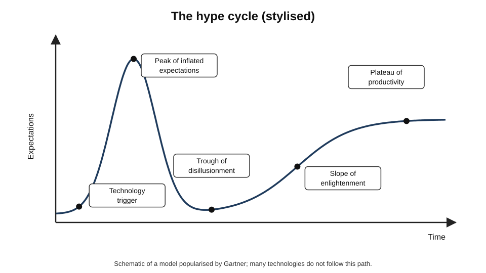
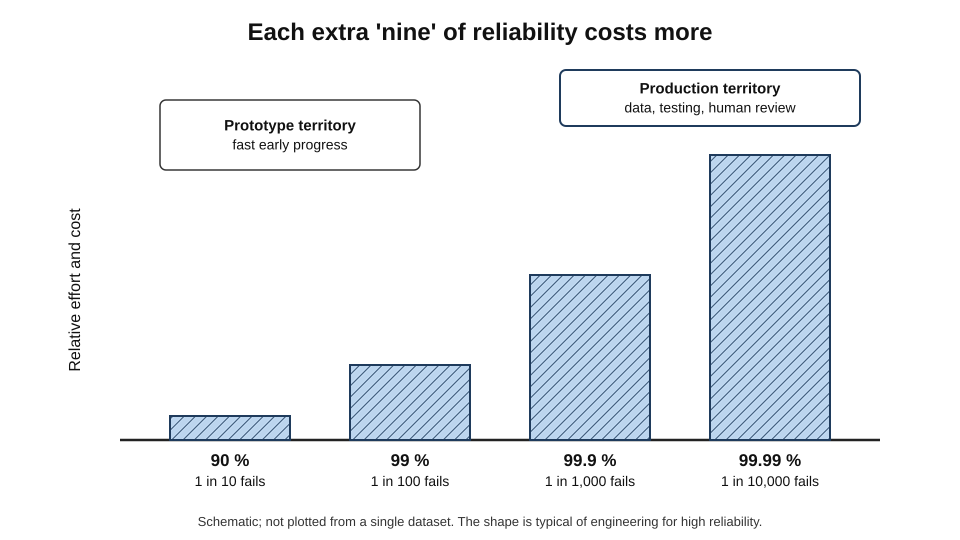
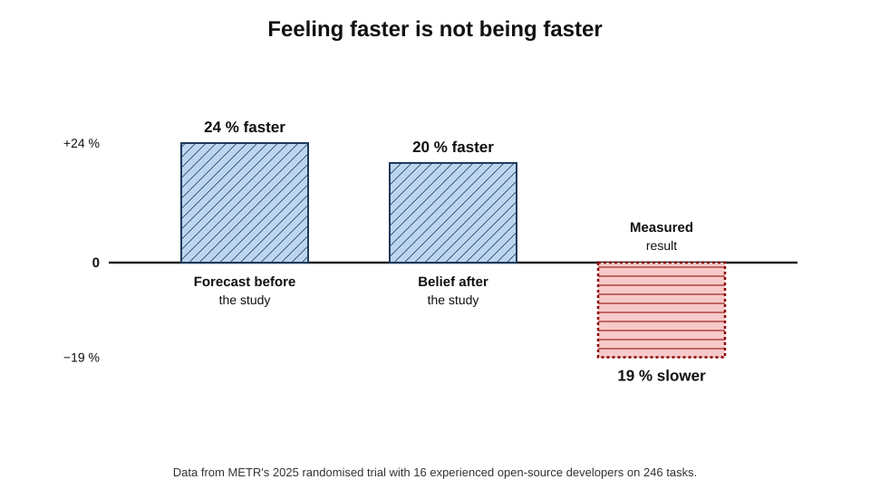
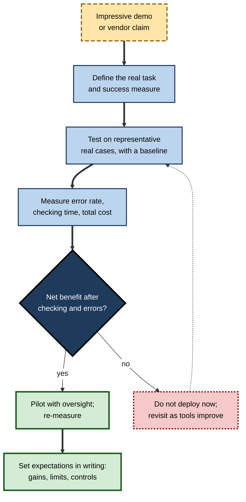
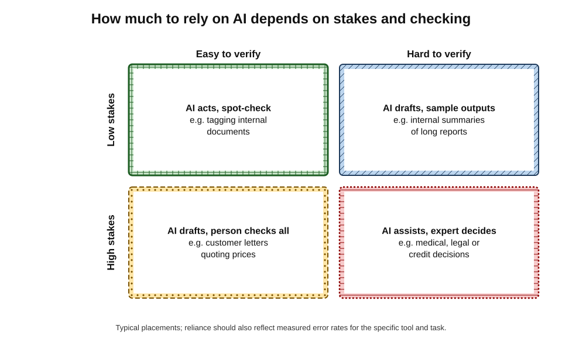
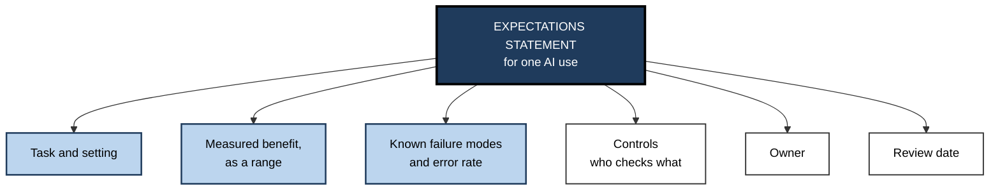

# A.12. Setting realistic expectations for AI capabilities

A team watches a demonstration in which an AI system drafts a flawless client proposal in thirty seconds. Six months later, the same team finds that drafts need heavy editing, that the tool occasionally invents figures, and that the promised time savings have shrunk to a modest gain on some tasks and none on others.

Elsewhere, a sceptical manager refuses to let staff use AI at all — and watches competitors handle routine correspondence in half the time. Both teams had **unrealistic expectations**, in opposite directions. Setting expectations accurately — neither inflated by demonstrations nor deflated by disappointment — is one of the most valuable professional skills in an age of rapidly changing tools.

> **Definition — Realistic expectation (of an AI capability):** a belief about what a particular system will achieve on a particular task, in a particular setting, that is grounded in evidence about its performance there — including how often it fails, how failures are caught and what it costs.

> **Definition — Capability:** what a system *can* do under favourable conditions.

> **Definition — Reliability:** how *consistently* a system does it correctly, across the full range of real cases.

**Why expectations matter**

- **Investment** — over-optimism wastes money on projects that cannot deliver; under-optimism forgoes real gains.
- **Safety and quality** — expecting more reliability than exists leads to unchecked errors reaching customers, patients or courts.
- **Morale** — inflated promises followed by disappointment breed cynicism that blocks later, sensible adoption.
- **Credibility** — professionals who forecast AI's effects accurately become trusted advisers.

---

## Why Expectations Go Wrong

### Patterns of over- and under-estimation

- **Amara's law** — attributed to the futurist Roy Amara: people tend to **overestimate the effect of a technology in the short run and underestimate it in the long run**.
- **The hype cycle** — a model popularised by the research firm Gartner from 1995: a technology trigger, a **peak of inflated expectations**, a **trough of disillusionment**, a slope of enlightenment and a plateau of productivity.

**Figure 1.** The hype cycle: a stylised pattern of expectations over time.

> **Watch out:** the hype cycle is a **description of a common pattern**, not a law. Analyses of technologies that Gartner tracked have found that many never followed the curve — some went straight to use, others disappeared. Use it as a reminder that early excitement is unreliable, not as a forecast.

### Where inflated expectations come from

- **Demonstrations** — chosen to show the best case, on prepared inputs.
- **Benchmarks** — high scores on standard tests that do not match real work.
- **Anecdotes** — striking individual successes shared widely; failures rarely shared.
- **Vendor incentives** — sales depend on optimism.
- **Fluency** — confident, polished output looks more reliable than it is.
- **Extrapolation** — assuming rapid recent progress continues in every direction.

### Where deflated expectations come from

- **One bad experience** — a single hallucination or poor answer generalised to the whole technology.
- **Out-of-date impressions** — judging today's tools by those of two years ago.
- **Wrong task** — testing a tool on work it is poorly suited to.
- **Poor use** — vague instructions, no context, no iteration.
- **Identity and threat** — reluctance to accept that valued skills can be partly automated.

| | Over-expectation | Under-expectation |
|---|---|---|
| Typical belief | "It will do this job for us" | "It is a toy that makes things up" |
| Typical trigger | Polished demo, benchmark headline | One bad output, outdated experience |
| Typical cost | Failed projects, unchecked errors | Missed productivity, unmanaged staff use |
| Typical blind spot | Error rates, integration, checking time | Steady improvement; tasks where it already helps |
| Remedy | Measure on real work, plan for failures | Test fairly on suitable tasks, revisit regularly |

---

## Capability Is Not Reliability

### The gap between "can" and "does"

- **A system that succeeds sometimes** has the capability; whether it is useful depends on **how often** and **whether failures are caught**.
- **Example:** an assistant that writes a correct database query 80 % of the time is impressive — but a process that runs 1,000 queries a day will receive about 200 wrong ones.
- **Reliability falls with task length.** If each step succeeds independently with probability *p*, a task of *n* steps succeeds with probability *p*ⁿ.

> **Formula — Compounding reliability:** success over *n* independent steps = *p*ⁿ. With 95 % per step: 10 steps → 0.95¹⁰ ≈ **60 %**; 20 steps → 0.95²⁰ ≈ **36 %**. With 99 % per step: 20 steps → 0.99²⁰ ≈ **82 %**.

> **Key point:** small per-step error rates become large failure rates over long tasks — one reason AI agents that perform many steps on their own are much harder to make dependable than assistants that produce a single draft.

### The last mile

- **Early progress is fast.** Getting a prototype to work on most cases is relatively quick.
- **The last few per cent are slow and expensive.** Each further gain in reliability — 90 % to 99 %, 99 % to 99.9 % — typically demands disproportionately more data, engineering, testing and human review.
- **Self-driving cars illustrate this.** In the mid-2010s, several companies and executives predicted fully self-driving cars on public roads within a few years. Driverless taxi services did begin operating — first in limited areas of Phoenix, Arizona, and later in other cities — but roughly a decade later than many early forecasts, and still within defined areas and conditions.

**Figure 2.** The last mile: each step towards full reliability costs more than the one before.

### Progress is real — and measurable

**Study card — task-length "time horizons" (METR, 2025–2026)**

- **Organisation:** METR, a non-profit that evaluates AI systems.
- **Method:** measured the length of software and reasoning tasks — timed by how long skilled humans take — that AI agents could complete with a given success rate.
- **Findings:**
  - the length of task that leading systems could complete with **50 % reliability** had been **doubling roughly every seven months** from 2019 to 2024;
  - an updated analysis in early 2026 estimated that the doubling time had **shortened to around four months** since 2023;
  - the length of task completed at **80 % reliability** was much shorter than at 50 %.
- **Significance:** capability is improving quickly and measurably — but "can do a task half the time" and "can be trusted with it" remain far apart.

> **Watch out:** trend lines are not guarantees. Extrapolating a doubling rate several years ahead assumes that the drivers of progress — computing power, data, investment and research advances — continue at the same pace, which no one can know.

---

## What the Evidence on Real Work Shows

### Gains where tasks fit

**Study card — AI assistance in customer support (Brynjolfsson, Li and Raymond, 2023)**

- **Setting:** about 5,000 customer-support agents at a software company, given access to an AI tool that suggested responses during chats.
- **Results:**
  - productivity (issues resolved per hour) rose by about **14 %** on average;
  - the gain was about **34 %** for the least experienced and lowest-skilled agents, with little effect for the most experienced;
  - customer sentiment improved and staff turnover fell.
- **Significance:** a realistic, sizeable gain — concentrated among novices, on a well-suited task, with humans still handling every conversation.

### Losses where expectations outran reality

**Study card — experienced developers using AI tools (METR, 2025)**

- **Design:** a randomised controlled trial with 16 experienced open-source developers working on 246 real tasks in large codebases they knew well; each task was randomly assigned to allow or disallow AI tools.
- **Expectations:**
  - before the study, developers **forecast** that AI would make them about **24 % faster**;
  - after completing the tasks, they **believed** AI had made them about **20 % faster**.
- **Measured result:** with AI tools allowed, they took about **19 % longer**.
- **Explanations offered:** time spent prompting, waiting and reviewing; AI suggestions poorly suited to large, complex, familiar codebases; high existing expertise.
- **Caveats:** a small sample of a specific kind of developer and task, with tools of early 2025; the authors cautioned against generalising.
- **Significance:** **perceived** productivity gains can differ sharply from **measured** ones — and in the opposite direction.

**Figure 3.** Expected, perceived and measured effects of AI tools in the 2025 developer study.

> **Remember:** **feeling faster is not being faster.** Measure time and quality on real work, with a comparison.

> **Watch out:** widely shared claims about the failure rate of corporate AI pilots — such as a 2025 report claiming that the large majority of generative-AI pilots produced no measurable financial return — rest on surveys and interviews whose methods have been questioned. Treat both dramatic success figures and dramatic failure figures with the same scepticism.

---

## A Method for Setting Expectations

### Five questions for any proposed use

1. **Fit** — is the task language-heavy, pattern-based and similar to what the tool has been shown to do well?
2. **Verifiability** — can a person check the output quickly and reliably?
3. **Stakes** — what does an uncaught error cost — and to whom?
4. **Reliability on real cases** — what error rate does a fair test on representative inputs show?
5. **Total cost** — including checking time, rework, integration, licences, training and governance.

> **Mnemonic — "Five Very Sensible Reality Tests":** Fit, Verifiability, Stakes, Reliability, Total cost.

**Figure 4.** Setting expectations from evidence rather than demonstrations.

### Matching autonomy to evidence

| | Easy to verify | Hard to verify |
|---|---|---|
| **Low stakes** | Let AI act, spot-check — *e.g.* tagging internal documents | Use AI for drafts; sample outputs — *e.g.* summarising long reports for internal reading |
| **High stakes** | AI drafts; a person checks every output — *e.g.* customer letters with prices | AI assists a qualified person, who decides — *e.g.* medical, legal or credit decisions |

**Figure 5.** Matching how much to rely on AI to stakes and ease of checking.

### Worked example (illustrative): will AI drafting save time on customer replies?

A service team writes 2,000 replies a month, each taking 10 minutes by hand. A pilot measures an AI-assisted process on 200 real emails.

| Step | Measured in the pilot | Time per reply |
|---|---|---|
| Generating the draft | — | 0.5 min |
| Reviewing and editing every draft | All 200 | 3.5 min |
| Rewriting drafts that were unusable | 15 % of drafts, 8 min each | 0.15 × 8 = 1.2 min |
| **Total AI-assisted** | | **5.2 min** |

*Illustrative figures.*

> **Formula — Net time saved:** (manual time − AI-assisted time) × volume. (10 − 5.2) × 2,000 = **9,600 minutes ≈ 160 hours a month** — about a 48 % reduction, compared with the 90 % the demonstration implied.

> **Formula — Expected errors reaching customers:** volume × error rate after review. If review misses 1 % of material errors in drafts: 2,000 × 0.01 = **20 replies a month** — which must be acceptable, or the review process strengthened.

1. **The demo implied** a 30-second task — a 95 % saving.
2. **The pilot showed** a realistic 48 % saving, once review and rework were counted.
3. **Errors** — some will still reach customers; the team decides whether 20 a month is tolerable and adds spot checks for pricing statements.
4. **Expectation set:** "AI drafting is expected to halve reply time; every draft will be reviewed; we will re-measure after three months."

> **Watch out:** if reviewers become complacent, review time falls and so does the catch rate — the saving looks larger while the error rate rises. Measure both.

### Case study: Klarna's AI customer assistant

- **Situation:** in February 2024 the payments company Klarna announced that its AI assistant, built with OpenAI, had handled about **two-thirds of customer-service chats** in its first month — work it said was equivalent to about **700 full-time agents** — with customer satisfaction comparable to human agents.
- **Expectations raised:** the announcement was widely cited as evidence that AI could replace large customer-service workforces.
- **What followed:** in 2025 the company's chief executive said publicly that a focus on cost had led to **lower quality** in some service, and that Klarna would again recruit human agents so that customers could always reach a person.
- **Interpretation:**
  - the AI handled many routine queries effectively — a real gain;
  - complex, sensitive or unusual cases, and customers' desire for human contact, set limits that headline figures did not capture;
  - the right model turned out to be **a combination** of automated handling and readily available people.
- **Lesson:** early headline metrics (share of chats handled, equivalent headcount) can be accurate and still give an unrealistic picture. Realistic expectations require measuring **quality, escalations and customer outcomes over time**, not just volume.

---

## Communicating Expectations

### Good practice for professionals

- **Be specific** — name the system, the task, the setting and the measured effect.
  - Not "AI will transform our reporting" but "AI drafting cut first-draft time for monthly reports by about 40 % in a three-month pilot, with all figures still checked by analysts".
- **State the error rate and who catches errors.**
- **Separate today's evidence from tomorrow's possibility.**
- **Give ranges, not points** — "between 30 % and 50 % faster on these tasks".
- **Plan reviews** — tools change every few months; re-test before relying on old results.
- **Report failures as well as successes** — they set expectations as much as wins.

> **In practice:** a one-page "expectations statement" for each AI use — task, measured benefit, known failure modes, controls, owner, review date — prevents both hype and dismissal from taking hold.

**Figure 6.** The parts of a realistic expectations statement.

---

## Expectations Over Time

### Systems change under users' feet

- **Models are updated frequently** — sometimes every few months, sometimes silently.
- **Updates can make some things worse.** A 2023 study by researchers at Stanford and Berkeley compared versions of widely used chat models released a few months apart and found substantial changes in performance on several tasks — improvements on some, marked declines on others.
- **Consequence:** an evaluation done once is a snapshot. Realistic expectations require **re-testing** after significant updates and **monitoring** in use.

> **Definition — Regression (in AI systems):** a decline in performance on a task after a system is updated, even if it improves on others.

### How to treat forecasts

- **Expert surveys disagree widely.** A 2023 survey of 2,778 published AI researchers, by the research group AI Impacts and university collaborators, found a median expectation of a 50 % chance that machines would outperform humans at every task by 2047 — thirteen years earlier than in the same survey a year before — with very wide disagreement among respondents.
- **Forecasts shift quickly** with recent progress, in both directions.
- **For practical planning**, near-term, task-specific evidence is far more useful than long-range predictions about general capability.

> **Watch out:** a forecast is not a plan. Organisations should prepare for a **range** of possibilities — faster and slower progress — and base present decisions on what tools demonstrably do now.

### Expectations by role

| Role | Typical misexpectation | Realistic stance |
|---|---|---|
| Executive | "AI will cut costs by a fixed percentage across the business" | Gains vary by task; measure function by function and reinvest in redesign |
| Manager | "My team can now do twice the work with the same quality" | Some tasks speed up, others do not; checking takes time; quality must be measured |
| Practitioner | "It writes it, so I don't need to know it" | Expertise is needed to judge outputs; unaided skill still matters |
| Customer | "The chatbot's answer is the company's final word" | It may be wrong; the company remains responsible and a person should be reachable |
| Sceptic | "It just makes things up, so it's useless" | It is unreliable on some tasks and very useful on others; test fairly |

### Keeping expectations honest after launch

- **Track a small set of measures** — time per task, error rates found in review, escalations, user satisfaction.
- **Sample outputs regularly** — even when no one complains.
- **Record incidents** — what went wrong, how it was caught, what changed.
- **Re-baseline** — compare with how the work is done without AI from time to time, because both the tools and the work change.

> **Mnemonic — "TSRR":** **T**rack, **S**ample, **R**ecord, **R**e-baseline — the four habits that stop yesterday's evaluation becoming today's assumption.

### Worked example (illustrative): a pilot report that sets expectations well

A legal operations team reports on a three-month pilot of AI summarisation of incoming contracts.

1. **Task** — two-page summaries of supplier contracts for commercial managers.
2. **Measured benefit** — summary preparation time fell from about 45 minutes to 15–20 minutes, including lawyer review.
3. **Error profile** — in a review of 120 summaries, 9 had a material omission (about 7.5 %), most often unusual termination clauses; none reached a signed decision because lawyers caught them.
4. **Controls** — every summary is reviewed; termination, liability and data-protection clauses are always checked against the contract.
5. **Limits** — not yet tested on contracts in other languages or on non-standard templates.
6. **Owner and review** — head of legal operations; re-test after the next model update or in six months.

> **Key point:** nothing in such a report is exciting — and that is its strength. It tells decision-makers exactly **what to expect, what to watch and when to look again**.

---

## Expectations by Kind of Task

Realistic expectations differ by task. The following summarises typical patterns reported in studies and practice up to 2026; any specific tool must still be tested.

| Kind of task | Realistic expectation | Main risk | Sensible checking |
|---|---|---|---|
| First drafts of routine text | Substantial time savings; quality often good | Generic tone; small factual errors | Read and edit everything sent externally |
| Summarising documents | Fast, usually accurate on main points | Omitting unusual but important details | Check key clauses or figures against the source |
| Coding assistance | Gains on routine code and unfamiliar libraries; smaller or negative for experts in complex codebases | Subtle bugs, security flaws | Tests, code review |
| Data analysis | Useful for writing analysis code and explaining methods | Wrong assumptions; confident misreadings | Re-run calculations; check data handling |
| Research and fact-finding | Good starting points when sources are retrieved | Invented citations without retrieval | Open and read every cited source |
| Decisions about people | Can organise information and flag patterns | Bias; over-reliance | A qualified person decides and can explain |
| Autonomous multi-step action | Improving fast on bounded, reversible tasks | Compounding errors; unintended actions | Limits on permissions; logs; approval for irreversible steps |

> **Remember:** expect the most from AI where outputs are **drafts**, checking is **cheap** and errors are **reversible**; expect the least where outputs are **final**, checking is **hard** and errors are **costly**.

### Expectations and learning

- **Novices often gain most in immediate output**, because the tool supplies patterns they lack.
- **But they are least able to spot errors**, and relying on the tool for work they are meant to learn can slow the development of their own skill.
- **Experienced professionals often gain less in speed** but more in **breadth** — handling unfamiliar areas faster — while remaining the best placed to check results.

> **Watch out:** setting expectations only in terms of today's output ignores tomorrow's capability. A team that expects AI to do junior work must also plan how juniors will still learn to judge that work.

---

## Open Questions

- **How long will rapid capability growth continue?**
  - Measured trends are steep, but their drivers — computing, data, investment, research — could change.
- **Why do measured and perceived productivity diverge?**
  - The developer study is one data point; how widespread the gap is remains unknown.
- **How can reliability, not just capability, be measured routinely?**
  - Most public benchmarks report average success, not consistency or the cost of failures.
- **What are the long-run effects on skills?**
  - Gains for novices are well documented; whether reliance slows their development is less clear.
- **How should organisations update expectations as tools change?**
  - Results from one model version may not hold for the next.

---

## Summary

- A **realistic expectation** is grounded in evidence about a **specific system, task and setting**, including failures, checking and cost.
- Expectations go wrong in both directions: **Amara's law** and the **hype cycle** (a pattern, not a law) describe early over-excitement and later under-appreciation.
- **Capability ≠ reliability.** Per-step errors **compound** (*p*ⁿ); the **last mile** of reliability is slow and costly, as self-driving cars showed.
- Capability is improving fast and measurably — **time horizons** of tasks completed at 50 % reliability have been doubling every few months — but reliability at higher thresholds lags.
- Real-work evidence is mixed: about **14 %** productivity gain (34 % for novices) in customer support; experienced developers **19 % slower** while believing they were **20 % faster**.
- Set expectations with **Fit, Verifiability, Stakes, Reliability, Total cost**; match autonomy to **stakes and ease of checking**; calculate **net time saved** and **expected errors**.
- **Klarna** shows headline metrics can be accurate yet misleading; measure quality and outcomes over time.
- Communicate specifically: task, measured range, error rate, controls, owner, review date.

---

## Self-Check

1. Distinguish capability from reliability, with an example.
2. State Amara's law and describe the hype cycle. Why should the hype cycle be used with caution?
3. List four sources of inflated and three of deflated expectations.
4. A task has 15 steps, each 97 % reliable. What is the chance of completing it without error?
5. What is the "last mile" problem, and how do self-driving cars illustrate it?
6. What did METR's time-horizon studies find, and why do 50 % and 80 % horizons differ?
7. Summarise the customer-support study and who benefited most.
8. What did the 2025 developer trial find about perceived versus measured speed?
9. Name the five questions for setting expectations.
10. In the worked example, recalculate the saving if 30 % of drafts are unusable.
11. Place each in the stakes–verifiability grid and suggest a level of reliance: tagging blog posts; drafting tax advice for clients; summarising board papers.
12. What lessons does the Klarna case teach about headline metrics?
13. Rewrite as a realistic expectation: "AI will make our legal team twice as productive."
14. Your director, after a vendor demo, wants to automate all supplier-contract reviews within a quarter. Write a response that neither dismisses nor endorses the plan, setting out how to establish realistic expectations.

### Answer Key

1. Capability: what a system can do under favourable conditions; reliability: how consistently it does so across real cases. *E.g.* an assistant that can write a correct query but does so only 80 % of the time.
2. People overestimate a technology's short-term effects and underestimate its long-term ones. Hype cycle: trigger, peak of inflated expectations, trough of disillusionment, slope of enlightenment, plateau of productivity. Caution: many technologies do not follow it; it describes a pattern, not a law.
3. Inflated: demos, benchmarks, anecdotes, vendor incentives, fluency, extrapolation. Deflated: one bad experience, out-of-date impressions, wrong task, poor use, threat to identity.
4. 0.97¹⁵ ≈ 0.63 → about **63 %**.
5. The final gains in reliability cost disproportionately more than early gains. Fully driverless taxis arrived roughly a decade after many predictions and still operate in limited areas and conditions.
6. The length of tasks AI agents could complete with 50 % reliability doubled about every seven months (2019–2024), with an updated estimate of about four months since 2023. Tasks completed with 80 % reliability are much shorter, because higher reliability is harder to achieve.
7. About 5,000 support agents with an AI suggestion tool resolved about 14 % more issues per hour; the least experienced gained about 34 %, the most experienced little.
8. Developers forecast 24 % faster and afterwards believed they were 20 % faster, but measured completion was about 19 % slower with AI tools.
9. Fit, verifiability, stakes, reliability on real cases, total cost.
10. Rework: 0.30 × 8 = 2.4 min; total = 0.5 + 3.5 + 2.4 = 6.4 min; saving (10 − 6.4) × 2,000 = 7,200 min ≈ 120 hours a month (36 %).
11. Tagging blog posts: low stakes, easy to verify — AI acts, spot checks. Drafting tax advice: high stakes, hard to verify — AI assists a qualified adviser who decides. Summarising board papers: high stakes, moderately hard to verify — AI drafts, a person checks against the papers before circulation.
12. Volume and headcount-equivalent figures can be accurate yet hide quality problems, escalations and customer preferences; measure quality and outcomes over time and expect a human–AI combination.
13. *E.g.* "In a three-month pilot on first-draft NDAs and standard clauses, AI drafting reduced drafting time by 30–40 %; every draft is reviewed by a lawyer; error rates and time will be re-measured before extending to other documents."
14. Acknowledge the potential and propose to test it: define the review tasks and quality standard; run the tool on a representative sample of past contracts with known issues, measuring what it catches, misses and invents; calculate net time after lawyer review; classify contracts by stakes, keeping high-value or unusual ones under full human review; pilot on low-risk contracts with oversight; report a measured range of savings, error rates and controls; decide on wider use at a set review date.

---

## Glossary

| Term | Meaning |
|---|---|
| Amara's law | People overestimate a technology's short-run effects and underestimate its long-run effects. |
| Capability | What a system can do under favourable conditions. |
| Compounding reliability | The fall in overall success as independent steps, each with some error rate, are chained. |
| Expectations statement | A short record of an AI use's task, measured benefit, failure modes, controls, owner and review date. |
| Hype cycle | A stylised pattern of inflated expectations, disillusionment and gradual productive use. |
| Last mile | The final, costly gains needed to make a system reliable enough for real use. |
| Net time saved | Manual time minus AI-assisted time (including checking and rework), multiplied by volume. |
| Realistic expectation | A belief about a system's performance grounded in evidence from the relevant task and setting. |
| Reliability | How consistently a system performs correctly across real cases. |
| Time horizon | The length of task, measured in human time, an AI system can complete at a given success rate. |
| Verifiability | How quickly and reliably a person can check an output. |
