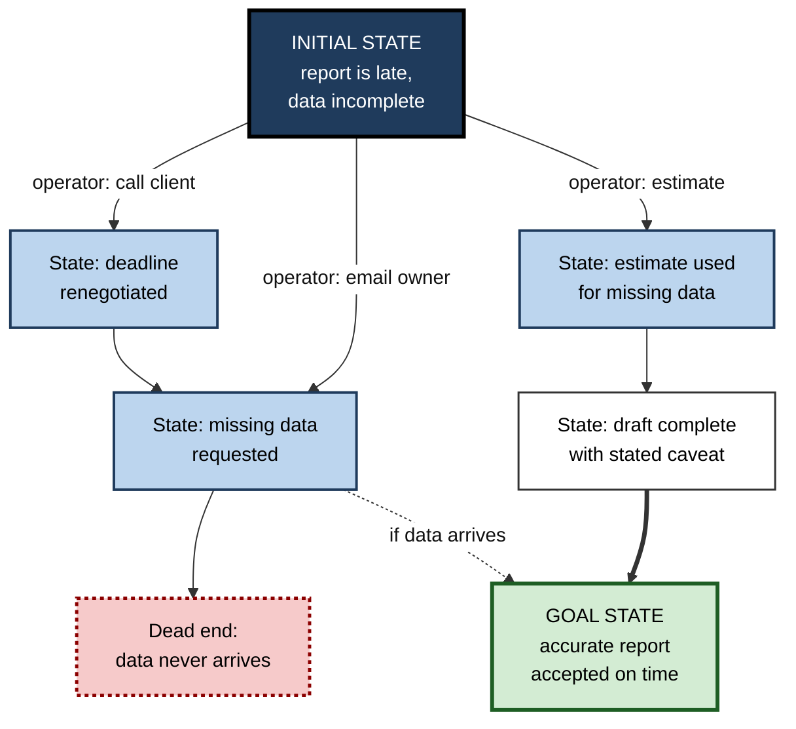
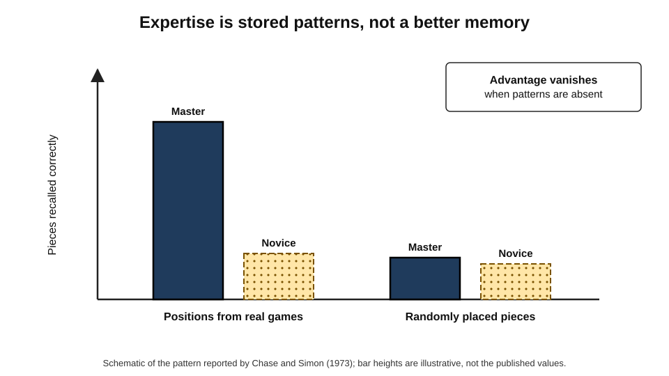
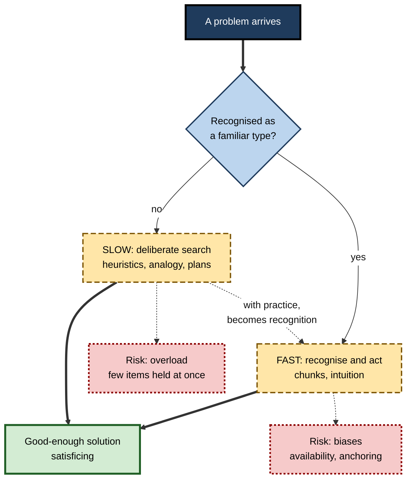
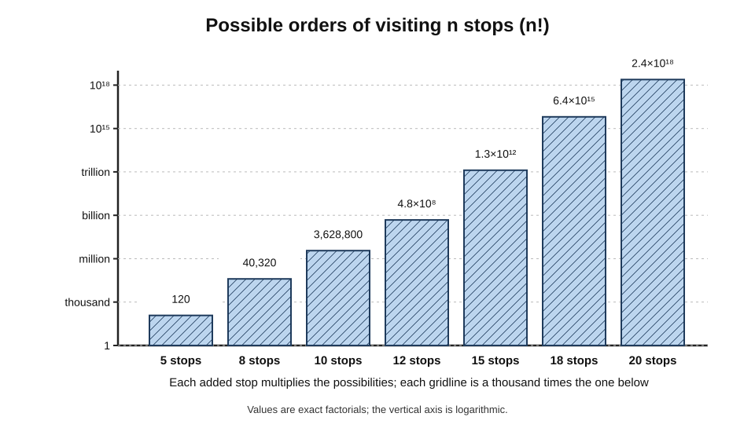
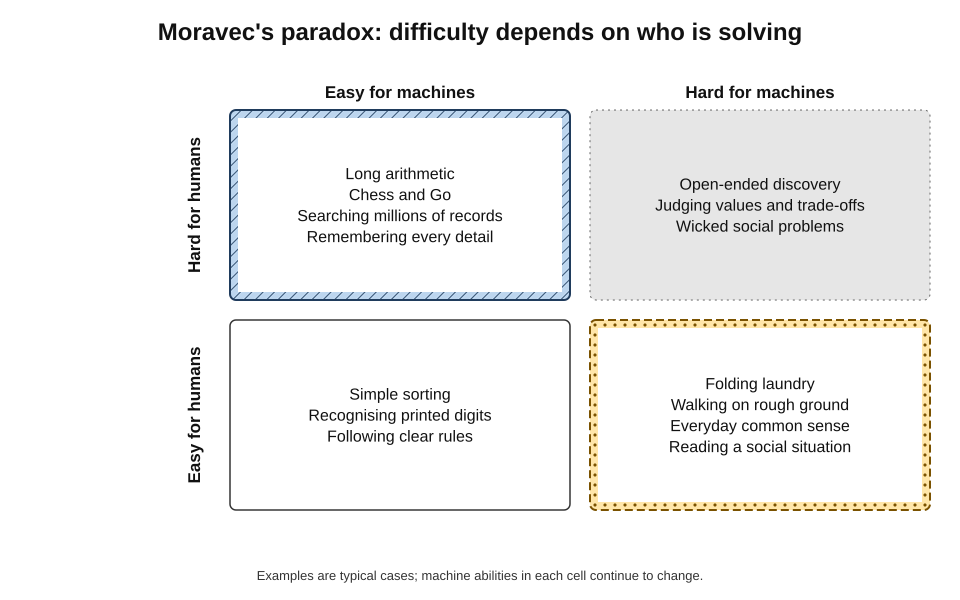
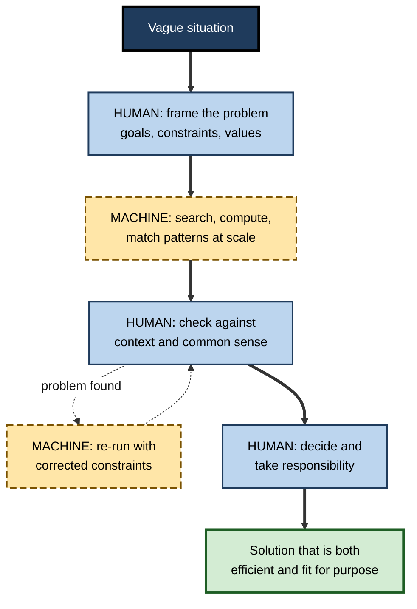

# A.2. How humans solve problems vs. how machines do

A delivery driver with twelve drops plans the day by glancing at a map and following a sensible loop; routing software checks millions of possible orders and finds a route a few kilometres shorter. A chess grandmaster considers perhaps a handful of moves and plays the best one; a chess engine examines millions of positions a second.

A child sees at once that a photograph shows a cat on a sofa; for decades the best computers could not. Humans and machines can arrive at the same answers by **completely different routes** — and each route has its own characteristic strengths and failures.

> **Definition — Problem:** a situation in which there is a gap between a current state and a desired goal state, and the way to close the gap is not immediately known.

> **Definition — Problem solving:** the process of finding and carrying out a sequence of actions that transforms the current state into the goal state.

**Why the comparison matters**

- **Delegation.** Deciding which parts of a task to give to software and which to keep requires knowing how each solves problems.
- **Error checking.** Humans and machines make **different kinds of mistakes**; knowing them is how each catches the other's.
- **Explanation.** A machine's answer may be correct for reasons no person would use — or wrong for reasons no person would make.
- **Design.** The most effective systems combine human and machine problem solving rather than choosing one.

---

## The Anatomy of a Problem

### The problem space

- **Allen Newell and Herbert Simon** described problem solving, in *Human Problem Solving* (1972), as **search through a problem space**:
  - **initial state** — where things stand now;
  - **goal state** — what counts as solved;
  - **operators** — the actions that change one state into another;
  - **constraints** — rules about which actions are allowed;
  - **path** — the sequence of operators that leads from start to goal.
- **The insight:** the same framework describes a person doing a puzzle and a program searching for a solution — which made human and machine problem solving comparable for the first time.

> **Definition — Problem space:** the set of all states a problem can be in, together with the operators that move between them.

**Figure 1.** A problem described as a space of states joined by operators.

### Well-defined and ill-defined problems

- **Well-defined problems** — the start, the goal and the allowed moves are all clear.
  - *e.g.* a Sudoku; calculating tax owed under stated rules; finding the shortest route between two depots.
- **Ill-defined problems** — the goal, the allowed moves or even the problem itself is unclear.
  - *e.g.* "improve team morale"; "design a better onboarding experience"; "decide whether to enter a new market".
- **Wicked problems** — Horst Rittel and Melvin Webber (1973) described social-planning problems with no definitive formulation, no stopping rule and no right answer, only better or worse ones.
  - *e.g.* urban congestion; an organisation's culture.

> **Key point:** machines excel when a problem can be made **well defined**. Much of the human work in any problem is **turning an ill-defined situation into a well-defined problem** — deciding what the goal really is.

| | Well-defined problem | Ill-defined problem | Wicked problem |
|---|---|---|---|
| Goal | Clear and agreed | Vague or disputed | Contested; shifts as it is tackled |
| Allowed moves | Specified | Partly open | Open, with side effects |
| Test of success | Objective | Judgement | No final test |
| Typical example | Scheduling shifts under fixed rules | Redesigning a service | Reducing inequality in a city |
| Machine contribution | Can often solve outright | Can generate and evaluate options | Can inform, not decide |

---

## How Humans Solve Problems

### Trial and error

- **Edward Thorndike (1898)** placed cats in puzzle boxes; they escaped first by random struggling, then faster with each trial as successful actions were "stamped in".
- **Still common:** trying settings on an unfamiliar device until it works.
- **Strength:** needs no theory. **Weakness:** slow, and hopeless when the space is large.

### Heuristics: rules of thumb

> **Definition — Heuristic:** a rule of thumb that usually leads to a good solution quickly but does not guarantee one.

- **Means–ends analysis** — find the biggest difference between where one is and where one wants to be, and pick an action that reduces it.
  - *e.g.* "The report lacks a cost section — so get the cost figures first."
- **Working backwards** — start from the goal and ask what must be true just before it.
  - *e.g.* planning a product launch from the launch date back.
- **Sub-goaling** — break a big problem into smaller ones.
- **Hill climbing** — always take the step that looks best now.
  - Fails when the way forward requires a step that temporarily looks worse.
- **Analogy** — use the solution to a similar, familiar problem.

**George Pólya, *How to Solve It* (1945)** — four phases still taught to mathematicians and engineers:

1. **Understand** the problem.
2. **Devise a plan.**
3. **Carry out** the plan.
4. **Look back** — check the result and what can be learned.

> **Mnemonic — "Ugly Ducks Can Learn":** Understand, Devise a plan, Carry out, Look back.

### Analogy and its difficulty

**Study card — Gick and Holyoak (1980)**

- **Problem:** Karl Duncker's radiation problem (1945) — how to destroy a tumour with rays that would damage healthy tissue at full strength.
  - Solution: many weak rays from different directions converging on the tumour.
- **Design:** some participants first read a story about a general who captured a fortress by splitting his army into small groups converging from many roads.
- **Results:**
  - few people solved the problem without the story;
  - reading the story helped only modestly **unless** people were told it was relevant — then most solved it.
- **Conclusion:** people possess useful analogies but **rarely retrieve them spontaneously** when the surface details differ.

> **In practice:** prompting teams with "what other problem does this resemble?" — and drawing on examples from other industries — deliberately triggers the analogical transfer that rarely happens on its own.

### Insight

- **Wolfgang Köhler (1917)** observed chimpanzees on Tenerife who, after failing to reach hanging bananas, suddenly stacked boxes or joined sticks — solving the problem in one step after a pause.
- **Insight** — a sudden restructuring of how the problem is represented, often after an impasse.
- **Functional fixedness** — seeing objects only in their usual role blocks insight.
  - **Duncker's candle problem (1945):** given a candle, a box of drawing pins and matches, attach the candle to a wall. The solution — pin the empty box to the wall as a shelf — is found far more often when the pins are presented *outside* the box.

> **Definition — Functional fixedness:** a bias that limits a person to using an object only in the way it is traditionally used.

### Expertise and pattern recognition

**Study card — Chase and Simon (1973), building on Adriaan de Groot (1946)**

- **Design:** chess masters and novices viewed a board for about five seconds, then reconstructed it from memory.
- **Results:**
  - with positions from **real games**, masters recalled far more pieces than novices;
  - with **randomly placed** pieces, the masters' advantage largely disappeared.
- **Conclusion:** expertise rests on a vast store of familiar patterns, or **chunks**, built over years — not on a better memory in general.

> **Definition — Chunk:** a familiar pattern stored in long-term memory and handled as a single unit.

- **Recognition-primed decision-making — Gary Klein (1980s onwards):** experienced fire commanders, nurses and pilots rarely compare options. They **recognise** a situation as a type, imagine the first plausible action playing out, and act if it works.
- **Implication:** expert human problem solving is mostly **fast recognition**, with slow search reserved for the unfamiliar.

**Figure 2.** Recall of chess positions by masters and novices.

### Two systems and their biases

- **Daniel Kahneman, *Thinking, Fast and Slow* (2011)**, popularised a long line of dual-process research:
  - **System 1** — fast, automatic, effortless, intuitive;
  - **System 2** — slow, deliberate, effortful, rule-following.
- **Amos Tversky and Daniel Kahneman (1974)** showed that intuitive judgement relies on heuristics that produce **systematic biases**:
  - **availability** — judging frequency by how easily examples come to mind;
  - **representativeness** — judging probability by resemblance to a stereotype;
  - **anchoring** — estimates pulled towards an initial number, even an irrelevant one.

> **Watch out:** some individual findings in this tradition — especially several "priming" studies cited in popular accounts — have **failed to replicate**. The core heuristics-and-biases results on availability, representativeness and anchoring are robust; their size varies with conditions.

### Bounded rationality

- **Herbert Simon (1955–56)** argued that people cannot optimise: they have limited information, time and memory.
- They **satisfice** — accept the first option that is good enough.
- **Working memory** holds only a few items at once — George Miller's "seven, plus or minus two" (1956), revised downwards by later researchers to about **four** chunks.

> **Definition — Satisficing:** choosing the first option that meets an acceptable threshold rather than searching for the best possible one.

**Figure 3.** The two modes of human problem solving.

---

## How Machines Solve Problems

### Algorithms

> **Definition — Algorithm:** a finite, precisely specified sequence of steps that, followed exactly, solves a class of problems.

- **A recipe is an informal algorithm**; a computer program is a formal one.
- **Correctness can be proved** for many algorithms — a guarantee no human heuristic offers.
- **Examples:** sorting a list; Euclid's method for the greatest common divisor (about 300 BCE); Dijkstra's shortest-path algorithm (1959).

### Exhaustive search and the combinatorial explosion

- **Brute force** — try every possibility and keep the best.
- **The obstacle:** the number of possibilities grows explosively.
  - A travelling salesperson visiting *n* cities in a fixed starting city has (*n* − 1)! possible orders.

> **Formula — Orders of visiting stops:** a route starting and ending at a depot with *n* stops has *n*! possible orders. For 5 stops: 5! = **120**. For 10: 10! = **3,628,800**. For 20: about **2.4 × 10¹⁸** — far more than any computer could check one by one.

**Figure 4.** How the number of possibilities explodes as a problem grows.

> **Key point:** raw speed does not defeat the combinatorial explosion. Machines also need **heuristics** — clever ways of not looking at most of the space.

### Search with heuristics

- **A\* search — Hart, Nilsson and Raphael (1968):** explores the most promising states first, using an estimate of the remaining distance; with a suitable estimate it is guaranteed to find the shortest path.
  - Used in route planners, video games and robot navigation.
- **Game-tree search** — imagine moves and replies several turns ahead, score the resulting positions, and choose the move that leads to the best position assuming the opponent also plays well (**minimax**).
  - **Alpha–beta pruning** skips branches that cannot affect the choice.
- **Optimisation and constraint solvers** — mathematical methods that schedule airline crews, allocate hospital beds and plan factory production under thousands of constraints.

**Study card — Deep Blue versus Garry Kasparov (1997)**

- **Event:** IBM's Deep Blue beat the world chess champion 3½–2½ over six games in New York in May 1997.
- **Method:** specialised hardware evaluating about **200 million positions per second**, with an evaluation function hand-tuned with grandmaster advice and a large opening book.
- **Contrast:** Kasparov estimated that he considered only a few positions per second — relying on pattern recognition and judgement.
- **Significance:** the same game was won by **massive search guided by hand-written knowledge** on one side and **expert recognition** on the other.

### Learning patterns from data

- **Many modern systems are not given the method at all.** They are shown very large numbers of examples and adjust internal parameters until their outputs match — in effect, building their own statistical "recognition".
- **The result resembles human intuition** — fast, pattern-based, hard to explain — but is acquired from far more examples and fails in different ways.

**Study card — AlphaGo versus Lee Sedol (2016)**

- **Problem:** Go has vastly more possible positions than chess; brute-force search is hopeless.
- **Method:** DeepMind combined **neural networks trained on human games and self-play** — a learned sense of good moves and good positions — with **tree search** to read ahead selectively.
- **Result:** AlphaGo beat Lee Sedol, one of the strongest players in the world, **4–1** in Seoul in March 2016.
- **Move 37 of game two:** a move that commentators first took for a mistake and later praised as creative; AlphaGo's own estimate put the chance of a human playing it at about one in ten thousand.
- **Game four:** Lee's own unexpected move 78 led AlphaGo into a sequence of poor moves — a reminder that learned intuition can fail abruptly in unfamiliar territory.

### Generating step-by-step reasoning

- **Large language models** solve many problems by producing intermediate steps in text before an answer.
  - Researchers found from about 2022 that prompting models to "think step by step" improved accuracy on many reasoning tasks; later "reasoning models" were trained to produce long internal chains of steps.
- **Status:** whether this resembles human deliberate reasoning or is a different process that looks similar is **debated**; the written steps do not always reflect how the answer was actually produced.

---

## Side by Side

| | Humans | Machines |
|---|---|---|
| Speed of individual steps | Slow — milliseconds to seconds | Extremely fast — billions of operations a second |
| Working memory | About four chunks at once | Effectively unlimited for stored data |
| Breadth of search | A few options, chosen by intuition | Millions of options, or learned shortcuts |
| Learning from few examples | Often one or a handful | Usually many, though improving |
| Common sense about the world | Rich, acquired from bodily and social life | Patchy; often absent outside training data |
| Turning vague goals into clear problems | Strong | Weak unless guided |
| Consistency | Varies with fatigue, mood and time of day | Highly consistent for the same input (unless designed to vary) |
| Explaining reasoning | Can give reasons — not always the true ones | Often cannot, or gives plausible text that may not reflect the process |
| Typical failure | Biases, fatigue, overload, fixedness | Brittleness, shortcut learning, misreading the goal |

### Moravec's paradox

- **Hans Moravec (1988)** and others observed that what is **hard for people** — long multiplication, chess, formal logic — was comparatively **easy for computers**, while what is **effortless for people** — recognising faces, walking across a cluttered room, picking up an egg — was extremely hard.
- **Explanation offered:** perception and movement were refined by hundreds of millions of years of evolution and run unconsciously; abstract reasoning is evolutionarily recent and therefore feels hard.
- **Since the 2010s** learning from data has made machine perception far better, but dexterous physical manipulation in messy real environments remains difficult.

**Figure 5.** Moravec's paradox: what is hard for humans and what is hard for machines often differ.

### Characteristic machine failures

- **Brittleness** — performance collapses when inputs differ from those the system was built or trained for.
  - *e.g.* a vision system trained on daytime images failing at dusk.
- **Shortcut learning** — the system finds an easy cue that predicts the answer in training data but is irrelevant to the real task.
  - **Documented example:** a 2018 study of deep-learning models reading chest X-rays found that they could identify **which hospital** an image came from, and that hospital identity was linked to disease rates — so part of their apparent diagnostic skill rested on the hospital, not the lungs.
- **Adversarial examples** — tiny, carefully chosen changes to an input, invisible to people, that flip a model's output.
  - Demonstrated for image classifiers by researchers at Google and elsewhere from 2013–14: an image of a panda, imperceptibly altered, classified as a gibbon with high confidence.
- **Specification gaming** — the system achieves the literal goal it was given in an unintended way.
  - *e.g.* a 2016 reinforcement-learning agent in a boat-racing game learned to circle endlessly collecting points rather than finish the race.

> **Watch out:** machine failures are often **alien** — they occur on inputs a person would find trivially easy, and they come with no sign of hesitation. A person who misreads an X-ray usually hesitates on a hard case; a model may be wrong with complete confidence on an easy one.

### Characteristic human failures

- **Biases** — availability, anchoring, confirmation bias.
- **Fixedness** — functional fixedness; seeing only the familiar framing.
- **Overload** — dropping items when holding too many in mind.
- **Fatigue and inconsistency** — the same judge or doctor can decide differently at different times of day.
  - *e.g.* a widely cited 2011 study of Israeli parole decisions reported fewer favourable rulings before food breaks; later analyses argued the effect was inflated by how cases were ordered — **contested**.

---

## Working Together

### Worked example (illustrative): planning a twelve-stop delivery round

A logistics coordinator plans a van route from a depot to twelve shops.

| Step | Human approach | Machine approach |
|---|---|---|
| Frame the problem | Notices two shops close early and one has a loading bay only before 10:00 | Treats all stops as identical unless told otherwise |
| Generate a route | Sketches a sensible clockwise loop in two minutes | Searches using heuristics and optimisation over a vast number of orders |
| Result | 96 km; meets all real-world constraints | 88 km if constraints are entered; 81 km but violating the loading-bay rule if they are not |
| Check | Knows the high street is closed on market day | Has no way to know unless the data says so |

*Illustrative figures.*

1. **The human frames the problem** — identifies the constraints that matter, several of which exist only in local knowledge.
2. **The machine searches** — given the constraints, it finds a route 8 km shorter than the human sketch.
3. **The human checks** — catches the market-day closure absent from the data.
4. **Conclusion:** the best route came from **human framing + machine search + human checking**.

> **Watch out:** the shortest route found *without* the constraints looks best on paper. An optimiser always optimises the problem it is given — not the problem the business actually has.

### Case study: freestyle chess and the "centaur"

- **Situation:** after losing to Deep Blue, Garry Kasparov promoted "advanced chess" from 1998, in which human players used computers during games.
- **The 2005 freestyle tournament:** an online event open to any combination of humans and computers.
  - Grandmasters with strong programs and the strongest stand-alone programs both took part.
- **Result:** the winners were two amateur players from the United States using three ordinary computers, who had developed a skilled **process** for consulting their programs and deciding when to trust which.
- **Kasparov's conclusion (2010):** a weak human, a machine and a **better process** could beat a strong human with a machine and an inferior process.
- **Later caveat:** as engines grew far stronger in the following decade, the human contribution in pure chess shrank towards zero — the advantage of the "centaur" depended on the machine having gaps a human could fill.
- **Lesson:** human–machine combinations win **where the machine has blind spots and the human knows them** — and the design of the collaboration matters as much as the skill of either partner.

**Figure 6.** Dividing a problem between human and machine strengths.

### Principles for combining the two

- **Let humans define the goal.** Machines optimise exactly what they are told.
- **Let machines handle scale and consistency** — searching, calculating, checking every record.
- **Use machines to widen options**, humans to judge them.
- **Check machine outputs on the cases a human finds easy** — that is where alien failures hide.
- **Check human judgements with data** — that is where biases hide.
- **Keep responsibility with a person**, who must understand the problem well enough to know when the machine is wrong.

> **In practice:** in medicine, finance and engineering, the strongest teams treat software as a **second opinion with different blind spots** — not as an oracle, and not as an assistant to be ignored.

---

## Open Questions

- **Do machines "reason" or only appear to?**
  - Step-by-step outputs from language models improve accuracy, but whether they reflect a process like human reasoning is disputed.
- **How can machines learn from as few examples as people?**
  - Humans generalise from a handful of cases; machine systems are improving but usually need far more data.
- **How much does human intuition really add alongside strong machines?**
  - The chess experience suggests the margin shrinks as machines improve; whether that holds in open-ended domains is unknown.
- **Can machine common sense be built?**
  - Physical and social common sense remains one of the hardest gaps.
- **How should collaboration be designed?**
  - Evidence on which divisions of labour work best, and for whom, is still thin.

---

## Summary

- A **problem** is a gap between a current and a goal state; **problem solving** finds actions to close it — a search through a **problem space** (Newell and Simon).
- Problems range from **well-defined** to **ill-defined** and **wicked**; much human value lies in turning vague situations into clear problems.
- Humans solve problems by **trial and error, heuristics, analogy, insight** and, above all in experts, **fast pattern recognition** built from chunks (Chase and Simon; Klein).
- Human judgement runs in **fast** and **slow** modes, with predictable **biases**, limited **working memory** and **bounded rationality** (satisficing).
- Machines solve problems by **algorithms, exhaustive or heuristic search, optimisation**, and increasingly by **patterns learned from data**; raw speed alone cannot beat the **combinatorial explosion**.
- Deep Blue won by **search plus hand-written knowledge**; AlphaGo by **learned intuition plus selective search**.
- **Moravec's paradox:** what is hard for humans is often easy for machines and vice versa.
- Machines fail by **brittleness, shortcut learning, adversarial examples** and **specification gaming**; humans by **bias, fixedness, overload** and **fatigue**.
- The best results usually come from **human framing, machine search and human checking**, with responsibility kept by a person.

---

## Self-Check

1. Define a problem space and name its five elements.
2. Classify each as well-defined, ill-defined or wicked: scheduling exams in fixed rooms; improving staff retention; reducing homelessness in a city.
3. Explain means–ends analysis and working backwards with a workplace example of each.
4. What did Gick and Holyoak show about analogy, and what is the practical implication?
5. What is functional fixedness? Describe Duncker's candle problem.
6. What did Chase and Simon's chess experiment reveal about expertise?
7. Distinguish System 1 and System 2, and name three heuristics that produce biases.
8. A route has 8 stops. How many possible orders are there, and why does this matter?
9. How did Deep Blue and AlphaGo differ in the way they solved their games?
10. State Moravec's paradox and the explanation usually given for it.
11. Explain shortcut learning using the chest X-ray example.
12. Why are machine errors described as "alien", and what checking practice follows?
13. What does the 2005 freestyle chess tournament suggest, and what is the later caveat?
14. A bank wants software to choose which small businesses receive loans. Propose a division of work between people and the system, giving reasons.

### Answer Key

1. The set of states a problem can be in, plus the operators between them. Elements: initial state, goal state, operators, constraints, and the path of operators from start to goal.
2. Exam scheduling in fixed rooms: well-defined. Improving staff retention: ill-defined. Reducing homelessness: wicked.
3. Means–ends analysis reduces the largest difference between current and goal state — *e.g.* "the bid lacks pricing, so get pricing first". Working backwards starts from the goal — *e.g.* planning a conference from its date back to venue booking.
4. People rarely retrieve a relevant analogy spontaneously when surface details differ, but use it readily when told it is relevant. Teams should be prompted to look for parallels deliberately.
5. Seeing objects only in their usual role. Given a candle, drawing pins in a box and matches, people struggle to see the box as a shelf; presenting the pins outside the box makes the solution easier.
6. Masters recalled real game positions far better than novices but not random positions — so expertise depends on stored patterns (chunks), not general memory.
7. System 1 is fast and intuitive; System 2 slow and deliberate. Availability, representativeness and anchoring.
8. 8! = 40,320. Possibilities grow factorially, so larger problems cannot be solved by checking every option; search needs heuristics.
9. Deep Blue relied on extremely fast search (about 200 million positions a second) with hand-tuned evaluation. AlphaGo used neural networks that learned a sense of good moves and positions from games and self-play, combined with selective tree search.
10. Tasks hard for people (abstract reasoning, calculation) are relatively easy for computers, while tasks easy for people (perception, movement) are hard. Explanation: perception and movement were refined by long evolution and run unconsciously; abstract reasoning is recent.
11. A model can exploit an easy cue correlated with the answer in training data. Chest X-ray models could detect which hospital an image came from — linked to disease rates — so part of their apparent diagnostic skill rested on the hospital rather than the anatomy.
12. They occur on cases a person finds easy, without hesitation or warning, and for reasons unlike human error. So outputs should be spot-checked on easy as well as hard cases, and not trusted because they look confident.
13. A well-designed human–machine process can beat stronger players with poorer processes. Later, as engines improved, the human contribution in chess shrank — combinations help only where machines have gaps humans can fill.
14. People define lending goals, fairness constraints and acceptable risk; the system scores applications consistently and flags patterns at scale; loan officers review borderline and unusual cases, check for shortcut cues (such as postcode standing in for protected characteristics) and take the decision, which they must be able to explain to the applicant and regulator.

---

## Glossary

| Term | Meaning |
|---|---|
| A\* search | A search method that explores the most promising states first using an estimate of remaining cost. |
| Adversarial example | An input altered imperceptibly to make a model give a wrong output. |
| Algorithm | A finite, precise sequence of steps that solves a class of problems. |
| Analogy | Solving a problem by using the solution to a similar one. |
| Bounded rationality | Decision-making limited by information, time and cognitive capacity. |
| Brittleness | Collapse of performance when inputs differ from those expected. |
| Chunk | A familiar pattern stored and handled as a single unit. |
| Combinatorial explosion | The very rapid growth in possibilities as a problem grows. |
| Functional fixedness | Seeing objects only in their traditional role. |
| Heuristic | A rule of thumb that usually, but not always, leads to a good solution. |
| Ill-defined problem | A problem whose goal, moves or test of success are unclear. |
| Insight | Sudden restructuring of a problem's representation that reveals a solution. |
| Means–ends analysis | Choosing actions that reduce the largest difference between current and goal states. |
| Minimax | Choosing the move that is best assuming the opponent replies as well as possible. |
| Moravec's paradox | What is hard for humans is often easy for machines, and the reverse. |
| Problem space | All states of a problem and the operators that move between them. |
| Recognition-primed decision | Acting on the first plausible option suggested by recognising a familiar situation. |
| Satisficing | Choosing the first option that is good enough. |
| Shortcut learning | A model relying on an easy cue that predicts the answer in training data but not in reality. |
| Specification gaming | A system meeting the literal goal it was given in an unintended way. |
| Well-defined problem | A problem with a clear start, goal and set of allowed moves. |
| Wicked problem | A social problem with no definitive formulation or final solution. |
