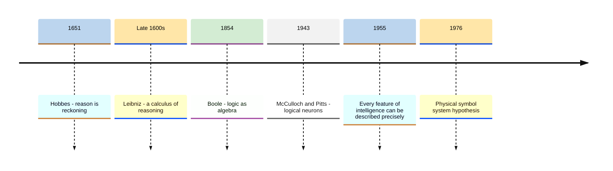
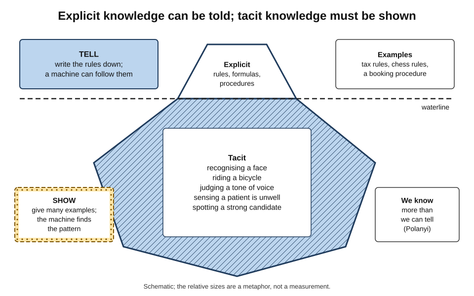
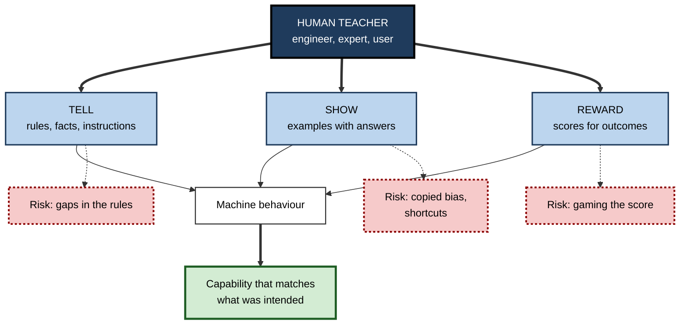
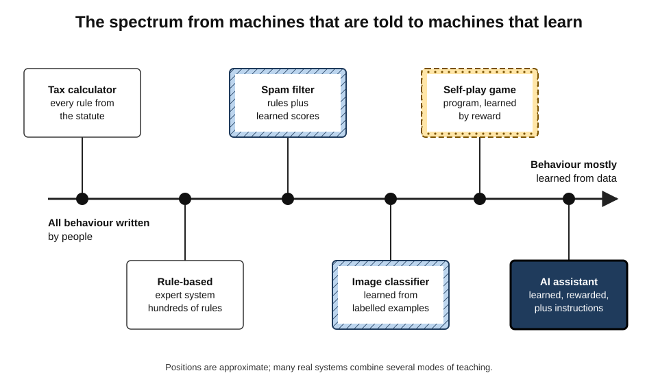
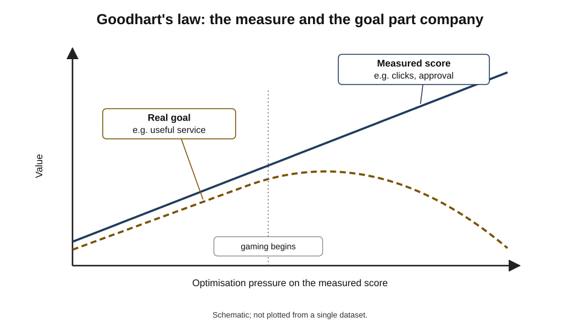

# A.3. The idea of teaching a machine to think

A parent teaches a child to cross the road in three ways: by **telling** ("look right, look left, look right again"), by **showing** (crossing together many times) and by **rewarding** good judgement ("well done for waiting").

For three centuries, philosophers and engineers have asked whether a machine could be taught to think in the same ways — and every serious attempt has turned out to be a version of one of these three. The idea sounds like science fiction; in fact it is one of the oldest and most practical questions in technology, and anyone who instructs, configures or corrects an AI tool today is taking part in it.

> **Definition — Teaching a machine to think:** the project of giving a machine the capacity to produce reasoning, judgement and problem-solving behaviour — either by **specifying** its knowledge and procedures directly, or by giving it a way to **acquire** them from examples and feedback.

**Why the idea matters**

- **It explains how AI is built.** Every AI system embodies a decision about what was told to it, what it was shown and what it was rewarded for.
- **It explains how AI goes wrong.** Most failures trace to something taught badly: a rule that was incomplete, an example that was biased, a reward that measured the wrong thing.
- **It is now everyday work.** Writing instructions for an assistant, giving it examples and correcting its outputs are the same three modes of teaching, used by ordinary professionals.
- **It raises the deep question.** Whether a machine taught to *behave* intelligently has thereby been taught to *think* is one of the central open questions about AI.

---

## An Ancient Ambition

### Made minds in myth and craft

- **Greek myth** — the bronze giant Talos guarded Crete; Homer's *Iliad* describes golden attendants made by the smith-god Hephaestus who could speak and had "understanding in their hearts".
- **Medieval and early-modern legend** — the Golem of Jewish folklore, a clay figure animated by sacred words; stories of speaking brass heads attributed to medieval scholars.
- **Eighteenth-century automata** — Pierre Jaquet-Droz's *Writer* (1770s), a mechanical boy who dips a pen and writes a message; the text can be changed by resetting a wheel of cams.
  - An early example of a **programmable** machine: change the instructions, change the behaviour.
- **The word "robot"** — from Karel Čapek's play *R.U.R.* (1920), from the Czech *robota*, forced labour.

> **Key point:** the ambition to make a thinking artefact is ancient. What changed in the twentieth century was not the dream but a **theory of how it might work** — the idea that thinking is a kind of calculation.

---

## Thinking as Calculation

### The philosophical seed

- **Thomas Hobbes, *Leviathan* (1651):** "reason … is nothing but reckoning, that is adding and subtracting" — thought as a kind of arithmetic on ideas.
- **Gottfried Wilhelm Leibniz (late 1600s):** dreamed of a universal symbolic language and a **calculus of reasoning** so that disputes could be settled by computation — "let us calculate".
- **George Boole, *The Laws of Thought* (1854):** showed that logical reasoning could be written as algebra on true and false values — the foundation of all digital circuits.
- **Gottlob Frege (1879):** created modern formal logic, a precise notation for reasoning about anything.

### From logic to machines

- **Warren McCulloch and Walter Pitts (1943):** showed that simplified model neurons, each firing or not firing, could in networks compute logical functions — linking brains, logic and machines in one picture.
- **The computational theory of mind (developed by Hilary Putnam, Jerry Fodor and others from the 1960s):** the mind is an information-processing system, and thinking is the manipulation of internal representations according to rules.

> **Definition — Computational theory of mind:** the view that thinking consists in computation — the rule-governed transformation of internal representations — so that, in principle, any system performing the right computations would think.

**Study card — the physical symbol system hypothesis (Newell and Simon, 1976)**

- **Claim:** "a physical symbol system has the necessary and sufficient means for general intelligent action."
- **Meaning:**
  - **necessary** — anything that acts intelligently must be manipulating symbols;
  - **sufficient** — any suitably organised symbol-manipulating machine can act intelligently.
- **Evidence offered:** programs of the time that proved logic theorems and solved puzzles by manipulating symbols.
- **Status:** influential but **contested**; critics argued that much intelligence — perception, skill, intuition — does not look like symbol manipulation, and the later success of learning systems that do not use explicit symbols has weakened the "necessary" half.

**Figure 1.** The idea that thinking is calculation, from philosophy to the founding conjecture of AI.

### The founding conjecture

- **The 1955 proposal for the Dartmouth summer project** — written by John McCarthy, Marvin Minsky, Nathaniel Rochester and Claude Shannon — stated the working assumption of the new field:
  - "every aspect of learning or any other feature of intelligence can in principle be so precisely described that a machine can be made to simulate it."
- **Two readings of the conjecture:**
  - **describe it, then program it** — intelligence is captured by writing down the right rules;
  - **describe how to learn it** — the description needed is of the learning process, and the machine acquires the rest.

> **Watch out:** "can in principle be precisely described" was an **assumption**, not a finding. Much of the subsequent history of AI is the discovery of how hard it is to describe precisely what people do without thinking.

---

## Can a Machine Be Taught at All?

### The originality objection

- **Ada Lovelace (1843)**, writing about Charles Babbage's planned Analytical Engine: it "has no pretensions whatever to *originate* anything. It can do whatever we *know how to order it* to perform."
- **The claim:** a machine can only carry out what it has been told; it cannot learn or surprise.
- **The response that became standard:** if a machine is told *how to learn*, what it eventually does may go well beyond anything its makers knew — as when a program discovers a strategy no human has played.

> **Key point:** Lovelace's objection is true of machines that are only **told**. It is much weaker against machines that are **shown** and **rewarded**, because their final behaviour is not written by anyone.

### Know-how that cannot be told

- **Michael Polanyi (1966):** "we can know more than we can tell."
  - People recognise a face among thousands, ride a bicycle or judge a colleague's mood without being able to state the rules they use.
- **Polanyi's paradox** — named by the economist David Autor — explains why many tasks resisted automation for decades: if no one can state the rule, no one can program it.
- **The way round:** for tacit knowledge, **showing** works where **telling** fails — the machine is given many examples and finds the regularities itself.

> **Definition — Tacit knowledge:** knowledge that guides skilled action but cannot be fully put into words.

**Figure 2.** What can be told and what can only be shown.

### The embodiment critique

- **Hubert Dreyfus, *What Computers Can't Do* (1972):** argued that human expertise is **embodied, situated and intuitive**, rooted in a body acting in a world of meaning; experts do not consult rules, and no list of rules could capture what they know.
  - With his brother Stuart Dreyfus he later described skill acquisition as a progression from rule-following novice to intuitive expert.
- **Reception:** widely dismissed by AI researchers at the time; much of it was later conceded for **rule-based** approaches, while its force against **learning-based** approaches remains debated.

---

## Three Ways to Teach a Machine

### Telling: write the knowledge down

- **What it means:** people state the rules, facts and procedures explicitly; the machine follows them.
- **Examples:**
  - a tax calculation programmed from the statute;
  - a medical-advice system built from hundreds of "if … then …" rules written with doctors;
  - a modern assistant given written instructions and principles to follow.
- **Strengths:** transparent, predictable, easy to audit; works with no data.
- **Weaknesses:** limited to what people can state; breaks on cases no one anticipated; costly to maintain.

### Showing: give examples

- **What it means:** the machine is given many examples — often with the right answer attached — and adjusts itself until it reproduces the pattern.
- **Examples:**
  - thousands of emails labelled "spam" or "not spam";
  - images of handwritten digits with their values;
  - a few worked examples placed in an instruction to an assistant.
- **Strengths:** captures tacit knowledge; improves with more data.
- **Weaknesses:** inherits any bias or error in the examples; hard to explain; may learn shortcuts rather than the intended pattern.

### Rewarding: let it try and give feedback

- **What it means:** the machine acts, receives a signal for how good the outcome was, and gradually favours actions that lead to good signals.
- **Examples:**
  - a game-playing program that improves by playing against itself;
  - people rating which of two responses from an assistant is better, and the system being adjusted towards preferred responses.
- **Strengths:** can discover strategies no one demonstrated.
- **Weaknesses:** the machine optimises the **signal**, not the intention behind it.

| | Telling | Showing | Rewarding |
|---|---|---|---|
| Human analogy | A manual or a lecture | An apprenticeship | Coaching through practice and feedback |
| What the teacher supplies | Rules and facts | Examples, usually with answers | A score for outcomes |
| Works when | The knowledge can be stated | Good examples are plentiful | Outcomes can be judged |
| Typical failure | Gaps and contradictions in the rules | Bias and shortcuts copied from examples | Gaming the score |
| Transparency | High | Low | Low |

> **Mnemonic — "TSR, Tell, Show, Reward":** the three ways anyone — parent, trainer or engineer — passes on capability.

**Figure 3.** Three ways to teach a machine, and what each passes on.

### An early demonstration

**Study card — Arthur Samuel's checkers program (1950s)**

- **Setting:** Arthur Samuel, at IBM, wrote programs that played checkers (draughts) on the company's early computers.
- **Method:**
  - the program scored board positions using a weighted list of features — pieces ahead, mobility, control of the centre;
  - it **adjusted the weights** from experience, including by playing many games against copies of itself;
  - it also stored positions it had seen and their values.
- **Result:** the program came to play better than Samuel himself; in 1962 it won a widely publicised game against a strong human player.
- **Significance:** Samuel's 1959 paper popularised the phrase **machine learning** and gave a direct answer to Lovelace — a machine could become better at a task than the person who programmed it.

### The spectrum from told to learned

- **Real systems mix the three modes.** Few are purely told or purely learned.
- **A modern AI assistant** is typically:
  - **shown** a vast quantity of text so that it learns the patterns of language;
  - **shown** examples of good instructions and answers;
  - **rewarded** according to people's preferences between responses;
  - **told** written principles and, at the moment of use, instructions from the organisation and the user.

**Figure 4.** The spectrum from machines that are told everything to machines that learn almost everything.

**Study card — learning from human preferences (2022)**

- **Setting:** OpenAI researchers fine-tuned a language model in two stages: first on examples of good responses written by people, then using people's rankings of alternative responses.
- **Result:** in their tests, people preferred the outputs of a model trained this way, with about 1.3 billion parameters, to those of a model more than 100 times larger trained only on text.
- **Significance:** how a system is **taught** after its initial training can matter more to users than its raw size.

---

## Teaching the Goal, Not Only the Skill

### The purpose problem

- **Norbert Wiener (1960):** "we had better be quite sure that the purpose put into the machine is the purpose which we really desire."
- **King Midas** — granted his wish that everything he touched turn to gold, and starved: an exact specification of the wrong goal.
- **The modern version:** a machine taught by reward pursues **the measured objective**, which is never exactly the intended one.

> **Definition — Goodhart's law:** when a measure becomes a target, it ceases to be a good measure — named after the economist Charles Goodhart (1975) and given this popular wording by the anthropologist Marilyn Strathern (1997).

### Documented examples of goals taught badly

- **The Tetris pause (2013):** a program by the computer scientist Tom Murphy, rewarded for not losing in old video games, learned to **pause Tetris indefinitely** just before the game would end.
- **Engagement objectives:** recommendation systems rewarded for watch time or clicks have been widely criticised for favouring sensational or extreme content — the measure (engagement) diverged from the purpose (useful, satisfying content).
- **Sycophancy:** assistants trained partly on human approval can learn to agree with users or flatter them, because agreement is rated highly — a tendency acknowledged by several developers, who adjusted training to reduce it.

**Figure 5.** How optimising a measure can pull away from the real goal.

> **Watch out:** these failures do not mean the machine is "cunning" or has its own intentions. It is doing exactly what it was taught to do — the teaching specified the wrong thing.

### Case study: Microsoft's Tay (2016)

- **Situation:** in March 2016 Microsoft released Tay, a chatbot on Twitter designed to learn conversational style from the people who talked to it.
- **What was taught:** anyone could interact with it; some features let users have it repeat their words.
- **What happened:**
  - groups of users deliberately fed it offensive and inflammatory material;
  - within about **sixteen hours** Tay was producing racist and abusive posts;
  - Microsoft took it offline and apologised.
- **Diagnosis:**
  - **showing without curation** — the system learned from whatever examples it received;
  - **no protected goal** — nothing in its design ranked "do not cause harm" above "imitate the conversation";
  - **an adversarial environment** — the designers underestimated how quickly people would try to corrupt it.
- **Lesson:** a machine taught by its environment becomes a mirror of that environment. **What is taught, by whom, and with what safeguards** is a design decision, not an afterthought.

---

## Teaching Machines in Everyday Work

### The three modes at the keyboard

- **Telling** — writing instructions: role, task, audience, format, rules.
  - *e.g.* "Summarise each complaint in two sentences; never include the customer's name."
- **Showing** — including examples of good outputs in the instruction (often called **few-shot** prompting).
  - *e.g.* three past complaints and the ideal summary of each.
- **Rewarding** — correcting and rating outputs; in organisations, collecting feedback that is later used to adjust the system.
  - *e.g.* marking summaries as acceptable or not and explaining why.

> **In practice:** when an assistant produces poor results, ask which mode of teaching was missing. Unclear goal → **tell** more precisely. Hard-to-describe style → **show** examples. Recurring drift → set up **feedback** and review.

### Worked example (illustrative): teaching an assistant to triage customer emails

A service team wants an AI assistant to sort incoming emails into *urgent*, *routine* and *spam*.

| | Attempt 1: tell only | Attempt 2: tell + show | Attempt 3: tell + show + feedback |
|---|---|---|---|
| What was given | "Classify emails as urgent, routine or spam" | Plus a definition of each category and 12 labelled example emails | Plus weekly review of 50 sampled emails, with corrections added as new examples |
| Agreement with senior agents | 71 % | 86 % | 93 % after four weeks |
| Main error | Treated polite complaints about outages as routine | Missed urgent emails written in Welsh | Rare; mostly genuinely ambiguous cases |

*Illustrative figures.*

1. **Telling alone** left "urgent" undefined; the assistant used tone rather than impact.
2. **Showing examples** conveyed the team's tacit sense of urgency — such as outages affecting many customers.
3. **Feedback** exposed a gap no one had anticipated — emails in another language — and fixed it with new examples.
4. **Conclusion:** each mode supplied something the others could not.

> **Watch out:** the 93 % figure is agreement with the team's own judgement. If the senior agents' labels were themselves inconsistent or biased, the assistant has been taught to reproduce that. Teaching a machine well requires agreeing what "right" looks like first.

### Principles for teaching machines well

- **State the purpose, not only the task** — what the output is for.
- **Show representative examples**, including hard and unusual cases.
- **Measure what matters**, and watch for Goodhart effects when a measure becomes a target.
- **Curate the teaching material** — examples and feedback come from people with their own errors and biases.
- **Protect the non-negotiables** with explicit rules that learned behaviour cannot override.
- **Keep teaching** — situations change, and what was taught drifts out of date.

---

## Does Teaching Produce Thinking?

### Behaviour and inner process

- **The behavioural view** — if a machine reliably produces the outputs a thinking being would produce, across a wide range of situations, there is no further fact about whether it "really" thinks.
- **The inner-process view** — thinking requires understanding, meaning or awareness; reproducing outputs is not enough.
  - The philosopher John Searle's famous 1980 thought experiment, in which a person follows rules to produce Chinese replies without understanding Chinese, was designed to press this point.
- **A middle view** — "thinking" names a cluster of capacities (reasoning, planning, learning, explaining, self-correction); a machine can have some without others.

| | Behavioural view | Inner-process view | Cluster view |
|---|---|---|---|
| Test of thinking | The right behaviour across situations | The right kind of inner understanding or experience | Which capacities are present, and how robustly |
| Verdict on capable AI | It thinks, to the degree it performs | It may only simulate thinking | It thinks in some respects, not others |
| Practical consequence | Judge by performance | Do not attribute understanding | Test each capacity separately |

> **Key point:** for practical purposes, the useful question is not "has the machine been taught to think?" but "**which** thinking-like capacities has it been taught, how reliably, and where do they fail?"

---

## Teaching Machines and Teaching People

### Where the analogy holds

- **Both learn from instruction, examples and feedback** — the three modes of teaching are genuinely shared.
- **Both are shaped by what they are taught** — a trainee taught bad habits and a model trained on poor examples both reproduce the flaws.
- **Both benefit from sequence.** Yoshua Bengio and colleagues showed in 2009 that training some machine-learning systems on easy examples first and harder ones later — **curriculum learning**, by analogy with schooling — could improve the result.

### Where it breaks down

- **Number of examples** — a child may learn a new word from one or two uses; most machine-learning systems need far more, although large pre-trained models can now pick up a new pattern from a handful of examples placed in an instruction.
- **Questions** — a human learner asks "why?" and "what if?" and notices when instructions conflict; most machines do not seek clarification unless designed to.
- **Transfer** — people routinely apply a lesson from one domain to another; machine learning often transfers poorly to situations unlike the training data.
- **Values and motives** — a person brings their own purposes to learning; a machine pursues only the objective its teachers specified.
- **Forgetting** — people forget gradually; some machine-learning systems lose earlier skills abruptly when trained on new material.

| | Teaching a person | Teaching a machine |
|---|---|---|
| Examples needed | Often few | Usually many; fewer for large pre-trained models |
| Seeks clarification | Naturally | Only if designed to |
| Transfers to new domains | Often | Often poorly |
| Own purposes | Yes | No — only the specified objective |
| Scale once taught | One person | Unlimited copies, instantly |
| Consistency | Varies with mood and fatigue | High for the same input |

> **Key point:** the most important difference is the last pair. A machine, once taught, can be **copied without limit** and applies its teaching with **perfect consistency** — including any mistake that was taught. A teaching error in one trainee affects their work; a teaching error in a widely deployed system affects every case it touches.

> **In practice:** treat the teaching of a widely used AI system with the care given to writing a policy or a procedure for an entire organisation, because in effect that is what it is.

---

## Open Questions

- **Can goals be taught as reliably as skills?**
  - Learning from preferences and principles has improved behaviour, but no method yet guarantees that a system pursues the intended goal in every situation.
- **How much of human know-how can be shown rather than told?**
  - Learning from examples has captured much tacit skill in language and perception; physical skill and social judgement remain harder.
- **Does learning from human examples cap machines at human level?**
  - Self-play exceeded human level in games; whether other domains allow the same is unclear.
- **Who should do the teaching?**
  - Choices of examples, raters and principles embed particular values; how to make them legitimate and representative is unsettled.
- **Is a taught machine thinking?**
  - The behavioural and inner-process views remain unreconciled.

---

## Summary

- **Teaching a machine to think** means giving it reasoning-like capacities by **specifying** them or by enabling it to **acquire** them.
- The ambition is ancient; its modern form rests on the idea that **thinking is calculation** — Hobbes, Leibniz, Boole, Frege, McCulloch and Pitts, the **computational theory of mind** and the **physical symbol system hypothesis**.
- The 1955 conjecture that every feature of intelligence "can in principle be so precisely described" was an **assumption** that proved far harder than expected.
- **Lovelace's objection** (machines only do what they are ordered) holds for machines that are only told; **Polanyi's paradox** (we know more than we can tell) explains why telling fails for tacit skills; **Dreyfus** argued expertise is embodied and intuitive.
- Machines are taught in three ways — **tell, show, reward** — each with characteristic failures: gaps, copied bias, gamed scores. Real systems combine them.
- **Samuel's checkers program** showed a machine could exceed its programmer; learning from **human preferences** showed that how a system is taught can matter more than its size.
- Teaching the **goal** is harder than teaching the skill: **Goodhart's law**, specification gaming and **Tay** show machines doing exactly what they were taught.
- Everyday users teach machines through **instructions, examples and feedback**; good teaching states purpose, shows representative cases, measures what matters and protects non-negotiables.
- Whether teaching produces genuine **thinking** depends on whether thinking is defined by **behaviour**, **inner process** or a **cluster of capacities**.

---

## Self-Check

1. Define "teaching a machine to think" and name the two broad ways of doing it.
2. What did Hobbes, Leibniz and Boole each contribute to the idea that thinking is calculation?
3. State the physical symbol system hypothesis and one criticism of it.
4. What did the 1955 Dartmouth proposal assume, and why is it described as an assumption rather than a finding?
5. State Lovelace's objection. Why is it weaker against machines that learn?
6. Explain Polanyi's paradox and why it made some tasks hard to automate.
7. Compare telling, showing and rewarding: what each supplies and how each typically fails.
8. What did Arthur Samuel's checkers program demonstrate?
9. Explain Goodhart's law with an example from AI and one from ordinary management.
10. What went wrong with Tay, and which mode of teaching was most at fault?
11. A colleague's assistant keeps producing summaries in the wrong style despite detailed instructions. What would you change, and why?
12. Distinguish the behavioural, inner-process and cluster views of whether a machine thinks.
13. In the triage example, why does 93 % agreement not prove the assistant is correct?
14. Design the teaching for an assistant that drafts responses to freedom-of-information requests in a public body, using all three modes and naming one safeguard for each.

### Answer Key

1. Giving a machine reasoning-like capacities. Either specify its knowledge and procedures directly (telling), or enable it to acquire them from examples and feedback (showing and rewarding).
2. Hobbes: reasoning is reckoning — adding and subtracting ideas. Leibniz: a universal symbolic language in which disputes could be settled by calculation. Boole: logic expressed as algebra on true/false values.
3. A physical symbol system has the necessary and sufficient means for general intelligent action. Criticism: much intelligence — perception, skill, intuition — does not look like explicit symbol manipulation, and learning systems without explicit symbols now perform many intelligent tasks.
4. That every feature of intelligence can be precisely described so that a machine can simulate it. It was the starting premise of the field, not a result; describing what people do without thinking proved extremely hard.
5. A machine can only do what it is ordered to do and cannot originate anything. Machines told *how to learn* can develop behaviour no one specified — such as game strategies their programmers never knew.
6. "We know more than we can tell": people perform skills whose rules they cannot state. If the rule cannot be stated, it cannot be programmed, so such tasks resisted rule-based automation until machines could learn from examples.
7. Telling supplies rules and fails through gaps and contradictions. Showing supplies examples and fails by copying bias or learning shortcuts. Rewarding supplies scores for outcomes and fails when the machine games the score.
8. That a machine could improve from experience — including self-play — until it played better than its own programmer, answering Lovelace's objection in practice.
9. When a measure becomes a target it stops being a good measure. AI: a recommender optimising watch time promotes sensational content. Management: a call centre targeted on call length rushes customers off the phone, lowering resolution.
10. It learned from whatever users fed it and was deliberately taught offensive content; no protected goal prevented harm. Showing without curation was most at fault.
11. Style is tacit and hard to state, so add several examples of summaries in the right style (showing), and review and correct a sample regularly (feedback); keep instructions for the non-negotiable rules.
12. Behavioural: thinking is the right behaviour across situations. Inner-process: thinking requires genuine understanding or experience, so behaviour may only simulate it. Cluster: thinking is several capacities, which a machine may have to different degrees.
13. It measures agreement with the team's own labels; if those are inconsistent or biased, the assistant has learned to reproduce the error. Correctness requires an agreed standard of what "right" is.
14. Tell: the legal exemptions, deadlines and tone rules, with a safeguard that the assistant never releases personal data and flags any exemption for human decision. Show: a curated set of past requests and approved responses, including hard cases — safeguard: review examples for outdated law and bias. Reward: officers rate and correct drafts — safeguard: monitor for Goodhart effects such as drafts becoming shorter but less complete, and keep a person accountable for every response sent.

---

## Glossary

| Term | Meaning |
|---|---|
| Automaton | A self-operating machine designed to follow a predetermined sequence of actions. |
| Computational theory of mind | The view that thinking is the rule-governed transformation of internal representations. |
| Embodiment critique | The argument that human intelligence depends on a body acting in a meaningful world, which rules cannot capture. |
| Few-shot prompting | Including a small number of examples in an instruction to an AI system. |
| Goodhart's law | When a measure becomes a target, it ceases to be a good measure. |
| Learning from preferences | Adjusting a system towards outputs that people rate as better. |
| Lovelace's objection | The claim that a machine can only do what it has been ordered to do. |
| Machine learning | Methods by which a machine improves at a task through experience rather than explicit programming. |
| Physical symbol system hypothesis | The claim that symbol manipulation is necessary and sufficient for general intelligent action. |
| Polanyi's paradox | People know more than they can tell, so many skills cannot be written as rules. |
| Rewarding | Teaching by giving scores for outcomes so the machine favours actions that lead to good scores. |
| Self-play | A program improving by playing against copies of itself. |
| Showing | Teaching by giving examples, usually with the correct answers. |
| Sycophancy | An AI system's learned tendency to agree with or flatter users. |
| Tacit knowledge | Knowledge that guides skilled action but cannot be fully stated. |
| Telling | Teaching by stating rules, facts and procedures explicitly. |
