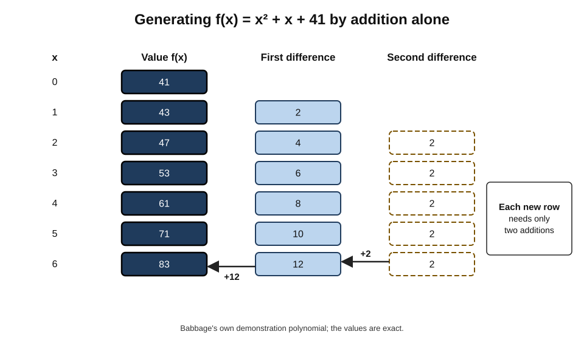
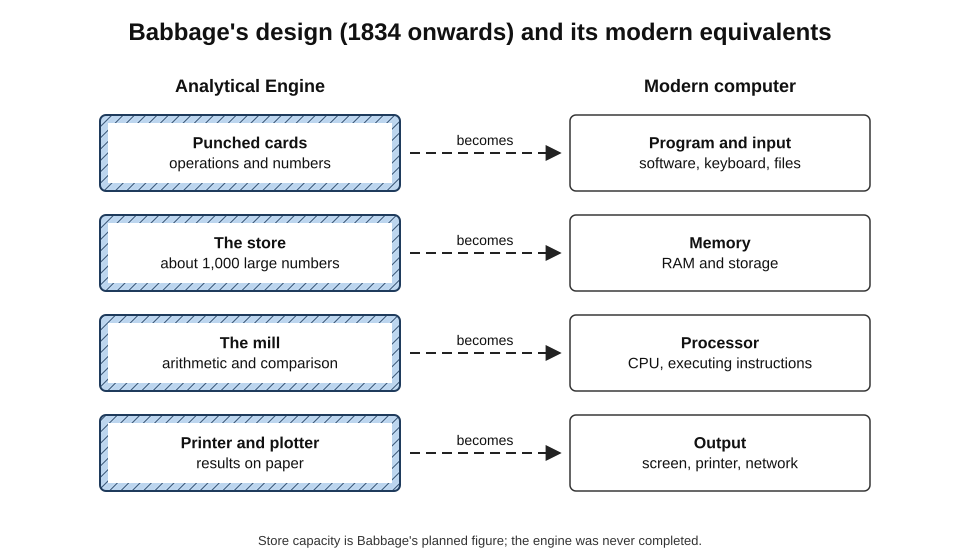
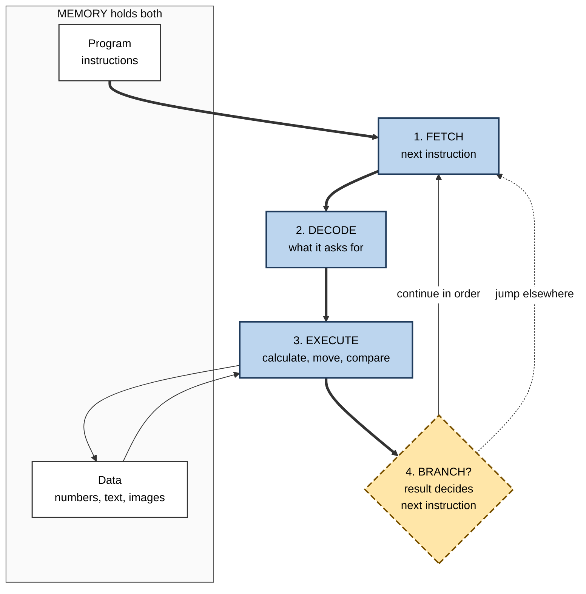
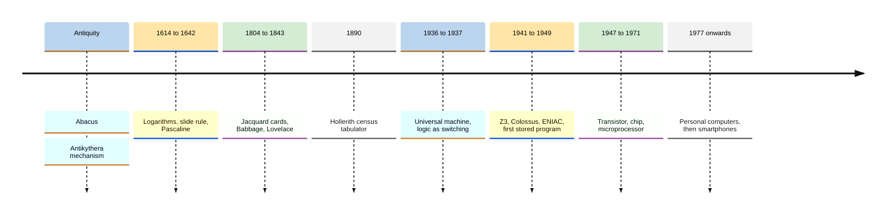
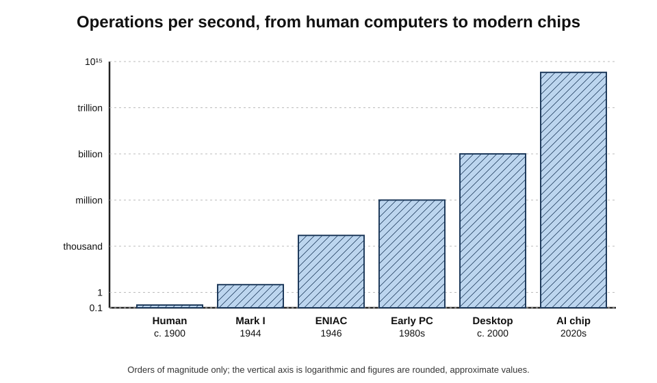
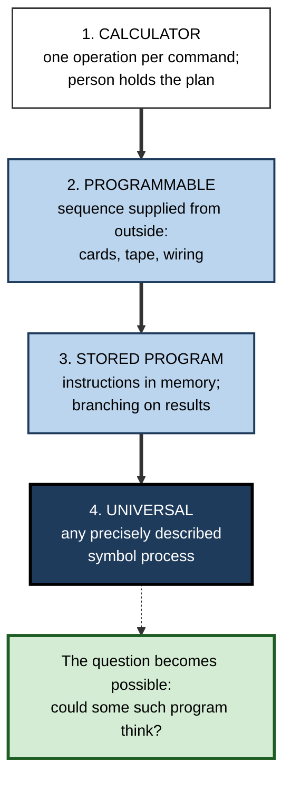

# A.4. Brief history: from calculators to computers

In 1900 a "computer" was a **person** — usually a clerk, often a woman, who spent the working day doing arithmetic by hand for an observatory, an insurance office or a government. By 1950 the word was beginning to mean a room-sized electronic machine; by 2010 it meant a device in a pocket.

The journey from devices that help people **calculate** to machines that **follow programs of their own** took about four centuries of ideas and one decade of decisive engineering — and it is the reason that a question such as "can a machine think?" could be asked seriously at all.

> **Definition — Calculator:** a device that carries out arithmetic operations on numbers supplied to it, one operation at a time, with a person deciding what to do next.

> **Definition — Computer (in the modern sense):** a machine that automatically carries out a stored sequence of instructions — a **program** — on data, can choose its next step according to the results so far, and can be reprogrammed to perform any calculation that can be precisely described.

**Why this history matters**

- **It explains what a computer actually is** — a general-purpose symbol-processing machine, not merely a fast calculator.
- **It shows how ideas arrive before machines** — many key concepts were stated a century before they could be built.
- **It reveals the people behind it** — including the large, long-overlooked workforce of human computers.
- **It explains present-day AI's foundations** — the hardware, the stored program and the speed that modern systems depend on.

---

## Before Machines: Aids to Counting

### Tallies and the abacus

- **Tally marks** — notches on bone and wood used to record counts; some prehistoric notched bones are interpreted as tallies, though the meaning of the oldest is debated.
- **Counting boards and the abacus** — beads or pebbles on rods or lines represent digits by position.
  - Used across the ancient Mediterranean, China (the *suanpan*) and Japan (the *soroban*).
  - Skilled users still add and subtract faster on an abacus than many people on a keyboard.
- **The abacus is a memory aid, not a machine.** The person does every step; the beads only hold the numbers.

### An astonishing exception

- **The Antikythera mechanism** — recovered from a Roman-era shipwreck off the Greek island of Antikythera in 1901 and dated to roughly the second or first century BCE.
  - A box of at least thirty interlocking bronze gears that modelled the movements of the Sun and Moon, predicted eclipses and tracked calendar cycles.
  - An **analogue** device: quantities are represented by the rotation of gears, not by digits.
- **Nothing of comparable complexity survives from the following thousand years.**

> **Definition — Analogue device:** a machine that represents quantities by continuously varying physical magnitudes, such as angles or voltages.

> **Definition — Digital device:** a machine that represents quantities by discrete symbols, such as the digits 0–9 or 0 and 1.

### Logarithms and the slide rule

- **John Napier (1614)** — published logarithms, which turn multiplication into addition.
- **Napier's bones (1617)** — numbered rods that simplified multiplication.
- **The slide rule (William Oughtred, around the 1620s–1630s)** — two logarithmic scales sliding against each other; multiplying is done by adding lengths.
  - The engineer's standard tool for more than three centuries — used in designing bridges, aircraft and the Apollo spacecraft — until electronic pocket calculators replaced it in the 1970s.

---

## Mechanical Calculators

### The first calculating machines

- **Wilhelm Schickard (1623)** — designed a "calculating clock" for adding and subtracting, described in letters to the astronomer Johannes Kepler; it did not survive.
- **Blaise Pascal (1642)** — built the **Pascaline**, a geared adding machine, aged about nineteen, to help his father with tax calculations.
  - Key mechanism: an automatic **carry** — when one wheel passes 9, it advances the next by one.
- **Gottfried Wilhelm Leibniz (1670s–1694)** — built the **stepped reckoner**, using a stepped drum to multiply and divide by repeated addition and subtraction.
  - Leibniz also described **binary arithmetic**, using only 0 and 1 — the number system of modern computers.

### Calculators for business

- **Thomas de Colmar's arithmometer** — patented in 1820 and manufactured from the 1850s; the first calculator produced commercially in quantity, used by insurers and banks.
- **The Comptometer (Dorr Felt, 1887)** — a key-driven adding machine fast enough for office clerks to add columns at high speed.
- **The Curta (1948)** — a hand-cranked mechanical calculator small enough to hold in one palm, designed by Curt Herzstark.

> **Key point:** every mechanical calculator performs **one operation per command**. The person decides which number to enter and which operation comes next. The "program" lives in the operator's head.

---

## Computers Who Were People

### Dividing the labour of calculation

- **Mathematical tables** — logarithms, navigation tables, astronomical positions and insurance tables were the software of the industrial age, and errors in them could wreck ships.
- **Gaspard de Prony (1790s)** — organised the production of enormous French logarithm tables like a factory, inspired by Adam Smith's description of the division of labour:
  - a few mathematicians chose formulas;
  - a middle tier turned them into simple procedures;
  - a large team carried out only additions and subtractions.
- **This was an algorithm executed by people** — and it directly inspired Charles Babbage to ask whether the bottom tier could be replaced by gears.

### The human computer as a profession

- **Observatories** — from the 1880s the Harvard College Observatory employed a team of women computers who classified stars from photographic plates.
  - **Henrietta Leavitt** found the relationship between the brightness and pulsing period of certain stars (1912), later used to measure cosmic distances.
  - **Annie Jump Cannon** developed the star-classification scheme still used today.
- **War work** — the Second World War created vast demand for ballistics tables; hundreds of human computers, mostly women, worked in the United States and Britain.
- **Aeronautics and spaceflight** — at the US agency that became NASA, human computers calculated flight paths.
  - **Katherine Johnson** checked the electronic computer's orbital calculations for John Glenn's 1962 flight at his request.
- **The first programmers** — six women who had worked as human computers became the programmers of ENIAC in 1945–46.

> **Watch out:** histories of computing long omitted these workers, presenting machines as the achievement of a few inventors. The work of calculating — and later of programming — was for decades largely women's work, and its later re-description as "engineering" coincided with men taking over many of the roles.

---

## The Idea of a Programmable Machine

### Instructions on cards

- **Joseph-Marie Jacquard's loom (1804)** — a chain of punched cards controlled which threads were raised for each pass of the shuttle.
  - Change the cards, change the pattern: **the instructions were separate from the machine**.
  - Thousands of looms used it within a few years.

### Babbage's engines

**Study card — Charles Babbage and the Difference Engine (proposed 1822)**

- **Aim:** calculate and print mathematical tables automatically, eliminating human error.
- **Method:** the **method of finite differences** — for any polynomial, successive differences eventually become constant, so a whole table can be generated **by addition alone**.
- **Fate:** the British government funded construction for years; only a portion was completed, and the project was abandoned in the 1840s.
- **Vindication:** in 1991 the Science Museum in London completed **Difference Engine No. 2** from Babbage's later drawings, using tolerances achievable in his era; it worked.

### Worked example: generating a table by addition alone

Babbage often demonstrated his engine with the polynomial *f*(*x*) = *x*² + *x* + 41.

| *x* | *f*(*x*) | First difference | Second difference |
|---|---|---|---|
| 0 | 41 | | |
| 1 | 43 | 2 | |
| 2 | 47 | 4 | 2 |
| 3 | 53 | 6 | 2 |
| 4 | 61 | 8 | 2 |
| 5 | 71 | 10 | 2 |

1. **Notice** the second difference is always **2** — true for every quadratic.
2. **To get the next value**, add 2 to the last first difference (10 + 2 = 12), then add that to the last value (71 + 12 = **83**).
3. **Check:** *f*(6) = 36 + 6 + 41 = **83**.
4. **Conclusion:** once the starting values are set, every further entry needs only two additions — exactly what columns of geared wheels can do.

> **Formula — Method of differences:** for a polynomial of degree *n*, the *n*-th differences are constant; each new value is obtained by adding, from the constant difference upwards, through *n* columns.

**Figure 1.** How the Difference Engine generates a table using only addition.

### The Analytical Engine

- **Designed from 1834 onwards, never built.** Babbage's far more ambitious design was a **general-purpose** machine.
- **Its parts mirror a modern computer:**
  - the **store** — held numbers (memory);
  - the **mill** — performed arithmetic (processor);
  - **punched cards**, borrowed from Jacquard — supplied operations and data (program and input);
  - a **printer and plotter** — output.
- **Conditional branching** — the engine could change its sequence of operations according to a result, the ingredient that separates a computer from a calculator.

### Ada Lovelace's notes

- **Ada Lovelace (1843)** translated an Italian engineer's article about the Analytical Engine and added notes three times its length.
- **Note G** set out, step by step, how the engine could compute **Bernoulli numbers** — often described as the first published computer program.
  - Historians debate how much of the mathematics was Lovelace's own and how much Babbage's; her **conceptual** contribution is not in doubt.
- **Her vision:** the engine could manipulate any symbols, not only numbers — it "might compose elaborate and scientific pieces of music of any degree of complexity or extent".

> **Key point:** Lovelace saw that a general-purpose machine is a **symbol processor**. Numbers are only one kind of symbol — the insight that underlies every later attempt to make machines do things that look like thinking.

**Figure 2.** The parts of Babbage's Analytical Engine and their modern equivalents.

### Data processing arrives

- **Herman Hollerith's tabulator (1890 US census)** — census answers were punched into cards; electrical machines read and counted them.
  - The census was tabulated far faster than the previous one, which had taken most of a decade by hand.
- **From tabulators to an industry** — Hollerith's company became part of the firm renamed **International Business Machines (IBM)** in 1924; punched-card machines ran payrolls, inventories and accounts for the next half-century.

---

## Theory Catches Up

- **Logic as switching — Claude Shannon (1937):** his master's thesis showed that circuits of electrical relays could implement Boole's algebra of logic, so any logical or arithmetical operation could be built from on/off switches.
- **The universal machine — Alan Turing (1936):** described an abstract machine that, given a description of any other computing machine, could imitate it — the theoretical basis of the general-purpose computer.
- **Binary** — Leibniz's 0 and 1 became the natural language of switches: on and off.

> **Definition — Universal (general-purpose) computer:** a machine that, given the right program and enough memory and time, can carry out any computation that any other computing machine can.

---

## The First Electronic Computers

### A decade of firsts

- **Konrad Zuse's Z3 (Berlin, 1941)** — electromechanical, binary, controlled by a program punched into film; the first working programmable, fully automatic computing machine.
- **Colossus (Bletchley Park, 1943–44)** — designed by the Post Office engineer **Tommy Flowers** to help break German high-command teleprinter ciphers.
  - Electronic, using about 1,600 and later about 2,400 valves, and programmable by switches and plugs.
  - Kept secret until the 1970s, so it shaped few later designs directly.
- **Harvard Mark I (1944)** — Howard Aiken's electromechanical calculator built with IBM; programmed by **Grace Hopper** among others.
- **ENIAC (University of Pennsylvania, completed 1945, unveiled February 1946)** — designed by John Mauchly and J. Presper Eckert.
  - About 18,000 vacuum tubes, around 30 tonnes; about **5,000 additions per second**.
  - Programmed by **rewiring** plug-boards and setting switches — a new problem could take days to set up.

### The stored-program idea

- **John von Neumann's *First Draft of a Report on the EDVAC* (June 1945)** — drawing on the ENIAC team's ideas — described a machine whose **instructions are stored in the same memory as its data**.
  - Changing the task means loading a new program, not rewiring.
  - Programs can even modify or generate other programs.
- **The Manchester "Baby" (21 June 1948)** — Frederic Williams, Tom Kilburn and Geoff Tootill's Small-Scale Experimental Machine ran the **first stored program** in history.
- **EDSAC (Cambridge, May 1949)** — Maurice Wilkes's machine, the first stored-program computer to give a regular computing service to users.

> **Definition — Stored-program computer:** a computer in which the program is held in memory alongside the data, so it can be changed as easily as the data.

**Figure 3.** The stored-program cycle at the heart of every modern computer.

### Computers go to work

- **LEO I (J. Lyons & Co., London, 1951)** — the first computer used for routine business work.
- **UNIVAC I (1951)** — the first commercial computer in the United States, delivered to the Census Bureau.
  - In November 1952, on national television, it predicted Dwight Eisenhower's landslide presidential victory from early returns, when pollsters expected a close race.

### Case study: LEO, the tea-shop computer

- **Situation:** J. Lyons & Co. ran hundreds of tea shops and food factories in Britain, with huge volumes of small orders, deliveries and payroll calculations.
- **Decision:** in 1947 two Lyons managers visited the United States to study office methods, learned of electronic computers, and concluded that Lyons should build its own.
- **Action:**
  - Lyons funded the Cambridge EDSAC team in return for help and built **LEO I** (Lyons Electronic Office) based on its design;
  - in November 1951 LEO ran a regular weekly job valuing the output of Lyons bakeries;
  - by 1954 it was calculating the company's payroll, and it later processed work for other firms and the government.
- **Result:** Lyons founded LEO Computers Ltd to sell machines to other organisations; the business later merged into what became the British computer company ICL.
- **Lesson:** the decisive insight was **organisational, not technical** — seeing that clerical work was already a set of procedures and could be redesigned around a machine. The same insight applies whenever any new computing technology enters an office.

---

## From Rooms to Pockets

### Shrinking the switch

- **The transistor (Bell Labs, 1947)** — John Bardeen, Walter Brattain and William Shockley; a small, reliable solid-state switch replacing the hot, fragile vacuum tube.
- **The integrated circuit (1958–59)** — Jack Kilby at Texas Instruments and Robert Noyce at Fairchild independently placed many transistors on one piece of semiconductor.
- **Moore's law (1965)** — Gordon Moore observed that the number of components per chip was doubling roughly every year, later revised to roughly every two years.
  - An **observation and industry target**, not a law of nature; the pace has slowed since the 2010s as transistors approach atomic scales.

> **Formula — Doubling growth:** a quantity doubling every two years grows by 2^(years ÷ 2). Over 20 years: 2¹⁰ = **1,024 times**; over 40 years: 2²⁰ ≈ **1 million times**.

### The calculator gives birth to the microprocessor

- **The Intel 4004 (1971)** — the first commercial microprocessor, a whole processor on one chip, was developed for **Busicom**, a Japanese company making desktop calculators.
  - Rather than design many special-purpose chips, Intel's engineers proposed one **general-purpose programmable** chip — the calculator-versus-computer distinction resolved in favour of the computer.
- **Electronic pocket calculators** — by the mid-1970s cheap pocket models had replaced the slide rule.
- **Personal computers** — from the mid-1970s hobbyist kits, then the Apple II (1977) and the IBM PC (1981).
- **Smartphones** — from the late 2000s, general-purpose computers more powerful than the room-sized machines of the 1970s carried in pockets.

**Figure 4.** Milestones from counting aids to pocket computers.

### The growth of speed

- **A skilled human computer** — roughly one multi-digit operation every several seconds, for a few hours at a stretch.
- **ENIAC (1946)** — about 5,000 additions per second.
- **Personal computers of the early 1980s** — hundreds of thousands to about a million instructions per second.
- **A single modern processor chip** — billions of operations per second per core; specialised chips used for AI perform far more, in parallel.

**Figure 5.** The rise in calculating speed, from human computers to modern chips.

---

## Calculator, Programmable Machine, Computer

### Four steps in the idea

| | Calculator | Programmable machine | Stored-program computer | Universal computer (concept) |
|---|---|---|---|---|
| Example | Pascaline, pocket calculator | Jacquard loom, Z3, ENIAC | Manchester Baby, EDSAC, today's devices | Turing's universal machine |
| Who decides the next step | The operator, every time | A fixed external sequence (cards, tape, wiring) | The program in memory, depending on results | Any program describing any computation |
| Can it branch on results? | No | Limited or none in early machines | Yes | Yes |
| Changing the task | Not applicable — it does arithmetic | New cards or rewiring | Load a new program | Supply a new description |
| Handles symbols other than numbers? | No | Patterns, codes | Yes — text, images, sound | In principle, any symbols |

**Figure 6.** The four conceptual steps from calculating aid to universal computer.

> **Remember:** a calculator **does arithmetic when told**; a computer **follows a program that can decide its own next step** and can process any kind of symbol.

> **Watch out:** "first computer" claims depend entirely on the definition used — electronic or electromechanical, programmable or fixed, stored-program or not, working or merely designed. Z3, Colossus, ENIAC, the Manchester Baby and EDSAC are each correctly called "first" under some definition, and national pride often decides which definition is chosen.

---

## Why This History Matters for Thinking About AI

- **Computers are symbol processors.** Once machines could manipulate any symbols according to programs, the question of whether some program could reproduce thinking became an engineering question as well as a philosophical one.
- **Speed and memory changed what was possible.** Approaches that were hopeless on machines doing thousands of operations a second became practical at billions — much of modern AI rests on that growth.
- **The human computers foreshadowed today's debates.** A whole profession of calculation was automated within a generation; the workers who adapted often moved into programming, the new skill the machines created.

> **In practice:** when a new computing technology arrives, the LEO lesson holds — the gains come from **redesigning the work around the machine**, not from bolting the machine onto the old process.

---

## Software: The Other Half of the Computer

A stored-program computer is only as useful as the programs written for it. The 1950s turned programming from wiring and raw numbers into a discipline with its own languages and tools.

### From machine code to languages

- **Machine code** — the earliest stored programs were written as numbers, each standing for an instruction; slow to write and easy to get wrong.
- **Assembly languages** — short names for instructions (such as ADD or JUMP), translated into numbers by a program.
- **Grace Hopper's A-0 (1952)** — one of the first **compilers**, a program that translated higher-level instructions into machine code. Hopper argued, against scepticism, that programs could be written in something close to English.
- **FORTRAN (IBM, 1957)** — led by John Backus; allowed scientists to write formulas much as they would on paper, and became the first widely used high-level language.
- **COBOL (1959)** — designed by a committee drawing heavily on Hopper's work, for business data processing; still running in many banks and governments today.

> **Definition — Compiler:** a program that translates instructions written in a programming language into machine code a computer can execute.

### Bugs and debugging

- **The famous moth (1947)** — operators of the Harvard Mark II found a moth trapped in a relay and taped it into the logbook with the note "First actual case of bug being found".
- **The word "bug"** for a technical fault is older — engineers, including Thomas Edison, used it in the nineteenth century — but the moth became the emblem of **debugging**.
- **Maurice Wilkes** recalled realising, while working on EDSAC around 1949, that a large part of his life would be spent finding errors in his own programs.

> **Key point:** from the first stored programs onwards, most of the effort of computing went into **software** — describing tasks precisely enough for a machine to carry them out — rather than into the hardware. The question of whether intelligence itself could be so described grew directly out of that experience.

| | Hardware | Software |
|---|---|---|
| What it is | The physical machine — circuits, memory, devices | The instructions the machine follows |
| How it changes | Slowly, by redesign and manufacture | Quickly, by rewriting and reloading |
| Early example | ENIAC's valves and plug-boards | Lovelace's Bernoulli method; EDSAC's subroutine library |
| Typical failure | Component breakdown | Logical error — a bug |

---

## Open Questions

- **Who should be credited with "inventing" the computer?**
  - Invention was cumulative and distributed; the answer depends on which property is taken as essential.
- **How much did Lovelace contribute mathematically?**
  - Scholars continue to debate the division of work between her and Babbage.
- **How long can computing power keep growing?**
  - Transistor scaling has slowed; new architectures, specialised chips and other technologies are being explored, with uncertain prospects.
- **What happens to the human work of calculation and programming?**
  - Just as human computers gave way to programmers, AI tools that write code raise the question of which human skills the next shift will create.

---

## Summary

- A **calculator** performs one arithmetic operation per command under a person's direction; a **computer** follows a **stored program**, branches on results and can process any symbols.
- **Counting aids** (tallies, abacus), the analogue **Antikythera mechanism**, **logarithms** and the **slide rule** helped people calculate but left every step to them.
- **Mechanical calculators** — Schickard, **Pascal** (automatic carry), **Leibniz** (stepped drum, binary), the **arithmometer** — automated single operations.
- For centuries, **human computers** — often women — produced tables and calculations; de Prony's factory-style organisation inspired Babbage.
- **Jacquard's punched cards** separated instructions from the machine; **Babbage's Difference Engine** generated tables by addition alone; the **Analytical Engine** anticipated the processor, memory, program and branching; **Lovelace** saw it as a general **symbol processor**.
- **Hollerith's tabulator** began large-scale data processing; **Shannon** linked logic to switches; **Turing** defined the universal machine.
- The 1940s produced **Z3, Colossus, Harvard Mark I and ENIAC**; the **stored-program** idea (von Neumann report, 1945) was first realised by the **Manchester Baby** (1948) and put into service by **EDSAC** (1949); **LEO** and **UNIVAC** took computers into business.
- The **transistor**, **integrated circuit** and **microprocessor** (born from a calculator contract) shrank computers into pockets; speed rose by many orders of magnitude.

---

## Self-Check

1. Define a calculator and a modern computer, and state the single most important difference.
2. Why is the abacus described as a memory aid rather than a machine?
3. What was remarkable about the Antikythera mechanism, and why is it called analogue?
4. What problem did Pascal's automatic carry solve?
5. How did de Prony organise table-making, and why did it matter to Babbage?
6. Using the method of differences for *f*(*x*) = *x*² + *x* + 41, compute *f*(7) from the table values, showing the additions.
7. Name the four main parts of the Analytical Engine and their modern equivalents.
8. What did Lovelace's Note G contain, and what was her broader insight?
9. What did Shannon's 1937 thesis show?
10. Why is the stored-program idea so important, and which machine first ran a stored program?
11. What made LEO's achievement organisational as much as technical?
12. Why is "the first computer" a contested title?
13. Over 30 years, how many times does a quantity grow if it doubles every two years?
14. A manager says, "AI is just a very fast calculator." Using this history, explain what the statement gets right and what it gets wrong.

### Answer Key

1. A calculator performs arithmetic one operation at a time under a person's direction; a computer automatically follows a stored program, choosing its next step from results, and can be reprogrammed for any precisely described task. The key difference: the computer holds and follows its own program, including branching.
2. The beads only hold numbers; the person performs every step of the calculation.
3. A geared device from roughly the second or first century BCE that modelled the Sun and Moon and predicted eclipses — of a complexity not seen again for over a thousand years. It is analogue because quantities are represented by gear rotations, not digits.
4. Passing from 9 to 0 on one wheel automatically advanced the next wheel, so multi-digit addition needed no manual carrying.
5. Mathematicians chose formulas, a middle tier reduced them to simple steps, and a large team performed only additions and subtractions. Since the bottom tier did purely mechanical work, Babbage saw it could be done by machine.
6. Continuing the table: f(6) = 83 with first difference 12. Next first difference = 12 + 2 = 14; f(7) = 83 + 14 = **97**. Check: 49 + 7 + 41 = 97.
7. Store → memory; mill → processor; punched cards → program and input; printer/plotter → output.
8. A step-by-step method for the Analytical Engine to compute Bernoulli numbers — often called the first published program. Broader insight: the engine could manipulate any symbols, not just numbers, such as musical notes.
9. That circuits of on/off relays could implement Boolean logic, so any logical or arithmetical operation could be built from switches.
10. Holding instructions in memory alongside data means tasks change by loading a new program rather than rewiring, and programs can create or alter other programs. The Manchester Baby, on 21 June 1948.
11. Lyons saw that its clerical work was already a set of procedures and redesigned it around a machine — choosing to build its own computer and reorganise bakery valuations and payroll accordingly.
12. It depends on the definition — electronic versus electromechanical, programmable or not, stored-program or not, built or only designed — so different machines qualify under different definitions.
13. 2^(30 ÷ 2) = 2¹⁵ = **32,768** times.
14. Right: AI systems run on computers and ultimately perform enormous numbers of arithmetic operations. Wrong: a computer is a general-purpose symbol processor following programs that branch on results; AI systems process text, images and sound, and much of their behaviour is learned rather than specified operation by operation. Calling it a "calculator" hides both its generality and the fact that its outputs are not exact answers to a stated sum.

---

## Glossary

| Term | Meaning |
|---|---|
| Abacus | A counting frame using beads on rods to represent digits by position. |
| Analogue device | A machine representing quantities by continuously varying physical magnitudes. |
| Analytical Engine | Babbage's design for a general-purpose mechanical computer with store, mill, cards and branching. |
| Arithmometer | The first commercially mass-produced mechanical calculator. |
| Calculator | A device performing one arithmetic operation per command under human direction. |
| Conditional branching | Choosing the next instruction according to the result of a previous one. |
| Difference Engine | Babbage's machine for generating tables using the method of finite differences. |
| Digital device | A machine representing quantities by discrete symbols. |
| Human computer | A person employed to perform calculations by hand. |
| Integrated circuit | Many transistors and other components built on one piece of semiconductor. |
| Method of differences | Generating polynomial values by repeated addition of constant differences. |
| Microprocessor | A complete processor on a single chip. |
| Moore's law | The observation that components per chip doubled roughly every one to two years. |
| Program | A stored sequence of instructions for a computer. |
| Slide rule | A calculating device using sliding logarithmic scales. |
| Stored-program computer | A computer holding its program in memory alongside its data. |
| Transistor | A small solid-state electronic switch. |
| Universal computer | A machine that can, in principle, carry out any computation any other machine can. |
| Vacuum tube (valve) | An early electronic switch based on controlling current in a vacuum. |
