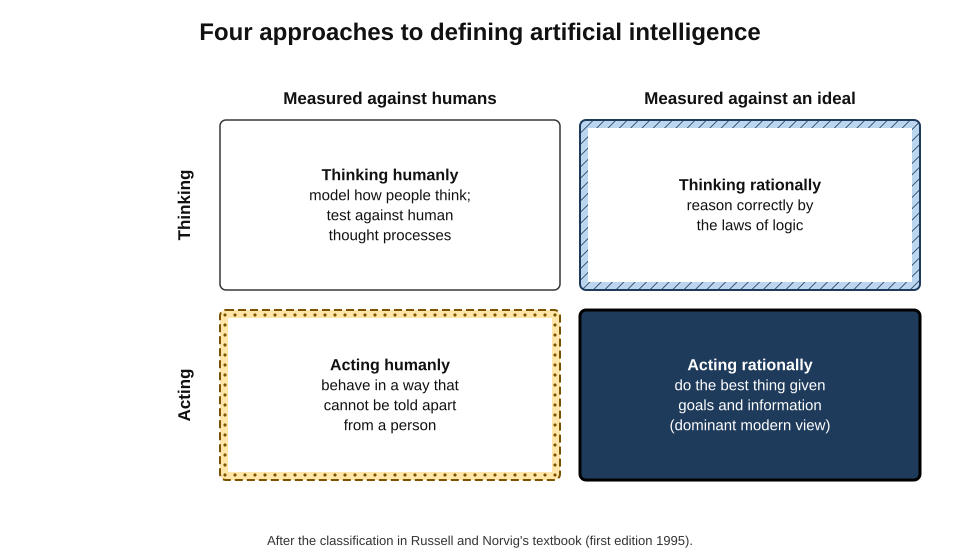
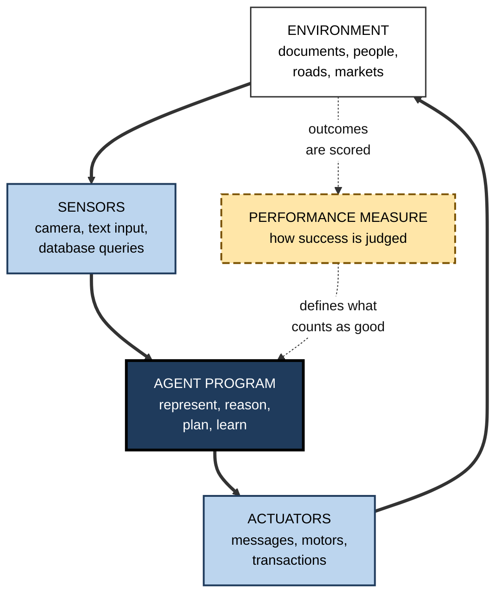
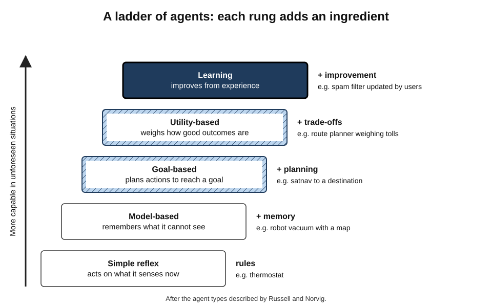
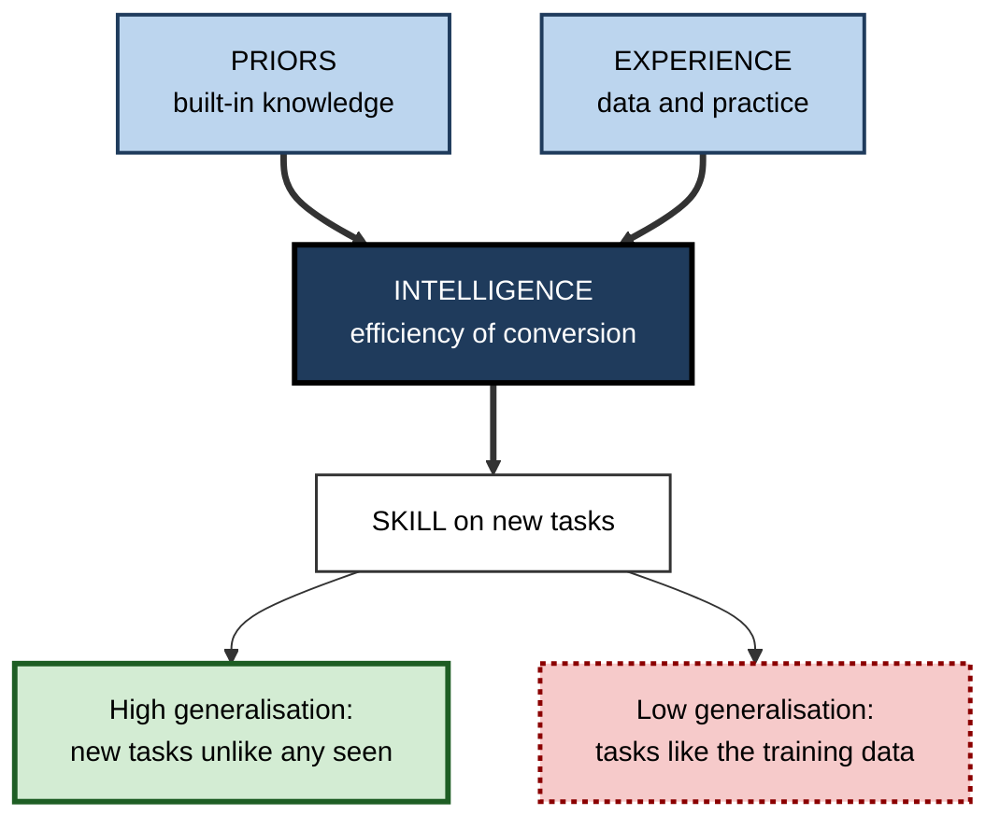
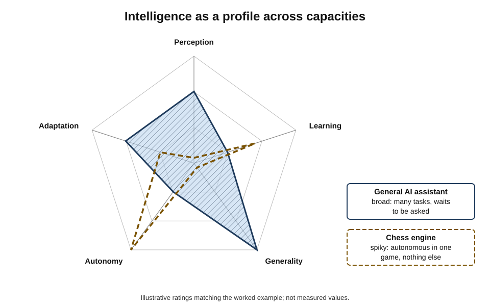
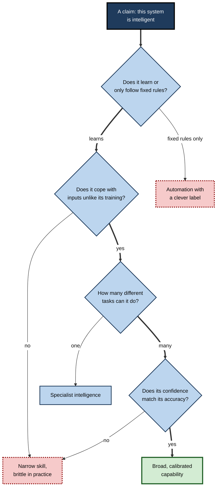

# A.5. What makes a machine intelligent?

A thermostat switches the heating on when the room is cold. A robot vacuum maps a flat and avoids the stairs. A chess engine beats every human alive. An AI assistant drafts a contract clause, explains a tax rule and writes a poem in the same minute.

All four are sometimes called "intelligent", yet they differ enormously in **what they can perceive, what they can learn, how widely they can act and how they cope with the unexpected**. Deciding what makes a machine intelligent means replacing a vague yes-or-no label with a set of precise questions.

> **Definition — Machine intelligence:** the degree to which a machine can achieve goals across a range of situations by perceiving its environment, representing what it knows, reasoning, learning from experience and acting — especially in situations it was not specifically built for.

> **Definition — Agent:** anything that perceives its environment through sensors and acts upon that environment through actuators.

**Why the question matters**

- **Buying and building.** Organisations pay a premium for "intelligent" products; a clear test separates genuine capability from marketing.
- **Trust.** How far a system can be relied on in new situations depends on which ingredients of intelligence it has.
- **Risk.** Systems with more autonomy and adaptiveness need more oversight.
- **Communication.** Precise vocabulary prevents both overclaiming and dismissiveness.

---

## Four Ways to Define Artificial Intelligence

### The two questions behind the definitions

- **Is intelligence about *thinking* or about *acting*?**
- **Is the standard *human* performance or *ideal* (rational) performance?**
- Stuart Russell and Peter Norvig's textbook *Artificial Intelligence: A Modern Approach* (first edition 1995) organised the field's definitions into four approaches by crossing these two questions.

| | Human standard | Rational standard |
|---|---|---|
| **Thinking** | **Thinking humanly** — build systems that think the way people do; test against human thought processes (cognitive modelling) | **Thinking rationally** — build systems that reason correctly by the laws of logic |
| **Acting** | **Acting humanly** — build systems whose behaviour cannot be told apart from a person's | **Acting rationally** — build agents that act to achieve the best expected outcome |

- **Thinking humanly** — the cognitive-science route; requires knowing how people actually think.
- **Thinking rationally** — the logic route; struggles with uncertainty and with knowledge that is hard to state formally.
- **Acting humanly** — the behavioural route associated with the imitation game; measures resemblance, not quality.
- **Acting rationally** — the **rational-agent** route; the dominant view in modern AI.

> **Definition — Rational agent:** an agent that, for each possible sequence of perceptions, selects the action expected to maximise its performance measure, given what it perceives and what it knows.

> **Key point:** the rational-agent view makes intelligence a matter of **doing the right thing given the goal and the information available** — which can be measured, and which does not require a machine to resemble a person.

**Figure 1.** Four approaches to defining artificial intelligence.

### Rational is not omniscient

- **Rationality is judged by what the agent could know.** A driver who brakes for a child running into the road is rational even if a falling tree then blocks the road.
- **Rationality is relative to the performance measure.** A system optimising the wrong measure can be perfectly rational and still harmful.
- **Bounded rationality applies to machines too** — finite computing time and memory mean even machines must use shortcuts.

> **Watch out:** the definitions governments and regulators now use — such as the OECD's revised 2023 definition — describe an AI system by how it **infers** outputs from inputs with varying **autonomy** and **adaptiveness**. They define a legal category of system, not the degree of intelligence it has.

---

## The Agent and Its Environment

### Describing any agent: PEAS

- **Performance measure** — how success is judged.
- **Environment** — the world the agent operates in.
- **Actuators** — how it acts.
- **Sensors** — how it perceives.

> **Mnemonic — "PEAS":** Performance, Environment, Actuators, Sensors.

**Worked example: a PEAS description of an automated invoice-matching agent**

| Element | Description |
|---|---|
| Performance | Share of invoices matched correctly to purchase orders; time saved; errors caught |
| Environment | Accounts-payable system, supplier invoices in many formats, purchase-order database |
| Actuators | Approving matches, flagging discrepancies, sending queries to staff |
| Sensors | Document reader for invoices, database queries, staff responses |

*Illustrative example.*

- **What it reveals:** the agent's intelligence depends heavily on the environment — consistent formats make the task easy; messy, novel formats demand perception and adaptation.

**Figure 2.** An agent perceiving and acting in its environment, judged by a performance measure.

### What makes an environment hard

- **Fully or partially observable** — can the agent see everything relevant?
  - *e.g.* chess is fully observable; poker and driving are not.
- **Deterministic or stochastic** — does an action always have the same result?
- **Static or dynamic** — does the world change while the agent is deciding?
- **Discrete or continuous** — a finite set of states and moves, or smoothly varying ones?
- **Single-agent or multi-agent** — are there others whose goals cooperate or compete?
- **Known or unknown** — does the agent know the rules of the world?

| | Chess | Robot vacuum | Taxi driving | Customer-service conversation |
|---|---|---|---|---|
| Observable | Fully | Partially | Partially | Partially |
| Deterministic | Yes | Mostly | No | No |
| Static | Yes (between moves) | Mostly | No | No |
| Discrete | Yes | No | No | Words are discrete; meaning is not |
| Agents | Two | One (plus people and pets) | Many | Two or more |

> **Key point:** a system that excels in an easy environment — fully observable, deterministic, static, discrete — may show **less general intelligence** than a mediocre system in a hard one. Chess is hard for people but, as environments go, easy for machines.

---

## A Ladder of Agents

Russell and Norvig describe agents of increasing capability. Each rung adds an ingredient of intelligence.

- **Simple reflex agent** — acts on the current perception by fixed rules.
  - *e.g.* a thermostat: "if temperature < 19 °C, heat on".
  - No memory, no goal beyond the rule.
- **Model-based reflex agent** — keeps an internal **model** of the parts of the world it cannot currently see.
  - *e.g.* a robot vacuum that remembers which rooms it has cleaned.
- **Goal-based agent** — considers which sequences of actions will reach a **goal**.
  - *e.g.* a satnav planning a route to a destination.
- **Utility-based agent** — weighs **how good** different outcomes are, trading off speed, cost, risk and comfort.
  - *e.g.* a route planner balancing journey time against tolls and the chance of delay.
- **Learning agent** — **improves** its own behaviour from experience.
  - *e.g.* a spam filter that updates as users mark messages.

**Figure 3.** A ladder of agents, each rung adding an ingredient of intelligence.

> **Remember:** **react → remember → plan → weigh → learn**. Each step makes a machine more capable of handling situations its designers did not foresee.

---

## The Ingredients of Machine Intelligence

### Seven capacities

- **Perception** — turning raw signals into useful descriptions.
  - *e.g.* recognising a pedestrian in camera images; reading a scanned invoice.
- **Representation and knowledge** — holding information about the world in a usable form.
  - *e.g.* a map; a database of products; patterns stored in a learned model.
- **Reasoning and planning** — drawing conclusions and choosing sequences of actions.
  - *e.g.* scheduling deliveries; working out the implications of a contract clause.
- **Learning** — improving with experience.
  - *e.g.* better recommendations after more viewing history.
- **Language and communication** — understanding and producing human language.
  - *e.g.* answering a customer's question in plain English.
- **Action** — affecting the world, physically or digitally.
  - *e.g.* a robot arm picking items; an agent filing a ticket in another system.
- **Generalisation and adaptation** — applying what was learned to new situations.
  - *e.g.* a model trained on one hospital's images working on another's.

> **Mnemonic — "Please Remember Robots Learn Language And Generalise":** Perception, Representation, Reasoning, Learning, Language, Action, Generalisation.

### Autonomy and adaptiveness

- **Autonomy** — how far the system acts without human direction.
  - From suggesting (a draft) → deciding with approval → acting alone.
- **Adaptiveness** — how far the system changes its behaviour after deployment.
  - Fixed after training, or updating from new data.

> **Definition — Autonomy (of an AI system):** the degree to which a system can operate and pursue its objectives without human intervention.

> **Watch out:** autonomy is not intelligence. A simple timer that fires a sprinkler every night is fully autonomous and not intelligent at all; a highly capable assistant may have no autonomy, acting only when asked.

---

## Measuring How Intelligent a Machine Is

### Universal intelligence

- **Shane Legg and Marcus Hutter (2007)** turned their informal definition — the ability to achieve goals in a wide range of environments — into a mathematical one.
- **The idea:** score an agent's performance in **every** possible computable environment, giving **simpler environments more weight**, and add up the results.

> **Formula — Universal intelligence, in words:** intelligence = sum over all environments of (weight of the environment × the agent's expected performance in it), where the weight falls sharply as the environment becomes more complex. *Example (illustrative):* an agent scoring 0.9 in a simple environment of weight 0.5 and 0.2 in a harder one of weight 0.1 earns 0.45 + 0.02 = **0.47** from those two.

- **Strength:** captures generality — doing well in many kinds of world, not one.
- **Weakness:** cannot be computed in practice; and some argue it rewards abilities that matter little in the real world.

### Skill-acquisition efficiency

**Study card — François Chollet, "On the Measure of Intelligence" (2019)**

- **Argument:** **skill is not intelligence.** A system can be given high skill at a task by enormous training data or hand-built knowledge without being intelligent.
- **Proposal:** intelligence = the **efficiency with which a system acquires new skills** across a scope of tasks, relative to:
  - its **priors** — what it knew at the start;
  - its **experience** — how much data or practice it needed;
  - the **generalisation difficulty** — how different the new tasks are from anything seen.
- **The Abstraction and Reasoning Corpus (ARC):** puzzles of coloured grids, each requiring a new rule to be inferred from two or three examples — usually easy for people, long very hard for machines.
- **Developments:** a harder successor, ARC-AGI-2, was released in 2025; frontier AI systems' scores on it rose rapidly during 2025 and 2026, and a further interactive version was developed to probe learning in unfamiliar environments.

> **Key point:** a machine that needs millions of examples to learn what a child learns from three is **skilled**, but by this measure **less intelligent** — a distinction that marketing claims routinely blur.

**Figure 4.** Intelligence as the efficiency of turning priors and experience into new skills.

### Benchmarks and their limits

> **Definition — Benchmark:** a standard set of tasks, with an agreed scoring method, used to compare systems.

- **Saturation** — benchmarks are often "solved" within a few years of release, sometimes faster than their designers expected, forcing ever-harder replacements.
- **Contamination** — test questions may appear in a system's training data, so a high score may reflect memory rather than ability.
- **Narrowness** — a benchmark measures a slice of capability; a high score does not transfer automatically to real work.
- **Goodhart effects** — once a benchmark becomes a target, developers optimise for it, and it measures less.

> **Watch out:** a headline such as "AI surpasses humans on test X" usually means "a system scored above an average human baseline on a fixed set of questions" — not that it is better at the real-world activity the test was designed to sample.

### The AI effect

- **"AI is whatever hasn't been done yet"** — a quip attributed to the computer scientist Larry Tesler and popularised by Douglas Hofstadter in 1979.
- **The pattern:** once a machine can do something — play chess, recognise speech, route traffic — it is reclassified as "just computation".
- **Consequence:** the bar for calling machines intelligent keeps moving, which makes historical comparisons treacherous and keeps much working AI invisible.

---

## Competence Without Comprehension

- **Daniel Dennett's phrase (2017):** evolution produced creatures that do clever things without understanding why; the same can be true of machines.
- **The question for any system:** does it merely produce the right output in situations like those it has met, or does it have a model of *why* — one that lets it cope when conditions change?
- **Practical signs of comprehension in a system:**
  - correct answers to **rephrased** and **reordered** versions of the same problem;
  - sensible behaviour on **counterfactual** variations ("what if the rule were different?");
  - accurate **explanations** that predict its own behaviour;
  - **calibrated confidence** — knowing what it does not know.

> **In practice:** to test whether a tool "understands" a task in a given workplace, vary the inputs — change names, numbers and order; introduce a case that breaks the usual rule — and see whether performance holds.

**Figure 5.** Capability profiles: intelligence is a shape across dimensions, not a single number.

### Worked example (illustrative): profiling five systems

A procurement team must explain to its board what each of five products actually does. It rates each on five capacities, from 0 (absent) to 3 (strong).

| | Perception | Learning | Generality | Autonomy | Adaptation to the new |
|---|---|---|---|---|---|
| Smart thermostat | 1 | 1 | 0 | 3 | 0 |
| Chess engine | 0 | 2 (in training) | 0 | 3 (within the game) | 1 |
| Spam filter | 1 | 3 | 0 | 3 | 2 |
| Warehouse robot | 2 | 1 | 1 | 2 | 1 |
| General AI assistant | 2 | 1 (fixed after training) | 3 | 1 | 2 |

*Illustrative ratings.*

1. **No single winner.** Each system is strong on different capacities.
2. **Generality** — only the assistant handles many unrelated tasks.
3. **Autonomy** — the thermostat and spam filter act alone; the assistant waits to be asked.
4. **Learning** — the spam filter keeps learning in use; the assistant usually does not change between updates.
5. **Conclusion:** the board should be told *which* kinds of intelligence each product has, and should plan oversight according to autonomy and adaptation rather than to the label "AI".

> **Watch out:** the ratings are judgements, not measurements. Their value lies in forcing a precise conversation, not in the numbers.

---

## Judging Claims of Machine Intelligence

**Figure 6.** Questions for judging how intelligent a machine really is.

### Case study: IBM Watson, from quiz champion to the clinic

- **Situation:** in February 2011 IBM's Watson system beat two of the strongest champions of the US television quiz *Jeopardy!*, Ken Jennings and Brad Rutter.
  - It combined many language-analysis and search techniques, ran on a large cluster of servers and had stored huge quantities of reference text.
- **The leap:** IBM then promoted Watson for health care, including cancer treatment recommendations.
- **What happened:**
  - the University of Texas MD Anderson Cancer Center began an oncology project with Watson in 2012; an audit by the University of Texas System in 2017 reported spending of more than **$60 million** and the project was put on hold without being used for patient care;
  - reports from other hospitals described recommendations that clinicians judged unhelpful or, in some test cases, unsafe;
  - IBM sold most of its Watson Health assets in 2022.
- **Diagnosis:**
  - quiz questions have short factual answers checkable against text — a **narrow, well-defined** environment;
  - cancer treatment involves messy records, incomplete evidence, changing guidelines and patient values — a **partially observable, dynamic, high-stakes** environment;
  - success in the first did not imply the **generality and adaptation** the second required.
- **Lesson:** a spectacular demonstration in one environment is evidence of **skill in that environment**, not of general intelligence. Ask how different the target environment is.

---

## Testing a Claim of Intelligence in Practice

A claim that a system is "intelligent" becomes useful only when it is turned into tests. Professional evaluators use a small set of standard designs.

### Five kinds of test

- **Held-out testing** — measure performance on cases the system never saw during building.
  - Guards against a system that has merely memorised its examples.
- **Out-of-distribution testing** — use cases deliberately unlike the training data: other regions, formats, time periods, customer types.
  - Measures **generalisation**, the heart of intelligence.
- **Perturbation testing** — make small changes that should not matter (names, word order, formatting) and some that should (a key fact), and check that outputs change only when they ought to.
- **Adversarial testing ("red teaming")** — people try deliberately to make the system fail, mislead it or misuse it.
- **Human baseline comparison** — measure qualified people on the same cases under the same conditions.

> **Remember:** **held-out, shifted, perturbed, attacked, compared** — five ways of asking whether apparent intelligence survives contact with reality.

### Calibration: knowing what it does not know

> **Definition — Calibration:** the match between a system's stated confidence and how often it is actually right; a well-calibrated system that says "80 % sure" is right about 80 % of the time.

- **Why it matters:** a system that is often right but cannot signal when it is unsure forces people to check everything; a well-calibrated one lets them focus checks where they are needed.
- **The Brier score** — a standard measure of probabilistic predictions: the average of (forecast probability − actual outcome)², where the outcome is 1 if the event happened and 0 if not. Lower is better; 0 is perfect.

> **Formula — Brier score:** mean of (p − o)². Example (illustrative): a system predicts "fraud" with probabilities 0.9, 0.7 and 0.2 for three transactions; the first two were fraud (o = 1), the third was not (o = 0). Scores: (0.9 − 1)² = 0.01; (0.7 − 1)² = 0.09; (0.2 − 0)² = 0.04. Brier score = (0.01 + 0.09 + 0.04) ÷ 3 ≈ **0.047**.

### Worked example (illustrative): testing a contract-review assistant

| Test | What was done | Result |
|---|---|---|
| Held-out | 200 past contracts not used in configuring the tool | Flagged 88 % of risky clauses found by lawyers |
| Out-of-distribution | 50 contracts under a different country's law | Flagged 61 % |
| Perturbation | Same contracts with party names and clause order changed | Results almost unchanged — a good sign |
| Adversarial | Risky clauses reworded in unusual legal language | Flagged 54 % |
| Human baseline | Two junior lawyers on the same 200 contracts | Flagged 85 % and 91 % |
| Calibration | Compared stated confidence with actual accuracy | Over-confident on the foreign-law contracts |

*Illustrative figures.*

1. **On familiar contracts**, the tool performs at the level of a junior lawyer.
2. **On unfamiliar law and unusual wording**, performance falls sharply — and the tool does not signal that it is less sure.
3. **Conclusion:** deploy it for first-pass review of domestic contracts, with lawyer review of every flagged and unflagged high-value clause; do not use it on foreign-law contracts until re-tested.

> **Watch out:** reporting only the held-out score (88 %) would have suggested a generally capable tool. The **out-of-distribution, adversarial and calibration** results are what reveal how intelligent — and how trustworthy — it really is.

---

## Common Confusions About Machine Intelligence

- **Speed is not intelligence.** A system that answers instantly may be retrieving or pattern-matching; speed says nothing about how it copes with the new.
- **Memory is not intelligence.** Storing every document an organisation owns is a database's job; using knowledge well in unfamiliar situations is intelligence.
- **Fluency is not intelligence.** Polished language is one capacity among seven, and the easiest to mistake for the rest.
- **Scale is not intelligence.** A larger model or dataset often improves performance, but size alone does not guarantee generalisation, calibration or sound judgement.
- **Superhuman in one task is not general.** Systems that beat every human at Go cannot read a menu.
- **Failure on one task is not stupidity.** Systems with uneven profiles can be strong elsewhere; one bad answer does not settle the question.

> **Key point:** every one of these confusions replaces the question "**how well does it cope across varied and unforeseen situations?**" with an easier question about a single visible property.

| | Looks like intelligence because… | What to check instead |
|---|---|---|
| Speed | Quick answers seem clever | Performance on novel cases |
| Memory | It "knows" a great deal | Correct use of knowledge in new contexts |
| Fluency | It sounds expert | Accuracy, consistency and calibration |
| Scale | Bigger usually performs better | Generalisation and robustness tests |
| Narrow superhuman skill | It beats the best humans | Breadth across unrelated tasks |

---

## Open Questions

- **Can intelligence be measured independently of the tasks chosen?**
  - Every practical measure samples particular tasks; universal measures cannot be computed.
- **Is efficiency of learning the right core?**
  - Chollet's view is influential, but others argue that broad competence matters more than how it was acquired.
- **Does comprehension require more than behaviour?**
  - Tests of robustness and explanation help, but whether they detect understanding is debated.
- **How should benchmarks keep pace?**
  - Saturation and contamination make lasting measurement difficult.
- **How should autonomy and adaptiveness be governed?**
  - They drive risk more than raw capability, but measuring them consistently is still an unsettled practice.

---

## Summary

- **Machine intelligence** is the degree to which a machine achieves goals across situations by perceiving, representing, reasoning, learning and acting — especially in situations it was not built for.
- Russell and Norvig's four approaches — **thinking humanly, thinking rationally, acting humanly, acting rationally** — cross *thinking vs acting* with *human vs rational* standards; the **rational-agent** view dominates.
- Any agent can be described by **PEAS**; environments vary in observability, determinism, dynamics, continuity, number of agents and how well they are known.
- A ladder of agents — **reflex, model-based, goal-based, utility-based, learning** — adds memory, planning, trade-offs and improvement.
- Seven capacities make up machine intelligence: **perception, representation, reasoning, learning, language, action, generalisation**; **autonomy** and **adaptiveness** are separate from intelligence.
- **Legg and Hutter** define universal intelligence across all environments; **Chollet** defines intelligence as **skill-acquisition efficiency** and built **ARC** to test it.
- **Benchmarks** saturate, leak into training data and invite Goodhart effects; the **AI effect** keeps moving the bar.
- **Competence without comprehension** is common; robustness to rephrasing and change is the practical test.
- **IBM Watson** shows that success in a narrow environment does not imply general intelligence.

---

## Self-Check

1. Define machine intelligence and an agent.
2. Name Russell and Norvig's four approaches and the two questions that generate them.
3. Why does modern AI favour the rational-agent approach? What is its main danger?
4. Write a PEAS description for a hospital bed-allocation system.
5. Classify a self-driving taxi's environment on the six environment properties.
6. Place each on the agent ladder and justify: a motion-sensor light; a satnav; a recommender that improves with viewing history.
7. Why is autonomy not the same as intelligence? Give an example of each without the other.
8. Explain Legg and Hutter's universal intelligence in plain words, with one strength and one weakness.
9. What is Chollet's distinction between skill and intelligence, and how does ARC test it?
10. Give three reasons a benchmark score may overstate real capability.
11. What is the AI effect and why does it matter for judging progress?
12. How could a manager test whether a document-review tool has "comprehension" of contract clauses rather than surface competence?
13. What lessons does the Watson case teach about transferring success between environments?
14. A vendor claims its HR screening tool is "truly intelligent". Using the questions for judging machine intelligence, list what you would ask before believing it.

### Answer Key

1. Machine intelligence: the degree to which a machine achieves goals across situations by perceiving, representing, reasoning, learning and acting, especially in unforeseen situations. Agent: anything that perceives its environment through sensors and acts on it through actuators.
2. Thinking humanly, thinking rationally, acting humanly, acting rationally — from crossing *thinking vs acting* with *human vs rational standard*.
3. It is measurable and does not require resemblance to humans; it focuses on doing the best thing given goals and information. Danger: a system can act perfectly rationally towards a badly chosen performance measure.
4. Performance: patients placed promptly in suitable beds, waiting times, infection-control compliance. Environment: wards, admissions, discharges, staff rotas. Actuators: allocation recommendations, alerts to bed managers. Sensors: admissions system, discharge notices, ward status updates, staff input.
5. Partially observable; stochastic; dynamic; continuous; multi-agent; partly known (roads are mapped, other road users' intentions are not).
6. Motion-sensor light: simple reflex — acts on current perception by rule. Satnav: goal-based (often utility-based if it trades off tolls and time) — plans to a goal. Improving recommender: learning agent — changes its behaviour from experience.
7. Autonomy is acting without human direction; intelligence is capability to achieve goals across situations. A garden timer is autonomous but not intelligent; a powerful assistant used only on request is capable but not autonomous.
8. Score the agent's performance in every possible environment, weighting simpler ones more, and add up. Strength: rewards generality. Weakness: impossible to compute, and may reward abilities of little real-world importance.
9. Skill is performance on a task, which can be bought with data or hand-built knowledge; intelligence is the efficiency of acquiring new skills relative to priors and experience. ARC presents novel grid puzzles requiring a new rule from two or three examples.
10. Saturation (the test is too easy for current systems); contamination (questions in training data); narrowness (it samples a slice of real work); Goodhart effects (systems tuned to the benchmark).
11. Achievements are reclassified as "not real AI" once done, so the bar keeps moving; this hides real progress and makes comparisons across time unreliable.
12. Change names, numbers and the order of clauses; insert clauses that break the usual pattern; ask counterfactual questions; check whether its explanations predict its outputs; compare its confidence with its accuracy.
13. Winning a quiz showed skill in a narrow, well-defined environment; clinical care is partially observable, dynamic and high-stakes. Success does not transfer unless the system has the generality and adaptation the new environment requires; test in the target environment.
14. Does it learn or follow fixed rules? How was it validated, on what data, and does it work on candidates unlike the training data? Is it one narrow task or several? Is its confidence calibrated? How autonomous is it — does it reject candidates or only rank them? Does it adapt after deployment, and how is that monitored? What shortcut cues (such as names or postcodes) might it be using?

---

## Glossary

| Term | Meaning |
|---|---|
| Abstraction and Reasoning Corpus (ARC) | A set of novel grid puzzles designed to test skill-acquisition efficiency. |
| Actuator | The means by which an agent acts on its environment. |
| Adaptiveness | The degree to which a system changes its behaviour after deployment. |
| Agent | Anything that perceives its environment through sensors and acts on it through actuators. |
| AI effect | The tendency to stop calling a capability "AI" once machines achieve it. |
| Autonomy | The degree to which a system operates without human intervention. |
| Benchmark | A standard set of tasks and scoring method for comparing systems. |
| Contamination | Test material appearing in a system's training data. |
| Generalisation | Applying what was learned to new situations. |
| Learning agent | An agent that improves its behaviour from experience. |
| Machine intelligence | A machine's capacity to achieve goals across situations by perceiving, reasoning, learning and acting. |
| Model-based agent | An agent that keeps an internal model of unobserved parts of the world. |
| PEAS | Performance, Environment, Actuators, Sensors — a way to describe an agent's task. |
| Rational agent | An agent that chooses actions expected to maximise its performance measure. |
| Saturation | A benchmark becoming too easy to distinguish between systems. |
| Sensor | The means by which an agent perceives its environment. |
| Skill-acquisition efficiency | How efficiently a system learns new skills relative to its priors and experience. |
| Universal intelligence | Legg and Hutter's measure of performance across all computable environments, weighted by simplicity. |
| Utility-based agent | An agent that weighs how desirable different outcomes are. |
