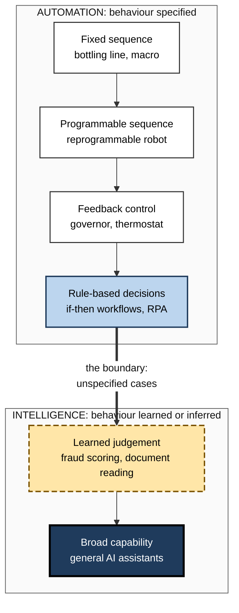
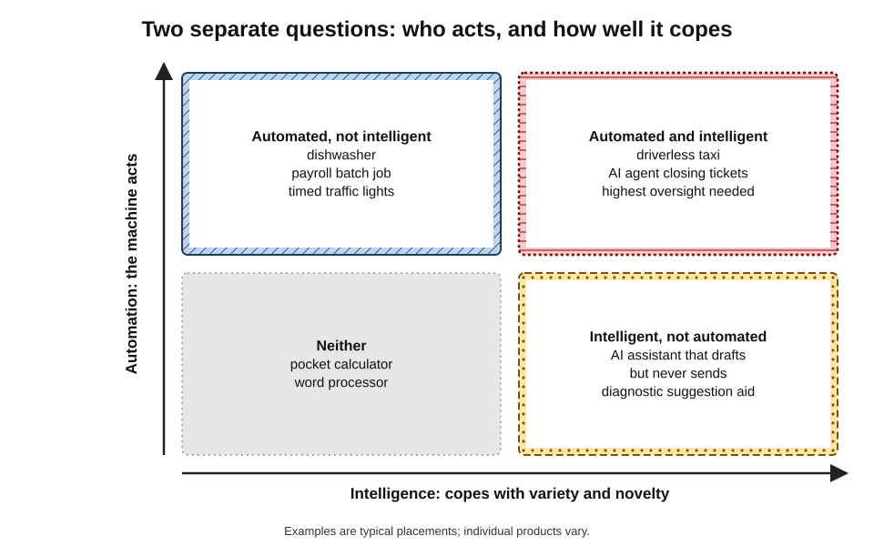
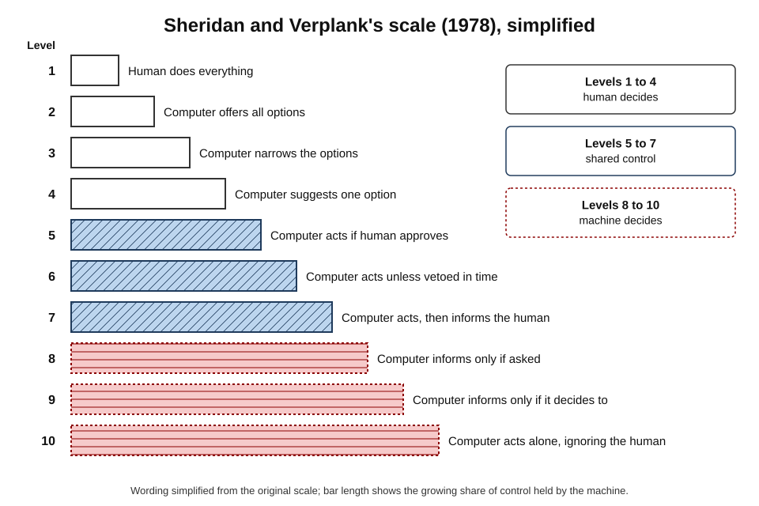
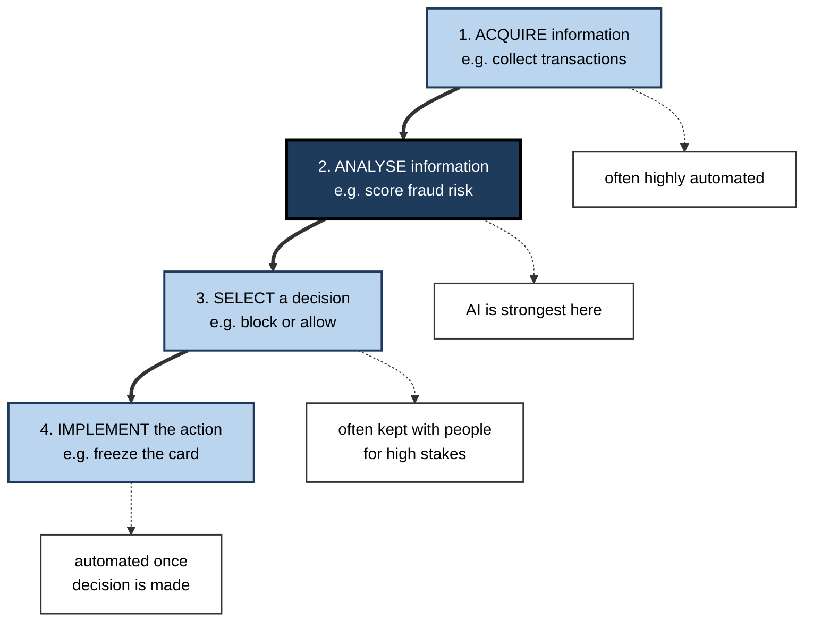
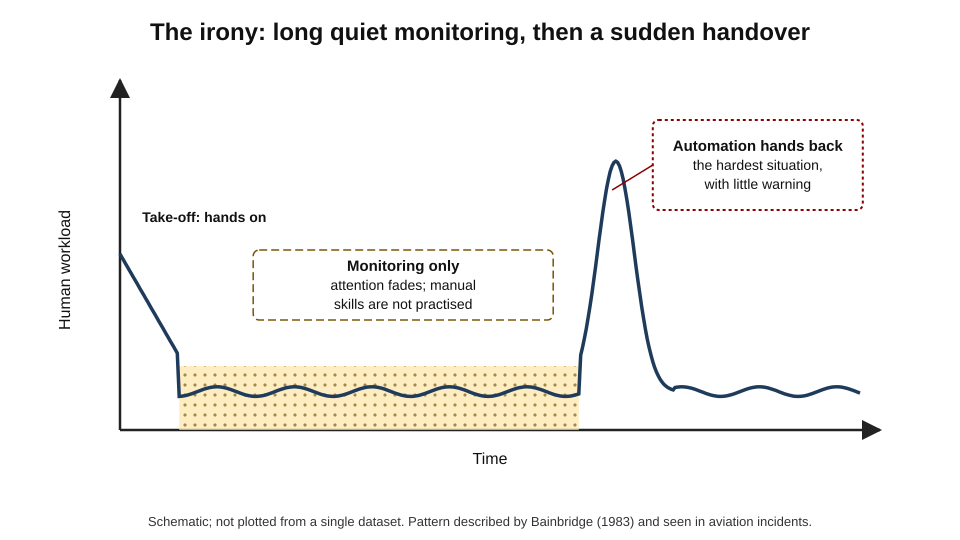
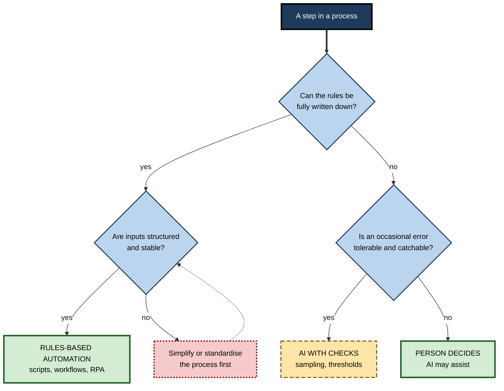

# A.6. Difference between automation and intelligence

A dishwasher runs a sixty-minute programme without anyone watching it. A factory robot welds the same seam ten thousand times a day without a single variation. A spreadsheet macro copies figures from fifty files into a report every Monday morning. None of these machines is intelligent — yet each is thoroughly **automated**.

Meanwhile, an AI writing assistant that can draft a persuasive letter about almost anything does nothing at all until someone asks. Automation and intelligence are **different properties**, and confusing them is one of the most common and costly mistakes made when organisations buy, build or trust technology.

> **Definition — Automation:** the use of technology to carry out a task with reduced or no human involvement, by following a procedure that has been specified in advance.

> **Definition — Intelligence (in a machine):** the capacity to achieve goals across varied situations — including unforeseen ones — by perceiving, learning, reasoning and adapting.

> **Definition — Intelligent automation:** automation in which some steps are performed by AI components — for example reading unstructured documents or making judgements — within an otherwise rule-based workflow.

**Why the distinction matters**

- **Choosing the right tool.** Many problems need reliable automation, not intelligence; others need intelligence, not automation.
- **Predicting failure.** Automated systems fail when the world departs from the script; intelligent systems fail in less predictable ways.
- **Designing oversight.** The more a system acts on its own, the more its errors propagate — whether or not it is intelligent.
- **Seeing through marketing.** "AI-powered" is often attached to straightforward automation; regulators have begun to penalise false claims.

---

## What Automation Is

### Origins of the word

- **"Automation"** came into common use in the late 1940s at the Ford Motor Company, where an engineering manager used it for the mechanical handling of parts between machines on production lines.
- **The idea is far older** — any mechanism that repeats a task without a person performing each step.

### Kinds of automation

- **Fixed (hard) automation** — machinery built for one task.
  - *e.g.* a bottling line; a stamping press.
- **Programmable automation** — the sequence can be changed between batches.
  - *e.g.* industrial robots reprogrammed for a new car model.
- **Feedback control** — the machine measures a result and corrects itself.
  - *e.g.* James Watt's centrifugal governor (1788), which opened or closed a steam valve to keep an engine's speed steady; a thermostat; cruise control.
- **Software automation** — scripts, macros, scheduled jobs and workflows.
  - *e.g.* an overnight job that reconciles payments; an email rule that files invoices.
- **Robotic process automation (RPA)** — software "robots" that operate other applications through their screens, clicking and typing as a person would.
  - *e.g.* copying data from emailed spreadsheets into a legacy finance system.

> **Definition — Feedback control:** automatic adjustment of a system's action based on measurement of its output, keeping a quantity near a target.

> **Key point:** feedback makes a machine **responsive**, not intelligent. A governor reacts to speed by a fixed law; it cannot notice that the engine is on fire.

### The properties of automation

- **Deterministic** — the same input produces the same output every time.
- **Specified** — every behaviour was decided by a designer.
- **Testable** — behaviour can be checked against the specification, case by case.
- **Brittle at the edges** — when an input falls outside what was specified, it fails, stops or does something wrong.
  - *e.g.* an RPA bot breaks when a supplier changes its spreadsheet layout or a screen button moves.

> **Watch out:** "deterministic" does not mean "safe". A rule that is followed perfectly can still be the wrong rule, and automated systems can repeat an error thousands of times before anyone notices.

---

## How Intelligence Differs

### The core contrasts

| | Automation | Intelligence |
|---|---|---|
| Source of behaviour | Specified in advance by people | Learned, inferred or reasoned, often not specified case by case |
| New situations | Fails, stops or misbehaves | Can often cope — imperfectly |
| Predictability | High: same input, same output | Lower: outputs may vary and surprise |
| Typical input | Structured, consistent | Unstructured and variable: text, images, speech |
| Testing | Against a specification | Statistically, on samples of cases |
| Explaining a decision | Point to the rule | Often difficult |
| Typical failure | Rigid error at the edge of the script | Plausible but wrong output; uneven competence |
| Maintenance | Update the rules when the process changes | Monitor, retrain, re-evaluate |

### The difference in one example

- **Automated invoice handling:** "If the invoice number matches an open purchase order and the amounts agree within £1, approve; otherwise send to a clerk."
  - Fast, cheap, auditable — but useless for a scanned, handwritten invoice in an unfamiliar layout.
- **Intelligent invoice handling:** a model reads any invoice image, extracts supplier, amounts and line items, and judges whether it probably matches an order.
  - Handles variety — but sometimes misreads a figure, and its confidence must be checked.

> **Remember:** automation answers "**how do we do the same thing reliably without a person?**"; intelligence answers "**how do we handle things we could not fully specify in advance?**"

**Figure 1.** From fixed automation to learning systems.

---

## Two Separate Dimensions

### Autonomy is not intelligence

- **Automation is about who acts** — the machine or a person.
- **Intelligence is about how well behaviour copes with variety and novelty.**
- **The two vary independently:**
  - **high automation, low intelligence** — dishwasher, payroll batch job, traffic lights on a timer;
  - **low automation, high intelligence** — an AI assistant that drafts but never sends; a diagnostic aid that suggests to a doctor;
  - **high automation, high intelligence** — a driverless taxi; an AI agent that resolves customer tickets end to end;
  - **low automation, low intelligence** — a hand calculator; a word processor.

**Figure 2.** Automation and intelligence as two separate dimensions.

> **Key point:** risk rises most steeply in the **top-right**: systems that are both autonomous and capable of unpredictable behaviour. But the **top-left** — autonomous and unintelligent — has caused many of the worst accidents in history, because rigid automation keeps acting when the world no longer matches its rules.

### Levels of automation

**Study card — Sheridan and Verplank (1978)**

- **Context:** research for the US Navy on teleoperated undersea systems.
- **Proposal:** a ten-point scale of how decisions are shared between human and computer, from:
  - **level 1** — the computer offers no assistance; the human does everything;
  - through **levels 3–5** — the computer suggests options, recommends one, or acts if the human approves;
  - to **level 10** — the computer decides everything and acts autonomously, ignoring the human.
- **Significance:** showed that automation is **a matter of degree**, not on or off.

**Figure 3.** A ten-step scale of automation, from human control to full machine autonomy.

- **Parasuraman, Sheridan and Wickens (2000)** — refined the idea: a system can be automated to different levels for **four separate functions**:
  1. **information acquisition** — gathering and filtering data;
  2. **information analysis** — interpreting and predicting;
  3. **decision selection** — choosing what to do;
  4. **action implementation** — carrying it out.
- **Driving automation (SAE J3016, first published 2014):** levels 0 (no automation) to 5 (full automation in all conditions), with the crucial line at **level 3**, where the system rather than the driver monitors the road within defined conditions.

**Figure 4.** Four functions that can each be automated to a different degree.

> **In practice:** describing a system by **which function is automated, to what level** is far more useful than calling it "automated" or "AI". A fraud system might automate analysis fully, recommend decisions, and require a person to approve freezing a business account.

---

## The Ironies of Automation

### Bainbridge's insight

**Study card — Lisanne Bainbridge, "Ironies of Automation" (1983)**

- **Observation:** designers automate the tasks they can, leaving people with the tasks they cannot — which are the **hardest and rarest**.
- **The ironies:**
  - operators are asked to **monitor** systems for long periods, which people do badly;
  - they must **take over** when automation fails — in the most difficult situations;
  - because the machine normally does the work, their **manual skills decay**, just when they are needed;
  - the more reliable the automation, the less practice operators get with failures.
- **Significance:** still one of the most cited papers in human-factors research; its predictions have been borne out in aviation, process control and driving.

**Figure 5.** The human's workload under automation: long, quiet monitoring broken by sudden, intense demands.

### How people misjudge automation

- **Vigilance decrement** — Norman Mackworth's wartime studies of radar observers (1948) found that the ability to detect rare signals falls within about half an hour of monitoring.
- **Use, misuse, disuse and abuse — Parasuraman and Riley (1997):**
  - **misuse** — relying on automation when it should not be trusted;
  - **disuse** — ignoring or switching off automation that would help, often after false alarms;
  - **abuse** — automating functions without regard for the human consequences.
- **Automation bias** — the tendency to accept an automated recommendation even when other evidence contradicts it, and to miss problems the automation does not flag.
- **Alarm fatigue** — so many alerts that people stop responding.

> **Definition — Automation bias:** the tendency to over-rely on automated systems, accepting their outputs without sufficient scrutiny.

> **Watch out:** automation bias applies with special force to AI. Fluent, confident outputs invite acceptance, and the cases where they are wrong are hard to spot — the same psychology that led pilots to trust instruments, now applied to paragraphs and recommendations.

### Case study: Air France Flight 447 (2009)

- **Situation:** on 1 June 2009 an Airbus A330 flying from Rio de Janeiro to Paris entered an area of storms over the Atlantic at night, with the autopilot engaged.
- **Trigger:** ice crystals temporarily blocked the aircraft's airspeed sensors. With unreliable speed data, the **autopilot disengaged** and handed control to the pilots, and flight-control protections changed mode.
- **What happened:**
  - the pilot flying made nose-up inputs that caused the aircraft to climb and then stall;
  - the crew did not recognise the stall, despite repeated stall warnings, and the confusing situation persisted for over three minutes;
  - the aircraft struck the ocean, killing all 228 people on board.
- **Findings of the French investigation authority (2012):** among the causes were the crew's lack of training in manual handling at high altitude, failure to recognise the stall, and the difficulty of understanding what the automated systems were doing.
- **Diagnosis in Bainbridge's terms:**
  - automation handled the routine and **handed back the hardest situation** without warning or context;
  - **manual skill** for that situation had rarely been practised;
  - the crew struggled to build a picture of a system they normally only monitored.
- **Lesson:** the danger of automation lies at the **handover**. Systems — including AI systems — must be designed for the moment they stop working, and people must keep the skills to take over.

### Rigid automation in other disasters

- **The Boeing 737 MAX (2018–19):** an automated flight-control function, acting on data from a single angle-of-attack sensor, repeatedly pushed the aircraft's nose down when that sensor failed; two crashes killed 346 people. The system was **not intelligent** — it followed its rule exactly — which is precisely why it kept acting on faulty data.
- **Lesson:** unintelligent automation is not safer by virtue of being simple; it is safe only when its rules match the world and its failures are anticipated.

---

## Choosing Between Automation, Intelligence and People

### A decision guide

**Figure 6.** Choosing rules-based automation, AI or a person for a step in a process.

### Worked example (illustrative): redesigning accounts payable

A company processes 10,000 supplier invoices a month. Today every invoice is keyed in by clerks.

| Invoice type | Share | Best approach | Reason |
|---|---|---|---|
| Structured e-invoices from large suppliers | 55 % | Rules-based automation | Fixed format; matching rules are clear |
| PDF and scanned invoices | 35 % | AI document reading, then rules-based matching | Layouts vary; AI extracts the fields |
| Disputed, unusual or high-value invoices | 10 % | Person decides, with AI summary | Judgement and supplier relationships matter |

*Illustrative figures.*

> **Formula — Straight-through processing rate:** invoices completed without human touch ÷ total invoices. If rules handle 95 % of e-invoices and AI plus rules handle 80 % of PDFs: (0.55 × 0.95 + 0.35 × 0.80) ÷ 1 = 0.5225 + 0.28 = **80.25 %**, leaving about 1,975 invoices a month for clerks instead of 10,000.

1. **Automate what is stable** — the e-invoices.
2. **Add intelligence where inputs vary** — the PDFs.
3. **Keep people where judgement matters** — disputes and high-value items.
4. **Design the handover** — clerks receive exceptions with the reason flagged, so they are not merely rubber-stamping.
5. **Monitor both** — rules break when suppliers change formats; AI accuracy drifts when invoice styles change.

> **Watch out:** the remaining ~20 % are the hardest invoices. Following Bainbridge, clerks now handle only difficult cases, with less routine practice — so training, rotation and clear exception reasons become more important, not less.

### "AI washing"

- **The practice:** labelling ordinary automation, or simple statistics, as "AI" to attract customers or investors.
- **Regulatory response:** in March 2024 the US Securities and Exchange Commission settled charges against two investment advisers for making false and misleading claims about their use of AI, with combined penalties of $400,000.
- **Questions that expose it:**
  - what does the system do that a set of rules could not?
  - what happens when it meets an input unlike any it was built for?
  - does its behaviour come from rules written by people, or from learning?

> **Key point:** there is nothing wrong with plain automation — it is often the **better** choice: cheaper, more predictable and easier to audit. The harm lies in **mislabelling** it, which leads buyers to expect adaptation it cannot provide.

---

## Testing Automation and Testing Intelligence

The two kinds of system demand different kinds of assurance.

### Testing automation

- **Specification-based testing** — every rule is checked against its intended behaviour, including boundary cases.
  - *e.g.* an invoice that differs from its purchase order by exactly £1.00, £1.01 and £0.99.
- **Coverage** — tests are designed to exercise every branch of the logic at least once.
- **Regression testing** — after any change, the full set of tests is re-run to confirm nothing else broke.
- **Result:** for a well-specified rule system, it is possible to say with high confidence that it behaves as designed — though not that the design is right.

### Testing intelligence

- **Statistical evaluation** — because inputs vary endlessly and outputs are learned, an AI component is tested on **samples** of realistic cases and its error rate is **estimated**, with uncertainty.
- **Ongoing monitoring** — accuracy can drift as the world changes, so tests continue after deployment.
- **Edge and shift testing** — deliberately unusual inputs reveal where competence ends.

> **Formula — Sample size to estimate an error rate:** n ≈ p(1 − p) × (1.96 ÷ E)², where p is the expected error rate and E the margin of error wanted (95 % confidence). Example: expecting about 5 % errors and wanting ±2 %: 0.05 × 0.95 × (1.96 ÷ 0.02)² = 0.0475 × 9,604 ≈ **456** cases.

| | Rule-based automation | AI component |
|---|---|---|
| What is tested | Each rule against the specification | Performance on samples of realistic cases |
| Typical evidence | Pass/fail on designed test cases | Estimated error rate with a margin of uncertainty |
| After deployment | Re-test when rules change | Monitor continuously for drift |
| What testing can establish | It does what was specified | How often it is right, on cases like those tested |

> **Key point:** a statement such as "the system is 95 % accurate" is meaningful only with three additions: **on what cases, measured how, and with what margin of error**.

---

## From Robotic Process Automation to AI Agents

### Two generations of software "workers"

- **RPA bots** follow recorded or scripted steps across applications — fast and literal.
- **AI agents** are given a goal in plain language and decide their own steps, using tools such as email, browsers and business systems.

| | RPA bot | AI agent |
|---|---|---|
| Instructions | Exact steps, scripted in advance | A goal; the agent plans steps |
| Handles a changed screen or format | Breaks | Often adapts |
| Predictability | High | Lower — may take unexpected routes |
| Typical error | Stops or repeats a step wrongly | Takes a plausible but wrong action |
| Audit | Script shows every step | Logs must be captured and reviewed |
| Best use | Stable, high-volume, rule-bound tasks | Varied tasks with checkable, reversible actions |

### Case study (illustrative): when the bot met a new form

- **Situation:** a mid-sized insurer used an RPA bot to copy details from an online claim form into its claims system — about 3,000 claims a month.
- **Event:** the web team added a new optional field and moved two others. The bot, matching screen positions, began entering **postcodes into the phone-number field** and **dates of birth into policy numbers**.
- **Detection:** the error ran for four days before a claims handler noticed garbled records; about 400 claims were affected.
- **Response:**
  1. the bot was paused and the records corrected by hand;
  2. a validation rule was added to reject implausible values (a postcode in a phone field);
  3. the web and automation teams agreed a change-notification procedure.
- **A later proposal:** replace the bot with an AI agent that "reads" the form like a person.
  - **Benefit:** it would adapt to layout changes.
  - **Risk:** it would occasionally misread a field **plausibly**, which validation rules might not catch.
  - **Decision:** use structured data from the form directly — **simpler automation**, not more intelligence — and keep the AI option for scanned paper claims.
- **Lesson:** the cure for brittle automation is not always intelligence. Often it is **better-designed automation** with validation and change control; intelligence is worth its unpredictability only where variety genuinely cannot be removed.

---

## Automation and Intelligence Across Industries

Most real systems combine rule-based automation with intelligent components. Seeing which is which, sector by sector, shows where each belongs.

| Sector | Rule-based automation | Intelligent component | Typical combination |
|---|---|---|---|
| Manufacturing | Robots repeating welds and placements | Vision systems spotting defects | Robots act; vision inspects; people handle exceptions |
| Banking | Standing orders, interest calculations, limit checks | Fraud scoring, document reading | Rules enforce limits; models flag risk; analysts decide on blocks |
| Healthcare | Drug-interaction alerts, appointment reminders | Image analysis, risk prediction | Rules guarantee safety checks; models prioritise; clinicians decide |
| Logistics | Sorting by barcode, scheduled dispatch | Demand forecasting, route optimisation under uncertainty | Rules move parcels; models plan; planners adjust |
| Customer service | Ticket routing by keyword, auto-acknowledgements | Understanding free-text queries, drafting replies | Rules route; AI drafts; agents approve and handle complex cases |

### What the pattern shows

- **Rules carry the guarantees** — limits, safety checks, legal requirements and anything that must always happen.
- **Intelligence handles the variety** — free text, images, uncertain forecasts and judgement calls.
- **People handle the exceptions and the accountability** — cases outside both, and the decisions that must be owned.

> **Remember:** **rules for what must always be true, intelligence for what cannot be specified, people for what must be answered for.**

### A note on work and skills

- Automation has long removed **routine** tasks; AI extends the reach into some **non-routine** cognitive tasks such as drafting and classification.
- In both cases the most durable human contributions are **framing problems, handling exceptions, exercising judgement and taking responsibility** — the very tasks Bainbridge warned would be left to people, and for which they must be kept in practice.

---

## Open Questions

- **How should oversight scale with autonomy and capability together?**
  - Frameworks treat levels of automation and AI risk separately; combining them coherently is unsettled.
- **Can the ironies of automation be avoided with AI?**
  - AI could keep people engaged by explaining, quizzing or sharing tasks — or could deepen skill decay by taking over more of the work. Evidence is early.
- **Where is the line between sophisticated automation and intelligence?**
  - Large rule systems and simple learned models overlap; the boundary is a continuum, not a wall.
- **How can handovers be made safe?**
  - Aviation and driving research gives partial answers; knowledge work is only beginning to face the problem.

---

## Summary

- **Automation** = performing a task with little or no human involvement by following a **specified** procedure; **intelligence** = coping with varied and unforeseen situations by perceiving, learning, reasoning and adapting.
- Kinds of automation: **fixed, programmable, feedback control, software automation, RPA**. Feedback makes machines **responsive**, not intelligent.
- Automation is **deterministic, specified, testable** and **brittle at the edges**; intelligence handles **unstructured, variable** inputs but is less predictable and harder to explain.
- Automation (**who acts**) and intelligence (**how well behaviour copes with novelty**) are **separate dimensions**; risk is highest when both are high, but rigid autonomous automation has caused many disasters.
- **Levels of automation** (Sheridan and Verplank; Parasuraman, Sheridan and Wickens; SAE driving levels) describe degrees of autonomy across **acquisition, analysis, decision and action**.
- **Bainbridge's ironies:** automation leaves people the hardest tasks, poor at monitoring and with decaying skills; **automation bias**, misuse and disuse follow. **Air France 447** and the **737 MAX** show the dangers at handover and of rigid rules.
- Choose **rules-based automation** for stable, structured steps, **AI with checks** for variable inputs where errors are tolerable, and **people** where judgement and stakes are high; beware **AI washing**.

---

## Self-Check

1. Define automation, machine intelligence and intelligent automation.
2. Why is a thermostat with feedback control automated but not intelligent?
3. List four properties of rule-based automation and explain "brittle at the edges" with an example.
4. Give one example for each quadrant of the automation–intelligence grid.
5. Describe Sheridan and Verplank's scale and what it showed.
6. Name the four functions in Parasuraman, Sheridan and Wickens's model and give a level for each in a medical-alert system.
7. State three of Bainbridge's ironies of automation.
8. Distinguish misuse, disuse and abuse of automation.
9. What is automation bias, and why might it be stronger with AI-generated text?
10. Explain how Air France 447 illustrates the danger of handover.
11. Why was the 737 MAX flight-control function dangerous precisely because it was not intelligent?
12. Recalculate the straight-through processing rate if AI handled only 60 % of PDFs. How many invoices would reach clerks?
13. What is "AI washing", and what three questions help expose it?
14. A hospital wants to "use AI" to schedule operating theatres. Using the decision guide, propose which parts should be rules-based, which AI-assisted and which human, and identify one irony of automation to guard against.

### Answer Key

1. Automation: performing a task with little or no human involvement by following a pre-specified procedure. Machine intelligence: coping with varied and unforeseen situations by perceiving, learning, reasoning and adapting. Intelligent automation: rule-based workflows in which some steps are performed by AI components.
2. It corrects itself by a fixed rule in response to temperature, but cannot recognise or cope with anything outside that rule — it does not learn, reason or adapt.
3. Deterministic, specified, testable, brittle at the edges. Brittle: an RPA bot fails when a supplier changes its spreadsheet layout, because the change was not specified.
4. High automation, low intelligence: payroll batch job. Low automation, high intelligence: AI assistant that drafts but does not send. High/high: driverless taxi. Low/low: pocket calculator.
5. A ten-point scale from the computer offering no assistance to the computer acting fully autonomously and ignoring the human; it showed that automation is a matter of degree.
6. Acquisition, analysis, decision selection, action implementation. In a medical-alert system: acquisition fully automated (monitors collect vital signs); analysis highly automated (risk score); decision moderate (system recommends, nurse decides); action low (nurse responds).
7. Operators are left the hardest tasks; people monitor poorly over long periods; manual skills decay through lack of practice; the more reliable the system, the less experience with failures.
8. Misuse: over-relying on automation when it should not be trusted. Disuse: ignoring helpful automation, often after false alarms. Abuse: automating without regard to human consequences.
9. Over-reliance on automated outputs without sufficient scrutiny. Fluent, confident AI text looks authoritative and its errors are hard to spot, inviting acceptance.
10. Automation handled routine flight, then disengaged in a confusing situation; the crew, rarely practised in manual high-altitude handling, did not recognise the stall. The most difficult moment was handed to people least prepared for it.
11. It followed its rule exactly, acting repeatedly on a single faulty sensor without recognising that the data made no sense — lacking any capacity to notice that the situation had departed from its assumptions.
12. (0.55 × 0.95 + 0.35 × 0.60) = 0.5225 + 0.21 = 0.7325 → **73.25 %**; about 2,675 invoices a month reach clerks.
13. Labelling ordinary automation or simple statistics as AI. Questions: what does it do that rules could not? What happens with unfamiliar inputs? Is its behaviour written by people or learned?
14. Rules-based: hard constraints such as theatre opening hours, staff working-time limits and equipment availability. AI-assisted: predicting case durations and cancellation risk from past data, proposing draft schedules. Human: final prioritisation of urgent cases and trade-offs between patients, made by clinicians. Guard against skill decay and automation bias — planners must still understand and challenge the schedule and be able to work manually if the system fails.

---

## Glossary

| Term | Meaning |
|---|---|
| AI washing | Falsely or misleadingly describing a product as using AI. |
| Alarm fatigue | Declining response to alerts because there are too many. |
| Automation | Performing a task with little or no human involvement by following a specified procedure. |
| Automation bias | Over-reliance on automated outputs without sufficient scrutiny. |
| Disuse | Ignoring or switching off automation that would help. |
| Feedback control | Automatic adjustment based on measuring output against a target. |
| Fixed automation | Machinery built to perform one task. |
| Handover | The transfer of control from automation to a person, or the reverse. |
| Intelligent automation | Rule-based workflows with some steps performed by AI components. |
| Ironies of automation | Bainbridge's observation that automation leaves people the hardest tasks with the least practice. |
| Levels of automation | Scales describing how decisions and actions are shared between human and machine. |
| Misuse | Relying on automation when it should not be trusted. |
| Programmable automation | Automation whose sequence can be changed between tasks. |
| Robotic process automation (RPA) | Software that operates other applications through their user interfaces as a person would. |
| Straight-through processing | Completion of a transaction without human intervention. |
| Vigilance decrement | Decline in detecting rare signals during prolonged monitoring. |
