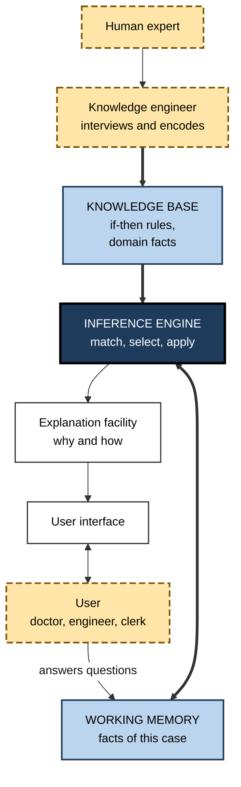
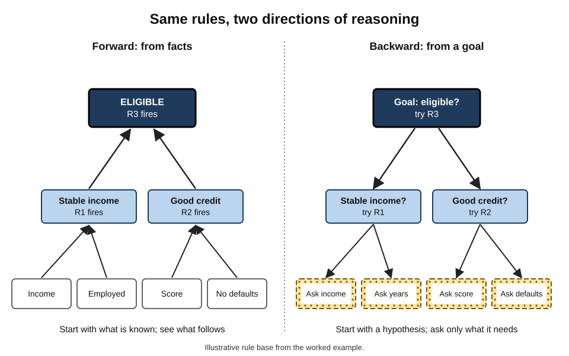
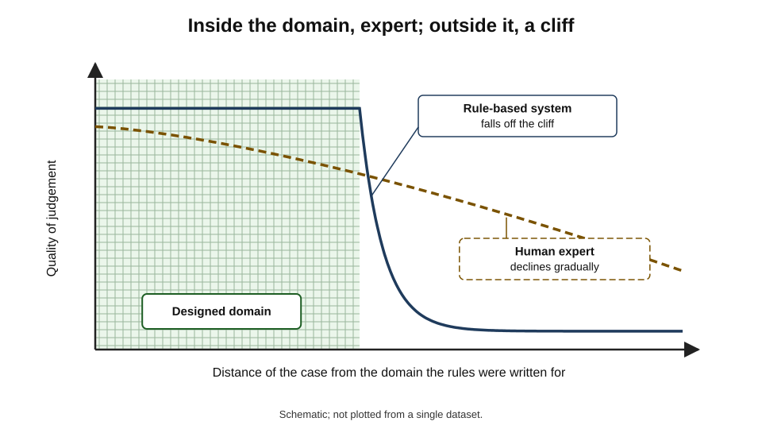
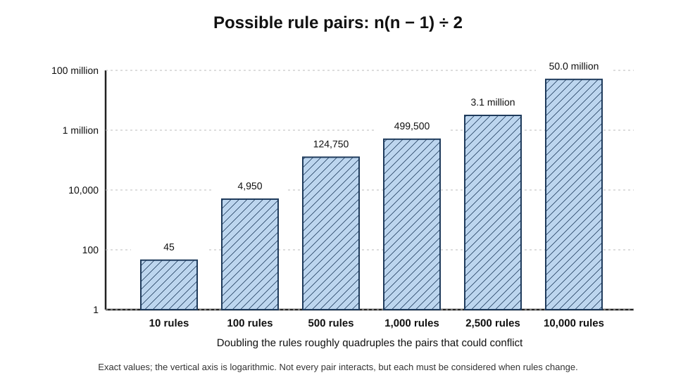
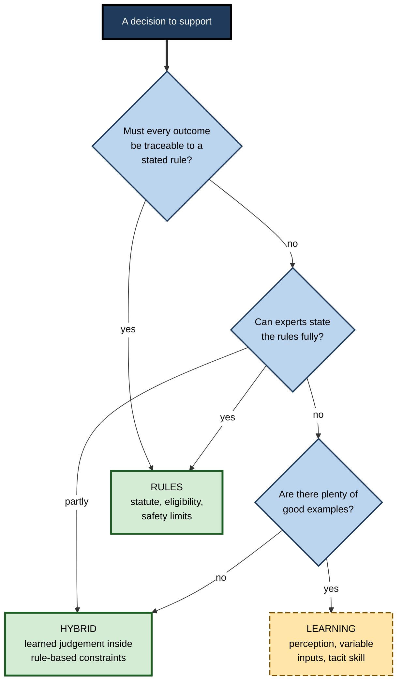

# A.7. Early rule-based systems and their limits

In a Stanford hospital in the mid-1970s, a doctor treating a patient with a severe blood infection could consult a computer program. It asked a series of questions — the patient's age, the site of the culture, the shape and staining of the organism — and then recommended antibiotics and doses. Asked *why* it wanted to know something, it replied by quoting the rule it was trying to apply.

In blind evaluations its advice was judged as good as that of specialists. Yet it was never used to treat a single patient. The story of such **rule-based systems** — how they worked, why they impressed, and why they hit hard limits — is the clearest lesson in AI about what writing knowledge down can and cannot achieve.

> **Definition — Rule-based system:** a computer system that reaches conclusions or takes actions by applying a set of explicit "if … then …" rules, written by people, to the facts of a situation.

> **Definition — Expert system:** a rule-based system designed to reproduce the judgement of human specialists in a narrow domain, such as diagnosing infections or configuring equipment.

**Why rule-based systems still matter**

- **They are everywhere.** Tax software, eligibility checks, fraud rules, compliance screens and many safety "guardrails" around modern AI are rule-based.
- **Their limits explain the turn to learning.** Most of the reasons AI moved towards learning from data were discovered by building expert systems.
- **Their strengths are still unmatched in places.** Where transparency, auditability and guaranteed behaviour matter, rules remain the right tool.
- **Their failure modes recur.** Brittleness, maintenance burden and missing common sense reappear in new forms whenever systems are built from specified knowledge.

---

## How a Rule-Based System Works

### The parts

- **Knowledge base** — the rules and stored facts about the domain.
  - *e.g.* "IF the organism is gram-positive AND grows in chains THEN it is probably streptococcus."
- **Working memory** — the facts about the current case.
  - *e.g.* "Patient 7: culture from blood; organism gram-positive; grows in chains."
- **Inference engine** — the program that matches rules against facts and decides which to apply.
- **Explanation facility** — shows which rules led to a conclusion and why a question is being asked.
- **User interface** — asks questions and presents conclusions.
- **Knowledge engineer** — the specialist who interviews experts and turns their knowledge into rules.

> **Definition — Production rule:** a rule of the form "IF conditions THEN actions or conclusions", the basic unit of knowledge in most rule-based systems.

> **Definition — Inference engine:** the component that applies rules to facts to derive new facts, conclusions or actions.

**Figure 1.** The architecture of a classic expert system.

### The recognise–act cycle

1. **Match** — find every rule whose IF part is satisfied by the facts in working memory.
2. **Resolve conflicts** — if several rules match, choose one by a strategy:
   - **specificity** — prefer the rule with more conditions;
   - **recency** — prefer rules using the newest facts;
   - **priority** — prefer rules the designer marked as more important.
3. **Act** — apply the chosen rule's THEN part, adding facts or taking an action.
4. **Repeat** until a goal is reached or no rule applies.

> **Watch out:** conflict resolution is where many rule systems behave unexpectedly. Adding one apparently harmless rule can change which rule wins elsewhere, altering conclusions in cases no one meant to touch.

### Forward and backward chaining

- **Forward chaining (data-driven)** — start from the facts, apply every rule that fits, and see what conclusions emerge.
  - Suits monitoring, configuration and planning — "given these components, what follows?"
- **Backward chaining (goal-driven)** — start from a hypothesis and work back through rules to see whether the facts support it, asking questions where facts are missing.
  - Suits diagnosis — "is it streptococcus? What would have to be true?"

| | Forward chaining | Backward chaining |
|---|---|---|
| Starts from | Known facts | A goal or hypothesis |
| Direction | Facts → conclusions | Goal → required facts |
| Asks questions | Rarely; uses what it has | Yes, only those relevant to the goal |
| Typical use | Configuration, monitoring, alerts | Diagnosis, eligibility, troubleshooting |
| Classic example | XCON configuring computers | MYCIN diagnosing infections |

**Figure 2.** Forward chaining reasons from facts; backward chaining reasons from a goal.

### Worked example (illustrative): a small loan-eligibility rule base

**Rules**

- **R1:** IF income ≥ £30,000 AND employment ≥ 2 years THEN *stable income*.
- **R2:** IF credit score ≥ 650 AND no defaults THEN *good credit*.
- **R3:** IF *stable income* AND *good credit* THEN *eligible*.
- **R4:** IF loan amount > 4 × income THEN *not eligible* (priority: high).

**Applicant:** income £42,000; employed 3 years; credit score 690; no defaults; loan £150,000.

**Forward chaining**

1. R1 fires → *stable income*.
2. R2 fires → *good credit*.
3. R3 fires → *eligible*.
4. R4 checks 150,000 > 4 × 42,000 = 168,000? **No** → does not fire.
5. **Conclusion:** eligible.

**Backward chaining from the goal "eligible?"**

1. Eligible needs *stable income* AND *good credit* (R3).
2. *Stable income* needs income and employment → asks both → satisfied.
3. *Good credit* needs score and defaults → asks both → satisfied.
4. Checks R4 for overriding high-priority rule → loan amount asked → not triggered.
5. **Conclusion:** eligible — reached by asking only the questions relevant to the goal.

> **Watch out:** the rules say nothing about a self-employed applicant with fluctuating income, a recent career break or income in another currency. The system will not ask; it will simply classify such applicants by rules that do not fit them. That silence is **brittleness**.

### Handling uncertainty: certainty factors

- **Experts reason with degrees of confidence**, not certainties.
- **MYCIN's certainty factors** — numbers from −1 (definitely false) to +1 (definitely true) attached to rules and conclusions.

> **Formula — Combining two positive certainty factors (MYCIN):** CF = CF₁ + CF₂ × (1 − CF₁). If one rule supports a diagnosis with 0.6 and another independently with 0.5: 0.6 + 0.5 × (1 − 0.6) = 0.6 + 0.2 = **0.8**.

> **Watch out:** certainty factors were a practical engineering device, not a sound theory of probability; later analysis showed they could give inconsistent results. Their shortcomings helped motivate probabilistic methods such as **Bayesian networks**, developed by Judea Pearl and others in the 1980s.

---

## Landmark Systems

**Study card — DENDRAL (Stanford, from 1965)**

- **Team:** Edward Feigenbaum, Bruce Buchanan, the geneticist Joshua Lederberg and the chemist Carl Djerassi.
- **Task:** infer the molecular structure of organic compounds from mass-spectrometry data.
- **Method:** generate candidate structures and prune them using chemists' rules about how molecules fragment.
- **Significance:** often described as the first expert system; it showed that **specialised knowledge**, more than general reasoning power, drove performance — the "knowledge is power" principle Feigenbaum championed.

**Study card — MYCIN (Stanford, 1970s)**

- **Developer:** Edward Shortliffe, with Bruce Buchanan and colleagues.
- **Task:** identify bacteria causing severe infections such as bacteraemia and meningitis, and recommend antibiotics.
- **Method:** several hundred production rules, backward chaining, certainty factors, and an explanation facility answering "why?" and "how?".
- **Evaluation (published 1979):** infectious-disease experts, not told which recommendations came from MYCIN, rated its therapy choices for meningitis cases as at least as acceptable as those of Stanford faculty specialists.
- **Fate:** never used in routine clinical care.
  - Consultations took considerable time, with data typed in by hand.
  - It did not connect to hospital record systems.
  - Questions of legal responsibility and clinician acceptance were unresolved.
- **Significance:** proved expert-level performance was possible in a narrow domain — and that **performance is not adoption**.

**Study card — XCON / R1 (Digital Equipment Corporation, from 1980)**

- **Developer:** John McDermott of Carnegie Mellon University, for DEC.
- **Task:** configure orders for DEC's VAX computers — selecting and arranging cabinets, cables, boards and power supplies so that systems would work as ordered.
- **Method:** forward chaining over production rules, growing from several hundred to thousands of rules.
- **Results reported:** by 1986 it had processed about 80,000 orders with 95–98 % accuracy, and DEC estimated savings of about **$25 million a year** through fewer configuration errors and faster assembly.
- **Significance:** the most cited commercial success of expert systems.

**PROSPECTOR (SRI International, late 1970s)** — a geological consultant that combined rules with probabilistic reasoning and was credited with helping identify a molybdenum deposit in Washington State in the early 1980s.

> **Key point:** each landmark system worked in a **narrow, stable domain** with well-understood expertise. That was not a coincidence — it was the condition of their success.

---

## Why Rule-Based Systems Appealed

- **Transparency** — every conclusion can be traced to specific rules.
- **Explanation** — the system can say why it asks and how it concluded.
- **Modularity** — in principle, knowledge can be added one rule at a time.
- **No data needed** — expertise, not historical records, is the raw material.
- **Capturing scarce expertise** — the knowledge of a few specialists could be made available everywhere.
- **Predictability** — the same facts always give the same answer.

> **In practice:** in regulated work — tax, benefits eligibility, safety interlocks, sanctions screening — these properties remain decisive. A rule can be shown to an auditor, a court or a regulator; a learned model's internal weights cannot.

---

## The Limits

### 1. The knowledge-acquisition bottleneck

- **Feigenbaum's term** for the slow, expensive work of extracting knowledge from experts.
- **Experts cannot state much of what they know** — their skill is partly tacit.
- **Experts disagree** — and the knowledge engineer must decide whose rules to encode.
- **Interviews distort** — experts describe what they think they do, which differs from what they actually do.

> **Definition — Knowledge-acquisition bottleneck:** the difficulty and cost of eliciting, formalising and validating expert knowledge as explicit rules.

### 2. Brittleness: the knowledge cliff

- **Inside its domain**, a rule-based system can perform at expert level.
- **Just outside it**, performance does not degrade gracefully — it **falls off a cliff**.
  - The system does not know that it does not know; it applies whatever rules match, or fails to conclude.
- **Human experts degrade gracefully** — they recognise unfamiliar cases, reason from general knowledge and ask colleagues.

**Figure 3.** The knowledge cliff: rule-based performance collapses outside the domain, while human performance declines gradually.

> **Definition — Brittleness:** the tendency of a system to fail abruptly, rather than gradually, when it meets situations outside those its designers anticipated.

### 3. The missing common sense

- **Rules rely on unstated background knowledge** that every person has and no rule base contains.
  - A medical system may not "know" that a patient who has died does not need antibiotics, or that men do not become pregnant — unless someone wrote a rule.
- **The qualification problem — John McCarthy (1980):** a rule such as "a boat can be used to cross a river" has endless exceptions — unless it has a hole, unless the oars are missing, unless the river is frozen — which no one can list completely.
- **The frame problem — McCarthy and Patrick Hayes (1969):** how to represent what does *not* change when an action is taken, without listing every unchanged fact.

> **Definition — Common-sense knowledge:** the vast, mostly unstated background knowledge about the everyday world that people use without noticing.

### 4. Interactions and maintenance

- **Rules interact.** With *n* rules there are *n*(*n* − 1) ÷ 2 possible pairs that might conflict or combine unexpectedly.

> **Formula — Possible rule pairs:** *n*(*n* − 1) ÷ 2. For 100 rules: 100 × 99 ÷ 2 = **4,950** pairs. For 2,500 rules: 2,500 × 2,499 ÷ 2 ≈ **3.1 million** pairs.

- **The world changes.** New products, regulations and treatments require rules to be added, changed and retired.
  - XCON needed a dedicated team of knowledge engineers to keep pace with DEC's changing product line.
- **Nobody understands the whole.** In large rule bases, the original authors move on and the logic becomes hard to follow — a problem now familiar as **technical debt**.

**Figure 4.** How the number of possible rule interactions grows as a rule base expands.

### 5. No learning

- **A rule-based system does not improve from experience.** Every error must be noticed by a person, diagnosed and fixed by editing rules.
- **The contrast that drove later AI:** systems that learn from examples improve with more data instead of more interviews.

### 6. The attempt to write down common sense: Cyc

- **Douglas Lenat began the Cyc project in 1984** to hand-encode the common-sense knowledge that expert systems lacked.
- **Scale:** over several decades, teams entered millions of assertions about everyday objects, events and relationships.
- **Outcome:** Cyc found some specialised uses but did not become the foundation of general machine common sense its founders hoped for.
- **Debate:** supporters argue the problem was underfunding and impatience; critics argue that common sense cannot be fully captured by hand-written statements.

| | Rule-based systems | Systems that learn from data |
|---|---|---|
| Source of knowledge | Interviews with experts | Examples and feedback |
| Transparency | High — rules can be read | Often low |
| Coping with the unexpected | Brittle — falls off a cliff | Degrades, sometimes oddly |
| Improvement | Manual editing | More data, retraining |
| Data needed | Little | Often a great deal |
| Best suited to | Stable, well-specified, auditable domains | Variable inputs, perception, tacit skill |

> **Mnemonic — "BBC MLC":** the limits — **B**ottleneck in acquisition, **B**rittleness, missing **C**ommon sense, **M**aintenance and interactions, no **L**earning, and the **C**yc lesson that common sense resists being written down.

---

## Rules Today

### Where rules still rule

- **Business rules engines** — pricing, discounts, eligibility, workflow routing.
- **Tax and benefits software** — encoding statute that must be followed exactly.
- **Compliance and sanctions screening** — rules that regulators can inspect.
- **Clinical decision support** — drug-interaction and allergy alerts in electronic health records.
  - **The alert-fatigue problem:** a 2006 systematic review found that clinicians overrode drug-safety alerts in roughly half to over nine-tenths of cases, many because the alerts were irrelevant to the patient — brittleness experienced as noise.
- **Guardrails around AI** — rules that block certain outputs, require approvals or restrict which tools an AI agent may use.
- **Hybrid systems** — learned models for perception and judgement, rules for constraints and safety; research on **neuro-symbolic** AI aims to combine the two more deeply.

**Figure 5.** When to use rules, when to use learning, and when to combine them.

### Case study: the rise and maintenance of XCON

- **Situation:** in the late 1970s DEC's VAX computers could be ordered in a huge number of combinations; configuring each order correctly took skilled technical editors, and errors meant missing parts, delays and free replacements.
- **Approach:**
  - John McDermott built R1 (later XCON) in a production-rule language, starting with several hundred rules elicited from DEC's experts;
  - the system checked each order and specified how components should be arranged.
- **Results:**
  - XCON entered use in 1980 and was extended to more product lines;
  - DEC reported about 80,000 orders processed by 1986 at 95–98 % accuracy and estimated savings of around $25 million a year.
- **The hidden cost:**
  - the rule base grew to thousands of rules as products multiplied;
  - every new product, option or policy required new and revised rules;
  - a permanent group of specialists was needed to maintain it, and understanding the interactions became steadily harder.
- **Aftermath:** XCON inspired many companies to build expert systems in the 1980s; few matched its success, and many proved too costly to maintain once their original builders left.
- **Lesson:** a rule-based system is not built once; it is **a living codification of a changing business**. Its value depends as much on the organisation's capacity to maintain it as on the quality of its first version.

---

## Lessons That Carry Forward

- **Narrow and stable beats broad and changing** for any system built from specified knowledge.
- **Performance is not adoption** — MYCIN's fate turned on workflow, integration and responsibility, not accuracy.
- **Know where the cliff is** — any system should be deployed with a clear statement of its domain and a way of detecting cases outside it.
- **Plan for maintenance from the start** — ownership, testing and change control.
- **Combine rules with learning deliberately** — rules for what must be guaranteed, learning for what cannot be written down.

> **Remember:** rules are **transparent but brittle**; learned systems are **flexible but opaque**. Good design uses each where its strength matters and its weakness is contained.

---

## Inside a Real Expert System

### What a MYCIN rule looked like

MYCIN's rules were stored in a formal language and could be translated into English. A frequently quoted example reads, in translation:

- **IF** the stain of the organism is gram-positive,
- **AND** the morphology of the organism is coccus,
- **AND** the growth conformation of the organism is clumps,
- **THEN** there is suggestive evidence (0.7) that the identity of the organism is staphylococcus.

- **Note the certainty factor (0.7)** — the rule expresses an expert's degree of belief, not a certainty.
- **Note the vocabulary** — every term (stain, morphology, conformation) had to be defined precisely and asked about in a fixed way.

### Explanation: "why?" and "how?"

- **"Why?"** — when asked why it wanted a fact, MYCIN showed the rule it was trying to apply and the goal that rule served.
  - *e.g.*, in paraphrase: "This will aid in determining the identity of the organism. It has already been established that the stain is gram-positive and the morphology is coccus; therefore, if the growth conformation is clumps, there is suggestive evidence that the organism is staphylococcus."
- **"How?"** — when asked how it reached a conclusion, it listed the rules and facts that contributed.
- **Why this mattered:** doctors could check the reasoning, disagree with a step and learn from the system — a level of transparency many later systems lack.

---

## Knowledge Engineering in Practice

### How experts' knowledge was extracted

- **Structured interviews** — asking experts to describe how they handle typical and difficult cases.
- **Think-aloud protocols** — experts solve real problems while speaking their thoughts; K. Anders Ericsson and Herbert Simon (1984) set out how such verbal reports can be used as data, and when they can be trusted.
- **Case review** — walking through past cases and asking what was decisive at each step.
- **Repertory grids** — a technique from the psychologist George Kelly's personal construct theory, used to draw out the distinctions experts make between cases.
- **Prototyping** — building a small rule base quickly, showing its conclusions to experts and refining it from their objections.

### The recurring problems

- **Experts cannot always say why** — they describe textbook reasoning rather than the cues they actually use.
- **Experts disagree** — two specialists may give different rules; the knowledge engineer must reconcile them or choose.
- **Rare cases are under-represented** — interviews concentrate on common cases, leaving gaps exactly where expertise matters most.
- **Validation is laborious** — every change must be tested against a growing library of cases.

| | Strength | Weakness |
|---|---|---|
| Structured interviews | Quick; easy to organise | Captures what experts think they do |
| Think-aloud protocols | Reveals actual reasoning steps | Slows the expert; may change the process |
| Case review | Grounded in real decisions | Hindsight may distort |
| Repertory grids | Surfaces tacit distinctions | Unfamiliar to experts; time-consuming |
| Prototyping | Fast feedback on errors | Can lock in early, poor structure |

> **In practice:** the same elicitation methods are used today to write **policies, prompts and evaluation criteria** for AI systems. Whenever an organisation tries to specify "what good looks like" for a machine, it meets the knowledge-acquisition bottleneck again.

### Worked example (illustrative): a rule that breaks a working process

A bank's payment-screening rule base contains:

- **R12:** IF payment > £10,000 AND destination is a new payee THEN hold for review.
- **R27 (added later):** IF customer is "premium" THEN release without review.

1. **Conflict:** a premium customer sends £50,000 to a new payee — both rules match.
2. **Resolution strategy:** the engine prefers the **most recently added** rule, so R27 wins and the payment is released.
3. **Effect:** a large payment to a new payee — a classic pattern in fraud — is released without review for exactly the customers most worth targeting.
4. **Fix:** give safety rules explicit **priority** over convenience rules, and add a regression test for every pair of rules that can both match.

> **Watch out:** no one intended this outcome; it emerged from the interaction of two individually sensible rules and an invisible conflict-resolution strategy. This is the maintenance problem in miniature.

---

## Open Questions

- **Can learned and symbolic approaches be truly integrated?**
  - Neuro-symbolic research is active, but no approach yet combines learned flexibility with rule-like guarantees at scale.
- **Can common sense ever be written down?**
  - Cyc's experience suggests hand-encoding alone is insufficient; whether learned systems acquire genuine common sense is debated.
- **How should rule-based guardrails around AI be designed?**
  - Rules that are too strict block useful outputs; rules that are too loose are easily evaded.
- **How can large rule bases be kept understandable?**
  - Modern software engineering offers testing and version control, but the interaction problem remains.

---

## Summary

- A **rule-based system** applies explicit **production rules** to facts; an **expert system** does so to reproduce specialist judgement in a narrow domain.
- Its parts: **knowledge base, working memory, inference engine, explanation facility, user interface**, built by a **knowledge engineer**.
- It runs a **match–resolve–act** cycle; **forward chaining** reasons from facts, **backward chaining** from goals; MYCIN handled uncertainty with **certainty factors**, later superseded by probabilistic methods.
- Landmark systems — **DENDRAL**, **MYCIN**, **XCON**, **PROSPECTOR** — succeeded in narrow, stable domains; MYCIN matched specialists but was never adopted.
- Strengths: **transparency, explanation, modularity, no data needed, predictability**.
- Limits: the **knowledge-acquisition bottleneck**, **brittleness** (the knowledge cliff), missing **common sense** (qualification and frame problems), **rule interactions and maintenance**, **no learning**, and the **Cyc** lesson.
- Rules remain essential in **tax, eligibility, compliance, clinical alerts and AI guardrails**, increasingly combined with learned components.

---

## Self-Check

1. Define a rule-based system, an expert system and a production rule.
2. Name the main components of an expert system and the role of each.
3. Describe the match–resolve–act cycle and three conflict-resolution strategies.
4. Distinguish forward from backward chaining and give a use for each.
5. In the loan example, would an applicant with income £35,000 and a loan of £150,000 be eligible? Show which rule decides.
6. Combine certainty factors of 0.4 and 0.7 using MYCIN's formula.
7. What did MYCIN's 1979 evaluation show, and why was it never used clinically?
8. What made XCON successful, and what was its hidden cost?
9. Explain the knowledge-acquisition bottleneck.
10. What is brittleness, and how does a "knowledge cliff" differ from human expert performance?
11. Explain the qualification problem with an example from your own field.
12. How many possible rule pairs exist in a 400-rule base?
13. Why do clinicians override most drug-safety alerts, and what does this reveal?
14. A regulator asks whether a bank's mortgage-affordability decisions should be made by rules or by a learned model. Advise, with reasons and a design.

### Answer Key

1. Rule-based system: applies explicit if–then rules written by people to facts. Expert system: a rule-based system reproducing specialist judgement in a narrow domain. Production rule: "IF conditions THEN actions/conclusions".
2. Knowledge base (rules and domain facts); working memory (facts of the case); inference engine (applies rules); explanation facility (why/how); user interface (questions and answers); knowledge engineer (elicits and encodes expertise).
3. Match rules whose conditions hold; resolve conflicts among them; act on the chosen rule; repeat. Strategies: specificity, recency, priority.
4. Forward: from facts to conclusions — configuration, monitoring. Backward: from a goal back to the facts needed — diagnosis, eligibility.
5. R4: 150,000 > 4 × 35,000 = 140,000 → yes, *not eligible* (high priority overrides R3 even if R1–R3 fire).
6. 0.4 + 0.7 × (1 − 0.4) = 0.4 + 0.42 = **0.82**.
7. Experts blind to the source rated its therapy recommendations at least as acceptable as Stanford specialists'. It was not adopted because consultations were slow, it did not integrate with hospital systems, and legal responsibility and acceptance were unresolved.
8. A narrow, stable, high-volume task with clear expertise, producing large savings and accuracy. Hidden cost: thousands of rules needing a permanent maintenance team as products changed.
9. Eliciting, formalising and validating expert knowledge is slow and costly, because much expertise is tacit, experts disagree, and they describe their practice inaccurately.
10. Abrupt failure outside the anticipated domain. Rule-based performance falls sharply at the domain edge; human experts decline gradually, recognising unfamiliar cases and reasoning from general knowledge.
11. A rule has endless unlisted exceptions — *e.g.* "a signed contract binds both parties" unless one party lacked capacity, unless it was signed under duress, unless it is void for illegality, and so on.
12. 400 × 399 ÷ 2 = **79,800**.
13. Many alerts are irrelevant to the specific patient because rules cannot capture context; the volume causes alert fatigue. It shows brittleness experienced as noise — and the safety risk when important alerts are overridden too.
14. Recommend a hybrid: hard rules for regulatory affordability limits, stress tests and prohibited factors, which must be auditable and explainable to applicants; a learned model may estimate risk or flag unusual income patterns within those constraints, monitored for bias; human underwriters review borderline and non-standard cases; all decisions logged with the rules applied and model inputs, with regular review as regulations change.

---

## Glossary

| Term | Meaning |
|---|---|
| Backward chaining | Reasoning from a goal back to the facts needed to support it. |
| Bayesian network | A graphical model representing probabilistic relationships among variables. |
| Brittleness | Abrupt failure on situations outside those anticipated. |
| Certainty factor | MYCIN's number from −1 to +1 expressing confidence in a rule or conclusion. |
| Common-sense knowledge | Unstated everyday background knowledge people use without noticing. |
| Conflict resolution | The strategy for choosing which of several matching rules to apply. |
| Cyc | A long-running project to hand-encode common-sense knowledge, begun in 1984. |
| Expert system | A rule-based system reproducing specialist judgement in a narrow domain. |
| Explanation facility | The component that shows why a question is asked and how a conclusion was reached. |
| Forward chaining | Reasoning from known facts to whatever conclusions follow. |
| Frame problem | The difficulty of representing what does not change when an action occurs. |
| Inference engine | The component that applies rules to facts. |
| Knowledge base | The stored rules and facts of a domain. |
| Knowledge engineer | A specialist who elicits expert knowledge and encodes it as rules. |
| Knowledge-acquisition bottleneck | The difficulty and cost of turning expert knowledge into rules. |
| Neuro-symbolic AI | Approaches combining learned neural models with symbolic rules and reasoning. |
| Production rule | A rule of the form IF conditions THEN actions or conclusions. |
| Qualification problem | The impossibility of listing every exception to a rule about the world. |
| Rule-based system | A system that applies explicit if–then rules to facts. |
| Working memory | The facts about the current case held during reasoning. |
