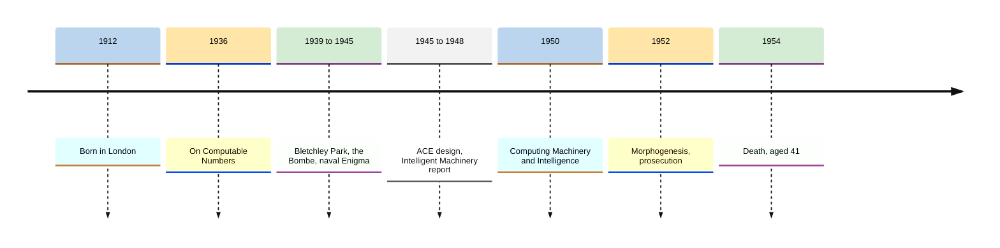
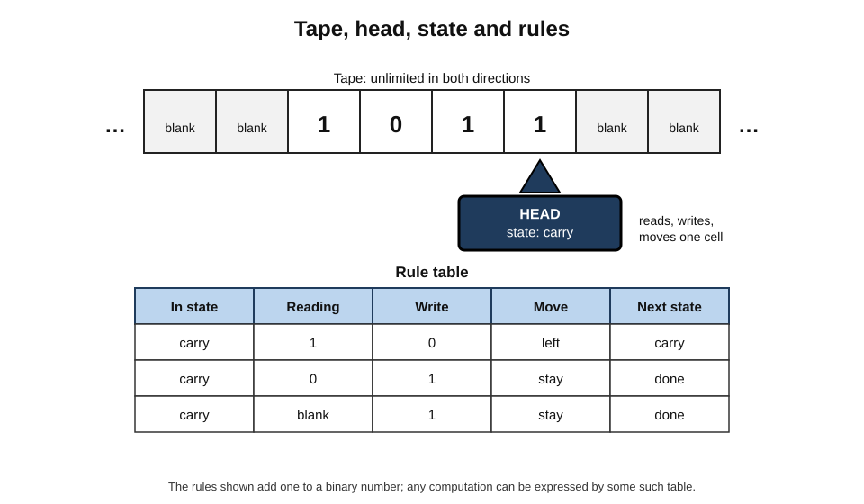
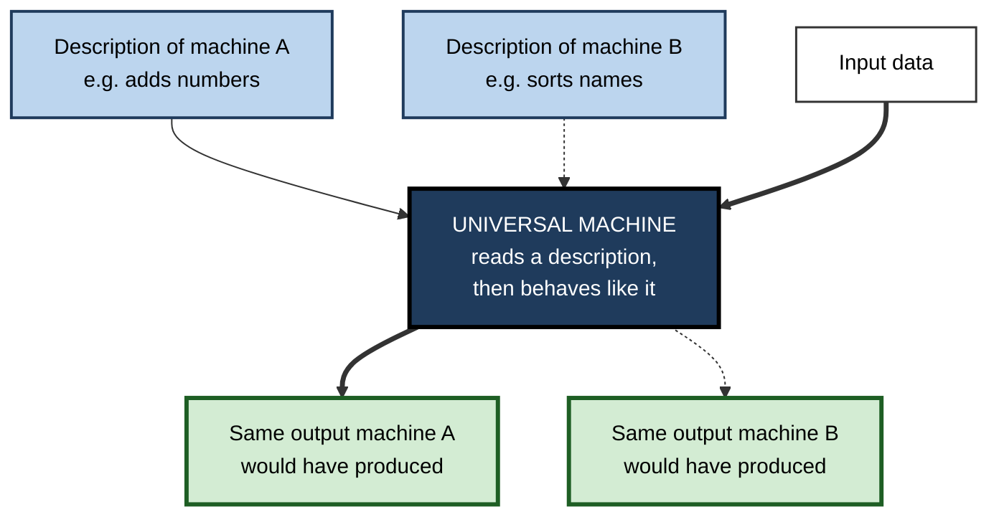
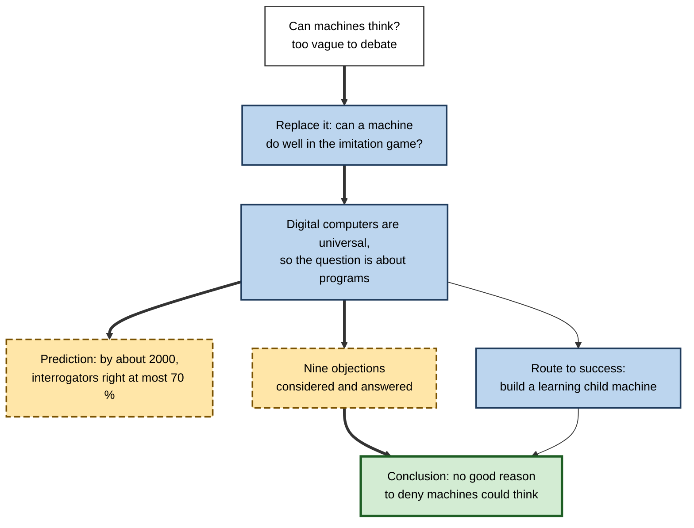
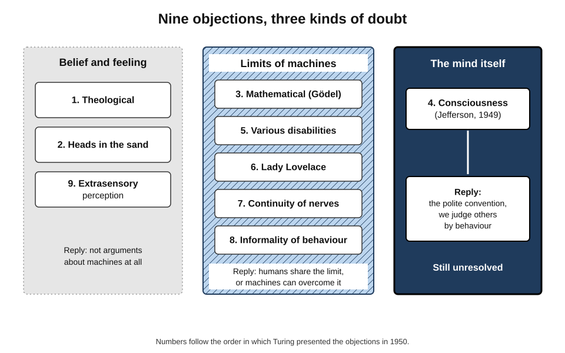

# A.8. Alan Turing and the question of machine thinking

In October 1950 the philosophy journal *Mind* published a paper that opened: "I propose to consider the question, 'Can machines think?'" Its author, Alan Turing, had already defined what a computer is — on paper, fourteen years before working computers existed — and had spent the war breaking German ciphers with machines he helped design.

In about twenty-five pages he reframed the question, predicted its answer, and answered in advance nearly every objection people still raise today. Understanding Turing's argument is the clearest way into the question of whether machines can think, and why it is so hard to settle.

> **Definition — The question of machine thinking:** whether a machine could, in any meaningful sense, think — and, if so, how anyone could tell.

> **Definition — Turing machine:** an abstract model of computation consisting of an unlimited tape of symbols, a head that reads and writes one symbol at a time, and a finite table of rules that, given the current state and symbol, decides what to write, which way to move and which state to enter next.

**Why Turing still matters**

- **He defined computation.** Every computer — and so every AI system — is, in principle, a Turing machine.
- **He turned a metaphysical question into a practical one.** Instead of arguing about the word "think", he proposed a test of behaviour.
- **He anticipated the objections.** The arguments he answered in 1950 — about consciousness, creativity, mistakes and originality — are the ones made about AI now.
- **He foresaw learning machines.** He argued that the way to an intelligent machine was to build one that could learn, as a child does.

---

## A Life in Brief

### Early years and Cambridge

- **Born 23 June 1912** in London; showed early talent for mathematics and science, often at odds with a school curriculum that favoured classics.
- **King's College, Cambridge (from 1931)** — read mathematics; elected a fellow in 1935 for a proof of the central limit theorem in probability, which he had found independently.
- **1936 — "On Computable Numbers"** — the paper that defined the Turing machine.
- **Princeton (1936–38)** — doctorate under the logician Alonzo Church, who had reached a parallel result by a different route.

### Bletchley Park

- **From September 1939** Turing worked at the Government Code and Cypher School at Bletchley Park.
- **The Bombe** — an electromechanical machine for finding the daily settings of the German Enigma cipher machine.
  - It built on the Polish **bomba** and on the Polish mathematicians' breakthroughs against Enigma — led by Marian Rejewski — which were shared with Britain and France in July 1939.
  - Turing's design, with an important improvement by Gordon Welchman, searched for settings consistent with a guessed fragment of plain text.
- **Hut 8** — Turing led the section attacking the especially difficult **naval Enigma**, vital in the Battle of the Atlantic.

> **Watch out:** claims that Turing's work "shortened the war by two years" or "saved fourteen million lives" are often repeated but are **estimates**, not established facts. Codebreaking was a vast collective effort involving thousands of people — many of them women who operated the Bombes — and Polish, British and American contributions.

### After the war

- **National Physical Laboratory (1945–47)** — designed the **Automatic Computing Engine (ACE)**, one of the first complete designs for a stored-program computer; a smaller Pilot ACE ran in 1950.
- **"Intelligent Machinery" (1948)** — an internal report, not published until 1968, setting out ideas about learning machines and networks of simple units.
- **Manchester (from 1948)** — worked on software for the Manchester computers and wrote one of the first programming manuals.
- **1950 — "Computing Machinery and Intelligence"** in *Mind*.
- **1951 — BBC radio talks** on whether digital computers could think.
- **1952 — morphogenesis** — a pioneering mathematical theory of how patterns such as spots and stripes form in living things.
- **Chess** — with David Champernowne he wrote a chess-playing algorithm in 1948; with no computer able to run it, he played it out by hand in 1952, taking about half an hour per move, and lost.

### Prosecution and death

- **1952** — after reporting a burglary, Turing acknowledged a sexual relationship with a man, then a crime in Britain. He was convicted of "gross indecency" and chose, as an alternative to prison, a year of hormone treatment with synthetic oestrogen; his security clearance was withdrawn.
- **7 June 1954** — Turing died of cyanide poisoning at his home in Wilmslow, aged 41; the inquest recorded suicide.
  - Some biographers have questioned that verdict; the evidence is inconclusive.
- **Recognition:** a public apology from the British prime minister (2009); a posthumous royal pardon (2013); a 2017 law pardoning men convicted under similar historic offences, informally called "Turing's law"; his portrait on the Bank of England £50 note (2021). The Association for Computing Machinery's highest honour, the **Turing Award**, has been given since 1966.

**Figure 1.** Alan Turing's life and work.

---

## Defining Computation: "On Computable Numbers" (1936)

### The problem Turing solved

- **David Hilbert's *Entscheidungsproblem* (decision problem, 1928):** is there a mechanical procedure that can decide, for any statement of mathematical logic, whether it is provable?
- **To answer, someone had to define "mechanical procedure" precisely.** Turing did so by imagining a human clerk following rules with pencil and paper — and then stripping the clerk down to the simplest possible machine.

### The Turing machine

- **Tape** — an unlimited strip divided into cells, each holding a symbol (such as 0, 1 or blank).
- **Head** — reads the symbol in one cell, can write a new symbol and move one cell left or right.
- **State** — the machine is always in one of a finite number of internal states.
- **Rule table** — for each combination of state and symbol read: what to write, which way to move, which state to enter.

**Figure 2.** A Turing machine: a tape, a read–write head and a table of rules.

### Worked example: a Turing machine that adds one to a binary number

The tape holds **1 0 1 1** (eleven); the head starts on the rightmost digit in state *carry*.

| Rule | In state | Reading | Write | Move | Next state |
|---|---|---|---|---|---|
| 1 | carry | 1 | 0 | left | carry |
| 2 | carry | 0 | 1 | stay | done |
| 3 | carry | blank | 1 | stay | done |

1. Reads **1** (rightmost) → rule 1: write 0, move left. Tape: 1 0 1 **0**.
2. Reads **1** → rule 1: write 0, move left. Tape: 1 0 **0** 0.
3. Reads **0** → rule 2: write 1, stop. Tape: 1 **1** 0 0.
4. **Result:** 1100 = **twelve**. Eleven plus one is twelve.

> **Key point:** three rules suffice for this task. Turing argued that **anything** a person can compute by following explicit rules can be computed by some machine of this kind — given enough tape and time.

### The universal machine

- **Turing's central insight:** one machine, the **universal Turing machine**, can read a *description* of any other Turing machine from its tape and then imitate it.
- **Consequence:** there is no need for a separate machine for each task — one general-purpose machine plus the right program will do. This is the theoretical idea behind every stored-program computer.

**Figure 3.** The universal machine: one machine that can imitate any other, given its description.

### What cannot be computed

- **The halting problem** — Turing proved that **no** machine can decide, for every program and input, whether that program will eventually stop.
- **Therefore** the *Entscheidungsproblem* has no general solution — some questions cannot be settled by any mechanical procedure.
- **Church–Turing thesis** — the widely accepted claim that Turing machines capture everything that can be computed by any effective procedure; Church's lambda calculus turned out to be equivalent.

> **Definition — Church–Turing thesis:** the thesis that any function computable by an effective, step-by-step procedure can be computed by a Turing machine.

> **Watch out:** the thesis concerns **what** can be computed, not how fast. A problem can be computable in principle yet take longer than the age of the universe — so "a computer could do it in principle" is not the same as "a computer can do it".

---

## "Computing Machinery and Intelligence" (1950)

### Replacing the question

- **Turing judged "Can machines think?" too vague to debate**, because "machine" and "think" have no agreed meaning.
- **He replaced it** with a behavioural question: could a machine do well in an **imitation game**, in which an interrogator converses in writing with a hidden machine and a hidden person and tries to tell which is which?
- **The move:** if a machine's conversation cannot be told from a person's, the burden falls on the sceptic to say what further evidence of thought is needed.

### Turing's predictions

- **On capability:** in about fifty years it would be possible to program computers with a storage capacity of about 10⁹ (in modern terms, roughly 125 megabytes) to play the game so well that "an average interrogator will not have more than 70 per cent chance of making the right identification after five minutes of questioning."
- **On language:** by the end of the century, "the use of words and general educated opinion will have altered so much that one will be able to speak of machines thinking without expecting to be contradicted."

> **Formula — Turing's threshold:** interrogator's chance of a correct identification ≤ 70 % after five minutes ⇔ the machine is mistaken for the human in at least 30 % of conversations. Example: if interrogators are right in 64 of 100 five-minute conversations, the machine "fooled" them 36 % of the time — above Turing's threshold.

**Figure 4.** The structure of Turing's 1950 argument.

---

## The Nine Objections

Turing listed the objections he expected and replied to each. They fall into three families.

### Objections from belief and feeling

- **1. The theological objection** — thinking is a function of an immortal soul, which God gave only to humans.
  - **Reply:** this restricts God's power; if God chose, He could give a soul to a machine. Turing added that theological arguments had a poor record, recalling the use of scripture against Galileo's astronomy.
- **2. The "heads in the sand" objection** — the consequences of thinking machines would be too dreadful, so let us hope they cannot exist.
  - **Reply:** not an argument at all; it calls for consolation, not refutation.
- **9. The argument from extrasensory perception** — humans may have telepathic abilities no machine could match.
  - **Reply:** Turing, influenced by claimed experimental evidence of his era, took this surprisingly seriously and proposed putting the competitors in a "telepathy-proof room". The evidence he relied on has not held up.

### Objections from the limits of machines

- **3. The mathematical objection** — Gödel's incompleteness theorems and Turing's own results show that any machine has questions it cannot answer.
  - **Reply:** humans also have limits and often give wrong answers; there is no proof that human minds escape such limits. A machine's limitation shows it is not omniscient, not that it cannot think.
- **5. Arguments from various disabilities** — "a machine can never be kind, have a sense of humour, fall in love, enjoy strawberries and cream, make mistakes, learn from experience, do something really new…"
  - **Reply:** these are generalisations from the limited machines people had seen. Several — making mistakes, learning from experience — are easily achieved.
- **6. Lady Lovelace's objection** — a machine can only do what we know how to order it to perform; it cannot originate anything.
  - **Reply:** machines frequently **surprise** their makers, because their makers cannot foresee every consequence of their programs; and a learning machine could come to do things no one ordered.
- **7. The argument from continuity in the nervous system** — the brain is continuous and analogue, not discrete like a digital computer.
  - **Reply:** a digital machine can imitate a continuous one closely enough that an interrogator could not tell the difference.
- **8. The argument from informality of behaviour** — no set of rules could cover every situation a person meets.
  - **Reply:** the absence of complete rules of *conduct* does not show there are no laws of *behaviour* underlying it; we cannot know we are not, in some sense, rule-governed.

### The objection from consciousness

- **4. The argument from consciousness** — the neurosurgeon Geoffrey Jefferson argued in 1949 that no machine could equal the brain until it could write a sonnet "because of thoughts and emotions felt, and not by the chance fall of symbols", and know that it had written it.
  - **Reply:** taken strictly, the only way to know whether anything thinks is to *be* it — which leads to solipsism, the view that only oneself has a mind. People ordinarily extend a **polite convention** that others think, on the basis of their behaviour; the same convention could be extended to machines.

| | The objection says | Turing's reply in brief | How it looks today |
|---|---|---|---|
| Consciousness | Thinking requires felt experience | Then we cannot know other people think either | The central unresolved debate |
| Lovelace | Machines only do what they are told | Machines surprise their makers; learning machines originate | Learning systems routinely produce behaviour no one programmed |
| Disabilities | Machines can never do X | Generalised from limited machines | Many listed abilities now achieved; others disputed |
| Mathematical | Machines have provable limits | So do humans | Accepted as a limit on all computation, not a barrier to thought |
| Informality | No rules can cover all of life | No complete rules of conduct ≠ no laws of behaviour | Learning from examples avoids writing all rules |

**Figure 5.** Turing's nine objections, grouped by the kind of doubt they express.

> **Key point:** Turing's strategy throughout was to ask whether the objection applied **equally to people**. If it did, it could not be used to deny thought to machines alone.

---

## Learning Machines

### The child machine

- **Turing's proposal (1950):** "Instead of trying to produce a programme to simulate the adult mind, why not rather try to produce one which simulates the child's?"
- **Three ingredients of the adult mind:**
  - the **initial state** of the mind, at birth;
  - the **education** it receives;
  - **other experience**, not described as education.
- **The plan:** build a simple child machine and educate it, using rewards and punishments, and refine the design by trial — "an analogy with evolution".
- **A random element** — he suggested that a learning machine might include randomness, to avoid getting stuck.

### Unorganised machines

- **In the 1948 "Intelligent Machinery" report**, Turing described networks of simple, randomly connected units that could be "organised" by training — an early anticipation of **neural networks**, which remained largely unknown because the report was unpublished for twenty years.

> **Watch out:** it is tempting to read later AI back into Turing. He anticipated **learning** and **networks of simple units** in outline; he did not anticipate the specific methods or the vast data and computing power on which modern systems depend.

---

## Assessing Turing's Legacy

### How the predictions fared

- **Storage** — computers passed 10⁹ bits of memory long before 2000; this part was modest.
- **The imitation game** — no system convincingly met his five-minute threshold by 2000. In 2025, researchers at the University of California, San Diego reported that a large language model, prompted to adopt a humanlike persona, was judged to be the human in a three-party version of the game more often than the real human participants.
- **Language** — people now routinely say that software "thinks", "understands" or "decides", though whether that reflects belief or convenient metaphor is unclear.

### What he got right — and what remains open

- **Right:** that a universal machine could in principle perform any precisely describable task; that learning would matter more than hand-written programs; that objections would centre on consciousness and originality.
- **Open:** whether behaving indistinguishably from a thinking being is the **same as** thinking — the question his test was designed to sidestep and that his critics insist cannot be sidestepped.

### Case study: industrialised codebreaking at Bletchley Park

- **Situation:** by 1939 the German armed forces relied on Enigma machines whose daily settings offered an astronomically large number of possibilities.
- **Inherited insight:** Polish cryptanalysts had reconstructed the machine's wiring and built devices to search settings; in July 1939 they shared their results with British and French intelligence.
- **Actions:**
  1. **Mathematical insight** — Turing and others exploited the structure of messages, using guessed fragments of plain text ("cribs") to rule out most settings logically.
  2. **Machines** — the Bombe searched remaining settings at high speed; the first went into service in 1940, and around two hundred were operating in Britain by the end of the war.
  3. **Organisation** — thousands of staff, many from the Women's Royal Naval Service, operated the machines in shifts, and analysts turned decrypts into intelligence.
- **Result:** Allied commanders received a large flow of decrypted German messages, including — after long struggle — naval Enigma traffic important to the Battle of the Atlantic.
- **Side effects:** secrecy, maintained for decades, meant that the participants' achievements — and the early lead in electronic computing represented by Colossus — went unrecognised and unexploited.
- **Lesson:** Turing's greatest practical success came not from a machine replacing human thought but from **combining human insight, machine search and organised human labour** — a pattern that still describes effective uses of AI.

---

## Turing's Ideas in Today's AI

Many of Turing's ideas, sketched between 1936 and 1952, have direct descendants in present-day computing and AI.

| Turing's idea | Where it appeared | Its modern descendant |
|---|---|---|
| The universal machine | "On Computable Numbers" (1936) | General-purpose computers and cloud platforms running any software |
| Limits of computation | The halting problem (1936) | Proven limits on what program-checking tools can guarantee |
| The imitation game | "Computing Machinery and Intelligence" (1950) | Human-judged evaluations of chatbots; debates about AI deception |
| The child machine | 1950 paper | Systems that acquire competence by learning rather than programming |
| Unorganised machines | "Intelligent Machinery" (1948) | Artificial neural networks trained from random starting connections |
| A random element | 1950 paper | Randomness in training and in how models choose their outputs |
| Reply to Lovelace | 1950 paper | Learning systems producing strategies and behaviour no one programmed |
| Chess by algorithm | Turochamp, with Champernowne (1948) | Game-playing programs that surpass human champions |

> **Key point:** Turing contributed both the **foundation** (what computation is) and the **agenda** (whether computation could amount to thought, and how a machine might learn) — which is why he is regarded as a founder of computer science and of AI alike.

### Turing in popular memory

- **The 2014 film *The Imitation Game*** brought his story to a wide audience but took many liberties.
  - It shows him building the codebreaking machine almost single-handedly and naming it "Christopher"; in fact the Bombe was a team effort built on Polish work, engineered by the British Tabulating Machine Company, and the name is a dramatic invention.
  - It compresses and rearranges events and invents conflicts for drama.
- **Why it matters:** popular portraits of the "lone genius" obscure how computing and codebreaking actually progressed — through teams, institutions and international cooperation.

> **Watch out:** Turing is sometimes described as having "invented the computer". He defined the theoretical idea of a universal computing machine and designed early computers, but the first working machines were built by many people in several countries, often independently of his work.

### Reading the 1950 paper today

- **It is short, witty and readable** — written for philosophers, with almost no mathematics.
- **Its tone is exploratory** — Turing calls some of his own arguments "recitations tending to produce belief" rather than proofs.
- **Its framing is of its time** — the original game involves a man imitating a woman, and some passages reflect 1950s assumptions; the core argument does not depend on them.
- **Its central move endures** — whenever people ask whether a machine "really" understands, they face Turing's question of what evidence, beyond behaviour, they would accept.

---

## Open Questions

- **Is behaviour enough to establish thought?**
  - Turing argued that it is all we have for other people; critics argue that inner experience or understanding is essential and invisible to behavioural tests.
- **Does the human mind exceed computation?**
  - A minority of thinkers — notably the physicist Roger Penrose — argue from Gödel's theorems that human understanding is not computable; most logicians and computer scientists disagree.
- **Was Turing right that learning is the route?**
  - Modern successes of learning systems support him; whether learning alone leads to general intelligence is debated.
- **How should "polite convention" be applied?**
  - If people extend the assumption of thought on the basis of behaviour, should they extend it to fluent machines — and with what consequences?

---

## Summary

- **Alan Turing (1912–1954)** — mathematician, codebreaker and founder of computer science; prosecuted in 1952 for homosexuality, he died in 1954; later apologised to, pardoned and commemorated.
- **"On Computable Numbers" (1936)** defined the **Turing machine** — tape, head, states, rules — and the **universal machine**, and proved that some problems (the **halting problem**) cannot be computed; with Church's work this underpins the **Church–Turing thesis**.
- At **Bletchley Park** he led the attack on naval Enigma and helped design the **Bombe**, building on Polish work, within a huge collective effort.
- **"Computing Machinery and Intelligence" (1950)** replaced "Can machines think?" with the **imitation game**, predicted machines would pass a five-minute version by about 2000, and answered **nine objections**, chiefly by asking whether each applied equally to humans.
- The **argument from consciousness** met the reply of the **polite convention**; **Lady Lovelace's objection** met the reply that machines surprise their makers and can learn.
- Turing proposed **learning child machines** and, in 1948, networks of **unorganised** units resembling neural networks.
- His capability prediction was late; a 2025 study reported a language model judged human more often than humans in a three-party test. Whether passing such tests amounts to **thinking** remains open.

---

## Self-Check

1. Why did Turing consider "Can machines think?" an unsatisfactory question, and what did he replace it with?
2. Describe the four parts of a Turing machine.
3. Trace the add-one machine on the tape 0 1 1 1. What is the result?
4. What is the universal Turing machine, and why does it matter for modern computers?
5. What is the halting problem, and what did its unsolvability show?
6. State the Church–Turing thesis and one common misunderstanding of it.
7. What were Turing's two predictions in 1950?
8. If interrogators correctly identify the machine in 75 of 100 five-minute conversations, has it met Turing's threshold? Explain.
9. Summarise the argument from consciousness and Turing's reply.
10. How did Turing answer Lady Lovelace's objection?
11. Give two items from the "various disabilities" list and explain why Turing thought such claims weak.
12. What was the "child machine" proposal, and what did the 1948 report anticipate?
13. What lesson does the Bletchley Park case offer for using AI in organisations?
14. A colleague says, "Turing proved machines can think." Evaluate the claim.

### Answer Key

1. "Machine" and "think" lack agreed meanings, so debate would be endless. He replaced it with whether a machine could do well in the imitation game — conversing so that an interrogator cannot reliably tell it from a person.
2. An unlimited tape of cells holding symbols; a head that reads, writes and moves one cell; a finite set of internal states; a rule table saying, for each state and symbol, what to write, where to move and which state to enter.
3. Rightmost 1 → 0, move left; 1 → 0, move left; 1 → 0, move left; 0 → 1, stop. Result 1 0 0 0 = eight (seven plus one).
4. A machine that reads a description of any other Turing machine and imitates it. It shows that one general-purpose machine with the right program can perform any computation — the basis of the stored-program computer.
5. Whether a program will eventually stop on a given input. Turing proved no machine can decide this for all cases, so some mathematical questions cannot be settled mechanically and the *Entscheidungsproblem* has no general solution.
6. Anything computable by an effective step-by-step procedure is computable by a Turing machine. Misunderstanding: that "computable in principle" means "feasible in practice" — some computable problems would take impossibly long.
7. That by about 2000, computers with about 10⁹ storage would play the imitation game so well that an average interrogator would have no more than a 70 % chance of correct identification after five minutes; and that educated opinion would accept talk of machines thinking.
8. No. Interrogators were right 75 % of the time, above the 70 % ceiling; the machine was mistaken for a human only 25 % of the time, below the 30 % needed.
9. Jefferson: no machine equals a brain until it creates from felt thoughts and emotions and knows it has done so. Turing: then we could only know anything thinks by being it — solipsism; we normally grant thought to others by a polite convention based on behaviour, which could extend to machines.
10. Machines often surprise their makers, who cannot foresee all consequences of their programs; and learning machines can come to do things no one ordered.
11. *E.g.* "make mistakes" and "learn from experience". Turing thought such claims were generalisations from the limited machines people had seen, and several were easily achievable.
12. Build a simple machine simulating a child's mind and educate it with rewards and punishments, refining the design by trial. The 1948 report described networks of simple, randomly connected units organised by training — an anticipation of neural networks.
13. Success came from combining human insight (cribs, logic), machine search (the Bombe) and organised human labour — not from machines replacing people. Effective AI use similarly designs a combined system.
14. Inaccurate. Turing argued that "Can machines think?" should be replaced by a behavioural test, predicted machines would do well at it, and showed objections were weak. He did not prove machines think; whether passing a behavioural test amounts to thinking remains disputed.

---

## Glossary

| Term | Meaning |
|---|---|
| Bombe | An electromechanical machine used at Bletchley Park to find Enigma settings. |
| Child machine | Turing's proposal to build a simple learning machine and educate it. |
| Church–Turing thesis | The thesis that Turing machines can compute anything computable by an effective procedure. |
| Crib | A guessed fragment of plain text used to break a cipher. |
| Entscheidungsproblem | Hilbert's question whether a mechanical procedure can decide the provability of any logical statement. |
| Enigma | A family of German rotor cipher machines used in the Second World War. |
| Halting problem | The problem of deciding whether a program will stop; proven unsolvable in general. |
| Imitation game | Turing's test in which an interrogator tries to tell a hidden machine from a hidden person by conversation. |
| Lovelace's objection | The claim that a machine can only do what it is ordered to do. |
| Polite convention | Turing's term for the ordinary assumption that others think, based on their behaviour. |
| Solipsism | The view that only one's own mind can be known to exist. |
| Turing machine | An abstract model of computation: tape, head, states and a rule table. |
| Universal Turing machine | A Turing machine that can imitate any other given its description. |
| Unorganised machine | Turing's 1948 term for a network of simple, randomly connected units that could be trained. |
