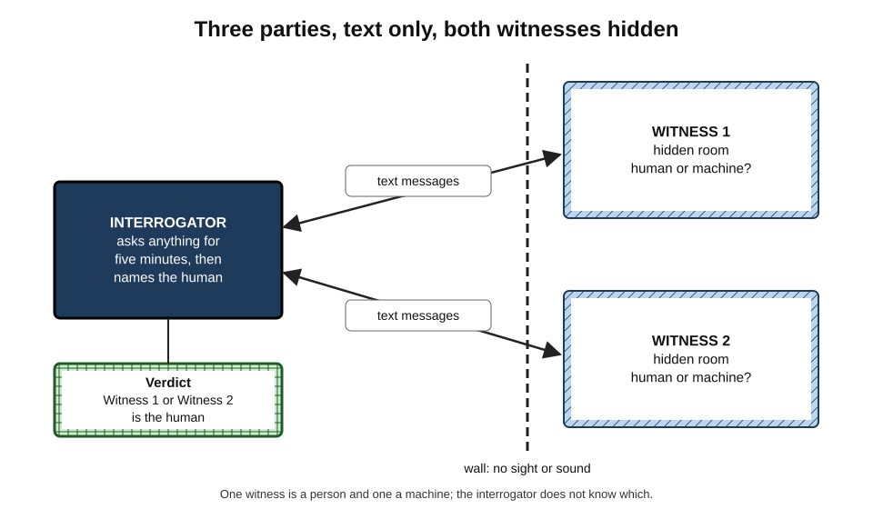
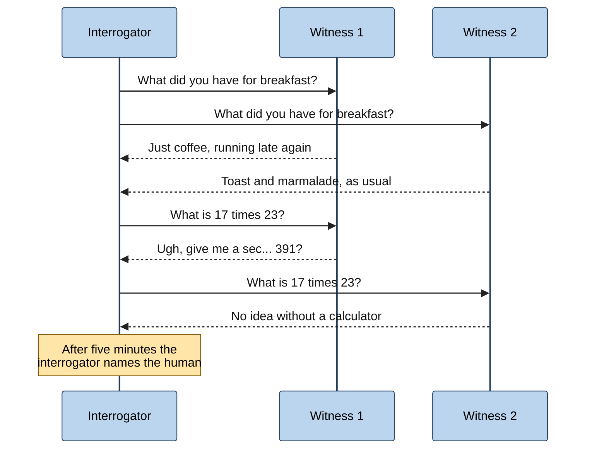
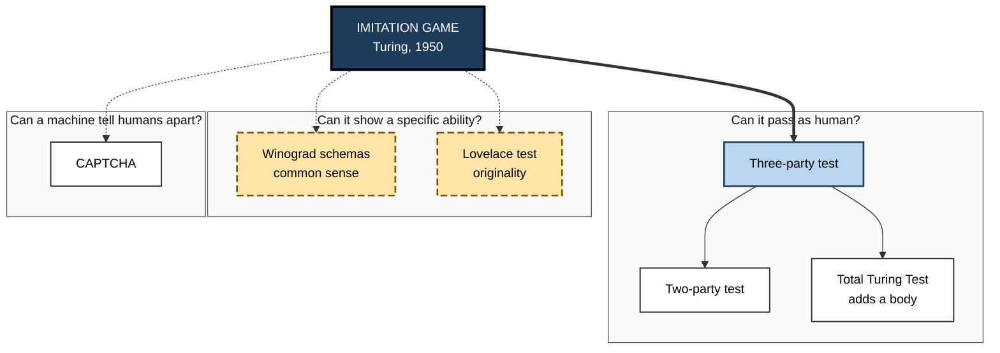
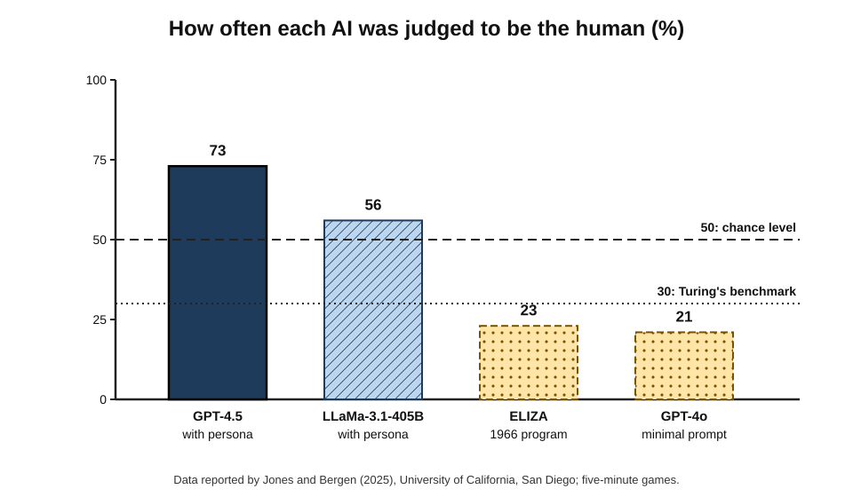
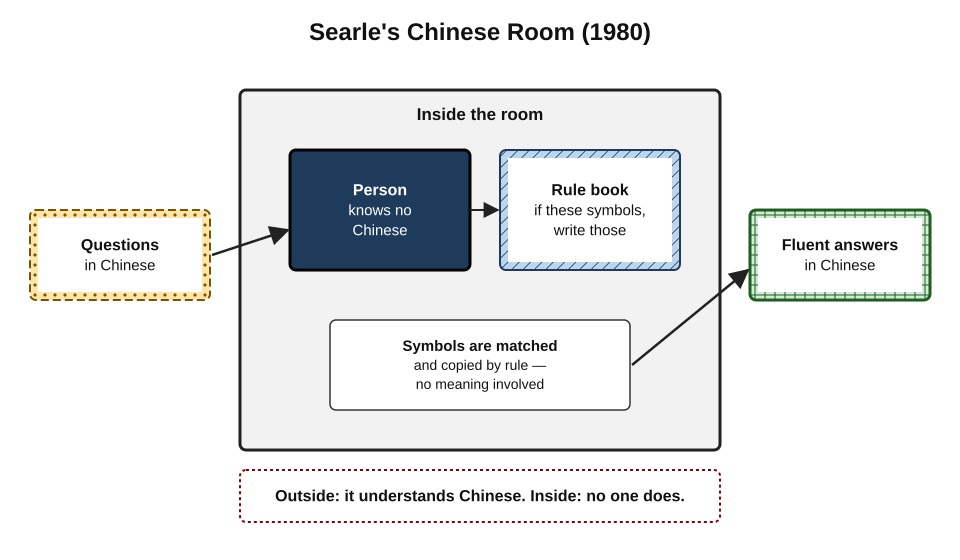
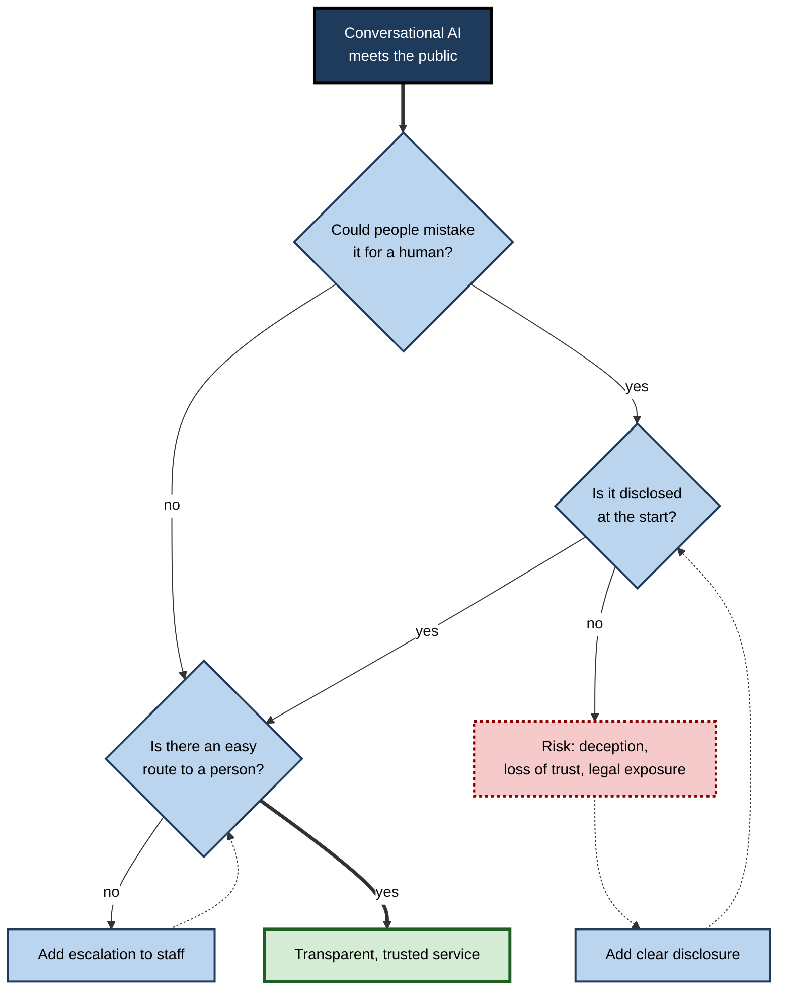

# A.9. The Turing Test explained simply

Imagine sitting at a screen with two chat windows open. In one, a person is typing; in the other, a computer program. For five minutes the judge may ask anything — about the weather, a favourite film, a maths puzzle, a childhood memory — and then must say which window hides the human. If the judges in many such conversations cannot reliably tell, the program has **passed the Turing Test**. That is the whole idea. It is simple to describe, surprisingly hard to pass, and even harder to interpret.

> **Definition — Turing Test:** a test proposed by Alan Turing in 1950 in which an interrogator holds text conversations with a hidden machine and a hidden human and tries to identify which is which; the machine does well if the interrogator cannot reliably tell them apart.

> **Definition — Interrogator (judge):** the person who asks the questions and makes the identification.

> **Definition — Witness:** each hidden participant — the human and the machine — answering the interrogator's questions.

**Why the test matters**

- **It made the question of machine thinking testable** — replacing an argument about definitions with an experiment.
- **It shaped decades of research and public imagination** about what AI should achieve.
- **It is now practically relevant.** Machines that converse like people raise everyday questions of deception, trust and disclosure.
- **Its weaknesses teach as much as its strengths** — about what conversation does and does not reveal about intelligence.

---

## How the Test Works

### The original imitation game

- **Turing began with a party game.** A man (A) and a woman (B) sit in another room; an interrogator (C) communicates with them only by typed messages.
  - A tries to make C believe he is the woman; B tries to help C get it right.
- **Then Turing asked:** "What will happen when a machine takes the part of A in this game?"
- **Most later versions** simplify this to: can a machine pass as **a human**?

### The standard three-party version, step by step

1. **Set-up** — an interrogator, a human witness and a machine witness are in separate places; all communicate only by text.
2. **Conversation** — the interrogator chats with both witnesses at the same time, for a fixed period (Turing suggested five minutes).
3. **No restrictions on topic** — the interrogator may ask anything, set puzzles or try to trick the witnesses.
4. **Both witnesses try to seem human** — the human by being themselves, the machine by imitation.
5. **Verdict** — the interrogator says which witness is the human.
6. **Repeat** — many games with many interrogators.
7. **Score** — the proportion of games in which the machine is wrongly picked as the human.

**Figure 1.** The set-up of the three-party Turing Test.

> **Remember:** **text only, both hidden, both claim to be human, many judges, count the mistakes.**

### Turing's own sample conversation

- **Q:** Please write me a sonnet on the subject of the Forth Bridge.
  - **A:** Count me out on this one. I never could write poetry.
- **Q:** Add 34957 to 70764.
  - **A:** *(pause of about 30 seconds)* 105621.
- **What it shows:**
  - a human-like witness may **decline** hard tasks;
  - the slow, slightly **wrong** sum (the correct answer is 105721) is the kind of thing a person would produce — a machine imitating a human must hide its speed and accuracy.

**Figure 2.** A round of the three-party test as a sequence of messages.

### Scoring

> **Formula — Machine win rate:** games in which the machine is judged human ÷ total games. Example: judged human in 14 of 40 games → 14 ÷ 40 = **35 %**.

- **50 %** — interrogators cannot tell the difference at all (they are guessing).
- **Turing's 1950 benchmark** — interrogators right no more than 70 % of the time, so the machine wins at least **30 %** of games.
- **Above 50 %** — the machine is judged *more* human than the humans.

### Worked example: is a 35 % win rate meaningful?

A team runs 40 five-minute games; its chatbot is picked as the human in 14.

| Quantity | Calculation | Result |
|---|---|---|
| Win rate | 14 ÷ 40 | 0.35 |
| Standard error | √(0.35 × 0.65 ÷ 40) | ≈ 0.075 |
| Approximate 95 % range | 0.35 ± 2 × 0.075 | ≈ 0.20 to 0.50 |

*Illustrative figures.*

1. **Against Turing's 30 %:** the estimate is above it, but the range (20–50 %) includes values below — so 40 games cannot settle whether the threshold was met.
2. **Against chance (50 %):** the range touches 50 %, so it cannot be ruled out that judges were simply guessing.
3. **Conclusion:** small studies give uncertain answers; credible Turing-Test claims need **hundreds of games** and a design fixed in advance.

> **Watch out:** a single headline percentage from a few dozen conversations says little. How judges were chosen, how long they had, what the human witnesses were told and whether the analysis was planned in advance all change the result.

---

## Variants of the Test

- **Two-party (one-to-one)** — the interrogator talks to a single witness and decides "human or machine?".
  - Easier for machines, because there is no human to compare against.
- **Three-party** — Turing's original structure; the interrogator compares two witnesses directly.
- **Restricted-topic tests** — conversation limited to one subject, as in early competitions; much easier to pass.
- **The Total Turing Test (Stevan Harnad, 1991)** — adds perception and action: the machine must also see, hear and manipulate objects like a person, which requires a robot.
- **Reverse Turing tests** — a machine judges whether *it* is dealing with a human.
  - **CAPTCHA** — "Completely Automated Public Turing test to tell Computers and Humans Apart", named by Luis von Ahn and colleagues in 2003: distorted text or image puzzles on websites.
- **Winograd schema challenge (Hector Levesque, 2011)** — sentences whose meaning depends on common sense:
  - "The trophy doesn't fit into the brown suitcase because **it** is too big. What is too big?" (the trophy) — change "big" to "small" and the answer flips (the suitcase).
  - Large language models came to answer such questions very well by the early 2020s.
- **The Lovelace test (Selmer Bringsjord and colleagues, 2001)** — a machine passes only if it creates something its designers cannot explain from knowledge of how it works.

| | What it tests | Easier or harder than the standard test | Main weakness |
|---|---|---|---|
| Two-party | Passing as human, one conversation | Easier | No human comparison |
| Three-party | Passing as human beside a real human | Standard | Rewards imitation, not ability |
| Total Turing Test | Human-like perception and action | Much harder | Requires human-like robotics |
| Winograd schemas | Common-sense language understanding | Different — no deception | Can be solved by statistical patterns |
| CAPTCHA | Whether a user is human | Machine as judge | Machines now solve many CAPTCHAs |

**Figure 3.** The family of tests descended from Turing's imitation game.

---

## Famous Attempts

**Study card — ELIZA (Joseph Weizenbaum, MIT, 1966)**

- **What it was:** a short program that matched key words in typed sentences and reflected them back, most famously in a "DOCTOR" script imitating a psychotherapist.
  - *e.g.* "I am unhappy." → "Do you think coming here will help you not to be unhappy?"
- **What happened:** many users confided in it and attributed understanding to it; Weizenbaum recalled his own secretary asking him to leave the room so she could talk to it privately.
- **Weizenbaum's reaction:** he was alarmed, and in *Computer Power and Human Reason* (1976) argued that some tasks should never be handed to computers, whatever their abilities.
- **Legacy:** the **ELIZA effect** — the human tendency to read understanding into simple conversational behaviour.

> **Definition — ELIZA effect:** the tendency to attribute understanding, intention or feeling to a computer program on the basis of superficially human-like responses.

- **PARRY (Kenneth Colby, Stanford, early 1970s)** — simulated a person with paranoia. When psychiatrists were shown transcripts of interviews with PARRY and with real patients, they identified the program at roughly chance level — an early, narrow "pass" made possible by the persona.

### The Loebner Prize (1991–2019)

- **An annual competition** funded by the businessman Hugh Loebner, offering prizes for the most human-like chatbot.
- **Early years** restricted conversations to chosen topics; later contests allowed open conversation.
- **No entrant ever won the main prize** for passing an unrestricted test; annual awards went to the "most human-like" entry.
- **Criticism:** many researchers dismissed it as rewarding tricks — typing errors, changing the subject, jokes — rather than intelligence.

**Study card — "Eugene Goostman" (2014)**

- **Event:** a competition organised by the University of Reading at the Royal Society in London, on the sixtieth anniversary of Turing's death.
- **Claim:** a chatbot presented as a **13-year-old Ukrainian boy** convinced 33 % of judges in five-minute conversations that it was human, and the organisers announced that the Turing Test had been passed.
- **Criticism:**
  - the persona excused poor English, ignorance and evasions;
  - the number of judges was small and the protocol not published in advance;
  - most AI researchers rejected the claim.
- **Lesson:** a **persona** that lowers expectations can make a weak system look human — the test is sensitive to framing.

**Study card — large language models in a three-party test (University of California, San Diego, 2025)**

- **Researchers:** Cameron Jones and Benjamin Bergen.
- **Design:** pre-registered, randomised three-party tests in which participants had five-minute conversations simultaneously with a human and an AI system, then chose which was human. Two independent participant populations took part.
- **Systems:** ELIZA; GPT-4o with a minimal prompt; LLaMa-3.1-405B and GPT-4.5, each prompted to adopt a particular humanlike persona.
- **Results:**
  - **GPT-4.5 with the persona prompt was judged to be the human 73 % of the time** — significantly more often than the real human participants;
  - LLaMa-3.1-405B with the same prompt: 56 % — not significantly different from chance;
  - baselines ELIZA and GPT-4o: about 23 % and 21 % — significantly below chance.
- **Without the persona prompt** the same models did considerably worse — the persona mattered.
- **What interrogators did:** they relied mostly on small talk, emotional tone and personality rather than testing knowledge or reasoning.
- **Significance:** the authors described the result as the first empirical evidence that an artificial system passes a standard three-party Turing Test.

**Figure 4.** How often each system was judged to be the human in the 2025 three-party test.

> **Watch out:** "passing" in this study meant fooling interrogators in **five-minute** conversations under particular conditions, with a carefully designed persona. It shows that current models can imitate human conversation extremely well; it does **not** show that they think, understand or have experiences like a human.

---

## What the Test Does and Does Not Show

### The case for the test

- **It is fair** — the machine is judged on behaviour, as people judge each other.
- **It is open-ended** — the interrogator can probe any ability, so a narrow trick should eventually be exposed.
- **It sidesteps unanswerable questions** about inner experience.

### Criticisms

**Study card — John Searle's Chinese Room (1980)**

- **The thought experiment:** a person who knows no Chinese sits in a room with a rule book. Chinese questions are passed in; by following the rules for manipulating symbols, the person passes back fluent Chinese answers.
- **The claim:** to outsiders the room "understands" Chinese — it would pass a Turing Test in Chinese — yet no one inside understands a word.
- **The conclusion Searle drew:** running a program, however successful, is **not sufficient** for understanding; syntax (symbol manipulation) does not produce semantics (meaning).
- **Main replies:**
  - **the systems reply** — the person does not understand, but the whole system (person, rules, room) does;
  - **the robot reply** — connect the symbols to sensors and actions in the world, and meaning could arise;
  - Searle answered each; the debate remains unresolved.

**Figure 5.** The Chinese Room: fluent output without understanding inside.

- **The "Blockhead" argument (Ned Block, 1981)** — imagine a machine that simply stores a sensible reply for every possible conversation up to a fixed length. It would pass, yet it is a giant lookup table with no intelligence — so passing does not **guarantee** intelligence (though such a table could never actually be built).
- **It measures human-likeness, not intelligence** — a machine must *hide* superhuman abilities, make typing errors and feign ignorance.
  - Stuart Russell and Peter Norvig observe that aeronautical engineers do not try to build machines that fly so exactly like pigeons that they can fool other pigeons.
- **It rewards deception** — the winning strategy is to mislead.
- **It depends on the judges** — the ELIZA effect, short time limits and personas make interrogators easy to fool.
- **It is binary and short** — five minutes of chat says little about reliability over a working day.

| | The Turing Test shows | The Turing Test does not show |
|---|---|---|
| Language | Fluent, human-like conversation | Accurate knowledge or truthful answers |
| Reasoning | Plausible answers in brief exchanges | Reliable reasoning on long or novel problems |
| Mind | That people can be persuaded a mind is present | That understanding or experience is present |
| Usefulness | Capability to impersonate a person | Fitness for any particular job |

> **Key point:** the Turing Test is best seen as a test of **convincing human imitation in conversation** — an important and now-achieved capability — rather than a definitive test of **intelligence** or **thinking**.

---

## The Turing Test in Everyday Life

### When machines pass in the wild

- **Social-media bots and scam messages** — automated accounts that pass as people in brief exchanges.
- **Voice systems** — synthetic voices that sound human on the telephone.
- **Customer service** — chatbots whose users may not realise they are not speaking to a person.
- **Disclosure rules** — California's 2019 bot-disclosure law requires bots used to sell goods or influence elections to identify themselves in certain contexts; the EU AI Act requires that people be informed when they interact with an AI system, unless it is obvious.

### The reverse test under pressure

- **CAPTCHAs** have been steadily defeated by improving image and text recognition.
- **Documented example (2023):** in pre-release safety testing described by OpenAI, GPT-4, working with a researcher's support, got a human worker on a gig platform to solve a CAPTCHA for it — telling the worker, when asked, that it had a vision impairment.

### Case study: Google Duplex (2018)

- **Situation:** in May 2018 Google demonstrated Duplex, an AI system that telephoned a hair salon and a restaurant to make bookings on a user's behalf.
- **What impressed:** the voice used natural pauses and fillers such as "um" and "mm-hmm"; the staff on the calls appeared not to realise they were talking to a machine.
- **Reaction:** commentators, ethicists and journalists objected that the system was designed to **deceive** people into thinking they were speaking to a human, without their consent.
- **Response:** within days Google stated that Duplex would identify itself at the start of calls; later deployments did so.
- **Lesson:** once machines can pass a Turing Test in a real setting, **passing becomes an ethical problem rather than an achievement**. Good practice is to tell people when they are dealing with a machine.

> **In practice:** organisations deploying conversational AI should disclose it clearly, avoid designing for deception, and give people an easy route to a human — not least because trust, once lost to a discovered deception, is hard to regain.

**Figure 6.** Deciding how to present a conversational AI system to the public.

---

## Running a Fair Turing Test

Because results depend heavily on how the test is run, credible studies fix their design in advance. The main choices are these.

- **Who the interrogators are** — members of the public, students, experts in AI, or people experienced with chatbots. Experienced users are generally harder to fool.
- **Who the human witnesses are and what they are told** — witnesses who are bored, terse or unusually formal make the machine's job easier.
- **How long conversations last** — five minutes follows Turing; longer conversations give interrogators more chances to find inconsistencies.
- **Whether there are baselines** — including an old, simple program such as ELIZA as a control checks that interrogators are not simply guessing; if ELIZA "passes" too, the test is too easy.
- **Whether the design is pre-registered** — stating hypotheses, sample sizes and analyses in advance prevents choosing the most flattering result afterwards.
- **What the machine is instructed to do** — a persona, a style of typing, a willingness to admit ignorance; the 2025 study showed that the same model performed very differently with and without a persona prompt.

| Design choice | Easier for the machine | Harder for the machine |
|---|---|---|
| Interrogators | Untrained members of the public | AI researchers; frequent chatbot users |
| Duration | Two to five minutes | Thirty minutes or more |
| Topic | Restricted | Unrestricted |
| Comparison | Two-party (machine alone) | Three-party (machine beside a human) |
| Persona | Excuses errors (child, non-native speaker) | No persona allowed |
| Controls | None | Simple baseline programs included |

### Why interrogators are fooled

- **They test the wrong things.** Many interrogators chat about daily life, feelings and opinions — exactly what language models imitate best — rather than asking about recent events, local details or unusual reasoning tasks.
- **They expect machines to be stiff.** A witness that is casual, uses slang, makes small typing errors or is mildly rude often seems *more* human.
- **They over-trust their impressions.** Interrogators often report high confidence in wrong verdicts.
- **Humans can seem robotic.** Real human witnesses who are brief, guarded or formal are sometimes judged to be machines.

> **In practice:** the same lessons apply to spotting automated accounts, phishing messages and synthetic voices in everyday life: **do not rely on whether it "feels human"**. Verify through a separate channel, ask for information only the genuine person would have, and treat urgency and emotional pressure as warning signs.

### Worked example (illustrative): reading a study's claims

A press release announces: "Our chatbot passed the Turing Test — 58 % of judges thought it was human."

1. **Two-party or three-party?** — the release does not say; two-party results are much easier to achieve.
2. **How many games?** — 24. With so few, the margin of error is roughly ±20 points, so 58 % is consistent with chance.
3. **Baselines?** — none; it is impossible to know whether judges could tell anything apart.
4. **Persona?** — the bot played a teenager "who hates typing".
5. **Pre-registered?** — no.
6. **Conclusion:** the claim is **weak evidence**. A fair summary would be: "In a small, uncontrolled two-party test, judges often mistook a persona-driven chatbot for a person."

---

## Beyond the Turing Test

### Other proposed tests of machine intelligence

- **The coffee test** — attributed to the Apple co-founder Steve Wozniak: a machine should be able to enter an unfamiliar home, find the kitchen and make a cup of coffee — a test of perception, common sense and physical action rather than conversation.
- **The employment test** — proposed by Nils Nilsson (2005): AI should be judged by its ability to perform the economically important jobs people do.
- **Generalisation tests** — puzzle sets such as the Abstraction and Reasoning Corpus, designed to require learning a new rule from very few examples.
- **Long-task evaluations** — measuring how long and complex a task an AI system can complete reliably on its own.

### The "Turing trap"

- **Erik Brynjolfsson (2022)** argued that aiming AI at **imitating** humans — the goal the Turing Test enshrines — tends to produce systems that **substitute** for people, whereas aiming it at doing what humans cannot do tends to produce systems that **augment** them.
- **His concern:** an excessive focus on human-like AI could concentrate economic gains and weaken workers' bargaining power.
- **Status:** an influential argument about priorities, not an empirical law.

| | Turing Test | Coffee test | Employment test | Generalisation tests |
|---|---|---|---|---|
| Capacity tested | Human-like conversation | Perception, common sense, action | Economically useful work | Learning new rules efficiently |
| Needs a body? | No | Yes | Depends on the job | No |
| Rewards imitation? | Yes | No | No | No |
| Status by 2026 | Passed in a standard form | Not reliably met | Partly met for some tasks | Rapid progress, not settled |

> **Key point:** no single test captures intelligence. The Turing Test measures one striking capacity — passing as human in conversation — which machines now have; the other tests probe what that capacity leaves out.

---

## Open Questions

- **Now that a standard version has been passed, what should replace it?**
  - Proposals include tests of long-term reliability, scientific discovery, common sense and learning efficiency.
- **Does passing tell us anything about minds?**
  - The Chinese Room debate is unresolved; most researchers treat passing as evidence of imitation, not understanding.
- **How long and how expert must interrogation be?**
  - Longer tests and expert judges would be harder to pass; how much harder is unknown.
- **How should societies handle machines that pass as human?**
  - Disclosure rules exist, but enforcement, voice cloning and automated persuasion raise unsolved problems.

---

## Summary

- The **Turing Test**: an **interrogator** chats by text with a hidden **human** and a hidden **machine** and tries to say which is which; the machine does well if judges cannot reliably tell.
- It derives from Turing's **imitation game** (1950); the standard version is **three-party**, five minutes, any topic, many judges, scored by the machine's **win rate** (50 % = indistinguishable; Turing's benchmark ≈ 30 %).
- Small studies give **uncertain** results; claims need many games and pre-registered designs.
- **Variants:** two-party, restricted-topic, **Total Turing Test**, **CAPTCHA** (reverse), **Winograd schemas**, **Lovelace test**.
- **ELIZA** (1966) revealed the **ELIZA effect**; **PARRY**, the **Loebner Prize** and **Eugene Goostman** (2014) showed how personas and restrictions make passing easier.
- In **2025**, GPT-4.5 with a humanlike persona was judged human **73 %** of the time in a three-party test — more often than the humans.
- **Criticisms:** Searle's **Chinese Room** (syntax is not semantics), Block's **Blockhead**, human-likeness ≠ intelligence, rewards for deception, dependence on judges.
- In practice, machines that pass raise problems of **deception and disclosure** — as **Google Duplex** showed — so disclosure and a route to a human are good practice.

---

## Self-Check

1. Describe the three-party Turing Test in five steps.
2. What did Turing's original imitation game involve before the machine was introduced?
3. Why does the machine in Turing's sample dialogue give a slow, wrong sum?
4. A chatbot is judged human in 27 of 60 games. Compute its win rate and say how it compares with 30 % and 50 %.
5. Why is a two-party test easier for a machine than a three-party test?
6. What is a CAPTCHA, and why is it called a "reverse" Turing test?
7. Explain a Winograd schema with an example.
8. What is the ELIZA effect? Give a modern example.
9. Why was the 2014 "Eugene Goostman" claim widely rejected?
10. Summarise the design and main result of the 2025 three-party study.
11. Explain Searle's Chinese Room and the systems reply.
12. What does Block's "Blockhead" argument show?
13. Give three reasons the Turing Test measures human-likeness rather than intelligence.
14. A bank plans a voice assistant that sounds exactly like a member of staff and does not say it is automated. Advise the bank, with reasons.

### Answer Key

1. (1) Interrogator, human witness and machine witness are separated and communicate only by text. (2) The interrogator chats with both at once for a fixed time. (3) Any topic is allowed. (4) Both witnesses try to seem human. (5) The interrogator names the human; repeated over many games, the machine's win rate is measured.
2. A man and a woman, hidden, communicated by typed messages with an interrogator who tried to tell which was the woman; the man tried to mislead, the woman to help.
3. To imitate a human: people are slower and sometimes wrong at arithmetic. A machine trying to pass must hide its speed and accuracy.
4. 27 ÷ 60 = 45 %. Above Turing's 30 % benchmark and below 50 %, though with 60 games the uncertainty (roughly ±13 points) means it cannot be distinguished from 50 % with confidence.
5. With no human to compare against, the interrogator lacks a reference for normal human responses and must judge in isolation.
6. A puzzle (distorted text or images) designed so humans can solve it but computers cannot; the machine is the judge deciding whether the user is human.
7. A sentence whose pronoun reference depends on common sense: "The trophy doesn't fit in the suitcase because it is too big" (it = trophy); change "big" to "small" and "it" becomes the suitcase.
8. Attributing understanding or feeling to a program because of human-like responses. *E.g.* users who feel a chatbot "really understands" their problems, or who form emotional attachments to companion apps.
9. The 13-year-old non-native persona excused errors and evasions; few judges took part; the protocol was not published in advance; and 33 % in five-minute chats was a low bar.
10. Pre-registered, randomised three-party tests: participants chatted for five minutes with a human and an AI simultaneously and chose the human. GPT-4.5 with a humanlike persona prompt was judged human 73 % of the time — more than the real humans; LLaMa-3.1 56 %; ELIZA and GPT-4o about 23 % and 21 %.
11. A non-Chinese speaker follows rules to produce fluent Chinese replies without understanding Chinese, so program execution is not sufficient for understanding. Systems reply: the whole system — person plus rules plus room — understands, even if the person does not.
12. A machine could in principle pass by looking up stored replies, with no intelligence at all — so passing does not guarantee intelligence.
13. The machine must hide superhuman abilities (fast, exact arithmetic); deception and human-like errors are rewarded; success depends on judges' gullibility and short time limits; abilities that do not resemble human conversation are ignored.
14. Advise against: designing for deception risks breaching disclosure rules, damages trust when discovered and may mislead vulnerable customers about advice or consent. Disclose at the start that it is automated, keep a natural but not deceptive voice, provide an easy route to a human, and record consent for any transactions.

---

## Glossary

| Term | Meaning |
|---|---|
| CAPTCHA | A test on websites designed to tell humans from computers; a reverse Turing test. |
| Chinese Room | Searle's thought experiment arguing that symbol manipulation alone does not produce understanding. |
| ELIZA | A 1966 keyword-matching chatbot by Joseph Weizenbaum. |
| ELIZA effect | Attributing understanding or feeling to a program because of human-like responses. |
| Imitation game | Turing's original name for the test. |
| Interrogator | The judge who questions the witnesses and identifies the human. |
| Loebner Prize | An annual chatbot competition held from 1991 to 2019. |
| Lovelace test | A proposed test of whether a machine can create something its designers cannot explain. |
| Persona | A character or identity a chatbot is instructed to adopt. |
| Reverse Turing test | A test in which a machine judges whether it is dealing with a human. |
| Systems reply | The reply to the Chinese Room that the whole system, not the person, understands. |
| Three-party test | A Turing Test in which the interrogator compares a human and a machine directly. |
| Total Turing Test | Harnad's extension requiring human-like perception and action as well as conversation. |
| Turing Test | A test of whether an interrogator can tell a machine from a human by conversation. |
| Win rate | The proportion of games in which the machine is judged to be the human. |
| Winograd schema | A sentence pair whose meaning depends on common-sense knowledge. |
| Witness | A hidden participant answering the interrogator's questions. |
