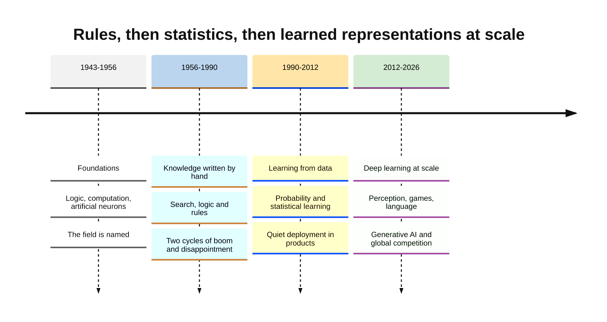
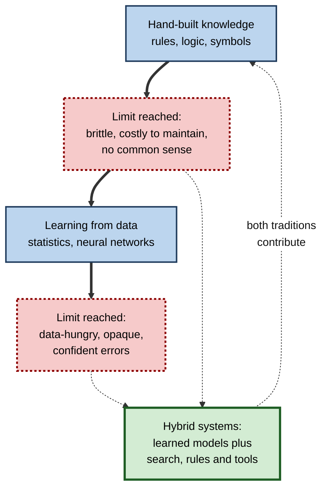
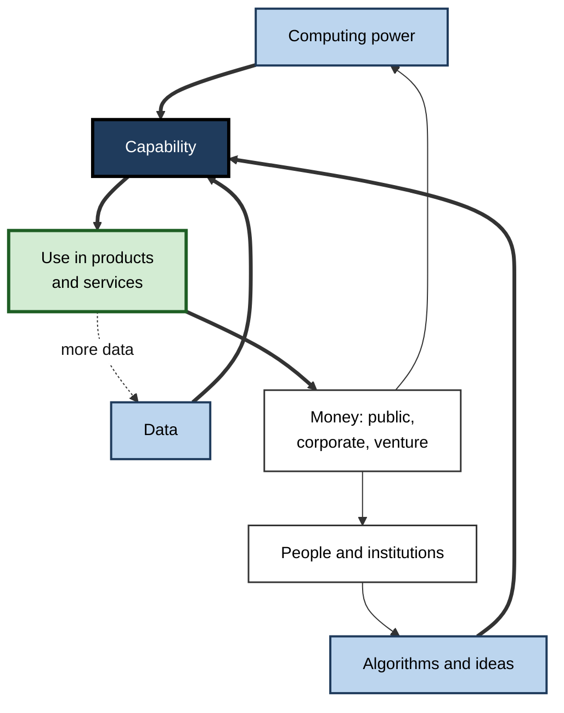
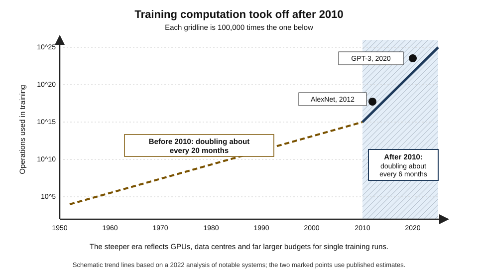
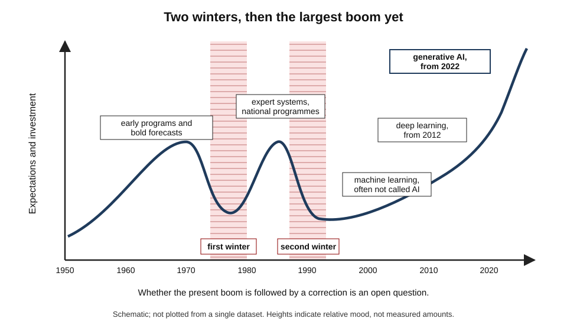
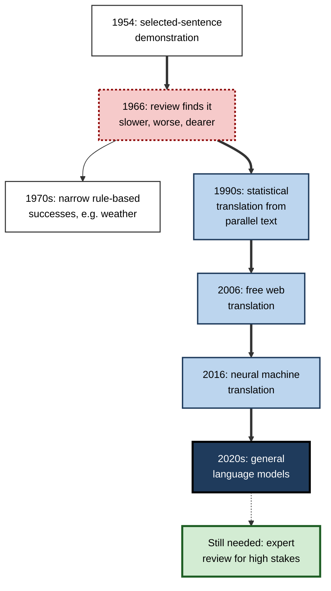
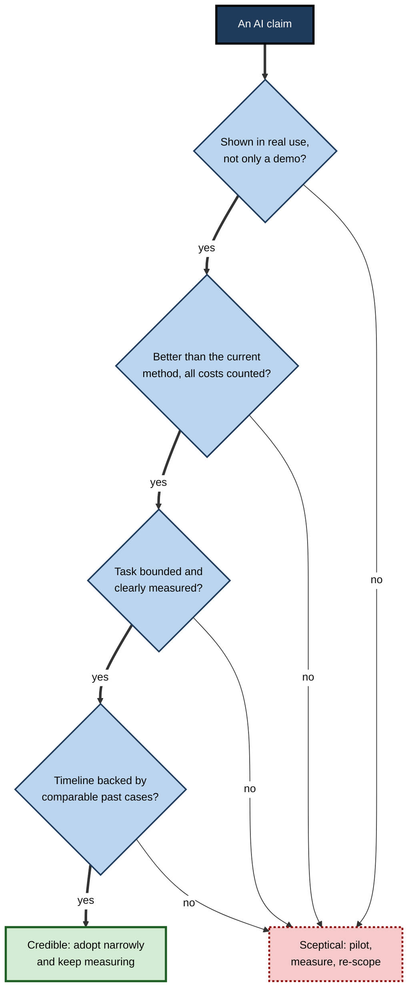

# B. A Short History of AI

In 1958 a newspaper reported that a learning machine would one day walk, talk and be conscious of its own existence. In 1973 a British government review concluded that the field had failed to deliver. In 2016 a program beat one of the world's best Go players, and in 2022 a chatbot reached a mass audience within weeks.

The history of artificial intelligence is a story of brilliant ideas, false dawns, quiet progress and sudden breakthroughs — and anyone who has to judge an AI claim today is, knowingly or not, judging it against that history.

> **Definition — History of AI:** the development, from the 1940s to the present, of the ideas, methods, machines, institutions and expectations involved in making computers perform tasks that would be called intelligent if done by people.

**Why it matters**

- **It is the best guide to judging claims.** Promises of imminent human-level AI have been made in almost every decade since the 1950s; knowing how earlier promises fared is the first defence against hype.
- **It explains today's technology.** Present-day systems are built from ideas — neural networks, search, probability, learning from data — that are decades old.
- **It shows what really drives progress.** Computing power, data, funding and institutions have mattered at least as much as clever algorithms.
- **It reveals recurring risks.** Over-promising, narrow benchmarks, hidden costs and concentration of power have appeared again and again.

---

## Why AI Has a History Worth Knowing

### A field defined by its ambitions

- **Most sciences are defined by a subject** — cells, stars, markets. AI is defined by an **ambition**: to reproduce intelligent behaviour in machines.
- **Because the ambition is open-ended, the field keeps redefining itself.** Methods that work become ordinary engineering; what remains unsolved keeps the name "AI".
- **Consequence:** the history of AI is partly a history of **shifting definitions** of what counts as intelligent behaviour — from proving theorems, to diagnosing infections, to recognising faces, to holding a conversation.

> **Definition — AI effect:** the tendency for a capability to stop being regarded as "artificial intelligence" once machines perform it reliably — so that the field's successes are continually reclassified as ordinary computing.

### Long roots

- **Old dreams** — myths of artificial beings, mechanical automata and calculating machines long pre-date computers.
- **The modern starting point** — the 1940s, when logic, the mathematics of computation, early models of neurons, information theory and the first electronic computers came together.
- **The naming** — a 1955 proposal for a summer workshop at Dartmouth College coined the term "artificial intelligence" and set an agenda that is still recognisable.

> **Key point:** the field is about seventy years old as a named discipline, but its central questions — can reasoning be mechanised, can machines learn, what is intelligence — are far older.

**Figure 1.** Three broad paradigms in the history of AI, 1943–2026.

---

## The Three Great Paradigms

The history can be read as three overlapping answers to one question: **where should a machine's knowledge come from?**

### Knowledge written by people

- **Idea:** intelligence is the manipulation of symbols by rules; experts' knowledge can be written down and a machine can reason with it.
- **Strengths:** transparent reasoning, reliable within its domain, needs little data.
- **Weaknesses:** brittle outside its rules; hand-writing knowledge is slow, costly and never complete; common sense proved impossible to encode by hand.
- **Legacy:** search algorithms, planning, rules engines, knowledge graphs and the habit of demanding explanations.

### Knowledge estimated from data

- **Idea:** rather than writing rules, estimate patterns and probabilities from examples.
- **Strengths:** handles noise and uncertainty; improves with more data; can be tested on held-out cases.
- **Weaknesses:** relies on features designed by people; limited by the data collected; less transparent.
- **Legacy:** the empirical culture of datasets, benchmarks and measured error rates; spam filters, fraud detection, recommendations and speech recognition.

### Representations learned at scale

- **Idea:** let many-layered neural networks learn their own features from raw data, using vast datasets and computing power.
- **Strengths:** state-of-the-art perception, language and generation; one model can serve many tasks.
- **Weaknesses:** data- and energy-hungry, opaque, prone to confident errors, and concentrated in organisations able to pay for scale.
- **Legacy (still unfolding):** generative AI, foundation models and AI as a mass consumer technology.

| | Knowledge written by people | Knowledge estimated from data | Representations learned at scale |
|---|---|---|---|
| Dominant period | Late 1950s to late 1980s | 1990s to early 2010s | 2012 onwards |
| Source of knowledge | Experts and programmers | Labelled data plus human-designed features | Very large datasets, largely raw |
| Typical system | Theorem prover, expert system | Spam filter, credit scorer, speech recogniser | Image classifier, language model, image generator |
| How quality is judged | Expert review, demonstrations | Error on held-out test sets | Benchmarks, user adoption, human preference |
| Main failure mode | Brittleness outside the rules | Limited by features and data | Hallucination, bias, opacity, cost |
| Who could build it | University laboratories | Universities and data-rich firms | Mainly a few large companies |

> **Watch out:** the paradigms **overlap**; they did not simply replace one another. Neural networks were proposed in the 1940s and revived in the 1980s; rule-based systems still run much of the world's software; and modern systems increasingly combine learned models with search, rules and tools.

### The pendulum between rules and learning

**Figure 2.** The recurring swing between hand-built knowledge and learning.

> **Key point:** each paradigm ran into a limit that the other was better placed to address. The present direction — learned models combined with explicit reasoning, retrieval and tools — reflects lessons from both.

---

## The Engines of Progress

### Five forces

- **Computing power**
  - Gordon Moore observed in 1965 that the number of components on a chip was doubling regularly; for decades this made computers vastly cheaper and faster.
  - Every major advance — from early game programs to deep learning — depended on computing that had only just become affordable.
- **Data**
  - Early systems learned from hand-typed examples; later ones from transaction records, digitised text, the web, smartphone photos and user behaviour.
- **Algorithms and ideas**
  - Search, probabilistic reasoning, back-propagation, convolutional networks, reinforcement learning, attention and diffusion — each unlocked new capabilities.
- **Money**
  - Military research agencies funded early laboratories; companies later funded most research; venture and corporate investment drove the generative-AI boom.
- **People and institutions**
  - A few laboratories trained generations of researchers; shared datasets, conferences and open-source software spread ideas quickly.

**Figure 3.** How the engines of progress reinforce one another.

### Computing power: the long acceleration

- **Before about 2010** the computing used to train the largest AI systems roughly doubled every 20 months or so, broadly in line with general chip progress, according to a 2022 analysis of hundreds of milestone systems by researchers at the Epoch research group.
- **From about 2010** it began doubling roughly every six months, as researchers used GPUs and then entire data centres — far faster than chips themselves improved.
- **By the mid-2020s** the largest training runs used many billions of times more computation than the systems of the 1950s and 1960s.

**Figure 4.** Two eras of growth in the computation used to train notable AI systems.

> **Formula — Doubling time and growth:** growth over a period = 2^(years ÷ doubling time). Example: doubling every six months for ten years gives 2^(10 ÷ 0.5) = 2²⁰ ≈ **one million times**; doubling every two years over the same decade gives 2⁵ = **32 times**.

> **Watch out:** the shift to faster growth reflects **spending**, not only better chips. Organisations chose to devote far more money and hardware to single training runs. That kind of growth can continue only as long as the money, chips and electricity do.

### Ideas that waited

- **Neural networks** — proposed in 1943, trained with back-propagation from the 1980s, but dominant only after 2012.
- **Reinforcement learning** — formalised in the 1980s, famous only after it mastered video games and Go in the 2010s.
- **Statistical language models** — Claude Shannon modelled English statistically around 1950; seventy years later, prediction of the next word underlies modern language models.

> **Key point:** in AI, being **early** is often indistinguishable from being **wrong** — until data and computing catch up with the idea. This makes confident judgements about which ideas are "dead ends" risky.

---

## The Rhythm of Hype and Winter

### Booms, busts and the quiet in between

- **Pattern:** a striking demonstration → bold predictions → heavy investment → difficulties in scaling to real problems → critical reviews or market failure → funding cuts and a damaged reputation → quiet progress under other names → a new breakthrough.
- **Two major downturns** — in the mid-1970s and from the late 1980s — followed this pattern; the term "AI winter" itself was coined in 1984, as a warning.
- **The present boom** — since the 2010s, and especially since 2022, investment and expectations have reached their highest levels ever.

**Figure 5.** Expectations of AI over seventy years.

> **Definition — AI winter:** a period of reduced funding, investment and confidence in AI following inflated expectations that the technology failed to meet.

### Why the cycle repeats

- **Demonstrations are easy; deployment is hard.** Selected examples in controlled settings rarely reveal the costs of real use.
- **Forecasts are anchored on recent progress.** Rapid early gains are projected forward as if they will continue.
- **Incentives reward bold claims.** Researchers, companies and governments compete for attention, talent and money.
- **The hard part is often invisible.** Common sense, robustness and integration into real work are less dramatic than headline capabilities.

| | Typical feature of a boom | Typical feature of a winter |
|---|---|---|
| Public narrative | Human-level AI is close | AI has failed |
| Funding | Abundant, loosely directed | Scarce, tied to specific deliverables |
| Vocabulary | "Artificial intelligence" used proudly | Other names preferred: analytics, decision support |
| Research | Rapid growth, many entrants | Smaller community; unfashionable ideas continue quietly |
| What actually happens | Real but narrower progress than claimed | Real but less visible progress continues |

> **Watch out:** the present cannot be judged simply by analogy with past winters. Today's AI has **far larger user numbers, real revenues and systems that improve with data**, which earlier booms lacked. Whether a significant correction will come, and how deep it might be, is **genuinely contested**.

### Forecasts: a humbling record

- **Founders' forecasts** — in the late 1950s and 1960s leading researchers predicted a computer chess champion and general machine intelligence within ten to twenty years; the chess prediction took about forty years; the general one remains unmet.
- **Experts' forecasts today** — a large 2023 survey of published AI researchers produced an aggregate estimate of a 50% chance of machines outperforming humans at every task by around 2047 — thirteen years earlier than the same survey's estimate a year before — with enormous disagreement between individuals.
- **Lesson:** forecasts of **when** have been far less reliable than forecasts of **whether**; many feats once called impossible have happened, but rarely on schedule.

---

## Recurring Lessons

### Hard for people is not hard for machines

- Early AI found logic, algebra and chess — hard for people — comparatively easy, and perception, movement and common sense — easy for people — extremely hard.
- This reversal, associated with the roboticist Hans Moravec, has reappeared in each era: language models that pass professional exams can still miscount objects or misread a clock.

> **Definition — Moravec's paradox:** the observation that high-level reasoning requires relatively little computation while low-level perception and motor skills require enormous amounts — the opposite of what intuition suggests.

### Benchmarks drive and distort progress

- **Drive** — shared tests, from chess championships to large image and language datasets, made progress measurable and competitive.
- **Distort** — once a benchmark becomes the target, methods are tuned to its quirks; scores rise faster than real-world capability.
- **Saturation** — modern benchmarks are often "used up" within a year or two, so the field must constantly invent harder ones.

### Narrow successes, general disappointments

- Almost every lasting success has been **narrow**: a specific game, a specific diagnosis, a specific kind of image.
- Almost every disappointment has followed a **general** promise: thinking machines, captured expertise, universal assistants.
- Modern general-purpose models blur this boundary more than any earlier systems — one reason the present moment feels different.

### General methods and scale

- Over the long run, methods that make use of **more data and computation** have tended to overtake methods built on hand-crafted human knowledge — an argument made forcefully by the reinforcement-learning pioneer Richard Sutton in 2019.
- Critics reply that successful architectures themselves embody human insight, and that scale has not solved reliability or reasoning.

> **Remember:** five recurring lessons — **demonstration is not deployment; hard for people is not hard for machines; benchmarks drive and distort; narrow succeeds before general; scale often beats hand-crafting, but not always.**

> **Mnemonic — "Don't Hype Beyond Narrow Scale":** Deployment, Hard-versus-easy, Benchmarks, Narrow, Scale.

---

## Who Made AI — and Who Was Left Out

### Funders and places

- **Military funding** — from the 1960s the US military's advanced research agency funded the leading laboratories, shaping their priorities; military goals also drove programmes in the 1980s.
- **National programmes** — Japan's Fifth Generation project, Britain's Alvey programme and Europe's research frameworks in the 1980s; national AI strategies across the world from the late 2010s.
- **Corporate laboratories** — from Bell Labs and IBM in the early decades to Google, Microsoft, Meta, OpenAI, Anthropic, DeepMind, Baidu, Alibaba and others today; by the mid-2020s companies produced the great majority of notable AI models.
- **Geography** — the United States has led throughout; Britain, Canada and Japan played important roles; China rose rapidly from the 2010s to near parity in model performance by 2026.

| Era | Main funders | Main builders | Main geography |
|---|---|---|---|
| 1950s–1960s | Military research agencies, foundations | A few elite university laboratories and IBM | United States, Britain |
| 1970s–1980s | Military and national programmes, corporations | Universities, corporate AI groups, start-ups | United States, Britain, Japan, Europe |
| 1990s–2000s | Research councils, technology companies | Universities, data-rich firms | United States, Canada, Europe |
| 2010s–2020s | Technology companies, venture capital, governments | Large company laboratories and start-ups | United States and China, with Europe, Britain, India, Canada and others |

### The missing figures

- **The founding circle was narrow** — overwhelmingly men from a few institutions in the United States and Britain.
- **Women's contributions were often overlooked**, for example:
  - **Margaret Masterman** founded the Cambridge Language Research Unit in 1955, an early centre for machine translation and computational linguistics;
  - **Karen Spärck Jones** introduced in 1972 the "inverse document frequency" weighting that became a foundation of search engines;
  - the large teams of mostly female programmers and, later, data labellers whose work made systems possible but rarely appeared in histories.
- **The global workforce behind data** — from the 2000s much labelling and content moderation was done by low-paid workers in many countries.

> **Watch out:** histories of AI are often written by its participants and winners. Such accounts tend to present progress as a straight line towards the present and to remember **inventors** rather than **builders, users and those affected**. Reading the history well means asking whose work and whose perspective are missing.

> **Definition — Whig history:** history written as an inevitable march of progress towards the present, judging the past by how far it led to today's winners.

---

## Case Study: Sixty Years of Machine Translation

Machine translation is the one application that runs through every era of AI history, and it shows the whole pattern in miniature.

- **1954 — the demonstration:** a public experiment by Georgetown University and IBM translated about sixty carefully chosen Russian sentences, prompting predictions that the problem would be solved within a few years.
- **1966 — the review:** a US government advisory committee found machine translation slower, less accurate and more expensive than human translators once correction was counted; funding collapsed for two decades.
- **1970s — narrow successes:** rule-based systems survived where the task was tightly bounded; Canada's METEO system translated weather bulletins between English and French for over two decades, and the European Commission used rule-based translation as a drafting aid.
- **Late 1980s–1990s — the statistical turn:** IBM researchers learned translation from bilingual parliamentary records, replacing grammar rules with probabilities.
- **2006 — mass access:** a free web translation service based on statistical methods put rough translation in everyone's hands.
- **2016 — the neural switch:** neural machine translation replaced statistical systems in major products, cutting errors substantially.
- **2020s — general models:** large language models translated, explained and adapted text across many languages as one task among thousands.

- **Lessons:**
  1. the 1954 promise was **right about the destination and wrong about the timing** by about sixty years;
  2. the 1966 review was **right about its time**, because it counted the full cost of correction;
  3. **narrow, bounded uses** created value long before general translation worked;
  4. each leap came from a **change of paradigm** — rules, then statistics, then neural networks — enabled by more data and computing;
  5. even today, high-stakes translation (legal, medical) still needs **expert review**.

**Figure 6.** Machine translation through the paradigms of AI.

---

## Using History to Judge the Present

### Questions history teaches

1. **Is this a demonstration or a deployment?** Selected examples in controlled conditions are the weakest evidence.
2. **Compared with what?** Is the system better, cheaper or faster than the current human or conventional method, once correction and integration are counted?
3. **How narrow is the task?** Bounded tasks succeed first; broad promises usually take longer.
4. **What does it depend on?** Special hardware, scarce data or continuing subsidies have undone earlier booms.
5. **Who benefits and who bears the risk?** Earlier eras show that costs often fall on those least represented in the decisions.

**Figure 7.** Testing an AI claim against the lessons of history.

### Worked example (illustrative): testing a five-year prediction

A consultancy report claims that "AI will automate 80% of a firm's contract review within five years". *Illustrative figures.*

1. **Separate the claims.** "Much contract review can be automated" (plausible) is different from "80% within five years" (a specific timeline).
2. **Find a reference class.** Machine translation took about sixty years from demonstration to broad use; driverless taxis over a decade from the first large road-testing programme (2009) to fully driverless paid services in a few cities; image recognition only a few years from the 2012 breakthrough to routine use in photo services.
3. **Locate the task.** Contract review is closer to translation and summarisation (text, with high stakes) than to photo search (low stakes).
4. **Ask what the 80% measures.** Share of documents touched by AI, or share of reviewer hours removed? The first could be reached quickly; the second requires reliability high enough to drop human checking.
5. **Restate the claim.**
   - "Within two to three years, AI drafts first-pass reviews for most standard contracts, saving perhaps 30–40% of reviewer time, with expert sign-off retained."
   - "Removing human review for most contracts" — no reliable date; depends on error rates, liability and regulation.

| | Original claim | Historically informed restatement |
|---|---|---|
| Scope | 80% of contract review | First-pass review of standard contracts |
| Timeline | Five years | Two to three years for assisted review; open for full automation |
| Human role | Implied removal | Expert sign-off retained |
| Evidence needed | None stated | Pilot results, error rates on representative contracts |

> **Watch out:** historical analogies can mislead in both directions. Some technologies were adopted **faster** than anyone expected; the point is not that every forecast is too optimistic, but that **timelines need evidence**.

> **In practice:** professionals who know the history ask the same questions of every AI claim — **what exactly, by when, compared with what, measured how, and at whose risk?** — and expect honest answers to include uncertainty.

---

## Open Questions

- **Is this boom different?**
  - Present AI has mass adoption and revenue that earlier booms lacked, yet investment far exceeds current returns; whether a correction comes, and how severe, is debated.
- **Will scale continue to deliver?**
  - Gains from more data and computation have been remarkably consistent; limits from data supply, energy and cost may change the trajectory.
- **Will the pendulum swing back towards explicit knowledge?**
  - Hybrid systems combining learned models with reasoning, search and tools are growing; whether they amount to a new paradigm is unclear.
- **How should the history be written?**
  - Historians increasingly include labour, users, affected communities and non-Western contributions; the standard story of a few great inventors is being revised.
- **What did the founders get right?**
  - Their conjecture that intelligent behaviour can be mechanised has been borne out for many tasks; whether it holds for every aspect of intelligence remains open.

---

## Summary

- The **history of AI** spans about seventy years as a named field, with roots in logic, computation, neural models and information theory; the name came from a **1955 proposal**.
- AI is defined by an **ambition**, so its definition keeps shifting; the **AI effect** reclassifies successes as ordinary computing.
- Three overlapping **paradigms** answer where knowledge comes from: **written by people** (rules, symbols), **estimated from data** (statistics), and **learned at scale** (deep neural networks and generative models); the field **swings between rules and learning** and now combines them.
- Five **engines of progress**: computing power, data, algorithms, money, people and institutions; training computation shifted from doubling about every **20 months** to about every **six months** after 2010.
- Many ideas **waited decades** for data and computing to catch up.
- AI has moved through a **rhythm of hype and winter**; the **present boom** is the largest, and comparisons with past winters are **contested**.
- **Forecasts** of *whether* have been better than forecasts of *when*.
- Recurring lessons: **demonstration ≠ deployment**, **Moravec's paradox**, **benchmarks drive and distort**, **narrow before general**, **scale often beats hand-crafting**.
- AI was shaped by **military, national and corporate funders** and a **narrow founding group**; many contributors, including women and data workers, were overlooked; beware **Whig history**.
- **Machine translation** shows the whole arc: a premature promise, a sobering review, narrow successes and paradigm shifts over sixty years.
- History equips professionals to test claims: **what, by when, compared with what, measured how, at whose risk**.

---

## Self-Check

1. Why is the history of AI partly a history of shifting definitions of intelligence?
2. Describe the three broad paradigms of AI and the question they answer.
3. Compare the strengths and main failure modes of rule-based and learned systems.
4. Name the five engines of progress and explain how they reinforce one another.
5. What changed in the growth of training computation around 2010, and what drove the change?
6. If training computation doubles every six months, how much does it grow in five years?
7. Give two examples of ideas that "waited" for decades before succeeding.
8. Describe the typical cycle of hype and winter and explain why it tends to repeat.
9. Why might the present boom differ from earlier ones, and why might it not?
10. What is Moravec's paradox, and how does it still apply?
11. Explain how benchmarks both drive and distort progress.
12. Who funded and built AI in its early decades, and how has that changed?
13. What is Whig history, and why is it a risk in writing the history of AI?
14. What does the history of machine translation teach about timelines and narrow applications?
15. A start-up claims its AI will replace most radiologists within three years. Use the lessons of AI history to evaluate the claim.

### Answer Key

1. AI is defined by an ambition rather than a subject; as machines master tasks, those tasks are reclassified as ordinary computing (the AI effect), so the frontier of "intelligence" keeps moving — from theorem proving to diagnosis to perception to conversation.
2. Where should a machine's knowledge come from? Written by people (rules and symbols, late 1950s–late 1980s); estimated from data (statistical learning, 1990s–early 2010s); learned at scale (deep networks and generative models, 2012 onwards).
3. Rule-based: transparent, reliable within its domain, little data needed; fails by brittleness outside its rules and costly upkeep. Learned: handles noise, improves with data, strong at perception and language; fails by data hunger, opacity, bias and confident errors.
4. Computing power, data, algorithms and ideas, money, people and institutions. Capability from compute, data and algorithms leads to use, use brings money and more data, and money buys more computing and talent.
5. Growth accelerated from doubling roughly every 20 months to about every six months, because organisations used GPUs and whole data centres and spent far more on single training runs.
6. 2^(5 ÷ 0.5) = 2¹⁰ = 1,024 times.
7. Neural networks (proposed 1943, dominant after 2012); reinforcement learning (1980s, famous in the 2010s); statistical language modelling (Shannon around 1950, central in modern language models).
8. Demonstration → bold predictions → investment → difficulty scaling → critical review or market failure → cuts and stigma → quiet progress → new breakthrough. It repeats because demonstrations hide deployment costs, forecasts extrapolate early gains, incentives reward bold claims and the hardest problems are the least visible.
9. Different: mass adoption, real revenue and systems that improve with data and serve many tasks. Similar: investment far ahead of returns, bold timelines, hidden running costs and dependence on scarce chips and energy. The outcome is uncertain.
10. High-level reasoning is computationally cheap while perception and motor skills are expensive — the reverse of human intuition. It still applies: models that pass hard exams can fail at simple perceptual or common-sense tasks.
11. They make progress measurable and competitive and attract investment, but once they become targets, methods are tuned to their quirks, scores outrun real capability, and benchmarks saturate quickly.
12. Early: military research agencies and foundations funded a few elite university laboratories and IBM, mainly in the US and Britain. Now: technology companies, venture capital and governments fund research led mainly by large company laboratories, with the US and China dominant.
13. History told as an inevitable march to the present, judging the past by its contribution to today's winners. It hides dead ends, alternative paths and the work of overlooked contributors such as women, users and data workers.
14. The 1954 promise came true only after about sixty years and several paradigm shifts; a review that counted full costs was right for its time; narrow, bounded applications such as weather bulletins created value long before general translation worked; high-stakes use still needs expert review.
15. Separate the plausible conjecture (AI can assist with many reading tasks) from the timeline. History shows that demonstrations on curated images often overstate real performance; deployment requires prospective validation, integration, regulation and liability arrangements; narrow tasks are automated first. A credible restatement: AI will increasingly assist radiologists with specific findings and workload, with human sign-off, over a period that depends on real-world evidence; "replacing most radiologists in three years" lacks support from comparable cases.

---

## Glossary

| Term | Meaning |
|---|---|
| AI effect | The tendency for a capability to stop being called AI once machines perform it reliably. |
| AI winter | A period of reduced funding and confidence in AI after inflated expectations. |
| Benchmark | A shared test used to measure and compare AI systems. |
| Benchmark saturation | The point at which leading systems score near the maximum on a test. |
| Deep learning | Machine learning with many-layered neural networks that learn their own representations. |
| Doubling time | The time taken for a quantity, such as training computation, to double. |
| Expert system | A rule-based program applying specialists' knowledge in a narrow domain. |
| Generative AI | AI that creates new content such as text, images or code from prompts. |
| History of AI | The development of AI's ideas, methods, machines, institutions and expectations since the 1940s. |
| Hybrid system | A system combining learned models with explicit rules, search or tools. |
| Inverse document frequency | A weighting that gives rarer words more importance in search, introduced by Karen Spärck Jones in 1972. |
| Machine translation | Automatic translation of text or speech from one language to another. |
| Moore's law | Gordon Moore's 1965 observation that the number of components on a chip doubles regularly. |
| Moravec's paradox | The observation that reasoning is computationally cheap while perception and movement are expensive. |
| Paradigm | A broad shared approach to a field's problems, methods and standards of success. |
| Reference class | A set of comparable past cases used to estimate how a new case will turn out. |
| Symbolic AI | AI based on explicit symbols and rules written by people. |
| Whig history | History told as an inevitable march of progress towards the present. |
