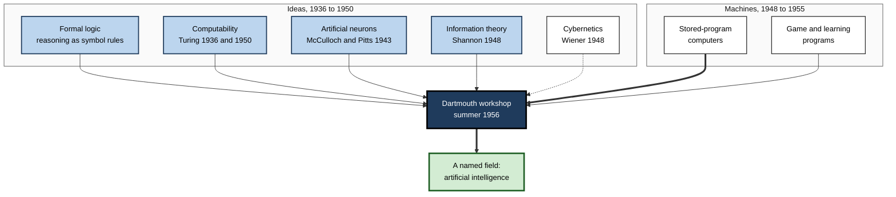
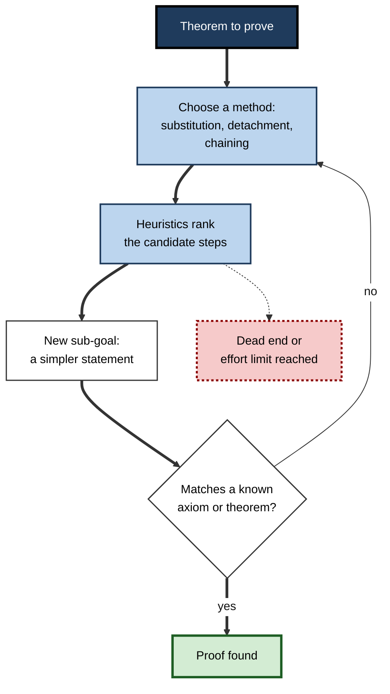
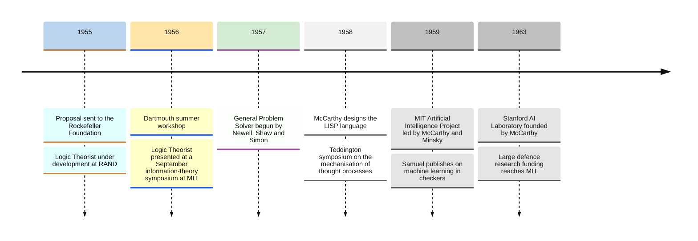
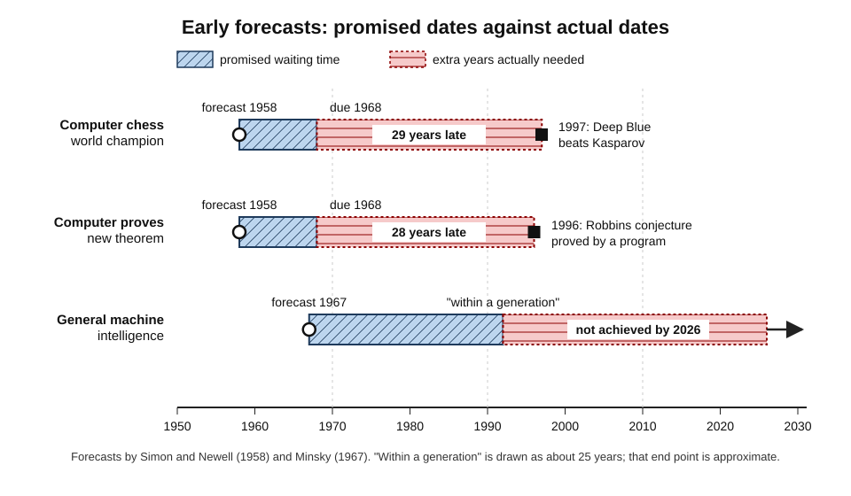
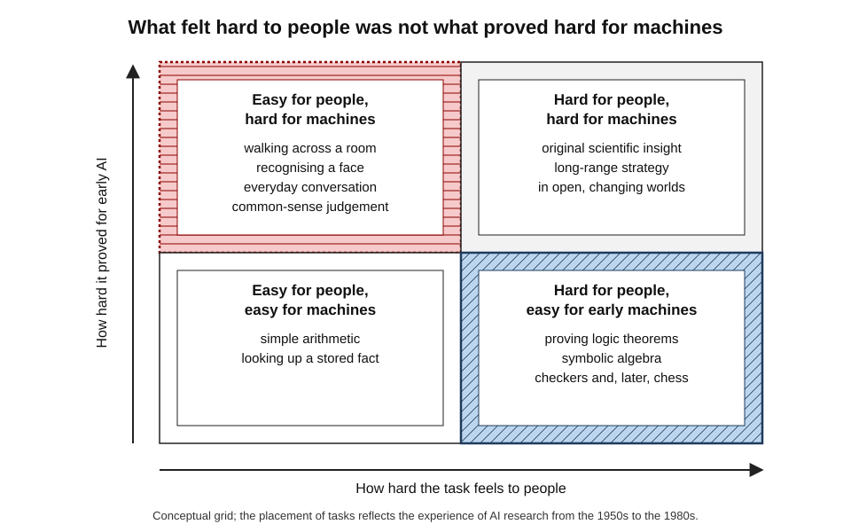

# B.1. The 1956 Dartmouth Conference: AI is born

In the summer of 1956 a small group of mathematicians, engineers and psychologists gathered on the campus of Dartmouth College in Hanover, New Hampshire. They had no shared laboratory, no agreed method and only a modest grant — but they had a name for what they wanted to build: **artificial intelligence**. Nothing they produced that summer worked better than the programs some of them brought with them, yet the meeting is remembered as the founding event of a scientific field that now shapes economies.

> **Definition — Dartmouth Summer Research Project on Artificial Intelligence:** an informal workshop held at Dartmouth College over roughly eight weeks in the summer of 1956, proposed by John McCarthy, Marvin Minsky, Nathaniel Rochester and Claude Shannon, at which "artificial intelligence" was adopted as the name of a new research field.

**Why it matters**

- **It created an identity.** Scattered work on "thinking machines" became a named field with a programme, a community and, soon, laboratories and funding.
- **It set an agenda.** The topics listed in the 1955 proposal — language, neural networks, abstraction, self-improvement, creativity — are still recognisable research areas.
- **It set a pattern of optimism.** The belief that intelligence could be mechanised quickly, and the gap between that belief and reality, recurs throughout the history of the field.
- **It explains present-day vocabulary.** Terms such as "AI", "heuristic" and "machine learning" date from this circle and its immediate aftermath.

---

## The World Before the Name

The workshop did not appear from nothing. Between 1943 and 1955 several lines of thought converged on the idea that thinking might be a kind of computation.

### Ideas that made the question possible

- **Logic as calculation**
  - Late nineteenth- and early twentieth-century logicians (George Boole, Gottlob Frege, Bertrand Russell and Alfred North Whitehead) showed that much reasoning could be written as formal symbol manipulation.
  - If reasoning is rule-following on symbols, a machine that follows rules on symbols might reason.
- **Computability**
  - Alan Turing (1936) described an abstract machine able to carry out any procedure that can be stated precisely; in 1950 he asked whether machines could think and proposed an imitation game as a practical test.
- **Artificial neurons**
  - Warren McCulloch and Walter Pitts (1943) showed that networks of idealised on–off neurons could compute logical functions.
  - This suggested that the brain itself might be a kind of logical machine.
- **Information theory**
  - Claude Shannon (1948) gave a mathematical measure of information; in 1950 he published an analysis of how a computer might be programmed to play chess.
- **Cybernetics**
  - Norbert Wiener's *Cybernetics* (1948) studied control and communication in animals and machines, centred on feedback.
  - It gave the post-war period its vocabulary for "machines that behave purposefully".

> **Definition — Cybernetics:** the study of control and communication in animals and machines, with an emphasis on feedback loops; the dominant framework for thinking about intelligent machines in the late 1940s and early 1950s.

### Machines that made it practical

- **Stored-program computers**
  - Machines such as the Manchester Baby (1948), EDSAC (1949) and the IBM 701 (1952) held their programs in memory, so the same hardware could be set to entirely different tasks.
  - A general-purpose machine invited the question of whether "general-purpose thinking" could be programmed.
- **Early game programs**
  - Christopher Strachey wrote a draughts (checkers) program for the Ferranti Mark 1 in the early 1950s.
  - Arthur Samuel at IBM began a checkers program that improved by playing — work he later described as "machine learning".
- **Learning machines**
  - At a 1955 computer conference in Los Angeles, a session on "learning machines" included papers by Oliver Selfridge on pattern recognition and by Allen Newell on chess.

**Figure 1.** The intellectual streams that converged on the 1956 workshop.

> **Key point:** by 1955 the *idea* that thought might be computation and the *machines* to test it both existed; what was missing was a community that treated the question as its full-time work.

---

## The 1955 Proposal

### Who wrote it

- **John McCarthy** — a young assistant professor of mathematics at Dartmouth; the driving force and author of the name.
- **Marvin Minsky** — a Junior Fellow at Harvard who had built an analogue neural-network learning machine (SNARC) in 1951.
- **Nathaniel Rochester** — manager of information research at IBM and a designer of the IBM 701.
- **Claude Shannon** — of Bell Telephone Laboratories, the founder of information theory and the best-known name on the document.

| Organiser | Base in 1955 | Background | Later legacy |
|---|---|---|---|
| John McCarthy | Dartmouth College | Mathematics, logic | Invented the LISP language (1958); co-founded the MIT AI project; founded the Stanford AI Laboratory |
| Marvin Minsky | Harvard (Junior Fellow) | Mathematics, neural networks | Co-founded the MIT AI project; leading theorist of symbolic AI and frames |
| Nathaniel Rochester | IBM | Electrical engineering, computer design | Ran early neural-network simulations on IBM machines |
| Claude Shannon | Bell Labs | Information theory, switching circuits | Lent scientific authority; remained a peripheral figure in AI itself |

> **In practice:** pairing two young researchers with two established figures from a major company and a major laboratory gave the proposal credibility with funders — a pattern still used in grant applications and corporate research bids.

### What it asked for

- **Funding:** submitted to the Rockefeller Foundation on 31 August 1955; it requested $13,500 and received $7,500, roughly half.
- **Scale:** "a 2 month, 10 man study of artificial intelligence".
- **The founding conjecture:** that "every aspect of learning or any other feature of intelligence can in principle be so precisely described that a machine can be made to simulate it."
- **The promise:** "a significant advance can be made in one or more of these problems if a carefully selected group of scientists work on it together for a summer."

> **Definition — Artificial intelligence (as the proposal framed it):** the project of making machines behave in ways that would be called intelligent if a human behaved so; the founders took it to cover learning, reasoning, language use and creativity.

> **Watch out:** the conjecture is a **working hypothesis**, not a finding. It asserts that intelligence *can in principle* be precisely described — a claim that remains debated and that the workshop did nothing to prove.

### The seven problem areas

The proposal named seven topics. Each became a recognisable strand of research, though progress came on very different timescales.

| Topic in the 1955 proposal | What the founders meant | What happened later |
|---|---|---|
| Automatic computers | Machines are fast enough; the bottleneck is writing programs | Largely true for symbolic tasks; modern learning methods later proved hungry for both data and computing power |
| How a computer can be programmed to use a language | Treat thinking as manipulating words by rules | Rule-based language systems struggled for decades; statistical and neural methods eventually succeeded |
| Neuron nets | Arrange hypothetical neurons to form concepts | Perceptrons (late 1950s), back-propagation (1980s), deep learning (2010s) |
| Theory of the size of a calculation | Measure how efficient a computation is | Grew into computational complexity theory |
| Self-improvement | Machines that improve their own performance | Machine learning in the broad sense |
| Abstractions | Forming concepts from sensory and other data | Representation learning; still unsolved in general |
| Randomness and creativity | Controlled randomness as a source of original ideas | Search with random elements; generative models |

*The right-hand column summarises developments over the following seventy years.*

---

## The Summer of 1956

### What the workshop was really like

- **Informal and fluid**
  - It ran for roughly eight weeks from mid-June to mid-August 1956.
  - Participants came and went; only a few, such as Ray Solomonoff, stayed for most of the period.
  - There was no fixed timetable of talks and no joint project.
- **Small**
  - Accounts list somewhere between ten and twenty people who attended at some point.
  - Among them: McCarthy, Minsky, Rochester, Shannon, Solomonoff, Oliver Selfridge, Trenchard More, Arthur Samuel, Allen Newell and Herbert Simon.
- **Disappointing to its organisers**
  - McCarthy later recalled that the participants did not collaborate as he had hoped; most pursued their own ideas.

> **Watch out:** popular accounts sometimes picture a structured conference with keynote speeches and a common breakthrough. The record shows an **unstructured summer of conversations**; its importance lies in what followed, not in what was achieved there.

### The program that stole the show

Allen Newell and Herbert Simon, with the programmer Cliff Shaw at the RAND Corporation, arrived with something the others lacked: a working program.

**Study card — The Logic Theorist (Newell, Shaw and Simon, 1955–56)**

- **Task:** prove theorems of propositional logic from chapter 2 of Whitehead and Russell's *Principia Mathematica*.
- **Method:**
  - start from the theorem to be proved;
  - apply a small set of methods — substitution, detachment, forward and backward chaining — to work back towards known axioms and theorems;
  - use **heuristics** (rules of thumb) to decide which steps to try first, instead of trying every possibility.
- **Results:**
  - it proved 38 of the first 52 theorems in that chapter;
  - for one theorem (2.85) it found a proof shorter than the one in the book.
- **Conclusion:** a machine could perform a task regarded as requiring intelligence, by **heuristic search through a space of possibilities** — the first convincing demonstration of the symbolic approach.

> **Definition — Heuristic:** a rule of thumb that guides a search towards promising options without guaranteeing the best answer; it trades certainty for speed.

> **Definition — Heuristic search:** solving a problem by exploring a space of possible steps, guided by heuristics that rank which steps to try first.

**Figure 2.** How the Logic Theorist searched for a proof.

**Two reactions to the Logic Theorist**

- **Bertrand Russell** is reported to have been delighted that a machine could reproduce, and in one case improve on, the book's reasoning.
- **The Journal of Symbolic Logic** declined a paper that listed the program as a co-author — an early sign of the resistance that machine-produced results would meet.

### Two traditions in one room

The summer brought together people who would later lead rival approaches.

| | Symbolic approach | Neural and learning approach |
|---|---|---|
| Core idea | Intelligence is manipulating symbols by explicit rules | Intelligence emerges from many simple units adjusting their connections |
| Champions at or near Dartmouth | Newell, Simon, McCarthy | Rochester's neuron simulations; Minsky's early SNARC; Selfridge on pattern recognition |
| Typical demonstration | Proving logic theorems, playing chess | Recognising patterns, learning from examples |
| Strength | Transparent reasoning; works with little data | Copes with noisy perception; improves with experience |
| Weakness | Brittle when rules are incomplete | Slow, hard to interpret, limited by the computers of the time |
| Fortunes | Dominant from the late 1950s to the late 1980s | Revived in the 1980s; dominant from the 2010s |

> **Key point:** the founding moment already contained the **central tension of AI history** — between writing intelligence down as rules and letting it be learned from data.

---

## What the Workshop Actually Achieved

### Outputs, honestly assessed

- **No breakthrough was produced at Dartmouth itself.**
  - The Logic Theorist was built before the workshop.
  - Most later achievements came from work begun elsewhere.
- **The name stuck.**
  - McCarthy chose "artificial intelligence" partly to distinguish the effort from cybernetics and from Wiener's dominance of that field.
  - Newell and Simon disliked it and for years preferred "complex information processing".
- **A network formed.**
  - The participants became the leaders of the first AI laboratories and the reviewers, editors and advisers of the next two decades.
- **An agenda was legitimised.**
  - Funders, universities and companies now had a label under which to place money and people.

### Competing names for the new field

| Name | Associated with | Emphasis | Why it lost or won |
|---|---|---|---|
| Cybernetics | Norbert Wiener | Feedback, control, analogue systems | Broad and dominated by one figure; drifted towards control engineering and systems theory |
| Automata studies | Shannon and McCarthy's 1956 edited volume | Abstract mathematical machines | Attracted mainly theoretical papers on automata, disappointing McCarthy |
| Complex information processing | Newell and Simon | Programs as models of human thought | Accurate but unexciting; survived mainly in cognitive psychology |
| Artificial intelligence | McCarthy and the Dartmouth proposal | Machines doing what intelligence does | Memorable, ambitious and neutral about method; it won |

> **Watch out:** the name has costs. "Intelligence" invites comparison with people and fuels both hype and fear. Many researchers have argued that a duller name would have produced **more realistic expectations**.

### The institutions that followed

**Figure 3.** From proposal to laboratories, 1955–1963.

- **MIT** — McCarthy and Minsky started the Artificial Intelligence Project around 1959; it grew into one of the world's leading AI laboratories.
- **Carnegie Institute of Technology** (later Carnegie Mellon University) — Newell and Simon built the General Problem Solver and a school of research joining AI with psychology.
- **Stanford** — McCarthy moved there in 1962 and founded the Stanford Artificial Intelligence Laboratory.
- **Britain** — the 1958 Teddington symposium, hosted by the National Physical Laboratory, brought British and American researchers together; Edinburgh later became a major centre.
- **Funding** — from 1963 ARPA, the US military's Advanced Research Projects Agency, gave large, loosely directed grants to MIT, Carnegie and Stanford, allowing researchers to pursue their own agendas.

> **Definition — LISP:** a programming language designed by John McCarthy in 1958 for manipulating symbols and lists; for three decades it was the main language of AI research.

> **In practice:** the pattern of a few elite laboratories with generous, flexible defence money shaped AI's early culture — ambitious, academic, demonstration-driven and largely free of commercial pressure.

---

## The Optimism of the Founders

### Predictions that were made

The founders and their immediate successors made confident forecasts.

- **Herbert Simon and Allen Newell (1958)** predicted that within ten years:
  - a digital computer would be the world's chess champion;
  - a digital computer would discover and prove an important new mathematical theorem;
  - most theories in psychology would take the form of computer programs.
- **Herbert Simon (1965):** machines would be capable, within twenty years, of doing any work a man can do.
- **Marvin Minsky (1967):** within a generation the problem of creating artificial intelligence would be substantially solved.

**Figure 4.** Predicted and actual dates for three early forecasts.

- **Chess** — a computer, IBM's Deep Blue, beat the world champion Garry Kasparov in a match in 1997: about **thirty years late**.
- **A new theorem** — in 1996 an automated reasoning program at Argonne National Laboratory found a proof of the Robbins conjecture, a problem open for six decades: almost **thirty years late**, and in a narrow area.
- **General intelligence** — still not achieved; whether today's systems are approaching it is contested.

### Why the forecasts were so wrong

- **Early success on the "hard" problems misled them.**
  - Logic, algebra and chess *feel* difficult to people, so success there seemed to imply that easier things would follow.
  - In fact perception, movement, everyday language and common sense — easy for people — proved far harder for machines.
- **Combinatorial explosion was underestimated.**
  - The number of possible moves or proof steps grows exponentially; methods that worked on small problems collapsed on realistic ones.
- **Computers were tiny.**
  - Machines of the 1950s had memories measured in thousands of words; nobody could test how ideas would behave at scale.
- **Incentives rewarded bold claims.**
  - Ambitious promises attracted funding and talent.
- **Planning fallacy.**
  - Like most project teams, the founders imagined the best-case path and ignored base rates of delay.

> **Definition — Moravec's paradox:** the observation, associated with Hans Moravec in the 1980s, that high-level reasoning needs relatively little computation while low-level perception and movement need enormous amounts — the reverse of what the founders assumed.

**Figure 5.** Moravec's paradox: what is hard for people and what is hard for machines.

> **Definition — Combinatorial explosion:** the rapid, often exponential, growth in the number of possibilities a search must consider as a problem grows.

> **Definition — Planning fallacy:** the tendency, described by Daniel Kahneman and Amos Tversky, to underestimate the time and cost of a task by focusing on its specific plan and ignoring how similar tasks have gone.

> **Watch out:** it is easy to mock the founders. Their **conjecture** has held up better than their **timelines**: many tasks they listed, from chess to theorem proving to language use, have since been mechanised — only far later, and often by methods they did not foresee.

---

## Reading the Founding Moment Critically

### Common misreadings of the founding story

- **"AI was invented at Dartmouth."**
  - The *name* and the *community* were created there; the ideas and several working programs pre-dated it.
- **"Dartmouth was the only founding event."**
  - Historians also point to the September 1956 MIT symposium on information theory, where Newell and Simon presented the Logic Theorist alongside work by Noam Chomsky and George Miller; Simon later treated that meeting as a birth date of **cognitive science**.
  - British work, from Turing's papers to the Ratio Club discussion group (1949–1958), developed in parallel.
- **"The founders were naive."**
  - They were among the most capable scientists of their generation; they lacked the data, the computers and the decades of failure that later researchers could learn from.

### Who was missing

- **The participants were almost all white American men** from a handful of elite institutions and companies.
- **Women who were already programming computers** — many of the operators and programmers of the period were women — were not part of the founding circle.
- **Consequence:** a narrow founding group shaped what counted as "intelligence" (logic, chess, mathematics) and which problems were thought worth solving — an early instance of the question of whose perspectives AI reflects.

> **Key point:** founding moments are partly **constructed afterwards**. Dartmouth became "the birth of AI" because the people who attended went on to lead the field and to tell its history.

### The fiftieth anniversary

- In 2006 Dartmouth hosted a conference, AI@50, to mark the anniversary.
- Five original participants attended: McCarthy, Minsky, Selfridge, Solomonoff and More.
- Reflections stressed how much harder general intelligence had proved than expected — and how much narrower, practical AI had already achieved.

---

## Case Study: The Dartmouth Proposal as a Research Bid

- **Situation:** in 1955 a 28-year-old assistant professor wanted to bring together the handful of people interested in thinking machines.
- **Problem:** the topic had no name, no academic home and no funding line; the leading framework, cybernetics, was dominated by one figure.
- **Actions:**
  1. **Recruited credibility** — co-signed the proposal with Shannon (famous) and Rochester (IBM), alongside the promising Minsky.
  2. **Coined a name** — "artificial intelligence", broad enough to include rival methods.
  3. **Stated a bold conjecture** — that every feature of intelligence could be precisely described and simulated.
  4. **Asked for a small, bounded sum** — two months, ten people.
  5. **Listed concrete topics** — so funders could see what the money would buy.
- **Result:**
  - partial funding, a loosely attended workshop and no joint breakthrough;
  - but a named field, a durable network and, within a few years, well-funded laboratories.
- **Side effects:**
  - the bold framing created expectations that could not be met, contributing to later disappointment and funding cuts.
- **Lesson:** **naming and convening** can matter more than immediate results — but promises made to win support become the yardstick by which a field is later judged.

### Worked example (illustrative): scoping an ambitious AI initiative without repeating Dartmouth's mistake

A strategy team proposes a "two-month sprint" to build an assistant that will "handle all customer queries". The steps below test the plan against the lesson of 1956. *Illustrative figures.*

1. **Separate the conjecture from the timeline.**
   - Conjecture: most queries can be answered automatically.
   - Timeline: two months. Treat these as different claims needing different evidence.
2. **Find a reference class.**
   - Look at how long comparable projects inside and outside the firm took. Suppose five similar projects took between five and eleven months.
3. **Split the "easy" from the "hard".**
   - Password resets and order tracking are routine; complaints, refunds and vulnerable customers are not — the modern form of Moravec's paradox.
4. **Define a narrow first milestone.**
   - "Resolve 40% of password and tracking queries unaided within four months, with a human hand-over for everything else."
5. **Agree what failure looks like.**
   - Stop or redesign if the milestone is missed by a set margin.

| | Original pitch | Re-scoped plan |
|---|---|---|
| Promise | All customer queries | Two routine query types first |
| Timeline | Two months | Four months, based on comparable projects |
| Success measure | "Working assistant" | 40% of the two query types resolved unaided |
| Risk if missed | Loss of credibility for the whole programme | A bounded, explainable shortfall |

> **Watch out:** a bold vision is not the error — Dartmouth's vision was largely right. The error is attaching a **short, specific deadline** to an unproven conjecture.

---

## Why Dartmouth Still Matters

### Lessons that recur

- **Ambition attracts resources, and resources raise expectations.**
  - Cycles of excitement and disappointment in AI begin with this dynamic.
- **Method debates are permanent.**
  - Rules versus learning, symbols versus statistics, hand-built knowledge versus data — the arguments started in this circle.
- **Hard and easy are not what they seem.**
  - What humans find difficult is not a good guide to what machines find difficult.
- **Benchmarks shape fields.**
  - The early choice of chess and logic as tests of intelligence directed effort for decades.

### Dartmouth and present-day AI

- The founders hoped a few clever programs would capture intelligence; today's most capable systems instead learn statistical patterns from very large datasets using very large amounts of computation.
- Yet the founding conjecture — that intelligence can be described precisely enough to be simulated — is effectively the bet still being made by modern AI laboratories.
- The tension between **impressive demonstrations** and **genuine general capability**, visible in the founders' forecasts, remains the central question in judging AI claims.

> **In practice:** when a vendor or researcher promises human-level capability "within a few years", the history since 1956 suggests asking three questions — **what exactly will be achieved, by when, and how will it be measured?**

---

## Open Questions

- **Was the founding conjecture right?**
  - Modern systems perform many tasks once thought to need intelligence, but whether every aspect of intelligence can be precisely described and simulated remains unresolved.
- **Did the name help or harm the field?**
  - "Artificial intelligence" attracted talent and money but may have encouraged decades of over-promising; there is no way to test the alternative history.
- **Which founding event matters most?**
  - Historians weigh Dartmouth against the 1956 MIT symposium, British work and earlier cybernetics; the answer depends on whether the focus is the name, the ideas or the institutions.
- **How much did the narrow founding group shape what AI became?**
  - The influence of the founders' backgrounds on the problems the field chose is plausible but hard to measure.

---

## Summary

- The **Dartmouth Summer Research Project on Artificial Intelligence** (1956) was proposed in 1955 by **McCarthy, Minsky, Rochester and Shannon** and gave the field its name.
- It drew on **formal logic, computability, artificial neurons, information theory, cybernetics** and the new **stored-program computers**.
- The proposal's **conjecture**: every feature of intelligence can in principle be described precisely enough for a machine to simulate it; it listed **seven topics** from language to creativity.
- The workshop itself was **informal, small and loosely collaborative**; the **Logic Theorist** of Newell, Shaw and Simon, which proved 38 of 52 *Principia* theorems by **heuristic search**, was its standout exhibit.
- Its real achievements were a **name, a network and an agenda**, followed by laboratories at **MIT, Carnegie and Stanford** and generous defence funding.
- The founders' **forecasts** were decades too early because of **combinatorial explosion**, small computers, **Moravec's paradox** and the **planning fallacy** — though many of the tasks they named were eventually achieved.
- The founding moment already contained AI's lasting tension between **symbolic rules** and **learning from data**.

---

## Self-Check

1. Who wrote the 1955 Dartmouth proposal, and what did each bring to it?
2. State the founding conjecture of the proposal and explain why it is a hypothesis rather than a finding.
3. Name four intellectual developments that made the workshop possible.
4. Describe the Logic Theorist and explain why it mattered more than anything produced during the summer.
5. Define heuristic search and give an everyday example of a heuristic.
6. Why did McCarthy choose the name "artificial intelligence" rather than "cybernetics" or "automata studies"?
7. Summarise two of the founders' predictions and how long they took to come true.
8. Explain Moravec's paradox and how it helps account for the founders' optimism.
9. Compare the symbolic and neural approaches as they existed in the 1950s.
10. Why do some historians question the idea that AI was "born" at Dartmouth?
11. What were the side effects of the proposal's bold framing?
12. A colleague proposes building a general-purpose internal assistant "in six weeks". Using the lessons of 1956, describe how to re-scope the proposal.

### Answer Key

1. John McCarthy (Dartmouth; organiser, coined the name), Marvin Minsky (Harvard; neural-network and theoretical interests), Nathaniel Rochester (IBM; computer design and access to machines), Claude Shannon (Bell Labs; scientific prestige and information theory).
2. "Every aspect of learning or any other feature of intelligence can in principle be so precisely described that a machine can be made to simulate it." It is a working assumption that motivates research; nothing at the workshop demonstrated it, and it remains debated.
3. Formal logic as symbol manipulation; Turing's computability and his 1950 question about machine thinking; McCulloch and Pitts's artificial neurons; Shannon's information theory; Wiener's cybernetics; stored-program computers.
4. A program by Newell, Shaw and Simon that proved 38 of the first 52 theorems in chapter 2 of *Principia Mathematica* by working backwards from the goal using heuristics. It was a working demonstration that a machine could perform a recognisably intelligent task; it was built before the workshop.
5. Exploring possible steps towards a goal while using rules of thumb to choose which to try first. Everyday heuristic: when lost in a city, head towards the tallest buildings to find the centre.
6. To mark out a new field distinct from cybernetics (dominated by Wiener and focused on feedback and control) and broader than the narrowly mathematical "automata studies"; the name was memorable and neutral about method.
7. Simon and Newell (1958): a computer chess champion within ten years — achieved in 1997, about thirty years late; a computer-discovered important theorem within ten years — the Robbins proof of 1996 is a candidate, about thirty years late. (Minsky's 1967 forecast of general AI within a generation remains unmet.)
8. High-level reasoning is computationally cheap, while perception and movement are expensive. Early successes on logic and chess, which people find hard, led the founders to believe that "easy" human abilities would follow quickly; they did not.
9. Symbolic: explicit rules over symbols, transparent, worked with little data, brittle. Neural: networks of simple units learning connections, suited to perception, limited by tiny computers and hard to interpret.
10. The ideas and key programs pre-dated it; the September 1956 MIT symposium and British work were also important; the "birth" story was told largely by participants who later led the field.
11. Expectations were set far above what could be delivered, so later results looked like failures, contributing to scepticism and funding cuts.
12. Separate the conjecture (an assistant is feasible) from the deadline; check how long comparable projects took; identify routine tasks versus hard ones; define a narrow, measurable first milestone with a realistic date; agree in advance what result would trigger a redesign.

---

## Glossary

| Term | Meaning |
|---|---|
| ARPA | The US military's Advanced Research Projects Agency, the main early funder of AI laboratories. |
| Artificial intelligence | The project of making machines do things that would be called intelligent if done by people; named in 1955. |
| Combinatorial explosion | The rapid growth in the number of possibilities a search must consider as a problem grows. |
| Cybernetics | The study of control and communication, especially feedback, in animals and machines. |
| Dartmouth workshop | The 1956 summer research project at Dartmouth College at which AI was named as a field. |
| General Problem Solver | A program by Newell, Shaw and Simon, begun in 1957, intended to solve a wide range of formal problems. |
| Heuristic search | Exploring possible steps towards a goal, ordered by heuristics. |
| Heuristic | A rule of thumb that guides search towards promising options without guaranteeing the best answer. |
| LISP | A symbol-processing programming language designed by McCarthy in 1958; the main AI language for decades. |
| Logic Theorist | The 1955–56 program that proved theorems from *Principia Mathematica*; the first convincing symbolic AI program. |
| Moravec's paradox | The observation that reasoning is computationally cheap while perception and movement are expensive. |
| Neuron net | A network of simplified artificial neurons; the ancestor of today's neural networks. |
| Planning fallacy | The tendency to underestimate time and cost by focusing on the plan rather than on how similar tasks went. |
| Stored-program computer | A computer that holds its instructions in memory, so the same machine can run different programs. |
| Symbolic AI | The approach that represents knowledge as symbols and reasoning as rules applied to them. |
