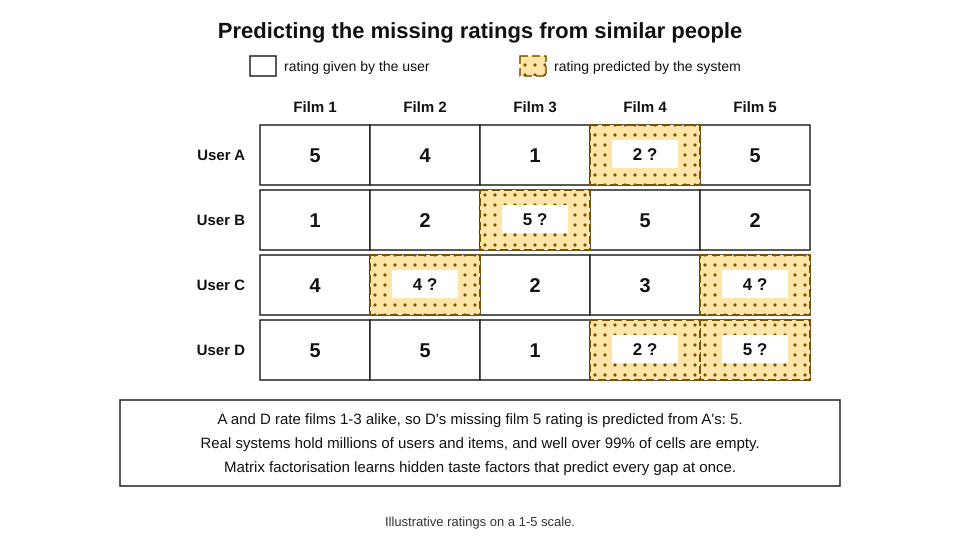
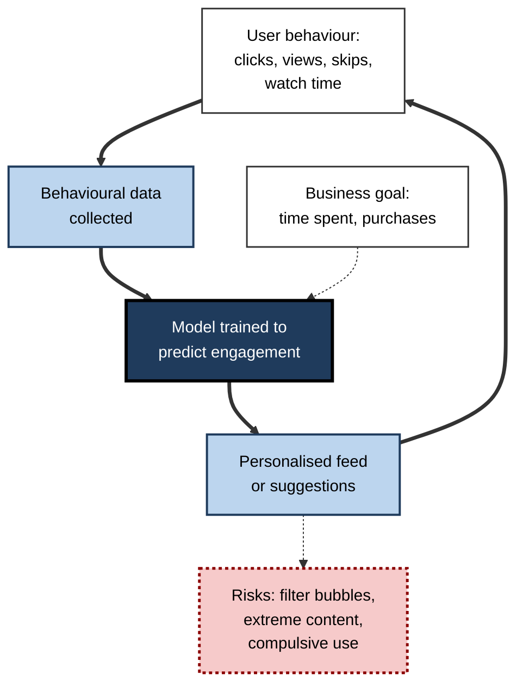
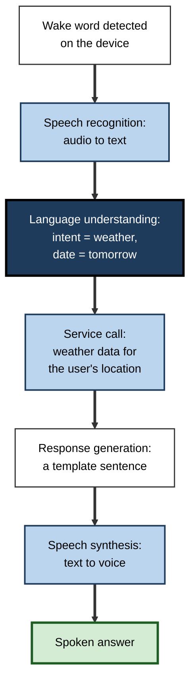
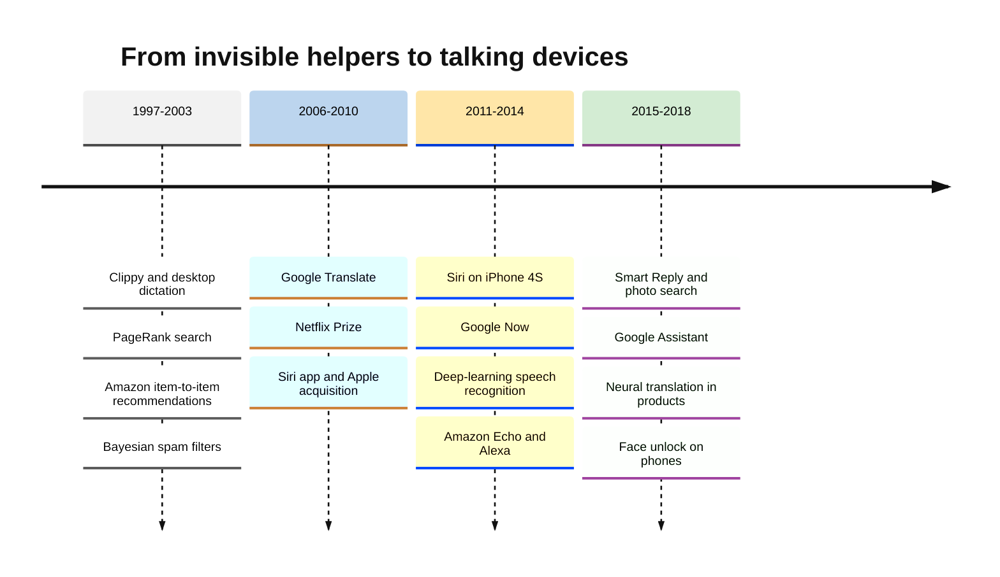
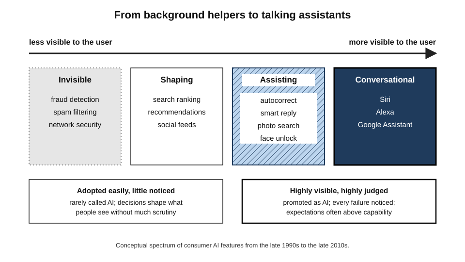

# B.10. AI in mainstream products: Siri, Alexa, recommendations

In October 2011 Apple introduced a phone that could be asked, out loud, whether it would rain tomorrow. Three years later Amazon began selling a cylinder that sat in the kitchen and listened for its name. Long before either, online shops had quietly been suggesting "customers who bought this also bought…". Between the late 1990s and the late 2010s artificial intelligence moved out of laboratories and into the pockets, homes and shopping baskets of billions of people — often without being called AI at all.

> **Definition — Consumer AI:** artificial-intelligence features built into products used by the general public, such as search, recommendations, spam filters, voice assistants, photo organisation and predictive text.

> **Definition — Recommender system:** software that predicts which items — products, films, songs, posts — a particular person is likely to want, using data about that person and about others.

**Why it matters**

- **It made AI part of daily life** for billions of people a decade before chatbots became famous.
- **It established the business model** of using behavioural data to personalise services — and the privacy, attention and fairness debates that followed.
- **It showed the gap between demonstration and daily use.** Voice assistants were hailed as the next computing platform; their real use settled on a few simple tasks.
- **It trained public expectations** of what AI is — invisible, helpful, sometimes creepy, often disappointing.

---

## The Invisible First Wave (1995–2010)

### AI that nobody called AI

- **Web search**
  - From 1998 Google ranked pages by **PageRank** — treating links as votes — and over the following years added many learned signals.
  - Search became the first AI-shaped service used by almost everyone online.
- **Spam filtering**
  - Learned (Bayesian) filters spread in the early 2000s; by the 2010s large email services were filtering the large majority of incoming mail automatically.
- **Card-fraud detection**
  - Neural-network scoring of transactions became standard in banking during the 1990s.
- **Speech dictation**
  - Desktop dictation, such as Dragon NaturallySpeaking (1997), served doctors, lawyers and people with disabilities.
- **Translation**
  - Google Translate launched in 2006 using statistical machine translation, bringing rough automatic translation to the public free of charge.

> **Key point:** the first mass-market AI was **invisible**. It worked in the background, framed as "search", "filters" or "security", and so escaped both hype and scrutiny.

> **Definition — AI effect:** the tendency for a technique to stop being called "AI" once it is reliable and routine.

### Early attempts at visible assistants

- **Microsoft's Office Assistant ("Clippy", 1997)**
  - An animated paper clip that offered help, drawing on Microsoft Research's Bayesian work on inferring users' goals.
  - In the shipped product it interrupted constantly and was widely mocked; Microsoft switched it off by default in 2001 and removed it in 2007.
- **Lesson:** a helpful system that **interrupts at the wrong moment** is experienced as unhelpful — accuracy of inference is less important than respect for the user's attention.

---

## Recommendations: The Engine of Online Business

### From ratings to purchases

- **Collaborative filtering research (early 1990s)**
  - Projects such as Xerox's Tapestry (1992) and the University of Minnesota's GroupLens (1994) predicted a person's preferences from the ratings of people with similar tastes.
- **Amazon's item-to-item recommendations (from 1998)**
  - Instead of finding similar *people*, Amazon computed which *items* were often bought together — fast enough to work across millions of products and customers.
  - The approach, described publicly by Amazon engineers in 2003, became one of the most copied ideas in e-commerce.

> **Definition — Collaborative filtering:** recommending items to a person based on the preferences of other people with similar behaviour, without needing to understand the items themselves.

> **Definition — Content-based filtering:** recommending items similar in their features (genre, author, ingredients) to items a person already liked.

### Worked example (illustrative): item-to-item recommendation

A bookshop records which of four customers bought three books. *Illustrative figures.*

| Customer | Book X (project management) | Book Y (negotiation) | Book Z (gardening) |
|---|---|---|---|
| Asha | Bought | Bought | — |
| Ben | Bought | Bought | — |
| Chen | Bought | — | Bought |
| Dana | — | — | Bought |

1. **Customers who bought X:** Asha, Ben, Chen (3).
2. **Of these, who also bought Y:** Asha, Ben (2) → 2 ÷ 3 ≈ **67%**.
3. **Of these, who also bought Z:** Chen (1) → 1 ÷ 3 ≈ **33%**.
4. **Recommendation:** a new customer viewing Book X is shown **Book Y** first: "customers who bought this also bought…".

> **Watch out:** co-purchase rates favour **popular items** — a bestseller bought by everyone will appear "related" to everything. Real systems adjust for overall popularity, or recommendations collapse into a list of bestsellers.

**Figure 1.** A ratings matrix: collaborative filtering fills in the gaps.

### Case study: The Netflix Prize (2006–2009)

- **Situation:** Netflix, then mainly a DVD-by-post service, relied on its recommendation system, Cinematch, to help members find films and spread demand beyond new releases.
- **Problem:** improving the system internally had become slow.
- **Action:**
  1. In October 2006 Netflix released about 100 million anonymised ratings and offered **one million dollars** to the first team to improve Cinematch's prediction accuracy by **10%**.
  2. Tens of thousands of teams from around the world entered; leaders shared methods openly.
  3. The decisive technique was **matrix factorisation** — learning hidden "taste factors" for each film and member — combined with blends of hundreds of models.
- **Result:**
  - in September 2009 the team "BellKor's Pragmatic Chaos" won, minutes ahead of a rival with an equal score;
  - the competition advanced recommender research and popularised open data competitions.
- **Side effects / caveats:**
  - researchers showed that some members could be **re-identified** by matching anonymised ratings with public reviews; a planned second prize was cancelled in 2010 after a privacy lawsuit and regulatory concerns;
  - Netflix later explained that it did not deploy the full winning blend — the extra accuracy did not justify the engineering cost, and the business had shifted to streaming, where viewing behaviour mattered more than star ratings.
- **Lesson:** **benchmark accuracy is not business value**, and "anonymised" behavioural data can identify people.

> **Definition — Matrix factorisation:** a technique that represents each user and each item by a short list of learned numbers (factors) whose combination predicts the user's rating of the item.

### Recommendations become the product

- **Netflix (streaming, from 2007)** — company researchers wrote in 2015 that most hours watched came from recommendations rather than search.
- **YouTube (2010s)** — moved to deep-neural-network recommendations optimised for viewing time; recommended videos came to account for most viewing.
- **Spotify** — personalised playlists such as Discover Weekly (2015) blended collaborative filtering with audio analysis.
- **Social media feeds** — Facebook's News Feed (2006) moved to algorithmic ranking; TikTok's "For You" feed, which reached global audiences from 2018, made recommendation the whole experience.

> **Watch out:** figures such as "a third of Amazon's sales come from recommendations" or "80% of Netflix viewing comes from recommendations" are **widely repeated**. They originate in company statements or consultancy estimates and are hard to verify independently; they should be treated as indications of scale, not precise facts.

**Study card — Deep neural networks for YouTube recommendations (Google, 2016)**

- **Problem:** choose, from many millions of videos, a few dozen for each of over a billion users, in a fraction of a second, as new videos arrive every minute.
- **Design — two stages:**
  1. **candidate generation** — a neural network narrows millions of videos to a few hundred plausible ones, using the user's watch and search history;
  2. **ranking** — a second network scores those candidates in detail and orders them.
- **Objective:** the ranking was trained to predict **expected watch time** rather than clicks, because clicks rewarded misleading thumbnails.
- **Result:** the paper reported clear gains over earlier systems; the two-stage design became an industry template.
- **Conclusion:** the choice of **what to optimise** — clicks, watch time, satisfaction — is a design decision with large effects on what billions of people see.

> **Key point:** recommendation at this scale is a **funnel** — cheap, broad filtering first, expensive, precise ranking last — and its behaviour is set by the **objective** it is trained on.

**Figure 2.** The feedback loop at the heart of a recommendation feed.

| | Content-based | Collaborative filtering | Deep-learning recommenders |
|---|---|---|---|
| Uses | Item features | Other users' behaviour | Both, plus context (time, device, sequence of actions) |
| Era of dominance | 1990s onwards, alongside others | Late 1990s to mid-2010s | Mid-2010s onwards |
| Strength | Works for new items with known features | Finds non-obvious connections | Very accurate at predicting engagement |
| Weakness | Recommends "more of the same" | Struggles with new users and items (cold start) | Opaque; optimises whatever metric it is given |
| Typical example | "More books by this author" | "Customers who bought this also bought" | Video and short-form feeds |

> **Definition — Cold-start problem:** the difficulty of recommending to a new user, or recommending a new item, before any behavioural data exist.

---

## Voice Assistants: Computers You Can Talk To

### Siri: from a defence project to the iPhone

**Study card — The origins of Siri (2003–2011)**

- **Research roots:** from 2003 SRI International led CALO ("Cognitive Assistant that Learns and Organises"), a large project funded by DARPA's programme on personalised assistants.
- **Spin-off:** in 2007 SRI researchers, including Dag Kittlaus, Adam Cheyer and Tom Gruber, founded Siri Inc. to build a consumer assistant.
- **Launch:** a Siri app appeared on the iPhone App Store in February 2010; Apple bought the company about two months later.
- **Integration:** in October 2011 Siri was launched as a built-in feature of the iPhone 4S, using speech-recognition technology licensed from Nuance.
- **Conclusion:** decades of government-funded research in speech, language understanding and planning reached the mass market through a start-up and a phone.

### The assistant race

| Assistant | Company | Launched | Main form | Distinctive feature |
|---|---|---|---|---|
| Siri | Apple | 2011 | Phone | First mass-market voice assistant |
| Google Now | Google | 2012 | Phone | Proactive "cards" based on location, calendar and search |
| Cortana | Microsoft | 2014 | Phone and PC | Tied to Windows; later scaled back for consumers |
| Alexa | Amazon | 2014 (Echo speaker) | Smart speaker | Always-listening home device; third-party "skills" |
| Google Assistant | Google | 2016 | Phone and speaker | Strong search and conversation; Duplex phone-calling demonstration in 2018 |

### Alexa and the smart speaker

- **November 2014:** Amazon introduced the Echo, a speaker with far-field microphones that could hear a command across a room, waking on the word "Alexa".
- **Building blocks:** Amazon had acquired speech and language companies — including Evi (a British question-answering start-up) and Ivona (a Polish speech-synthesis firm).
- **Platform strategy:** outside developers built tens of thousands of "skills"; device makers built Alexa into lights, thermostats and cars.
- **Adoption:** smart speakers spread rapidly in the late 2010s, especially in the United States and the United Kingdom.

**Figure 3.** What happens when a voice assistant answers "What is the weather tomorrow?".

> **Key point:** the assistants of the 2010s were **pipelines of separate components**, with language understanding mapping requests to a fixed set of **intents**. Anything outside the list produced "Sorry, I don't know that one" — very different from the open-ended language models that followed.

> **Definition — Intent:** in a voice or chat assistant, the category of request the system recognises (such as set-timer, play-music or get-weather), to which a pre-built action is attached.

### Expectations and reality

- **The promise:** voice would become the next great computing platform, replacing screens for many tasks and enabling "voice commerce".
- **The reality:** surveys repeatedly found that most use concentrated on a few tasks — music, timers, weather, simple questions and smart-home control.
- **The business problem:** inexpensive devices sold at or near cost did not lead to large new revenue; in 2022 press reports described heavy losses in Amazon's devices unit and major job cuts.
- **Privacy concerns:**
  - in 2019 reports revealed that contractors at several companies listened to samples of recordings to improve recognition, prompting changes to policies and opt-outs;
  - always-listening microphones raised lasting questions about trust in the home.

> **Watch out:** loss figures for voice-assistant businesses come largely from **press reports citing internal documents**; companies did not publish them. The broad conclusion — that assistants did not become the profitable platform once predicted — is widely accepted.

| | Predicted in the mid-2010s | Observed by the early 2020s |
|---|---|---|
| Main use | General help, shopping, conversation | Music, timers, weather, lights |
| Voice shopping | A major new sales channel | Little used |
| Conversation | Increasingly natural dialogue | Mostly single commands |
| Business model | Platform revenue from skills and commerce | Devices sold cheaply; limited revenue |
| Public attitude | Excitement | Convenience mixed with privacy concerns |

---

## The Deep-Learning Upgrade (2012–2020)

- **Speech recognition** — deep networks from 2012 cut error rates sharply, making assistants usable in noisy rooms and for more accents.
- **Photos** — services launched in the mid-2010s let users search their pictures for "dog" or "beach" without tagging them.
- **Translation** — neural machine translation replaced statistical systems in major products from 2016.
- **Smart Reply** — from 2015 email services suggested short replies generated by neural networks.
- **Face unlock** — phones introduced face recognition for unlocking from 2017, using depth sensors and on-device neural networks.
- **On-device AI** — phone makers added dedicated neural-processing chips so that features could run locally, faster and with less data sent to the cloud.

### Search becomes a learning system

- **1998–2010s:** link analysis (PageRank) was joined by hundreds of signals — words, freshness, location, click behaviour — combined increasingly by **learned ranking** models.
- **2015:** Google said it had begun using a machine-learning system, RankBrain, to interpret unfamiliar queries.
- **2019:** Google began using the BERT language model to understand search queries, which it described as one of the biggest changes to search in years.
- **Lesson:** search moved from **matching words** to **interpreting meaning** — a gradual change most users never noticed.

### The smartphone as the AI platform

- **Always with the user** — phones combined cameras, microphones, location and personal data, giving AI both inputs and a reason to personalise.
- **Keyboards** — predictive text and autocorrect learned from typing patterns; **federated learning**, introduced by Google researchers in 2016–2017, allowed keyboard models to improve from many phones without collecting users' raw typing.
- **Cameras** — "computational photography" used learned models to combine several exposures, sharpen faces and brighten night scenes.
- **Accessibility** — live captions, screen readers that describe images and voice control opened phones to many disabled users.

> **Definition — Federated learning:** a way of training a shared model across many devices, in which each device learns from its own data and sends only model updates, not the raw data, to a central server.

> **Definition — On-device AI:** running an AI model on the user's own phone or computer rather than in a remote data centre, improving speed and privacy.

### Data, privacy and the law

- **The business model** — free services funded by advertising and personalisation depended on collecting behavioural data at scale.
- **Regulation** — the European Union's General Data Protection Regulation (applying from 2018) gave people rights over their personal data, including information about automated decisions, and pushed firms to justify data collection.
- **Platform changes** — from 2021 Apple required apps to ask permission before tracking users across other companies' apps, reshaping the advertising industry.
- **Consequence:** privacy became a **product feature** and a competitive argument, not only a legal requirement.

| | Early consumer AI (1998–2010) | Mature consumer AI (2011–2020) |
|---|---|---|
| Visibility | Mostly invisible | Visible in assistants, cameras and feeds |
| Main data | Clicks, purchases, emails | Voice, photos, location, viewing, typing |
| Main method | Statistical learning and link analysis | Deep learning, on-device models |
| Where it ran | Company servers | Servers and increasingly the phone itself |
| Public debate | Little | Privacy, attention, bias, misinformation |

**Figure 4.** AI arrives in consumer products, 1997–2018.

### Case study: The Duplex demonstration (2018)

- **Situation:** at its developer conference in May 2018 Google played recordings of its Assistant telephoning a hair salon and a restaurant to make bookings on a user's behalf.
- **What impressed:** the system, called Duplex, spoke with natural pauses and filler sounds ("um", "mm-hmm"), handled interruptions and coped when the restaurant said no booking was needed.
- **What alarmed:** the people answering the phone did not appear to know they were talking to a machine. Commentators asked whether it was ethical for AI to imitate a human voice without saying so.
- **Response:** within days Google said Duplex would identify itself at the start of calls; it was later offered in limited form for restaurant bookings and similar tasks.
- **Result:** the service remained narrow — a few booking types in some countries — far from the general assistant the demonstration suggested.
- **Lesson:** a capability that **imitates people** raises questions of **disclosure and consent** that pure task performance does not — questions that returned on a far larger scale with generative voice and chat systems.

> **Remember:** people have a reasonable expectation to **know when they are dealing with a machine**. Disclosure is now a legal requirement for some AI systems in several jurisdictions.

### Public failures

- **Microsoft Tay (March 2016)** — a chatbot designed to learn from conversations on Twitter was manipulated by users into posting offensive messages and was withdrawn within about a day.
- **Mislabelled photos (2015)** — a photo service's automatic labelling applied an offensive label to images of Black people; the company apologised and removed the label category, highlighting bias in training data.
- **Lesson:** consumer AI operates **in public, at scale and among adversarial users**; failures that would be minor in a laboratory become reputational crises.

---

## What the Mainstream Era Taught

### Lessons for product builders

1. **Narrow and reliable beats broad and unreliable.** Timers and music succeeded; open-ended help disappointed.
2. **Invisible AI is easiest to adopt.** People accept filtering and ranking they never see — which is also why it needs oversight.
3. **The metric shapes the product.** Recommenders optimised for watch time or clicks deliver exactly that, with side effects.
4. **Data is the moat.** The firms with the most user behaviour built the best models, reinforcing their lead.
5. **Privacy is part of the product.** Always-on microphones and behavioural tracking create lasting trust costs.

**Figure 5.** How visible AI features were to their users.

> **In practice:** professionals evaluating a consumer-style AI feature for their own organisation can ask the questions this era answered painfully: **what exactly will people use it for, what metric will it optimise, what data does it collect, and what happens when users try to break it?**

---

## Open Questions

- **Do recommendation systems create filter bubbles?**
  - Concern is widespread, but empirical studies give mixed results; effects seem to depend on the platform, the user and how "bubble" is measured.
- **Will language models revive voice assistants?**
  - Assistants rebuilt on large language models promise genuine conversation; whether this changes how people use them is still unfolding.
- **Who should control the objectives of recommenders?**
  - Platforms set them; regulators and users increasingly seek a say. The right balance is contested.
- **Can personalisation and privacy coexist?**
  - On-device processing and privacy-preserving techniques help, but the trade-off has not been resolved.

---

## Summary

- **Consumer AI** reached the mass market first **invisibly** — search (**PageRank**, 1998), **spam filters**, fraud detection, dictation and Google Translate (2006) — illustrating the **AI effect**.
- **Clippy** (1997) showed that a badly timed assistant is worse than none.
- **Recommender systems** grew from **collaborative filtering** research (Tapestry, GroupLens) to **Amazon's item-to-item** method (1998); the **Netflix Prize** (2006–2009) advanced **matrix factorisation** but exposed **re-identification** risks and showed benchmark accuracy ≠ business value.
- Recommendations became the core of **Netflix, YouTube, Spotify** and social feeds, driven by an engagement **feedback loop**; widely quoted percentages are **hard to verify**.
- **Siri** grew from DARPA-funded **CALO** research at SRI, became a start-up (2007), was bought by Apple (2010) and launched on the **iPhone 4S (2011)**; **Google Now**, **Cortana**, **Alexa/Echo (2014)** and **Google Assistant (2016)** followed.
- 2010s assistants were **pipelines** mapping speech to fixed **intents**; use settled on simple tasks; business returns and **privacy** disappointed.
- **Deep learning** upgraded speech, photos, translation, Smart Reply and face unlock; **search** shifted from matching words to interpreting meaning (RankBrain, BERT); phones became the main AI platform, with **on-device** and **federated** learning; **GDPR** and tracking limits made privacy a product feature.
- YouTube's 2016 **two-stage** recommender optimised **watch time**, showing that the objective shapes what people see; failures such as **Tay** showed the risks of AI in public.

---

## Self-Check

1. Give four examples of AI that reached the public before 2010 without being called AI.
2. What does the "AI effect" describe?
3. Why did Clippy fail despite being based on serious research?
4. Distinguish collaborative filtering from content-based filtering.
5. In the illustrative bookshop example, why is Book Y recommended to someone viewing Book X, and what common pitfall must real systems correct?
6. Summarise the Netflix Prize and two lessons from it.
7. Trace Siri from research project to iPhone feature.
8. Explain how a 2010s voice assistant processed a request, and why it often failed on unusual questions.
9. How did actual use of voice assistants differ from predictions?
10. Describe the recommendation feedback loop and one risk it creates.
11. What did Microsoft Tay demonstrate?
12. A retailer plans a voice-shopping assistant. Using the history of the 2010s, what would you advise?

### Answer Key

1. Any four: PageRank-based web search; Bayesian spam filters; card-fraud detection; desktop speech dictation; statistical machine translation; recommendation engines.
2. The tendency for a technique to stop being called AI once it becomes reliable and routine.
3. It interrupted users at the wrong moments and could not judge when help was wanted, so even reasonable inferences felt intrusive; respect for attention mattered more than inference accuracy.
4. Collaborative filtering uses other people's behaviour to infer preferences without understanding the items; content-based filtering recommends items whose features resemble items the person liked.
5. Two of the three customers who bought X also bought Y (67%), more than bought Z (33%). Pitfall: popular items appear related to everything, so systems must adjust for overall popularity.
6. Netflix offered one million dollars for a 10% improvement in rating prediction, releasing about 100 million anonymised ratings; matrix factorisation and model blending won in 2009. Lessons: benchmark accuracy gains may not justify deployment cost; "anonymised" behavioural data can be re-identified.
7. DARPA-funded CALO research at SRI (from 2003) → Siri Inc. spin-off (2007) → App Store app (February 2010) → acquired by Apple (April 2010) → built into the iPhone 4S (October 2011).
8. Wake-word detection, speech recognition to text, language understanding mapping the text to an intent, a service call, a templated response and speech synthesis. Requests outside the predefined intents could not be handled.
9. Predicted to become a major platform for help, shopping and conversation; in practice used mainly for music, timers, weather and smart-home control, with little voice shopping and limited revenue.
10. Behaviour data train a model that predicts engagement, which shapes the feed, which shapes further behaviour. Risk: optimising engagement can promote extreme or compulsive content, or narrow what people see.
11. That AI learning from public input can be manipulated by adversarial users, and that consumer AI failures happen at scale and become reputational crises quickly.
12. Start with narrow, high-frequency tasks such as reordering, tracking and simple queries; expect little open-ended shopping; design for privacy and clear consent; measure real use rather than downloads; test against misuse; integrate with existing apps rather than relying on voice alone.

---

## Glossary

| Term | Meaning |
|---|---|
| AI effect | The tendency for working techniques to stop being called AI. |
| CALO | A DARPA-funded assistant research project led by SRI (2003–2008) from which Siri emerged. |
| Clippy | Microsoft Office's animated assistant (1997–2007), widely seen as intrusive. |
| Cold-start problem | Difficulty recommending for new users or items with no data. |
| Collaborative filtering | Recommending from the behaviour of similar users. |
| Consumer AI | AI features in products used by the general public. |
| Content-based filtering | Recommending items similar in features to ones a person liked. |
| Duplex | Google's 2018 system that made telephone bookings in a natural-sounding voice. |
| Federated learning | Training a shared model across devices without collecting raw data. |
| GDPR | The EU's General Data Protection Regulation, applying from 2018. |
| Intent | The category of request a voice or chat assistant recognises. |
| Item-to-item recommendation | Suggesting items frequently bought or viewed together. |
| Matrix factorisation | Representing users and items by learned factors that predict ratings. |
| Netflix Prize | A 2006–2009 competition to improve Netflix's rating predictions by 10%. |
| On-device AI | Running AI models on the user's own device. |
| PageRank | Google's 1998 method of ranking web pages by their links. |
| Re-identification | Linking supposedly anonymous data back to specific people. |
| Recommender system | Software predicting which items a person will want. |
| Smart speaker | A voice-controlled speaker with a built-in assistant, such as the Amazon Echo. |
| Wake word | The word that activates a listening device, such as "Alexa". |
