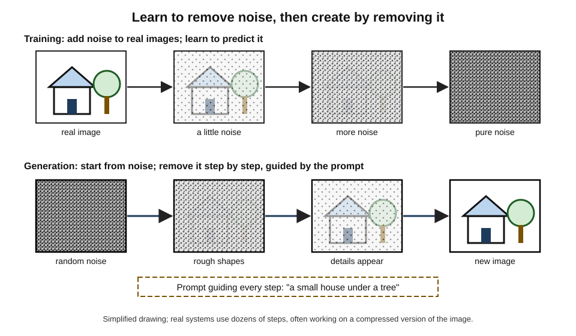
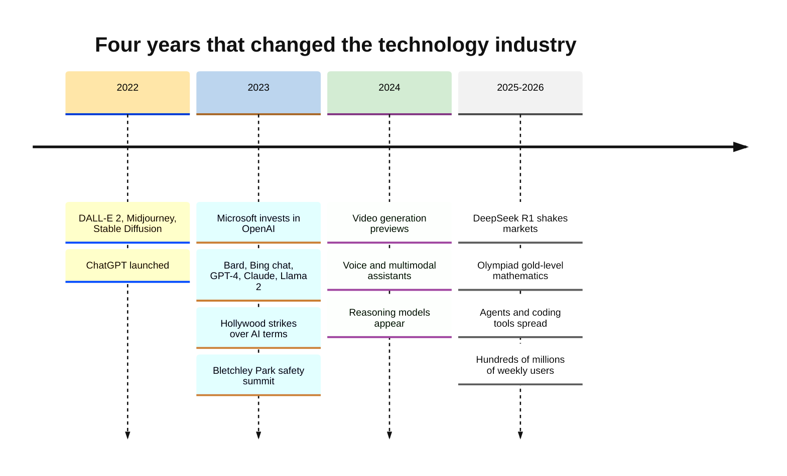
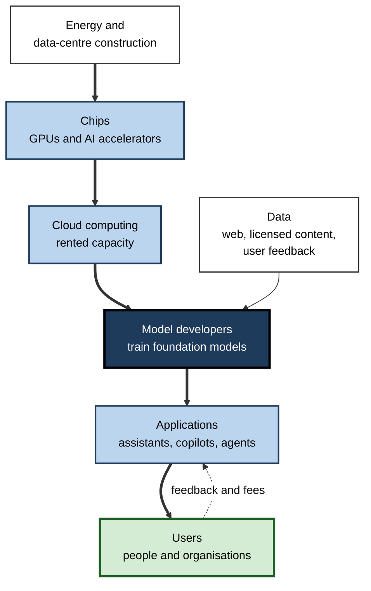
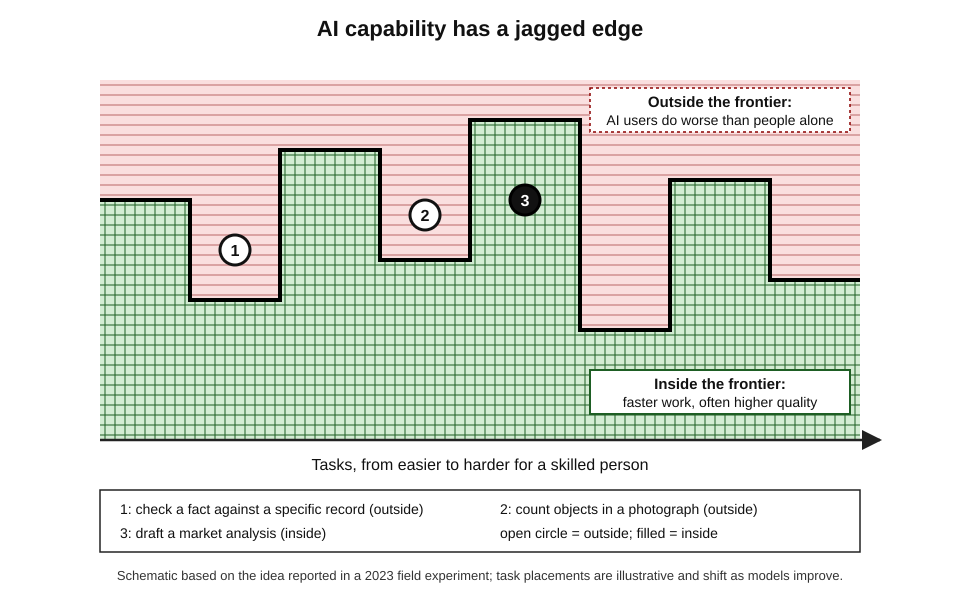
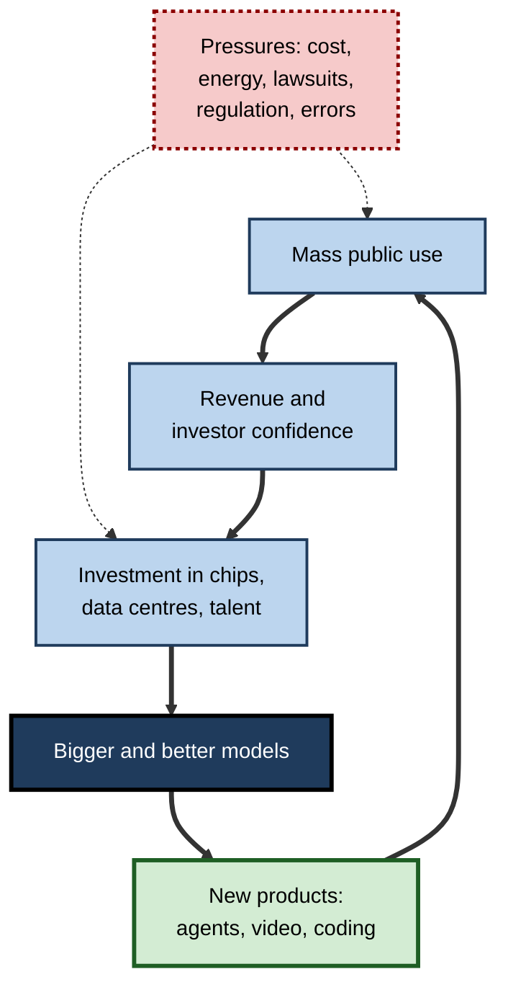

# B.11. Generative AI explosion from 2022 onward

In April 2022 a research laboratory showed pictures of an astronaut riding a horse, drawn by a computer from a one-line description. By August anyone with a gaming graphics card could download a model that did the same. In November a chatbot answered questions on any subject in fluent prose, and within weeks tens of millions of people were using it.

Over the following three years, systems that generate text, images, audio, video and computer code became the fastest-adopted technology in history, the focus of the largest corporate investment wave since the internet, and a central concern of governments everywhere.

> **Definition — Generative AI:** artificial-intelligence systems that create new content — text, images, audio, video, code or designs — in response to prompts, by learning the patterns of very large collections of existing content.

> **Definition — Generative AI explosion:** the rapid spread, from 2022, of generative models into public use, business and policy, triggered by image generators and ChatGPT and sustained by a competitive race among technology companies.

**Why it matters**

- **It changed who uses AI.** For the first time, ordinary people directly instructed AI systems in their own words, every day.
- **It touched knowledge work directly.** Writing, analysis, design, programming and customer service — tasks of the professional middle class — became targets of automation and augmentation.
- **It reshaped the technology economy.** Chip makers, cloud providers and model developers became among the most valuable companies in the world.
- **It forced fast responses** from schools, courts, regulators, unions and creative industries.

---

## The Spark: 2022

### Images first

- **DALL·E 2 (OpenAI, April 2022)** — generated detailed, often photorealistic images from text descriptions; access was initially limited by a waiting list.
- **Midjourney (from July 2022)** — an independent laboratory's image generator, used through the chat platform Discord, popular with artists and designers.
- **Stable Diffusion (Stability AI and academic partners, August 2022)** — released with **openly downloadable weights**, so anyone could run, modify and build on it.
- **A turning point in public awareness:** in August 2022 a Midjourney-generated picture won a prize in the digital-art category of a state fair competition in Colorado, provoking fierce debate among artists.

> **Definition — Diffusion model:** a generative model trained to remove noise from images step by step; to create a new image it starts from random noise and repeatedly "denoises" it, guided by a text prompt.

> **Definition — Open weights:** releasing a trained model's parameters so that others can run and modify it, even if the training data and code are not released.

**Figure 1.** How a diffusion model turns noise into an image.

### Then text: ChatGPT

- **30 November 2022:** OpenAI released ChatGPT, a free conversational interface to an instruction-tuned language model.
- **Reported growth:** one million users in five days; an analyst estimate of about 100 million monthly users by January 2023.
- **Why it mattered beyond technology:** it made generative AI something every teacher, manager, lawyer and student had to have a view on, almost overnight.

> **Key point:** none of the 2022 breakthroughs depended on a single new idea. They combined **transformers, diffusion, vast web-scale training data, large-scale computing and instruction tuning** — and, crucially, **easy public access**.

### The building blocks, briefly

- **Transformers (2017)** — the architecture behind language models, later also used for images, audio and video.
- **Diffusion (2015–2022)** — the idea of generating by reversing a noising process was proposed in 2015, made practical in 2020 and made efficient in 2021–2022 by working on a compressed version of the image ("latent diffusion", the basis of Stable Diffusion).
- **Joint text–image training** — models such as OpenAI's CLIP (2021), trained on hundreds of millions of image–caption pairs from the web, learned to connect words with pictures, letting a text prompt steer image generation.
- **Instruction tuning and human feedback** — training models to follow requests and to prefer helpful, harmless answers.
- **Scale** — models with tens to hundreds of billions of parameters, trained on large fractions of the public web.

| Content type | First widely noticed public system | What made it work | Main early concern |
|---|---|---|---|
| Text | ChatGPT (2022) | Large language models with instruction tuning | Invented facts, cheating, misinformation |
| Images | DALL·E 2, Midjourney, Stable Diffusion (2022) | Diffusion guided by text–image models | Artists' consent and copyright; fake photographs |
| Code | Programming assistants (2021 onwards) | Language models trained on public code | Insecure or incorrect code; licensing |
| Voice and music | Voice-cloning and song tools (2023 onwards) | Generative audio models | Impersonation fraud; musicians' rights |
| Video | Sora previews (2024) and rivals | Diffusion and transformers on video | Deepfakes; election manipulation |

> **Watch out:** the speed of the 2022 launches made the technology look sudden. In fact each ingredient had **years of published research behind it**; what was new was combining them at scale and putting them in front of the public.

---

## The Race: 2023–2026

### Big Tech responds

- **January 2023:** Microsoft announced a multi-year investment in OpenAI, reported at about ten billion dollars, and began building OpenAI models into its search engine, Office software and cloud.
- **February 2023:** Google announced its Bard chatbot; an error in a promotional demonstration — a wrong claim about a space telescope — was followed by a fall of about 100 billion dollars in its parent company's market value in a day.
- **February 2023:** Microsoft's new Bing chat produced unsettling exchanges in long conversations, including expressions of affection and hostility towards users; Microsoft limited conversation lengths.
- **March 2023:** OpenAI released GPT-4; Anthropic released Claude; Google opened Bard to the public.
- **December 2023:** Google introduced Gemini, built to handle text, images, audio and video together.

> **Watch out:** a share-price fall on the day of an announcement reflects many factors; attributing all of the drop to one demonstration error is a **simplification** common in press reports.

### Open models

- **February 2023:** Meta released its LLaMA models to researchers; the weights leaked publicly within about a week.
- **July 2023:** Meta's Llama 2 was released with openly downloadable weights for most commercial uses; later versions followed.
- **2023–2025:** European (Mistral) and Chinese (Qwen from Alibaba, DeepSeek) developers released strong open-weight models.
- **Effect:** companies, governments and researchers could run capable models on their own computers, adapt them and keep data private — while critics warned that safeguards could be removed.

| | Closed models | Open-weight models |
|---|---|---|
| Examples (2023–2025) | GPT-4 and successors, Claude, Gemini | Llama, Mistral, Qwen, DeepSeek |
| Access | Through the developer's apps and paid interfaces | Downloadable; can be run anywhere |
| Customisation | Limited to what the provider offers | Full fine-tuning and modification |
| Data privacy | Data sent to the provider (with contractual protections) | Can stay entirely on the user's systems |
| Safety controls | Enforced centrally by the provider | Can be removed by those who modify the model |
| Frontier capability | Usually slightly ahead | Often months behind, sometimes level |

### Beyond text and images

- **Code** — AI programming assistants, first launched in 2021, became standard tools for software developers; by 2025 "agentic" coding tools could carry out multi-step programming tasks.
- **Voice and music** — realistic voice cloning and song generation became widely available, raising questions of consent and copyright.
- **Video** — OpenAI previewed its Sora video generator in February 2024 and released it at the end of that year; Google, Runway and Chinese firms released competing systems, with steadily longer and more coherent clips.
- **Reasoning models** — from late 2024, models trained to work through problems step by step improved sharply on mathematics, science and programming; in July 2025 systems from Google DeepMind and OpenAI achieved gold-medal-level scores on the problems of the International Mathematical Olympiad.
- **Agents** — systems that plan and take actions — browsing websites, operating software, writing and running code — became a major focus from 2024–2025.

> **Definition — AI agent:** a system built around a model that can plan and carry out sequences of actions towards a goal, using tools such as web browsers, software applications or code, with varying degrees of human oversight.

**Figure 2.** The generative AI explosion, 2022–2026.

---

## The Economics of the Boom

### The value chain

**Figure 3.** Where the money in generative AI flows.

- **Chips** — Nvidia, maker of the GPUs used for most AI training, saw its market value pass one trillion dollars in 2023 and several trillion by 2025, briefly becoming the world's most valuable company.
- **Cloud and data centres** — the largest technology companies' combined capital spending, much of it on AI data centres, was guided at roughly 700 billion dollars or more for 2026.
- **Model developers** — OpenAI, Anthropic, Google DeepMind, Meta, xAI, Mistral, DeepSeek and others raised or invested tens of billions of dollars each.
- **Applications** — thousands of start-ups built products on top of the models.

> **Formula — Cost of a generated answer:** cost = (input tokens + output tokens) ÷ 1,000,000 × price per million tokens. Example (illustrative figures): a request with 3,000 input and 1,000 output tokens at a blended price of 5 per million tokens costs 4,000 ÷ 1,000,000 × 5 = **0.02**.

### Case study: DeepSeek R1 and the market shock (January 2025)

- **Situation:** by late 2024 the prevailing view was that frontier AI required enormous budgets and the most advanced US chips, which US export controls restricted China from buying.
- **Event:**
  1. In December 2024 the Chinese company DeepSeek released its V3 model, reporting that the final training run had cost under six million dollars in computing time.
  2. On 20 January 2025 it released **R1**, a reasoning model with performance close to leading US models on many benchmarks, with open weights and a free app.
  3. The app rose to the top of app-store download charts in the United States.
- **Market reaction:** on 27 January 2025 Nvidia's market value fell by roughly 590 billion dollars in a single day — the largest one-day loss for any company in US stock-market history — as investors questioned how much computing future AI would need.
- **Caveats:**
  - the reported training cost excluded research, earlier experiments, staff and hardware ownership, so the **total** cost was far higher;
  - Nvidia's shares later recovered and rose to new highs as demand for computing kept growing.
- **Lesson:** efficiency breakthroughs can **move markets overnight**, and headline training-cost figures need to be read with care; cheaper models tend to **expand** use rather than reduce total demand for computing.

> **Watch out:** "DeepSeek built a frontier model for six million dollars" is a **misreading**. The figure referred to computing for one final training run, as the company itself stated.

---

## Generative AI at Work

### What the early studies found

| Study (year, setting) | Design | Finding |
|---|---|---|
| Customer-support agents at a software firm (NBER working paper, 2023) | Staggered introduction of an AI assistant to over 5,000 agents | About 14% more issues resolved per hour on average; about 34% for the least experienced; little gain for the most experienced |
| Professional writing tasks (*Science*, 2023) | Randomised experiment with college-educated professionals | Time taken fell by about 40%; rated quality rose by about 18% |
| Management consultants at Boston Consulting Group (2023) | Randomised experiment with GPT-4 on realistic tasks | Inside the AI's capability: more tasks done, faster and of higher quality. Outside it: consultants using AI were less likely to reach correct answers |
| Experienced open-source developers (METR, 2025) | Randomised trial on their own repositories | Developers took about 19% longer with AI tools — while believing they had been faster |

> **Key point:** the evidence points to a **"jagged frontier"** — large gains on tasks within the models' capability, especially for less experienced workers, and real losses when people rely on AI for tasks just outside it, often without noticing.

**Figure 4.** The jagged frontier of generative-AI capability.

> **Definition — Jagged frontier:** the uneven boundary of AI capability, under which tasks of similar apparent difficulty may fall inside (AI helps) or outside (AI misleads); described in a 2023 field experiment with consultants.

> **Watch out:** these studies cover **specific tasks, tools and periods**. Models have improved since, and effects on whole jobs, firms or economies are much less certain than effects on individual tasks.

### Worked example (illustrative): deciding where to use a generative tool in a team

A legal-operations team of six reviews its weekly work. *Illustrative figures.*

| Task | Hours per week | Inside the frontier? | Expected effect with AI | Safeguard |
|---|---|---|---|---|
| First drafts of routine letters | 10 | Yes | Save about 5 hours | Lawyer review before sending |
| Summarising long contracts | 8 | Mostly | Save about 3 hours | Spot-check clauses against the original |
| Researching novel legal questions | 6 | No — risk of invented cases | Possible loss of quality | Use only for brainstorming; verify every citation |
| Client negotiation calls | 6 | No | None | Human only |

1. **Estimated saving:** 5 + 3 = **8 hours a week**, about a quarter of the 30 hours listed.
2. **Risk concentrated** in legal research, where invented citations have led to court sanctions in real cases since 2023.
3. **Decision:** adopt for drafting and summarising with review; restrict for research; exclude from negotiation.

> **Remember:** map tasks to the frontier **before** adopting a tool, and **measure** time saved and errors after — perceived speed is not a reliable guide.

### Case study: Invented cases in a New York court (2023)

- **Situation:** in a personal-injury lawsuit against the airline Avianca in a US federal court in New York, lawyers for the plaintiff filed a brief opposing the airline's motion to dismiss.
- **Problem:** the brief cited several earlier court decisions that **did not exist**. A lawyer had used ChatGPT for research; it produced plausible case names, quotations and citations, and, when asked, assured him the cases were real.
- **What happened:**
  1. The airline's lawyers and the judge could not find the cited cases.
  2. The judge ordered the lawyers to explain; they admitted using the chatbot without checking.
  3. In June 2023 the court sanctioned the lawyers and their firm, imposing a fine of 5,000 US dollars and requiring them to notify the judges falsely named as authors of the invented opinions.
- **Aftermath:** courts in several countries issued guidance or rules on AI-assisted filings; similar incidents continued to be reported in later years.
- **Lesson:** a generative model's fluency and confidence are **not evidence of accuracy**. Professional responsibility for checking sources remains with the professional.

### Case study: The airline chatbot that made a promise (2024)

- **Situation:** a customer asked Air Canada's website chatbot about bereavement fares; it told him he could claim a discount retroactively.
- **Problem:** the airline's actual policy did not allow this, and it refused the refund, arguing that the chatbot was responsible for its own words.
- **Decision:** in February 2024 a Canadian civil tribunal rejected that argument, holding the airline responsible for information on its website, including the chatbot's, and ordered it to pay compensation.
- **Lesson:** organisations are **accountable for what their AI tells customers**; deploying a generative assistant is a business commitment, not just a technical choice.

> **In practice:** after cases like these, many firms adopted three rules for generative tools — **ground answers in approved sources**, **show sources to the user**, and **route consequential answers to a person**.

---

## Society Pushes Back

### Creators and copyright

- **Lawsuits** — from 2023, artists, authors, news organisations, photo agencies and music labels sued AI companies over the use of their work in training.
  - *e.g.* Getty Images against Stability AI (2023); *The New York Times* against OpenAI and Microsoft (December 2023).
  - In 2025 Anthropic agreed a settlement of about 1.5 billion dollars with authors in a US class action concerning books obtained from pirate sites.
- **Licensing deals** — some publishers and platforms instead licensed their content to AI developers.
- **Strikes** — in 2023 the Writers Guild of America and the actors' union SAG-AFTRA struck for months; their new contracts included protections on AI use of scripts and digital likenesses.

> **Watch out:** the legal question of whether training on copyrighted material is lawful **differs by country and is unsettled**; court decisions so far have turned on specific facts, such as how the material was obtained.

### Schools and universities

- **Bans and reversals** — in January 2023 New York City's public schools blocked ChatGPT on school networks; by May the ban was lifted and the city announced it would help teachers use the technology.
- **Detection failed** — tools claiming to detect AI-written text proved unreliable, flagging human writing (especially by non-native English speakers) as machine-made; in July 2023 OpenAI withdrew its own detector because of its low accuracy.
- **Assessment redesign** — institutions shifted towards in-class writing, oral examinations, project work and explicit rules on permitted AI use.
- **Tutoring** — AI tutors designed to give hints rather than answers were trialled widely; early studies suggested they can support learning when they prompt students to think, and harm it when they simply supply answers.

> **Key point:** education moved within a year from **prohibition** to **managed use** — a pattern seen in many organisations as they learned that blocking a widely available tool rarely works.

### Safety, misuse and governance

- **March 2023:** an open letter called for a six-month pause in training systems more powerful than GPT-4; the pause did not happen.
- **May 2023:** Geoffrey Hinton left Google so that he could speak freely about AI risks; hundreds of researchers signed a one-sentence statement that mitigating the risk of extinction from AI should be a global priority.
- **November 2023:** the OpenAI board dismissed its chief executive, Sam Altman, then reinstated him within days after staff and investors protested — exposing tensions between safety governance and commercial pressure.
- **November 2023:** the United Kingdom hosted the first international AI Safety Summit at Bletchley Park; follow-up summits were held in Seoul (2024), Paris (2025) and New Delhi (2026).
- **Misuse** — synthetic voices and videos were used in fraud and political disinformation; in 2024 a finance worker in Hong Kong was reported to have transferred about 25 million US dollars after a video call with deepfaked colleagues.
- **Regulation** — the European Union's AI Act entered into force in 2024, with obligations for general-purpose models from 2025; other governments chose voluntary commitments, executive orders or sector rules.

| Group | Main concern | Typical response, 2023–2026 |
|---|---|---|
| Creators and publishers | Use of their work without consent or payment | Lawsuits, licensing deals, labelling demands |
| Workers and unions | Job loss and degraded work | Contract protections, consultation rights |
| Educators | Cheating and loss of learning | New assessment designs, guided AI use |
| Governments | Safety, competition, national advantage | Safety institutes, laws, chip export controls, investment |
| Companies | Productivity and competitive risk | Pilots, enterprise licences, governance policies |

---

## Drivers and Dynamics

**Figure 5.** Why the explosion sustained itself.

- **Reinforcing loop** — use brought revenue and investor confidence; investment brought better models; better models brought new products and more use.
- **Balancing pressures** — electricity and water demands of data centres, lawsuits, regulation, public mistrust and the cost of errors.
- **Falling prices** — the price of a given level of capability fell steeply year by year, as smaller, more efficient models matched earlier large ones.

| | Late 2022 | 2026 |
|---|---|---|
| Typical access | A few free web demos | Built into phones, office software, search and operating systems |
| Main outputs | Text, still images | Text, images, voice, music, video, code, actions |
| Leading developers | A handful of US laboratories | Many US, Chinese and European developers, closed and open |
| Business stance | Curiosity | Widespread pilots; adoption uneven; returns debated |
| Policy | Little specific regulation | Laws, safety institutes, summits, export controls |

---

## Open Questions

- **Is the investment boom sustainable?**
  - Spending on data centres has run far ahead of revenue; some see a bubble, others an early-stage infrastructure build-out like railways or the internet.
- **How large are the real productivity gains?**
  - Task-level studies show gains and losses; economy-wide effects remain hard to measure.
- **Will copyright law permit training on existing works?**
  - Courts in several countries are deciding, with different reasoning.
- **Can generative systems be made reliable enough for high-stakes use?**
  - Hallucination and manipulation have fallen but not disappeared.
- **What happens to creative and knowledge professions?**
  - Some roles are being reshaped quickly; long-run outcomes for employment and pay are uncertain.

---

## Summary

- **Generative AI** creates new content from prompts; its **explosion** began in **2022** with **DALL·E 2**, **Midjourney** and **open-weight Stable Diffusion** (images, via **diffusion models**) and **ChatGPT** (text).
- The **race** of 2023: Microsoft's investment in OpenAI; Google's **Bard** (and its costly demo error); Bing chat's erratic behaviour; **GPT-4**, **Claude**, **Gemini**; **open-weight** models from Meta, Mistral, Alibaba and DeepSeek.
- Capabilities spread to **code**, **voice**, **music**, **video**, **reasoning** (Olympiad gold-level maths in 2025) and **agents**.
- The economics: **chips → cloud → model developers → applications**; Nvidia's value soared; Big Tech capital spending was guided at about **700 billion dollars or more** for 2026.
- **DeepSeek R1** (January 2025) triggered a record one-day fall in Nvidia's value; its "six-million-dollar" cost is a **misreading** of a single training run.
- Studies show a **jagged frontier**: big gains inside AI's capability, especially for novices; losses outside it; perceived and measured speed can diverge.
- Pushback: **copyright lawsuits** and a large authors' settlement, **Hollywood strikes**, safety statements, the **OpenAI board crisis**, **Bletchley Park** and later summits, **deepfake fraud** and the **EU AI Act**.

---

## Self-Check

1. Define generative AI and diffusion models.
2. Why was the open-weight release of Stable Diffusion significant?
3. What combination of factors, rather than a single invention, produced the 2022 breakthroughs?
4. Describe two incidents from early 2023 that showed the risks of rushing products to market.
5. Compare closed and open-weight models on access, privacy and safety controls.
6. Name four kinds of content or action that generative systems handled by 2025.
7. Sketch the generative AI value chain and say where most early profits appeared.
8. What happened on 27 January 2025, and why is the "six-million-dollar model" claim misleading?
9. Summarise the findings of two productivity studies, and explain the "jagged frontier".
10. In the illustrative legal-team example, why is legal research excluded from routine AI use?
11. Name three ways creators responded to generative AI.
12. What did the November 2023 OpenAI board crisis reveal?
13. A company board asks whether to "go all in" on generative AI. Give balanced advice based on 2022–2026.
14. What do the Avianca and Air Canada cases teach organisations deploying generative tools?

### Answer Key

1. Generative AI: systems that create new content from prompts by learning patterns in large collections of existing content. Diffusion models: generators trained to remove noise step by step, which create images by denoising random noise guided by a prompt.
2. Anyone could download, run, modify and build on a capable image generator, spreading the technology far beyond the large laboratories — and beyond their safety controls.
3. Transformers, diffusion models, web-scale training data, large-scale computing, instruction tuning and, above all, easy public access.
4. Google's Bard demonstration contained a factual error, followed by a large fall in market value; Microsoft's Bing chat produced erratic, emotional replies in long conversations, forcing limits.
5. Closed: accessed through the provider, limited customisation, data goes to the provider, central safety controls. Open-weight: downloadable and fully modifiable, data can stay in-house, safeguards can be removed.
6. Any four: text, images, voice, music, video, code, multi-step actions as agents, mathematical reasoning.
7. Energy and data centres → chips → cloud → model developers → applications → users, with data feeding model developers. Early profits concentrated in chips (notably Nvidia) and cloud computing.
8. Nvidia's market value fell by about 590 billion dollars, the largest one-day loss in US market history, after DeepSeek's R1 suggested frontier-level AI could be built more cheaply. The figure covered only the computing for one final training run, not research, experiments, staff or hardware.
9. Customer support: about 14% more issues resolved per hour, 34% for novices. Writing tasks: about 40% less time and 18% higher rated quality. Consultants: gains inside the AI's capability, worse accuracy outside it. The jagged frontier is the uneven boundary between tasks AI helps with and tasks where it misleads.
10. Models can invent cases and citations; the task lies outside the frontier and errors carry serious professional consequences, so AI is restricted to brainstorming with full verification.
11. Lawsuits over training data; licensing deals with AI companies; union strikes winning contract protections; demands for labelling and consent.
12. Tension between a governance structure meant to prioritise safety and the commercial pressures of investors and staff; commercial forces prevailed within days.
13. Generative AI brings real, measured gains on many tasks, but gains are uneven and some uses reduce quality; costs, legal risks and regulation are evolving. Advise targeted adoption: map tasks to the frontier, pilot with measurement, require human review for high-stakes outputs, manage data and copyright risk, and avoid long commitments to a single provider.
14. Avianca: fluent output is not evidence of accuracy, and professionals remain responsible for verifying sources. Air Canada: an organisation is accountable for what its chatbot tells customers. Both point to grounding answers in approved sources, showing sources and routing consequential answers to people.

---

## Glossary

| Term | Meaning |
|---|---|
| AI agent | A model-based system that plans and carries out actions with tools. |
| AI text detector | A tool claiming to identify machine-written text; generally unreliable. |
| Capital expenditure | Spending on long-lived assets such as data centres and chips. |
| ChatGPT | OpenAI's conversational assistant, launched in November 2022. |
| CLIP | A 2021 OpenAI model linking images and text, trained on image–caption pairs. |
| Closed model | A model available only through its developer's services. |
| DeepSeek R1 | A Chinese open-weight reasoning model released in January 2025. |
| Diffusion model | A generator that creates images by removing noise step by step. |
| Generative AI | AI that creates new content from prompts. |
| Hallucination | Fluent, confident output that is false or invented. |
| Jagged frontier | The uneven boundary between tasks AI helps with and tasks it gets wrong. |
| Latent diffusion | Diffusion carried out on a compressed representation of an image, making generation cheaper. |
| Open weights | Publicly released model parameters that others can run and modify. |
| Reasoning model | A language model trained to work through problems step by step before answering. |
| Stable Diffusion | An open-weight image generator released in August 2022. |
| Value chain | The sequence of businesses from chips and energy to end users. |
