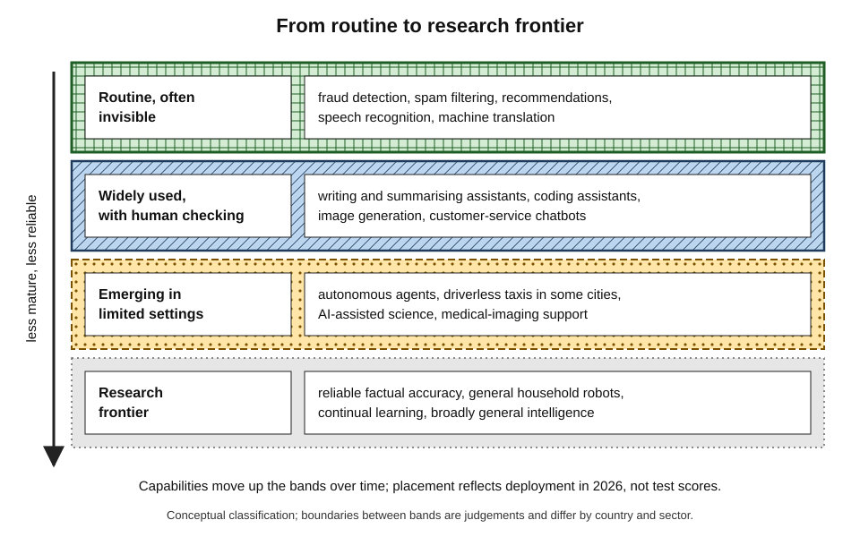
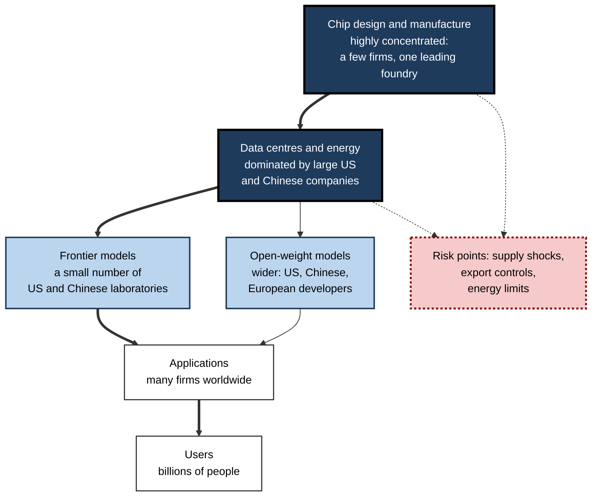
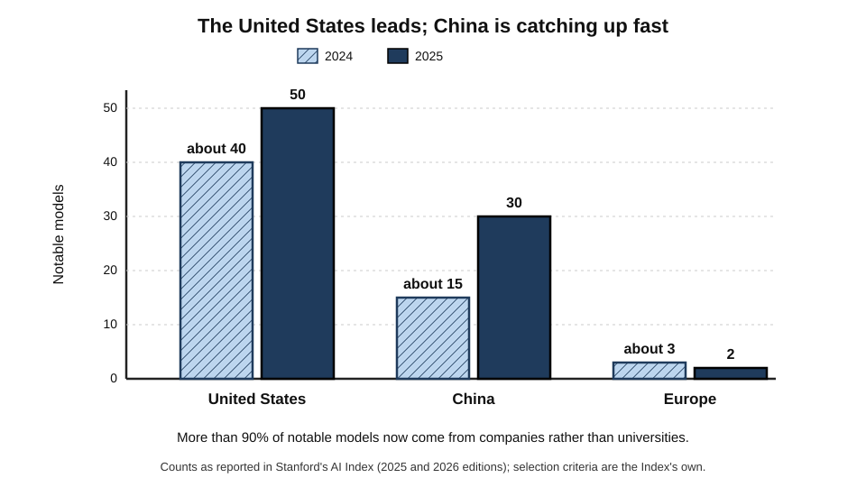
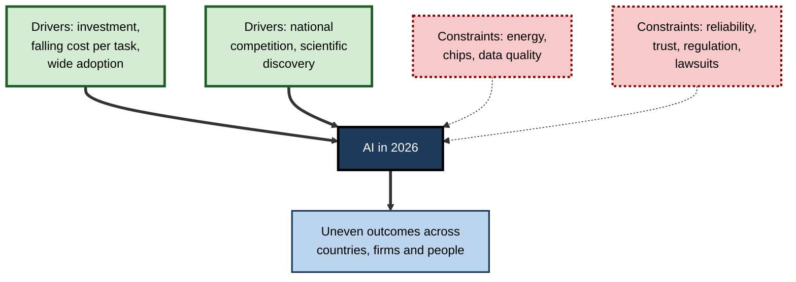
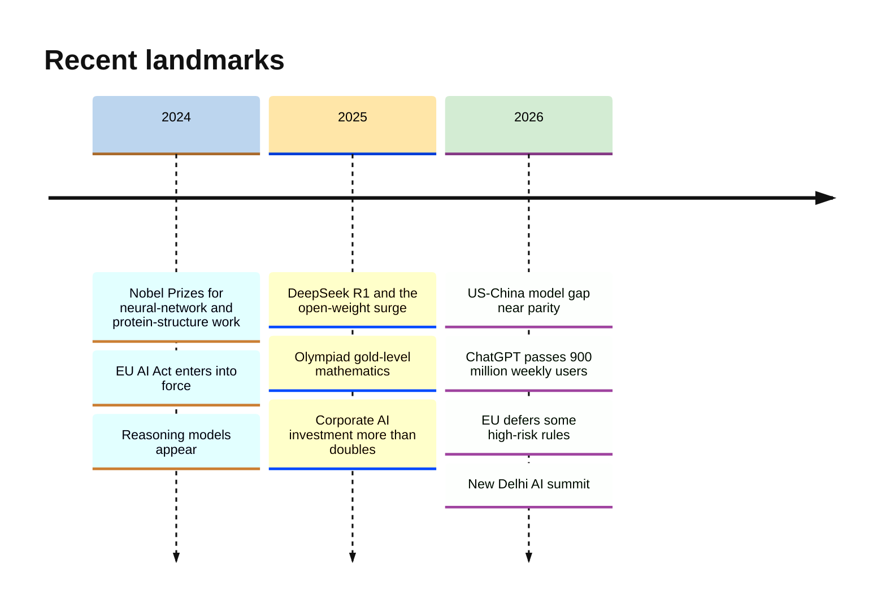

# B.12. Where AI stands today globally

Seventy years after a summer workshop gave the field its name, artificial intelligence is used every week by hundreds of millions of people, absorbs hundreds of billions of dollars of investment a year and features in the national strategies of nearly every major government. Systems that write, code, analyse images and hold conversations are routine; systems that drive taxis without a human at the wheel operate in a number of cities.

Yet the same systems still invent facts, fail in unfamiliar situations and are distributed very unevenly across the world. Understanding where AI stands in 2026 means holding both pictures at once.

> **Definition — State of AI:** the current position of artificial intelligence as measured across capability (what systems can do), adoption (who uses them), investment and infrastructure (who pays for and builds them), geography (where they are made and used), governance (how they are controlled) and public attitudes (how they are regarded).

**Why it matters**

- **Decisions depend on the present, not the hype.** Investment, career, policy and purchasing choices need an accurate picture of what AI can reliably do today.
- **The picture changes fast.** Benchmarks that took decades to approach are now saturated within a year or two; statistics go out of date quickly.
- **AI has become geopolitical.** Chips, data centres, talent and models are now treated as matters of national power.
- **The gains are uneven.** Between countries, firms and people, access to AI's benefits differs sharply.

---

## How the State of AI Is Measured

### The main indicators

- **Capability** — results on benchmarks and in real tasks.
- **Adoption** — shares of people and organisations using AI, and how intensively.
- **Investment** — private funding, corporate spending and government programmes.
- **Infrastructure** — computing capacity, chips, data centres and energy.
- **Research and talent** — publications, notable models, patents, skilled workers and their movement.
- **Governance** — laws, standards, institutions and international agreements.
- **Public opinion** — trust, optimism and anxiety in surveys.

> **Key point:** much of what is known comes from a few recurring reports — notably **Stanford University's annual AI Index**, along with work by the OECD, the International Energy Agency, consultancies and industry surveys — each with its own methods and gaps.

### Reading AI statistics with care

| Indicator | What it captures | Common pitfall |
|---|---|---|
| "X% of organisations use AI" | Any use, in at least one function, among survey respondents | Says nothing about depth, value or how many employees use it |
| "Y million weekly users" | Reach of a product, usually company-reported | Counts light and heavy users alike; definitions vary |
| Benchmark score | Performance on a specific test | Tests saturate, leak into training data or miss real-world conditions |
| AI investment total | Money committed, by a stated definition | "AI" may include broad cloud and data-centre spending |
| Number of notable models | Influential systems by origin | Depends on the selection criteria of whoever counts |
| Training-cost figure | Cost of one run, as reported | Often excludes research, staff and hardware ownership |

### Worked example (illustrative): what "78% adoption" does and does not mean

A survey of 1,000 large firms reports that 78% "use AI". *Illustrative figures.*

1. **Respondents:** 1,000 firms answered; non-respondents may be less likely to use AI, so the true share in all firms may be lower.
2. **Definition:** "use" means at least one function — perhaps marketing copy or a customer chatbot.
3. **Depth:** a follow-up question shows that only 20% use AI in three or more functions, and 8% report measurable profit effects.
4. **Translation:**
   - 780 firms use AI somewhere;
   - about 200 use it widely;
   - about 80 can show financial results.

| Headline | Narrower reading | Narrowest reading |
|---|---|---|
| 78% use AI | 20% use it widely | 8% report measurable profit effects |

> **Remember:** before using an AI statistic, ask **who was counted, how "use" was defined, and what was actually measured**.

---

## Capability: What AI Can Do in 2026

### Where AI performs at or above expert level on tests

- **Science and mathematics questions** — leading models match or exceed human experts on graduate-level science question sets and competition mathematics; in July 2025 systems from Google DeepMind and OpenAI reached gold-medal level on International Mathematical Olympiad problems.
- **Programming** — on widely used tests of fixing real software issues, top systems rose within about a year to performance approaching the human baseline, according to the 2026 AI Index.
- **Hard knowledge tests** — on "Humanity's Last Exam", a set of very difficult expert questions released in early 2025, the best models moved from single-digit scores to above 50% by spring 2026.
- **Perception** — image and speech recognition at human level for many routine tasks; real-time translation between many languages.
- **Science** — protein-structure prediction recognised by the 2024 Nobel Prize in Chemistry; AI-assisted discovery in materials, weather forecasting and drug design.

### Where AI remains unreliable

- **Factual reliability** — models still generate plausible falsehoods, especially about specific records, citations and recent events.
- **Long, open-ended tasks** — autonomous agents carrying out many steps in real software environments still fail often; surveys in 2026 found their use in organisations in the low single digits of firms.
- **Robustness** — performance can collapse on unusual inputs or under deliberate manipulation.
- **Physical world** — general-purpose household or factory robots remain largely experimental, despite heavy investment.
- **Seemingly simple tasks** — models that solve olympiad problems may still misread a clock face or miscount objects; the 2026 AI Index highlighted such uneven results.

> **Watch out:** "expert-level on a benchmark" is not "expert-level at the job". Benchmarks measure **isolated questions with known answers**; jobs require judgement, responsibility, context and reliability over time.

**Figure 1.** How mature different AI capabilities were in 2026.

### Case study: Driverless taxis — twenty years from challenge to service

- **Situation:** in 2004 the US military research agency DARPA held a desert race for autonomous vehicles; no vehicle finished. In 2005 five did. In 2007 an "Urban Challenge" tested driving among traffic.
- **Actions:**
  1. Google began a self-driving project in 2009, recruiting veterans of the DARPA challenges; it became **Waymo** in 2016.
  2. Waymo opened a fully driverless public service in parts of Phoenix in 2020, then expanded to San Francisco, Los Angeles and other cities.
  3. Chinese companies, including Baidu's Apollo Go, ran large driverless services in several Chinese cities.
- **Result:** by 2025 Waymo reported hundreds of thousands of paid driverless rides a week; driverless taxis had become ordinary in a handful of cities.
- **Caveats:**
  - other well-funded efforts were scaled back or closed after incidents — in 2023 California suspended the permits of General Motors' Cruise after a pedestrian was dragged by one of its cars;
  - services operate in mapped areas and conditions, not everywhere;
  - ride numbers are **company-reported**.
- **Lesson:** a capability that looked "five years away" for well over a decade arrived **gradually, city by city**, after vast investment — a realistic model for how many AI capabilities reach everyday use.

### AI in science and health

- **Biology** — DeepMind and the European Bioinformatics Institute released predicted structures for over 200 million proteins in 2022 — nearly every protein known to science — freely to researchers.
- **Weather** — machine-learning forecasting models from Google DeepMind, Huawei, Nvidia and others matched or beat traditional physics-based forecasts on many measures from 2023; in 2025 the European Centre for Medium-Range Weather Forecasts began running an AI forecasting system operationally alongside its physics-based model.
- **Medicine** — the US Food and Drug Administration authorised 223 AI-enabled medical devices in 2023, up from six in 2015, according to the 2025 AI Index — most in radiology.
- **Mathematics and computing** — AI systems found improved algorithms for some computational problems and assisted mathematicians with proofs.

> **Watch out:** device authorisations and published results show **what has been approved or reported**, not how much patients benefit. Evidence of improved outcomes in routine care is still thinner than evidence of accuracy in tests.

---

## Adoption: Who Uses AI

- **Consumers**
  - OpenAI reported in February 2026 that ChatGPT had passed 900 million weekly users; other assistants from Google, Meta, Microsoft, Anthropic and Chinese developers also served hundreds of millions.
  - The 2026 AI Index reported that generative AI had spread to around half of people in surveyed populations within three years — faster than personal computers or the internet.
- **Workers**
  - Surveys reported in the 2026 AI Index found a majority of surveyed employees using AI at work at least occasionally, with especially high rates in India, China, Nigeria, the United Arab Emirates and Saudi Arabia.
- **Organisations**
  - Large majorities of surveyed companies reported using AI in at least one business function; far fewer reported deep, organisation-wide use or measurable financial returns.
- **Students**
  - Large majorities of secondary and university students in countries such as the United States reported using generative AI for schoolwork, while few teachers described school policies as clear.

> **Key point:** adoption is **wide but shallow**. Many people and firms use AI occasionally; far fewer have reorganised work around it.

> **Watch out:** high adoption in surveys does not track investment. Some countries with the largest AI industries report **lower** everyday use than smaller, highly connected countries such as Singapore or the United Arab Emirates.

---

## Investment and Infrastructure

### Money

- **Corporate investment** — the 2026 AI Index estimated global corporate AI investment at roughly 580 billion dollars in 2025, more than double the 2024 figure, with the United States accounting for the majority.
- **Private funding gap** — in 2024 US private AI investment, at about 109 billion dollars, was roughly twelve times China's, according to the 2025 AI Index.
- **Data-centre spending** — the four largest US technology companies guided combined capital expenditure for 2026 at roughly 700 billion dollars or more, much of it for AI.

### Computing, chips and energy

- **Compute growth** — the 2026 AI Index reported that the world's AI computing capacity had grown roughly threefold a year since 2022, with Nvidia's chips accounting for most of it.
- **Chip supply** — the most advanced AI chips are manufactured largely by one company, TSMC, in Taiwan — a concentration widely regarded as a strategic vulnerability.
- **Export controls** — since 2022 the United States has restricted exports of advanced AI chips and chip-making tools to China; China has invested heavily in domestic alternatives.
- **Energy** — the International Energy Agency estimated that data centres used about 1.5% of global electricity in 2024 and projected that their consumption could roughly double by 2030, driven largely by AI.

> **Formula — Growth multiple:** capacity after n years = starting capacity × (annual growth factor)ⁿ. Example: tripling each year for three years gives 3 × 3 × 3 = **27 times** the starting capacity.

**Figure 2.** The layers of the AI industry and where control is concentrated.

### Cost and efficiency

- **Falling price of capability** — the 2025 AI Index estimated that the cost of querying a model performing at the level of GPT-3.5 on a standard knowledge test fell more than 280-fold between late 2022 and late 2024.
- **Smaller models catching up** — in 2022 the smallest model scoring above 60% on that test had 540 billion parameters; by 2024 a model with 3.8 billion parameters did so, a reduction of over a hundredfold.
- **Rising cost at the frontier** — at the same time, training the very largest models was reported to cost hundreds of millions of dollars in computing alone, and the electricity and emissions of the biggest runs rose sharply.
- **Result:** a **two-speed** pattern — yesterday's frontier becomes cheap and widely available, while today's frontier becomes ever more expensive and concentrated.

> **Key point:** cheaper capability **spreads** AI to more users and countries; more expensive frontier training **concentrates** the leading edge in a few companies. Both trends are happening at once.

| | Frontier models | Widely available models |
|---|---|---|
| Who builds them | A handful of US and Chinese laboratories | Many companies, universities and open-source groups |
| Cost trend | Rising: larger training runs each year | Falling steeply: same capability for a fraction of the price |
| Typical access | Paid services and interfaces | Open weights, cheap services, on-device use |
| Main concerns | Concentration of power, safety, energy | Misuse once safeguards are removed; quality control |

---

## Research, Talent and Incidents

### Research output

- **Volume** — the 2026 AI Index reported about 258,000 AI-related computer-science publications a year, roughly double the level of a decade earlier.
- **China's share** — China leads in the number of AI publications and patents; the United States leads in the most influential models and in highly cited industrial research.
- **Industry versus academia** — companies produce nearly all notable models, while universities remain important for basic research, training and independent evaluation — often hampered by limited computing.

### Talent

- **Demand** — job postings mentioning AI skills have grown steadily; postings asking for skills with AI agents rose sharply in 2025.
- **Mobility** — skilled AI researchers have long moved towards the United States, but the 2026 AI Index reported a steep fall in that inflow in recent years, as other countries competed and immigration became harder.
- **Education** — many countries have added AI to school and university curricula; the speed of change has outrun teacher training.

### Incidents and harms

- **Recorded incidents** — public databases that track AI failures and harms, from wrongful arrests based on face recognition to deepfake fraud and harmful chatbot advice, recorded rising numbers of incidents each year, reaching a record in 2024 according to the 2025 AI Index.
- **Interpretation** — part of the rise reflects **more use and more reporting**, not only less safe systems.

> **Watch out:** incident counts are **lower bounds**. Most harms are never reported publicly, and databases depend on media coverage, which favours dramatic cases.

---

## Geography: The Global Map of AI

### Who builds the most influential models

**Figure 3.** Notable AI models by region of origin, 2024 and 2025.

- **United States** — produced the largest number of notable models (about 40 in 2024 and 50 in 2025 by the AI Index's count), with the deepest investment and most large laboratories.
- **China** — doubled its count of notable models from about 15 to 30 between 2024 and 2025; by early 2026 the performance gap between the best US and Chinese models had narrowed to a few percentage points on leading comparisons, with leadership changing hands more than once.
- **Europe** — few frontier models (about 2–3 a year by this count), but strong research, open-weight developers such as Mistral, and the world's most comprehensive AI law.
- **Industry dominance** — more than 90% of notable models now come from companies rather than universities, reversing the pattern of the field's first decades.

### Regional profiles

| Region | Main strengths | Main constraints | Policy approach |
|---|---|---|---|
| United States | Frontier laboratories, chips design, capital, cloud | Energy and grid limits; public trust in regulation low | Light federal regulation; export controls; industrial policy for chips and data centres |
| China | Large talent pool, open-weight models, robotics manufacturing, government support | Restricted access to the most advanced chips | State-led strategy; content and labelling rules for generative AI |
| European Union | Research, industrial users, regulatory influence | Less venture capital and fewer large AI firms | Comprehensive risk-based AI Act, with some obligations deferred to 2027–2028 |
| United Kingdom | Research (including Google DeepMind's London base), AI safety institute | Scale of investment | Sector regulators plus a national AI security institute |
| India | Very large developer workforce, high workplace adoption, digital public infrastructure | Compute capacity, investment scale | National AI mission funding compute and models; hosted the 2026 AI summit |
| Gulf states | Capital and energy for data centres | Small local talent base | Large sovereign investments in AI infrastructure |

> **Definition — Sovereign AI:** a government's effort to secure national control over key parts of the AI stack — compute, data, models or talent — rather than depending entirely on foreign providers.

> **Watch out:** counts of "notable models" depend on **who selects them and how**. They show broad trends — US lead, rapid Chinese growth, industry dominance — but are not precise league tables.

### Industrial robots

- In 2024 China installed about **295,000** industrial robots — far more than Japan (about 44,500) or the United States (about 34,200), according to figures cited in the 2026 AI Index.
- Physical automation and AI are converging, and manufacturing scale gives China a strong position.

---

## Governance and Public Opinion

### Governance in brief

- **Binding law** — the EU AI Act (in force 2024) is the most comprehensive; in 2026 the EU agreed to defer some high-risk obligations to December 2027 and August 2028.
- **National strategies** — dozens of countries have AI strategies; many have created AI safety or security institutes.
- **International coordination** — summits at Bletchley Park (2023), Seoul (2024), Paris (2025) and New Delhi (2026); OECD AI principles; United Nations initiatives.
- **Divergence** — approaches range from comprehensive regulation (EU) through sectoral rules (UK) to deregulatory industrial policy (US) and state-directed control (China).

### What the public thinks

- **Mixed feelings** — the 2026 AI Index reported that about 59% of surveyed people worldwide thought AI's benefits outweighed its drawbacks, while about 52% said AI products made them nervous.
- **Regional differences** — optimism is highest in much of Asia and lower in many Western countries.
- **Trust in regulation** — trust in one's own government to regulate AI responsibly varied widely; it was reported at about 31% in the United States, among the lowest of the countries surveyed.
- **Experts and public differ** — surveys found AI experts far more optimistic than the general public about AI's effects on jobs.

**Figure 4.** Forces shaping where AI goes next from its 2026 position.

---

## The Uneven Distribution of AI

- **Between countries**
  - Computing capacity, frontier laboratories and investment are concentrated in the United States and China; many countries in Africa, Latin America and parts of Asia have little local AI infrastructure.
  - Language matters: models perform best in English and other widely written languages, less well in many others.
- **Between firms**
  - Large companies with data and capital move fastest; small firms often depend on a few providers.
- **Between workers**
  - Early evidence suggests AI helps less experienced workers most on tasks within its capability, while hiring for some entry-level roles — such as junior software development and customer support — has weakened in exposed occupations.
- **Between learners**
  - Students with guidance gain from AI tutoring; those who use AI to replace their own effort may learn less.

| | Where AI is most advanced | Where AI lags |
|---|---|---|
| Infrastructure | Large data-centre clusters, reliable power | Limited computing and unreliable grids |
| Language | English, Chinese and major European languages | Many African, South Asian and indigenous languages |
| Skills | Large technical workforces | Shortages of trained specialists |
| Governance | Established institutions and laws | Limited capacity to evaluate and regulate |
| Typical relationship to AI | Builder and exporter | Importer and user |

> **In practice:** for organisations outside the main AI centres, practical strategies include using **open-weight models** to keep data local, building **local-language datasets**, sharing **public computing infrastructure** and investing in **AI literacy** across the workforce.

**Figure 5.** Key developments in the state of AI, 2024–2026.

---

## Open Questions

- **Will capability keep rising at the recent pace?**
  - Some expect continued rapid gains from scale and new methods; others point to limits in data, energy and reliability. Expert forecasts differ widely.
- **Will investment pay off?**
  - Spending far exceeds current AI revenue; whether returns will justify it is one of the largest economic questions of the decade.
- **Will the US–China contest fragment AI?**
  - Export controls and rival standards could split the world into separate AI ecosystems.
- **Can the benefits be spread more evenly?**
  - Without deliberate effort, AI may widen gaps between countries and between workers.
- **Can public trust be earned?**
  - Optimism and anxiety coexist; reliability, accountability and visible benefits will decide which grows.

---

## Summary

- The **state of AI** is measured by **capability, adoption, investment, infrastructure, geography, governance and opinion**; key sources such as the **AI Index** have their own definitions and gaps.
- Read statistics carefully: **who was counted, how "use" was defined, what was measured**.
- **Capability (2026):** expert-level results on many tests (science, mathematics, programming; Olympiad gold-level maths in 2025; protein structures); persistent weaknesses in **factual reliability, long autonomous tasks, robustness, physical robots** and some simple tasks.
- **Driverless taxis** illustrate gradual, city-by-city deployment after two decades of work.
- **Adoption** is **wide but shallow**: ChatGPT over **900 million weekly users** (February 2026), majority workplace use in many countries, few firms with deep integration.
- **Cost and efficiency:** a **two-speed** pattern — the price of a given capability fell over a hundredfold in two years, while frontier training grew more expensive; research volume doubled in a decade; recorded **incidents** rose (partly from more reporting).
- **Investment and infrastructure:** corporate AI investment of roughly **580 billion dollars** in 2025; Big Tech capital spending around **700 billion dollars** planned for 2026; compute roughly tripling yearly; chip supply concentrated; data-centre electricity use projected to roughly **double by 2030**.
- **Geography:** US leads in notable models and investment; **China** is near parity in model performance and leads in robot installations; Europe leads in regulation; India, the Gulf and others pursue **sovereign AI**.
- **Opinion:** about **59%** see more benefits than drawbacks; about **52%** are nervous; trust in regulators varies widely.
- AI's benefits are **unevenly distributed** across countries, languages, firms, workers and learners.

---

## Self-Check

1. List six dimensions on which the state of AI can be measured.
2. Why must a statistic such as "78% of organisations use AI" be interpreted with care?
3. Give three areas where AI reached expert-level test performance by 2026 and three where it remains unreliable.
4. Why is "expert-level on a benchmark" not the same as "expert-level at the job"?
5. What does the history of driverless taxis suggest about how AI capabilities reach daily life?
6. What does "wide but shallow" adoption mean?
7. Why is the supply of advanced AI chips regarded as a strategic vulnerability?
8. If AI computing capacity triples every year, how much larger is it after four years?
9. Compare the AI positions of the United States, China and the European Union.
10. What is sovereign AI, and why are countries pursuing it?
11. What do surveys say about public attitudes to AI?
12. Give three ways in which AI's benefits are unevenly distributed.
13. A government in a country with little AI infrastructure asks how to benefit from AI. Suggest a strategy.

### Answer Key

1. Capability, adoption, investment, infrastructure, research and talent, governance, public opinion (any six).
2. It may count any use in a single function, reflect only survey respondents and say nothing about depth of use or measurable value.
3. Expert-level: graduate-level science questions; competition mathematics (Olympiad gold level); fixing software issues; protein-structure prediction; routine image and speech recognition. Unreliable: factual accuracy on specific records; long autonomous multi-step tasks; robustness to unusual or adversarial inputs; general-purpose physical robots; some simple perceptual tasks.
4. Benchmarks test isolated questions with known answers; jobs demand judgement, context, accountability and consistent reliability over time.
5. Capabilities arrive gradually, in limited areas and conditions first, after long investment and with setbacks — not all at once on a predicted date.
6. Many people and organisations use AI occasionally or in one function, but few have reorganised work around it or can show measurable returns.
7. The most advanced chips are made largely by one company in one place, so disruption — natural, political or military — would affect the whole industry; export controls also make supply a tool of national policy.
8. 3 × 3 × 3 × 3 = 81 times the starting capacity.
9. US: most notable models, largest investment, frontier laboratories, light federal regulation and export controls. China: rapid growth in models, near parity in performance, open-weight strength, robot manufacturing scale, state-led policy, limited access to top chips. EU: strong research and users, few frontier models, comprehensive AI Act.
10. A government's effort to control key parts of the AI stack — compute, data, models, talent — to reduce dependence on foreign providers, protect data and culture and capture economic value.
11. A majority see more benefits than drawbacks (about 59%), yet about half feel nervous; optimism is higher in much of Asia; trust in governments to regulate AI varies, and experts are more optimistic than the public about jobs.
12. Between countries (infrastructure and investment concentrated in the US and China); between languages (better performance in widely written languages); between firms (large firms move faster); between workers (entry-level hiring pressure in exposed roles); between learners (guided versus substitutive use).
13. Use open-weight models that can run locally; build local-language datasets; share public computing resources or regional partnerships; invest in AI literacy and specialist skills; focus first on high-value public services such as health, agriculture and education; develop proportionate governance and evaluation capacity.

---

## Glossary

| Term | Meaning |
|---|---|
| AI Index | Stanford University's annual report tracking data on AI worldwide. |
| Benchmark saturation | The point at which leading systems score near the maximum on a test, so it no longer separates them. |
| Corporate AI investment | Company spending on AI, including private funding, mergers and minority stakes, as defined by the reporting source. |
| Export controls | Government restrictions on selling particular technologies abroad. |
| Frontier model | One of the most capable AI models available at a given time. |
| Medical device authorisation | Regulatory approval for a product, including AI software, to be used in healthcare. |
| Notable model | An AI model judged influential by a tracking source's criteria. |
| Open-weight model | A model whose parameters are publicly released. |
| Sovereign AI | National efforts to control key parts of the AI stack. |
| State of AI | AI's current position across capability, adoption, investment, geography, governance and opinion. |
| TSMC | Taiwan Semiconductor Manufacturing Company, the leading maker of advanced chips. |
| Two-speed pattern | Frontier AI growing more expensive while earlier capability becomes cheap and widespread. |
