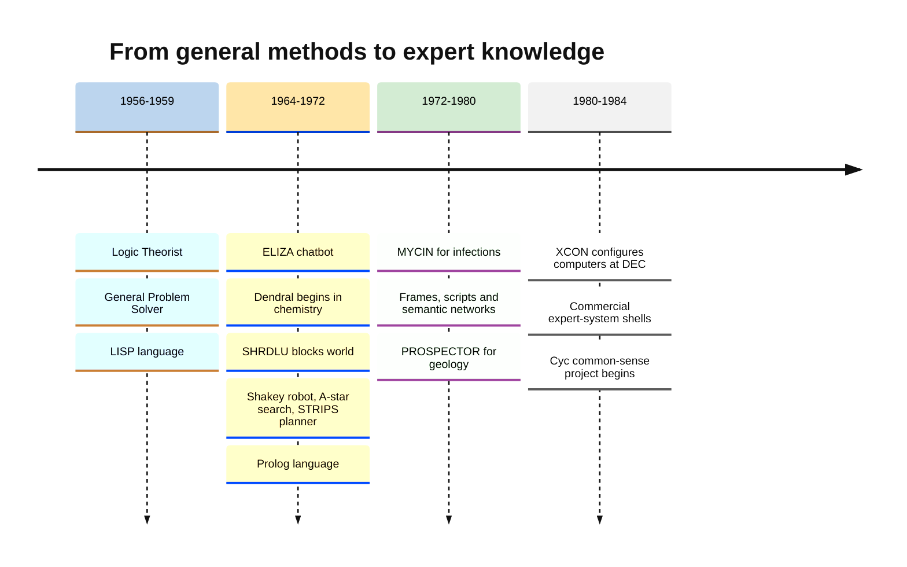
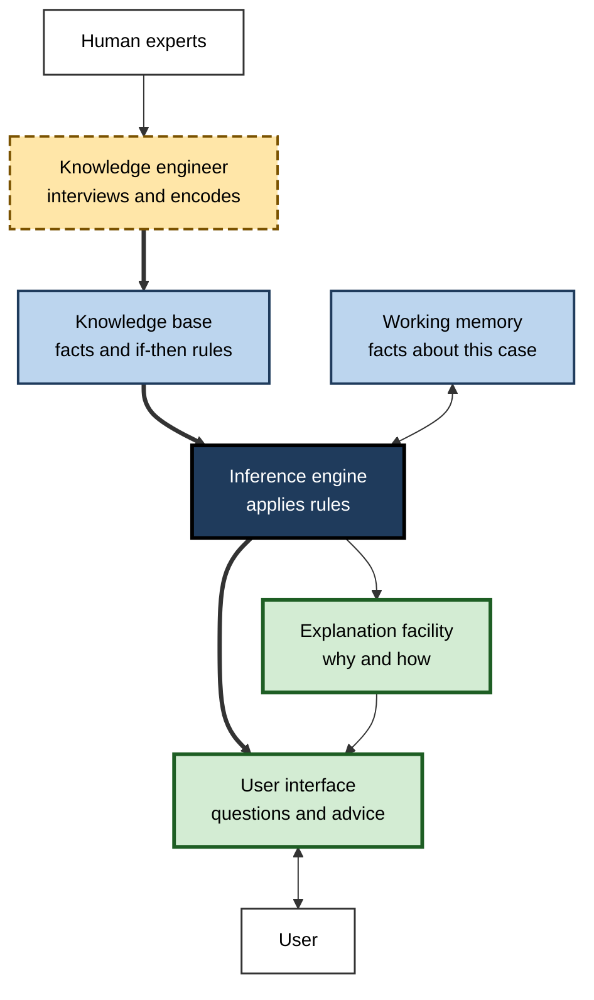
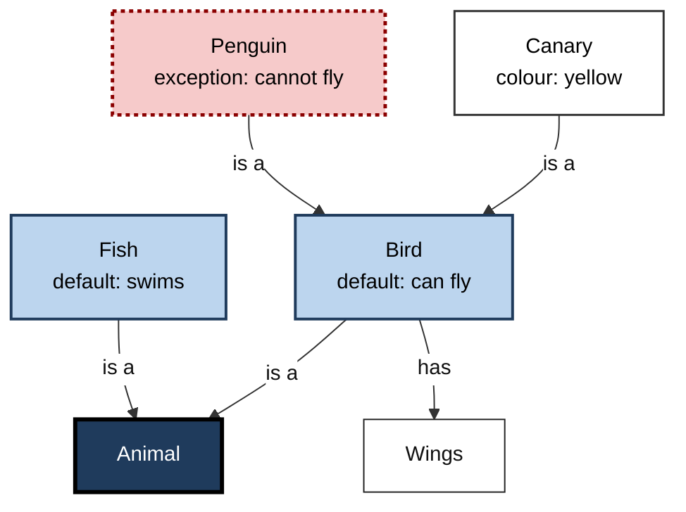
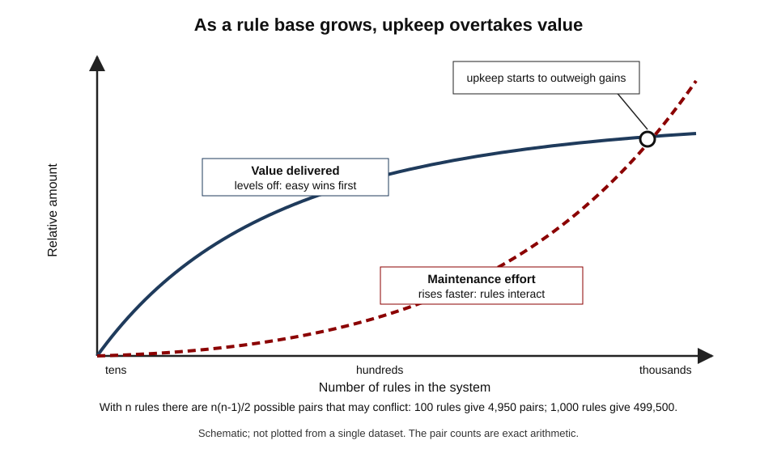
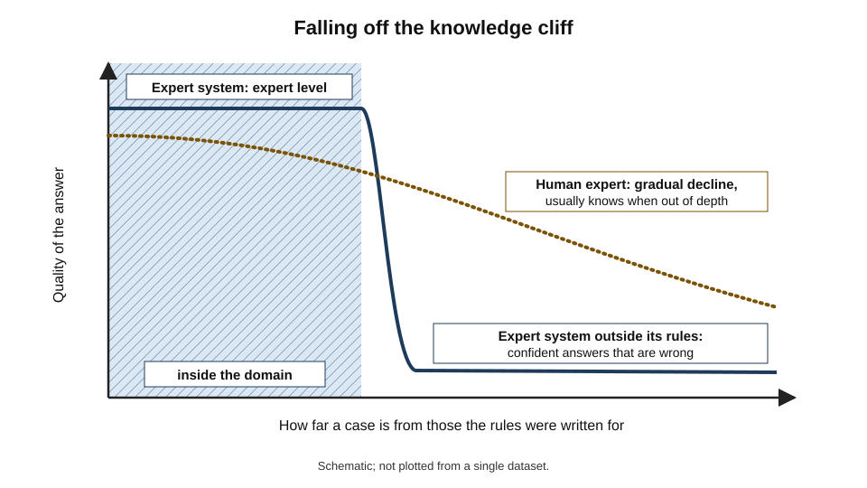

# B.2. Early symbolic AI and expert systems

A doctor in the 1970s types into a terminal: the patient has a fever, a stiff neck and a recent operation. The program asks a few questions about laboratory cultures, then recommends an antibiotic — and, if asked "why?", replies with the rules it used. No data was "learned"; every step came from rules written down by specialists. For three decades this was what artificial intelligence meant: **knowledge written as symbols, and reasoning carried out by rules**.

> **Definition — Symbolic AI:** the approach to artificial intelligence that represents knowledge as explicit symbols (words, facts, rules, structures) and produces intelligent behaviour by manipulating those symbols with logical or heuristic procedures.

> **Definition — Expert system:** a symbolic AI program that captures the knowledge of human specialists in a narrow domain, usually as if–then rules, and applies it to give advice or make decisions at an expert level.

**Why it matters**

- **It dominated AI from the late 1950s to the late 1980s** and produced the field's first commercial successes.
- **It still runs much of the world's software.** Business-rules engines, tax and benefits calculators, product configurators and clinical alerts descend from it.
- **Its limits explain modern AI.** The difficulty of writing knowledge down by hand is the main reason the field later turned to learning from data.
- **Its strengths are back in demand.** Transparency, auditability and guaranteed rules are exactly what purely statistical systems lack.

---

## The Symbolic Hypothesis

### Intelligence as symbol manipulation

- **Starting belief:** human thinking is the manipulation of internal symbols — "the patient", "has fever", "infection" — according to rules.
- **Consequence:** if a computer stores the right symbols and the right rules, it can think in the same sense.
- **Advantage:** the reasoning is **readable** — every step can be inspected.

> **Definition — Physical symbol system hypothesis:** the claim, stated by Allen Newell and Herbert Simon in their 1976 Turing Award lecture, that "a physical symbol system has the necessary and sufficient means for general intelligent action."

- **"Necessary"** — anything intelligent, including a human brain, must be a symbol system.
- **"Sufficient"** — any symbol system of adequate size and organisation can be made intelligent.

> **Watch out:** the hypothesis is a **bold empirical claim**, not a proven result. Critics such as the philosopher Hubert Dreyfus argued that much human expertise is intuitive and not rule-based; the success of later neural networks reopened the question.

> **Definition — GOFAI ("Good Old-Fashioned AI"):** a name coined by the philosopher John Haugeland in 1985 for the symbolic approach; now used, sometimes affectionately and sometimes dismissively, for rule-based AI in general.

### The building blocks

- **Symbols** — tokens standing for things or ideas.
  - *e.g.* `ORGANISM-1`, `GRAM-NEGATIVE`, `BLOCK-A`.
- **Structures** — symbols combined into statements.
  - *e.g.* `(ON BLOCK-A BLOCK-B)` — "block A is on block B".
- **Rules** — conditions linked to conclusions or actions.
  - *e.g.* IF the stain is Gram-negative AND the shape is rod THEN the organism may be in a particular family.
- **Search** — exploring sequences of rule applications to reach a goal.
- **Heuristics** — rules of thumb that decide which possibilities to explore first.

---

## The First Generation: Search and General Methods (1956–1970)

### General problem solving

**Study card — The General Problem Solver (Newell, Shaw and Simon, 1957–59)**

- **Aim:** a single program able to solve any problem that can be stated as a starting state, a goal state and a set of operators.
- **Method — means–ends analysis:**
  1. compare the current state with the goal;
  2. identify the most important difference;
  3. choose an operator that reduces that difference;
  4. if the operator cannot be applied yet, set up a sub-goal to make it applicable;
  5. repeat.
- **Results:** solved logic puzzles, the Tower of Hanoi and simple proofs.
- **Limits:** only well-defined, small problems; real tasks produced too many possibilities.
- **Conclusion:** general methods are **weak** — they apply everywhere but achieve little anywhere without specific knowledge.

> **Definition — Means–ends analysis:** a problem-solving strategy that repeatedly identifies the biggest difference between the current state and the goal and applies an action that reduces it.

> **Example:** to get from Bengaluru to a meeting in Delhi, the biggest difference is distance (take a flight); the flight needs reaching the airport (sub-goal: book a taxi); the taxi needs a phone (sub-goal: charge it). Each step reduces a difference or enables one that does.

### Language and microworlds

- **ELIZA (Joseph Weizenbaum, MIT, 1964–66)**
  - Imitated a psychotherapist using keyword patterns and templates.
  - *e.g.* "I am unhappy" → "Why do you say you are unhappy?"
  - It had **no understanding**, yet some users confided in it as if it did. Weizenbaum was disturbed and became a lifelong critic of over-trusting computers.
- **SHRDLU (Terry Winograd, MIT, 1968–70)**
  - Understood typed English commands about a simulated world of coloured blocks on a table.
  - *e.g.* "Find a block which is taller than the one you are holding and put it into the box."
  - Impressive because it joined parsing, reasoning, planning and memory — but only inside its tiny world.
- **Shakey (Stanford Research Institute, 1966–72)**
  - The first mobile robot to reason about its own actions: it perceived rooms with a camera, planned routes and pushed boxes.
  - Produced lasting techniques: the **A\* search algorithm** (1968) and the **STRIPS** planner (1971).

> **Definition — Microworld:** a deliberately simplified, closed environment — such as a table of blocks — in which a program's knowledge can be complete; used to study intelligence without the messiness of the real world.

> **Watch out:** the ELIZA effect — people attributing understanding to a program because its replies **sound** human — was first named after this 1960s program. It is even stronger with modern chatbots.

**Figure 1.** Milestones of symbolic AI, 1956–1984.

---

## The Knowledge Turn

### "In the knowledge lies the power"

- By the late 1960s, researchers at Stanford around **Edward Feigenbaum** concluded that general reasoning methods were not the source of expert performance.
- **What made experts expert was specific knowledge** — thousands of facts and rules of thumb about one domain.
- This became known as the **knowledge principle**: a system's performance depends mainly on the knowledge it has, not on the cleverness of its reasoning method.

> **Key point:** the knowledge turn moved AI from searching for **one general method** to building **many narrow, knowledge-rich systems** — a shift that made AI commercially useful for the first time.

### Dendral: the first expert system

**Study card — Dendral (Stanford, from 1965)**

- **Team:** Edward Feigenbaum (computer science), Joshua Lederberg (genetics, Nobel laureate) and Bruce Buchanan (philosophy and computer science), with chemist Carl Djerassi.
- **Task:** infer the molecular structure of organic compounds from mass-spectrometry data.
- **Method:**
  - generate candidate structures consistent with the chemical formula;
  - use chemists' rules about how molecules break apart to prune and rank candidates.
- **Results:** performance comparable to expert chemists on its families of compounds; results published in the chemistry literature.
- **Conclusion:** encoding a specialist's heuristics could produce expert-level performance in a narrow field.

### MYCIN: medical diagnosis by rules

**Study card — MYCIN (Stanford, early to mid-1970s)**

- **Developer:** Edward Shortliffe, as doctoral work, with Bruce Buchanan and others.
- **Task:** identify bacteria causing severe infections such as bacteraemia and meningitis, and recommend antibiotics and doses.
- **Knowledge:** several hundred if–then rules, each with a **certainty factor** expressing the strength of the conclusion.
- **Method — backward chaining:** start from a hypothesis ("the organism is E. coli") and ask for the evidence needed to confirm or reject it.
- **Explanation:** could answer "why are you asking this?" and "how did you conclude that?" by displaying its rules.
- **Evaluation:** in a 1979 blinded study of meningitis cases, published in the *Journal of the American Medical Association*, outside experts rated MYCIN's recommendations acceptable in 65% of cases — as good as or better than the Stanford infectious-disease faculty, whose ratings ranged from 42.5% to 62.5%.
- **But:** it was **never used in routine clinical care**.
  - it ran on a large shared computer, and a consultation took a long time;
  - it was not integrated with hospital records;
  - questions of legal responsibility for its advice were unresolved;
  - many clinicians were reluctant to accept computer advice.
- **Conclusion:** technical excellence is not enough; **deployment** depends on workflow, liability and trust.

> **Definition — Certainty factor:** a number, typically from −1 to +1, attached to a rule or conclusion in MYCIN-style systems to express how strongly the evidence supports it; a practical but mathematically informal alternative to probability.

**An example MYCIN-style rule** (simplified wording)

- **IF**
  1. the infection is primary bacteraemia, and
  2. the culture site is one of the sterile sites, and
  3. the suspected portal of entry is the gastrointestinal tract,
- **THEN** there is suggestive evidence (certainty 0.7) that the organism is *Bacteroides*.

### Commercial expert systems

**Study card — XCON (also called R1; Digital Equipment Corporation, from 1980)**

- **Developer:** John McDermott at Carnegie Mellon University, for Digital Equipment Corporation (DEC).
- **Task:** configure orders for VAX computers — choosing and arranging the cabinets, cables, boards and components a customer's order needed.
- **Why it was needed:** orders were highly varied; human configurers made frequent errors, leading to delays and costly field fixes.
- **Growth:** from several hundred rules at launch to many thousands by the late 1980s.
- **Results:** DEC reported very large savings — figures of around $25 million a year were widely quoted in the mid-1980s — and far higher configuration accuracy.
- **Costs:** a dedicated team was needed simply to maintain the rules as products changed.
- **Conclusion:** expert systems could pay for themselves in narrow, well-defined, high-volume tasks — and they needed continuous upkeep.

> **Watch out:** savings figures for 1980s expert systems were usually **reported by the companies themselves** and are hard to verify independently. Treat them as indications of value, not audited results.

- **Other well-known systems**
  - **PROSPECTOR** (SRI, late 1970s) — advised geologists on mineral exploration; it was credited with helping to identify a molybdenum deposit.
  - **INTERNIST / CADUCEUS** (University of Pittsburgh) — attempted diagnosis across internal medicine, far broader than MYCIN.
  - **Expert-system shells** such as EMYCIN — MYCIN with its medical knowledge removed, so that any domain's rules could be added.

---

## How an Expert System Works

### The architecture

**Figure 2.** The parts of a classic expert system.

- **Knowledge base** — the domain rules and facts; written once, used for every case.
- **Inference engine** — the general reasoning program; it does not know anything about the domain.
- **Working memory** — the facts about the current case, growing as the consultation proceeds.
- **Explanation facility** — shows which rules led to a conclusion.
- **Knowledge engineer** — the specialist who interviews experts and translates their knowledge into rules.

> **Key point:** the separation of **knowledge base** from **inference engine** was the central engineering idea. The same engine could reason about infections, geology or computer orders, depending on which rules were loaded.

> **Definition — Knowledge engineering:** the discipline of eliciting knowledge from human experts and representing it in a form a computer can use.

### Forward and backward chaining

| | Forward chaining | Backward chaining |
|---|---|---|
| Starts from | The known facts | A goal or hypothesis |
| Direction | Data → conclusions | Conclusion → required evidence |
| Asks the user | Rarely; uses what is given | Only for facts relevant to the current hypothesis |
| Good for | Monitoring, configuration, planning | Diagnosis, advice, classification |
| Classic example | XCON configuring an order | MYCIN identifying an organism |

> **Definition — Forward chaining:** reasoning from known facts towards whatever conclusions the rules allow.

> **Definition — Backward chaining:** reasoning from a goal backwards, seeking only the facts needed to prove or disprove it.

### Worked example (illustrative): a loan-approval rule base

A bank encodes a credit officer's rules. *Illustrative figures.*

- **Rules**
  - R1: IF income ≥ 3 × monthly repayment THEN affordability = good.
  - R2: IF missed payments in the last year = 0 THEN history = clean.
  - R3: IF affordability = good AND history = clean THEN decision = approve.
  - R4: IF history ≠ clean THEN decision = refer to an officer.
- **Case facts:** monthly income 90,000; repayment 25,000; missed payments 0.

**Forward chaining**

1. R1 fires: 90,000 ≥ 75,000 → affordability = good.
2. R2 fires: 0 missed payments → history = clean.
3. R3 fires → decision = **approve**.

**Backward chaining** (goal: is decision = approve?)

1. R3 could conclude approve; it needs affordability = good and history = clean.
2. To get affordability, R1 needs income and repayment → ask for them → satisfied.
3. To get history, R2 needs missed payments → ask → satisfied.
4. Conclusion: **approve**, with the explanation "R3, because R1 and R2".

> **Watch out:** the system is only as good as its rules. If an applicant has income from an unusual source the rules never mention, it will decide anyway — confidently and wrongly. This is **brittleness**.

---

## Representing Knowledge

The 1970s produced several ways of organising symbolic knowledge beyond flat rules.

- **Semantic networks** (Ross Quillian, late 1960s)
  - Concepts as nodes, relationships as labelled links.
  - *e.g.* canary —is-a→ bird —has→ wings.
  - Ancestors of today's **knowledge graphs**.
- **Frames** (Marvin Minsky, 1974)
  - A structure for a stereotyped situation or object, with **slots** and default values.
  - *e.g.* a "hotel room" frame has slots for bed, bathroom and price, filled with defaults until known otherwise.
- **Scripts** (Roger Schank and Robert Abelson, 1977)
  - Frames for sequences of events.
  - *e.g.* the "restaurant script": enter, be seated, order, eat, pay, leave — letting a program infer that a diner who "left a tip" had eaten.
- **Logic programming** (Prolog, Alain Colmerauer and Robert Kowalski, early 1970s)
  - Knowledge as logical statements; computation as proof.
  - Became the language of Japan's national AI project in the 1980s.

| Representation | Unit of knowledge | Strength | Weakness |
|---|---|---|---|
| Production rules | IF condition THEN conclusion | Easy to write and explain one at a time | Thousands of rules interact unpredictably |
| Semantic network | Concept nodes and links | Captures classification and inheritance | Meaning of links can be vague |
| Frame | Object with slots and defaults | Handles typical cases and exceptions | Hard to keep consistent at scale |
| Script | Ordered stereotyped events | Supports inference about stories | Fails on unusual sequences |
| Logic | Formal statements and proofs | Precise; guaranteed conclusions | Struggles with uncertainty and exceptions |

**Figure 3.** A small semantic network with frame-style defaults.

> **Example:** asked "can a canary fly?", the network inherits *can fly* from Bird. Asked about a penguin, it must find the exception stored locally — and every such exception must be written by hand.

---

## The Limits of Hand-Built Knowledge

### The knowledge acquisition bottleneck

- **Experts cannot easily say what they know.**
  - Much expertise is tacit — a radiologist "sees" a shadow is wrong before being able to say why.
- **Interviews are slow and expensive.**
  - Building a serious system took person-years of interviews and rule writing.
- **Experts disagree.**
  - Different specialists give different rules for the same situation.
- **Knowledge changes.**
  - New drugs, products and regulations require constant rewriting.

> **Definition — Knowledge acquisition bottleneck:** the difficulty, cost and slowness of extracting knowledge from experts and encoding it — the main constraint on building and maintaining expert systems.

**Figure 4.** Why rule bases became harder to maintain as they grew.

### Brittleness and the missing common sense

- **Brittleness** — expert systems performed well inside their domain and failed abruptly just outside it, without knowing they had failed.
  - *e.g.* a medical system told a patient was male might still ask about pregnancy if no rule linked the two; another might diagnose a car with measles if its rules were given car "symptoms".
- **No common sense** — systems lacked the everyday knowledge every adult has.
  - *e.g.* that people cannot be in two places at once, or that water makes things wet.
- **The frame problem** (John McCarthy and Patrick Hayes, 1969) — how to represent what does *not* change when an action occurs, without listing every unaffected fact.
- **Uncertainty** — rules are naturally all-or-nothing; certainty factors and similar devices were patches with weak mathematical foundations.
- **No learning** — systems did not improve from experience; every improvement required a person to edit rules.

> **Definition — Brittleness:** the tendency of a system to perform well within its expected conditions and fail suddenly and badly outside them.

> **Definition — Frame problem:** the difficulty, in logic-based AI, of representing the effects of an action without also having to state explicitly everything the action leaves unchanged.

**Figure 5.** Competence inside and outside a narrow domain.

### The grand attempt at common sense

**Study card — Cyc (Douglas Lenat, from 1984)**

- **Aim:** hand-encode the millions of common-sense facts and rules that ordinary people take for granted, so that expert systems would no longer be brittle.
- **Method:** a team of knowledge engineers writing assertions in a formal logical language, over decades.
- **Results:** a very large knowledge base and a company (Cycorp) selling applications; but it **did not deliver general common sense** and had limited influence on mainstream AI.
- **Conclusion:** the scale of everyday knowledge defeated manual encoding — a lesson that pointed towards learning knowledge from data.

> **Watch out:** Cyc's assessment is contested. Supporters argue its knowledge is valuable for specific applications; critics argue that four decades of effort show manual common-sense encoding does not scale.

---

## Symbolic AI in Professional Use

### Where the symbolic approach still wins

- **Rules that must be followed exactly**
  - *e.g.* tax calculations, benefit eligibility, payroll, regulatory reporting.
- **Decisions that must be explained**
  - *e.g.* credit refusals, insurance underwriting, audit trails.
- **Configurations with hard constraints**
  - *e.g.* a car or computer configurator that must never offer incompatible parts.
- **Safety-critical checks**
  - *e.g.* drug-interaction alerts in electronic prescribing.

| | Symbolic expert system | Statistical machine-learning model |
|---|---|---|
| Source of knowledge | Experts, written as rules | Patterns learned from examples |
| Data needed | Little | Usually a lot |
| Explanation | The rules that fired | Often hard to extract |
| Handles novel or messy inputs | Poorly; brittle | Better within the range of its data |
| Updating | Edit rules by hand | Retrain on new data |
| Guarantees | Rules always applied as written | Probabilistic; may err unpredictably |

> **In practice:** modern systems often **combine** the two. A bank may use a learned model to estimate default risk and a rule layer to enforce lending law; a chatbot may use a language model for conversation and fixed rules for refund limits.

### Case study: MYCIN — excellent advice nobody used

- **Situation:** severe bacterial infections need antibiotic treatment before laboratory cultures are complete; choosing well needs specialist knowledge that many hospital doctors lacked in the 1970s.
- **Problem:** could a program give specialist-level advice?
- **Actions:**
  1. Stanford researchers interviewed infectious-disease specialists and encoded several hundred rules with certainty factors.
  2. They built backward-chaining consultations and an explanation facility.
  3. They tested the system in blinded comparisons with human experts.
- **Result:**
  - a 1979 evaluation rated its recommendations at least as acceptable as those of Stanford faculty specialists;
  - its architecture became the EMYCIN shell, used in other domains.
- **Side effects / caveats:**
  - never used routinely in patient care;
  - slow consultations on shared computers, no link to hospital records, unresolved liability and professional reluctance.
- **Lesson:** a system's **accuracy in testing** is only one condition for value; **integration, accountability and trust** decide whether it is used — a lesson repeated with clinical AI today.

### Case study (illustrative): retiring a twenty-year-old rules engine

- **Situation:** an insurer's claims system runs on about 8,000 hand-written rules accumulated over two decades. *Illustrative figures.*
- **Problem:** nobody fully understands how the rules interact; each change risks breaking something; two engineers spend most of their time on maintenance.
- **Diagnosis:**
  - many rules duplicate or contradict each other;
  - a small core encodes legal requirements; most of the rest encode judgement about suspicious claims.
- **Actions:**
  1. Keep the legally required rules as an explicit, tested rule layer.
  2. Replace the judgement rules with a learned risk model, trained on historical outcomes.
  3. Keep explanations for refusals by logging which legal rules applied and the main factors behind the risk score.
- **Result:** fewer rules to maintain; faster updates; humans still review high-risk claims.
- **Lesson:** use rules where **certainty and explanation** are essential, and learning where **judgement and patterns** dominate.

---

## The Legacy of Symbolic AI

- **Technical legacy**
  - search algorithms (A\*), planning (STRIPS and its successors), knowledge graphs, rule engines, logic programming, constraint solvers.
- **Professional legacy**
  - knowledge engineering became business analysis and requirements engineering; expert-system shells became business-rules management systems.
- **Intellectual legacy**
  - the importance of domain knowledge; the value of explanation; the clear demonstration that common sense is the hardest problem.
- **The modern revival**
  - **neuro-symbolic AI** tries to combine learned pattern recognition with explicit reasoning;
  - language-model systems that call calculators, databases or rule checkers are a practical form of the same idea.

> **Key point:** symbolic AI did not fail; it **found its niche**. It solves problems with clear rules superbly and problems without them poorly — the opposite profile to learning systems.

---

## Open Questions

- **Is explicit reasoning necessary for robust intelligence?**
  - Some researchers believe large learned models will develop reasoning on their own; others argue that explicit symbols are needed for reliability, and the evidence is not settled.
- **Can knowledge be extracted from learned models into rules?**
  - Turning what a neural network has learned into human-readable rules would combine the strengths of both, but current methods are partial.
- **How should hybrid systems be designed and governed?**
  - When a rule and a learned model disagree, which wins, and who decides?
- **Was the physical symbol system hypothesis right?**
  - The success of neural networks shows intelligence-like behaviour without hand-written symbols, but whether symbols emerge inside them is an active research question.

---

## Summary

- **Symbolic AI** represents knowledge as explicit symbols and reasons with rules; Newell and Simon's **physical symbol system hypothesis** (1976) claimed this was necessary and sufficient for intelligence.
- **First generation (1956–1970):** general methods such as the **General Problem Solver** and **means–ends analysis**; language and **microworld** programs (ELIZA, SHRDLU); the Shakey robot with A\* and STRIPS.
- **The knowledge turn:** Feigenbaum's **knowledge principle** — expertise lies in specific knowledge — led to **expert systems**: Dendral (chemistry), MYCIN (infections), XCON (computer configuration).
- **Architecture:** knowledge base + **inference engine** + working memory + explanation facility; **forward chaining** (data to conclusions) and **backward chaining** (goal to evidence).
- **Representations:** rules, semantic networks, frames, scripts, logic.
- **Limits:** the **knowledge acquisition bottleneck**, **brittleness**, missing common sense, the **frame problem**, weak handling of uncertainty and no learning; **Cyc** showed the scale of common sense.
- **Legacy:** rules engines, configurators, knowledge graphs, planning and search; strong where rules must be exact and explained; combined with learning in modern **hybrid** systems.

---

## Self-Check

1. Define symbolic AI and give three of its building blocks.
2. State the physical symbol system hypothesis and one major criticism of it.
3. Explain means–ends analysis with an everyday example.
4. What is a microworld, and why did programs such as SHRDLU impress and disappoint?
5. What was the "knowledge turn", and why did it make AI commercially useful?
6. Describe MYCIN's method, its evaluation and why it was never used in routine care.
7. Draw or describe the architecture of an expert system and explain why separating the knowledge base from the inference engine mattered.
8. Compare forward and backward chaining, with an example of each.
9. What is the knowledge acquisition bottleneck?
10. Explain brittleness and the frame problem.
11. What did the Cyc project attempt, and what does its outcome suggest?
12. A government department wants to automate benefit-eligibility decisions. Argue for a symbolic, a learned or a hybrid design.

### Answer Key

1. AI that represents knowledge as explicit symbols and reasons by manipulating them with rules. Building blocks: symbols, structures combining them, rules, search and heuristics.
2. "A physical symbol system has the necessary and sufficient means for general intelligent action." Criticism: much human expertise is intuitive and not rule-based (Dreyfus); neural networks achieve intelligent-seeming behaviour without hand-written symbols.
3. Repeatedly find the biggest difference between where one is and the goal, and take an action that reduces it, setting sub-goals when the action is not yet possible — e.g. planning a journey: flight, then taxi to the airport, then charging the phone to book the taxi.
4. A small, closed, fully described environment. SHRDLU understood complex commands inside its block world, but its methods did not scale to the open, ambiguous real world.
5. The realisation, associated with Feigenbaum, that expert performance comes from large amounts of specific domain knowledge rather than general reasoning. Narrow, knowledge-rich systems could solve valuable business and scientific problems.
6. Backward chaining over several hundred rules with certainty factors, with an explanation facility. A 1979 blinded evaluation rated its advice as acceptable as or better than Stanford specialists'. It was not used because of slow consultations, lack of integration with hospital systems, unresolved liability and clinician reluctance.
7. Knowledge base (domain rules), inference engine (general reasoning), working memory (case facts), explanation facility and user interface, built by a knowledge engineer. The separation allowed one engine to serve many domains (expert-system shells) and made the knowledge editable.
8. Forward: facts to conclusions, e.g. XCON working from an order to a configuration. Backward: hypothesis to required evidence, e.g. MYCIN testing whether an organism is a given species and asking only relevant questions.
9. The slowness, cost and difficulty of extracting tacit, changing and sometimes conflicting expert knowledge and encoding it as rules.
10. Brittleness: good performance inside the expected range and sudden, unrecognised failure outside it. Frame problem: representing the effects of an action without having to state everything that does not change.
11. Hand-encoding millions of common-sense facts to cure brittleness. Decades of effort produced a large knowledge base but not general common sense, suggesting that manual encoding does not scale.
12. Eligibility rules come from law and must be applied exactly and explained, so the core should be symbolic. A learned model could help with tasks such as prioritising cases for review or detecting likely errors, with rules governing final decisions — a hybrid with human oversight for contested cases.

---

## Glossary

| Term | Meaning |
|---|---|
| A\* search | A 1968 search algorithm from the Shakey project that finds shortest paths efficiently using a heuristic estimate. |
| Backward chaining | Reasoning from a goal back to the evidence needed to establish it. |
| Brittleness | Sudden, unrecognised failure outside a system's expected conditions. |
| Certainty factor | A number expressing the strength of a rule's conclusion in MYCIN-style systems. |
| Cyc | A project, begun in 1984, to hand-encode common-sense knowledge. |
| Dendral | The first expert system, inferring molecular structures from mass-spectrometry data. |
| ELIZA effect | Attributing understanding to a program because its replies sound human. |
| Expert system | A program that applies specialists' knowledge, usually as rules, in a narrow domain. |
| Expert-system shell | An inference engine and tools without domain knowledge, to which any domain's rules can be added. |
| Forward chaining | Reasoning from known facts towards conclusions. |
| Frame problem | The difficulty of representing what an action does not change. |
| Frame | A knowledge structure for a typical object or situation, with slots and defaults. |
| GOFAI | "Good Old-Fashioned AI": rule-based symbolic AI. |
| Inference engine | The general reasoning component that applies rules to case facts. |
| Knowledge acquisition bottleneck | The cost and difficulty of extracting and encoding expert knowledge. |
| Knowledge base | The stored domain facts and rules of an expert system. |
| Knowledge engineering | Eliciting expert knowledge and representing it for a computer. |
| Means–ends analysis | Problem solving by repeatedly reducing the largest difference from the goal. |
| Microworld | A simplified closed environment used to study AI. |
| MYCIN | A 1970s Stanford expert system for diagnosing infections and recommending antibiotics. |
| Physical symbol system hypothesis | The claim that symbol manipulation is necessary and sufficient for general intelligence. |
| Script | A knowledge structure for a stereotyped sequence of events. |
| Semantic network | Concepts as nodes linked by labelled relationships. |
| Symbolic AI | AI based on explicit symbols and rules. |
| XCON | DEC's expert system for configuring computer orders, introduced in 1980. |
