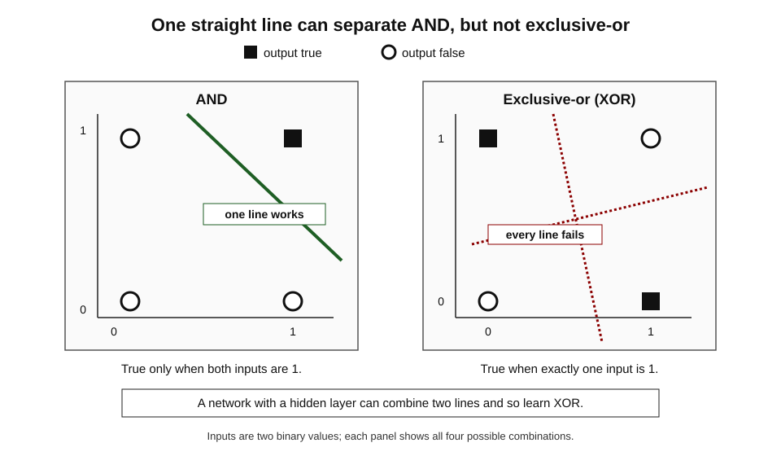
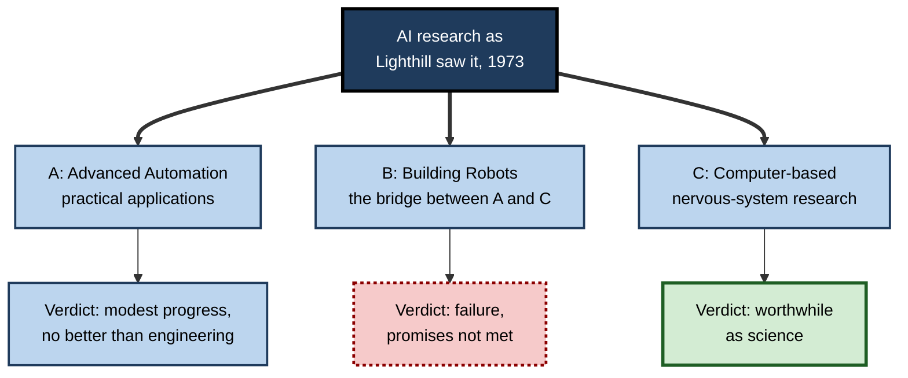
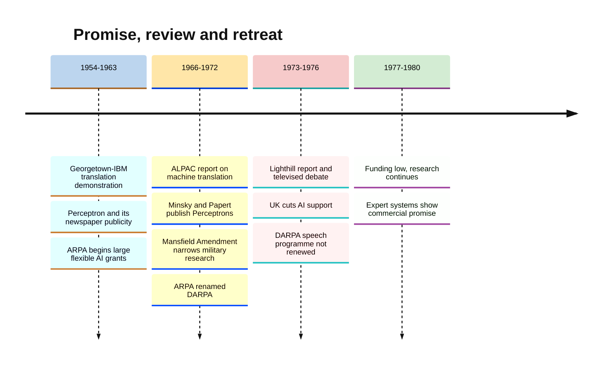
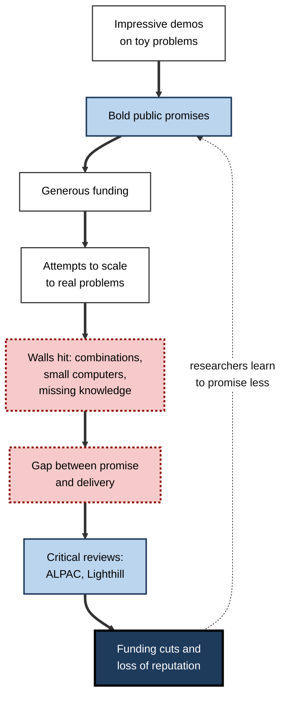
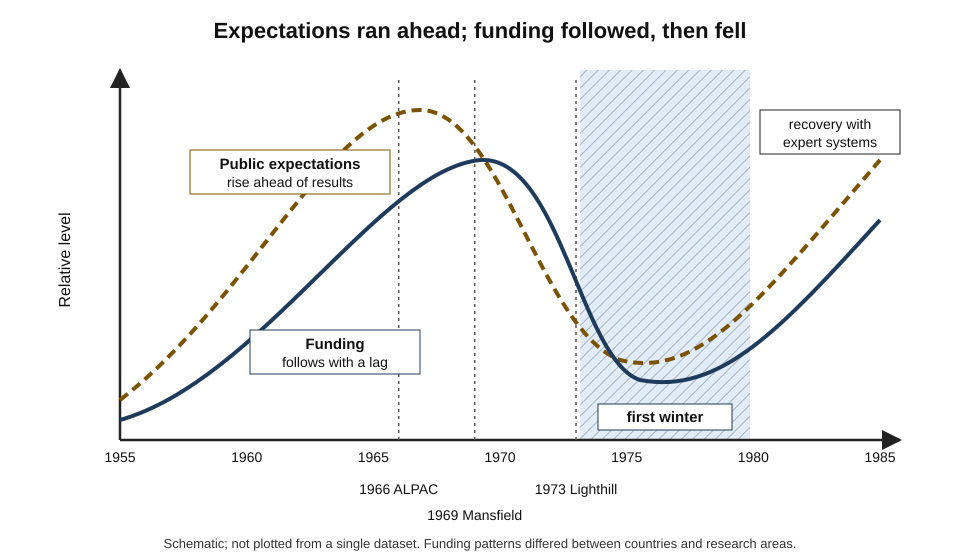

# B.3. The first AI winter and why funding dried up

In 1958 a newspaper report on a new learning machine suggested it would one day walk, talk, see and be conscious of its existence. In 1954 a public demonstration translated Russian sentences into English and was hailed as the start of automatic translation. By the mid-1970s, government reviews in the United States and Britain had concluded that the promises had not been kept, and money for whole areas of AI research was cut. Researchers later called this period the **first AI winter**.

> **Definition — AI winter:** a period of reduced funding, commercial interest and public confidence in artificial intelligence, following a period of inflated expectations that the technology failed to meet.

> **Definition — First AI winter:** the downturn in AI funding and reputation from roughly 1974 to 1980, triggered by unmet promises in machine translation, neural networks, robotics and general problem solving, and by critical government reviews in the United States and the United Kingdom.

**Why it matters**

- **It is the first full cycle of AI hype and disappointment** — a pattern that has repeated and may repeat again.
- **It shows how funding decisions shape science.** Whole lines of research, notably neural networks, were set back by a decade or more.
- **It teaches how to judge AI claims.** The questions reviewers asked in the 1960s and 1970s are still the right ones to ask of any AI promise.
- **It is often misremembered.** Research did not stop; the winter was patchy, and some of the field's most important ideas were born during it.

---

## The Boom Before the Winter

### Money and confidence, 1956–1973

- **Generous, flexible funding**
  - From 1963 the US Advanced Research Projects Agency (ARPA) gave large grants to MIT, Carnegie Mellon and Stanford with few conditions — in effect, funding people rather than projects.
  - In Britain, Edinburgh, Sussex and Essex built strong groups with research-council support.
- **Impressive demonstrations**
  - Programs proved theorems, solved algebra problems, played checkers and conversed in narrow worlds.
- **Bold public promises**
  - Founders forecast chess champions, translating machines and general intelligence within a decade or a generation.

> **Key point:** the boom rested on **demonstrations in small, controlled settings**. The question nobody could yet answer was whether those methods would **scale** to real problems.

### Three bets that went wrong

| Bet | The promise | What happened |
|---|---|---|
| Machine translation | Fully automatic, high-quality translation of scientific texts within a few years | Output needed heavy human correction; costs exceeded those of human translators |
| Neural networks (perceptrons) | Machines that learn to see, recognise and eventually think | Single-layer networks were proved unable to learn some simple functions; interest and funding collapsed |
| General problem solving and robotics | General methods that would scale from puzzles to the real world | Search was swamped by the number of possibilities; robots handled only simplified rooms |

---

## Machine Translation and the ALPAC Report

### The Georgetown–IBM demonstration (1954)

- **What happened:** a public demonstration in New York translated more than sixty carefully chosen Russian sentences into English.
- **How:** a vocabulary of about 250 words and six grammar rules.
- **Reception:** newspapers presented it as a breakthrough; organisers suggested that automatic translation might be largely solved within a few years.
- **Why it mattered:** in the Cold War, the US government wanted fast access to Soviet scientific literature, and money flowed into translation research.

> **Watch out:** the sentences were **selected to work** with the tiny vocabulary and rules. A demonstration on hand-picked inputs tells very little about performance on real ones — a lesson that applies to every AI demonstration since.

### Why translation was so hard

- **Ambiguity** — words have many meanings, chosen by context.
  - *e.g.* "bank" (river or money); "the pen is in the box" versus "the box is in the pen" (a pen can be an enclosure).
- **World knowledge** — choosing the right meaning often needs knowledge of how the world works.
  - The philosopher-linguist Yehoshua Bar-Hillel argued in 1960 that fully automatic high-quality translation was impossible without such knowledge.
- **Grammar differences** — word order, cases and idioms do not map one-to-one between languages.

> **Watch out:** the famous story that "the spirit is willing but the flesh is weak" came back from Russian as "the vodka is good but the meat is rotten" is **almost certainly apocryphal**. Versions of it circulated as jokes well before any system could have produced it. It illustrates the real problem, but it is not evidence.

### The ALPAC report (1966)

**Study card — ALPAC report (1966)**

- **Body:** the Automatic Language Processing Advisory Committee, set up by US government funding agencies through the National Academy of Sciences and chaired by John R. Pierce of Bell Labs.
- **Question:** after a decade of spending, was machine translation delivering value?
- **Findings:**
  - machine output needed extensive human **post-editing**;
  - machine-aided translation was **slower, less accurate and more expensive** than human translation;
  - there was no shortage of human translators, and demand for Russian translation was modest;
  - there was no prospect of useful general machine translation in the near future.
- **Recommendations:** stop large-scale funding of machine translation; support basic research in computational linguistics and practical aids for human translators.
- **Effect:** US government funding for machine translation fell sharply for about two decades.

> **Definition — Post-editing:** human correction of machine-translated text to make it accurate and readable.

> **Key point:** ALPAC judged machine translation by **cost and usefulness**, not by technical cleverness. It is an early example of an evaluation asking "is this better than the alternative?" rather than "is this impressive?".

---

## Perceptrons and the Retreat from Neural Networks

### Rosenblatt's perceptron

- **Who:** Frank Rosenblatt, a psychologist at the Cornell Aeronautical Laboratory, with US Navy funding.
- **What (1957–58):** a learning machine — first simulated on an IBM 704, then built as the Mark I Perceptron with a grid of light sensors.
- **How it learned:** connections between inputs and an output unit were strengthened or weakened after each mistake, until it classified simple patterns correctly.
- **Publicity:** a 1958 press briefing led to newspaper reports that the Navy expected such machines eventually to walk, talk, see, write, reproduce themselves and be conscious of their existence.

> **Definition — Perceptron:** an early artificial neural network that sums weighted inputs and outputs one of two classes, learning its weights by adjusting them after errors.

### The book that turned the tide

**Study card — Minsky and Papert, *Perceptrons* (1969)**

- **Authors:** Marvin Minsky and Seymour Papert of MIT.
- **Method:** rigorous mathematical analysis of what single-layer perceptrons can and cannot compute.
- **Findings:**
  - a single-layer perceptron can learn only patterns that can be separated by a straight line (or flat plane);
  - it therefore **cannot** learn simple functions such as **exclusive-or (XOR)**, nor determine whether a figure is connected, without impractically large numbers of units;
  - the authors were pessimistic that multi-layer networks would escape these limits in practice.
- **Effect:** combined with the lack of a method for training multi-layer networks, the book contributed to a sharp decline in neural-network funding and research through the 1970s.

**Figure 1.** Why a single-layer perceptron cannot learn exclusive-or.

> **Definition — Exclusive-or (XOR):** a logical function that is true when exactly one of two inputs is true and false when both or neither are.

> **Definition — Linearly separable:** describes data whose classes can be divided by a single straight line, plane or flat boundary.

> **Watch out:** it is often said that *Perceptrons* "killed" neural networks. Historians regard this as **contested and oversimplified**. The book proved real limits of single-layer networks; the decline also reflected Rosenblatt's death in 1971, the lack of a training method for multi-layer networks, small computers and competition for funds with symbolic AI. Multi-layer networks trained by **back-propagation** later overcame the XOR limit.

---

## The Lighthill Report

### The review

**Study card — Lighthill report (1973)**

- **Author:** Sir James Lighthill, a distinguished applied mathematician, commissioned by the UK Science Research Council.
- **Title:** "Artificial Intelligence: A General Survey".
- **Framework — three categories:**
  - **A — Advanced Automation:** practical applications such as character recognition and machine translation; some progress, but no better than conventional engineering.
  - **C — Computer-based Central Nervous System research:** using computers to model the brain and mind; valuable as science.
  - **B — Building Robots, the "Bridge" between A and C:** general-purpose intelligent robots; judged a failure that had not delivered on its promises.
- **Central criticism:** methods that worked on toy problems collapsed under the **combinatorial explosion** of real problems.
- **Effect:** UK government support for AI research was cut back sharply, surviving in only a few universities; the effect lasted until the early 1980s.

**Figure 2.** Lighthill's classification of AI research and his verdict on each part.

### The televised debate

- In 1973 the BBC broadcast a debate at the Royal Institution in London.
- **Lighthill** argued his case against three leading researchers: **Donald Michie** (Edinburgh), **John McCarthy** (Stanford) and **Richard Gregory** (Bristol).
- The researchers argued that Lighthill had misunderstood the field and that general results were not the only measure of progress.
- The debate exposed a real disagreement: was AI an **engineering** field to be judged by applications, or a **science** to be judged by understanding?

> **Watch out:** many AI researchers regarded the Lighthill report as unfair — written by an outsider, relying on limited consultation, and dismissive of robotics. Others accept that its core criticism, the **combinatorial explosion**, was correct. Both views have support.

### Robots and vision: the problems that looked easy

- **The MIT summer vision project (1966)**
  - Seymour Papert circulated a memo proposing that a group of students could build a significant part of a visual system — separating objects from background and naming them — over one summer.
  - Computer vision then took **decades**; reliable object recognition arrived only in the 2010s.
  - The memo became a standard example of underestimating perception.
- **Freddy (Edinburgh, late 1960s to early 1970s)**
  - A robot with a camera and an arm that could assemble a toy car or boat from a heap of parts.
  - It needed hours of work and carefully controlled lighting; small changes to the scene could defeat it.
- **Shakey (Stanford Research Institute, 1966–72)**
  - Planned routes and pushed boxes in specially painted rooms; each step could take minutes of computation.

> **Key point:** robots exposed the gap between **reasoning about a simplified world** and **acting in the real one**. Lighthill's harshest verdict fell on exactly this "bridge" between computation and the physical world.

| | What the demonstrations showed | What real use demanded |
|---|---|---|
| Environment | Painted rooms, plain blocks, controlled lighting | Clutter, shadows, movement, change |
| Speed | Minutes or hours per action | Real-time response |
| Knowledge | Complete description of a tiny world | Open-ended common sense |
| Reliability | Successful runs selected for reports | Consistent performance every time |

### The philosophical critics

**Study card — Hubert Dreyfus, "Alchemy and Artificial Intelligence" (1965) and *What Computers Can't Do* (1972)**

- **Who:** a philosopher at MIT and later Berkeley, commissioned by the RAND Corporation to assess AI.
- **Argument:**
  - early AI rested on the assumption that all intelligent behaviour can be expressed as explicit rules over symbols;
  - human expertise depends instead on **tacit, intuitive, embodied** skill — experts "see" what to do without consulting rules;
  - early successes on formal problems would therefore not extend to everyday intelligence.
- **Reception:** most AI researchers dismissed him at the time, sometimes rudely.
- **Assessment:** several of his predictions about the limits of rule-based systems were borne out in both winters; later learning-based methods, which do not rely on hand-written rules, partly sidestep his critique.

- **Joseph Weizenbaum, *Computer Power and Human Reason* (1976)**
  - The creator of the ELIZA chatbot argued that some decisions — in therapy, justice and care — should not be delegated to computers even if they could make them.
  - His was an **ethical** rather than a technical critique, and it anticipated present-day debates about where AI should be used.

> **Definition — Tacit knowledge:** knowledge a person uses but cannot fully put into words, such as how to ride a bicycle or judge a patient's appearance.

> **Watch out:** the critics were not simply "anti-AI". Dreyfus's target was a **particular theory** of intelligence (rules over symbols); Weizenbaum's was a **particular use** of computers. Both distinctions are lost when they are remembered only as sceptics.

---

## The American Funding Shift

### From people to missions

- **The Mansfield Amendment (1969)**
  - Attached to the US military authorisation for 1970, it required US military research funds to support work with a **direct and apparent relationship** to military functions.
  - Basic, curiosity-driven research was expected to move to civilian funders such as the National Science Foundation.
- **ARPA becomes DARPA (1972)**
  - The agency, renamed DARPA (the D standing for defence), moved towards **mission-oriented** projects with milestones and deliverables.
- **Consequence:** the loosely directed, "fund the best people" style that had built AI ended.

> **Definition — Mission-oriented research:** research funded to achieve a specific practical goal for the funder, with defined milestones, as opposed to open-ended basic research.

### The speech-understanding programme

**Study card — DARPA Speech Understanding Research programme (1971–76)**

- **Aim:** systems able to understand connected speech from a vocabulary of about 1,000 words, with constrained grammar and cooperative speakers.
- **Participants:** groups at Carnegie Mellon, BBN, SRI and elsewhere.
- **Results:** Carnegie Mellon's **Harpy** system met or came close to the main targets by 1976.
- **Decision:** DARPA did not renew the programme as planned; officials were disappointed that the systems were far from practical use.
- **Lesson:** meeting the **technical specification** was not the same as meeting the **funder's expectation** — the targets themselves had been set too far from real use.

> **Watch out:** accounts differ on how far the programme "failed". It produced techniques that later fed into successful statistical speech recognition; what was lost was the funder's confidence.

**Figure 3.** The first AI winter, 1954–1980.

---

## Why the Funding Dried Up

### The underlying causes

- **Over-promising**
  - Founders, journalists and funders all repeated forecasts that the technology could not meet.
- **Combinatorial explosion**
  - Search-based methods that solved puzzles could not cope with the number of possibilities in real problems.
- **Limited computing power and memory**
  - Machines had a tiny fraction of the capacity needed to test ideas at realistic scale.
- **Missing common-sense and world knowledge**
  - Translation, vision and robotics all needed everyday knowledge that nobody knew how to supply.
- **No way to train deeper networks**
  - Neural networks were limited to a single learning layer.
- **Policy change**
  - US defence funding shifted to mission-oriented work; the UK accepted Lighthill's verdict.
- **External critique**
  - Dreyfus's argument that human expertise rests on intuition that rules cannot capture gave sceptical funders an intellectual case.

> **Mnemonic — "POCKET":** Promises too big, Overwhelming combinations, Computers too small, Knowledge missing, Explicit policy change, Training of networks impossible.

**Figure 4.** How inflated expectations turned into funding cuts.

### Comparing the two great reviews

| | ALPAC (United States, 1966) | Lighthill (United Kingdom, 1973) |
|---|---|---|
| Commissioned by | US government agencies via the National Academy of Sciences | UK Science Research Council |
| Scope | Machine translation only | All of AI |
| Author(s) | A committee chaired by John R. Pierce | One mathematician, Sir James Lighthill |
| Main test | Cost and quality against human translators | Progress towards general intelligent robots |
| Key criticism | Slower, worse and dearer than people | Combinatorial explosion; robot research a failure |
| Effect | Machine-translation funding cut for about twenty years | UK AI support cut to a few centres until the early 1980s |

---

## What Continued in the Cold

The winter was real for funding and reputation, but research did not stop.

**Figure 5.** Expectations and funding before, during and after the first winter.

- **Expert systems**
  - Stanford's work on medical and chemical expert systems continued and became the basis of the 1980s boom.
- **Logic programming**
  - The Prolog language emerged in France and Britain in the early 1970s.
- **Knowledge representation**
  - Frames (1974), scripts (1977) and other structures were developed.
- **Neural networks in small pockets**
  - A few researchers, such as Paul Werbos (who described back-propagation for networks in his 1974 doctoral thesis), Kunihiko Fukushima (the neocognitron, 1980) and Stephen Grossberg, kept working with little attention.
- **Statistical speech recognition**
  - At IBM, Frederick Jelinek's group developed statistical methods that later transformed speech and language processing.

> **Key point:** winters cut **money and attention**, not ideas. Several foundations of modern AI were laid when the field was least fashionable.

| | What the winter cut | What survived or grew |
|---|---|---|
| Machine translation | Large US government programmes | Basic computational linguistics; tools for human translators |
| Neural networks | Mainstream funding and student interest | Isolated theoretical work, including early back-propagation |
| Robotics | UK general-purpose robot research | Industrial and specialised robotics |
| Speech | DARPA's speech-understanding programme | Statistical speech recognition at IBM and elsewhere |
| Symbolic AI | Open-ended general problem solving | Knowledge-based expert systems |

---

## Lessons for Judging AI Today

### The questions the reviewers asked

1. **Compared with what?** Is the system better, cheaper or faster than the current human or conventional method?
2. **On which inputs?** Were the demonstrations on selected cases or on real, representative ones?
3. **At what scale?** Does the method still work when the problem is ten or a thousand times larger?
4. **At what total cost?** Including human correction, integration and upkeep.
5. **By what measure?** Is success defined by the builder or by the user?

> **Remember:** **demonstration ≠ deployment**. A system shown working on chosen examples has passed the easiest test, not the important one.

### Worked example (illustrative): testing a translation vendor's claim with ALPAC's logic

A legal firm is offered machine translation of contracts at 20% of the cost of human translation. *Illustrative figures.*

1. **Human baseline:** a professional translates a 10,000-word contract for 100,000 (currency units) in five days.
2. **Machine output:** 20,000 for the raw translation, delivered in an hour.
3. **Post-editing:** a qualified lawyer-translator must check every clause; the firm's pilot shows this takes three days and costs 60,000.
4. **Error risk:** in the pilot, two meaning-changing errors survived post-editing in one contract out of ten.

| | Human only | Machine plus post-editing |
|---|---|---|
| Direct cost | 100,000 | 20,000 + 60,000 = 80,000 |
| Time | 5 days | About 3 days |
| Residual serious errors (pilot) | None found | 1 contract in 10 |
| Saving | — | 20%, not the advertised 80% |

- **Conclusion:** the real saving is a quarter of the advertised one, and the error risk may outweigh it for high-stakes contracts; the tool may still suit internal, low-stakes documents.

> **Watch out:** headline comparisons usually omit **post-editing, checking and error costs**. ALPAC's central insight was to count them.

### Case study: The Lighthill report and British AI

- **Situation:** by the early 1970s British AI groups, especially at Edinburgh, were internationally respected; Edinburgh's robot Freddy could assemble simple objects from a heap of parts.
- **Problem:** the Science Research Council faced competing claims on limited funds and disagreement among its advisers about AI's value.
- **Actions:**
  1. The council asked Sir James Lighthill, an eminent outsider, for an independent survey.
  2. Lighthill produced a short, sharply argued report classifying AI into three categories and judging general-purpose robotics a failure.
  3. The report was published with replies from researchers, and Lighthill debated leading figures on BBC television.
- **Result:**
  - UK government support for AI was greatly reduced for nearly a decade;
  - Edinburgh's robotics work was cut back, and some researchers left the field or the country.
- **Side effects:**
  - Britain lost ground in AI just as expert systems began to show commercial value;
  - in 1983 the government's Alvey programme, a response partly to Japan's national AI project, restored substantial funding.
- **Lesson:** a single review, written by a respected outsider and accepted by a funder, can **redirect a national research field for a decade** — for better or worse. How evaluation questions are framed decides the answer.

### Modern parallels

- **Selected demonstrations** — launch videos showing a system's best cases.
- **Benchmark targets** — systems that meet a test's specification but disappoint in real use, like the speech programme.
- **Policy swings** — governments that fund AI generously when it is fashionable and sharply cut back when confidence falls.
- **Cost of human correction** — reviewing and fixing AI output, the modern form of post-editing.

> **In practice:** professionals adopting AI tools can protect themselves and their organisations from a "local winter" by **piloting on representative work, counting correction costs and setting success measures before the trial starts**.

---

## Open Questions

- **Did the first winter slow AI, or redirect it usefully?**
  - Some argue that cutting over-hyped programmes forced the field towards practical, knowledge-based work; others that it delayed neural networks by more than a decade.
- **Was the Lighthill report fair?**
  - Historians and researchers still disagree about its method and judgements.
- **How much did *Perceptrons* matter?**
  - Its role relative to other causes of the neural-network decline remains debated.
- **Can winters be predicted?**
  - The signs — promises outrunning results, rising costs, sceptical reviews — are recognisable in hindsight; whether they can be recognised in time is uncertain.

---

## Summary

- An **AI winter** is a period of reduced funding and confidence after inflated expectations; the **first** ran from roughly **1974 to 1980**.
- **Machine translation:** the selective 1954 **Georgetown–IBM** demonstration raised hopes; the **ALPAC report (1966)** found machine translation slower, worse and dearer than human work once **post-editing** was counted, and US funding collapsed.
- **Neural networks:** Rosenblatt's **perceptron** was over-publicised; **Minsky and Papert's *Perceptrons* (1969)** proved single-layer networks cannot learn functions such as **XOR**; its role in the decline is **contested**.
- **Britain:** the **Lighthill report (1973)** split AI into categories A, B and C, judged general robotics a failure because of **combinatorial explosion**, and led to deep cuts.
- **United States:** the **Mansfield Amendment (1969)** and DARPA's turn to **mission-oriented** research ended flexible funding; the **speech-understanding programme** met targets but was not renewed.
- **Causes:** over-promising, combinatorial explosion, small computers, missing knowledge, policy change, untrainable deep networks, outside critique (**Dreyfus**).
- **Research continued:** expert systems, Prolog, knowledge representation, early back-propagation and statistical speech recognition.
- **Lessons:** compare with the alternative, test on representative inputs, check scale, count total cost including correction, and agree success measures in advance.

---

## Self-Check

1. Define an AI winter and give the approximate dates of the first.
2. Why was the 1954 Georgetown–IBM demonstration misleading?
3. What did the ALPAC report find, and why is its method still useful?
4. Explain why a single-layer perceptron cannot learn XOR.
5. Why is it oversimplified to say that *Perceptrons* "killed" neural networks?
6. Describe Lighthill's three categories and his verdict on each.
7. What did the Mansfield Amendment change about AI funding in the United States?
8. Why was the DARPA speech programme not renewed even though Harpy met its main targets?
9. List five causes of the first AI winter.
10. Name three lines of work that continued or began during the winter.
11. Compare the ALPAC and Lighthill reports on scope, method and effect.
12. A vendor claims its AI cuts document-review costs by 70%. Using lessons from the first winter, what would you check before accepting the claim?

### Answer Key

1. A period of reduced funding, commercial interest and confidence in AI following unmet expectations; roughly 1974–1980.
2. It used about sixty selected sentences, a 250-word vocabulary and six rules, so it showed nothing about performance on real, unrestricted text — yet it was presented as a breakthrough.
3. Machine output needed heavy post-editing, and the result was slower, less accurate and more expensive than human translation; there was no near-term prospect of general machine translation. Its method — comparing total cost and quality with the existing alternative — remains the right test of any AI tool.
4. A single-layer perceptron draws one straight-line boundary between classes. XOR's true cases (0,1) and (1,0) lie on opposite corners from its false cases (0,0) and (1,1), so no single line separates them.
5. The book proved real limits, but the decline also reflected the lack of a training method for multi-layer networks, small computers, Rosenblatt's death in 1971 and competition for funds; multi-layer networks later overcame the limits.
6. A, Advanced Automation: modest progress, no better than conventional engineering. C, computer-based nervous-system research: worthwhile science. B, Building Robots, the bridge between them: a failure, defeated by the combinatorial explosion.
7. It required military research funds to have a direct link to military functions, ending open-ended, people-based grants and pushing DARPA towards mission-oriented projects with milestones.
8. The targets — a limited vocabulary, constrained grammar and cooperative speakers — were far from practical use, so meeting them did not satisfy the funder's expectation of usable systems.
9. Any five: over-promising; combinatorial explosion; limited computing power; missing common-sense and world knowledge; no method to train multi-layer networks; US and UK policy changes; critiques such as Dreyfus's.
10. Any three: expert systems; Prolog and logic programming; frames and scripts; early back-propagation (Werbos); the neocognitron (Fukushima); statistical speech recognition at IBM.
11. ALPAC: US committee, machine translation only, judged on cost and quality versus humans, cut translation funding for about twenty years. Lighthill: one UK mathematician, all of AI, judged progress towards general robots and the combinatorial explosion, cut UK AI support until the early 1980s.
12. Compare with the current method; ask whether the evidence comes from selected or representative documents; check performance at full volume; count human checking and correction time and the cost of missed errors; agree success measures and run a pilot before committing.

---

## Glossary

| Term | Meaning |
|---|---|
| AI winter | A period of reduced funding and confidence in AI after unmet expectations. |
| ALPAC report | The 1966 US review that found machine translation not cost-effective and led to funding cuts. |
| Back-propagation | A method for training multi-layer neural networks by passing error signals backwards through the layers. |
| Combinatorial explosion | The rapid growth in possibilities that overwhelms search on realistic problems. |
| DARPA | The name ARPA took in 1972, adding "Defence" to its title. |
| Exclusive-or (XOR) | A function true when exactly one of two inputs is true. |
| Georgetown–IBM experiment | The 1954 public demonstration of Russian-to-English machine translation on selected sentences. |
| Harpy | Carnegie Mellon's speech-understanding system of the mid-1970s. |
| Lighthill report | The 1973 UK review of AI that judged general robotics a failure and led to cuts. |
| Linearly separable | Data whose classes can be divided by a single straight line or flat boundary. |
| Mansfield Amendment | The 1969 US law requiring military research funding to serve military functions directly. |
| Mission-oriented research | Research funded to meet a specific practical goal with milestones. |
| Perceptron | An early single-layer neural network that learns to classify inputs into two classes. |
| Post-editing | Human correction of machine-translated text. |
| Tacit knowledge | Knowledge a person uses but cannot fully put into words. |
