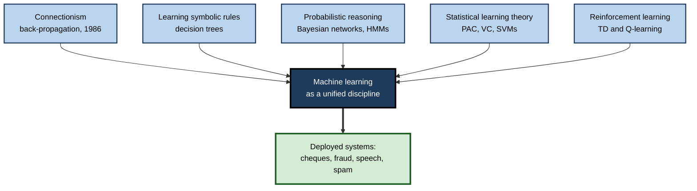
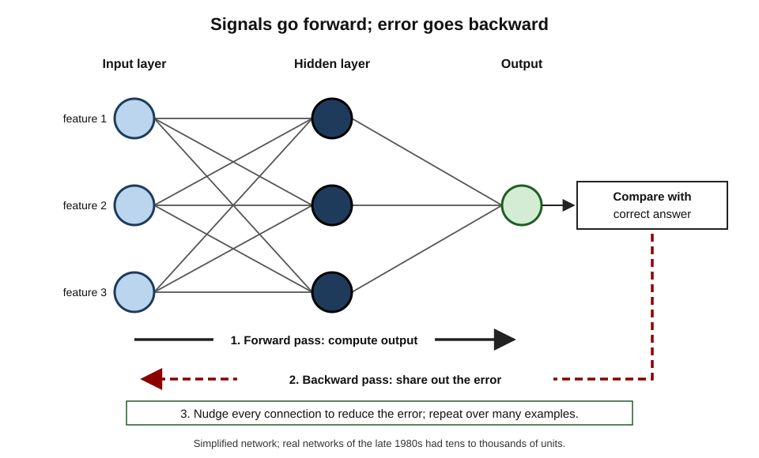
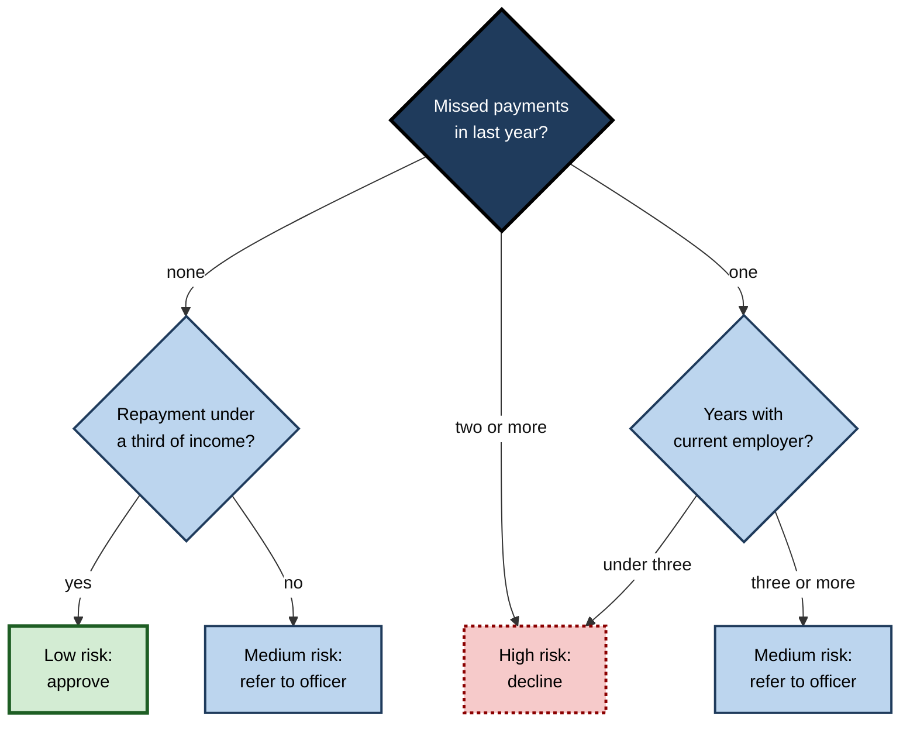
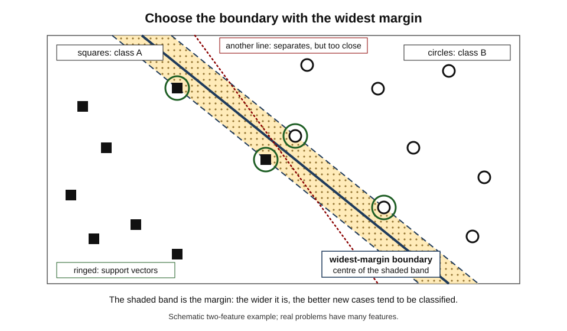
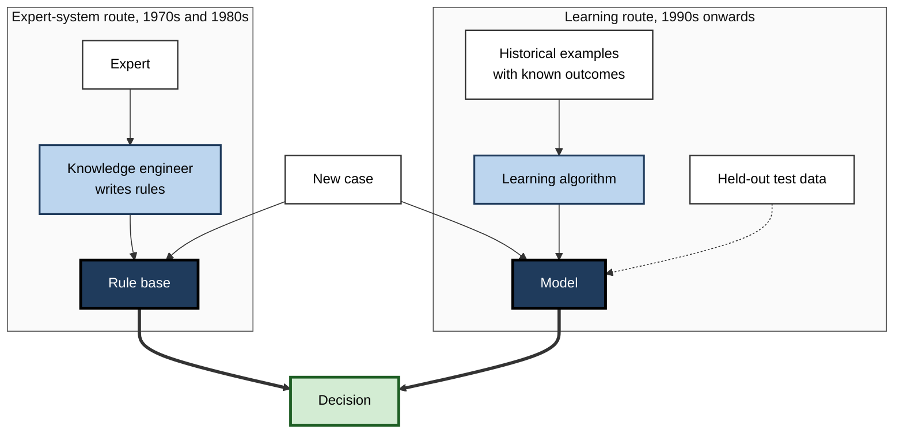
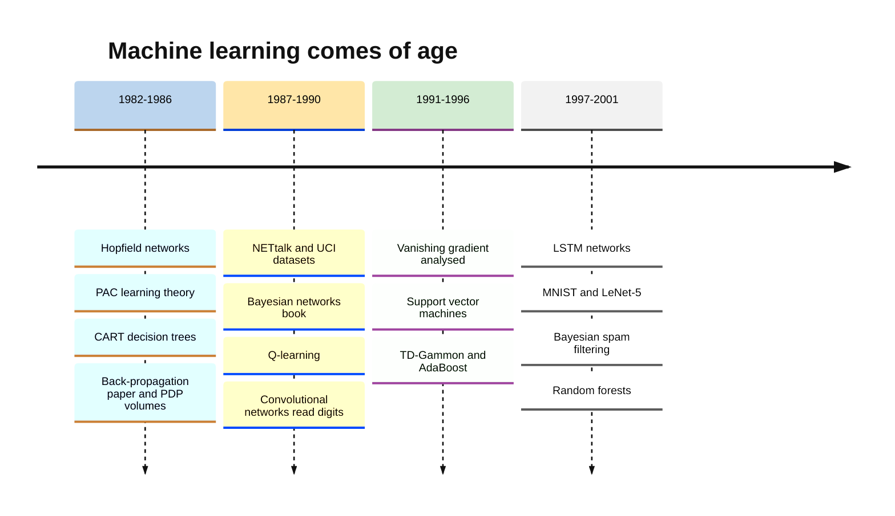

# B.4. Rise of machine learning in the 1980s and 90s

In 1985 an expert system's rules were written by a knowledge engineer interviewing a specialist for months. By 1998 a bank's cheque-reading machine had learned to recognise handwritten digits from tens of thousands of examples, and an email filter could learn what spam looked like from a user's own inbox. Between those dates artificial intelligence changed its central question from **"what rules should we write?"** to **"what can be learned from data?"**

> **Definition — Machine learning:** the branch of AI in which systems improve their performance on a task by finding patterns in examples (data), instead of following rules written entirely by people.

> **Definition — Statistical turn:** the shift in AI, mainly during the 1980s and 1990s, from hand-built symbolic knowledge towards probabilistic models and algorithms that learn from data.

**Why it matters**

- **It is the bridge between old and modern AI.** Almost every method used today — neural networks trained by back-propagation, decision trees, probabilistic models, reinforcement learning — was established or revived in these two decades.
- **It created the working culture of AI** — shared datasets, held-out test sets, measured error rates and competitive benchmarks.
- **It produced the first quiet mass deployments** — cheque reading, fraud detection, speech dictation and spam filtering — long before "AI" became a consumer word again.
- **It explains why data became valuable.** Once systems learned from examples, whoever held the examples held an advantage.

---

## Why AI Turned to Learning

### Push factors: the limits of hand-built knowledge

- **The knowledge acquisition bottleneck** — writing rules by hand was slow, expensive and never complete.
- **Brittleness** — rule systems failed abruptly on cases their authors had not foreseen.
- **Uncertainty** — the real world is noisy; all-or-nothing rules handled it poorly.
- **Maintenance** — large rule bases became impossible to keep consistent.

### Pull factors: new conditions

- **Cheaper computing** — personal computers and workstations put serious processing on individual desks.
- **More digital data** — transaction records, scanned documents, speech recordings and, from the mid-1990s, the web.
- **Better mathematics** — statistics, probability and optimisation offered principled ways to learn and to measure error.
- **Commercial demand** — banks, telecoms firms and retailers needed to classify millions of cases automatically.

> **Key point:** the turn to learning was not a single breakthrough. It was the **convergence** of a failing approach (hand-built rules), available resources (data and computers) and ready methods (statistics and neural networks).

**Figure 1.** The streams that formed machine learning in the 1980s and 1990s.

---

## The Connectionist Revival

### Back to neural networks

After the perceptron's decline in the 1970s, neural networks returned in the 1980s under the name **connectionism** — the idea that intelligence emerges from many simple connected units.

> **Definition — Connectionism:** the approach that models intelligence as the activity of networks of simple, interconnected units whose connection strengths are learned from experience.

- **Hopfield networks (John Hopfield, 1982)**
  - A physicist showed that a network of connected units could store memories as stable states and recall them from partial cues.
  - It brought physicists' mathematical tools and prestige into the field.
- **Boltzmann machines (Geoffrey Hinton and Terrence Sejnowski, mid-1980s)**
  - Networks with hidden units that learned probability distributions over their inputs.
- **Hopfield and Hinton** shared the 2024 Nobel Prize in Physics for these foundational contributions to machine learning with neural networks.

### Back-propagation

**Study card — Rumelhart, Hinton and Williams (1986)**

- **Publication:** a short paper in *Nature*, "Learning representations by back-propagating errors", alongside the two-volume book *Parallel Distributed Processing* edited by David Rumelhart and James McClelland.
- **Problem solved:** how to train a network with **hidden layers** — the limitation that had stalled perceptrons.
- **Method:**
  1. pass an input forward through the layers to produce an output;
  2. measure the error against the correct answer;
  3. pass the error backwards, using calculus (the chain rule) to work out how much each connection contributed;
  4. adjust every connection slightly to reduce the error;
  5. repeat over many examples.
- **Results:** hidden units learned useful internal features nobody had programmed — such as family relationships in a small test of kinship.
- **Conclusion:** multi-layer networks could learn their own **internal representations**, overcoming the limits that had defined the first winter.

> **Definition — Back-propagation:** a method for training multi-layer neural networks that computes how each connection contributed to the output error and adjusts the connections to reduce it.

> **Definition — Hidden layer:** a layer of units between a network's inputs and outputs, whose activity is not directly specified but learned.

> **Watch out:** back-propagation was **not invented** in 1986. Versions appeared earlier, including in Paul Werbos's 1974 doctoral thesis and in work on automatic differentiation by Seppo Linnainmaa (1970). The 1986 paper's contribution was to show convincingly that it **learned useful representations** and to bring it to wide attention. Credit for the idea is contested.

**Figure 2.** Back-propagation in a small network: forward signals and backward error.

### What the revived networks could do

- **NETtalk (Terrence Sejnowski and Charles Rosenberg, 1987)**
  - Learned to convert written English text into phonetic symbols for a speech synthesiser.
  - Its output, played aloud, progressed from babble to intelligible speech during training — a vivid public demonstration.
- **ALVINN (Dean Pomerleau, Carnegie Mellon, 1989)**
  - A neural network that learned to steer a research vehicle by watching a human driver, using camera images as input.
- **Convolutional networks for handwriting (Yann LeCun and colleagues, Bell Labs, from 1989)**
  - Networks designed so that the same small feature detectors were applied across an image.
  - Read handwritten postcodes and digits with high accuracy.

> **Definition — Convolutional neural network:** a neural network that applies the same small learned filters across every position of an image, so that it detects features wherever they appear; the ancestor of modern computer-vision networks.

- **Theory:** in 1989 George Cybenko and others proved that a network with one hidden layer can, in principle, approximate any continuous function — the **universal approximation theorem**.

> **Watch out:** the theorem says a suitable network **exists**, not that it can be found by training, or that it would need a practical number of units. It is often over-quoted as proof that neural networks "can learn anything".

---

## Learning Rules and Trees

Not all learning was neural. Symbolic AI researchers developed methods that learned readable rules from examples.

- **Decision trees**
  - **CART** (Leo Breiman, Jerome Friedman, Richard Olshen and Charles Stone, 1984) — from statistics.
  - **ID3** (Ross Quinlan, 1986) and its successor **C4.5** (1993) — from AI.
  - The algorithm repeatedly chooses the question about the data that best separates the classes, building a tree of if–then tests.
- **Why they mattered:**
  - learned automatically, but produced human-readable logic — a bridge between expert systems and statistical learning;
  - widely used in credit, insurance and medicine because decisions could be explained.

> **Definition — Decision tree:** a model that classifies a case by asking a sequence of questions about its features, each answer leading down a branch to a final decision.

**Figure 3.** A decision tree of the kind learned automatically from historical cases (illustrative).

> **Key point:** an expert-system rule base and a learned tree can look identical. The difference is **where the rules came from** — an interview with an expert, or an algorithm searching historical data.

---

## The Probabilistic Revolution

### Reasoning with uncertainty

**Study card — Judea Pearl, *Probabilistic Reasoning in Intelligent Systems* (1988)**

- **Problem:** expert systems handled uncertainty with ad hoc numbers such as certainty factors, which could give inconsistent results.
- **Proposal:** **Bayesian networks** — graphs in which each node is a variable and each link a direct probabilistic influence, so that the full joint probability can be computed efficiently.
- **Results:** a principled way to update beliefs as evidence arrives, widely used in diagnosis, troubleshooting and decision support.
- **Recognition:** Pearl received the 2011 Turing Award for this work and later work on causal reasoning.

> **Definition — Bayesian network:** a graphical model in which nodes are variables and links show direct probabilistic dependencies, allowing beliefs to be updated consistently when evidence is observed.

> **Formula — Bayes' rule:** P(cause | evidence) = P(evidence | cause) × P(cause) ÷ P(evidence). Example: if 1% of transactions are fraudulent, a test flags 90% of frauds and 5% of genuine transactions, then P(fraud | flagged) = (0.9 × 0.01) ÷ (0.9 × 0.01 + 0.05 × 0.99) ≈ 0.009 ÷ 0.0585 ≈ **15%**.

### Speech recognition goes statistical

- **Hidden Markov models (HMMs)**
  - Developed for speech in the 1970s by groups at IBM (under Frederick Jelinek) and at Carnegie Mellon (James Baker, later a founder of Dragon Systems).
  - Treated speech as a sequence of hidden states (sounds) producing observable acoustic signals, with probabilities learned from recordings.
- **By the 1990s HMMs dominated speech recognition.**
  - Dragon's dictation software reached consumers; in 1997 Dragon NaturallySpeaking offered continuous dictation on personal computers.
- **The culture clash**
  - A remark attributed to Jelinek — that every time a linguist left his group, recognition accuracy went up — captured the tension between hand-built linguistic knowledge and learning from data.

> **Watch out:** the Jelinek quotation exists in several versions and its exact wording and occasion are **uncertain**. It is best treated as a summary of a real debate, not a documented statement.

> **Definition — Hidden Markov model:** a probabilistic model of a sequence in which an unobserved state changes step by step and each state produces an observable signal; long the standard method for speech recognition.

### Statistical machine translation

- In the late 1980s and early 1990s an IBM team learned translation from **parallel text** — the Canadian parliament's proceedings, published in both English and French.
- Instead of grammar rules, it estimated the probability that a French phrase corresponded to an English one.
- This approach dominated translation research until neural methods replaced it in the mid-2010s — a striking reversal of the 1966 judgement that machine translation was a dead end.

---

## Learning Theory and the Algorithms of the 1990s

### A theory of what can be learned

- **PAC learning (Leslie Valiant, 1984)**
  - "Probably approximately correct": a framework for asking how many examples are needed to learn a concept to a given accuracy with a given confidence.
  - Valiant received the 2010 Turing Award.
- **VC dimension (Vladimir Vapnik and Alexey Chervonenkis, from the late 1960s)**
  - A measure of a model's capacity — how complex the patterns it can fit are — linked to how well it will generalise to new data.

> **Definition — Generalisation:** a learned model's ability to perform well on new examples it was not trained on — the central goal of machine learning.

### Support vector machines

**Study card — Support vector machines (Boser, Guyon and Vapnik, 1992; Cortes and Vapnik, 1995)**

- **Idea:** among all lines (or planes) separating two classes, choose the one with the **widest margin** to the nearest examples.
- **Kernel trick:** implicitly map data into a higher-dimensional space where a straight boundary becomes possible, without computing that space directly.
- **Results:** strong accuracy on handwriting, text classification and bioinformatics, with solid theory and few settings to tune.
- **Effect:** by the late 1990s SVMs were often preferred to neural networks, which were harder to train and less understood.

> **Definition — Support vector machine (SVM):** a learning method that separates classes with the boundary that has the largest margin to the nearest examples (the support vectors), often using kernels to handle curved boundaries.

**Figure 4.** The widest-margin boundary chosen by a support vector machine.

### Combining many weak learners

- **Boosting** — Yoav Freund and Robert Schapire's **AdaBoost** (1995) combined many simple classifiers, each focusing on the examples the previous ones got wrong.
- **Bagging and random forests** — Leo Breiman (1996, 2001) averaged many trees trained on random samples of the data.
- **Lesson:** combinations of simple models often beat any single complex one — still true in practice for many business datasets.

### Reinforcement learning matures

- **Temporal-difference learning (Richard Sutton, 1988)** — learning to predict future reward from the difference between successive predictions.
- **Q-learning (Christopher Watkins, 1989)** — learning the value of each action in each state from trial and error.
- **TD-Gammon (Gerald Tesauro, IBM, early 1990s)** — a neural network trained by playing backgammon against itself reached a level close to the best human players.

> **Definition — Reinforcement learning:** learning which actions to take by trial and error, guided by rewards and penalties, rather than by labelled examples.

| Method family | Representative work | What is learned | Strength | Weakness in the 1990s |
|---|---|---|---|---|
| Neural networks | Back-propagation (1986); convolutional networks (1989) | Connection weights | Learns its own features; good at perception | Slow to train; hard to interpret; deep networks hard to train |
| Decision trees | CART (1984); ID3 (1986); C4.5 (1993) | If–then splits | Readable; fast | Unstable; single trees overfit |
| Bayesian models | Bayesian networks (1988); HMMs | Probabilities | Principled uncertainty | Structure often hand-designed |
| Support vector machines | 1992–95 | Maximum-margin boundary | Strong theory; accurate | Slow on very large datasets; kernel choice |
| Ensembles | AdaBoost (1995); random forests (2001) | Many combined models | High accuracy | Less interpretable than one tree |
| Reinforcement learning | TD (1988); Q-learning (1989) | Values of states and actions | Learns from interaction | Needs many trials; limited to small problems |

---

## A New Research Culture

### Data, benchmarks and measured progress

- **Shared datasets**
  - The **UCI Machine Learning Repository** (from 1987) gave researchers common datasets for comparison.
  - **MNIST** (1998), 70,000 handwritten digits, became the standard first test for image classifiers.
- **Held-out testing**
  - Models were judged on data kept aside during training — the habit that separates measured progress from wishful demonstration.
- **Competitions and evaluations**
  - US government evaluations of speech recognition and of text retrieval (the TREC conferences, from 1992) compared systems on the same tasks each year.
- **Data mining**
  - Workshops on "knowledge discovery in databases" from 1989 became a major conference series, linking machine learning with databases and business analytics.

> **Key point:** benchmarks made AI **empirical**. Claims could be checked by others on the same data — a sharp contrast with the demonstration culture of the 1960s and 1970s.

> **Watch out:** benchmarks also bring a risk — researchers tune methods to a well-known dataset until gains reflect the dataset's quirks rather than real progress. This concern, raised in the 1990s, remains current.

**Figure 5.** Two ways of building an intelligent system.

| | Expert-system development | Machine-learning development |
|---|---|---|
| Main input | Expert interviews | Historical data with outcomes |
| Key specialist | Knowledge engineer | Data analyst or machine-learning engineer |
| Quality check | Expert review of rules | Error rate on held-out test data |
| Updating | Rewrite rules | Retrain on new data |
| Typical failure | Missing rules for unusual cases | Patterns that do not hold in new data, or reflect bias in old data |

---

## Machine Learning at Work

### The first quiet deployments

- **Cheque and postcode reading** — convolutional networks at AT&T and partners read handwritten amounts and postcodes.
- **Card-fraud detection** — from the early 1990s neural-network systems scored each card transaction for fraud risk in real time, becoming standard in the card industry.
- **Credit scoring** — statistical scoring models spread across lending, increasingly using learned methods.
- **Speech dictation** — HMM-based software for professionals such as doctors and lawyers.
- **Spam filtering** — from 1998 researchers showed that Bayesian text classifiers could learn to separate spam from legitimate mail; the method spread widely in the early 2000s.
- **Recommendations** — collaborative filtering research (such as the GroupLens project, 1994) learned from the ratings of similar users, an approach soon adopted by online retailers.

### The business of data mining

- **Data warehouses** — in the 1990s large firms consolidated transaction records into central databases designed for analysis, creating the raw material for learning.
- **A standard method** — a consortium of European companies, including Daimler-Benz, the statistics firm SPSS and the data-warehouse company NCR, developed **CRISP-DM** (Cross-Industry Standard Process for Data Mining, from 1996): business understanding → data understanding → data preparation → modelling → evaluation → deployment.
- **Typical projects** — customer churn prediction in telecoms, market-basket analysis in retail, credit and fraud scoring in finance, demand forecasting in manufacturing.
- **Lesson carried forward** — practitioners found that most effort went into **understanding the business problem and preparing data**, not into choosing the algorithm — still true today.

> **Definition — CRISP-DM:** a six-stage process model for data-mining projects, developed from 1996 by an industry consortium, that begins with understanding the business problem and ends with deploying the model.

> **In practice:** these systems were rarely marketed as "AI" — the term carried the stigma of the second winter. Practitioners spoke of "pattern recognition", "data mining", "analytics" or "predictive modelling".

### Case study: Teaching machines to read cheques

- **Situation:** banks processed enormous volumes of paper cheques, each with a handwritten amount that clerks had to key in.
- **Problem:** handwriting varies endlessly; rule-based recognition of digits performed poorly.
- **Actions:**
  1. Yann LeCun's group at AT&T Bell Labs developed convolutional networks trained by back-propagation on large sets of labelled digit images.
  2. The design built in a useful assumption — that a feature such as a stroke means the same wherever it appears — reducing what the network had to learn.
  3. The team combined the network with other components into a full document-reading system, described in a 1998 paper on what became known as LeNet-5.
  4. NCR and others deployed the technology in cheque-reading machines.
- **Result:** by the late 1990s systems using this approach were reported to be reading a substantial share of cheques written in the United States.
- **Caveats:** the networks handled narrow, well-defined tasks; similar methods did not yet work on complex natural images, and the wider field soon favoured SVMs.
- **Lesson:** learning from **many labelled examples**, with an architecture suited to the data, could solve perception problems that rules could not — the template that deep learning later scaled up.

### Worked example (illustrative): how a 1990s spam filter learned

A filter is trained on a user's mail: 400 spam and 600 legitimate messages. It examines the word "free". *Illustrative figures.*

1. **Count:** "free" appears in 240 of the 400 spam messages and 30 of the 600 legitimate ones.
2. **Estimate likelihoods:** P(free | spam) = 240 ÷ 400 = 0.60; P(free | legitimate) = 30 ÷ 600 = 0.05.
3. **Prior:** P(spam) = 400 ÷ 1,000 = 0.40; P(legitimate) = 0.60.
4. **Apply Bayes' rule** to a new message containing "free":
   - spam score = 0.60 × 0.40 = 0.24;
   - legitimate score = 0.05 × 0.60 = 0.03;
   - P(spam | free) = 0.24 ÷ (0.24 + 0.03) ≈ **0.89**.
5. **Combine many words:** a naive Bayes filter multiplies such evidence across all words in the message, assuming (naively) that words are independent.

| Word in message | P(word given spam) | P(word given legitimate) | Points towards |
|---|---|---|---|
| free | 0.60 | 0.05 | Spam |
| invoice | 0.05 | 0.20 | Legitimate |
| meeting | 0.02 | 0.25 | Legitimate |
| winner | 0.30 | 0.01 | Spam |

*Illustrative figures.*

- **Conclusion:** nobody wrote a rule saying "free means spam"; the filter **learned** the association from the user's own data and kept updating as spammers changed tactics.

> **Watch out:** the filter learns whatever the data contains. If a user marks all newsletters as spam, it will learn that too — learned systems reflect the **labels and biases of their training data**.

---

## The Neural Network Slump of the Late 1990s

- **Training deep networks was hard.**
  - Sepp Hochreiter's 1991 thesis analysed the **vanishing gradient** problem: error signals shrink as they pass back through many layers, so early layers barely learn.
  - Hochreiter and Jürgen Schmidhuber's **long short-term memory (LSTM)** network (1997) addressed this for sequences, but its impact came later.
- **Computers and datasets were too small** to show neural networks' full advantage.
- **SVMs and ensembles were easier to use** and had better theory.
- **Result:** by around 2000 many researchers regarded neural networks as unfashionable; a small group — notably Geoffrey Hinton, Yann LeCun and Yoshua Bengio — kept working on them, supported in part by the Canadian Institute for Advanced Research.

> **Definition — Vanishing gradient:** the shrinking of error signals as they are passed backwards through many layers, which prevents the early layers of a deep network from learning effectively.

**Figure 6.** Key developments in machine learning, 1982–2001.

---

## Open Questions

- **Who deserves credit for back-propagation?**
  - Several researchers described versions of it between 1970 and 1986; how to apportion credit is still argued.
- **Was the turn away from neural networks in the late 1990s a mistake?**
  - In hindsight, networks needed only more data and computing power; at the time, SVMs were the rational choice on the evidence available.
- **How much did benchmarks distort research?**
  - Shared datasets made progress measurable, but may have rewarded narrow gains over understanding.
- **What did the statistical turn lose?**
  - Readable rules and explicit knowledge gave way to models that were more accurate but harder to explain — a trade-off that still shapes debates about explainable AI.

---

## Summary

- **Machine learning** improves performance from examples rather than hand-written rules; it rose because hand-built knowledge hit the **knowledge acquisition bottleneck** while data, computers and statistical methods became available.
- **Connectionism** revived neural networks: **Hopfield networks** (1982), Boltzmann machines and **back-propagation** (Rumelhart, Hinton and Williams, 1986), which trained **hidden layers** and overcame the perceptron's limits; credit for the idea is **contested**.
- Demonstrations included **NETtalk**, **ALVINN** and LeCun's **convolutional networks**, which read cheques.
- **Decision trees** (CART, ID3, C4.5) learned readable rules; **Bayesian networks** (Pearl, 1988) and **hidden Markov models** made uncertainty principled; IBM's statistical translation learned from parallel text.
- **Learning theory** (PAC, VC dimension) led to **support vector machines**; **boosting** and **random forests** combined weak learners; **TD learning**, **Q-learning** and **TD-Gammon** advanced reinforcement learning.
- A new **empirical culture** of shared datasets (UCI, **MNIST**), held-out testing and evaluations took hold.
- Quiet deployments: cheque reading, fraud detection, credit scoring, dictation, **spam filtering**, recommendations — usually not called "AI".
- By 2000 neural networks were out of fashion owing to the **vanishing gradient**, small data and competition from SVMs.

---

## Self-Check

1. Define machine learning and explain how it differs from building an expert system.
2. Give two push factors and two pull factors behind the turn to learning.
3. Explain, step by step, how back-propagation trains a network.
4. Why is it inaccurate to say back-propagation was invented in 1986?
5. What is a convolutional neural network, and why did it suit handwritten digits?
6. What does the universal approximation theorem show, and what does it not show?
7. How does a learned decision tree differ from an expert system's rule base?
8. A test flags 90% of frauds and 5% of genuine transactions; 1% of transactions are fraudulent. What share of flagged transactions are fraud, and why is the answer surprising?
9. Explain the idea of a support vector machine's margin.
10. Why did shared datasets and held-out testing change AI research?
11. Name four applications of machine learning deployed before 2000.
12. Why were neural networks out of favour around 2000?
13. A manager proposes replacing a rule-based fraud system with a learned model. What advantages and risks would the history of the 1990s suggest?

### Answer Key

1. Systems that improve performance on a task by learning patterns from examples. Expert systems encode rules obtained from experts; machine learning derives the decision logic from data.
2. Push: knowledge acquisition bottleneck; brittleness; poor handling of uncertainty; maintenance of large rule bases. Pull: cheaper computers; more digital data; better statistical methods; commercial demand.
3. Feed an input forward to get an output; compute the error against the correct answer; propagate the error backwards using the chain rule to find each connection's contribution; adjust connections slightly to reduce error; repeat over many examples.
4. Earlier versions existed, for example in Linnainmaa's 1970 work on automatic differentiation and Werbos's 1974 thesis; the 1986 paper demonstrated its power for learning representations and popularised it.
5. A network that applies the same small learned filters across the image, detecting features wherever they occur. Handwritten strokes can appear anywhere and in many styles, so shared feature detectors suit the task and reduce what must be learned.
6. That a network with one hidden layer can in principle approximate any continuous function. It does not show that training will find such a network, or that the network would be of practical size.
7. The logic can look the same, but the tree's questions and thresholds are chosen by an algorithm from historical data, while the rule base is written by people from expert interviews.
8. About 15%: (0.9 × 0.01) ÷ (0.9 × 0.01 + 0.05 × 0.99) ≈ 0.15. It is surprising because the test seems accurate, but fraud is rare, so false alarms from the many genuine transactions outnumber true detections.
9. Among all boundaries separating the classes, an SVM chooses the one with the largest distance to the nearest examples on each side; a wide margin tends to generalise better to new data.
10. They let different teams compare methods on the same data and verify claims, replacing selective demonstrations with measured, reproducible progress.
11. Any four: cheque and postcode reading; card-fraud detection; credit scoring; speech dictation; spam filtering; recommendations.
12. Deep networks were hard to train because of the vanishing gradient; datasets and computers were too small to show their advantage; SVMs and ensembles were easier to use and better understood.
13. Advantages: adapts to new fraud patterns by retraining, can find patterns experts missed, scales to many features. Risks: harder to explain decisions, depends on the quality and bias of historical labels, may fail when patterns shift; a hybrid keeping essential rules plus held-out testing and monitoring would reduce these risks.

---

## Glossary

| Term | Meaning |
|---|---|
| AdaBoost | A boosting method that combines simple classifiers, each focusing on previous errors. |
| Back-propagation | Training a multi-layer network by passing error backwards to adjust connections. |
| Bayesian network | A graph of variables and probabilistic dependencies for reasoning under uncertainty. |
| Connectionism | Modelling intelligence as networks of simple connected units with learned connection strengths. |
| Convolutional neural network | A network applying shared learned filters across an image. |
| CRISP-DM | A six-stage industry process model for data-mining projects. |
| Decision tree | A model that classifies by a sequence of questions about features. |
| Generalisation | Performing well on new data not seen in training. |
| Hidden layer | A layer of units between input and output whose behaviour is learned. |
| Hidden Markov model | A probabilistic sequence model with hidden states producing observations. |
| Machine learning | Improving task performance by learning patterns from data. |
| MNIST | A 1998 dataset of 70,000 handwritten digits used as a standard benchmark. |
| Naive Bayes | A classifier applying Bayes' rule while assuming features are independent. |
| PAC learning | A theory of how many examples are needed to learn a concept probably and approximately correctly. |
| Q-learning | A reinforcement-learning method that learns the value of actions in states. |
| Random forest | An ensemble of decision trees trained on random samples and averaged. |
| Reinforcement learning | Learning actions by trial and error from rewards. |
| Statistical turn | AI's shift from hand-built knowledge to probabilistic, data-driven methods. |
| Support vector machine | A classifier that chooses the boundary with the widest margin. |
| Universal approximation theorem | The result that one-hidden-layer networks can approximate any continuous function in principle. |
| Vanishing gradient | Error signals shrinking through many layers, preventing early layers from learning. |
