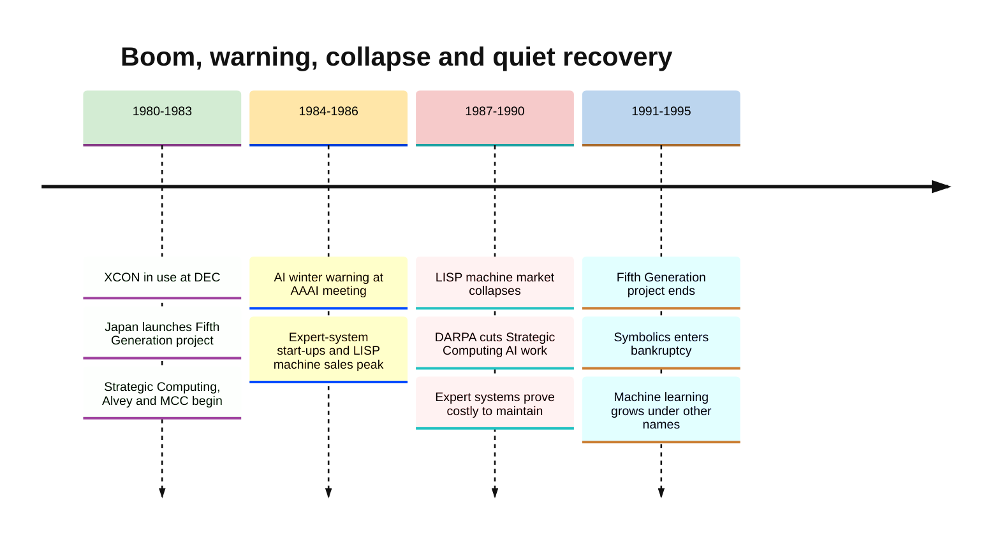
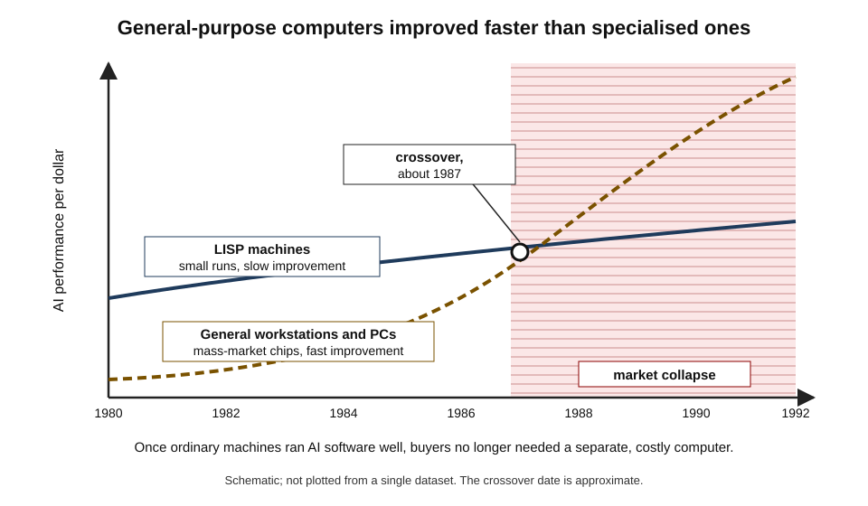
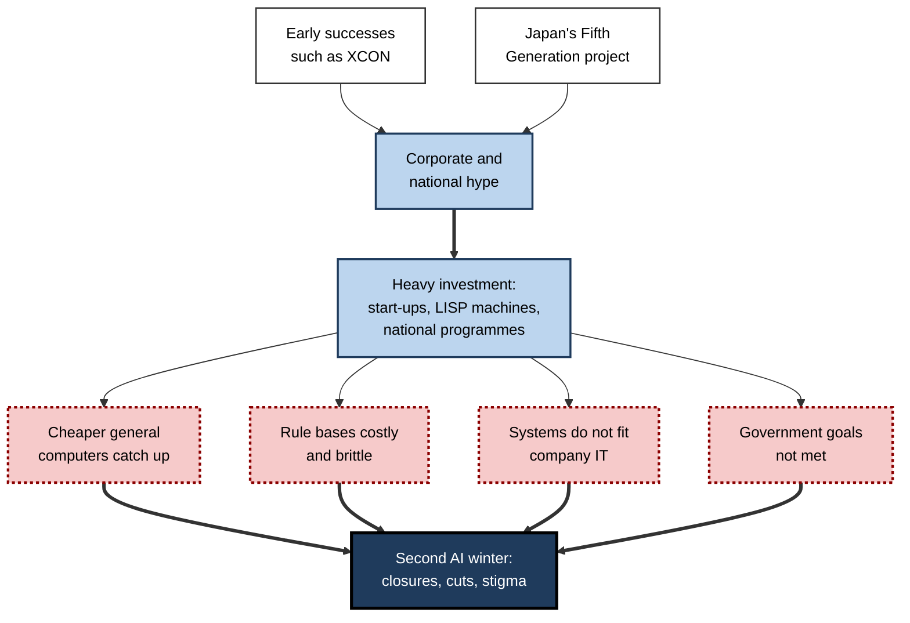
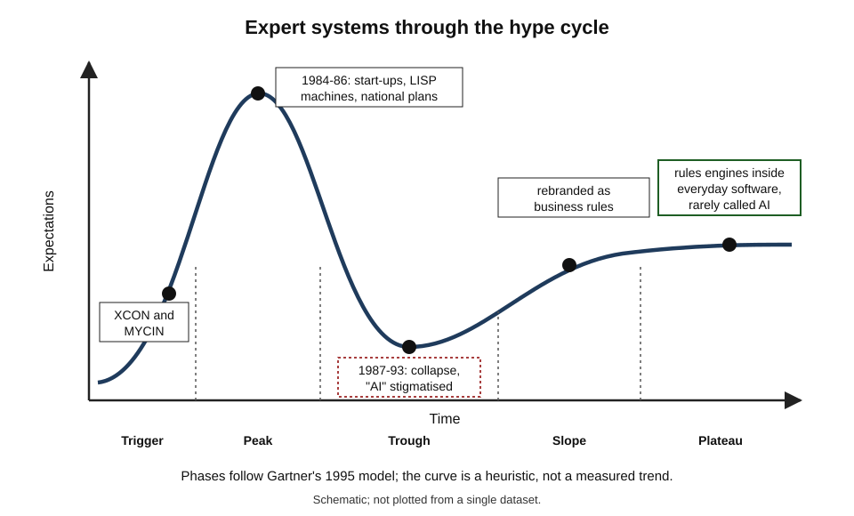
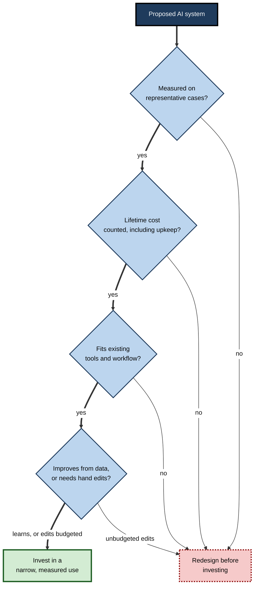

# B.5. The second AI winter and lessons learned

In 1984, at the height of a commercial boom, two of the most prominent AI researchers stood before their colleagues at the annual meeting of the American Association for Artificial Intelligence and warned of a coming "AI winter".

Within four years specialised AI computers could not find buyers, start-ups were folding, national programmes were being scaled back and "expert system" had become a phrase to avoid in a business plan. The warning had come true — and the lessons drawn from it still shape how the technology industry talks about AI.

> **Definition — Second AI winter:** the collapse of commercial and government enthusiasm for AI from about 1987 to the early or mid-1990s, following the boom in expert systems, specialised AI hardware and national AI programmes in the early 1980s.

**Why it matters**

- **It was a commercial crash, not only a funding cut.** Companies, products and an entire hardware market disappeared — closer to a modern technology bubble than to the first winter.
- **It shaped the industry's vocabulary.** For years afterwards, successful systems were sold as "analytics", "decision support" or "business rules" rather than "AI".
- **It produced durable lessons** about hype, total cost, integration and maintenance that apply directly to generative AI.
- **It cleared ground.** Behaviour-based robotics, probabilistic methods and machine learning grew while expert systems faded.

---

## The Boom of the Early 1980s

### Why business fell in love with expert systems

- **Proven examples**
  - Digital Equipment Corporation's XCON configured computer orders and was reported to save tens of millions of dollars a year.
  - Medical and geological systems had matched specialists in tests.
- **A clear story for managers**
  - Capture the knowledge of your best experts, copy it to every branch and keep it when they retire.
- **Tools to build them**
  - Expert-system "shells" let companies add their own rules to a ready-made inference engine.
- **Rapid growth**
  - Large corporations set up AI groups; start-ups sold software, consulting and hardware; one widely used estimate puts the AI industry's growth from a few million dollars in 1980 to billions of dollars by 1988.

> **Definition — Knowledge-based system:** a program whose behaviour comes mainly from an explicit store of domain knowledge (facts and rules) — the broader category that includes expert systems.

### Special hardware: the LISP machine

- **What:** workstations designed to run the LISP language — the main language of AI research — efficiently.
- **Who:** spin-offs from MIT's AI Laboratory, notably **Symbolics** and **Lisp Machines Inc.**, plus Texas Instruments and Xerox.
- **Why:** in the early 1980s ordinary computers ran LISP slowly; dedicated machines offered powerful programming environments that AI developers loved.
- **Price:** tens of thousands of dollars per machine.

> **Definition — LISP machine:** a computer whose hardware and operating system were designed specifically to run LISP programs, sold to AI developers in the 1980s.

### National programmes

The boom became a matter of national competitiveness after Japan announced an ambitious plan in 1981–82.

| Programme | Country | Years | Aim | Outcome |
|---|---|---|---|---|
| Fifth Generation Computer Systems | Japan (MITI and the ICOT institute) | 1982–1992 | Massively parallel computers running logic programming, as a base for knowledge processing | Research advances in parallel logic programming; no commercial impact; ended without its goals |
| Strategic Computing Initiative | United States (DARPA) | 1983–1993 | Machine intelligence for military uses: autonomous vehicles, a pilot's assistant, battle management | Scaled back from the late 1980s; some technologies, notably in computer vision and parallel computing, survived |
| Alvey Programme | United Kingdom | 1983–1988 | Restore British strength in information technology, including "intelligent knowledge-based systems" | Revived UK research groups; limited lasting industrial effect |
| MCC (Microelectronics and Computer Technology Corporation) | United States (industry consortium) | From 1983 | Shared long-range research by US firms, including the Cyc common-sense project | Some research value; Cyc spun out; consortium faded in the 1990s |
| ESPRIT | European Community | From 1984 | Collaborative research in information technology | Broad IT programme in which AI was one strand |

> **Key point:** the Fifth Generation project was the **spark of the second boom**. Fear of Japanese dominance, at a time when Japan led in consumer electronics and cars, persuaded Western governments to fund AI on a large scale.

### The warning

- At the 1984 AAAI meeting, **Roger Schank** and **Marvin Minsky** — both veterans of the first winter — warned that enthusiasm had run far ahead of capability and that a collapse would follow.
- They used the phrase **"AI winter"**, by analogy with "nuclear winter", a term then current in public debate.
- The talk is usually cited as the origin of the expression.

---

## The Collapse, 1987–1993

**Figure 1.** From boom to winter, 1980–1995.

### The hardware market vanished

- **Cheaper general-purpose machines caught up.**
  - Workstations from Sun Microsystems and others, and desktop computers from Apple and IBM, became powerful enough to run LISP and other AI software well.
  - Software companies ported their tools to these machines.
- **Result:** around 1987 the market for LISP machines collapsed within a short period; Symbolics shrank and later filed for bankruptcy protection (1993).

| | LISP machine (mid-1980s) | General-purpose workstation (late 1980s) |
|---|---|---|
| Purpose | One language, AI development | Any software |
| Price | Tens of thousands of dollars | Falling every year |
| Speed trend | Improved slowly, small production runs | Improved rapidly, driven by mass-market chips |
| Software | Excellent but proprietary environment | Ported AI tools plus all ordinary business software |
| Fit with company IT | A separate island | Part of the normal network |

> **Watch out:** the LISP machines did not fail because they were bad. They were technically admired. They failed because **general-purpose hardware improved faster** than a specialised niche product could — a pattern seen repeatedly in computing.

**Figure 2.** Why specialised AI hardware lost to general-purpose computers.

### Expert systems disappointed

- **Maintenance costs**
  - Rule bases needed constant updating as products, prices and regulations changed; XCON alone required a dedicated team.
- **Brittleness**
  - Systems failed on unusual cases and could not tell they were out of their depth.
- **No learning**
  - Every improvement needed a knowledge engineer.
- **Integration problems**
  - Many systems ran on separate hardware and could not easily use company databases or fit existing workflows.
- **Narrow value**
  - Successes were real but confined to tightly bounded tasks; the promise of "capturing expertise" broadly was not met.

### Inside the Strategic Computing Initiative

**Study card — DARPA Strategic Computing Initiative (1983–1993)**

- **Origins:** launched by DARPA in 1983, partly in response to Japan's Fifth Generation project; planned spending was about a billion dollars over ten years.
- **Three flagship applications:**
  1. an **Autonomous Land Vehicle** for the US Army that would drive itself across country;
  2. a **Pilot's Associate** for the Air Force — an expert system to help fighter pilots manage information;
  3. a **battle-management system** for the Navy to assist commanders with planning.
- **Supporting technologies:** expert systems, speech recognition, computer vision, natural-language understanding and parallel computer architectures.
- **Results:**
  - the vehicle and assistant demonstrations fell well short of their goals;
  - parallel computing, chip design and some vision and speech research advanced and fed later industry.
- **Decision:** from 1987 AI funding within the initiative was cut sharply as priorities shifted to computing hardware and networks.
- **Conclusion:** the initiative tied AI research to **specific, ambitious military demonstrations**, so their shortfall damaged the reputation of the whole field.

> **Watch out:** judgements of Strategic Computing differ. Some historians see an expensive failure; others note that it built infrastructure and expertise that paid off later, including in autonomous-vehicle research that resurfaced in DARPA's driverless-car challenges of 2004–2007.

### Britain's Alvey Programme

**Study card — The Alvey Programme (1983–1988)**

- **Origin:** a 1982 committee chaired by the civil servant John Alvey recommended a national programme in advanced information technology, in response to Japan.
- **Scale:** about 350 million pounds, shared between government and industry.
- **Areas:** chip design, software engineering, human–computer interfaces and **intelligent knowledge-based systems** — a phrase chosen partly to avoid the term "AI", still tainted in Britain after the Lighthill report.
- **Results:** revived UK university research and collaboration with industry; few lasting commercial products.
- **Conclusion:** even a decade after Lighthill, the **name** of the field remained politically sensitive — evidence of how long a winter's reputation lasts.

### Government programmes were cut

- **Strategic Computing:** from 1987 DARPA's new leadership of its information-processing office, under the computer scientist Jack Schwartz, sharply reduced spending on AI, judging that expert systems were "clever programming" rather than a path to machine intelligence.
- **Fifth Generation:** ended in 1992; its parallel logic machines found no market, and the world moved to conventional processors and personal computers.
- **Alvey:** finished in 1988 and was not renewed in the same form.

**Figure 3.** How the second boom turned into a winter.

### Comparing the two winters

| | First winter (about 1974–1980) | Second winter (about 1987–early 1990s) |
|---|---|---|
| What had been promised | General intelligence, translation, thinking robots | Captured expertise, intelligent business systems, national leadership |
| Who was disappointed | Mainly government funders | Companies, investors and governments |
| Main trigger | Critical reviews (ALPAC, Lighthill) and policy change | Market collapse of hardware and disappointing deployments |
| Technical cause | Combinatorial explosion; tiny computers | Brittleness, maintenance and the knowledge bottleneck |
| What it hit hardest | Translation, neural networks, general robotics | Expert systems, LISP machines, national AI programmes |
| What grew during it | Expert systems, logic programming | Machine learning, probabilistic methods, behaviour-based robotics |

---

## What Happened During the Winter

### The name became toxic

- Companies continued to use rule-based systems but stopped calling them AI.
  - "Expert systems" became **"business rules"**, **"decision support"** or **"knowledge management"**.
  - Learning systems were called **"data mining"**, **"analytics"** or **"pattern recognition"**.
- Researchers applying for grants often avoided the term.

> **Definition — AI effect:** the tendency for a technique to stop being called "artificial intelligence" once it works reliably and becomes routine — a saying often linked to John McCarthy's remark that once something works, nobody calls it AI any more.

> **Watch out:** the exact origin of the "AI effect" sayings is **uncertain**; versions are attributed to McCarthy and to the computer scientist Larry Tesler ("intelligence is whatever machines haven't done yet"). The idea is widely accepted; the quotations should not be relied on word for word.

### New directions grew in the cold

- **Behaviour-based robotics**
  - Rodney Brooks at MIT argued, in papers such as "Elephants Don't Play Chess" (1990), that intelligence should be built from simple behaviours coupled directly to sensing, without elaborate symbolic world models.
  - His approach led to practical robots, including, later, the Roomba vacuum cleaner from the company he co-founded, iRobot.
- **Probabilistic and statistical methods**
  - Bayesian networks, hidden Markov models and support vector machines matured.
- **Intelligent agents**
  - AI reframed itself around agents that perceive and act to achieve goals — a framing popularised by a leading textbook in 1995.
- **Neural networks**
  - Enjoyed a revival after 1986, then faded again in the later 1990s.

> **Definition — Behaviour-based robotics:** an approach in which a robot's intelligence comes from layers of simple behaviours reacting directly to sensor input, rather than from a central symbolic plan.

> **Key point:** AI did not die in the second winter; it **fragmented and rebranded**. Many of its most useful ideas went on working inside ordinary software under other names.

---

## What Survived the Winter

### Expert systems became ordinary software

- **Business rules engines**
  - Rule-based decision software continued to be sold under names such as "business rules management systems", used for insurance underwriting, credit decisions, pricing and regulatory compliance.
- **Configuration and scheduling**
  - Constraint-based configurators for products such as cars and computers, and scheduling systems for airlines and factories, grew out of AI research.
- **Diagnostics**
  - Rule-based troubleshooting was built into telephone networks, printers, cars and help-desk software.
- **Planning and logistics**
  - In the 1991 Gulf War the US military used an AI-based planning tool, DART, to schedule the transport of equipment and people; DARPA later reported that the savings repaid its decades of AI funding — a claim that is hard to verify but widely cited.

> **Key point:** the second winter killed the **market category** "expert systems", not the **technique**. Rules embedded inside ordinary software kept working quietly for decades.

| | What collapsed | What carried on |
|---|---|---|
| Products | Stand-alone expert-system shells and LISP machines | Rules engines inside business software |
| Organisations | AI start-ups and corporate AI groups | IT departments maintaining rule-based applications |
| Research | Large national AI programmes | Machine learning, probabilistic reasoning, robotics |
| Language | "Artificial intelligence", "expert system" | "Decision support", "analytics", "business rules" |
| People | Many knowledge engineers left the field | Skills moved into software engineering and consulting |

### The professions it shaped

- **Knowledge engineers** became business analysts, requirements engineers and rules developers.
- **AI programmers** moved into object-oriented software, databases and, later, web development; ideas from LISP environments, such as interactive development and garbage collection, entered mainstream programming languages.
- **Researchers** turned to statistical methods and machine learning, laying the ground for the next boom.

---

## The Hype Cycle

### A model of technology expectations

- In 1995 the research company Gartner introduced the **hype cycle**, a model of how expectations of a new technology change over time:
  1. **Technology trigger** — a breakthrough or demonstration;
  2. **Peak of inflated expectations** — publicity and over-investment;
  3. **Trough of disillusionment** — failures, closures, scepticism;
  4. **Slope of enlightenment** — practical uses become understood;
  5. **Plateau of productivity** — mainstream, unglamorous adoption.
- The expert-systems story fits this pattern closely.

**Figure 4.** The expert-systems era mapped onto the hype-cycle model.

> **Definition — Hype cycle:** a descriptive model, introduced by Gartner in 1995, of how expectations for a new technology rise to an inflated peak, fall into a trough of disillusionment and then recover to a plateau of practical use.

> **Watch out:** the hype cycle is a **heuristic, not a law**. Studies that have tracked technologies against it find that many do not follow the pattern — some go straight to adoption, others never recover. It is useful for asking questions, not for predicting dates.

---

## Lessons Learned

### Lessons the field drew

1. **Promise less than you can deliver.**
   - Each winter followed claims that outran results; credibility, once lost, took a decade to rebuild.
2. **Count the total cost.**
   - Building a system is a fraction of its cost; maintaining, updating and integrating it dominate over its life.
3. **Avoid dependence on special hardware.**
   - General-purpose platforms usually improve faster than specialised ones.
4. **Integrate with real work.**
   - A system that lives on a separate machine, outside the workflow, will not be used however clever it is.
5. **Build systems that learn.**
   - Hand-maintained knowledge does not scale; systems should improve from data.
6. **Measure, do not demonstrate.**
   - Judge systems on representative data and agreed metrics, not on selected showcase cases.
7. **Expect the narrow to succeed and the general to disappoint.**
   - Bounded tasks delivered value; broad promises failed.

> **Mnemonic — "Please Count Hidden Infrastructure, Learning Must Narrow":** Promises, Cost, Hardware, Integration, Learning, Measurement, Narrowness — the seven lessons of the second winter.

**Figure 5.** Questions that test an AI investment against the lessons of the second winter.

### Warning signs, then and now

| Warning sign | 1980s form | Present-day form |
|---|---|---|
| Promises outrun results | "Capture all your experts' knowledge" | "Replace whole professions within a few years" |
| Investment ahead of revenue | Start-ups and national programmes funded on expectation | Very large spending on data centres ahead of proven returns |
| Special infrastructure | LISP machines | Specialised AI chips and data centres (though these also run general workloads) |
| Hidden running costs | Rule maintenance teams | Human review of outputs, inference costs, monitoring |
| Pilot-to-production gap | Prototypes that never reached daily use | Pilots that do not scale across the organisation |
| National rivalry | Fear of Japan's Fifth Generation | US–China competition in AI |

> **Watch out:** similarities do not prove that a third winter will come. Today's AI differs in important ways — it already has very large numbers of users and revenue-generating products, and it improves with data rather than hand-written rules. Whether present investment levels are sustainable is **genuinely contested**.

### Worked example (illustrative): the true cost of a rules-based system

A distributor builds an expert system to quote complex orders in 1985. The table follows its costs over six years. *Illustrative figures* (in thousands of dollars).

| Year | Build | Hardware | Rule maintenance | Estimated savings | Running balance |
|---|---|---|---|---|---|
| 1 | 600 | 200 | 50 | 100 | −750 |
| 2 | 0 | 0 | 150 | 450 | −450 |
| 3 | 0 | 0 | 250 | 500 | −200 |
| 4 | 0 | 0 | 350 | 500 | −50 |
| 5 | 0 | 250 (replace obsolete LISP machines) | 400 | 450 | −250 |
| 6 | 0 | 0 | 450 | 400 | −300 |

1. **Early years:** savings grow as the system is used.
2. **Middle years:** maintenance rises because products and prices change and new rules interact with old ones.
3. **Year 5:** the special hardware is obsolete and must be replaced or the system ported.
4. **Conclusion:** the system never pays back; it was valuable as a prototype but unaffordable as a product.

> **Remember:** in AI, as in all software, **running cost over the lifetime** — not build cost — decides whether a system is worth having.

---

## Case Study: Japan's Fifth Generation Computer Systems Project

- **Situation:** in 1981 Japan's Ministry of International Trade and Industry (MITI) announced a ten-year national project, run from 1982 by the Institute for New Generation Computer Technology (ICOT).
- **Aim:** leap beyond conventional computers to machines built for **knowledge processing** — massively parallel hardware running **logic programming** (a Prolog-like language), able to support reasoning, natural-language interfaces and expert systems.
- **Actions:**
  1. Recruited researchers from leading Japanese electronics companies to ICOT.
  2. Built a series of parallel inference machines and a parallel logic-programming language.
  3. Published widely and hosted international conferences.
- **International reaction:**
  - A 1983 book by Edward Feigenbaum and Pamela McCorduck warned that Japan might overtake the United States;
  - the United States, Britain and Europe launched or expanded their own programmes in response.
- **Result:**
  - genuine research advances in parallel logic programming;
  - but the special machines had no commercial market, conventional processors improved faster and the AI applications did not materialise;
  - the project ended in 1992 and its software was released freely.
- **Lesson:** a coherent, well-funded national vision can still fail if it **bets on one technical approach** — here, logic programming on special hardware — just as the field and the market move elsewhere.

### Case study (illustrative): avoiding a "local winter" with a generative-AI programme

- **Situation:** a professional-services firm launches twenty generative-AI pilots in six months after a board presentation promises 30% productivity gains. *Illustrative figures.*
- **Problem:** after a year, three pilots are in daily use; the rest stalled; staff are cynical and the board is questioning the budget.
- **Diagnosis, using the lessons of the 1980s:**
  - promises were set before measurement;
  - pilots ran outside normal tools and workflows;
  - review and correction time was not counted;
  - no owner was responsible for keeping prompts, data connections and guidance up to date.
- **Actions:**
  1. Stop counting pilots; measure time saved and error rates in the three working uses.
  2. Integrate those uses into the firm's existing document and case-management systems.
  3. Assign product owners and maintenance budgets.
  4. Restate the target as specific, measured gains in named tasks.
- **Result:** fewer, better-integrated tools with measured benefit; restored credibility with the board.
- **Lesson:** the second winter's lessons — **measure, integrate, budget for maintenance, promise narrowly** — apply directly at the level of a single organisation.

---

## Open Questions

- **When did the second winter end?**
  - Commercial expert systems faded by the early 1990s, but AI's reputation recovered only around the 2000s or later; dates depend on whether funding, markets or public image are measured.
- **Was the Fifth Generation project a failure?**
  - It missed its goals, but trained a generation of researchers and advanced parallel computing; how to weigh these is debated.
- **Could expert systems have succeeded with better integration and learning?**
  - Modern rule engines are widely used, suggesting the idea was sound and the packaging and expectations were wrong.
- **Is a third AI winter likely?**
  - Some analysts see bubble-like investment; others argue that broad adoption and revenue make a collapse of the earlier kind unlikely. The question is open.

---

## Summary

- The **second AI winter** (about **1987 to the early or mid-1990s**) followed an early-1980s boom in **expert systems**, **LISP machines** and **national programmes**.
- **Japan's Fifth Generation** project (1982–1992) prompted Western responses: DARPA's **Strategic Computing Initiative**, Britain's **Alvey Programme**, the **MCC** consortium and Europe's **ESPRIT**.
- In 1984 **Schank and Minsky** warned of an **"AI winter"**, coining the term.
- **Causes:** cheaper general-purpose computers destroyed the **LISP machine** market (around 1987); expert systems proved **brittle**, costly to **maintain**, unable to **learn** and poorly **integrated**; government goals were unmet and funding was cut.
- **Inside the programmes:** **Strategic Computing** tied AI to ambitious military demonstrations (autonomous vehicle, pilot's associate) that fell short; **Alvey** avoided the word "AI" altogether.
- **Effects:** closures and a toxic name; working techniques were **rebranded** as business rules, analytics and data mining (the **AI effect**); expert systems survived as **rules engines**, configurators and planning tools such as **DART**.
- **What grew:** behaviour-based robotics (**Brooks**), probabilistic methods, machine learning and intelligent agents.
- The **hype cycle** describes the pattern but is a **heuristic, not a law**.
- **Lessons:** promise narrowly, count lifetime cost, avoid special hardware, integrate, build systems that learn, measure rather than demonstrate.

---

## Self-Check

1. Define the second AI winter and give its approximate dates.
2. Why did businesses invest heavily in expert systems in the early 1980s?
3. What was a LISP machine, and why did its market collapse?
4. What did Japan's Fifth Generation project aim to do, and how did other countries respond?
5. Who warned of an "AI winter" in 1984, and what did the phrase allude to?
6. List four reasons expert systems disappointed in practice.
7. Compare the first and second AI winters on triggers and on who was disappointed.
8. What is the AI effect? Give an example.
9. Name two research directions that grew during the second winter.
10. Describe the hype cycle and one limitation of it.
11. Using the illustrative cost table, explain why a system with real savings can still fail to pay back.
12. A board asks whether today's AI spending will end in a third winter. Give a balanced answer using the history of the 1980s.

### Answer Key

1. A collapse of commercial and government enthusiasm for AI, from about 1987 to the early or mid-1990s, after the expert-systems and LISP-machine boom.
2. Systems such as XCON reported large savings; capturing experts' knowledge was an appealing story; shells made building systems easier; competitors and national programmes created pressure to act.
3. A workstation designed specifically to run LISP efficiently. General-purpose workstations and personal computers became powerful and cheap enough to run AI software, improving faster than the niche machines.
4. Massively parallel computers running logic programming as the basis of knowledge processing. The United States (Strategic Computing, MCC), Britain (Alvey) and Europe (ESPRIT) launched or expanded programmes.
5. Roger Schank and Marvin Minsky, at the AAAI meeting; the phrase alluded to "nuclear winter".
6. Any four: high maintenance cost; brittleness on unusual cases; inability to learn; poor integration with company systems; narrow value relative to broad promises.
7. First: triggered by critical reviews and policy changes; mainly government funders disappointed. Second: triggered by a hardware market collapse and disappointing deployments; companies, investors and governments disappointed.
8. The tendency for working techniques to stop being called AI. Example: route-finding in navigation apps or rules engines in insurance — once routine, they are described as ordinary software.
9. Any two: behaviour-based robotics; probabilistic methods such as Bayesian networks and HMMs; machine learning including SVMs; the intelligent-agent framing; neural networks after 1986.
10. Trigger, peak of inflated expectations, trough of disillusionment, slope of enlightenment, plateau of productivity. Limitation: it is descriptive, many technologies do not follow it, and it cannot predict timing.
11. Maintenance costs rose every year as rules multiplied, and obsolete special hardware had to be replaced; cumulative costs outran savings, so the balance never became positive.
12. Similarities: promises outrunning results, investment ahead of revenue, hidden running costs, a pilot-to-production gap and national rivalry. Differences: very large user numbers, real revenue, systems that improve with data and general-purpose infrastructure. A sharp correction in some areas is possible, but a collapse like the 1980s is uncertain; the prudent course is to measure value use case by use case.

---

## Glossary

| Term | Meaning |
|---|---|
| AI effect | The tendency for working techniques to stop being called AI once routine. |
| AI winter | A period of reduced funding, investment and confidence in AI after unmet expectations. |
| Alvey Programme | The UK's 1983–1988 national IT research programme, including knowledge-based systems. |
| Behaviour-based robotics | Building robot intelligence from simple behaviours reacting directly to sensing. |
| Business rules engine | Software that applies explicit business rules, a descendant of expert systems. |
| DART | A logistics planning tool used by the US military in 1991, built with AI techniques. |
| Expert-system shell | A ready-made inference engine to which domain rules are added. |
| Fifth Generation Computer Systems | Japan's 1982–1992 national project for parallel logic-programming computers. |
| Hype cycle | Gartner's 1995 model of rising, falling and recovering expectations for a technology. |
| ICOT | The Japanese institute that ran the Fifth Generation project. |
| Knowledge-based system | A program whose behaviour comes mainly from explicit domain knowledge. |
| LISP machine | A computer designed specifically to run the LISP language. |
| MCC | A US industry research consortium founded in 1983. |
| Second AI winter | The collapse of AI enthusiasm from about 1987 to the early or mid-1990s. |
| Strategic Computing Initiative | DARPA's 1983–1993 programme for military machine intelligence. |
| Symbolics | The leading LISP machine company, which filed for bankruptcy protection in 1993. |
| Total cost of ownership | All costs of a system over its life, including maintenance and replacement. |
