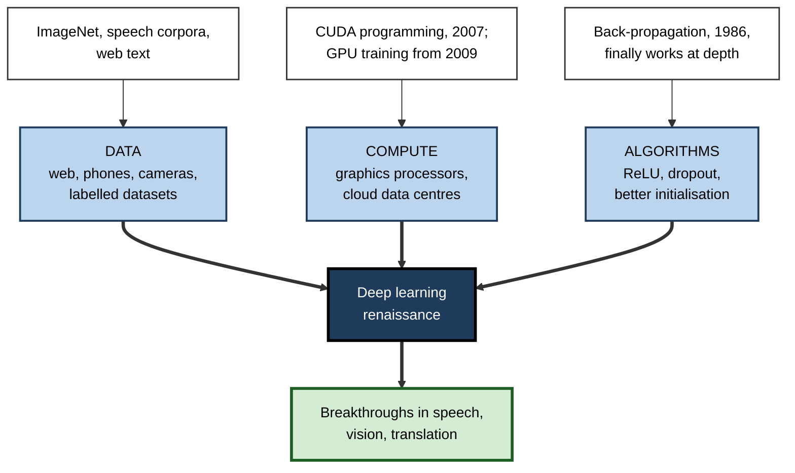
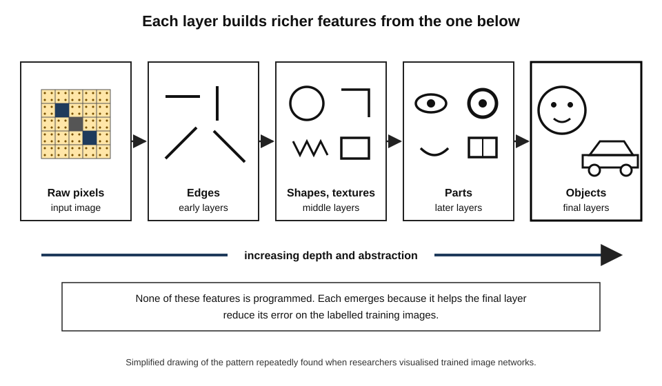
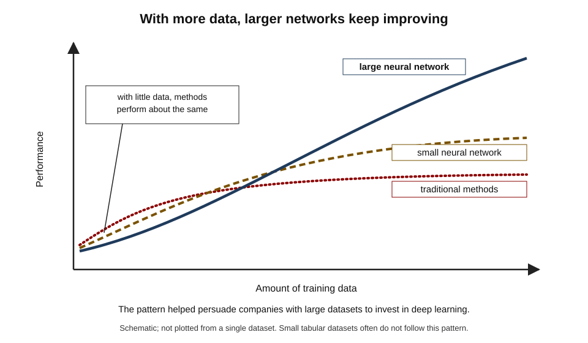
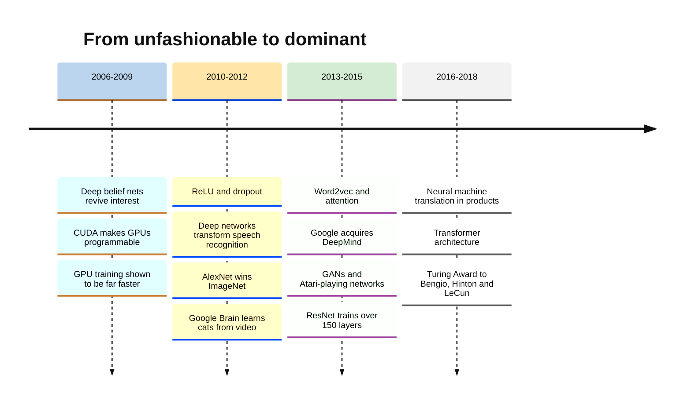
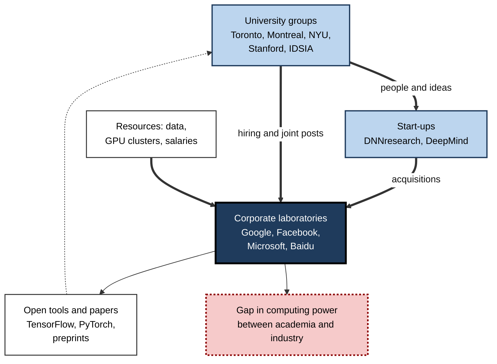

# B.6. Deep learning renaissance after 2010

In 2005 a graduate student proposing a thesis on neural networks might have been gently advised to choose something more promising.

By 2015 the same networks were transcribing speech on hundreds of millions of phones, sorting photographs by their contents and translating text, and the researchers who had kept faith with them were being hired by the largest technology companies for sums usually reserved for star athletes. Few reversals in the history of science have been so fast.

> **Definition — Deep learning:** machine learning with neural networks of many layers, in which each layer learns to transform the output of the layer below into a more abstract representation, so that useful features are learned from raw data rather than designed by hand.

> **Definition — Deep learning renaissance:** the rapid return of neural networks to the centre of AI between roughly 2006 and 2016, driven by larger datasets, graphics processors and improved training methods, and marked by breakthroughs in speech, vision and language.

**Why it matters**

- **It is the foundation of present-day AI.** Image recognition, speech assistants, machine translation, recommendation and large language models all rest on it.
- **It changed who leads AI.** Research moved from university laboratories to a few companies with the data and computing power to train large models.
- **It changed how AI is built.** Instead of designing features by hand, engineers collect data, choose an architecture and train.
- **It teaches a hard lesson** about research: an idea can be right for decades before the conditions exist for it to work.

---

## From Outcast to Mainstream

### The long wait, 1995–2006

- **Neural networks were unfashionable.**
  - Support vector machines and other methods were easier to train, better understood and often more accurate on the datasets of the time.
  - Leading conferences rejected many neural-network papers.
- **A small group persisted.**
  - Geoffrey Hinton (Toronto), Yann LeCun (New York University) and Yoshua Bengio (Montreal) continued the work.
  - From 2004 the **Canadian Institute for Advanced Research (CIFAR)** funded a programme on neural computation that gave them a network of collaborators.
- **Jürgen Schmidhuber's group** in Switzerland developed recurrent networks, including the long short-term memory (LSTM) network.

> **Key point:** the renaissance depended on **patient funding of an unfashionable idea** by a small institute — a reminder that breakthroughs often come from areas the mainstream has abandoned.

### The 2006 spark

**Study card — Hinton, Osindero and Teh (2006), "A fast learning algorithm for deep belief nets"**

- **Problem:** deep networks were very hard to train; error signals faded through many layers (the vanishing gradient).
- **Method — layer-wise pre-training:**
  1. train the first layer, without labels, to model the raw data;
  2. treat its outputs as data for a second layer and train that;
  3. repeat to build a deep stack;
  4. fine-tune the whole network on the labelled task.
- **Results:** deep networks trained this way performed well on handwritten digits, showing that depth could be made to work.
- **Effect:** renewed interest in deep architectures; the term **"deep learning"** spread as a fresh label for the field.

> **Watch out:** layer-wise pre-training was soon **abandoned** for most purposes. Better activation functions, initialisation and much more labelled data allowed deep networks to be trained directly. The 2006 paper mattered more for **changing minds** than for the method it introduced.

---

## The Three Ingredients

The renaissance happened because three conditions arrived together.

**Figure 1.** Three ingredients that came together around 2010.

### Data

- **The internet and smartphones** created vast collections of images, text, audio and video.
- **Crowdsourced labelling** made it affordable to annotate millions of examples.
- **Large public datasets** — most famously ImageNet, with over a million labelled images in a thousand categories for its annual challenge — gave researchers a common target.

> **Key point:** deep networks have many adjustable parameters and so need **many examples**. Before about 2009 the datasets were usually too small for their advantages to show.

### Compute: the graphics processor

- **Graphics processing units (GPUs)** were designed to draw video-game images by doing many simple calculations at once.
- Training a neural network is dominated by the same kind of calculation — multiplying large grids of numbers (matrices).
- **2007:** Nvidia released CUDA, making GPUs programmable for general calculations.
- **2009:** a Stanford group led by Andrew Ng reported that GPUs trained certain large networks many tens of times faster than conventional processors.

> **Definition — Graphics processing unit (GPU):** a processor with thousands of simple arithmetic units working in parallel, originally for graphics and now the main hardware for training neural networks.

| | Central processing unit (CPU) | Graphics processing unit (GPU) |
|---|---|---|
| Design | A few powerful cores | Thousands of simple cores |
| Strength | Complex, varied, sequential tasks | The same simple calculation on huge amounts of data |
| Neural-network training | Slow | Many times faster |
| Original market | General computing | Video games and graphics |
| Role after 2012 | Coordinating work | Doing almost all training arithmetic |

### Algorithms: making depth trainable

| Problem | Fix | When |
|---|---|---|
| Error signals vanish in deep networks | **ReLU** activation (output zero for negative input, otherwise pass the input through) | Popularised 2010–2011 |
| Networks memorise training data | **Dropout** — randomly switching off units during training | 2012 |
| Training unstable as layers interact | **Batch normalisation** — rescaling each layer's inputs | 2015 |
| Choosing learning rates by hand | **Adaptive optimisers** such as Adam | 2014 |
| Very deep networks degrade | **Residual connections** that let signals skip layers (ResNet) | 2015 |

> **Definition — Activation function:** the rule by which an artificial neuron converts its summed input into an output; the ReLU is the simplest widely used one.

> **Definition — Residual connection:** a shortcut that adds a layer's input to its output, letting information and error signals pass easily through very deep networks.

> **Remember:** the core idea — **back-propagation through layered networks** — dated from the 1980s. What changed was **data, hardware and a set of engineering fixes**.

---

## How Deep Networks See the World

### Layers of representation

- **Shallow methods** of the 2000s depended on **hand-designed features**.
  - *e.g.* for images, engineers designed edge and texture detectors; for speech, specific acoustic measurements.
- **Deep networks learn the features.**
  - Early layers learn simple patterns; later layers combine them into complex ones.
- **Example for images:**
  - layer 1 — edges and colour blobs;
  - middle layers — textures, corners, simple shapes;
  - later layers — parts such as eyes, wheels or windows;
  - final layers — whole objects such as faces or cars.

**Figure 2.** Features learned at increasing depth in an image network.

> **Definition — Representation learning:** learning, from raw data, the features in which a problem becomes easy to solve, instead of designing those features by hand.

| | Hand-engineered features (2000s) | Learned features (deep learning) |
|---|---|---|
| Who designs features | Domain experts and engineers | The training process |
| Data needed | Moderate | Large |
| Performance as data grows | Levels off early | Keeps improving for longer |
| Transfer to new tasks | Usually redesign | Reuse and fine-tune a trained network |
| Interpretability | Features have known meanings | Features often hard to describe |

### More data, better results

- A widely shared observation of the 2010s, popularised by Andrew Ng: as the amount of data grows, traditional methods level off, while larger neural networks continue to improve.

**Figure 3.** Performance against data for traditional methods and neural networks of different sizes.

> **Watch out:** this picture is a **schematic generalisation**, not a law. On small or tabular business datasets, traditional methods such as gradient-boosted trees still often match or beat deep networks.

---

## The Breakthroughs, 2009–2016

### Speech recognition falls first

**Study card — Deep networks for speech (2009–2012)**

- **Setting:** speech recognition had used hidden Markov models with hand-designed acoustic features for about two decades; progress had slowed.
- **Method:** researchers at Toronto, working with Microsoft, Google and IBM, replaced part of the traditional system — the model of how sounds map to speech units — with a deep neural network.
- **Results:** substantial reductions in word error rates on standard tasks; in 2012 a joint paper by the four groups reported consistent gains across their systems.
- **Deployment:** Google introduced deep-network speech recognition in Android voice search in 2012; other companies followed quickly.
- **Conclusion:** deep learning's first large industrial success came in speech, before the more famous result in vision.

### Vision: the 2012 moment

- In 2011 a Swiss group (Dan Cireşan and colleagues in Schmidhuber's laboratory) used GPU-trained convolutional networks to win image-recognition competitions, including one on traffic signs at better-than-human accuracy.
- In 2012 a Toronto team's GPU-trained network, AlexNet, won the ImageNet challenge by a large margin, convincing most of the computer-vision community almost overnight.
- Within three years, deep networks dominated every major vision benchmark.

### Google Brain and the "cat" experiment

- **2011:** Google set up a deep-learning project, later called **Google Brain**, led by Andrew Ng, Jeff Dean and Greg Corrado.
- **2012:** a network trained on 16,000 processor cores, using frames from millions of YouTube videos and **no labels**, developed units that responded to faces and to cats.
- **Significance:** a vivid public demonstration that networks could discover concepts unaided — and of how much computation large companies could deploy.

### Language: from word vectors to neural translation

- **Word embeddings (word2vec, Google, 2013)**
  - Represented each word as a list of numbers learned from its contexts; words with similar meanings received similar vectors.
  - *e.g.* the vector for "king" minus "man" plus "woman" lay close to "queen".
- **Sequence-to-sequence learning (2014)**
  - Networks that read a whole sentence and generated another — the basis for neural translation.
- **Attention (Dzmitry Bahdanau, Kyunghyun Cho and Yoshua Bengio, 2014)**
  - Let the network focus on the relevant source words when producing each output word.
- **Google Neural Machine Translation (2016)**
  - Replaced phrase-based statistical translation in a major product, cutting translation errors substantially in Google's own evaluations.
- **2017:** the transformer architecture, built entirely on attention, opened the path to large language models.

> **Definition — Word embedding:** a representation of a word as a vector of numbers, learned so that words used in similar contexts have similar vectors.

### Generating and acting

- **Generative adversarial networks (Ian Goodfellow and colleagues, 2014)** — two networks competing, one generating images and one judging them, produced increasingly realistic synthetic pictures.
- **Deep reinforcement learning (DeepMind, 2013–2015)** — a single network learned to play dozens of Atari video games from screen pixels and the score.

**Figure 4.** Milestones of the deep learning renaissance, 2006–2018.

---

## Sequences, Hardware and Early Science

### Sequences: the return of recurrent networks

- **The problem:** speech, handwriting and text are **sequences**, where meaning depends on order and on what came long before.
- **Recurrent neural networks** pass information from one step to the next, giving them a form of memory, but simple versions forget quickly because of vanishing gradients.
- **LSTM (1997)** added "gates" that decide what to keep, forget and output, letting networks remember over long stretches.
- **The comeback:**
  - from 2009 LSTM networks developed in Schmidhuber's group won international handwriting-recognition competitions;
  - by 2015–2016 LSTMs powered speech recognition, translation and predictive keyboards in products used by billions;
  - from 2017 the attention-only transformer began to replace them for most language tasks.

> **Definition — Recurrent neural network:** a network that processes a sequence one element at a time while carrying forward an internal state, so that earlier inputs can influence later outputs.

> **Definition — Long short-term memory (LSTM):** a recurrent network design with gates controlling what information is stored, forgotten and passed on, allowing it to learn long-range patterns in sequences.

### Hardware built for deep learning

- **GPUs evolved** — Nvidia added features specifically for neural-network arithmetic, and its data-centre business grew rapidly.
- **Custom chips** — in 2016 Google revealed the **tensor processing unit (TPU)**, a chip designed only for neural-network calculations, which it had been using in its data centres since 2015.
- **Why it mattered:** hardware and algorithms began to be **designed together**; the cost of computing became a central factor in who could lead.

| | Recurrent networks (LSTM) | Convolutional networks | Transformers (from 2017) |
|---|---|---|---|
| Best suited to | Sequences: speech, handwriting, text | Images and other grid-like data | Sequences first, then almost everything |
| Key idea | Memory carried from step to step | Shared filters across positions | Attention linking every element to every other |
| Training | Step by step, hard to parallelise | Highly parallel | Highly parallel |
| Peak influence | About 2014–2017 | About 2012–2020 in vision | 2018 onwards |

### Early use in medicine and science

- **Medical imaging** — from 2016 studies reported deep networks reading retinal photographs, skin images and some scans at levels comparable to specialists in retrospective tests.
- **Biology** — in 2018 DeepMind's first AlphaFold system came top in an international protein-structure prediction competition; its 2020 successor transformed the field.
- **Physical sciences** — networks began to be used to analyse particle-physics data, astronomical images and materials properties.

> **Watch out:** many early medical results came from **retrospective studies on curated data**. Later reviews found that relatively few had been tested prospectively in real clinical settings, and performance often fell when data came from different hospitals or equipment.

### Critics at the peak

- In 2018 the cognitive scientist Gary Marcus published "Deep Learning: A Critical Appraisal", arguing that deep learning:
  - needed far more data than people do;
  - generalised poorly beyond its training distribution;
  - lacked explicit reasoning and common sense;
  - was hard to interpret and easy to fool.
- Supporters replied that many of these limits would shrink with scale and new architectures; some did, others remain.

> **Key point:** the renaissance produced extraordinary results and a **standing debate** — whether scaling deep networks is enough, or whether new ingredients such as explicit reasoning are required.

---

## Industry Takes Over

### The talent race

- **2013:** Google acquired DNNresearch, a start-up formed by Hinton and two students, after a competitive auction among technology companies.
- **2013:** Facebook created an AI research laboratory led by Yann LeCun.
- **2014:** Google acquired DeepMind, a London start-up founded by Demis Hassabis, Shane Legg and Mustafa Suleyman, for a price widely reported at around half a billion dollars.
- **2014:** Baidu hired Andrew Ng to lead its AI research.
- **2015:** OpenAI was founded as a non-profit research laboratory.
- **Consequence:** many leading academics moved to industry or held joint posts; companies offered computing resources universities could not match.

> **Key point:** the renaissance moved the **centre of gravity of AI research** from universities to companies — a shift with lasting consequences for who sets research agendas and who can afford to compete.

**Figure 5.** How deep-learning research moved from universities into industry.

### Open tools

- **Software frameworks** made deep learning accessible:
  - Theano (Montreal), Caffe (Berkeley, 2013), TensorFlow (Google, 2015) and PyTorch (Facebook, 2016), all released free.
- **Open publication** — most research appeared openly on preprint servers, often with code.
- **Cloud GPUs** — rented by the hour, so small teams could train sizeable models.

### Recognition

- The 2018 **Turing Award**, computing's highest honour, went to **Yoshua Bengio, Geoffrey Hinton and Yann LeCun** for making deep neural networks a critical component of computing.
- In 2024 Hinton shared the **Nobel Prize in Physics** with John Hopfield for foundational discoveries enabling machine learning with neural networks.

> **Watch out:** the "three godfathers" story leaves out many contributors — among them Jürgen Schmidhuber's group, Kunihiko Fukushima, the developers of back-propagation and the many engineers who built GPUs, datasets and software. Credit in deep learning is **actively disputed**.

---

## Case Study: Speech Recognition's Rapid Switch

- **Situation:** by the late 2000s speech recognition was a mature field using hidden Markov models and carefully engineered acoustic features; progress on hard tasks such as conversational telephone speech had slowed.
- **Problem:** voice interfaces on phones needed recognition robust to accents, noise and casual speech.
- **Actions:**
  1. Toronto researchers, including graduate students who spent internships at Microsoft, Google and IBM, showed that deep networks could model the acoustic signal better than the traditional component.
  2. Industrial teams replaced that component in their systems while keeping the rest.
  3. GPUs made it practical to train on thousands of hours of recorded speech.
  4. Google shipped the new approach in Android voice search in 2012.
- **Result:** large reductions in error rates; within a few years essentially all major commercial recognisers used deep networks, and later end-to-end networks replaced the older architecture entirely.
- **Lesson:** the switch was fast because the new method could **slot into an existing pipeline**, beat it on **agreed benchmarks**, and run on **available hardware** — conditions worth checking whenever a new technique promises to replace an established one.

### Worked example (illustrative): why the GPU changed what could be tried

A team wants to train an image network on a dataset of one million pictures, for 90 passes through the data. *Illustrative figures.*

1. **On a multi-core CPU server:** suppose one pass takes 40 hours → 90 passes = 3,600 hours ≈ **150 days**.
2. **On two GPUs, about 30 times faster per pass:** 40 ÷ 30 ≈ 1.3 hours per pass → 90 passes ≈ 120 hours ≈ **5 days**.
3. **What this changes:**
   - with CPUs the team can test perhaps two designs a year;
   - with GPUs it can test dozens, learning from each.

| | CPU server | Two GPUs |
|---|---|---|
| Time per pass | 40 hours | About 1.3 hours |
| Full training run | About 150 days | About 5 days |
| Experiments per year | About 2 | Over 60 |

- **Conclusion:** faster hardware did not just make training quicker — it multiplied the **number of ideas** researchers could test, which is how the algorithmic fixes of 2010–2015 were found.

> **Formula — Training time:** total time = time per pass × number of passes. Example: 1.3 hours × 90 ≈ 117 hours ≈ 5 days.

---

## The Renaissance Assessed

### Why it worked

- **Scale beat cleverness.** The reinforcement-learning pioneer Richard Sutton summarised the period in a 2019 essay, "The Bitter Lesson": general methods that make use of more computation have repeatedly beaten methods built on human knowledge.
- **Compute for the largest training runs grew explosively.** A 2018 analysis by OpenAI estimated that it had doubled roughly every three and a half months from 2012 — far faster than the historic growth in chip performance.
- **Benchmarks made progress visible**, attracting talent and investment.

> **Watch out:** "The Bitter Lesson" is an influential **opinion**, not a theorem. Critics argue that architectural ideas — convolutions, attention, residual connections — encode human insight, and that scale alone does not explain the progress.

### What it did not solve

- **Data hunger** — deep networks usually need far more examples than people.
- **Brittleness** — small, carefully crafted changes to an image (adversarial examples, reported in 2013) could make a network misclassify it with confidence.
- **Opacity** — it is hard to explain why a network made a particular decision.
- **Bias** — networks learn the patterns, including the prejudices, present in their data.
- **Energy and cost** — training ever larger models consumes rising amounts of electricity and money.

| | Neural networks around 1995 | Deep networks around 2015 |
|---|---|---|
| Typical depth | 1–3 layers | Tens to over a hundred layers |
| Training data | Thousands of examples | Millions of examples |
| Hardware | Workstation CPUs | GPUs in data centres |
| Key tricks | Back-propagation, sigmoid units | ReLU, dropout, batch normalisation, residual connections |
| Standing in AI | Out of fashion | The dominant approach |
| Main users | Researchers, some banks and post offices | Every large technology company |

---

## Open Questions

- **Why do deep networks generalise so well?**
  - They have far more parameters than training examples, which classical theory suggested should cause memorisation; the full explanation is still debated.
- **How much of the progress is scale, and how much is ideas?**
  - "The Bitter Lesson" and its critics disagree; the answer shapes how research money is spent.
- **Can deep learning be made data-efficient?**
  - People learn from few examples; whether networks can match this without enormous pre-training is open.
- **What are the consequences of industry dominance?**
  - Academic researchers struggle to match company computing budgets; effects on openness and research directions are uncertain.

---

## Summary

- **Deep learning** uses many-layered neural networks that learn their own **representations** from raw data.
- Neural networks were unfashionable from the mid-1990s; **Hinton, LeCun, Bengio** and others persisted, supported by **CIFAR**; Hinton's **2006** deep-belief-net paper revived interest.
- Three ingredients converged: **data** (web, phones, ImageNet), **compute** (**GPUs**, CUDA in 2007) and **algorithms** (**ReLU**, **dropout**, batch normalisation, Adam, **residual connections**).
- Deep networks replace **hand-engineered features** with learned ones and keep improving as data grows (a schematic, not universal, pattern).
- Breakthroughs: **speech** (2009–2012, deployed in Android in 2012), **vision** (Cireşan 2011; AlexNet 2012), **Google Brain's** cat units (2012), **word embeddings**, **attention** and **neural translation** (2013–2016), **GANs** and deep reinforcement learning.
- **Sequences:** **LSTM** recurrent networks returned from 2009 and powered speech, translation and keyboards until **transformers** took over from 2017; custom hardware such as Google's **TPU** appeared.
- Early results in **medicine** and **biology** (AlphaFold, 2018) were striking but often **retrospective**; critics such as Gary Marcus (2018) questioned data hunger, generalisation and reasoning.
- **Industry took over**: talent acquisitions (DNNresearch, DeepMind), corporate laboratories and free frameworks (TensorFlow, PyTorch).
- Recognition: **2018 Turing Award**; **2024 Nobel Prize in Physics** for Hinton and Hopfield; credit is **disputed**.
- Limits remained: data hunger, brittleness and adversarial examples, opacity, bias, energy cost.

---

## Self-Check

1. Define deep learning and explain what "representation learning" means.
2. Why were neural networks out of favour between the mid-1990s and the mid-2000s?
3. What did the 2006 deep-belief-net paper contribute, and why did its method fade?
4. Name the three ingredients of the renaissance and give one example of each.
5. Why are GPUs suited to training neural networks?
6. Match three training problems to the techniques that fixed them.
7. Describe how an image network's layers build up from edges to objects.
8. Why was speech recognition the first large industrial success of deep learning?
9. What did the 2012 Google Brain "cat" experiment show?
10. Explain word embeddings with an example.
11. How did the renaissance shift the balance between universities and companies?
12. What is "The Bitter Lesson", and what is one criticism of it?
13. A firm with 5,000 rows of customer data asks whether to use deep learning to predict churn. Advise it.

### Answer Key

1. Machine learning with many-layered neural networks, each layer transforming the previous one's output into a more abstract representation. Representation learning means the system learns, from raw data, the features in which the task becomes easy, instead of engineers designing them.
2. Deep networks were hard to train (vanishing gradients), datasets and computers were too small to show their advantage, and SVMs and other methods were easier to use, better understood and often more accurate.
3. It showed, through layer-wise unsupervised pre-training, that deep networks could be trained to perform well, reviving interest and the "deep learning" label. The method faded as ReLU, better initialisation and large labelled datasets allowed direct training.
4. Data (ImageNet; web text; smartphone photos), compute (GPUs; CUDA; cloud data centres), algorithms (ReLU; dropout; residual connections).
5. Training is dominated by large matrix multiplications — the same simple calculation applied to huge amounts of data — which GPUs perform in parallel across thousands of cores.
6. Vanishing gradients → ReLU (and residual connections); memorising training data → dropout; unstable training → batch normalisation; difficult learning-rate tuning → Adam; degradation of very deep networks → residual connections.
7. Early layers detect edges and colour blobs; middle layers combine them into textures, corners and shapes; later layers into parts such as eyes or wheels; final layers into whole objects.
8. Deep networks could replace one component of the established pipeline, improved agreed benchmarks substantially, could be trained on GPUs with thousands of hours of speech, and were urgently needed for phone voice search.
9. A large network trained on unlabelled video frames developed units that responded to faces and cats, showing that networks can discover concepts without labels — and how much computation large companies could deploy.
10. Each word is represented as a vector learned from the contexts in which it appears, so similar words have similar vectors; e.g. king − man + woman lies near queen.
11. Companies acquired start-ups and hired leading academics, built large laboratories and offered computing resources universities could not match; research agendas increasingly came from industry.
12. Richard Sutton's 2019 argument that general methods exploiting more computation have repeatedly beaten methods built on human knowledge. Criticism: successful architectures such as convolutions and attention themselves embody human insight, so scale alone does not explain progress.
13. With 5,000 rows of tabular data, deep learning is unlikely to beat simpler methods such as logistic regression or gradient-boosted trees, which are cheaper, faster and easier to explain. Start there, compare on held-out data and consider deep learning only if data grows greatly or includes text, images or sequences.

---

## Glossary

| Term | Meaning |
|---|---|
| Activation function | The rule by which an artificial neuron turns its summed input into an output. |
| Adam | A widely used adaptive optimiser for training neural networks (2014). |
| Attention | A mechanism letting a network focus on the most relevant parts of its input. |
| Batch normalisation | Rescaling each layer's inputs during training to stabilise learning. |
| CIFAR | The Canadian Institute for Advanced Research, an early funder of deep-learning research. |
| CUDA | Nvidia's 2007 platform for programming GPUs for general calculations. |
| Deep learning | Machine learning with many-layered neural networks that learn representations. |
| Dropout | Randomly switching off units during training to reduce memorisation. |
| Generative adversarial network | Two networks, a generator and a judge, trained in competition. |
| GPU | A graphics processing unit with thousands of parallel arithmetic units. |
| Layer-wise pre-training | Training a deep network one layer at a time before fine-tuning. |
| LSTM | Long short-term memory: a recurrent network with gates controlling memory. |
| Recurrent neural network | A network that processes sequences step by step, carrying an internal state. |
| ReLU | Rectified linear unit: outputs zero for negative input, otherwise the input. |
| Representation learning | Learning useful features from raw data rather than designing them. |
| Residual connection | A shortcut adding a layer's input to its output, easing very deep training. |
| Tensor processing unit | Google's custom chip for neural-network calculations, revealed in 2016. |
| The Bitter Lesson | Sutton's 2019 argument that computation-hungry general methods beat built-in knowledge. |
| Word embedding | A learned vector representation of a word. |
