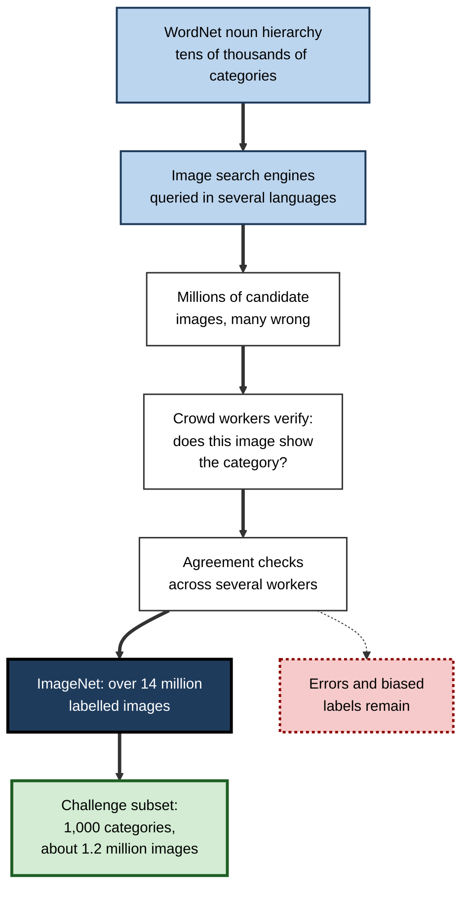
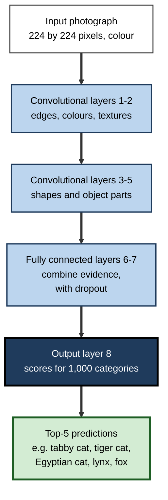
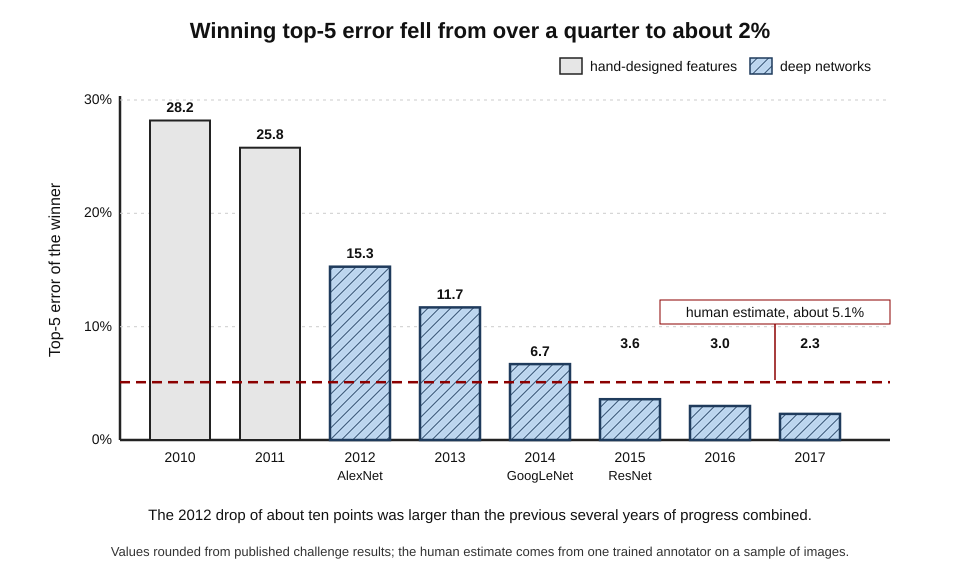
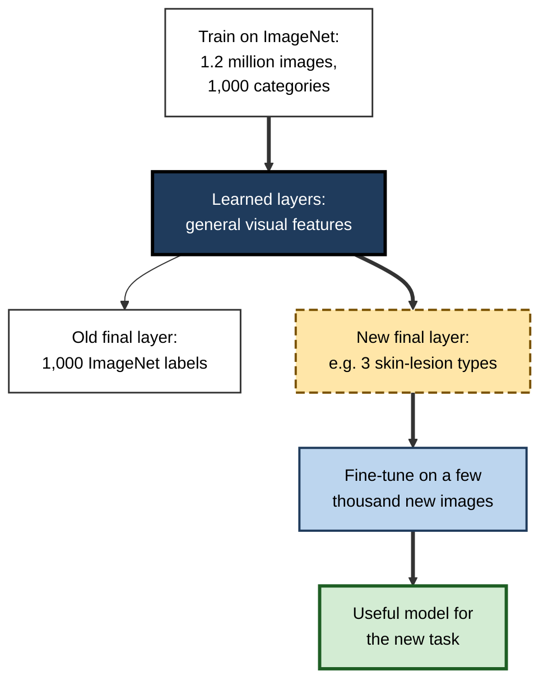
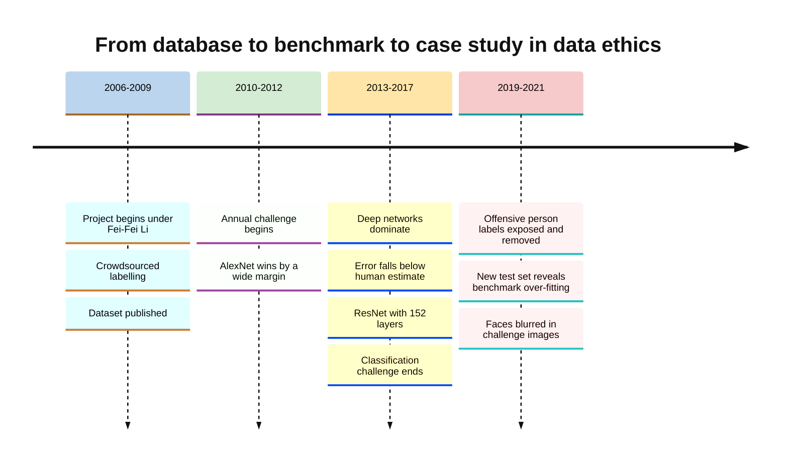

# B.7. ImageNet and the breakthrough in computer vision

In September 2012 the results of an annual image-recognition contest were announced at a workshop in Florence. Most entries, built with the best methods of the time, misjudged roughly a quarter of the test images. One entry, from a three-person team at the University of Toronto, cut that error by about ten percentage points in a single year. Within months, computer vision — a field that had spent decades hand-designing ways for machines to see — had switched to deep neural networks, and the rest of AI soon followed.

> **Definition — ImageNet:** a large database of labelled photographs organised by the categories of the WordNet lexical database, created by Fei-Fei Li and colleagues from 2007 and published in 2009; its annual recognition challenge (2010–2017) became the benchmark that launched modern deep learning.

> **Definition — Computer vision:** the field of AI concerned with enabling machines to interpret images and video — recognising objects, faces, scenes, text and movement.

**Why it matters**

- **It proved deep learning.** The 2012 result convinced the research community that deep neural networks trained on large data were superior to hand-designed methods.
- **It showed the power of data.** ImageNet demonstrated that a large, well-labelled dataset could be as important as a clever algorithm.
- **It created a benchmark culture.** Annual leaderboards drove rapid progress and became the model for other fields.
- **It exposed new risks.** Problems of label quality, bias and offensive categories in ImageNet anticipated the data-ethics debates of today.

---

## Seeing Is Hard

### Why vision resisted AI for fifty years

- **Pixels are not objects.**
  - A photograph is a grid of numbers giving brightness and colour; nothing in the numbers says "cat".
- **The same object looks different every time.**
  - Viewpoint, lighting, size, partial hiding, background and the variety within a category (a chihuahua and a mastiff are both dogs) change the pixels completely.
- **People make it look easy.**
  - Human vision uses a large share of the brain's cortex and years of experience; little of it is conscious, so it is hard to describe as rules.

> **Definition — Invariance:** the ability to recognise something as the same despite changes in position, size, lighting or viewpoint — the central challenge of object recognition.

### The pre-deep-learning toolkit

- **Hand-designed features**
  - Engineers created detectors for edges, corners and gradients, such as **SIFT** (David Lowe, 1999 and 2004) and **HOG** (2005), which described local patches of an image in ways robust to some changes.
- **Bag of visual words**
  - Images were summarised as counts of these local features, then classified with support vector machines.
- **Small datasets**
  - Benchmarks such as Caltech-101 (2004, about 100 categories) and PASCAL Visual Object Classes (2005–2012, 20 categories) had thousands to tens of thousands of images.

> **Key point:** before 2012, vision systems learned only the **final classification step**; the features they used were **designed by people**. Progress depended on human ingenuity in feature design.

---

## Building ImageNet

### The idea

- **Who:** Fei-Fei Li, then at Princeton and later Stanford, with Jia Deng, Kai Li and other collaborators.
- **Insight:** the field focused on algorithms, but children learn to see from an enormous quantity of visual experience. Perhaps machines needed **far more data**, covering far more of the visual world.
- **Scale aimed for:** every noun category in WordNet that could be pictured, with hundreds or thousands of images each.
- **Initial reaction:** many colleagues considered the project too large and of doubtful value.

> **Definition — WordNet:** a lexical database of English, created at Princeton under the psychologist George Miller from the 1980s, that groups words into sets of synonyms arranged in a hierarchy (for example, *beagle* is a *dog*, which is a *canine*, which is a *mammal*).

### How it was built

**Figure 1.** How ImageNet was assembled.

- **Crowdsourcing**
  - Labelling was done through Amazon Mechanical Turk, an online marketplace where workers are paid small sums for short tasks.
  - Tens of thousands of workers in many countries checked candidate images; each image was judged by several people.
- **Result:** the 2009 paper already described over 3 million images; the database eventually held more than 14 million images in over 20,000 categories — orders of magnitude larger than earlier vision datasets.

> **Definition — Crowdsourcing:** obtaining work, such as data labelling, from a large number of people, usually online and for small payments.

> **Watch out:** ImageNet's labour has an ethical side that was rarely discussed at the time. Much of AI's training data has been labelled by **low-paid, often invisible workers** — an issue now central to debates about fairness in AI supply chains.

### The challenge

**Study card — ImageNet Large Scale Visual Recognition Challenge (ILSVRC), 2010–2017**

- **Organisers:** the ImageNet team, initially co-located with the PASCAL challenge workshop.
- **Main task:** classify each test image into one of **1,000 categories**.
- **Data:** about 1.2 million training images, 50,000 validation images and 100,000 test images with hidden labels.
- **Measure — top-5 error:** a guess counts as correct if the true label is among the system's five highest-ranked answers.
- **Why five:** many images contain several objects, and some categories are very fine-grained (over a hundred dog breeds).
- **Results:** published each year, with a ranked table of teams.

> **Definition — Top-5 error:** the percentage of test images for which the correct label is not among a model's five most confident predictions.

| | PASCAL Visual Object Classes | ImageNet challenge |
|---|---|---|
| Years | 2005–2012 | 2010–2017 |
| Categories | 20 (e.g. person, car, cat) | 1,000 (including over 100 dog breeds) |
| Training images | About 10,000–20,000 | About 1.2 million |
| Typical difficulty | Common objects | Fine-grained and varied |
| Main legacy | Methods for detection and segmentation | Proof that deep learning scales |

---

## The 2012 Breakthrough

### AlexNet

**Study card — Krizhevsky, Sutskever and Hinton (2012), "ImageNet Classification with Deep Convolutional Neural Networks"**

- **Team:** Alex Krizhevsky, Ilya Sutskever and Geoffrey Hinton, University of Toronto.
- **Network:**
  - a convolutional neural network with **eight learned layers** (five convolutional, three fully connected);
  - about **60 million** adjustable parameters.
- **Key ingredients:**
  - **two consumer graphics cards** (Nvidia GTX 580s) training the network for about five to six days;
  - **ReLU** activations, which trained much faster than older ones;
  - **dropout** to reduce memorisation;
  - **data augmentation** — training on shifted, flipped and colour-altered copies of images.
- **Result:** top-5 error of about **15.3%**, against about **26.2%** for the second-placed entry, which used hand-designed features.
- **Conclusion:** a deep network learning its own features from a large dataset beat the best hand-engineered systems by a margin nobody in the field had expected.

> **Definition — Data augmentation:** creating extra training examples by applying small changes — flips, crops, colour shifts — to existing ones, so that a model learns to ignore those changes.

**Figure 2.** The shape of the AlexNet network, simplified.

### Why the result was so persuasive

- **The margin** — an improvement of about ten percentage points, when yearly gains had been one or two.
- **The benchmark** — a large, public, independently run test, so the result could not be dismissed as cherry-picking.
- **The simplicity** — the same general method could, in principle, be applied to any visual task given enough data.
- **The reproducibility** — the authors released their code; other groups repeated and improved the result within months.

| | AlexNet (first place, 2012) | Second place, 2012 |
|---|---|---|
| Approach | Deep convolutional network learning its own features | Hand-designed local features combined and classified |
| Hardware | Two consumer GPUs | Conventional processors |
| Top-5 error | About 15.3% | About 26.2% |
| Where improvement would come from | More data, more depth, more compute | Better hand-designed features |
| Fate | Became the template for vision | Approach largely abandoned within two years |

### Case study: How one result changed a field

- **Situation:** in 2012 computer vision was a mature discipline with its own methods; most researchers regarded neural networks as an old idea that had failed.
- **Problem:** progress on ImageNet had slowed to small annual gains.
- **Actions:**
  1. Krizhevsky wrote highly efficient GPU code for training convolutional networks.
  2. The team combined known components — convolutions, back-propagation, ReLU, dropout, augmentation — at a scale not attempted before.
  3. They entered the ImageNet challenge and published the method and code.
- **Result:**
  - by 2013 most leading entries used deep networks; by 2014 nearly all did;
  - in 2013 Google acquired the team's start-up, DNNresearch;
  - the paper became one of the most cited in computer science.
- **Side effects:** a rush of investment and hiring in deep learning; graphics-card makers, above all Nvidia, became central to AI.
- **Lesson:** a **large, open, trusted benchmark** allowed a single result to overturn an established consensus quickly — no amount of argument could have done the same.

---

## How a Convolutional Network Sees

### Filters, feature maps and pooling

- **A filter** is a small grid of learned numbers — for example 3 × 3 — that slides across the image.
- **At each position** the filter's numbers are multiplied by the pixel values beneath and added up, giving one number: how strongly that patch matches the filter's pattern.
- **A feature map** is the grid of these numbers across the whole image — a map of where the pattern appears.
- **Pooling** shrinks feature maps by keeping, for example, the largest value in each small block, so later layers see a coarser, more abstract picture and small shifts matter less.
- **Stacking** many such layers lets the network combine simple patterns into complex ones.

> **Formula — One convolution step:** output = sum of (filter value × pixel value) over the patch. Example (illustrative figures): a vertical-edge filter with columns (−1, 0, +1) applied to a 3 × 3 patch whose left column is dark (0) and right column bright (9) gives (−1 × 0) × 3 + (0 × the middle pixels) + (+1 × 9) × 3 = **27** — a strong edge response; on a flat patch of all 5s it gives (−1 × 5) × 3 + 0 + (+1 × 5) × 3 = **0** — no edge.

> **Definition — Feature map:** the grid of responses produced by sliding one filter across an image, showing where its pattern occurs.

> **Definition — Pooling:** reducing the size of a feature map by summarising small regions, typically by their maximum value, to gain tolerance to small shifts.

> **Key point:** the network is not told to look for edges, eyes or wheels. It **learns the filter numbers** by back-propagation because those patterns help reduce its classification error.

### Why convolution suits images

- **Local patterns** — nearby pixels are related; filters look at small neighbourhoods.
- **Repetition** — the same pattern (an edge, an eye) can appear anywhere; one filter is reused everywhere, so far fewer parameters are needed than if every pixel had its own connection.
- **Hierarchy** — objects are made of parts, which are made of simpler shapes; stacked layers mirror this.

| | Fully connected network on raw pixels | Convolutional network |
|---|---|---|
| Connections | Every pixel to every unit | Small filters shared across positions |
| Parameters for a 224 × 224 colour image | Enormous for even one layer | Modest per layer |
| Handles an object moving in the image | Poorly; must relearn at each position | Well; the same filter responds anywhere |
| Learns hierarchy of parts | Not naturally | Naturally, layer by layer |

---

## The Race to Superhuman Scores

### Five years of falling error

**Figure 3.** Winning top-5 error in the ImageNet classification challenge, 2010–2017.

| Year | Notable entry | Approximate top-5 error | Depth | Key idea |
|---|---|---|---|---|
| 2011 | Best hand-designed system | About 26% | Not a deep network | Engineered features and classifiers |
| 2012 | AlexNet (Toronto) | 15.3% | 8 layers | GPUs, ReLU, dropout |
| 2013 | ZFNet / Clarifai | About 11–12% | About 8 layers | Visualising and tuning the network |
| 2014 | GoogLeNet (Google) | 6.7% | 22 layers | "Inception" modules for efficiency |
| 2014 | VGG (Oxford) | 7.3% | 16–19 layers | Simple, very deep stacks of small filters |
| 2015 | ResNet (Microsoft Research) | 3.6% | 152 layers | Residual connections |
| 2017 | SENet | About 2.3% | Very deep | Re-weighting feature channels |

*Figures are rounded from published challenge results.*

### The "human-level" claim

- In 2014 Andrej Karpathy, then a Stanford graduate student, trained himself on the 1,000 categories and measured his own top-5 error at about **5.1%** on a sample of test images.
- From 2015, deep networks scored below this figure, prompting headlines that machines had surpassed human vision.

> **Watch out:** the "superhuman" claim is **narrow**. The human figure came from essentially one trained annotator on a sample; the task (pick five labels from 1,000 for a centred photograph) is not how people use vision; and networks that beat it could still fail badly on slightly unusual images. Better on a benchmark is not better at seeing.

### Worked example (illustrative): top-1 and top-5 error

A model is tested on ten images. *Illustrative figures.*

| Image | True label | Model's first guess | True label in top five? |
|---|---|---|---|
| 1 | Beagle | Beagle | Yes |
| 2 | Tabby cat | Tiger cat | Yes |
| 3 | Espresso | Espresso | Yes |
| 4 | Ambulance | Fire engine | Yes |
| 5 | Siberian husky | Alaskan malamute | Yes |
| 6 | Mushroom | Mushroom | Yes |
| 7 | Volcano | Volcano | Yes |
| 8 | Laptop | Notebook computer | Yes |
| 9 | Teapot | Vase | No |
| 10 | Goldfish | Goldfish | Yes |

1. **Top-1 errors** (first guess wrong): images 2, 4, 5, 8, 9 → 5 of 10 = **50%**.
2. **Top-5 errors** (true label not in top five): image 9 only → 1 of 10 = **10%**.
3. **Interpretation:** most top-1 "errors" are near misses between very similar categories — some, such as laptop versus notebook computer, are arguably not errors at all.

> **Formula — Top-k error:** number of images whose true label is not in the model's k most confident predictions ÷ total images. Example: 1 ÷ 10 = 10% top-5 error.

> **In practice:** choose the measure that matches the real use. A photo-search tool can tolerate top-5 answers; a system deciding whether a scan shows a tumour needs the **first answer** to be right — and needs measures of missed cases, not just overall accuracy.

---

## What ImageNet Made Possible

### Transfer learning

- Networks trained on ImageNet learned general visual features — edges, textures, shapes — useful far beyond the 1,000 categories.
- Researchers found they could take a network **pre-trained on ImageNet**, replace its final layer and **fine-tune** it on a small dataset for a new task.
- This made deep learning practical for problems with only hundreds or thousands of labelled images.

> **Definition — Transfer learning:** reusing a model trained on one task as the starting point for a different but related task, so that far less new data is needed.

**Figure 4.** Reusing an ImageNet-trained network for a new task.

### Beyond naming the picture

- **Object detection** — finding and labelling every object in an image with a box.
  - Region-based convolutional networks (R-CNN, 2014) and faster successors such as YOLO ("You Only Look Once", 2016) made detection fast enough for video.
- **Segmentation** — labelling every pixel, for example outlining each person or each organ in a scan (Mask R-CNN, 2017).
- **New datasets** — Microsoft's COCO dataset (2014), with objects outlined in everyday scenes, became the standard benchmark for detection and segmentation.

| Task | Question answered | Typical use |
|---|---|---|
| Classification | What is the main thing in this image? | Photo search, product recognition |
| Detection | What objects are where? | Driving, retail shelf monitoring, security cameras |
| Segmentation | Which pixels belong to which object? | Medical imaging, photo editing, robotics |

### Applications that followed

- **Photo search and organisation** — consumer photo services began letting users search their own pictures by content ("beach", "dog") in the mid-2010s.
- **Face recognition** — in 2014 Facebook's DeepFace approached human accuracy on a standard face-matching benchmark; face unlock and tagging spread.
- **Medical imaging**
  - a 2016 study in the *Journal of the American Medical Association* reported a deep network detecting diabetic eye disease in retinal photographs with high sensitivity and specificity;
  - a 2017 study in *Nature* reported skin-lesion classification at the level of the dermatologists it was compared against, using an ImageNet-pre-trained network.
- **Autonomous driving and robotics** — detecting pedestrians, vehicles and lanes in camera images.
- **Industry** — defect inspection in factories, crop monitoring in agriculture, document reading in finance and insurance.

> **Watch out:** "dermatologist-level" and similar results came from **retrospective tests on curated images**. Performance in clinics, on different cameras, skin tones and patient groups, has often been lower; such claims need prospective, real-world validation.

### The "ImageNet moment" for other fields

- ImageNet became the model for how a field advances: a large shared dataset, a clear metric, an annual leaderboard.
- In 2018 researchers spoke of natural language processing having its own "ImageNet moment", when large pre-trained language models began to be fine-tuned for many tasks — the path that led to modern language models.

---

## The Problems ImageNet Revealed

### Labels, bias and people

- **Label errors** — later analyses estimated that a few per cent of labels in the validation set were wrong, enough to distort comparisons between top models.
- **Geographic and cultural bias** — images came mostly from English-language web searches, so objects, weddings, homes and people from some regions were over-represented and others under-represented.
- **The "person" categories**
  - WordNet included categories for people based on jobs, but also on character, nationality or slurs.
  - In 2019 an art and research project by Kate Crawford and Trevor Paglen exposed offensive and stereotyped labels applied to photographs of real people.
  - The ImageNet team responded by removing a large share of images from the person categories and later blurring faces in the challenge images.
- **Consent** — the people photographed had not agreed to their images being used for training.

### Benchmark over-fitting

**Study card — A fresh ImageNet test set (Berkeley researchers, 2019)**

- **Design:** built a new test set following ImageNet's original collection process as closely as possible, then tested many published models on it.
- **Results:** accuracy fell substantially — by roughly ten percentage points or more — for every model; but the **ranking** of models stayed largely the same.
- **Conclusion:** progress on ImageNet was real, but part of each model's score depended on the exact quirks of the original test images.

> **Definition — Benchmark over-fitting:** improving scores on a particular test set in ways that do not carry over to new data from the same task, often because many researchers have tuned methods to that set.

| Problem | How it showed up in ImageNet | General lesson for AI data |
|---|---|---|
| Label noise | A few per cent of labels wrong | Audit labels; small error rates matter at the top of a leaderboard |
| Sampling bias | Over-representation of Western, English-language images | Check who and what the data represents |
| Harmful categories | Offensive labels on photographs of people | Review the label scheme, not just the images |
| Consent and privacy | Photographs of people used without permission | Data collection needs a lawful, ethical basis |
| Benchmark over-fitting | Accuracy drops on a fresh test set | Re-test on new data before claiming progress |

### Faces and fairness

**Study card — Gender Shades (Joy Buolamwini and Timnit Gebru, 2018)**

- **Design:** tested commercial face-analysis services from three major companies on a new benchmark of faces balanced by gender and skin type.
- **Results:** error rates in classifying gender were below 1% for lighter-skinned men but reached about **35%** for darker-skinned women in the worst case.
- **Effect:** the companies updated their systems; the study became a landmark in research on bias in computer vision, and several firms later restricted sales of face recognition to police.
- **Conclusion:** a model's accuracy on a benchmark can hide **very unequal accuracy across groups** if the data under-represent some of them.

> **Watch out:** "the model is 99% accurate" may conceal much worse performance for particular groups. Accuracy should be reported **separately for the populations** a system will serve.

### The end of the challenge

- After 2017, with top-5 error near 2%, the organisers ended the classification challenge; harder benchmarks for detection, video and more varied images took over.
- ImageNet remains a standard dataset for pre-training and comparison.

**Figure 5.** ImageNet's history, 2006–2021.

---

## Open Questions

- **Have vision models really learned to see?**
  - They match or beat people on benchmarks yet fail on unusual images that people find easy; whether they recognise objects the way people do is debated.
- **What is the right size and kind of dataset?**
  - Later systems were trained on billions of loosely labelled web images rather than carefully curated ones; the trade-off between scale and quality is unresolved.
- **How should datasets of people be built ethically?**
  - Consent, representation and labelling standards are still being worked out in research and law.
- **Can benchmarks keep up with the models?**
  - Benchmarks are saturated ever faster; designing tests that measure real capability is an open problem.

---

## Summary

- **Vision** was hard because pixels do not reveal objects and appearances vary endlessly; before 2012 systems relied on **hand-designed features** (SIFT, HOG) and small datasets (PASCAL: 20 categories).
- **ImageNet** (Fei-Fei Li and colleagues, from 2007, published 2009) used the **WordNet** hierarchy, image search and **crowdsourced** verification to label over **14 million** images.
- The **ImageNet challenge** (2010–2017): **1,000 categories**, about **1.2 million** training images, judged by **top-5 error**.
- **AlexNet (2012)** — an eight-layer **convolutional network** trained on **two GPUs**, with **ReLU**, **dropout** and **data augmentation** — scored about **15.3%** against **26.2%**, converting the field to deep learning.
- Error fell to about **3.6%** (ResNet, 2015) and **2.3%** (2017), below a **5.1%** single-annotator human estimate — a **narrow** "superhuman" result.
- ImageNet enabled **transfer learning** and applications in photos, faces, medicine, driving and industry; it inspired NLP's "ImageNet moment".
- **Convolutional networks** learn **filters** that produce **feature maps**, with **pooling** and stacked layers building a hierarchy; vision then moved beyond classification to **detection** and **segmentation** (COCO, YOLO, Mask R-CNN).
- It also revealed **label errors**, **sampling bias**, **offensive person categories**, **consent** issues and **benchmark over-fitting** (a fresh test set cut accuracy, though rankings held); **Gender Shades** (2018) exposed unequal accuracy across groups in face analysis.

---

## Self-Check

1. Why was object recognition so difficult for computers before 2012?
2. What were hand-designed features, and what role did they play in pre-2012 vision systems?
3. Describe how ImageNet was built and the role of WordNet and crowdsourcing.
4. Define top-5 error and explain why the challenge used it.
5. List four ingredients of AlexNet's success.
6. Why did the 2012 result persuade the field so quickly?
7. In the illustrative example, why was the top-1 error 50% but the top-5 error only 10%?
8. Why is the claim that machines surpassed human vision on ImageNet misleading?
9. Explain transfer learning and why ImageNet made it important.
10. Give two medical applications of ImageNet-era vision and one caution about them.
11. What did the 2019 new-test-set study find, and what does it mean?
12. Name three ethical problems revealed by ImageNet.
13. A hospital is offered a vision model with "97% accuracy" on a public benchmark. What would you ask before using it?

### Answer Key

1. Pixels are just numbers; the same object varies with viewpoint, lighting, size, occlusion and background; human vision is largely unconscious and hard to describe as rules.
2. Detectors and descriptors designed by engineers (e.g. SIFT, HOG) that summarised local image patches; systems learned only the final classifier on top of them, so progress depended on human feature design.
3. Categories came from WordNet's noun hierarchy; candidate images were collected by searching the web; crowd workers on Mechanical Turk verified whether each image showed its category, with several workers per image; the result was over 14 million labelled images.
4. The share of test images whose true label is not among the model's five most confident predictions. Images often contain several objects and many categories are fine-grained, so a strict single answer would penalise reasonable predictions.
5. A deep convolutional network; GPU training; ReLU activations; dropout; data augmentation; a large labelled dataset.
6. The margin was huge; the benchmark was large, public and independently run; the method was general; the code was released and the result was quickly reproduced.
7. Four of the five first-guess errors were near misses between similar categories, with the true label still among the top five; only one image's true label was missing entirely.
8. The human figure came from essentially one trained annotator on a sample; the task is artificial; and the networks still fail on unusual or slightly altered images that people handle easily.
9. Reusing a model trained on one task as the starting point for another, fine-tuning with far less data. ImageNet-trained networks learned general visual features that transferred to many tasks with small datasets.
10. Detecting diabetic eye disease in retinal photographs; classifying skin lesions. Caution: results came from retrospective tests on curated images; performance in real clinics and across patient groups may be lower and needs prospective validation.
11. Many models were tested on a newly collected ImageNet-style test set; accuracy fell by around ten points or more, but rankings were largely preserved. Progress was real, but scores partly reflected the quirks of the original test set.
12. Any three: low-paid crowd labour; offensive and stereotyped labels for people; images of people used without consent; geographic and cultural sampling bias.
13. Which data was it tested on, and does it resemble our patients, equipment and conditions? What are its sensitivity and specificity, not just accuracy? How does it perform for different patient groups? Has it been validated prospectively in clinical use? Who is accountable for errors, and how will its performance be monitored?

---

## Glossary

| Term | Meaning |
|---|---|
| AlexNet | The deep convolutional network that won the 2012 ImageNet challenge by a wide margin. |
| Benchmark over-fitting | Gains on one test set that do not carry over to new data. |
| Computer vision | The field of AI concerned with interpreting images and video. |
| Convolutional neural network | A network applying shared learned filters across an image. |
| Crowdsourcing | Obtaining work such as labelling from many people online. |
| Data augmentation | Creating extra training examples by altering existing ones slightly. |
| Feature map | The grid of responses produced by sliding one filter across an image. |
| Filter | A small grid of learned numbers applied across an image to detect a pattern. |
| Fine-tuning | Further training a pre-trained model on a new, usually smaller, dataset. |
| HOG | Histogram of oriented gradients, a hand-designed image feature from 2005. |
| ILSVRC | The ImageNet Large Scale Visual Recognition Challenge, 2010–2017. |
| ImageNet | A database of over 14 million labelled images organised by WordNet categories. |
| Invariance | Recognising something as the same despite changes in position, size or lighting. |
| Object detection | Finding and labelling each object in an image with a bounding box. |
| PASCAL VOC | A 2005–2012 vision benchmark with 20 object categories. |
| Pooling | Shrinking a feature map by summarising small regions. |
| ResNet | A 2015 network using residual connections, with up to 152 layers. |
| Segmentation | Labelling every pixel of an image by the object it belongs to. |
| SIFT | Scale-invariant feature transform, a hand-designed image feature. |
| Top-5 error | Share of images whose true label is not among the five top predictions. |
| Transfer learning | Reusing a model trained on one task for a related task. |
| WordNet | A lexical database grouping English words into a hierarchy of synonym sets. |
