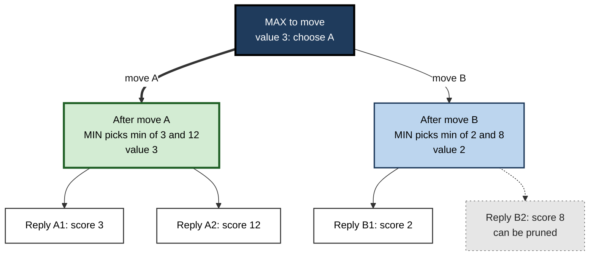
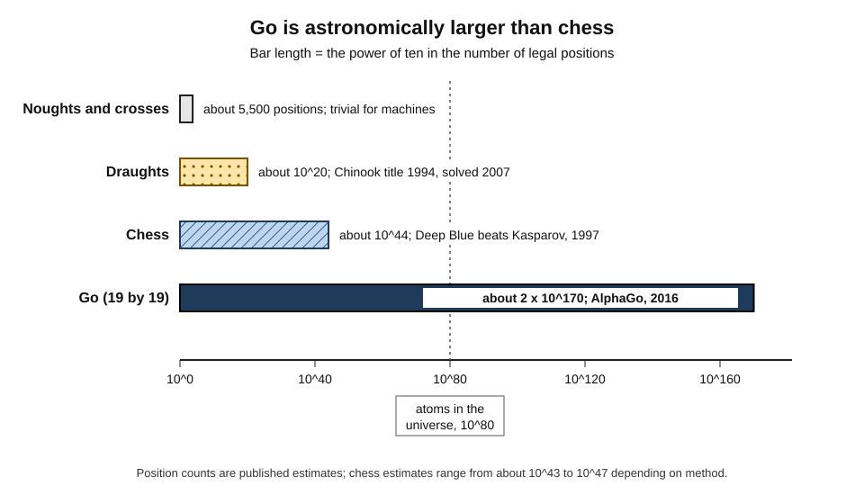
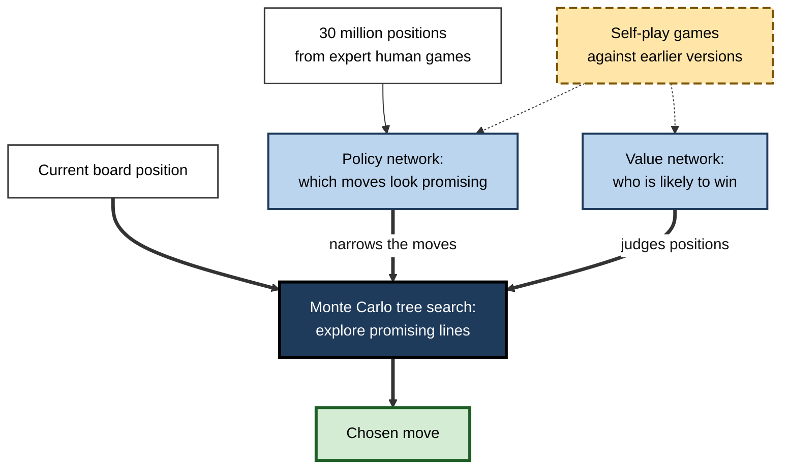
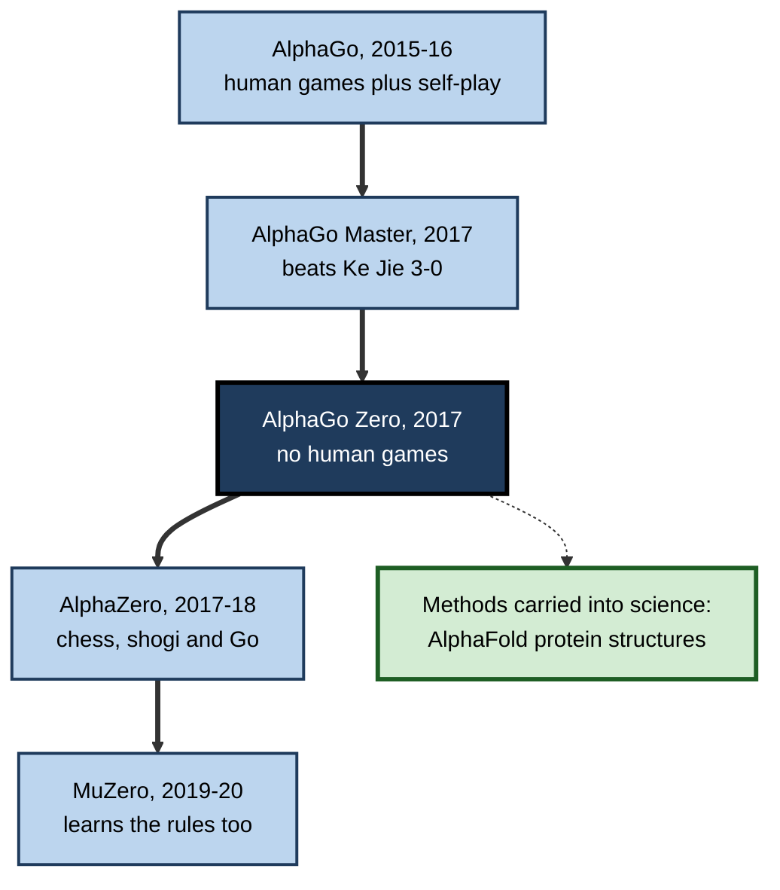
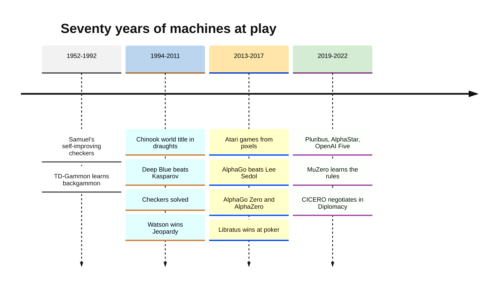

# B.8. AlphaGo and game-playing milestones

On 10 March 2016, in the second game of a match in Seoul, a computer program placed a stone on the fifth line of a Go board — move 37 — and professional commentators assumed it was a mistake. No strong human player would have chosen it. The move turned out to be decisive, and the program, AlphaGo, beat Lee Sedol, one of the best players of his generation, by four games to one.

Games had been a proving ground for artificial intelligence since the 1950s; Go was the one most experts thought machines would not master for another decade.

> **Definition — Game-playing AI:** programs that play games of strategy, such as chess, Go or poker, by searching possible future moves, evaluating positions and, in modern systems, learning from experience.

> **Definition — AlphaGo:** a Go-playing system developed by DeepMind that combined deep neural networks with tree search and reinforcement learning; it was the first program to defeat a top professional Go player in an even match (2016).

**Why it matters**

- **Games are AI's measuring stick.** Clear rules and unambiguous results let researchers compare methods and track progress over seventy years.
- **Each milestone marked a change in method** — from hand-tuned search (chess) to learned evaluation (backgammon, Go) to learning entirely from self-play.
- **The methods travelled.** Techniques built for games led directly to protein-structure prediction, chip design and the training of language models.
- **Games teach caution.** Superhuman play in a closed world says little about competence in an open one.

---

## Why AI Plays Games

### The attraction of games

- **Clear rules** — the whole world of the problem can be written down exactly.
- **Measurable outcomes** — win, lose or draw; ratings show progress precisely.
- **Human benchmarks** — champions provide a known standard of excellence.
- **Prestige** — beating a world champion attracts public attention, talent and funding.
- **Difficulty that can be dialled** — from noughts and crosses to Go, games span a vast range of complexity.

> **Key point:** chess was called the **"Drosophila of AI"** — like the fruit fly in genetics, a simple, well-understood organism on which general methods could be tested.

### Kinds of games

| | Perfect information | Imperfect information |
|---|---|---|
| What players can see | The whole state of the game | Only part of it (hidden cards, fog of war) |
| Examples | Noughts and crosses, draughts, chess, Go | Poker, Bridge, StarCraft, Diplomacy |
| Core method | Search ahead plus position evaluation | Reasoning about probabilities, bluffing and opponents' beliefs |
| Landmark machine victories | Chinook (draughts), Deep Blue (chess), AlphaGo (Go) | Libratus and Pluribus (poker), AlphaStar (StarCraft) |
| Closest real-world analogue | Logistics puzzles with full data | Negotiation, markets, security, military planning |

> **Definition — Perfect-information game:** a game in which every player can see the complete state at all times, such as chess or Go.

> **Definition — Imperfect-information game:** a game in which some information is hidden from players, such as opponents' cards in poker.

---

## Searching the Game Tree

### Minimax and its refinements

- **Game tree** — every possible move, every possible reply, and so on, branching outwards from the current position.
- **Minimax** (from the work of John von Neumann and Claude Shannon's 1950 chess paper):
  - assume each side picks the move best for itself;
  - work backwards from the end positions: on the program's turn take the **maximum** score, on the opponent's turn the **minimum**.
- **Evaluation function** — because the full tree is too large, search stops at a fixed depth and a formula scores the position (material, mobility, king safety).
- **Alpha–beta pruning** (late 1950s) — skips branches that cannot affect the final decision, allowing roughly twice the search depth for the same effort.

> **Definition — Minimax:** a decision rule for two-player games that chooses the move maximising the player's guaranteed outcome, assuming the opponent always replies with the move that is worst for the player.

> **Definition — Evaluation function:** a formula that estimates how good a position is without searching to the end of the game.

### Worked example (illustrative): minimax on a tiny tree

The program (MAX) has two moves, A and B. The opponent (MIN) then has two replies to each. Scores at the end of the search are from MAX's point of view. *Illustrative figures.*

**Figure 1.** A two-level game tree evaluated by minimax.

1. **Under move A**, the opponent will choose the reply worst for MAX: min(3, 12) = **3**.
2. **Under move B**, the opponent will choose min(2, 8) = **2**.
3. **MAX chooses** the larger guaranteed value: max(3, 2) = **3** → play **A**.
4. **Alpha–beta pruning:** once B1 scores 2 — already worse than A's guaranteed 3 — B2 need not be examined.

> **Watch out:** move A is chosen even though move B contains the tempting score of 8. Minimax assumes a **competent opponent**; hoping for the opponent's mistake is a different (and riskier) strategy.

### How big are game trees?

**Figure 2.** The size of four games and when machines beat the best humans.

- **Noughts and crosses** — a few thousand positions; solved by hand.
- **Draughts (checkers)** — about 10²⁰ positions.
- **Chess** — around 10⁴⁰ to 10⁵⁰ legal positions; Shannon estimated about 10¹²⁰ possible games.
- **Go** — about 2 × 10¹⁷⁰ legal positions on a 19 × 19 board, far more than the number of atoms in the observable universe (about 10⁸⁰).

> **Key point:** the larger the game, the less brute-force search can achieve — and the more the program must rely on **judgement** about which moves are worth considering and how good a position is.

---

## The Classical Milestones

### Draughts: Samuel to Chinook

- **Arthur Samuel (IBM, 1950s)** — a checkers program that improved its evaluation function by playing against itself; in 1959 he described this as "machine learning".
- **Chinook (Jonathan Schaeffer, University of Alberta)**
  - In 1994 it became the first program to hold a human world championship title, after the long-reigning champion Marion Tinsley withdrew from their match on health grounds.
  - In 2007 Schaeffer's team proved that checkers, played perfectly by both sides, is a **draw** — the game was **solved**.

### Backgammon: learning to evaluate

- **TD-Gammon (Gerald Tesauro, IBM, 1992)** — a neural network that learned its evaluation function by playing hundreds of thousands of games against itself with temporal-difference learning.
- It reached a level close to the best human players and changed how experts played some opening positions — an early sign that **self-play could discover new knowledge**.

### Chess: Deep Blue

**Study card — Deep Blue versus Garry Kasparov (1996 and 1997)**

- **Builders:** an IBM team including Feng-hsiung Hsu, Murray Campbell and Joe Hoane, building on Hsu's earlier Carnegie Mellon machines.
- **Machine:** a supercomputer with hundreds of special-purpose chess chips, searching on the order of **200 million positions per second**, with an evaluation function tuned using grandmaster games and advice.
- **1996, Philadelphia:** Kasparov won the match 4–2, though Deep Blue won the first game.
- **1997, New York:** an upgraded Deep Blue won the rematch 3½–2½ — the first defeat of a reigning world champion in a match under standard time controls.
- **Controversy:** Kasparov suspected human intervention after a surprising move in game 2; IBM denied it, declined a further rematch and retired the machine.
- **Conclusion:** chess fell to **massive, specialised search** guided by hand-crafted knowledge — not to anything resembling human thought.

> **Watch out:** later analysis suggested that one Deep Blue move that unsettled Kasparov may have resulted from a **software bug** that led to a random choice, according to an account by a member of the IBM team. The match shows that a human opponent's **interpretation** of a machine's behaviour can matter as much as the behaviour itself.

- **Othello:** also in 1997, the program Logistello beat the world champion Takeshi Murakami 6–0.

### Quiz shows: Watson

- **2011:** IBM's Watson beat two of the most successful champions of the US quiz show *Jeopardy!*, Ken Jennings and Brad Rutter.
- **Method:** hundreds of language-processing and retrieval techniques combined, with confidence estimates deciding when to answer.
- **Aftermath:** IBM sought to apply Watson in medicine and business; many projects disappointed, and in 2022 IBM sold much of its Watson Health business.

> **Key point:** Watson's story is a warning about **transfer**. Success in a game with clear answers did not carry over to messy domains such as cancer treatment, where data were incomplete and "right answers" contested.

---

## The Deep-Learning Era of Games

### Atari: learning from pixels

**Study card — Deep Q-network (DeepMind, 2013 and 2015)**

- **Task:** play classic Atari 2600 video games using only the screen pixels and the score as input.
- **Method:** a convolutional network combined with **Q-learning** — learning the value of each action in each situation from trial and error — with techniques to stabilise training.
- **Results:** in the 2015 *Nature* paper, one program with the same settings learned 49 games, reaching human-level performance on many of them, though doing poorly on games requiring long-term planning.
- **Conclusion:** a single learning system, without game-specific programming, could acquire many different skills — and attracted Google to acquire DeepMind in 2014.

> **Definition — Deep reinforcement learning:** reinforcement learning in which a deep neural network learns to estimate the values of actions or to choose actions directly from raw inputs.

### Why Go resisted for so long

- **Branching factor** — a chess position offers about 35 legal moves on average; a Go position offers about 250. Searching even a few moves ahead in Go multiplies into impossibly many lines.
- **No simple evaluation** — in chess, counting material (a queen is worth about nine pawns) gives a rough score; in Go, the value of a position depends on subtle, board-wide patterns of influence that even strong players struggle to put into words.
- **Long games** — a Go game typically lasts around 150 to 250 moves, so the consequences of a move can appear only much later.
- **Before 2015** — the best programs used Monte Carlo tree search with random play-outs and reached strong amateur level; they still needed handicap stones against professionals.

> **Formula — Growth of a search tree:** positions to examine ≈ (branching factor)^(depth). Example: four moves ahead, chess ≈ 35⁴ ≈ 1.5 million positions; Go ≈ 250⁴ ≈ 3.9 billion — over 2,500 times as many.

| | Chess | Go |
|---|---|---|
| Board | 8 × 8, six kinds of piece | 19 × 19, identical stones |
| Average legal moves per turn | About 35 | About 250 |
| Rough evaluation | Material count plus positional rules | No simple count; judgement of influence and shape |
| Best machine approach before deep learning | Deep search with hand-tuned evaluation | Random play-outs; strong amateur level |
| Machine beats world-class human | 1997 | 2016 |

### AlphaGo

**Study card — AlphaGo (DeepMind; *Nature*, January 2016)**

- **Team:** led by David Silver and Aja Huang, with Demis Hassabis and many colleagues.
- **Components:**
  - **policy network** — first trained to predict expert human moves from about 30 million positions, then improved by playing against versions of itself;
  - **value network** — trained to predict the winner from a position;
  - **Monte Carlo tree search** — explores promising lines, using the policy network to choose which moves to consider and the value network to judge positions.
- **October 2015:** beat the European champion Fan Hui 5–0 in a private match — the first defeat of a professional on a full board without handicap.
- **March 2016, Seoul:** beat Lee Sedol 4–1.
- **Conclusion:** learned intuition (the networks) plus search could master a game too large for brute force.

> **Definition — Monte Carlo tree search:** a search method that estimates the value of moves by simulating many possible continuations and focusing effort on the most promising branches.

> **Definition — Policy network:** a neural network that, given a position, outputs a probability for each possible move — in effect, the program's intuition about what to play.

> **Definition — Value network:** a neural network that estimates the probability of winning from a position.

**Figure 3.** How AlphaGo chose a move.

### Case study: AlphaGo versus Lee Sedol, Seoul, March 2016

- **Situation:** Go had long been regarded as AI's hardest classic board game. Lee Sedol, holder of many international titles, predicted he would win comfortably.
- **The match:** five games over a week, with a prize of one million US dollars, broadcast live and followed by a very large audience, especially in East Asia.
- **Key moments:**
  1. **Game 1:** AlphaGo won, surprising most observers.
  2. **Game 2, move 37:** AlphaGo played a fifth-line shoulder hit that its own policy network had estimated a human would choose with a probability of about 1 in 10,000; commentators first thought it an error, then recognised it as original and strong.
  3. **Game 3:** AlphaGo won, securing the match.
  4. **Game 4, move 78:** Lee found a brilliant "wedge" move that AlphaGo misjudged; the program then played poorly and resigned — Lee's only win.
  5. **Game 5:** AlphaGo won.
- **Result:** 4–1 to AlphaGo; the Korea Baduk Association awarded it a top professional rank in recognition of its play.
- **Side effects:**
  - a surge of investment and government interest in AI, particularly in China and South Korea;
  - in 2019 Lee Sedol retired, saying that AI was an entity that could not be defeated.
- **Lesson:** a learned system produced **genuinely new strategy** in a game humans had studied for over two thousand years — and could still fail in an unexpected position, as game 4 showed.

> **Watch out:** audience figures for the match are often quoted in the hundreds of millions; these come largely from the organisers and broadcasters and are **difficult to verify**.

### Beyond human data

- **AlphaGo Master (2017):** won 60 straight online games against top professionals in January 2017, then beat the world's top-ranked player, Ke Jie, 3–0 in May 2017.
- **AlphaGo Zero (*Nature*, October 2017):**
  - learned **without any human games**, starting from random play and the rules alone;
  - after three days of self-play it beat the version that defeated Lee Sedol by 100 games to 0.
- **AlphaZero (2017–2018):** one algorithm learned chess, shogi (Japanese chess) and Go from scratch and beat the strongest specialised programs in each, including the chess engine Stockfish.
- **MuZero (2019–2020):** learned to plan without even being told the rules, building its own model of how the game works.

> **Definition — Self-play:** training a game-playing system by having it play against copies of itself, so that it generates its own experience and improves without human examples.

**Figure 4.** The AlphaGo family, from human data to learned rules.

---

## Chess After Deep Blue

- **Engines overtook everyone** — by the mid-2000s commercial programs on ordinary computers beat world champions; in 2006 the world champion Vladimir Kramnik lost a match 4–2 to the program Deep Fritz.
- **Free and open engines** — the open-source engine Stockfish became the strongest conventional engine; Leela Chess Zero (from 2018) reproduced the AlphaZero approach as a volunteer project.
- **Human–machine teams** — in 1998 Kasparov promoted "advanced chess", in which players consult computers during games; in a 2005 online freestyle tournament a pair of amateur players using several programs beat grandmasters with computers, by managing their tools better.
- **Everyday use** — engines on phones now give any player analysis stronger than any human; professional preparation is built around them.

> **Key point:** the freestyle results suggested that the best performance can come from **people who manage machines well**, not only from the strongest machine or the strongest human — an idea now applied to human–AI collaboration at work.

> **Watch out:** "centaur" teams were stronger than engines alone in the mid-2000s; as engines improved, that advantage **shrank and largely disappeared** at the top level. The value of human–AI teams depends on the task and on how far the machine has advanced.

---

## Hidden Information and Many Players

- **Poker**
  - **Libratus** (Carnegie Mellon, Tuomas Sandholm and Noam Brown) beat four leading professionals at two-player no-limit Texas hold'em over 120,000 hands in January 2017.
  - **Pluribus** (Carnegie Mellon and Facebook, 2019) beat elite professionals in six-player games — significant because multi-player poker has no simple notion of an optimal strategy.
  - Methods: computing strategies that cannot be exploited, including bluffing at the right frequencies, rather than reading opponents.
- **Real-time strategy video games**
  - **OpenAI Five** beat the world champion team at Dota 2 in April 2019.
  - **AlphaStar** (DeepMind) reached Grandmaster level in StarCraft II, above the vast majority of ranked human players, as reported in *Nature* in 2019.
- **Negotiation**
  - **CICERO** (Meta, 2022) played the board game Diplomacy, which requires negotiating in natural language, and ranked in the top 10% of human players who played more than one game in an online league.

> **Key point:** each step added a feature of the real world that chess and Go lack — **hidden information**, **many agents**, **real time**, **language and persuasion** — moving games closer to the situations professionals actually face.

**Figure 5.** Major game-playing milestones, 1952–2022.

---

## What the Milestones Mean

### Two ways of being superhuman

| | Deep Blue (1997) | AlphaGo Zero and AlphaZero (2017) |
|---|---|---|
| Source of knowledge | Programmers and grandmasters, hand-tuned | Self-play from the rules alone |
| Search | About 200 million positions per second | Tens of thousands of positions per second, guided by learned intuition |
| Hardware | Custom chess chips | Google's tensor processing units, designed for neural networks |
| Generality | Chess only | One algorithm for several games |
| Style of play | Strong, materialistic, "computer-like" | Described by grandmasters as creative and dynamic |
| Legacy | Engineering showcase; retired | Methods applied to science and other domains |

### Effects on human players

- **Better human play**
  - A 2023 study in the *Proceedings of the National Academy of Sciences* analysed millions of professional Go moves and found that the quality of human decisions improved markedly after superhuman programs appeared, with more novel moves.
- **New training culture**
  - Chess and Go professionals now prepare with engines; opening theory in both games has been reshaped.
- **Fair-play problems**
  - Engine-assisted cheating has become a serious issue in online and over-the-board chess.

### The limits of game success

- **Narrowness** — AlphaGo could not play chess; Deep Blue could not play draughts. Even AlphaZero needed retraining for each game.
- **Closed worlds** — games have fixed rules and perfect simulators; real problems rarely do.
- **Data and computation** — self-play can generate millions of games because simulation is cheap; in medicine or engineering each "trial" may be costly or dangerous.
- **Hidden weaknesses** — in 2023 researchers showed that an amateur player using a strategy discovered by an adversarial program could beat leading superhuman Go programs, which failed to recognise a simple encirclement tactic.

> **Watch out:** "superhuman at Go" does not mean "understands Go as a strong human does". The 2023 adversarial results show that such systems can have **blind spots** a human expert would never have — a lesson for every high-performing AI system.

> **In practice:** game AI's most valuable legacy is methodological. **Learned intuition plus search**, **self-play** and **simulation** now help in protein-structure prediction (the AlphaFold work recognised by the 2024 Nobel Prize in Chemistry), chip layout, scheduling and in improving the reasoning of language models.

---

## Open Questions

- **How far can self-play methods go outside games?**
  - They need a fast, accurate simulator; most real domains lack one, and learned world models are an active research area.
- **Do superhuman game programs have human-like understanding?**
  - Their creative play suggests deep pattern knowledge; their adversarial blind spots suggest something different from human understanding.
- **What should replace games as AI's measuring stick?**
  - With the classic games mastered, researchers debate which benchmarks best capture general capability.
- **What happens to human expertise when machines are better?**
  - Evidence from Go suggests humans can improve by learning from AI; whether this holds in professions is uncertain.

---

## Summary

- Games are AI's **measuring stick**: clear rules, measurable results and human champions as benchmarks; chess was the **"Drosophila of AI"**.
- **Perfect-information** games (chess, Go) differ from **imperfect-information** games (poker, StarCraft).
- Classical method: **minimax** search of the **game tree**, with an **evaluation function** and **alpha–beta pruning**.
- Milestones: Samuel's checkers (1950s), **TD-Gammon** (1992), **Chinook** (1994 title; checkers **solved** 2007), **Deep Blue** beat **Kasparov** 3½–2½ (1997) using about 200 million positions a second, **Watson** won *Jeopardy!* (2011) but disappointed in medicine.
- Deep learning era: **DQN** learned Atari games from pixels (2013–2015); **AlphaGo** combined **policy** and **value networks** with **Monte Carlo tree search** and beat **Lee Sedol 4–1** (2016), including the famous **move 37**.
- **AlphaGo Zero** and **AlphaZero** learned by **self-play** without human data; **MuZero** learned the rules.
- Hidden information and many players: **Libratus** and **Pluribus** (poker), **OpenAI Five**, **AlphaStar**, **CICERO** (negotiation in Diplomacy).
- Go resisted because of its **branching factor** (about 250 against chess's 35) and the lack of a simple **evaluation**; after Deep Blue, chess engines became universal tools and **human–machine teams** briefly outplayed both.
- Lessons: game success is **narrow**, depends on cheap simulation and can hide **blind spots**; its methods transferred to science, notably **AlphaFold**.

---

## Self-Check

1. Why have games been so useful as tests of AI?
2. Distinguish perfect-information and imperfect-information games, with two examples of each.
3. Explain minimax and alpha–beta pruning.
4. In the illustrative tree, why does MAX choose A even though B contains a score of 8?
5. Why can brute-force search master chess but not Go?
6. How did Deep Blue's approach differ from AlphaGo Zero's?
7. Describe AlphaGo's three main components and how they worked together.
8. What happened at move 37 of game 2 and move 78 of game 4 in 2016?
9. What did AlphaGo Zero show that the original AlphaGo did not?
10. Why were Libratus and Pluribus important steps beyond chess and Go?
11. What does the story of IBM Watson suggest about transferring game success to real domains?
12. What did the 2023 adversarial Go results reveal?
13. A colleague argues that because AI beat the Go world champion, it will soon outperform experienced managers at strategy. Evaluate this argument.

### Answer Key

1. Clear rules, measurable outcomes, human champions as benchmarks, public prestige and a wide range of difficulty, allowing methods to be compared and progress tracked.
2. Perfect information: all state visible — chess, Go. Imperfect: some information hidden — poker, StarCraft (or Bridge, Diplomacy).
3. Minimax chooses the move with the best guaranteed outcome, assuming the opponent always replies with the move worst for the player; values are passed back from the leaves, taking maxima on the player's turns and minima on the opponent's. Alpha–beta pruning skips branches that cannot change the decision.
4. Because a competent opponent would answer B with B1, giving MAX only 2, whereas A guarantees at least 3.
5. Go has vastly more positions (about 2 × 10¹⁷⁰) and many more legal moves per turn, so even fast search covers a negligible fraction; strong play needs learned judgement about which moves to consider and how good positions are.
6. Deep Blue used hand-crafted evaluation and specialised hardware to search about 200 million positions per second. AlphaGo Zero learned its evaluation and move selection purely from self-play and searched far fewer positions, guided by neural networks.
7. A policy network suggesting promising moves, a value network estimating who will win, and Monte Carlo tree search exploring lines — using the policy network to narrow choices and the value network to judge positions.
8. Move 37: AlphaGo played a highly unusual fifth-line move, estimated as about a 1-in-10,000 human choice, which proved strong. Move 78: Lee Sedol's brilliant wedge move, which AlphaGo misjudged, leading to Lee's only win.
9. That superhuman play could be learned with no human examples at all, from the rules and self-play alone, and that it could exceed the human-trained version decisively.
10. Poker involves hidden information, bluffing and, in Pluribus's case, several opponents with no simple optimal strategy — features closer to real negotiation and markets.
11. Success where questions have clear answers and data are clean did not carry over to medicine, where data are incomplete, outcomes uncertain and "right answers" contested; domain fit matters more than headline wins.
12. An amateur using an adversarially discovered strategy could beat superhuman Go programs, which failed to recognise a simple tactic — showing hidden blind spots unlike human weaknesses.
13. Go is a closed, perfect-information game with fixed rules and a perfect simulator for self-play. Management strategy involves hidden information, changing rules, many stakeholders, values and few repeatable trials. Game success shows the power of learning plus search, not general strategic competence; AI may assist with analysis, but the inference does not follow.

---

## Glossary

| Term | Meaning |
|---|---|
| AlphaGo | DeepMind's Go system that beat Lee Sedol in 2016. |
| AlphaZero | A single algorithm that learned chess, shogi and Go by self-play. |
| Alpha–beta pruning | Skipping game-tree branches that cannot affect the decision. |
| Branching factor | The average number of legal moves available in a position. |
| Deep Blue | IBM's chess supercomputer that beat Kasparov in 1997. |
| Deep reinforcement learning | Reinforcement learning using deep neural networks. |
| Evaluation function | A formula estimating how good a game position is. |
| Game tree | The branching set of all possible move sequences from a position. |
| Imperfect-information game | A game in which some information is hidden from players. |
| Minimax | Choosing the move with the best guaranteed outcome against a competent opponent. |
| Monte Carlo tree search | Search that estimates move values by simulating many continuations. |
| MuZero | A system that learned to plan without being told the rules. |
| Perfect-information game | A game in which all players see the complete state. |
| Policy network | A network giving probabilities for each possible move. |
| Self-play | Training by playing against copies of oneself. |
| Solved game | A game whose outcome under perfect play is known. |
| Value network | A network estimating the probability of winning from a position. |
