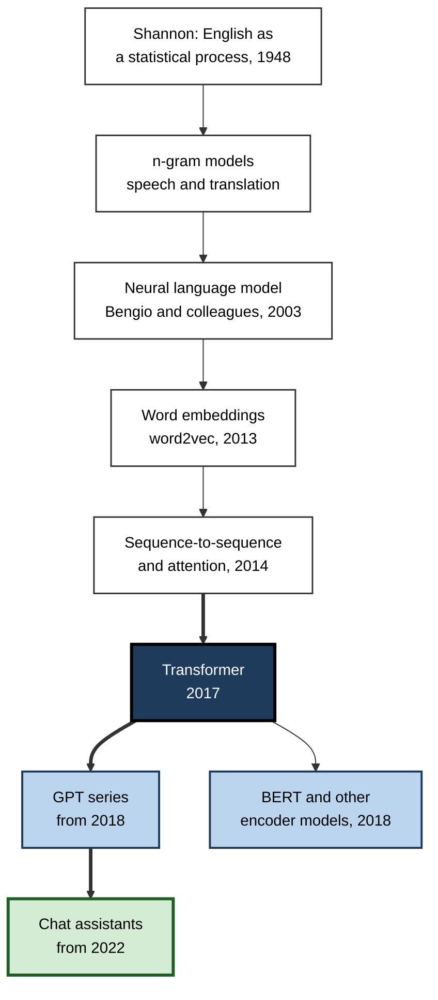
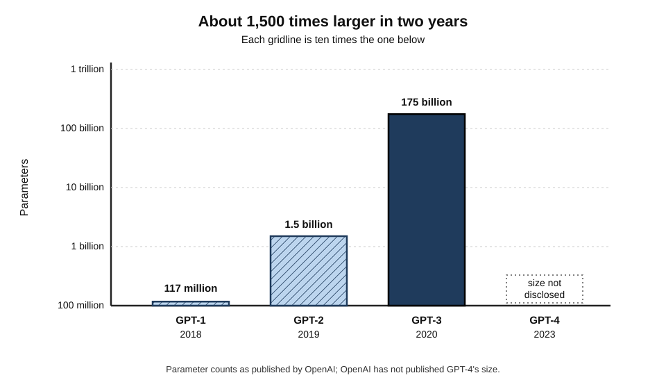
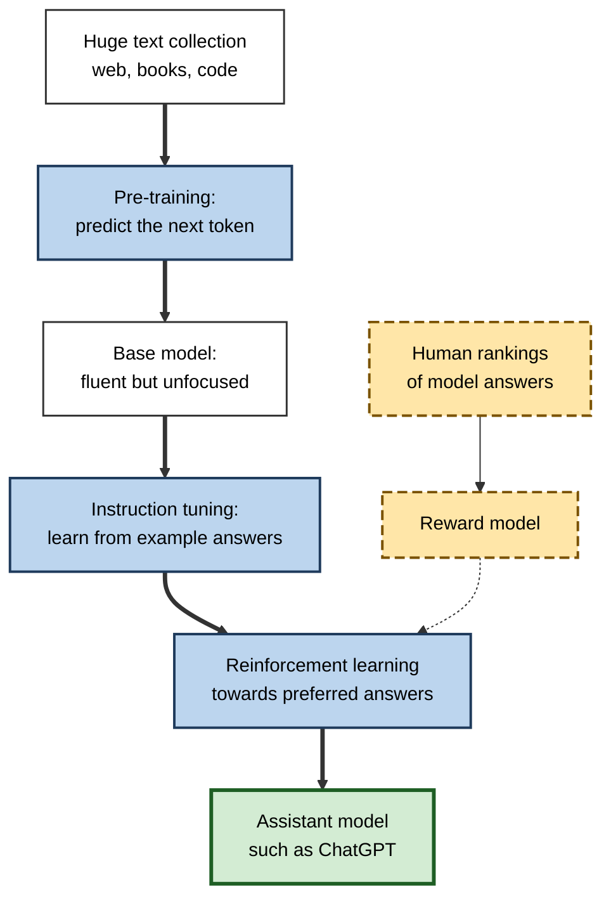
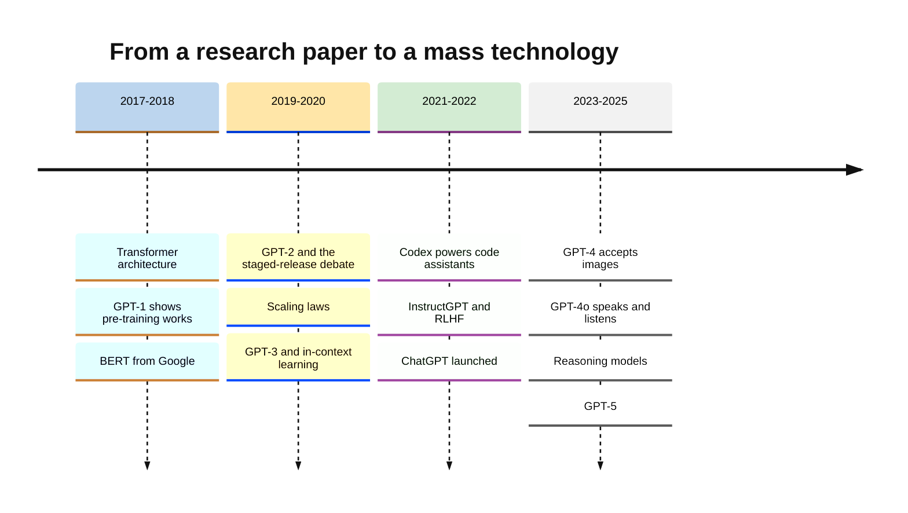
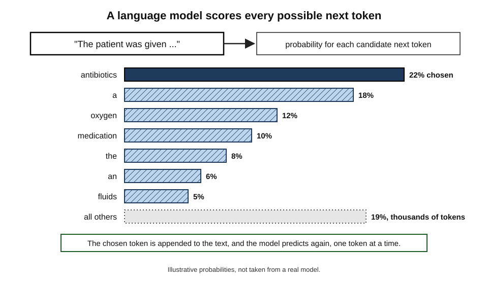

# B.9. GPT models and the language revolution

For most of AI's history, language was the problem that would not yield. Programs could play chess at world-champion level while still failing to understand a simple story. Then, within five years, a family of systems trained to do one modest thing — predict the next word in a passage of text — began writing essays, answering exam questions, translating, summarising and writing computer code. The systems were called **GPT**, and their arrival changed what the public, business and governments believed AI could do.

> **Definition — Language model:** a system that assigns probabilities to sequences of words, typically by predicting which word (or word fragment) is likely to come next given the text so far.

> **Definition — GPT (Generative Pre-trained Transformer):** a family of large language models developed by OpenAI from 2018, built on the transformer architecture, pre-trained on very large amounts of text to predict the next word, and then adapted to follow instructions.

**Why it matters**

- **It ended the long separation between AI and language.** Systems became able to work with ordinary human language across almost any subject.
- **It changed how AI is built.** One large, general "foundation" model, adapted to many tasks, replaced many small task-specific ones.
- **It made AI a mass consumer technology.** ChatGPT, launched in November 2022, reached a larger audience faster than any earlier AI product.
- **It raised new questions** about truthfulness, authorship, bias, jobs and power that dominate AI debate today.

---

## Before GPT: Teaching Machines Language

### Three earlier eras

- **Rules (1950s–1980s)**
  - Hand-written grammars and dictionaries; impressive in narrow domains, brittle elsewhere.
- **Statistics (1990s–early 2010s)**
  - **n-gram models** predicted the next word from the previous few words, using counts from large text collections.
  - Claude Shannon had shown in 1948–51 that English could be modelled as a statistical process and that people could predict the next letter with surprising accuracy.
  - Statistical models powered speech recognition, spelling correction and phrase-based translation.
- **Neural networks (2003–2017)**
  - Yoshua Bengio and colleagues (2003) introduced a neural language model that learned word representations.
  - Word embeddings (2013), sequence-to-sequence learning (2014) and **attention** (2014) brought neural translation into products by 2016.

> **Definition — n-gram model:** a language model that predicts the next word from the previous n − 1 words using frequency counts; for example a trigram model uses the two preceding words.

> **Example:** a trigram model that has seen "the cat sat on the mat" many times will predict "mat" after "on the" — but it cannot connect a word to anything said more than two words earlier.

### The limits that remained

- **Short memory** — n-grams saw only a few words; recurrent networks forgot over long passages.
- **Slow training** — recurrent networks processed text one word at a time, so they could not use parallel hardware fully.
- **Task-specific models** — each task (translation, sentiment, question answering) needed its own labelled dataset and model.

**Figure 1.** The lineage of language models.

---

## The Transformer (2017)

**Study card — Vaswani and colleagues (2017), "Attention Is All You Need"**

- **Authors:** eight researchers at Google Brain and Google Research.
- **Problem:** recurrent networks were slow to train and struggled with long-range connections in text.
- **Proposal:** the **transformer**, an architecture built on **self-attention** — every word in a passage directly weighs its relevance to every other word — with no recurrence.
- **Results:** better translation quality than previous systems, trained in a fraction of the time because the computation could run in parallel on GPUs.
- **Effect:** within two years the transformer became the standard architecture for language and, later, for images, audio, protein structures and more.

> **Definition — Transformer:** a neural-network architecture that processes all the words of a passage at once, using self-attention to let each word draw on information from any other; the basis of GPT and nearly all modern large language models.

> **Definition — Self-attention:** a mechanism by which each element of a sequence computes how much to draw on every other element, so that, for example, a pronoun can be linked to the noun it refers to.

> **Example:** in "The trophy did not fit in the suitcase because **it** was too big", self-attention lets the model weigh "trophy" and "suitcase" when representing "it" — the kind of long-range link that n-gram models could not make.

> **Key point:** the transformer's real advantage was **scalability**. Because it trains in parallel, it could absorb far more data and computation than earlier architectures — and it kept improving as both grew.

---

## The GPT Series

### GPT-1: pre-train, then fine-tune (2018)

**Study card — Radford and colleagues, OpenAI (June 2018), "Improving Language Understanding by Generative Pre-Training"**

- **Idea:** first **pre-train** a transformer to predict the next word on a large body of unlabelled text; then **fine-tune** it with a small labelled dataset for each task.
- **Data:** a corpus of several thousand unpublished books.
- **Size:** about **117 million** parameters.
- **Results:** state-of-the-art results on many language-understanding benchmarks.
- **Conclusion:** general knowledge of language learned from raw text transfers to specific tasks — the language counterpart of ImageNet pre-training.

> **Definition — Pre-training:** training a model on a large, general dataset (for language models, raw text) before adapting it to particular tasks.

> **Definition — Parameter:** an adjustable number inside a neural network, set during training; model size is usually described by the number of parameters.

### BERT: the rival approach (2018)

- In October 2018 Google released **BERT**, a transformer pre-trained to fill in **masked** words using context on both sides.
- BERT excelled at understanding tasks — classification, search, question answering — and in 2019 Google began using it to interpret search queries.
- For a time, BERT-style models were more influential than GPT in research and industry.

| | BERT-style (encoder) | GPT-style (decoder) |
|---|---|---|
| Training task | Fill in hidden words using both left and right context | Predict the next word from the left context only |
| Natural strength | Understanding and classifying text | Generating text |
| Typical uses | Search ranking, sentiment, entity extraction | Writing, conversation, code, open-ended answers |
| Scaling path | Grew to hundreds of millions of parameters | Grew to hundreds of billions |
| Position by 2023 | Widely used inside products, less visible | Basis of chat assistants and most frontier models |

### GPT-2: "too dangerous to release"? (2019)

**Study card — GPT-2 (OpenAI, February 2019)**

- **Size:** **1.5 billion** parameters — more than ten times GPT-1.
- **Data:** about 40 GB of text from web pages linked from the discussion site Reddit (a dataset called WebText).
- **Results:** coherent multi-paragraph text on almost any prompt; it performed some tasks — translation, summarisation, question answering — without task-specific training, at modest quality.
- **Release decision:** OpenAI initially withheld the full model, citing risks of automated disinformation and spam, and released it in stages over nine months.
- **Reaction:** some researchers praised the caution; others called it publicity, noting that similar models could be built by others.

> **Watch out:** the GPT-2 staged release is remembered both as the **first major debate about responsible release** of AI models and as an early example of **safety concerns being used in marketing**. Both readings have support.

### Scaling laws (2020)

- In January 2020 OpenAI researchers reported that a language model's error fell **smoothly and predictably** as a **power law** of three quantities: number of parameters, amount of training data and computation.
- **Implication:** bigger models trained on more data would reliably get better — making scale an engineering plan rather than a gamble.
- **Refinement (DeepMind, 2022, "Chinchilla"):** for a fixed computing budget, models had been too large and under-trained; the best results came from roughly **20 training tokens per parameter**, and a 70-billion-parameter model trained this way beat a 280-billion-parameter one.

> **Definition — Scaling law:** an empirical relationship showing how a model's performance improves, typically as a power law, with model size, data and computation.

> **Formula — Compute-optimal data (Chinchilla rule of thumb):** training tokens ≈ 20 × parameters. Example: a 70-billion-parameter model → 20 × 70 billion = **1.4 trillion** tokens.

### GPT-3: learning from the prompt (2020)

**Study card — Brown and colleagues, OpenAI (May 2020), "Language Models are Few-Shot Learners"**

- **Size:** **175 billion** parameters, trained on hundreds of billions of tokens of web text, books and Wikipedia.
- **Discovery — in-context learning:** given a few examples inside the prompt ("English: cheese → French: fromage; English: house → French: …"), the model performed the task **without any further training**.
- **Results:** competitive with fine-tuned systems on some tasks; weak on others, especially multi-step reasoning and arithmetic.
- **Access:** offered through a paid programming interface from mid-2020, so developers could build products on it.
- **Conclusion:** at sufficient scale, a single model could act as a **general-purpose language engine**, steered by instructions and examples.

> **Definition — In-context learning:** a large language model's ability to perform a new task from instructions or examples given in the prompt, without changing its parameters.

**Figure 2.** Growth in the size of GPT models, 2018–2020.

| | GPT-1 (2018) | GPT-2 (2019) | GPT-3 (2020) |
|---|---|---|---|
| Parameters | About 117 million | 1.5 billion | 175 billion |
| Training text | Several thousand books | About 40 GB of web pages | Hundreds of billions of tokens from web, books, Wikipedia |
| How tasks were done | Fine-tuning per task | Some tasks from the prompt alone, modestly | Few-shot in-context learning |
| Public access | Paper and model | Staged release over nine months | Paid programming interface |
| Headline impact | Pre-training works | Fluent text; misuse debate | General-purpose language engine |

---

## From Text Predictor to Assistant

### The alignment step

- **Problem:** a model trained only to continue text does not reliably follow instructions; it may ramble, invent facts or produce toxic content, because the web contains all of these.
- **Solution — reinforcement learning from human feedback (RLHF):**
  1. people write example answers to instructions; the model is fine-tuned on them;
  2. people rank several model answers from best to worst;
  3. a **reward model** learns to predict these preferences;
  4. the language model is trained with reinforcement learning to produce answers the reward model scores highly.
- **InstructGPT (OpenAI, January 2022):** labellers preferred the answers of a 1.3-billion-parameter instruction-tuned model to those of the original 175-billion-parameter GPT-3.

> **Definition — Reinforcement learning from human feedback (RLHF):** a training method in which human rankings of model outputs are used to train a reward model, which in turn guides further training of the language model towards preferred behaviour.

**Figure 3.** From raw text to a helpful assistant.

### Case study: The launch of ChatGPT (30 November 2022)

- **Situation:** OpenAI had a GPT-3.5 model, tuned with RLHF, and wanted public feedback; the company reportedly regarded the release as a low-key "research preview".
- **Action:** it released a free chat interface on the web — no programming needed.
- **Result:**
  - OpenAI's chief executive reported **one million users within five days**;
  - an analysis by the bank UBS, based on web-traffic data, estimated about **100 million monthly users by January 2023**, a growth rate faster than any consumer application it had tracked;
  - schools, universities and employers scrambled to respond; technology companies accelerated their own launches.
- **Why it worked:**
  - the **interface** — conversation in plain language — made the capability usable by anyone;
  - the **alignment** step made answers helpful and polite enough to be useful;
  - the **breadth** — writing, explaining, coding, planning — meant almost everyone found a use.
- **Problems that surfaced at once:**
  - confident invented facts and references (**hallucination**);
  - students submitting generated essays;
  - questions about the copyrighted material in its training data.
- **Lesson:** the technology behind ChatGPT was not new — GPT-3 had been available for two years. **Packaging, access and alignment** turned a research capability into a social phenomenon.

> **Watch out:** the 100-million figure is an **external estimate** from traffic data, not a company-reported count. It is widely quoted and plausible but should be cited as an estimate.

---

## GPT-4 and After

- **GPT-4 (March 2023)**
  - Accepted images as well as text; OpenAI did not disclose its size or training data, citing competition and safety.
  - OpenAI reported strong results on professional and academic exams, including a simulated US bar examination at around the 90th percentile of test-takers.
- **Plug-ins, tools and code execution (2023 onwards)** — models began calling search engines, calculators and other software.
- **GPT-4o (May 2024)** — handled text, images and speech in a single model with fast spoken conversation.
- **Reasoning models (from September 2024)** — OpenAI's o1 and successors were trained to work through problems step by step before answering, improving markedly on mathematics, science and programming tasks.
- **GPT-5 (August 2025)** — combined fast responses and extended reasoning in one system.
- **Competition** — by 2023–2025 comparable models came from Anthropic, Google, Meta, Mistral, DeepSeek and others; the GPT series was one family among several.

> **Watch out:** the GPT-4 bar-exam percentile was later **re-examined**. An independent 2024 analysis argued that compared with first-time test-takers, or on the essay sections, the percentile was considerably lower. Exam scores reported by model developers should be read with their **comparison group and conditions** in mind.

**Figure 4.** The GPT story, 2017–2025.

---

## Code, Measurement and Languages

### From text to code

- **Codex (OpenAI, 2021)** — a GPT model further trained on public source code; it could write working functions from plain-language descriptions.
- **GitHub Copilot (technical preview June 2021)** — built on Codex, it suggested code as programmers typed inside their editors; it became one of the first widely paid-for generative-AI products.
- **Why code mattered:**
  - code has precise, testable outputs, so progress could be measured by whether programs ran correctly;
  - programmers were early, enthusiastic adopters;
  - training on code appeared to help models with step-by-step reasoning more generally.
- **Concerns:** suggested code could contain security flaws or reproduce licensed code; a 2022 lawsuit challenged the use of public code for training.

### How language models were measured

- **GLUE (2018) and SuperGLUE (2019)** — collections of language-understanding tasks; models surpassed the estimated human baseline on SuperGLUE within about two years.
- **MMLU (2020)** — multiple-choice questions across 57 subjects from elementary mathematics to law and medicine; GPT-3 scored well below expert level, while leading models a few years later scored around or above 85–90%.
- **Professional exams** — developers began reporting results on bar, medical-licensing and other exams.
- **Benchmark saturation** — tests were "used up" ever faster, pushing researchers to build harder ones.
- **Contamination** — because models are trained on huge amounts of web text, test questions may have appeared in training data, inflating scores.

> **Definition — Benchmark contamination:** the presence of test questions or answers in a model's training data, which makes benchmark scores overstate genuine ability.

| Benchmark | Year introduced | What it tests | What happened |
|---|---|---|---|
| GLUE | 2018 | Sentence-level understanding tasks | Surpassed by models within about a year |
| SuperGLUE | 2019 | Harder understanding tasks | Models passed the human baseline by about 2021 |
| MMLU | 2020 | Knowledge across 57 academic and professional subjects | From well below expert level to near the ceiling within about four years |
| Professional exams | From 2023 | Bar, medical and other licensing exams | High reported scores; comparison groups debated |

> **Watch out:** a high benchmark score shows a model can answer **those questions in that format**. It does not show it can do the job the exam is meant to license.

### Beyond English

- **Training data skew** — most text on the web is in English and a few other major languages, so early models performed best in them.
- **Multilingual models** — later models handled dozens of languages, with quality falling for languages with less digital text.
- **Local efforts** — governments and research groups in many countries, including India, began building datasets and models for their own languages to avoid dependence on English-centred systems.

> **In practice:** for work in languages with less online text, professionals should test a model **in that language and domain** rather than relying on English benchmark results.

---

## How It Works, in Brief

### Next-token prediction

- Text is split into **tokens** — words or pieces of words.
- The model outputs a probability for every possible next token; one is chosen, added to the text, and the process repeats.
- Everything the model "knows" is stored in its parameters, shaped by predicting text across trillions of tokens.

**Figure 5.** Next-token prediction: probabilities for the word after "The patient was given" (illustrative).

> **Definition — Token:** a unit of text — a word, part of a word or punctuation mark — that a language model reads and predicts.

> **Key point:** next-word prediction sounds trivial, but predicting text **well** across every subject requires the model to capture grammar, facts, styles and patterns of reasoning. Whether this amounts to "understanding" is contested.

### Worked example (illustrative): reading a model-size claim

A vendor advertises "our 7-billion-parameter model, trained on 2 trillion tokens". What does history suggest?

1. **Tokens per parameter:** 2,000,000,000,000 ÷ 7,000,000,000 ≈ **286**.
2. **Compare with the Chinchilla guideline** of about 20 tokens per parameter: the model has been trained **far beyond** the compute-optimal amount.
3. **Interpretation:** developers often train small models on much more data than the guideline because a smaller model is **cheaper to run** for every user query — a deliberate trade-off between training cost and running cost.
4. **Conclusion:** parameter count alone says little; **training data, tuning and evaluation results** matter as much.

| Claim | What it tells you | What it does not tell you |
|---|---|---|
| Number of parameters | Rough capacity and running cost | Quality, safety or fitness for a task |
| Training tokens | How much text shaped the model | What the text was, or its quality and licensing |
| Benchmark score | Performance on that test | Performance on your data and tasks |
| "Aligned" or "safe" | That some tuning was done | How it behaves under pressure or misuse |

*Illustrative figures in the worked example.*

---

## The Revolution Assessed

### What changed

- **Generality** — one model handles thousands of tasks.
- **Interface** — natural language replaced programming as the way to instruct a computer for many purposes.
- **Economics** — capability became a service rented by the query; companies built products on a handful of providers' models.
- **Pace** — capabilities that experts expected decades away arrived within a few years.

### What critics said

- **"Stochastic parrots" (2021)** — a paper co-authored by the linguist Emily Bender and the computer scientist Timnit Gebru argued that large language models reproduce patterns without understanding, encode biases in their training data and carry environmental and social costs.
- **Hallucination** — models produce fluent, confident falsehoods, including invented citations.
- **Emergent abilities** — a 2022 study described abilities appearing suddenly at certain scales; a 2023 analysis argued that such jumps were partly an artefact of how performance was measured. The question remains **open**.
- **Data and consent** — models were trained on text and code written by people who were not asked and not paid, leading to legal challenges.

> **Watch out:** neither "it is just autocomplete" nor "it understands like a person" is a settled description. The behaviour is **more capable than simple pattern-matching suggests and less reliable than fluent text implies** — which is the practical point for any user.

> **In practice:** professionals using GPT-style tools treat them as **fast, knowledgeable but fallible collaborators** — useful for drafting, explaining and transforming text, and always checked when facts, figures, citations or legal consequences matter.

---

## Open Questions

- **Do large language models understand language?**
  - Philosophers, linguists and computer scientists disagree, and there is no agreed test.
- **How far will scaling continue to work?**
  - Gains from more data and computation have continued, but limits of high-quality text and rising costs are much debated.
- **Can hallucination be eliminated?**
  - It has been reduced, especially with retrieval and reasoning methods, but not removed.
- **Who owns the knowledge in a model?**
  - The legal status of training on copyrighted text is being decided case by case in several countries.
- **Why does next-word prediction produce such general abilities?**
  - Researchers studying the inner workings of models are only beginning to explain it.

---

## Summary

- A **language model** predicts the next word or **token**; language moved from **rules** to **statistics** (n-grams, from Shannon's work) to **neural networks** (2003 onwards).
- The **transformer** (Google, 2017) used **self-attention** and parallel training, making scale possible.
- **GPT-1** (2018, ~117 million parameters) showed **pre-training plus fine-tuning** works; **BERT** (2018) dominated understanding tasks.
- **GPT-2** (2019, 1.5 billion) wrote fluent text and triggered the **staged-release** debate.
- **Scaling laws** (2020) made improvement predictable; **Chinchilla** (2022) refined the balance to about **20 tokens per parameter**.
- **GPT-3** (2020, 175 billion) introduced **in-context learning** and an API.
- **RLHF** and **InstructGPT** (2022) turned text predictors into assistants; **ChatGPT** (30 November 2022) reached one million users in five days and an estimated 100 million within about two months.
- **GPT-4** (2023), **GPT-4o** (2024), **reasoning models** (2024–) and **GPT-5** (2025) followed amid strong competition.
- **Code** (Codex, Copilot, 2021) was an early paid use; benchmarks (GLUE, SuperGLUE, **MMLU**) were **saturated** quickly and are vulnerable to **contamination**; performance is strongest in languages with the most web text.
- Critiques: **stochastic parrots**, **hallucination**, contested **emergent abilities**, data consent and copyright.

---

## Self-Check

1. Define a language model and give an example of an n-gram prediction.
2. What limitations of earlier language models did the transformer overcome?
3. Explain self-attention with an example sentence.
4. What did GPT-1 demonstrate?
5. Compare BERT-style and GPT-style models.
6. Why was GPT-2's release controversial?
7. What are scaling laws, and what did the Chinchilla study change?
8. What is in-context learning, and why was it surprising in GPT-3?
9. Describe the steps of RLHF.
10. Why did ChatGPT spread so quickly when GPT-3 had been available for two years?
11. Why should the GPT-4 bar-exam percentile be treated with care?
12. A model has 13 billion parameters and was trained on 260 billion tokens. Is it compute-optimal by the Chinchilla rule, and what might explain a different choice?
13. A manager wants to use a GPT-style assistant to draft client advice. What does the history of these models suggest about safeguards?

### Answer Key

1. A system assigning probabilities to word sequences, usually by predicting the next word. Example: a trigram model predicting "mat" after "on the" because "on the mat" was frequent in its training text.
2. Short memory for long-range connections and slow, sequential training; the transformer links any words directly through self-attention and trains in parallel.
3. Each word computes how much to draw on every other word. In "The trophy did not fit in the suitcase because it was too big", the representation of "it" draws on "trophy" and "suitcase" to resolve the reference.
4. That pre-training a transformer on unlabelled text to predict the next word, then fine-tuning it on small labelled datasets, gave state-of-the-art results across many tasks.
5. BERT fills in masked words using context on both sides and excels at understanding tasks such as search and classification. GPT predicts the next word from the left and excels at generating text; it scaled to much larger sizes and became the basis of chat assistants.
6. OpenAI withheld the full model for nine months citing misuse risks such as disinformation; some saw responsible caution, others publicity, since similar models could be built elsewhere.
7. Empirical power-law relationships between performance and model size, data and compute. Chinchilla showed that for a fixed budget, models should be smaller and trained on more data — about 20 tokens per parameter.
8. Performing a new task from instructions or examples in the prompt without retraining. It was surprising because the ability was not explicitly trained; it appeared at large scale.
9. Collect example answers and fine-tune; have people rank several model answers; train a reward model on the rankings; use reinforcement learning to steer the language model towards highly rated answers.
10. A free, simple chat interface made it usable by anyone; RLHF made answers helpful; and its breadth meant nearly everyone found uses — packaging and access, not new capability, drove adoption.
11. It was reported by the developer under particular conditions and comparison groups; an independent analysis found a substantially lower percentile against first-time takers and on essay sections.
12. 260 ÷ 13 = 20 tokens per parameter — exactly the Chinchilla guideline. A developer might instead train a smaller model on more data to reduce running costs, or a larger one if training budget is plentiful and running cost less important.
13. Models can produce fluent but false statements and invented references, may reflect biases, and their benchmark scores may not reflect performance on the firm's tasks. Safeguards: human expert review of all client-facing content, verification of facts and citations, protection of confidential data, clear records of AI use and testing on representative cases before adoption.

---

## Glossary

| Term | Meaning |
|---|---|
| Benchmark contamination | Test material appearing in training data, inflating scores. |
| BERT | Google's 2018 transformer model trained to fill in masked words. |
| ChatGPT | OpenAI's conversational assistant, launched on 30 November 2022. |
| Chinchilla | A 2022 DeepMind study and model showing compute-optimal training at about 20 tokens per parameter. |
| Codex | OpenAI's 2021 GPT model trained on source code, the basis of early coding assistants. |
| Fine-tuning | Further training a pre-trained model for a particular task or behaviour. |
| GPT | Generative Pre-trained Transformer: OpenAI's family of large language models. |
| Hallucination | A model's production of fluent but false or invented content. |
| In-context learning | Performing a task from examples or instructions in the prompt without retraining. |
| InstructGPT | OpenAI's 2022 instruction-following models trained with RLHF. |
| Language model | A system that predicts or scores sequences of words. |
| MMLU | A 2020 benchmark of multiple-choice questions across 57 subjects. |
| n-gram model | A language model predicting the next word from the previous n − 1 words. |
| Parameter | An adjustable number inside a neural network, set by training. |
| Pre-training | Training on a large general dataset before task-specific adaptation. |
| Reward model | A model trained to predict which outputs people prefer. |
| RLHF | Reinforcement learning from human feedback. |
| Scaling law | An empirical rule for how performance improves with size, data and compute. |
| Self-attention | A mechanism letting each element of a sequence draw on every other element. |
| Token | A unit of text — word, word piece or symbol — read and predicted by a model. |
| Transformer | The 2017 attention-based architecture underlying modern language models. |
