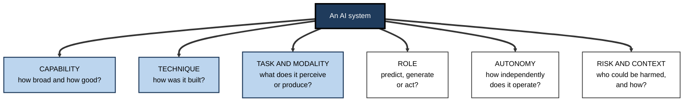
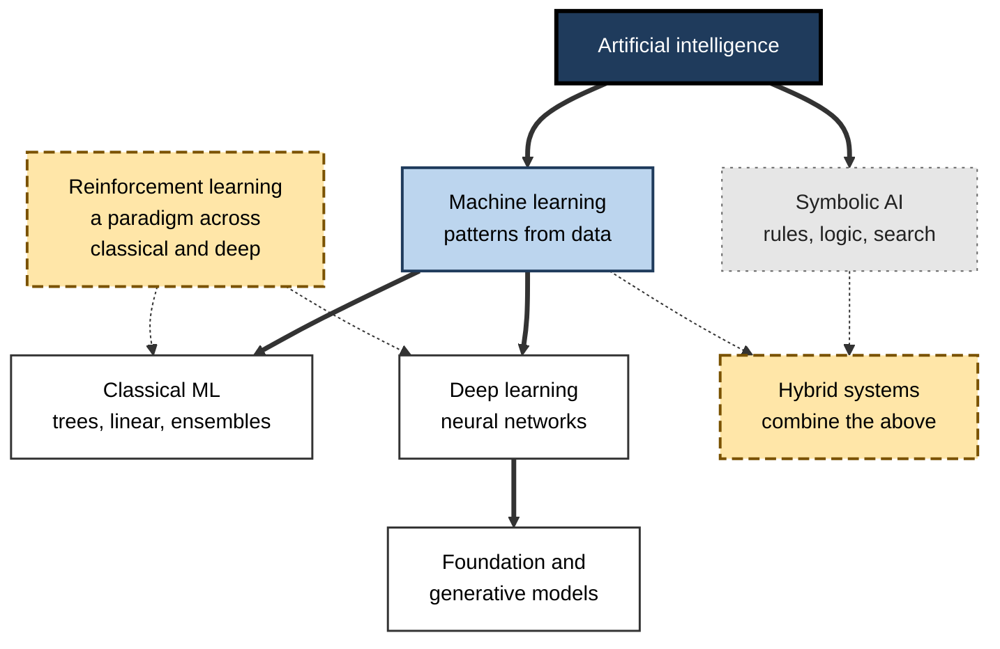
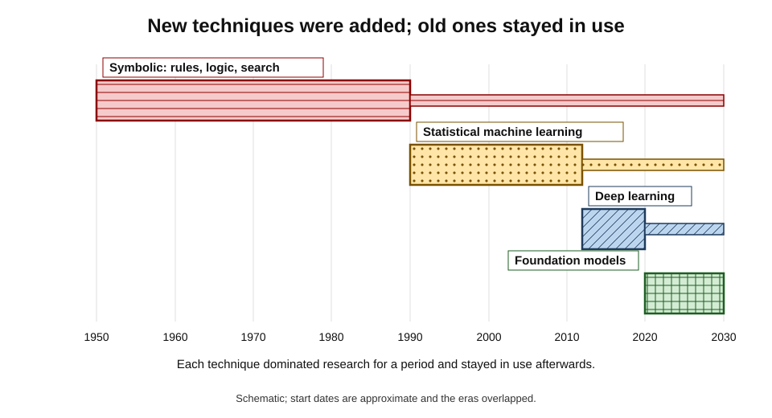
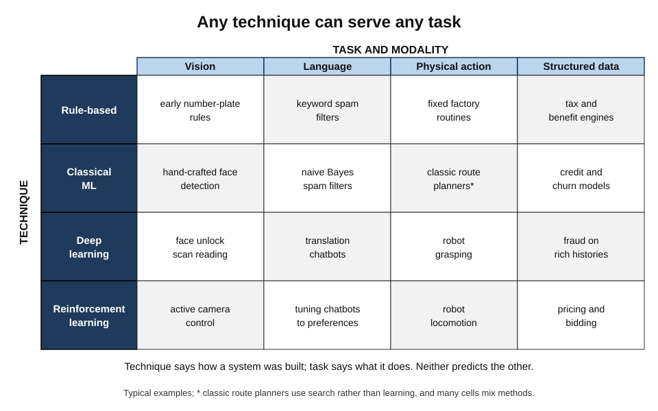
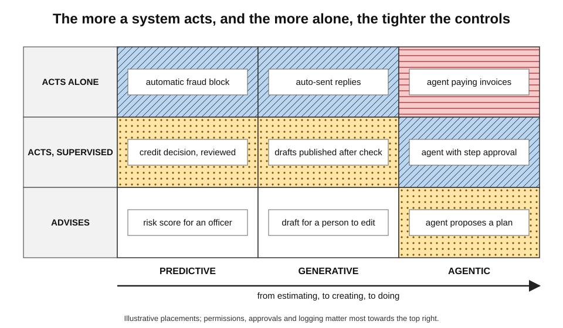
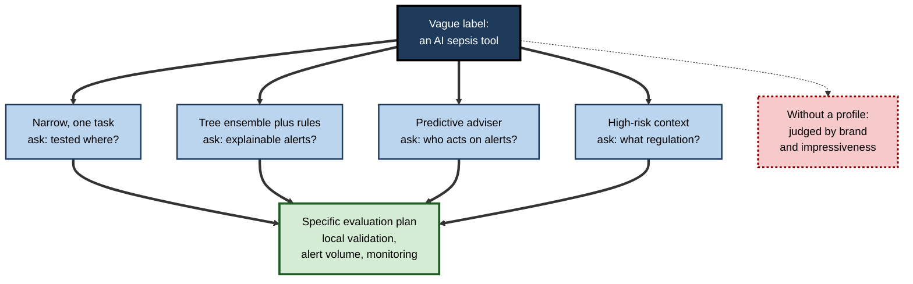

# C. Types of AI

Ask five people what "type" of AI a robotaxi is and five answers come back: "narrow AI", "deep learning", "computer vision", "robotics", "an autonomous system". All five are right, because each answers a different question — how broad the system is, how it was built, what it perceives, what body it has and how independently it acts. Most confusion in conversations about AI comes from mixing these questions up. Sorting them out is the first step to judging any system clearly.

> **Definition — Taxonomy of AI:** a structured way of classifying AI systems along one or more dimensions — such as breadth of capability, underlying technique, task or modality, role in decisions, degree of autonomy or level of risk — so that systems can be compared, understood and governed.

**Why it matters**

- **Expectations:** knowing what kind of system something is tells a user what it can do and how it is likely to fail.
- **Decisions:** buyers, managers and engineers choose between approaches; each type suits different problems.
- **Governance:** laws and policies attach obligations to types and uses of AI, so classification has legal and financial consequences.
- **Honesty:** labels are used in marketing; a clear taxonomy is the defence against exaggerated or false claims.

---

## Why Classification Is Hard

### One label, many meanings

- "AI" itself has shifted meaning: in the 1980s it usually meant hand-written expert systems; in the 2010s, machine learning; since 2022, often generative chatbots.
- **The "AI effect"** — a phrase associated with the computer scientist John McCarthy and others — describes how techniques stop being called AI once they become routine.
  - *e.g.* route planning, spell-checking and optical character recognition were once flagship AI problems; today they are "just software".

> **Watch out:** "it isn't really AI" is often a statement about **familiarity**, not about technique. Classification should rest on what a system does and how it works, not on how novel it feels.

### Many dimensions at once

- A single system can be **narrow** in capability, **deep learning** in technique, **vision** in modality, **predictive** in role, **highly autonomous** in deployment and **high-risk** in law.
- These dimensions are largely **independent**: knowing one says little about the others.

> **Key point:** there is no single "type" of an AI system. A useful description places it on **several axes**, each answering a different question.

**Figure 1.** Six independent questions for classifying any AI system.

> **Mnemonic — "CATRAR — Can A Taxonomy Really Avoid Risk?":** Capability, Approach (technique), Task and modality, Role, Autonomy, Risk.

---

## Classifying by Capability

### Breadth and depth

- **Breadth** — how many different tasks a system performs well.
- **Depth** — how well it performs any one of them.
- Every system in use today is **narrow** in the sense that its competence is bounded; general and super AI remain hypothetical, though the breadth of large models has made the boundary contested.
- A system can be **superhuman and narrow** — a chess engine — or **broad and unreliable** — a general chatbot.

### Levels rather than categories

- Researchers at Google DeepMind proposed in 2023 to rate systems on **performance** (from emerging to superhuman) and **generality** (narrow to general) separately, with **autonomy** as a third, deployment-dependent dimension.
- The practical lesson for a professional is to ask about **tested scope**: on what tasks, against what standard, with what reliability — and what happens just outside that scope.

> **Remember:** "narrow" describes **scope**, not **value**. Some of the most valuable systems ever built are narrow; what matters is that their scope is known.

---

## Classifying by Technique

### Two traditions and their descendants

- **Symbolic AI** — knowledge written by people as symbols and rules; reasoning by logic and search.
  - Its workhorse is the if-then rule system: transparent, auditable and exact within its rules, brittle outside them — still the backbone of tax, benefits, compliance and safety logic.
- **Machine learning** — competence estimated from data rather than written by hand.
  - Within it, **classical methods** (linear models, decision trees, tree ensembles, nearest neighbours) still dominate structured business data.
  - **Deep learning** — many-layered neural networks that learn their own features — transformed perception and language from 2012 onwards.
- **Learning paradigms** cut across these by the kind of feedback used: labelled examples, unlabelled structure, self-generated targets, or rewards. Learning from rewards — reinforcement learning — is the natural paradigm for sequential decisions, from games to robot control to tuning chatbots on human preferences.
- **Hybrids** combine techniques — learned perception with rule-based constraints, search guided by learned intuition, language models grounded in retrieved documents — and describe most systems that work reliably in practice.

**Figure 2.** The technique families of AI and how they nest.

> **Watch out:** the common picture of nested circles — AI containing machine learning containing deep learning — is correct as far as it goes, but it omits symbolic AI, hides that reinforcement learning is a **paradigm** rather than a layer, and suggests that inner circles are "more advanced". For tabular business data, a decision tree may beat a deep network.

### How the dominant technique changed

- **1950s–1980s — symbolic:** logic, search, expert systems.
- **1990s–2000s — statistical:** probabilistic models and machine learning trained on growing datasets.
- **2010s — deep learning:** convolutional and recurrent networks, then transformers.
- **2020s — foundation models:** very large pretrained models adapted to many tasks, often wrapped in tools, retrieval and rules.

**Figure 3.** The dominant technique of AI has shifted over seven decades, but earlier techniques never disappeared.

> **Key point:** paradigms are **layered, not replaced**. A modern bank runs rules written in the style of the 1980s, statistical scorecards from the 1990s, gradient-boosted models from the 2010s and language models from the 2020s — side by side.

| Technique | Source of competence | Data needed | Transparency | Typical strength | Typical failure |
|---|---|---|---|---|---|
| Rule-based | Human-written rules | Little | High | Exact policy, guarantees | Brittle at the edges |
| Classical ML | Statistical patterns | Moderate | Medium | Tabular prediction | Shortcuts; drift |
| Deep learning | Learned layered features | Large | Low | Perception, language | Opaque; adversarial fragility |
| Reinforcement learning | Rewards from interaction | Very large experience | Low | Sequential decisions | Reward hacking |
| Foundation models | Broad pretraining | Enormous | Very low | Breadth, flexibility | Fluent error |
| Hybrid | Combination | Varies | Varies | Flexibility with guarantees | Integration complexity |

---

## Classifying by Task and Modality

### What the system perceives and produces

- **Vision** — images and video; teaching machines to recognise, locate and measure what they show.
- **Language** — text and speech; analysing, translating and generating human language.
- **Physical action** — robots and vehicles that sense and act on the world, where errors cause physical harm and the gap between what is easy for people and for machines is widest.
- **Structured data** — tables of transactions, records and sensor readings; the home of most business prediction.
- **Multimodal** — several of these together, increasingly in a single model.

### Technique and task cross-cut

- Any task can be attacked with several techniques, and any technique serves several tasks.
  - *e.g.* number-plate reading was once done with hand-crafted vision rules, now with deep networks; text classification was done with rules, then naive Bayes, then fine-tuned transformers.

**Figure 4.** Technique and task are separate axes: typical systems at their intersections.

---

## Classifying by Role: Predict, Generate, Act

### Three roles in a decision

- **Predictive (analytical) AI** — estimates something unknown: a score, a class, a forecast.
  - *e.g.* fraud probability; demand next week; whether a scan is abnormal.
- **Generative AI** — creates new content: text, images, code, audio, designs.
  - *e.g.* a draft contract; marketing images; synthetic test data.
- **Agentic AI** — pursues a goal over several steps by planning, calling tools and acting, with some independence.
  - *e.g.* an assistant that researches suppliers, compares quotes and drafts a purchase order for approval.

> **Definition — Agentic AI:** AI systems that pursue goals over multiple steps by planning, using tools and taking actions in software or the physical world with a degree of independence.

| | Predictive | Generative | Agentic |
|---|---|---|---|
| Output | A number or label | New content | Actions and their results |
| Typical question | "How likely is X?" | "Draft me Y" | "Get Z done" |
| Where judgement sits | Person decides on the prediction | Person edits and approves content | Person sets goals and limits; may approve steps |
| Characteristic risk | Biased or drifting scores | Fluent falsehood; rights issues | Compounding errors; unintended actions |
| Key control | Thresholds, monitoring | Verification, provenance | Permissions, step approval, logs |

> **Watch out:** these roles describe **use**, not **technique**. The same language model can classify an email (predictive), draft a reply (generative) and send it after checking a calendar (agentic). Controls must follow the role.

---

## Classifying by Autonomy

### From tool to independent agent

- **Tool** — the person does the task; AI assists on request.
  - *e.g.* spell-check.
- **Adviser** — AI recommends; the person decides.
  - *e.g.* a credit score shown to a loan officer.
- **Supervised automation** — AI acts; a person monitors and can intervene.
  - *e.g.* motorway driving assistance (the driver remains responsible).
- **Bounded autonomy** — AI acts without a person within defined conditions.
  - *e.g.* robotaxis within a mapped city zone; automatic card-fraud blocking below a value threshold.
- **Full autonomy** — AI acts anywhere a person could; not achieved in open-ended settings.

**Figure 5.** Roles and autonomy together: as systems move from predicting to acting, and from advising to acting alone, controls must tighten.

> **Key point:** autonomy is a **deployment decision**, not a property of the technique. The same model can be a harmless adviser or a dangerous autonomous agent depending on what it is permitted to do.

---

## Classifying by Risk and Context

### Frameworks used by policy-makers

- **The OECD Framework for the Classification of AI Systems (2022)** describes systems along five dimensions:
  - **People and planet** — who is affected, and how;
  - **Economic context** — sector, business function, scale, criticality;
  - **Data and input** — provenance, collection, quality, personal data;
  - **AI model** — technique, how it was built and is updated;
  - **Task and output** — what the system does, its autonomy and its outputs.
- **Risk-based regulation** — such as the European Union's AI Act — classifies by **use** rather than technique: a few practices are prohibited, some uses are **high-risk** (for example in employment, credit, education and essential services) with strict obligations, some carry **transparency** duties (such as disclosing chatbots and labelling synthetic content), and most face no specific obligations.

> **Remember:** law mostly regulates **what AI is used for**, not **how it is built**. A simple scorecard used for hiring can be high-risk; a sophisticated model recommending songs is not.

| Axis | Question | Example categories | Who mainly uses it |
|---|---|---|---|
| Capability | How broad and how good? | Narrow, general (hypothetical), super (hypothetical); performance levels | Researchers, strategists |
| Technique | How was it built? | Rule-based, classical ML, deep learning, RL, hybrid | Engineers, architects |
| Task and modality | What does it handle? | Vision, language, physical action, structured data, multimodal | Product teams |
| Role | Predict, generate or act? | Predictive, generative, agentic | Managers, risk owners |
| Autonomy | How independent? | Tool, adviser, supervised, bounded, full | Operations, safety |
| Risk and context | Who could be harmed? | Prohibited, high-risk, transparency, minimal | Regulators, compliance |

---

## Using Taxonomies Well

### Worked example (illustrative): profiling one system on six axes

A hospital is considering a sepsis early-warning system that monitors patients' vital signs and laboratory results and alerts nurses.

1. **Capability** — narrow: one prediction task; vendor reports performance at expert level on retrospective data from three hospitals.
2. **Technique** — gradient-boosted trees on tabular data, plus rule-based alert thresholds.
3. **Task and modality** — structured clinical data; no images or free text.
4. **Role** — predictive: it produces a risk score.
5. **Autonomy** — adviser: it alerts; clinicians decide on treatment.
6. **Risk and context** — patient safety; likely regulated as a medical device and high-risk under AI rules; alert fatigue and missed cases are the main harms.

- **What the profile reveals:**
  - the decisive questions are **local validation** (does it work on this hospital's patients?), **alert volume** and **clinician response** — not whether it uses "advanced AI";
  - because it is **predictive and advisory**, controls focus on thresholds, monitoring and training, not on content verification or action permissions.

> **Watch out:** a real sepsis-prediction product used in many US hospitals was found, in an external validation published in *JAMA Internal Medicine* in 2021 by Andrew Wong and colleagues, to perform considerably worse than its developer had reported, missing many cases while generating frequent alerts. A profile is a starting point for questions, not a substitute for local evidence.

**Figure 6.** Profiling a system across axes turns a vague label into specific questions.

### Types of AI in everyday professional work

Most professionals already work alongside several types of AI at once, often without labelling them.

- **Finance and accounting**
  - **Rule-based:** tax calculations, approval limits, reconciliation rules.
  - **Predictive:** fraud scores, credit risk, cash-flow forecasts.
  - **Generative:** first drafts of commentary on monthly results.
- **Healthcare**
  - **Rule-based:** drug-interaction alerts.
  - **Predictive vision:** triage of scans; screening of retinal photographs.
  - **Generative language:** drafting clinic letters from consultation recordings, reviewed by the clinician.
- **Software engineering**
  - **Rule-based:** static-analysis checks and security policies.
  - **Generative:** code suggestions and test generation.
  - **Agentic:** assistants that open, test and propose changes to code for human review.
- **Logistics and operations**
  - **Optimisation and search:** route and schedule planning.
  - **Physical AI:** warehouse robots and automated sorting.
  - **Predictive:** demand forecasts and maintenance alerts.
- **Law and compliance**
  - **Search and language:** document review, clause extraction.
  - **Generative with retrieval:** drafting from precedent banks.
  - **Rule-based:** sanctions screening and conflict checks.

> **In practice:** the professional skill is not to master every technique but to recognise **which type is in front of them**, what its characteristic failures are, and which checks it therefore needs.

| If the system is mainly… | Its typical failure is… | So the key check is… |
|---|---|---|
| Rule-based | A case its rules did not foresee | Test unusual cases; review rules regularly |
| Predictive | A biased or drifting score | Monitor accuracy by group and over time |
| Generative | Fluent, confident error | Verify against sources before use |
| Agentic | A wrong action taken at speed | Limit permissions; approve consequential steps |
| Physical | Harm in the physical world | Safety limits, fallbacks, incident review |

### Common classification errors

- **Confusing capability with technique** — "it uses deep learning, so it must be intelligent".
- **Confusing role with technique** — "generative AI" names what a system does, not a single method.
- **Confusing fluency with breadth** — articulate output feels general.
- **Confusing autonomy with intelligence** — a simple system given wide permissions can be more dangerous than a sophisticated adviser.
- **Classifying by brand** — calling every product with a chatbot "AI-powered" regardless of what it does.

### Case study: "AI washing" before the regulators

- **Situation:** as investor interest in AI surged, some firms described products and processes as "AI-driven" with little basis.
- **Enforcement:** in March 2024 the US Securities and Exchange Commission settled charges against two investment advisers, Delphia and Global Predictions, for making false and misleading statements about their use of AI — for example, claiming to use machine learning on client data to predict which companies would succeed when they did not. The firms paid civil penalties totalling 400,000 US dollars.
- **Since then:** regulators in several jurisdictions have warned that exaggerated AI claims can breach securities, consumer-protection and advertising rules.
- **Lessons:**
  1. "AI" in marketing is a **claim** that can be tested against a taxonomy — what technique, what capability, what evidence.
  2. Precise classification protects organisations as well as their customers.
  3. Under-claiming is safer than over-claiming: describe what the system actually does.

### Case study (illustrative): one word, three projects

- **Situation:** a bank's board approved an "AI programme". Three teams interpreted it differently: one built a chatbot, one a credit-risk model, one an agent that executed small treasury transfers.
- **Problem:** a single governance policy written with chatbots in mind — focused on content review — left the credit model's fairness and the agent's payment permissions unaddressed.
- **Diagnosis:** the projects differed in **role** (generative, predictive, agentic), **autonomy** (adviser versus actor) and **risk** (customer communication, lending decisions, money movement).
- **Actions:**
  1. Classified every project on the six axes.
  2. Wrote controls by **role and autonomy**: content verification for generative use; fairness testing and monitoring for predictive credit decisions; permission limits, step approvals and logs for the agent.
  3. Required regulatory classification before any production release.
- **Result:** the agent's transfer limit was cut and dual approval added before launch; the credit model gained a fairness review. *Illustrative.*
- **Lesson:** governance must follow the **type of use**, not the label "AI".

---

## How the Categories Themselves Evolved

### Names follow fashions

- **1956 — "artificial intelligence"**, coined for the Dartmouth workshop proposal; the founders' ambition was general.
- **1970s–80s — "expert systems"** and **"knowledge-based systems"** became the commercial face of AI; "AI" and "rules" were nearly synonymous.
- **Late 1980s–90s** — after the collapse of the expert-systems market, researchers often avoided the label "AI", preferring "machine learning", "pattern recognition", "data mining" or "intelligent systems".
- **2006 onwards — "deep learning"** gained currency as Geoffrey Hinton and colleagues showed how to train many-layered networks; after 2012 it dominated.
- **2022 onwards — "generative AI"** became the public name for the field after chatbots and image generators reached mass audiences.
- **2024–25 — "agentic AI"** rose with systems that use tools and act over many steps.

> **Key point:** labels track **funding, fashion and public attention** as well as technique. A durable taxonomy asks what a system **does**, how it **works**, how **independently** it acts and whom it **affects** — questions that outlast the vocabulary of any decade.

### Choosing an approach for a problem

| Problem feature | Approach usually suited | Why |
|---|---|---|
| Logic fixed by law or policy | Rule-based | Exact, auditable, easy to change when the law changes |
| Plentiful labelled tabular data | Classical machine learning | Accurate, efficient, explainable with standard tools |
| Images, audio or free text | Deep learning, usually a pretrained model | Learns features that cannot be written by hand |
| Sequential decisions with a measurable outcome | Reinforcement learning, often in simulation | Learns strategies from consequences |
| Need for new content | Generative models | Produce drafts, designs, data |
| Need for both flexibility and guarantees | Hybrid | Learned components inside rules and checks |

> **Remember:** the right question is not "which type of AI is best?" but "**which approach fits this problem, these data and this level of risk?**"

### Where the types meet in one product

- **Example — a robotaxi:**
  - **capability:** narrow, within an operational design domain;
  - **technique:** deep-learning perception, learned prediction of other road users, rule-based traffic logic and safety limits — a hybrid;
  - **modality:** camera, LiDAR and radar data; physical action;
  - **role:** agentic — it acts;
  - **autonomy:** bounded, with remote assistance;
  - **risk:** safety-critical, regulated by transport authorities.
- **Example — a writing assistant in a law firm:**
  - narrow in scope though broad in language; a foundation model with retrieval; text modality; generative role; adviser autonomy; professional-conduct and confidentiality risks.

---

## The Frontier of Classification

### Categories under strain

- **Foundation models** perform many tasks, in many modalities, in all three roles — straining categories built for single-purpose systems.
- **Agents** blur the line between software and actor; their risk depends on permissions more than on the model.
- **Embodied foundation models** carry the same models into robots, merging language, vision and action.
- **Generality** is now argued over with measurements rather than definitions alone — psychometric profiles, novel-task benchmarks and the length of tasks agents can complete — and the results show uneven, "jagged" competence rather than a clean step from narrow to general.

### Debates about the categories themselves

- **Is "AI" a useful category at all?** Some scholars argue that the term covers techniques too different to regulate or discuss together, and that "automated decision systems" or specific technique names would be clearer.
- **Should regulation track capability as well as use?** Some rules now add obligations for the most capable general-purpose models, regardless of use — a shift from purely use-based classification.
- **Will the symbolic/learned divide persist?** Hybrids are central today; whether learned systems will absorb explicit reasoning or remain dependent on it is unresolved.

---

## Open Questions

- **Can one taxonomy serve engineers, managers, regulators and the public?**
  - Each needs different distinctions; frameworks such as the OECD's try to combine them, at the price of complexity.
- **How should general-purpose models be classified?**
  - A model that predicts, generates and acts across modalities defies single categories; classification may need to attach to each **deployment** rather than to the model.
- **Where does "AI" end?**
  - Legal definitions must separate AI from ordinary software; drawing that line without catching spreadsheets or missing powerful systems is difficult.
- **How should classification keep pace with change?**
  - Categories built in one era — expert systems, then machine learning, then generative AI — date quickly; durable taxonomies focus on **function, autonomy and impact** rather than technique.

---

## Summary

- There is **no single type** of an AI system; it is described along **several independent axes**: **capability, technique, task and modality, role, autonomy, risk and context** (CATRAR).
- **Capability** separates breadth from depth; all deployed systems are **narrow** in scope, and **general** and **super** AI are hypothetical, though the narrow–general boundary is contested.
- **Technique** families — **symbolic/rule-based**, **classical machine learning**, **deep learning**, **reinforcement learning** as a paradigm, **foundation models** and **hybrids** — differ in source of competence, data needs, transparency and failure modes; paradigms are **layered, not replaced**.
- **Task and modality** — vision, language, physical action, structured data, multimodal — cross-cut technique.
- **Role** — **predictive, generative, agentic** — describes use; controls must follow the role.
- **Autonomy** — tool, adviser, supervised, bounded, full — is a **deployment decision**.
- **Risk** frameworks (OECD; risk-based law such as the EU AI Act) classify mainly by **use and context**.
- Profiling a system on all axes turns a vague label into **specific evaluation questions**; misclassification and **AI washing** carry legal and practical consequences.

---

## Self-Check

1. Why is it misleading to ask what single "type" of AI a system is?
2. Name the six axes of classification and the question each answers.
3. What is the "AI effect", and why does it distort classification?
4. Distinguish breadth from depth, with an example of a system that is deep but narrow.
5. Describe the main technique families and one characteristic failure of each.
6. Why is the nested-circles picture of AI, machine learning and deep learning incomplete?
7. Explain "paradigms are layered, not replaced" with a business example.
8. Distinguish predictive, generative and agentic roles, and give the key control for each.
9. Why is autonomy described as a deployment decision?
10. List the five dimensions of the OECD classification framework.
11. Why does risk-based regulation classify by use rather than technique? Give an example.
12. Profile a supermarket's automated checkout camera system on the six axes.
13. What happened in the 2024 SEC "AI washing" cases, and what do they teach?
14. Why do foundation models and agents strain existing taxonomies?

### Answer Key

1. Because classifications answer different, independent questions — breadth, technique, modality, role, autonomy, risk — and a system has a position on each; one label captures only one.
2. Capability (how broad and how good?), technique (how built?), task and modality (what does it handle?), role (predict, generate or act?), autonomy (how independent?), risk and context (who could be harmed, and how?).
3. The tendency for techniques to stop being called AI once routine. It makes classification depend on novelty rather than on what systems do and how they work.
4. Breadth: how many tasks are done well; depth: how well one task is done. A chess engine is superhuman at chess and can do nothing else.
5. Rule-based: brittle at the edges. Classical ML: shortcuts and drift. Deep learning: opacity and adversarial fragility. Reinforcement learning: reward hacking. Foundation models: fluent error. Hybrids: integration complexity.
6. It omits symbolic AI, treats reinforcement learning as if it were a layer when it is a paradigm used with both classical and deep methods, and implies inner circles are always more advanced, which is false for many tabular problems.
7. Older techniques remain in use alongside newer ones: a bank runs rule engines, statistical scorecards, gradient-boosted models and language models at the same time.
8. Predictive: estimates a score or label — controlled by thresholds and monitoring. Generative: creates content — controlled by verification and provenance. Agentic: takes multi-step actions — controlled by permissions, step approvals and logs.
9. The same model can be confined to advising or allowed to act; what it may do is set by those who deploy it, not by its technique.
10. People and planet; economic context; data and input; AI model; task and output.
11. Harm depends on how a system is used and on whom it affects, not on how it was built. A simple scorecard used for hiring can be high-risk, while a sophisticated music recommender is not.
12. Capability: narrow (product recognition). Technique: deep learning vision, likely with rules for pricing and alerts. Modality: video. Role: predictive (which item, possible theft). Autonomy: bounded or supervised — charges automatically, staff review alerts. Risk: consumer protection, privacy of customers filmed, false theft accusations.
13. Two investment advisers settled charges for false claims about using AI and paid penalties totalling 400,000 dollars. Lessons: AI claims are testable statements; precise description protects firms and customers; over-claiming has legal consequences.
14. They span many tasks, modalities and roles at once, and agents' risk depends on permissions; categories designed for single-purpose systems no longer fit, so classification may need to attach to each deployment.

---

## Glossary

| Term | Meaning |
|---|---|
| Agentic AI | AI pursuing goals over several steps by planning, using tools and acting. |
| AI effect | The tendency for techniques to stop being called AI once they become routine. |
| AI washing | Exaggerated or false claims that a product or process uses AI. |
| Autonomy | The degree to which a system acts without human decision or supervision. |
| Breadth | The range of tasks a system performs well. |
| Classical machine learning | Non-deep learning methods such as linear models, trees and ensembles. |
| Deep learning | Machine learning with many-layered neural networks. |
| Depth | How well a system performs a particular task. |
| Foundation model | A large model trained on broad data and adapted to many tasks. |
| Generative AI | AI that creates new content. |
| Hybrid AI | Systems combining two or more AI techniques. |
| Modality | The kind of data a system handles, such as images, text or audio. |
| Narrow AI | AI whose competence is bounded to specific tasks. |
| OECD classification framework | A 2022 framework describing AI systems along five dimensions. |
| Predictive AI | AI that estimates unknown values, classes or future events. |
| Reinforcement learning | Learning to act from rewards through interaction. |
| Risk-based regulation | Rules whose obligations depend on the risk of an AI system's use. |
| Rule-based system | AI applying explicit if-then rules written by people. |
| Symbolic AI | AI based on explicit symbols, rules, logic and search. |
| Taxonomy of AI | A structured classification of AI systems along chosen dimensions. |
