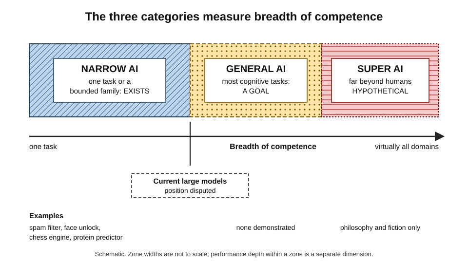
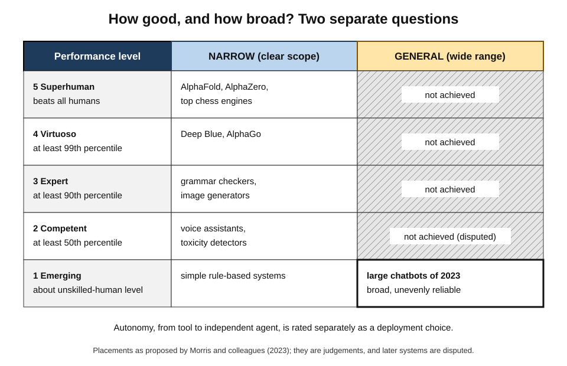
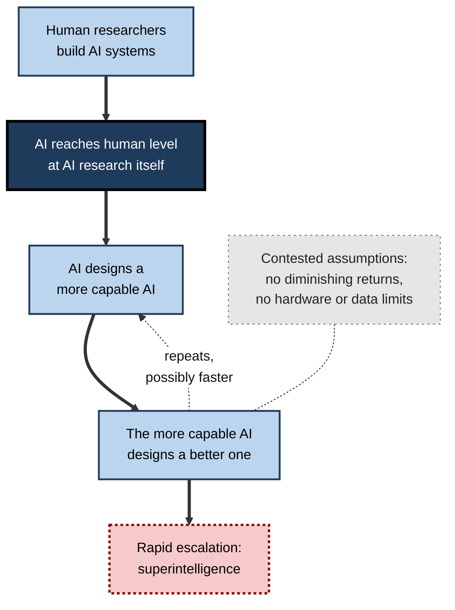
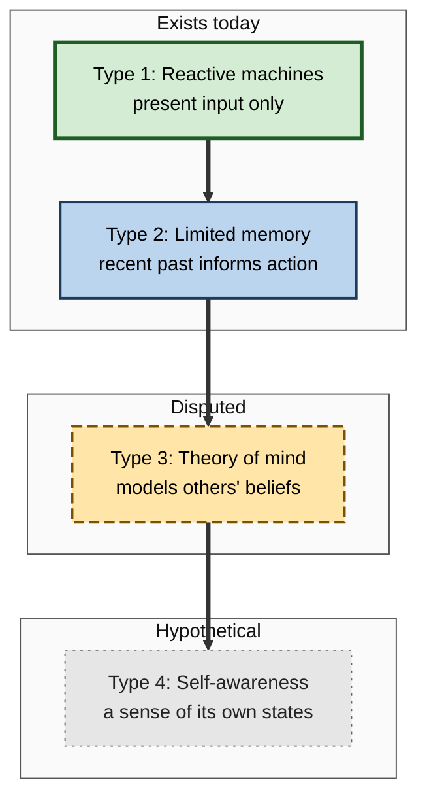
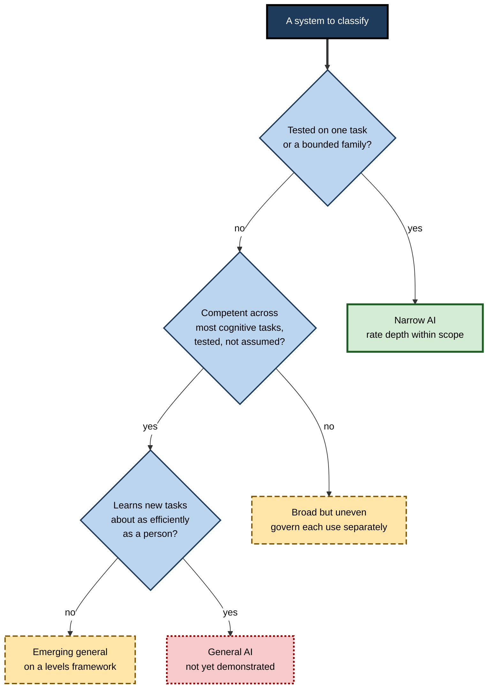

# C.1. Narrow AI vs. General AI vs. Super AI

A chess engine that has not lost to a human champion in decades cannot tell a cat from a dog. A photo app that recognises every face in a family album cannot play noughts and crosses. A chatbot that drafts a legal letter in seconds may fail a simple puzzle a child solves at once. Each is impressive inside a boundary and helpless outside it — and the width of that boundary is the most useful single fact to know about any AI system.

> **Definition — Narrow AI (artificial narrow intelligence, ANI):** an AI system that performs a specific task, or a bounded family of tasks, competently — but cannot carry that competence into unrelated tasks without being rebuilt or retrained.

> **Definition — General AI (artificial general intelligence, AGI):** a hypothetical AI system that matches or exceeds skilled human performance across most cognitive tasks, including tasks it was not specifically built for, and can learn new ones with roughly human efficiency.

> **Definition — Super AI (artificial superintelligence, ASI):** a hypothetical intellect that greatly exceeds the best human performance in virtually all domains of interest — the formulation of the philosopher **Nick Bostrom (2014)**.

**Why the distinction matters**

- It tells a buyer, regulator or user **what to expect** from a system — and what not to.
- It separates **claims about products** (almost always narrow) from **claims about the future** (general and super).
- It frames the largest debates in the field: how far current methods can go, how fast, and with what risks.
- Most public confusion about AI comes from **reading narrow success as general ability**.

---

## A Scale of Breadth

### Breadth, not cleverness

The three terms describe **how wide** a system's competence is, not how impressive it is on any one task.

- **Depth** — how well a system performs a given task.
  - *e.g.* a protein-structure predictor may beat every human expert.
- **Breadth** — how many different tasks it can perform well.
  - *e.g.* the same predictor cannot write an email or plan a holiday.
- **Transfer** — how readily competence in one task helps with a new one.
  - *e.g.* a person who learns chess picks up draughts quickly; a chess engine does not.
- **Learning efficiency** — how much experience a system needs to acquire a new skill.
  - *e.g.* a child learns a new word from a handful of uses; many machine systems need thousands of examples.

> **Key point:** a system can be **superhuman and narrow** at once. Depth and breadth are independent dimensions.

**Figure 1.** Narrow, general and super AI placed on the dimension of breadth.

### The three categories side by side

| | Narrow AI | General AI | Super AI |
|---|---|---|---|
| Scope | One task or a bounded family | Most cognitive tasks humans can do | Virtually all cognitive domains |
| Performance level | Anywhere from weak to superhuman, within scope | At least skilled-human level across the board | Far beyond the best humans everywhere |
| Learning new tasks | Requires redesign, new data or retraining | Learns new tasks roughly as efficiently as a person | Learns faster and better than any person |
| Existence | Exists everywhere today | Not achieved; its nearness is disputed | Hypothetical |
| Typical examples | Spam filters, face unlock, chess engines, route planners, chatbots | Fictional assistants such as the computer in *Star Trek* | Speculative scenarios in philosophy and fiction |

> **Watch out:** "narrow" is not an insult. Narrow systems include some of the most valuable technologies ever built — search, translation, fraud detection, medical imaging. "Narrow" describes scope, not worth.

### Where the terms came from

- **"Artificial intelligence"** — coined in the 1955 proposal for the 1956 Dartmouth workshop, whose authors hoped every aspect of intelligence could be described precisely enough for a machine to simulate it. The founding ambition was, in effect, **general**.
- **"Narrow AI"** — came into use as the field retreated to specialised tasks after early overconfidence; it described what actually worked.
- **"Artificial general intelligence"** — used by the physicist **Mark Gubrud (1997)** and popularised in the early 2000s by researchers including **Shane Legg** and **Ben Goertzel**, who wanted a name for the original ambition that the field had largely set aside.
- **"Superintelligence"** — rooted in the statistician **I. J. Good's** 1965 essay on an "ultraintelligent machine", and developed systematically by **Bostrom (2014)**.

> **Mnemonic — "AGS — Actual, Goal, Speculation":** narrow AI is actual; general AI is the field's goal; super AI is speculation.

---

## Narrow AI: The Only Kind That Exists

### What makes a system narrow

- **A fixed task definition** — inputs and outputs are decided in advance.
  - *e.g.* input: a transaction; output: a fraud probability.
- **Training or design for that task** — the system's competence comes from data or rules specific to the task.
- **Dependence on familiar conditions** — performance falls when inputs differ from those it was built for.
  - *e.g.* a vision model trained on daytime images struggles at night.
- **No understanding of its own purpose** — it does not know *why* the task matters or when to stop.

### Narrow does not mean simple

- **Superhuman narrow systems** exist in several domains:
  - **Game play** — chess (IBM's Deep Blue beat Garry Kasparov in 1997), Go (DeepMind's AlphaGo beat Lee Sedol in 2016).
  - **Science** — DeepMind's AlphaFold predicts protein structures to near-experimental accuracy in many cases; its developers shared the 2024 Nobel Prize in Chemistry.
  - **Perception** — some medical-imaging systems match specialists on carefully defined detection tasks.
- **Wide narrow systems** — modern language models handle writing, coding, translation, summarising and question-answering. They are much **broader** than earlier systems, which is why their classification is disputed (below).

### Everyday narrow AI

- **Personal life**
  - **Recommendations** — streaming and shopping suggestions.
  - **Navigation** — route planning with traffic prediction.
  - **Phones** — face unlock, photo search, predictive text.
- **Work**
  - **Finance** — card-fraud scoring; credit risk models.
  - **Healthcare** — triage of scans; reading of retinal photographs.
  - **Software** — code completion; automated testing.
  - **Sales and marketing** — lead scoring; churn prediction.
  - **Law** — document review in litigation; contract clause extraction.

> **Example (illustrative):** a bank's fraud model flags 0.3% of card transactions for review and catches most fraud — yet if the same model were shown a mortgage application it would produce a number with no meaning at all.

---

## General AI: The Goal and Its Definitions

### Why AGI is hard to define

There is no agreed definition of AGI, because there is no agreed definition of intelligence. Each proposed definition picks a different yardstick.

- **Human-comparison definitions** — AGI performs most cognitive tasks at the level of a skilled adult.
- **Economic definitions** — OpenAI's charter: "highly autonomous systems that outperform humans at most economically valuable work".
- **Goal-achievement definitions** — **Shane Legg and Marcus Hutter (2007)** collected some seventy definitions of intelligence and distilled them: intelligence measures an agent's ability to achieve goals in a wide range of environments.
- **Learning-efficiency definitions** — **François Chollet (2019)**: intelligence is the efficiency with which a system acquires new skills from limited experience; skill alone, bought with vast data, does not count.
- **Psychometric definitions** — **Dan Hendrycks and colleagues (2025)** grounded AGI in the Cattell–Horn–Carroll model of human cognitive abilities: AGI matches the cognitive versatility and proficiency of a well-educated adult across ten broad domains, such as reasoning, knowledge, memory and perception.

> **Key point:** the definitions disagree about whether **performance**, **breadth**, **autonomy**, **economic impact** or **learning efficiency** is the heart of the matter — so the same system may count as AGI under one definition and fall far short under another.

| Definition family | Yardstick | Strength | Weakness |
|---|---|---|---|
| Human comparison | Skilled-adult performance on most tasks | Intuitive | "Most tasks" and "skilled" are vague |
| Economic | Outperforming humans at valuable work | Ties to real-world impact | Depends on markets and adoption, not just capability |
| Goal achievement | Success across many environments | Mathematically precise | Hard to measure in practice |
| Learning efficiency | Speed of acquiring new skills | Separates intelligence from memorised skill | Few tests exist; humans hard to benchmark |
| Psychometric | Profile across cognitive abilities | Measurable, shows uneven profiles | Human tests may not suit machines |

### Levels rather than a line

**Study card — Morris and colleagues at Google DeepMind (2023), "Levels of AGI"**

- **Problem:** AGI was being treated as a single finish line, which made claims impossible to compare.
- **Proposal:** two independent dimensions.
  - **Performance** — how good, relative to skilled adults:
    - Level 0 — no AI;
    - Level 1 — emerging (equal to or somewhat better than an unskilled human);
    - Level 2 — competent (at least the 50th percentile of skilled adults);
    - Level 3 — expert (at least the 90th percentile);
    - Level 4 — virtuoso (at least the 99th percentile);
    - Level 5 — superhuman (outperforms all humans).
  - **Generality** — narrow (a clearly scoped task) versus general (a wide range of non-physical tasks, including learning new skills).
- **Placements suggested by the authors:**
  - chess and Go engines, and AlphaFold → high-performing **narrow** AI;
  - the large chatbots of 2023 → **emerging** general AI — broad, but not reliably competent across the board.
- **Also proposed:** separate **autonomy levels**, from AI as a tool to AI as a fully independent agent — because how much freedom a system is given is a deployment choice, not a property of its intelligence.
- **Conclusion:** the useful question is not "is it AGI?" but "**at what level of performance, across what breadth, with what autonomy?**"

**Figure 2.** Performance and generality as two separate dimensions.

> **Watch out:** the placements in such frameworks are **judgements**, not measurements. Researchers disagree sharply about where current systems sit.

### The jagged profile

- Current large models are **uneven**: expert-like at some tasks, weak at others that people find easy.
  - Hendrycks and colleagues (2025) reported an overall score of about **27% for GPT-4 and 57% for GPT-5** on their framework — with the shortfall concentrated in areas such as **long-term memory**, rather than spread evenly.
  - The ARC Prize Foundation's interactive **ARC-AGI-3** tests, launched in March 2026, were solved by human testers, while frontier models at launch scored close to zero — even as the same models excelled at professional examinations.
- This unevenness is called a **jagged frontier**: the boundary between what a system can and cannot do is irregular and hard to predict.

> **Definition — Jagged frontier:** the irregular boundary of an AI system's competence, along which tasks of apparently similar difficulty fall unpredictably inside or outside what it can do reliably.

---

## Super AI: The Speculative Extreme

### Three routes to superiority

**Bostrom (2014)** distinguished three ways an intellect could surpass humans:

- **Speed superintelligence** — thinks like a human, but much faster.
  - *e.g.* a mind that does a year of thinking in a day.
- **Collective superintelligence** — many minds coordinated so that the whole outperforms any human organisation.
  - *e.g.* millions of copies working together without friction.
- **Quality superintelligence** — thinks *better*, not just faster — as human thought differs from that of other animals.

> **Mnemonic — "SCQ — Speed, Collective, Quality":** the three forms of superintelligence.

### The intelligence explosion argument

**I. J. Good (1965)**, a statistician who had worked with Alan Turing at Bletchley Park, argued:

1. A machine that surpasses humans at all intellectual activities could also surpass them at **designing machines**.
2. It could therefore design an even better machine.
3. The process could repeat, each step faster — an "**intelligence explosion**".
4. Hence, in Good's words, the first ultraintelligent machine would be "the last invention that man need ever make", provided it was docile enough to keep under control.

- **Vernor Vinge (1993)** called the moment beyond which prediction fails the **technological singularity**.
- **Ray Kurzweil (2005)** popularised a date for it: around **2045**.

**Figure 3.** The recursive self-improvement loop at the heart of the intelligence explosion argument.

### Why many researchers doubt a fast explosion

- **Diminishing returns** — each improvement may be harder to find than the last, slowing rather than speeding the loop.
- **Physical bottlenecks** — computing hardware, energy, data and real-world experiments take time and money that intelligence alone cannot remove.
- **Intelligence is not one quantity** — being better at one cognitive task does not automatically make a system better at all of them.
- **Experiment, not just thought** — scientific progress needs tests in the physical world, which run at the world's pace.

> **Watch out:** the intelligence explosion is an **argument**, not an observation. Its conclusion depends on assumptions — about returns to research, bottlenecks and the nature of intelligence — that are actively disputed.

### Why the idea still matters

- **Risk research** — if superintelligence were possible, ensuring its goals matched human interests could be among the most consequential problems ever faced; this motivates much AI safety work.
- **Policy** — some governments and laboratories cite advanced-AI scenarios when designing evaluations and oversight for the most capable models.
- **Clarity** — distinguishing super AI from today's systems keeps present-day risks, such as bias and misuse, from being crowded out by speculation, and vice versa.

---

## Other Ways of Classifying AI by Capability

### Hintze's four types

**Arend Hintze (2016)**, an integrative biologist and computer scientist, proposed a functional classification that is widely repeated in business writing:

- **Reactive machines** — respond to the present input only; no memory of the past.
  - *e.g.* Deep Blue evaluated each chess position afresh.
- **Limited memory** — use recent past data to inform decisions.
  - *e.g.* a self-driving car tracking the speed of nearby vehicles over the last few seconds.
- **Theory of mind** — would model the beliefs, desires and intentions of others.
  - Not achieved in any robust sense; whether language models show glimmers of it is disputed.
- **Self-awareness** — would have a sense of its own existence and states.
  - Entirely hypothetical.

**Figure 4.** Hintze's four functional types, from the existing to the hypothetical.

> **Watch out:** Hintze's scheme was a short popular essay, not a research standard. Its middle category is so broad that almost every modern system is "limited memory", so it discriminates poorly between real systems.

### Weak and strong AI

- **John Searle (1980)** separated **weak AI** (machines that perform intelligent tasks or model minds) from **strong AI** (machines that literally *have* minds).
- This is a question about **minds**, not **breadth**: a general AI could, in principle, still be "weak" in Searle's sense.

### Comparing the classifications

| Scheme | Question it answers | Categories | Best use |
|---|---|---|---|
| Narrow / general / super | How broad and how strong is the competence? | ANI, AGI, ASI | Setting expectations; framing debates about the future |
| Levels of AGI | How good, how broad and how autonomous? | Performance levels × narrow/general, plus autonomy | Comparing claims precisely |
| Hintze's four types | What kind of internal function does it have? | Reactive, limited memory, theory of mind, self-aware | Teaching; rough intuition only |
| Weak / strong | Does it have a mind? | Weak, strong | Philosophy of mind; questions of moral status |

---

## The Boundary Between Narrow and General

### Why the boundary is blurring

- **Earlier systems** were unmistakably narrow: one model, one task.
- **Foundation models** — large models trained on broad data and then adapted — perform hundreds of tasks without task-specific design.
- **Multimodal models** handle text, images, audio and video together.
- **Agents** combine models with tools such as search, code execution and software control, extending what one system can do.

> **Definition — Foundation model:** a large model trained on broad data, usually by self-supervision, that can be adapted to a wide range of downstream tasks.

### Three positions on current systems

- **"Still narrow"** — current models perform a single underlying task, predicting the next piece of text, and their apparent breadth reflects the breadth of their training data.
  - Evidence cited: failure on genuinely novel puzzles; poor learning from a few examples once deployed; fabricated facts.
- **"Emerging general"** — breadth of competence is the defining feature, and current models already show it.
  - Evidence cited: strong performance across professional examinations, coding and science questions; transfer to unfamiliar tasks described in plain language.
- **"A new category"** — the narrow/general dichotomy no longer fits; systems are **broad but shallow in places**, and must be described by their profile.

> **Key point:** the disagreement is less about the facts — the systems' scores are public — than about **which facts count** as evidence of generality.

### Worked example (illustrative): classifying four systems

A technology team must explain to a board what four systems are. Each is placed by **breadth**, **performance within scope** and **ability to learn new tasks**.

| System | Breadth | Performance within scope | Learns new tasks? | Classification |
|---|---|---|---|---|
| Invoice-matching rule engine | One task | High on standard invoices; fails on unusual formats | No — rules must be rewritten | Narrow, competent |
| Chest X-ray triage model | One task family | Near specialist level on the conditions it was trained for | No — needs new labelled data | Narrow, expert-level within scope |
| General chatbot used for drafting | Hundreds of language tasks | Ranges from excellent to unreliable | Partly — from instructions and examples in the prompt | Broad; at most "emerging" general on the Levels framework |
| Science-fiction ship's computer | All tasks | Superhuman | Yes | Fictional general or super AI |

*Illustrative figures and systems.*

- **Steps used:**
  1. Define the **task scope** in plain words.
  2. Judge **performance** against a skilled human doing the same task.
  3. Test **transfer**: what happens with an unfamiliar input or a new task?
  4. Record **autonomy**: does a person check its output?
- **Conclusion:** only the first three exist, and all three need human oversight matched to their profile.

**Figure 5.** Classifying a system by tested scope rather than by the impression it makes.

> **Watch out:** the commonest error is to classify by **impressiveness of output** — fluent prose feels general — rather than by **tested breadth and transfer**.

---

## Using the Distinction Professionally

### Questions to ask about any system

1. **What exactly is the task?** — a narrow system should have a clearly stated scope.
2. **What happens just outside it?** — test inputs that differ from the training conditions.
3. **How does it fail?** — silently, loudly, or with confident nonsense?
4. **Who checks it?** — autonomy should match demonstrated reliability.
5. **Is a "general" claim backed by breadth tests**, or by a handful of impressive demonstrations?

> **Mnemonic — "TOFCB — The Outside Fails, Check Breadth":** Task, Outside the scope, Failure mode, Checker, Breadth evidence.

### Reading marketing and media claims

- **"Human-level"** — on which task, against which humans, measured how?
- **"Thinks like a person"** — usually a metaphor; ask what the system actually computes.
- **"AGI is near / here"** — under which definition? Claims change meaning entirely between definitions.
- **"Superintelligent"** — almost always describes narrow superhuman performance (*e.g.* at a game), not super AI.

> **In practice:** procurement teams increasingly ask suppliers for **scope statements**, **out-of-scope behaviour** and **evaluation evidence** rather than accepting labels. A narrow system with a precise scope is easier to govern than a broad one with vague promises.

### Case study: Deep Blue and the meaning of a narrow victory

- **Situation:** in May 1997, IBM's Deep Blue defeated the world chess champion Garry Kasparov in a six-game match, 3½–2½.
- **Public reading:** widely reported as a machine "out-thinking" humanity; magazine covers presented it as a turning point in the contest between human and machine minds.
- **What the system was:**
  - special-purpose hardware evaluating on the order of **200 million positions per second**;
  - a hand-tuned evaluation function, an opening book and endgame databases prepared with grandmaster help;
  - no ability to do anything except play chess.
- **What followed:**
  - the machine was retired soon afterwards;
  - its techniques did not transfer to other problems; Go, with far more possible positions, resisted the same approach for nearly two decades;
  - Kasparov later championed "advanced chess", in which humans and computers play together as teams.
- **Lesson:** superhuman performance in a bounded task says almost nothing about **general** intelligence. The right questions were about breadth and transfer — and the answers were "none" and "none".

### Case study (illustrative): a "general" assistant in a regulated firm

- **Situation:** an insurance firm deployed a general chatbot to help claims handlers summarise files and draft letters.
- **Problem:** handlers, impressed by fluent drafting, began asking it policy-coverage questions it had not been evaluated on; several answers cited policy clauses that did not exist.
- **Diagnosis:**
  - the system was **broad** in what it would attempt, but **evaluated** only on summarising;
  - breadth of willingness was mistaken for breadth of competence.
- **Actions:**
  1. The firm wrote a **scope statement**: summarising and drafting only.
  2. Coverage questions were routed to a retrieval system that quoted the actual policy text.
  3. Handlers were trained to treat answers outside scope as unverified.
- **Result:** fabricated citations largely disappeared from outgoing letters; trust in the tool, briefly damaged, recovered.
- **Lesson:** a broad system must be **governed as a collection of narrow capabilities**, each evaluated separately.

---

## Open Questions

- **Is AGI a meaningful single target?**
  - If intelligence is a profile of many abilities, there may be no moment at which a system "becomes" general — only a gradual filling-in of the profile.
- **Are current methods a path to AGI or a detour?**
  - Some researchers expect scaling and refinement of present methods to reach general competence; others argue that new ideas — about memory, world models or learning efficiency — are required.
- **Can generality be measured fairly?**
  - Tests leak into training data; human-designed tests may not suit machines; and learning efficiency is hard to measure.
- **Is superintelligence physically possible, and how fast could it arise?**
  - The answer depends on returns to research, physical bottlenecks and the nature of intelligence — all unresolved.
- **Do capability categories capture what matters for risk?**
  - A narrow system given wide autonomy may be riskier than a broad one under close supervision.

---

## Summary

- **Narrow AI** performs specific tasks, sometimes superhumanly; it is the only kind that exists.
- **General AI** would match skilled humans across most cognitive tasks and learn new ones efficiently; it has not been achieved, and its nearness is disputed.
- **Super AI** would greatly exceed the best humans in virtually all domains; it is hypothetical. Bostrom distinguished **speed, collective and quality** superintelligence.
- The terms measure **breadth**, not cleverness; **depth and breadth are independent**.
- AGI has **competing definitions** — human-comparison, economic, goal-achievement, learning-efficiency and psychometric — so the same system can pass under one and fail under another.
- The **Levels of AGI** framework separates **performance**, **generality** and **autonomy**.
- Current large models show a **jagged frontier**: uneven, hard-to-predict competence.
- **I. J. Good's intelligence explosion** argument underlies superintelligence scenarios; it rests on disputed assumptions about returns and bottlenecks.
- **Hintze's four types** and Searle's **weak/strong** distinction answer different questions and should not be confused with breadth.
- Professionally: classify systems by **tested scope, transfer and failure behaviour**, not by impressiveness; govern broad systems as collections of narrow capabilities.

---

## Self-Check

1. Define narrow, general and super AI in one sentence each.
2. Why can a system be both narrow and superhuman? Give an example.
3. Distinguish depth, breadth, transfer and learning efficiency.
4. Name four families of AGI definition and the yardstick each uses.
5. Describe the two main dimensions of the "Levels of AGI" framework and why autonomy is treated separately.
6. What is a jagged frontier, and what evidence suggests current models have one?
7. Set out I. J. Good's intelligence explosion argument in steps.
8. Give three reasons researchers doubt a rapid intelligence explosion.
9. List Bostrom's three forms of superintelligence.
10. Explain Hintze's four types and one weakness of the scheme.
11. How does Searle's weak/strong distinction differ from the narrow/general distinction?
12. Summarise the three positions on whether current large models are narrow or general.
13. A supplier claims its product offers "human-level intelligence". What five questions would you ask?
14. Why did Deep Blue's 1997 victory say little about general intelligence?
15. A firm finds staff using a drafting assistant for legal advice. How should it respond, and why?

### Answer Key

1. Narrow AI performs a specific task or bounded family of tasks. General AI would match skilled humans across most cognitive tasks and learn new ones efficiently. Super AI would greatly exceed the best humans in virtually all domains.
2. Because depth and breadth are independent: a system can be better than any human at one task and unable to do anything else. AlphaFold predicts protein structures beyond expert level but cannot write a letter.
3. Depth — quality on a task. Breadth — number of tasks done well. Transfer — how far skill in one task helps with a new one. Learning efficiency — how little experience is needed to acquire a new skill.
4. Human comparison (skilled-adult performance); economic (outperforming humans at valuable work); goal achievement (success across many environments); learning efficiency (speed of skill acquisition); psychometric (profile across cognitive abilities) — any four.
5. Performance (emerging, competent, expert, virtuoso, superhuman, relative to skilled adults) and generality (narrow versus general). Autonomy is a deployment decision — how much freedom a system is given — not a property of its intelligence, so it is rated separately.
6. An irregular, hard-to-predict boundary of competence. Current models excel at professional examinations yet fail some tasks people find easy; psychometric frameworks report uneven scores across domains, and interactive novel-puzzle tests launched in 2026 were solved by humans but scarcely at all by frontier models at launch.
7. A machine better than humans at all intellectual work would be better at designing machines; it could design a better machine; that machine could design a better one still; the cycle could accelerate into an intelligence explosion.
8. Diminishing returns to research; physical bottlenecks in hardware, energy, data and experiments; intelligence being many abilities rather than one quantity; the need for real-world testing.
9. Speed, collective and quality superintelligence.
10. Reactive machines; limited memory; theory of mind; self-awareness. Weakness: nearly every modern system falls into "limited memory", so it discriminates poorly; it was a popular essay, not a research standard.
11. Weak/strong asks whether a machine has a mind; narrow/general asks how broad its competence is. A broad system need not have a mind.
12. "Still narrow" — one underlying task, breadth inherited from data; "emerging general" — breadth itself is the defining feature and is present; "new category" — profiles are broad but uneven and the dichotomy no longer fits.
13. On which tasks? Against which humans? Measured how, and by whom? What happens outside the tested scope? How does it fail, and who checks it?
14. Deep Blue was special-purpose hardware and hand-built chess knowledge; it could do nothing else and its methods did not transfer. Superhuman depth in one bounded task says nothing about breadth.
15. Define the system's scope; evaluate any new use before allowing it; route legal questions to verified sources or qualified people; train staff that answers outside scope are unverified — because willingness to answer is not evidence of competence.

---

## Glossary

| Term | Meaning |
|---|---|
| Artificial general intelligence (AGI) | Hypothetical AI matching skilled humans across most cognitive tasks and learning new ones efficiently. |
| Artificial narrow intelligence (ANI) | AI that performs a specific task or bounded family of tasks. |
| Artificial superintelligence (ASI) | Hypothetical intellect far exceeding the best humans in virtually all domains. |
| Autonomy level | The degree of independence a system is given in deployment, from tool to independent agent. |
| Breadth | The range of tasks a system performs well. |
| Collective superintelligence | Superiority arising from many coordinated minds. |
| Depth | How well a system performs a particular task. |
| Foundation model | A large model trained on broad data and adaptable to many tasks. |
| Intelligence explosion | Hypothesised runaway cycle of AI improving its own design. |
| Jagged frontier | The irregular, hard-to-predict boundary of a system's competence. |
| Learning efficiency | How little experience a system needs to acquire a new skill. |
| Levels of AGI | A framework rating systems by performance, generality and autonomy. |
| Limited memory | Hintze's type for systems that use recent past data in decisions. |
| Quality superintelligence | Superiority in the quality, not just speed, of thought. |
| Reactive machine | Hintze's type for systems responding only to present input. |
| Speed superintelligence | Human-like thought running much faster than a human. |
| Strong AI | The claim that a suitably programmed machine literally has a mind. |
| Technological singularity | A hypothesised point beyond which technological change becomes unpredictable. |
| Theory of mind | The capacity to model the beliefs and intentions of others. |
| Transfer | Carrying competence from one task to a new one. |
| Weak AI | The claim that machines can perform intelligent tasks or model minds, without having minds. |
