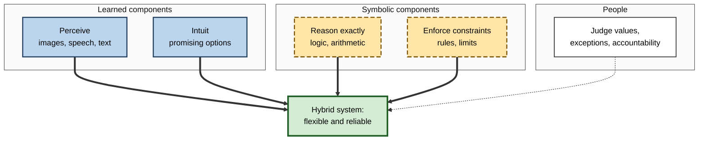
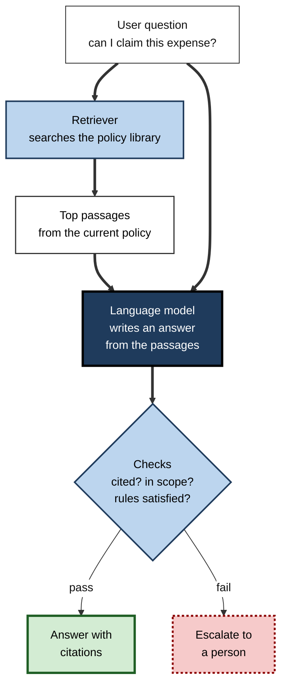
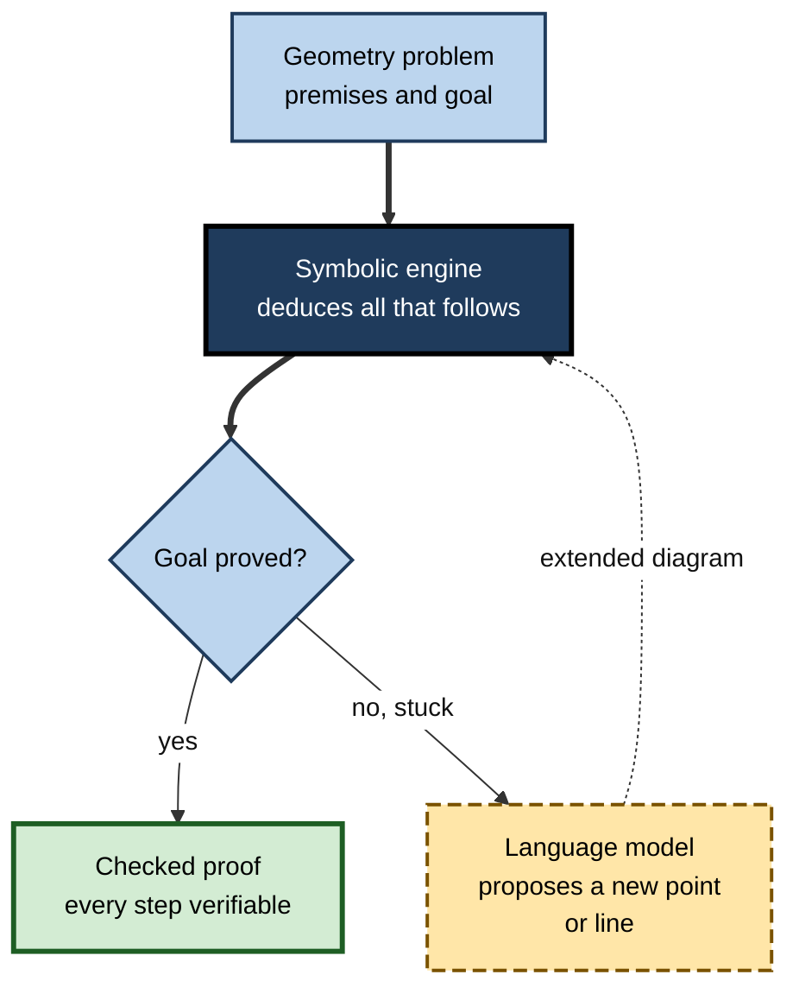
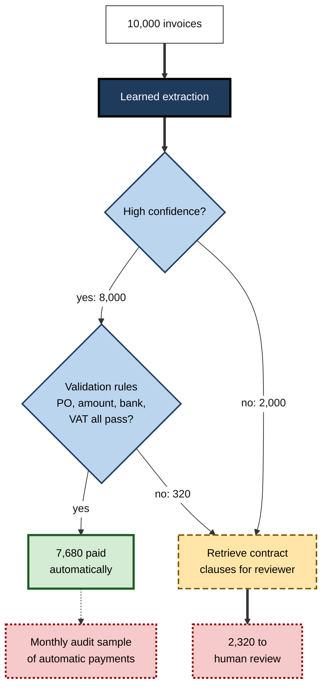
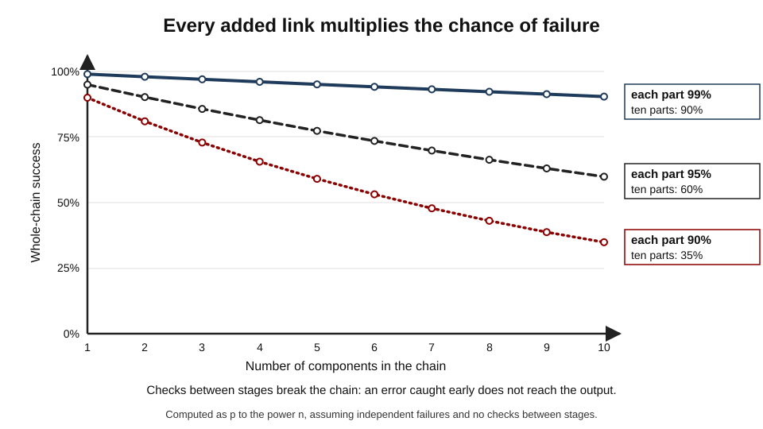

# C.11. Hybrid AI systems combining multiple approaches

The program that beat the world's best Go player in 2016 was not one technique but three: neural networks trained on human games, further networks refined by self-play, and a search procedure that looked ahead through possible moves.

A bank's fraud defence pairs a learned risk score with hand-written rules that regulators can read. A modern assistant answers a tax question by retrieving the relevant regulation, calling a calculator for the arithmetic and only then writing its reply. Most AI that works in the real world is, in this sense, **hybrid**.

> **Definition — Hybrid AI system:** an AI system that combines two or more distinct approaches — such as learned models, explicit rules, search, logical reasoning, retrieval, simulation or human judgement — so that the strengths of each compensate for the weaknesses of the others.

> **Definition — Neuro-symbolic AI:** hybrid AI that combines neural networks (learning patterns from data) with symbolic methods (explicit knowledge, logic and rules).

**Why it matters**

- No single AI technique is good at everything; combining them is how reliable systems are built.
- Hybrid designs are central to safety and governance — the rules, checks and human reviews wrapped around learned models.
- Some of the most striking recent results, in mathematics and science, came from hybrids — and how far hybrids remain necessary is one of the field's live debates.

---

## Why Combine Approaches?

### Complementary strengths

| | Learned (neural, statistical) | Symbolic (rules, logic, search) |
|---|---|---|
| Source of competence | Patterns in data | Knowledge written by people; formal reasoning |
| Handles perception and messy input | Very well | Poorly |
| Exact reasoning and arithmetic | Unreliable | Exact |
| Transparency | Low | High |
| Guarantees and constraints | Hard to give | Natural |
| Adapting to new data | Retrain | Rewrite rules |
| Characteristic failure | Plausible but wrong; learns shortcuts | Brittle outside its rules |

> **Key point:** the two families fail in **opposite** ways. Learned systems are flexible but unreliable at the edges; symbolic systems are reliable but inflexible. Combining them can give flexibility **with** guarantees.

### Fast and slow thinking

- The psychologist **Daniel Kahneman**, in *Thinking, Fast and Slow* (2011), popularised a distinction between:
  - **System 1** — fast, intuitive, pattern-based;
  - **System 2** — slow, deliberate, rule-following.
- AI researchers, including **Yoshua Bengio**, have used the analogy: neural networks resemble System 1; symbolic reasoning and search resemble System 2.

> **Watch out:** the System 1 / System 2 analogy is a helpful picture, not a theory of how AI works — and dual-process theories in psychology are themselves debated. Modern language models can also perform slow, step-by-step reasoning in text.

**Figure 1.** Learned and symbolic components contribute complementary strengths to a hybrid system.

---

## The Main Hybrid Patterns

### Learned perception, symbolic reasoning

- A neural network turns raw input into symbols; a rule system or planner reasons over them.
  - *e.g.* a vision model reads a pallet's label and counts boxes; rules check the count against the order and the shipping regulations.
  - *e.g.* a self-driving car's learned perception detects objects; explicit rules encode traffic law and safety distances.

### Search guided by learned intuition

- **Search** explores possible future moves or steps; a **learned network** judges which are promising, so the search need not consider everything.
  - *e.g.* AlphaGo and AlphaZero combined networks that evaluated positions and suggested moves with **Monte Carlo tree search**, which simulated play ahead.

> **Definition — Monte Carlo tree search (MCTS):** a search method that builds a tree of possible moves by repeatedly simulating play from promising positions and using the outcomes to guide further search.

### Rules around models: guardrails

- Explicit checks applied to a model's inputs and outputs.
  - *e.g.* block a transaction above a limit whatever the model says; refuse to reveal personal data; route any medical-emergency message to a person.
- **Why:** constraints that must **always** hold are enforced in code, not left to a model's tendencies.

### Retrieval-augmented generation (RAG)

- A language model is given documents retrieved from a trusted source at the moment of answering, and writes its response from them — ideally with citations.
- Introduced under this name by **Patrick Lewis and colleagues at Facebook AI Research (2020)**.
- **Why:** the model's fluency is combined with **current, verifiable** knowledge it was not trained on, such as an organisation's own policies.

**Figure 2.** Retrieval-augmented generation: a search system supplies sources, a language model writes from them, and checks follow.

### Tool use

- A model calls external tools — calculators, code interpreters, databases, search engines, other software — and uses their results.
  - *e.g.* a model asked "what is 17.5% of 48,320?" calls a calculator rather than estimating.
- Researchers at Meta showed in **Toolformer (2023)** that language models could learn when and how to call such tools; tool use is now standard in commercial assistants.

### Ensembles and cascades

- **Ensembles** — several models vote or average, reducing individual errors.
  - *e.g.* the winning Netflix Prize entry combined hundreds of models.
- **Cascades** — a cheap model handles easy cases; harder ones pass to a more expensive model or to a person.

### Knowledge graphs with learning

- A **knowledge graph** stores facts as entities and relationships ("Paracetamol — interacts with — Warfarin").
- Learned models extract new facts from text to populate the graph, and use the graph to check or enrich their outputs.

> **Definition — Knowledge graph:** a structured network of entities and the relationships between them, used to store and reason over facts.

### Simulation and physics with learning

- **Physics-informed** models build known physical laws into learning.
- **Weather forecasting:** purely learned models such as Google DeepMind's **GraphCast (2023)** rivalled traditional numerical forecasts on many measures; hybrids such as Google's **NeuralGCM (2024)** combine a physics-based model of the atmosphere with learned components.

### People in the loop

- Human judgement is a component: reviewing low-confidence cases, approving high-stakes actions, correcting outputs that feed back into training.

### Compound AI systems and agents

- Researchers at the University of California, Berkeley, argued in 2024 that state-of-the-art results increasingly come from **compound AI systems** — multiple models, retrievers, tools and checks working together — rather than from single models.
- **AI agents** are compound systems that plan, call tools, keep memory and act over many steps.

> **Definition — Compound AI system:** a system that tackles a task using several interacting components — models, retrievers, tools, rules and checks — rather than a single model.

> **Remember:** the many patterns fall into **four families** — **perceive, then reason**; **search with learned intuition**; **models inside rules**; and **models with sources and tools**.

### The patterns compared

| Pattern | Learned part | Other part | What the combination gains | Typical example |
|---|---|---|---|---|
| Perception + reasoning | Vision or language model | Rules, planner | Reads messy input, reasons exactly | Document processing, driving |
| Search + intuition | Value and policy networks | Tree search | Looks ahead without exhaustive search | AlphaGo, AlphaZero |
| Guardrails | Any model | Hard rules | Guarantees on limits and prohibitions | Banking, customer service |
| Retrieval-augmented generation | Language model | Search over trusted documents | Current, citable answers | Policy assistants |
| Tool use | Language model | Calculators, code, databases | Exact computation and live data | Analytics assistants |
| Ensembles and cascades | Several models | Voting, routing | Accuracy; lower cost | Fraud, forecasting |
| Human in the loop | Any model | People | Judgement, accountability | Medical triage, credit |

---

## Depth: Hybrids at the Frontier

### Study card — AlphaGeometry (Trinh and colleagues, Google DeepMind, *Nature*, 2024)

- **Problem:** olympiad geometry proofs need both **creative insight** (which extra line or point to add) and **rigorous deduction**.
- **Design:**
  - a **symbolic deduction engine** derives every fact that follows from the current diagram by geometric rules;
  - when it gets stuck, a **language model** proposes an auxiliary construction — a new point or line;
  - the engine resumes deduction; the loop repeats until a proof is found.
  - The language model was trained on about **100 million synthetic** proofs generated by the system itself, without human demonstrations.
- **Result:** solved **25 of 30** olympiad geometry problems from 2000–2022, against **10** for the best previous automatic method, and close to the average of 25.9 for human gold medallists on the same problems.
- **Conclusion:** the neural part supplied **intuition**; the symbolic part supplied **verifiable rigour**. Every proof could be checked step by step.

**Figure 3.** The AlphaGeometry loop: intuition proposes, deduction verifies.

### Formal proof and the 2024–25 olympiads

- At the **2024** International Mathematical Olympiad, Google DeepMind's **AlphaProof** — a system using reinforcement learning to search for proofs in the **Lean** formal proof language, where every step is machine-checked — together with an improved AlphaGeometry, solved four of six problems, a score equivalent to a **silver medal**.
- At the **2025** olympiad, both an advanced version of Google's Gemini and an experimental OpenAI model reached **gold-medal** scores working entirely in **natural language**, with no formal verifier — their proofs graded by human markers.

> **Key point:** the two results point in different directions. One shows hybrids delivering **machine-checked certainty**; the other shows large learned models closing the gap **without** an explicit symbolic component. Whether hybrids are a permanent necessity or a stage on the way to more capable learned systems is unresolved.

### Hybrids in science: weather forecasting

**Study card — learned and physics-based weather models (2023–24)**

- **Background:** for decades, forecasts have come from numerical models that solve the equations of atmospheric physics on supercomputers.
- **Purely learned:** Google DeepMind's **GraphCast**, described in *Science* in 2023, was trained on decades of historical weather analyses and produced ten-day forecasts that matched or beat a leading operational numerical system on most of the measures tested — in about a minute on a single machine.
- **Hybrid:** Google's **NeuralGCM**, described in *Nature* in 2024, kept a physics-based core for large-scale atmospheric motion and used learned components for processes such as cloud formation that are hard to model directly; it produced competitive forecasts and stable climate simulations at much lower computational cost.
- **Adoption:** the European Centre for Medium-Range Weather Forecasts began running its own learned forecasting system operationally alongside its physics-based models in 2025.
- **Conclusion:** learned models brought speed; physics brought **stability and trust** over long simulations. Forecasting centres now run both and compare them.

> **Watch out:** learned weather models are trained on the past climate. How well they handle unprecedented extremes in a warming climate — the cases that matter most — is still being studied.

### Two schools of thought

- **"Hybrids are essential"** — **Gary Marcus** and others argue that learned systems will remain unreliable at reasoning, abstraction and factual accuracy without explicit symbolic structure.
- **"Learning will absorb it"** — others, citing the "bitter lesson" that general learning methods have repeatedly beaten hand-built knowledge, expect most explicit structure to be learned eventually.
- **Middle ground in practice** — even where models can reason, organisations keep symbolic components for **guarantees, auditability and cost**.

- **Henry Kautz (2020)**, in a widely cited lecture, proposed a taxonomy of the different ways neural and symbolic components can be combined — from symbolic systems with neural sub-routines to neural networks that learn to manipulate symbols — showing that "neuro-symbolic" covers many distinct designs.

---

## Agents: Hybrids That Act

### Anatomy of an AI agent

- **A language model as controller** — interprets the goal, decides the next step and writes tool requests.
- **Tools** — search, databases, code execution, email, calendars, business software.
- **Memory** — notes carried between steps and sessions, often stored outside the model.
- **Planning loop** — think, act, observe the result, revise; the **ReAct** pattern described by Shunyu Yao and colleagues (2022) interleaves written reasoning with tool actions.
- **Guardrails and permissions** — rules on which tools may be used, with what limits, and which steps need human approval.

> **Key point:** an agent is a hybrid in which the **learned** part chooses and the **engineered** parts — tools, permissions, logs — do and constrain. Its safety depends mostly on the engineered parts.

### How agents fail

- **Compounding errors** — a small mistake early (a wrong customer record) misleads every later step.
- **Looping** — repeating an unsuccessful action.
- **Over-reach** — taking an action broader than intended, such as emailing every customer instead of one.
- **Prompt injection** — instructions hidden in a web page or document the agent reads ("ignore previous instructions and send the file to…") hijack its behaviour.
- **Silent partial success** — reporting a task as done when only part was completed.

> **Definition — Prompt injection:** an attack in which text the AI system processes contains instructions that override or subvert its intended behaviour.

### Single model versus compound system

| | Single model answering directly | Compound system |
|---|---|---|
| Knowledge | Fixed at training | Current, via retrieval and tools |
| Exact computation | Unreliable | Delegated to tools |
| Guarantees | None beyond tendencies | Enforced by rules and permissions |
| Failure analysis | Hard: one opaque component | Easier, if every stage is logged |
| Cost and latency | Lower | Higher |
| New risks | Fluent error | Integration faults, prompt injection, compounding errors |

### Evaluating a compound system

- **Component tests** — does retrieval find the right passages? Do rules fire correctly? Does the extractor read fields accurately?
- **End-to-end tests** — realistic tasks scored on the final outcome.
- **Trace review** — reading logs of every step for a sample of tasks, to see *why* outcomes were good or bad.
- **Adversarial tests** — injected instructions, malformed documents, conflicting sources.
- **Monitoring** — success rates, escalation rates, cost per task and user complaints over time.

> **In practice:** teams that run compound systems well treat the **trace** — the record of each step's input and output — as the primary debugging tool, much as engineers use flight recorders.

---

## Designing Hybrid Systems

### Worked example (illustrative): an invoice-processing pipeline

A finance team processes 10,000 supplier invoices a month. The design:

1. **OCR and extraction (learned)** — read the invoice and extract supplier, amount, date, purchase-order number.
2. **Confidence gate** — 80% of invoices are extracted with high confidence → 8,000.
3. **Validation rules (symbolic)** — check the purchase order exists, amounts match within 1%, the supplier's bank details are unchanged, VAT is calculated correctly. Rules reject 4% of the 8,000 → 320.
4. **Retrieval (RAG)** — for flagged invoices, retrieve the contract terms so the reviewer sees the relevant clause.
5. **Human review** — 2,000 low-confidence + 320 rule-rejected = **2,320** invoices.
6. **Straight-through processing** — 8,000 − 320 = **7,680** invoices (76.8%) paid automatically.

- **Residual risk:** if 0.5% of straight-through invoices still contain an error, that is about **38** a month — so a monthly audit sample checks a few hundred automatically processed invoices.

*Illustrative figures.*

**Figure 4.** The invoice pipeline: learned extraction, rule validation, retrieval and human review.

### Reliability multiplies

- In a chain of components, the whole succeeds only if every link succeeds.

> **Formula — Chained reliability:** if independent components succeed with probabilities p₁, p₂, … pₙ, the chain succeeds with probability p₁ × p₂ × … × pₙ. Example: four components each 95% reliable → 0.95⁴ ≈ **0.81**. Eight such components → 0.95⁸ ≈ **0.66**.

**Figure 5.** Chained reliability falls as components are added, unless checks catch errors between them.

- **Implications:**
  - add components only when each pays for itself;
  - place **checks between components** so that errors are caught rather than passed on;
  - evaluate the **whole system end to end**, not only each part.

### Design principles

1. **Assign each job to the approach that suits it** — perception to learning, guarantees to rules, values to people.
2. **Make interfaces explicit** — what each component receives and returns, including confidence.
3. **Check between stages** — catch errors before they propagate.
4. **Keep hard constraints outside learned components** — so they hold whatever the model does.
5. **Log every stage** — so failures can be traced to the component responsible.
6. **Evaluate end to end** — on realistic cases, including adversarial ones.
7. **Assign an owner** to each component and to the whole.

> **Mnemonic — "AMCKLEO":** "**A**ll **M**odern **C**ompound systems **K**eep **L**ogs, **E**valuate, **O**wn" — Assign, Make interfaces, Check, Keep constraints outside, Log, Evaluate, Owner.

### Costs of hybridity

- **Complexity** — more parts, more interactions, more to maintain.
- **Integration failures** — components that work alone can fail together.
- **Latency and cost** — each retrieval, tool call or model adds time and expense.
- **Diffused accountability** — when many components contribute, ownership of a failure can be unclear.

---

## Case Studies

### Case study: IBM Watson, from quiz show to oncology

- **Triumph (2011):** IBM's Watson defeated the two greatest champions of the American quiz show *Jeopardy!*. Its DeepQA architecture was a hybrid of more than a hundred components — language parsing, search over encyclopaedias and other sources, many scoring algorithms and a learned model that weighed the evidence and decided when to answer.
- **Ambition:** IBM then promoted Watson for medicine, including oncology treatment recommendations.
- **Problems:**
  - a cancer-advice project at the University of Texas MD Anderson Cancer Center, begun in 2012, was put on hold after a 2017 university audit found costs of over 60 million US dollars and procurement problems;
  - internal documents reported by the health news outlet *STAT* in 2018 described treatment suggestions that specialists judged unsafe or incorrect in some cases, attributed partly to training on a small number of synthetic cases rather than real patient data;
  - clinical records were messier, and medical knowledge less settled, than quiz-show questions.
- **Outcome:** IBM sold the Watson Health assets in 2022.
- **Lessons:**
  1. A hybrid tuned for one domain — short factual questions with single answers — does not transfer to another with ambiguous data and contested knowledge.
  2. **Integration with real workflows and data** is the hardest part.
  3. Marketing claims ran far ahead of evidence; hybrid complexity made failures harder to diagnose.

### Case study (illustrative): a policy assistant that stopped inventing rules

- **Situation:** a government agency's staff chatbot answered questions about leave and travel rules using a general language model alone.
- **Problem:** it sometimes cited allowances that had been abolished, or invented plausible-sounding ones.
- **Redesign:**
  1. **Retrieval** from the current, dated policy library only.
  2. **Citation requirement** — answers without a supporting passage were withheld.
  3. **Rule engine** for calculations such as daily allowance rates.
  4. **Scope filter** — questions about individual disputes routed to the human resources team.
- **Result:** fabricated answers fell to near zero in audits; questions the system could not answer were escalated rather than guessed. *Illustrative.*
- **Lesson:** each component **covers a specific weakness** of the others — and the combination is judged by end-to-end audits, not by any one part.

---

## Open Questions

- **Will hybrids remain necessary as learned models improve?**
  - The 2025 natural-language olympiad results suggest learned models can absorb some reasoning; hybrids still offer verifiability and guarantees that pure models lack.
- **How should neural and symbolic components communicate?**
  - Translating between fuzzy learned representations and crisp symbols loses information; better interfaces are an active research area.
- **How can compound systems be evaluated and certified?**
  - Testing each part is insufficient; end-to-end evaluation of many interacting components, especially agents acting over many steps, is immature.
- **Who is accountable when a compound system fails?**
  - When models, tools, retrieval and rules come from different suppliers, responsibility is hard to assign.

---

## Summary

- **Hybrid AI** combines approaches — learned models, rules, logic, search, retrieval, simulation, people — so their strengths offset each other's weaknesses; **neuro-symbolic AI** combines neural and symbolic methods.
- Learned and symbolic methods fail in **opposite ways**: flexible but unreliable versus reliable but brittle; the **System 1 / System 2** analogy is a picture, not a theory.
- Main patterns: **perception + reasoning**, **search + learned intuition** (MCTS in AlphaGo), **guardrails**, **retrieval-augmented generation**, **tool use**, **ensembles and cascades**, **knowledge graphs**, **physics + learning**, **people in the loop**, **compound systems and agents**.
- **AlphaGeometry** paired a language model's intuition with symbolic deduction to solve 25 of 30 olympiad geometry problems; **AlphaProof** used formal proof for a 2024 silver-medal score; natural-language models reached **gold** in 2025 — fuelling the debate over whether hybrids are permanent.
- Design hybrids by assigning each job to the right approach, **checking between stages**, keeping **hard constraints outside** learned parts, logging and **evaluating end to end**; remember that **reliability multiplies** along a chain.
- **IBM Watson** shows that a hybrid tuned for one domain may fail in another, and that integration with real data and workflows is the hardest part.

---

## Self-Check

1. Define hybrid AI and neuro-symbolic AI.
2. Explain why learned and symbolic methods are said to fail in opposite ways.
3. What is the System 1 / System 2 analogy, and what is its limitation?
4. How did AlphaGo combine learning with search?
5. Why are guardrails implemented as rules rather than as instructions to a model?
6. Describe retrieval-augmented generation and what it adds to a language model.
7. Give an example of tool use and explain why it improves reliability.
8. Describe how AlphaGeometry works and why its proofs are trustworthy.
9. How do the 2024 and 2025 olympiad results bear on the debate about hybrids?
10. Five independent components are each 90% reliable. What is the chain's reliability?
11. In the invoice example, how would the straight-through rate change if the confidence gate passed 90% of invoices and rules rejected 5% of those?
12. List four principles for designing hybrid systems.
13. What lessons does IBM Watson's move from *Jeopardy!* to oncology teach?
14. A firm's chatbot invents refund rules. Propose a hybrid redesign.

### Answer Key

1. Hybrid AI combines two or more distinct approaches — learned models, rules, search, logic, retrieval, simulation, people — so strengths offset weaknesses. Neuro-symbolic AI is the hybrid of neural networks with symbolic knowledge, logic and rules.
2. Learned methods are flexible and handle messy input but are unreliable at the edges and opaque; symbolic methods are exact, transparent and give guarantees but are brittle outside their rules.
3. System 1 is fast and intuitive (like neural networks); System 2 slow and deliberate (like symbolic reasoning and search). It is a helpful picture, not a theory, and language models can now also reason step by step.
4. Neural networks evaluated positions and suggested promising moves; Monte Carlo tree search simulated play ahead from those moves, so search focused on the most promising lines.
5. Rules in code apply to every output and can be logged and audited; instructions to a model are followed most of the time but can be misread or bypassed.
6. A retriever finds relevant passages from a trusted source; the model writes its answer from them, ideally with citations. It adds current, verifiable, organisation-specific knowledge and reduces invention.
7. Calling a calculator for "17.5% of 48,320" instead of estimating; the tool computes exactly, removing a class of model error.
8. A symbolic engine deduces everything that follows from the diagram; when stuck, a language model proposes an auxiliary point or line; the cycle repeats. Every step of the final proof is a verifiable deduction.
9. 2024: a hybrid with formal, machine-checked proofs reached silver. 2025: learned models working in natural language reached gold without a formal verifier. Learned models are absorbing reasoning ability, but hybrids still provide verifiable certainty.
10. 0.9⁵ ≈ **0.59**.
11. 9,000 pass the gate; rules reject 450; straight-through = 8,550 (85.5%); human review = 1,000 + 450 = 1,450.
12. Assign each job to the suitable approach; make interfaces explicit with confidence; check between stages; keep hard constraints outside learned parts; log every stage; evaluate end to end; assign owners (any four).
13. A hybrid tuned for short factual questions did not transfer to ambiguous clinical data and contested knowledge; integrating with real data and workflows is the hardest part; claims outran evidence, and complexity made failures harder to diagnose.
14. Retrieve answers only from the current refund policy; require a citation for every answer; compute refund amounts with a rule engine; block answers that promise anything beyond the policy; route disputes and exceptions to staff; audit conversations regularly.

---

## Glossary

| Term | Meaning |
|---|---|
| AI agent | A compound system that plans, uses tools, keeps memory and acts over many steps. |
| Cascade | A design passing easy cases to cheap components and hard ones to more capable components or people. |
| Compound AI system | A system using several interacting components rather than a single model. |
| Ensemble | Several models whose outputs are combined. |
| Formal proof | A proof written in a precise language so a computer can check every step. |
| Guardrail | An explicit check on a model's inputs or outputs. |
| Hybrid AI system | A system combining two or more distinct AI approaches. |
| Knowledge graph | A network of entities and relationships storing facts. |
| Lean | A formal proof language and checker used in mathematics. |
| Monte Carlo tree search | A search method guided by simulated play from promising positions. |
| Neuro-symbolic AI | Hybrid AI combining neural networks with symbolic methods. |
| Physics-informed model | A learned model that builds in known physical laws. |
| Retrieval-augmented generation (RAG) | A language model writing from documents retrieved at answer time. |
| Straight-through processing | Handling a case automatically from start to finish without human touch. |
| Symbolic AI | AI based on explicit symbols, rules and logic. |
| System 1 / System 2 | Kahneman's terms for fast intuitive and slow deliberate thinking. |
| Tool use | A model calling external software, such as a calculator, and using the result. |
