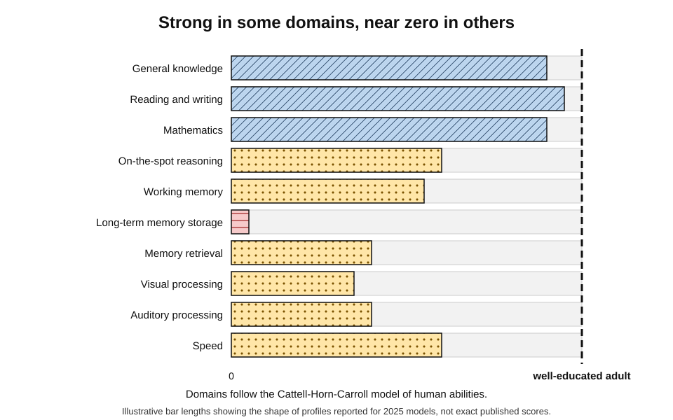
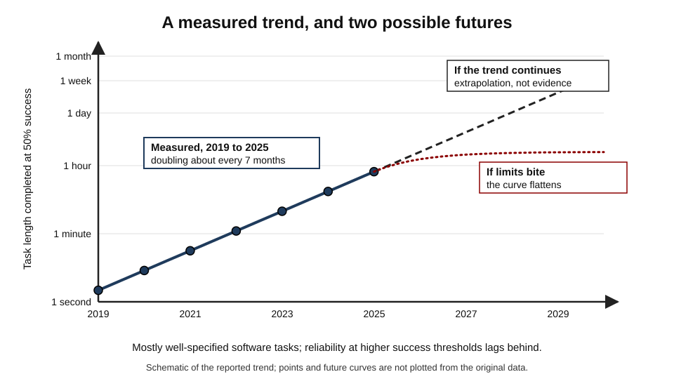
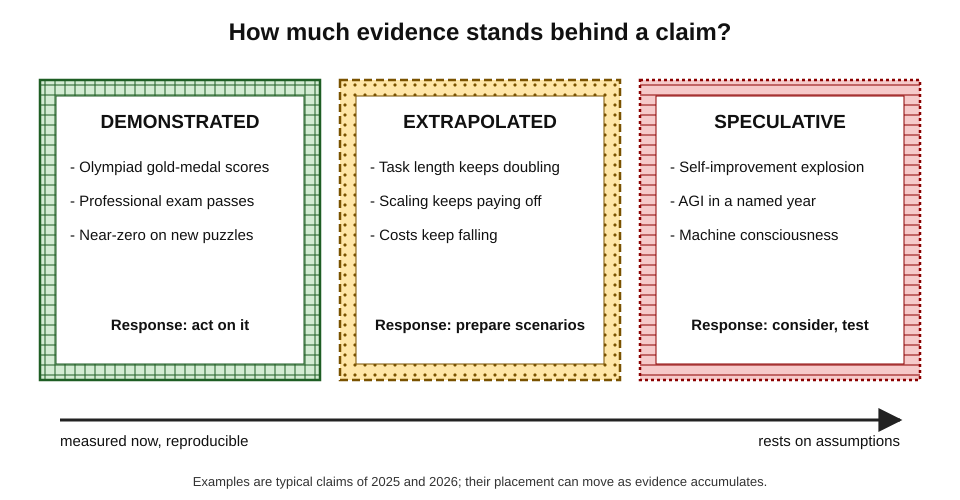
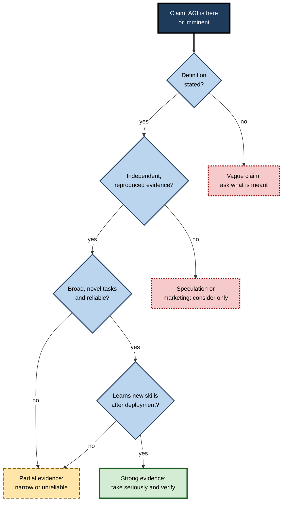
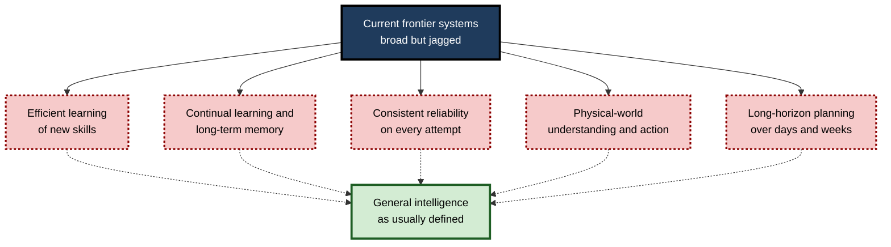
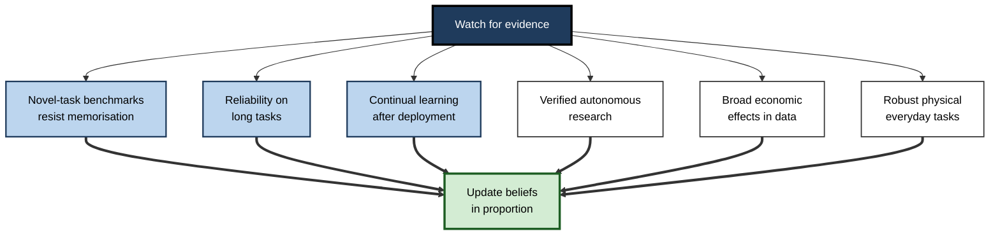

# C.12. Artificial General Intelligence: current reality vs. speculation

In 2025 AI systems reached gold-medal standard at the International Mathematical Olympiad. In 2026 the same generation of systems, faced with simple interactive puzzles that ordinary adults solved within minutes, scored close to zero. Chief executives announce that general intelligence is a few years away; respected researchers reply that essential ingredients are still missing. Separating what has been **demonstrated** from what is **extrapolated** and what is **imagined** is one of the most practical skills in AI literacy.

> **Definition — Artificial general intelligence (AGI):** a hypothetical AI system that matches or exceeds skilled human performance across most cognitive tasks, including unfamiliar ones, and acquires new skills with roughly human efficiency.

> **Definition — Speculation (in this context):** a claim about future AI capability that goes beyond what current evidence directly supports, however plausible or expert its source.

**Why it matters**

- AGI claims move investment, shape regulation and influence career choices.
- Over-belief leads to reckless deployment; under-belief leads to being unprepared for rapid change.
- The same evidence is read in opposite ways by informed people — so the ability to weigh claims oneself is essential.

---

## The State of Play

### What current systems demonstrably do

- **Broad language competence** — drafting, summarising, translating and answering questions across most professional domains.
- **Examination performance** — scores at or above typical passing levels on many professional and academic examinations in law, medicine and other fields.
- **Mathematics** — gold-medal scores at the 2025 International Mathematical Olympiad by systems from Google DeepMind and OpenAI, working in natural language.
- **Coding** — writing, debugging and explaining substantial programs; completing many well-specified software tasks autonomously.
- **Multimodality** — handling images, audio and video alongside text.
- **Agentic tasks** — using browsers, software tools and code to complete multi-step tasks, with growing but imperfect reliability.

### What they demonstrably struggle with

- **Novel abstraction** — puzzles that demand discovering a new rule from a few examples.
  - **François Chollet's ARC benchmark (2019)** was designed to test exactly this; its successors grew harder as systems improved. The interactive **ARC-AGI-3** tests, launched in March 2026, were solved by human testers, while leading models at launch scored close to zero.
- **Reliability** — performance that is excellent on average but unpredictable on any single attempt; confident errors.
- **Continual learning** — once deployed, most models do not durably learn from experience; they forget everything outside their context window unless retrained.
- **Long-term memory and planning** — sustaining a coherent goal over days or weeks of work.
- **The physical world** — dexterous manipulation and robust action in unstructured settings.
- **Learning efficiency** — needing vastly more data than a child to acquire comparable skills.

> **Key point:** today's systems are **broad but jagged** — superhuman in places, below an average adult in others, with no clear boundary between the two.

**Study card — Hendrycks and colleagues (2025), "A Definition of AGI"**

- **Approach:** grounded AGI in the **Cattell–Horn–Carroll** model of human cognitive abilities, the most widely validated psychometric model, testing AI across ten broad domains — including knowledge, reading and writing, mathematics, reasoning, working memory, long-term memory storage and retrieval, visual and auditory processing, and speed.
- **Benchmark for AGI:** the versatility and proficiency of a **well-educated adult**.
- **Results:** overall scores of about **27% for GPT-4** and **57% for GPT-5** — rapid progress, with a large remaining gap.
- **Profile:** strong in knowledge, language and mathematics; very weak in **long-term memory storage** — the ability to learn and retain new information over time.
- **Caveat:** the framework adapts human tests to machines, and critics question whether human ability models capture what matters for AI.

**Figure 1.** A jagged ability profile: strong in some cognitive domains, weak in others.

### The trend

- **Study card — METR (2025), task length:**
  - **Method:** researchers at the evaluation organisation METR measured the length of software and reasoning tasks — timed by how long skilled humans took — that AI agents could complete with 50% success.
  - **Result:** that length had **doubled roughly every seven months** from 2019 to 2025, from tasks of seconds to tasks of around an hour.
  - **Caveat:** the tasks were mostly well-specified software work; reliability at 80% or higher lagged well behind the 50% figure, and whether the trend continues is uncertain.

**Figure 2.** A doubling trend in the length of tasks AI agents complete, and what extrapolation assumes.

> **Watch out:** a steady trend on a logarithmic chart is **evidence of past progress**, not proof of future progress. Many technology trends have bent or stopped as they hit physical, economic or conceptual limits.

---

## Evidence, Extrapolation and Speculation

### Three kinds of claim

- **Demonstrated** — observed now, under stated conditions, ideally reproduced independently.
  - *e.g.* "This model scores 85% on this benchmark, as measured by an independent evaluator."
- **Extrapolated** — inferred by extending an observed trend.
  - *e.g.* "If task length keeps doubling every seven months, agents will handle week-long projects within a few years."
- **Speculative** — dependent on capabilities or events with no current evidence base.
  - *e.g.* "AGI will recursively improve itself into superintelligence within months."

**Figure 3.** Claims about AGI range from demonstrated facts through extrapolations to speculation.

| | Demonstrated | Extrapolated | Speculative |
|---|---|---|---|
| Basis | Direct measurement now | Extension of a measured trend | Imagined scenarios, analogies, arguments |
| Key question | Was it measured fairly and reproduced? | Will the trend continue, and why? | What assumptions does it rest on? |
| Typical source | Papers, independent evaluations | Forecasts, scaling analyses | Essays, interviews, fiction, advocacy |
| Appropriate response | Act on it | Plan for it, with scenarios | Consider it; do not treat as fact |

> **Remember:** **demonstrated** → act; **extrapolated** → prepare; **speculative** → consider, and look for evidence.

### Why claims are hard to judge

- **Definitional drift** — "AGI" is defined differently by different speakers; a claim may be true under one definition and false under another.
- **Benchmark contamination** — test questions may have appeared in training data, inflating scores.
- **Benchmark saturation** — tests are solved quickly, so "beats humans on X" often means X was a narrow test.
- **Selective demonstration** — showcased examples may be the best of many attempts.
- **Interests** — developers, investors, critics and advocacy groups all have reasons to emphasise particular readings.
- **Anthropomorphism** — fluent language triggers the human tendency to attribute minds.

> **Definition — Anthropomorphism:** attributing human mental states, such as understanding, feelings or intentions, to non-human things.

### A method for evaluating an AGI claim

1. **Definition** — which definition of AGI is being used?
2. **Evidence type** — demonstrated, extrapolated or speculative?
3. **Measurement** — on which tasks, measured by whom, with what controls for contamination?
4. **Breadth** — tested across many domains, including novel ones, or a few showcase tasks?
5. **Reliability** — average performance, or consistent performance on every attempt?
6. **Learning** — can the system acquire new skills after deployment?
7. **Interests** — who benefits if the claim is believed?

> **Mnemonic — "DEMBRLI — Do Experts Measure Breadth, Reliability, Learning, Interests?":** Definition, Evidence type, Measurement, Breadth, Reliability, Learning, Interests.

**Figure 4.** Evaluating a claim that a system is, or is close to, AGI.

---

## Arguments About the Path to AGI

### The case that current methods may get there

- **Scaling has delivered** — repeated, predictable gains as models, data and compute grew.
- **Surprising capabilities appeared** — abilities not explicitly trained for, such as translation between language pairs rarely seen together, emerged with scale.
- **New techniques compound** — reinforcement learning on checkable tasks, tool use and agent frameworks have extended capabilities beyond pure scaling.
- **The bitter lesson** — Richard Sutton's argument that general methods exploiting computation have repeatedly beaten hand-built knowledge.

### The case that something essential is missing

- **Novelty** — Chollet and others argue that current systems mostly apply **memorised skill**, not efficient acquisition of new skills; ARC-style results support this.
- **World models** — **Yann LeCun** has argued that systems trained mainly on text lack an understanding of the physical world that infants acquire through perception and action, and that new architectures are needed.
- **Reliability and grounding** — **Gary Marcus** and others hold that without explicit reasoning and knowledge structures, systems will keep making confident errors.
- **Continual learning and memory** — present systems are frozen after training; general intelligence seems to require learning throughout life.
- **Data and energy limits** — high-quality human text is finite, and the largest training runs consume large amounts of energy and capital.

**Figure 5.** Capabilities widely regarded as missing or immature in current systems.

> **Watch out:** both sides sometimes treat their position as settled. Neither the success of scaling so far nor the persistence of current weaknesses **proves** what will happen next. Informed experts genuinely disagree.

### The embodiment argument

- **Claim:** much of human intelligence is grounded in a body acting in the physical world — handling objects, moving through space, feeling consequences. A system trained mostly on text and images, the argument runs, lacks this grounding.
- **Evidence cited for it:** current systems' weakness at physical common sense, at predicting the results of actions, and at robot manipulation in unfamiliar settings.
- **Evidence cited against it:** large models trained on video and on robot data are improving at physical prediction; people born with severe physical disabilities develop full general intelligence, suggesting that much grounding can come by other routes.
- **Status:** unresolved; it shapes research choices, with some laboratories investing heavily in **world models** learned from video and interaction.

### What experts expect

- **A survey of 2,778 AI researchers (Katja Grace and colleagues, published 2024)** found an aggregate forecast of a **50% chance** that machines would outperform humans at every task by **2047** — thirteen years earlier than the same question had produced a year before.
- Individual forecasts ranged from a few years to never; the spread itself is the key finding.
- **Leaders of frontier AI companies** have publicly predicted transformative or general systems within a few years; their forecasts are informed but come from those with the strongest commercial interest.

> **Watch out:** expert forecasts of AI have a poor historical record in both directions. In the 1960s pioneers predicted human-level AI within a generation; in the 2010s many experts predicted that fluent conversational AI was decades away.

---

## When Claims Outrun Evidence

### Case study: the LaMDA sentience claim

- **Situation:** in June 2022 a Google engineer, Blake Lemoine, who had been testing the company's conversational model LaMDA for biased output, publicly claimed that it was **sentient**, releasing transcripts in which the model spoke of its feelings and fear of being switched off.
- **Response:** Google said its experts had reviewed his concerns and found no evidence for them; he was placed on leave and later dismissed for breaching confidentiality. Most AI researchers and philosophers who commented rejected the claim.
- **Why the transcripts were persuasive:** the model had been trained on vast amounts of human writing, including fiction and discussion about conscious machines; asked leading questions, it produced the responses such texts contain.
- **Lessons:**
  1. Fluent self-description is **not evidence of experience** — a language model can describe feelings it does not have.
  2. **Anthropomorphism** affects even experts who know how the systems work.
  3. Questions of capability (general intelligence) and of experience (sentience) are **separate**; neither settles the other.

### Case study: "Sparks of AGI"

- **Situation:** in March 2023 researchers at Microsoft released a paper titled "Sparks of Artificial General Intelligence", reporting experiments with an early version of GPT-4 across mathematics, coding, vision-like tasks, medicine, law and psychology, and arguing it could reasonably be viewed as an early, incomplete AGI.
- **Criticism:**
  - the experiments were qualitative and not independently reproducible — the model version was not publicly available;
  - the definition of intelligence used was broad and informal;
  - Microsoft was a major investor in the model's developer.
- **Value:** it documented a striking breadth of capability and prompted more rigorous evaluation frameworks.
- **Lesson:** a large set of impressive examples is **suggestive, not conclusive**. Strong claims need systematic, reproducible tests across breadth, novelty and reliability.

### When definitions carry money

- The partnership between Microsoft and OpenAI long contained provisions tied to OpenAI declaring that it had achieved AGI; under the restructured agreement announced in 2025, such a declaration was to be verified by an independent expert panel.
- **Lesson:** the meaning of "AGI" is not only a philosophical question — it can determine contracts, governance and control of technology.

### Case study (illustrative): a board briefing on "AGI by 2028"

- **Situation:** a technology vendor told a logistics company's board that "AGI by 2028" would make most of its planning staff redundant, and proposed a large contract to "prepare".
- **Analysis by the company's AI lead:**
  1. **Definition** — the vendor's AGI meant "AI that can do most planning tasks"; it had not said so.
  2. **Evidence type** — extrapolation from a benchmark trend plus speculation about reliability.
  3. **Demonstrated** — current tools drafted plans well but made errors in about one plan in ten when constraints were unusual. *Illustrative figure.*
- **Decision:** invest in **demonstrated** capability (planning assistants with human review), build a **scenario plan** for faster progress, and decline the "AGI readiness" contract.
- **Lesson:** decisions should rest on what is **demonstrated now**, with **scenarios** — not commitments — for what is extrapolated.

---

## Living With Uncertainty

### Signals worth watching

- **Novel-task benchmarks** — large gains on tests designed to resist memorisation.
- **Reliability** — success rates rising from "usually" to "almost always" on long tasks.
- **Continual learning** — systems that durably improve from their own deployment experience.
- **Autonomous research** — AI systems making verified contributions to science or to AI research itself.
- **Economic data** — measurable, broad changes in productivity and employment, not only anecdotes.
- **Physical capability** — robots reliably handling unstructured everyday tasks.

**Figure 6.** Signals that would distinguish genuine progress towards general intelligence from narrower advances.

### A professional stance

- **Use what is demonstrated** — adopt current capabilities where they fit, with appropriate checks.
- **Plan in scenarios** — slower, expected and faster progress; identify decisions that are robust across all three.
- **Invest in durable skills** — judgement, domain depth, verification, working with AI — which hold value in every scenario.
- **Update deliberately** — change views when significant new evidence appears, not with each announcement.

> **In practice:** a useful discipline is to keep a short written record of **what would change one's mind** — specific results that would make AGI seem nearer or further. It guards against both hype and complacency.

---

## What Would Count as AGI?

### Proposed tests

- **Conversation tests** — Turing's imitation game (1950): can a machine converse so that an interrogator cannot reliably tell it from a person? Modern chatbots pass short, informal versions, which has persuaded many that conversation alone is too weak a test.
- **The coffee test** — attributed to Apple's co-founder Steve Wozniak: could a robot enter an unfamiliar home, find the kitchen and make a cup of coffee? It demands perception, common sense and physical action.
- **The employment test** — proposed by the AI pioneer **Nils Nilsson (2005)**: could a machine do the jobs people are paid to do — a large share of them, at human standard?
- **The novel-skill test** — Chollet's ARC family: can the system solve new kinds of problems from a few examples, as efficiently as people?
- **The psychometric profile** — the Hendrycks framework: does the system match a well-educated adult across the broad domains of human cognitive ability?
- **The levels approach** — Google DeepMind's 2023 framework: how good, how broad and how autonomous?

| Test | What it emphasises | Strength | Weakness |
|---|---|---|---|
| Conversation | Human-like dialogue | Simple, intuitive | Fooled by fluency; short versions now passed |
| Coffee test | Physical, everyday competence | Hard to fake | Not standardised; mixes robotics with intelligence |
| Employment | Economic usefulness | Ties to real impact | Depends on adoption, law and prices, not only capability |
| Novel skill (ARC) | Learning efficiency on new problems | Resists memorisation | Narrow puzzle format |
| Psychometric profile | Breadth across cognitive abilities | Quantitative, shows gaps | Human tests may not suit machines |
| Levels | Performance, generality, autonomy | Separates questions | Placements are judgements |

> **Key point:** each test captures part of what people mean by general intelligence, and current systems pass some while failing others. The jaggedness of the results **is** the finding.

---

## Why the Question Matters Now

### Policy is already acting on capability

- **Frontier safety frameworks** — several leading developers have published policies committing to test their most capable models for dangerous capabilities (for example in cyber-attack or biological-weapons assistance) before release, and to add safeguards at defined thresholds.
- **Compute thresholds in law** — the EU AI Act presumes that a general-purpose model trained with more than 10²⁵ floating-point operations poses **systemic risk**, triggering duties of evaluation, incident reporting and cybersecurity.
- **Government evaluation bodies** — the United Kingdom's AI Security Institute (founded in 2023 as the AI Safety Institute) and counterparts elsewhere test advanced models before and after release.

> **Watch out:** policy built on capability thresholds depends on **measuring** capability — exactly where evidence is weakest. Compute is a convenient proxy, but efficiency gains mean smaller training runs can reach higher capability.

### What it means for a career

- **Demonstrated capability** is already changing tasks in writing, coding, analysis, customer service and design; this is happening whatever the outcome of the AGI debate.
- **Durable value** lies in what remains scarce: judgement under uncertainty, accountability, relationships, deep domain knowledge, and the ability to direct and verify AI work.
- **Adaptability** — the capacity to learn new tools and redesign one's own work — is valuable in every scenario, fast or slow.

---

## Open Questions

- **Is AGI a coherent target?**
  - If intelligence is a profile of many abilities, there may be no single moment of arrival — only an uneven filling-in.
- **Can current paradigms reach general competence?**
  - Scaling plus new training methods may suffice; or new ideas about memory, world models and learning efficiency may be required.
- **How should general capability be measured?**
  - Benchmarks are contaminated and saturate; interactive, novel and real-world tests are harder to build and to score.
- **Would AGI be conscious, or deserve moral consideration?**
  - Capability and experience are separate questions; there is no agreed test for machine experience.
- **How should society act under deep uncertainty?**
  - Preparing for rapid change risks wasted effort; failing to prepare risks being overtaken. How to balance these is a policy question as much as a technical one.

---

## Summary

- **AGI** is a hypothetical system matching skilled humans across most cognitive tasks and learning new ones efficiently; it has not been demonstrated.
- Current systems are **broad but jagged**: olympiad mathematics, professional examinations and coding on one side; novel abstraction (ARC-AGI-3), reliability, continual learning, long-term memory, physical action and learning efficiency on the other.
- **Hendrycks and colleagues (2025)** scored GPT-4 at about 27% and GPT-5 at about 57% of a well-educated adult's cognitive profile, with long-term memory a major gap.
- **METR** found task length doubling roughly every seven months to 2025 — evidence of a trend, not a guarantee.
- Classify claims as **demonstrated, extrapolated or speculative**; judge them by **definition, evidence, measurement, breadth, reliability, learning and interests**.
- Arguments for current methods (scaling, emergent abilities, new techniques) and against (novelty, world models, reliability, memory, limits) are both serious; **experts disagree widely**, and forecasts have a poor record.
- The **LaMDA** and **"Sparks of AGI"** episodes show how fluency and impressive examples can outrun evidence; commercial contracts show that definitions carry money.
- Professionally: **use what is demonstrated, plan in scenarios, build durable skills, update deliberately**.

---

## Self-Check

1. Define AGI and explain why current systems do not meet the definition.
2. List four capabilities current systems demonstrably have and four they struggle with.
3. What does "broad but jagged" mean? Give evidence.
4. Summarise the Hendrycks and colleagues framework and its main finding.
5. What did METR measure, and what are the caveats?
6. Distinguish demonstrated, extrapolated and speculative claims, with an example of each.
7. Name five reasons AGI claims are hard to judge.
8. Apply the seven-step method to the claim "our model has reached AGI because it passed the bar examination".
9. Summarise the strongest arguments on each side of whether current methods can reach AGI.
10. What did the 2024 survey of AI researchers find, and how should such forecasts be treated?
11. What does the LaMDA episode teach about anthropomorphism?
12. Why was "Sparks of AGI" criticised, and what was its value?
13. Why might the definition of AGI matter commercially?
14. A manager asks whether to retrain staff because "AGI is coming in two years". How would you advise?

### Answer Key

1. A system matching skilled humans across most cognitive tasks, including unfamiliar ones, and learning new skills with human-like efficiency. Current systems are uneven, fail on novel abstraction tests, are unreliable, do not learn durably after deployment and need far more data than people.
2. Have: broad language competence; strong examination results; olympiad-level mathematics; substantial coding; multimodality; multi-step tool use. Struggle: novel abstraction; consistent reliability; continual learning; long-term memory and planning; physical action; learning efficiency.
3. Competence across many domains but highly uneven — expert in some, weak in others — with unpredictable boundaries. Evidence: gold-medal olympiad mathematics alongside near-zero scores on ARC-AGI-3 at launch; psychometric profiles strong in knowledge but very weak in long-term memory.
4. AGI defined as the cognitive versatility and proficiency of a well-educated adult, measured across ten domains from the Cattell–Horn–Carroll model. GPT-4 scored about 27% and GPT-5 about 57%, with long-term memory storage a major weakness.
5. The length of tasks (in human time) AI agents complete with 50% success; it doubled about every seven months from 2019 to 2025. Caveats: mainly well-specified software tasks; higher-reliability thresholds lag; trends may not continue.
6. Demonstrated: a measured, reproduced benchmark score. Extrapolated: projecting a doubling trend forward. Speculative: rapid recursive self-improvement to superintelligence.
7. Definitional drift; benchmark contamination; saturation; selective demonstration; interests of those making claims; anthropomorphism (any five).
8. Definition: unstated — ask. Evidence: demonstrated, but one examination. Measurement: was the exam in training data? Breadth: one domain. Reliability: one attempt or consistent? Learning: no evidence of learning new skills. Interests: the claimant benefits. Conclusion: evidence of a narrow capability, not of AGI.
9. For: scaling has delivered predictable gains; unexpected abilities emerged; RL, tools and agents compound; general methods beat hand-built ones. Against: weak at novel abstraction; lack world models; unreliable; no continual learning or memory; data and energy limits.
10. Aggregate 50% chance by 2047 that machines outperform humans at every task, thirteen years earlier than a year before, with a very wide spread. Treat as informative about expert opinion, not as prediction; forecasts have erred in both directions.
11. Fluent self-description is not evidence of experience; even experts attribute minds to systems that produce human-like language; capability and sentience are separate questions.
12. Qualitative, non-reproducible experiments on an unreleased model, a loose definition and a conflict of interest. Value: documented striking breadth and spurred more rigorous evaluation.
13. Contracts and governance can depend on whether AGI has been declared — as in provisions in the Microsoft–OpenAI partnership — so a definition can shift rights, revenue and control.
14. Separate demonstrated capability from extrapolation: identify tasks current tools already change and train staff for them now; plan scenarios for slower and faster progress; invest in durable skills — judgement, domain expertise, verification and working with AI — that pay off in every scenario; avoid irreversible decisions based on speculation.

---

## Glossary

| Term | Meaning |
|---|---|
| AGI | Hypothetical AI matching skilled humans across most cognitive tasks and learning new ones efficiently. |
| Anthropomorphism | Attributing human mental states to non-human things. |
| ARC benchmark | Chollet's tests of discovering new rules from few examples; later versions are interactive. |
| Benchmark contamination | Test items appearing in training data, inflating scores. |
| Benchmark saturation | A test becoming too easy to distinguish systems. |
| Cattell–Horn–Carroll model | A psychometric model of the broad abilities making up human intelligence. |
| Continual learning | Learning durably from new experience after initial training. |
| Demonstrated claim | A claim supported by direct, ideally reproduced, measurement. |
| Extrapolated claim | A claim extending a measured trend into the future. |
| Jagged frontier | The uneven, hard-to-predict boundary of a system's competence. |
| Scenario planning | Preparing for several possible futures rather than one forecast. |
| Sentience | The capacity for subjective experience. |
| Speculative claim | A claim depending on capabilities or events without a current evidence base. |
| Task horizon | The length of task, in human time, that an AI agent can complete at a given success rate. |
| World model | An internal representation of how the world works, used to predict and plan. |
