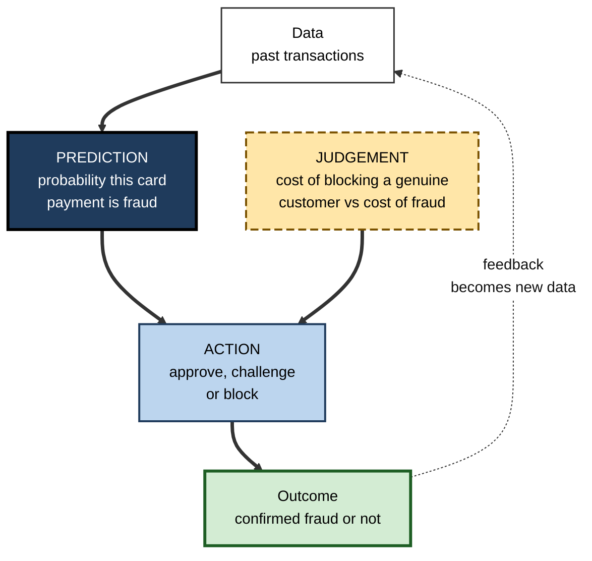
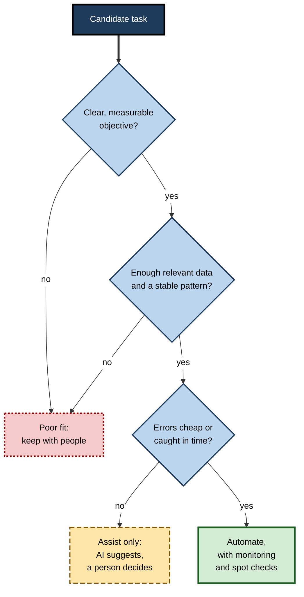
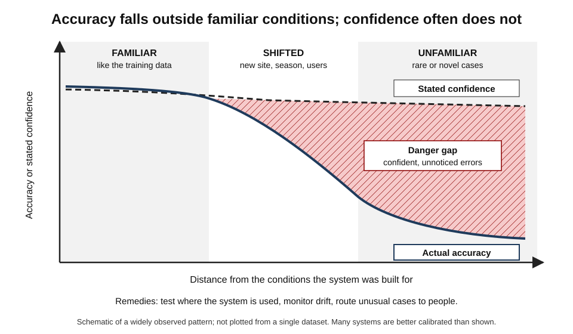
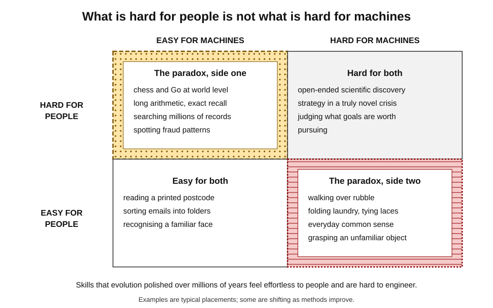
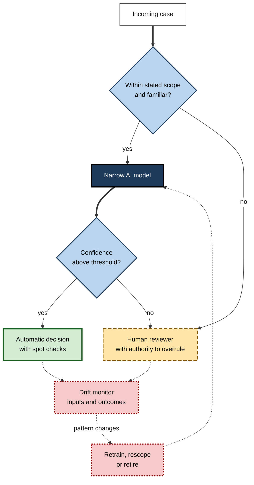

# C.2. What narrow AI can and cannot do

A model reads chest X-rays as accurately as a specialist in the hospital where it was built — and loses much of that accuracy in a hospital down the road with different scanners. A translation system renders a business email flawlessly and garbles a joke. A route planner beats any taxi driver at avoiding traffic and has no idea that the road ahead is closed for a parade.

Narrow AI is powerful in a specific, describable way, and helpless in an equally specific way. Knowing both is the core of practical AI judgement.

> **Definition — Capability profile:** the set of tasks and conditions under which an AI system performs reliably, together with the conditions under which it degrades or fails.

> **Definition — Task fit:** the degree to which a task's characteristics — its objective, data, stability, feedback and cost of error — suit the strengths of narrow AI.

**Why it matters**

- Most failed AI projects fail not because the technology is weak, but because it was applied to a task that did not fit.
- Most harmful AI incidents involve a system used **outside the conditions it was built for**.
- Judging task fit is a skill every manager, analyst and professional now needs — not only engineers.

---

## What Narrow AI Is

- **Narrow AI** performs one task, or a bounded family of tasks, with no ability to carry its competence into unrelated tasks without being rebuilt or retrained.
- Every AI system in commercial use is narrow in this sense — including broad language models, which are best understood as many narrow capabilities bundled together, each with its own reliability.

> **Key point:** the question is never "is this AI good?" but "**good at what, under which conditions, and how does it fail?**"

---

## What Narrow AI Does Well

### Eight families of task

- **Recognition and classification** — assigning an input to a category.
  - *e.g.* spam or not spam; tumour or benign; defective or sound part on a production line.
- **Prediction and forecasting** — estimating an unknown or future value.
  - *e.g.* next week's demand for a product; the probability a customer cancels a contract.
- **Ranking and recommendation** — ordering options by likely relevance.
  - *e.g.* search results; products a shopper may buy; candidate documents in litigation review.
- **Anomaly detection** — spotting what is unusual.
  - *e.g.* card fraud; network intrusions; a sensor reading that precedes machine failure.
- **Transcription and translation** — converting between forms.
  - *e.g.* speech to text; English to Hindi; handwriting to typed text.
- **Optimisation and search** — finding a good option among very many.
  - *e.g.* delivery routes; staff rosters; moves in a board game.
- **Generation within a domain** — producing new text, images, code or audio of a familiar kind.
  - *e.g.* a first draft of a product description; boilerplate code.
- **Control in structured settings** — acting repeatedly on a well-understood process.
  - *e.g.* warehouse robots on fixed routes; climate control in buildings.

> **Mnemonic — "Really Precise Robots Always Translate, Optimise, Generate, Control":** Recognition, Prediction, Ranking, Anomaly detection, Translation, Optimisation, Generation, Control.

### The sources of advantage

- **Speed** — millions of decisions per second; a card transaction can be scored in milliseconds.
- **Scale** — the same quality for the millionth case as for the first.
- **Consistency** — no fatigue, mood or Friday-afternoon effect.
- **High-dimensional pattern detection** — weighing thousands of variables at once, beyond what human attention can hold.
  - *e.g.* subtle patterns in retinal photographs that clinicians do not routinely see.
- **Cheap marginal cost** — once built, each additional prediction costs very little.

> **Example:** in 2018 the United States Food and Drug Administration authorised IDx-DR, the first autonomous AI system permitted to screen for a form of diabetic eye disease without a specialist reading the image — a narrow task with a clear definition, standardised photographs and a well-studied clinical outcome.

### The economics of cheap prediction

**Agrawal, Gans and Goldfarb, *Prediction Machines* (2018)**

- **Core argument:** the main thing current AI does is make **prediction** — filling in missing information — dramatically cheaper.
- **Consequence:** when something gets cheaper, it is used more, and its **complements** become more valuable.
- **The complements of prediction:**
  - **judgement** — knowing which outcomes matter and how much;
  - **data** — the raw material of prediction;
  - **action** — the ability to do something with the prediction.
- **Implication:** narrow AI rarely replaces a whole job; it replaces the **prediction part** of decisions, raising the value of the human judgement and action around it.

**Figure 1.** The anatomy of a decision: narrow AI supplies the prediction, while judgement and action remain separate elements.

---

## The Conditions Under Which Narrow AI Succeeds

### Five conditions of good task fit

- **A clear objective** — success can be stated and measured.
  - *e.g.* "flag transactions later confirmed as fraud" — not "keep customers happy".
- **Plentiful, relevant data** — many examples resembling the cases the system will meet.
  - *e.g.* years of labelled transactions from the same card network.
- **A stable environment** — the patterns in the data persist into the future.
  - *e.g.* the physics of a production line changes slowly; fashion trends do not.
- **Fast, reliable feedback** — errors are discovered quickly so the system can be corrected.
  - *e.g.* a fraud flag is confirmed or rejected within days.
- **Tolerable cost of error** — mistakes are affordable, or caught before they cause harm.
  - *e.g.* a wrong film recommendation costs nothing; a wrong dosage could kill.

> **Mnemonic — "ODSFE — Only Data-Rich, Stable, Fast, Error-tolerant tasks fit":** Objective, Data, Stability, Feedback, Error cost.

### Worked example (illustrative): scoring four candidate tasks

A retail bank wants to know where narrow AI fits. Each task is scored 1 (poor) to 3 (good) on the five conditions.

| Task | Objective | Data | Stability | Feedback | Error cost | Total |
|---|---|---|---|---|---|---|
| Card-fraud scoring | 3 | 3 | 2 | 3 | 2 | **13** |
| Routing customer emails to teams | 3 | 3 | 3 | 3 | 3 | **15** |
| Forecasting branch footfall | 3 | 2 | 2 | 3 | 3 | **13** |
| Deciding which business to lend to in a new country | 2 | 1 | 1 | 1 | 1 | **6** |

*Illustrative figures.*

1. **Rank** the tasks by total.
2. **Inspect the weakest condition** of each high scorer — fraud scoring's stability is only 2, because fraudsters adapt; it needs constant monitoring.
3. **Reject or redesign** low scorers — lending in a new market has little data, slow feedback (defaults take years) and high error cost; any model should at most **support** a human credit officer.
- **Conclusion:** email routing is the safest first project; fraud scoring is high value but needs drift monitoring; new-market lending is a poor fit.

> **Watch out:** a high total can hide a fatal zero. A task with perfect data but catastrophic, irreversible error cost may still be unsuitable for automation.

**Figure 2.** Deciding how much to rely on narrow AI for a task.

---

## What Narrow AI Cannot Do

### Leave the world it learned from

- A narrow system learns patterns from **training data** — the examples used to build it. It performs well on new cases **like** those examples.
- When the new cases differ — **distribution shift** — performance can fall sharply, often without warning.
  - **New population** — a skin-lesion classifier trained mostly on lighter skin performs worse on darker skin.
  - **New equipment** — an X-ray model meets a different scanner make.
  - **New behaviour** — fraudsters change tactics; customers' habits change during a pandemic.

> **Definition — Distribution shift:** a difference between the data a system was built on and the data it meets in use, which can degrade its performance.

**Figure 3.** Reliability falls as cases move away from the conditions a narrow system was built for.

### Learn the right thing for the right reason

- Narrow systems learn **whatever pattern predicts the label** — even when it is an accident of the data.
- **Shortcut learning** (named in a 2020 review by Robert Geirhos and colleagues) — a system succeeds on test data by exploiting a cue that will not hold in the real world.

**Study card — Zech and colleagues (2018), pneumonia detection from chest X-rays**

- **Design:** deep-learning models trained on chest X-rays from several hospital systems, then tested on images from hospitals not seen in training.
- **Results:**
  - performance was noticeably worse on unseen hospitals than on held-out images from the training hospitals;
  - the models could identify **which hospital** an image came from with very high accuracy — from features such as metal markers and image processing — and pneumonia rates differed between hospitals.
- **Conclusion:** part of the "pneumonia detection" was **hospital detection**. Testing on data from the same sources as training had overstated real-world performance.

> **Watch out:** a high accuracy score on a test set drawn from the **same source** as the training data says little about performance in a different setting. Ask where the test data came from.

### Understand cause and effect

- Narrow AI excels at **association**: "patients with X tend to have Y".
- It does not, by itself, answer **intervention** questions ("what happens if we give drug Z?") or **counterfactual** questions ("would this patient have recovered without Z?").
- **Judea Pearl** (Turing Award 2011) describes a **ladder of causation**:
  1. **Association** — seeing: what is correlated with what?
  2. **Intervention** — doing: what happens if we act?
  3. **Counterfactuals** — imagining: what would have happened otherwise?
- Most narrow AI stands on the first rung.

> **Example:** a model finds that hospital patients with asthma had **lower** pneumonia death rates — because, in the data, they were routinely sent to intensive care. Used naively to decide who can go home, it would send the most vulnerable patients away. This pattern was reported by Rich Caruana and colleagues in a 2015 study of interpretable models.

### Know the obvious

- **Common sense** — the vast, unspoken background knowledge people use without noticing — is largely absent.
  - *e.g.* a vision system may not "know" that a person cannot be both inside and on top of a car at once.
- **Moravec's paradox** — observed by the roboticist **Hans Moravec (1988)** and others: tasks hard for people (chess, calculus) are often easy for machines, while tasks easy for a toddler (walking over rubble, picking up a sock) are hard.

**Figure 4.** Moravec's paradox: human difficulty is a poor guide to machine difficulty.

### Know what it does not know

- Many systems output a **confidence** with every answer, but confidence is often **poorly calibrated** — high on cases the system gets wrong, especially unfamiliar ones.
- Language systems can produce fluent, confident, false statements.
- A system rarely says "this case is outside my competence" unless it was specifically built to.

> **Definition — Calibration:** the match between a system's stated confidence and its actual accuracy; a calibrated system that says "80% sure" is right about 80% of the time.

### Set its own goals or own its decisions

- A narrow system **optimises the objective it was given** — even when that objective is a poor proxy for what people actually want.
  - *e.g.* a feed optimised for time-on-app may promote outrage.
- It cannot judge whether its task is **worth doing**, or weigh values not written into its objective.
- It cannot be **accountable**: responsibility for its decisions remains with the people and organisations that deploy it.

### The capability profile side by side

| | Narrow AI tends to be strong | Narrow AI tends to be weak |
|---|---|---|
| Inputs | Familiar, like the training data | Unfamiliar, rare or shifted |
| Reasoning | Association and pattern | Cause, intervention, counterfactual |
| Knowledge | Within the training domain | Common sense and background knowledge |
| Self-assessment | Consistent scoring | Knowing when it is wrong |
| Goals | Optimising a given objective | Choosing or questioning objectives |
| Scale | Millions of decisions, identical quality | Single novel, high-stakes judgements |

> **Remember:** narrow AI is **fast, scalable and consistent within its world**; it is **fragile at the edges, blind to causes, short of common sense, poor at self-doubt and unable to choose its goals**.

---

## Depth: Why the Profile Looks Like This

### Interpolation, not understanding

- Most narrow systems work by **interpolation** — estimating answers between examples they have seen.
- They are much weaker at **extrapolation** — answering for cases beyond the range of their experience.
- People combine pattern recognition with **models of how the world works**, which let them reason about cases they have never seen.

### The long tail

- Real-world tasks contain a **long tail** of rare situations — each individually unlikely, together common.
  - *e.g.* a self-driving car meets a horse-drawn cart, a flooded underpass, a police officer waving traffic through a red light.
- Data for each rare case is scarce, so the system has little to learn from; this is why the **last few per cent** of reliability is often the hardest.

> **Key point:** a system that is right 99% of the time may be excellent for recommendations and unacceptable for driving. Whether the remaining 1% matters depends on **the task, not the technology**.

### The jagged frontier in professional work

**Study card — Dell'Acqua and colleagues (2023), Harvard Business School with Boston Consulting Group**

- **Design:** 758 consultants were given realistic tasks, with or without access to GPT-4.
  - Some tasks lay **inside** the model's frontier of competence (creative product ideas, writing, analysis).
  - One task was designed to lie **just outside** it — a business problem that required combining spreadsheet data with interview notes, where the model's plausible answer was wrong.
- **Results:**
  - **inside the frontier:** consultants using the model completed about 12% more tasks, about 25% faster, with output rated over 40% higher in quality;
  - **outside the frontier:** consultants using the model were about **19 percentage points less likely** to reach the correct answer than those without it.
- **Conclusion:** the same tool raised and lowered performance depending on which side of an **invisible** boundary the task lay. Users could not easily tell which side they were on.

> **Watch out:** the study is a single (if large) experiment with one firm and one model generation. The **direction** of the finding — help inside the frontier, harm just outside — has been widely echoed; the exact percentages should not be generalised.

### Automation bias

- **Automation bias** — the tendency of people to over-trust automated recommendations and to stop checking.
  - Reviewed by **Raja Parasuraman and Dietrich Manzey (2010)** across aviation, medicine and process control.
- It makes the weaknesses of narrow AI more dangerous: errors at the edge of competence go unnoticed precisely when people have learned to rely on the system.

> **Definition — Automation bias:** over-reliance on automated aids, leading to errors of omission (missing problems the aid did not flag) and commission (following an aid's wrong advice).

---

## Designing Around the Limits

### Six design responses

- **State the scope** — write down what the system is for, and what it is not for.
- **Test where it will be used** — on data from the real setting, not only from the training source.
- **Monitor for drift** — track input patterns and outcomes over time; retrain or retire when they change.
- **Route the unusual to people** — send low-confidence or out-of-scope cases to a human.
- **Keep humans meaningfully in the loop** — give reviewers time, information and authority to disagree.
- **Measure what matters** — evaluate against the real objective, not only a convenient proxy.

> **Remember:** the six responses run from **before deployment** (scope, test in context) through **operation** (monitor, route, review) to **evaluation** (measure the real objective).

**Figure 5.** A narrow system wrapped in the safeguards that compensate for its limits.

### Case study: Google Flu Trends

- **Situation:** in 2008 Google launched Flu Trends, which estimated influenza activity in the United States from the volume of flu-related search queries — promising estimates days or weeks ahead of official surveillance.
- **Early success:** initial estimates tracked official data from the Centers for Disease Control and Prevention closely, and the project was widely celebrated as a demonstration of big-data prediction.
- **Problem:** in the 2012–13 season it estimated a peak roughly **double** the level later recorded by official surveillance; it had also missed the start of the 2009 H1N1 pandemic, whose timing did not match seasonal patterns.
- **Diagnosis** (set out by David Lazer and colleagues in *Science*, 2014):
  1. **Shortcut patterns** — the model had selected search terms that correlated with flu season, including some related to winter rather than to illness.
  2. **Distribution shift** — people's searching changed, partly because of media coverage of flu and partly because Google's own search features changed.
  3. **No causal model** — search volume is a proxy, influenced by fear and news as well as sickness.
- **Result:** the public estimates were discontinued in 2015.
- **Lesson:** a narrow system's accuracy is a property of **a pattern at a time**, not of the method. Combining such signals with traditional surveillance worked better than either alone — later analyses found the combination improved forecasts.

### Case study (illustrative): when the warehouse moved

- **Situation:** a logistics firm used a vision system to check parcel labels; it ran at very high accuracy for two years.
- **Problem:** after the firm moved to a new warehouse, error rates rose sharply and silently; mis-routed parcels were noticed only through customer complaints.
- **Diagnosis:**
  - the new building had different lighting and a faster conveyor, producing slightly blurred images;
  - the system's confidence scores stayed high on the blurred images, so nothing was routed to human checkers;
  - no one was monitoring input quality.
- **Actions:**
  1. Collected and labelled images from the new site and retrained the model.
  2. Added an image-quality check that routed blurred images to staff.
  3. Introduced weekly sampling of automatic decisions against manual checks.
- **Result:** accuracy recovered within weeks; complaints returned to previous levels.
- **Lesson:** a change in **conditions** is a change in **task**. Every physical, organisational or market change should trigger a check of the systems that depend on it.

---

## Narrow AI Across the Professions

The same profile — strong within a well-defined pattern, weak at its edges — appears in every field. What changes is **where the edge lies** and **what an error costs**.

- **Medicine**
  - **Can:** flag suspicious regions on scans; screen retinal photographs; predict deterioration from vital signs; transcribe consultations.
  - **Cannot:** weigh a patient's values against treatment burdens; notice that the scan belongs to the wrong patient; take responsibility for a diagnosis.
- **Law**
  - **Can:** find relevant documents among millions in litigation review; extract clauses from contracts; draft standard letters.
  - **Cannot:** judge what a court will find persuasive in a novel dispute; guarantee that a cited case exists; owe a duty to the client.
- **Finance**
  - **Can:** score fraud and credit risk; reconcile transactions; forecast cash flows from stable patterns.
  - **Cannot:** foresee a crisis without precedent in its data; decide how much risk an institution should accept.
- **Software engineering**
  - **Can:** suggest code, write tests, explain unfamiliar code, find some classes of bug.
  - **Cannot:** decide what the product should do; reliably reason about the whole architecture of a large system; be accountable for security.
- **Sales and marketing**
  - **Can:** score leads; predict churn; personalise offers; draft campaign variants.
  - **Cannot:** build trust with a sceptical buyer; judge when a campaign would damage the brand.
- **Human resources**
  - **Can:** answer policy questions; schedule interviews; summarise survey comments.
  - **Cannot:** fairly judge potential from historical hiring data that reflect past bias — a lesson learned publicly when Amazon abandoned an experimental CV-screening model, reported in 2018, after finding it penalised CVs that mentioned women's organisations.

> **Key point:** in each profession the **prediction** element is increasingly automated, while **judgement, relationships and accountability** remain human. The professional's value shifts towards the edge cases the system cannot handle — which requires knowing exactly where those edges are.

### Four signs a task is at the edge

- **Novelty** — the case is unlike anything in the historical record.
  - *e.g.* a new product, a new regulation, a pandemic.
- **Stakes** — an error would be costly, irreversible or unlawful.
- **Values** — the right answer depends on weighing interests, not on predicting a fact.
- **Context outside the data** — the deciding information is not in the system's inputs.
  - *e.g.* a customer's bereavement, known only from a phone call.

> **Mnemonic — "NSVC — Novelty, Stakes, Values, Context":** "Never Send Vital Cases" to a narrow system unchecked.

---

## Open Questions

- **Will broader models dissolve the distinction between narrow and general competence?**
  - Large models perform many tasks, but still show sharp, unpredictable boundaries; whether those boundaries will fade with scale is unresolved.
- **Can systems learn to know what they do not know?**
  - Methods for calibration and out-of-distribution detection help, but no method reliably flags every unfamiliar case.
- **Can causal reasoning be learned from data alone?**
  - Some researchers believe sufficiently rich data and models will capture causal structure; others hold that explicit causal models are indispensable.
- **How should responsibility be shared between people and systems?**
  - Human oversight is the standard remedy, but automation bias suggests oversight often fails in practice; better designs are still being sought.

---

## Summary

- Narrow AI is strong at **recognition, prediction, ranking, anomaly detection, translation, optimisation, generation within a domain and control in structured settings**.
- Its advantages are **speed, scale, consistency, high-dimensional pattern detection and low marginal cost**; in economic terms, it makes **prediction** cheap and raises the value of **judgement, data and action**.
- It fits tasks with a clear **objective**, plentiful **data**, a **stable** environment, fast **feedback** and tolerable **error cost** (ODSFE).
- It cannot reliably leave the world it learned from (**distribution shift**), may learn **shortcuts**, stays on the **association** rung of the ladder of causation, lacks **common sense**, is often **poorly calibrated** and cannot choose or question its **goals** or be accountable.
- **Moravec's paradox**: human difficulty is a poor guide to machine difficulty.
- The **jagged frontier** means the same tool can help on one task and harm on a neighbouring one; **automation bias** makes this more dangerous.
- Design around the limits: **scope, test in context, monitor drift, route the unusual to people, keep humans meaningfully involved, measure the real objective**.

---

## Self-Check

1. Define capability profile and task fit.
2. List eight families of task at which narrow AI does well, with an example of each.
3. According to Agrawal, Gans and Goldfarb, what does AI make cheaper, and what becomes more valuable as a result?
4. State the five conditions of good task fit.
5. What is distribution shift? Give three different causes.
6. Describe the Zech and colleagues pneumonia study and what it revealed.
7. Explain Pearl's ladder of causation and where most narrow AI stands on it.
8. What is Moravec's paradox? Give one example from each side.
9. Why does poor calibration make narrow AI risky?
10. Summarise the Dell'Acqua and colleagues study, including its main caveat.
11. What is automation bias, and why does it amplify the limits of narrow AI?
12. Explain why Google Flu Trends failed, using at least two concepts from the limits of narrow AI.
13. A hospital wants to automate discharge decisions using a model trained on past records. Which conditions of task fit are weakest, and what design would you propose?
14. Why can a task scoring well overall on the five conditions still be unsuitable for automation?

### Answer Key

1. Capability profile: the tasks and conditions under which a system performs reliably, plus those under which it fails. Task fit: how well a task's objective, data, stability, feedback and error cost suit narrow AI.
2. Recognition (spam filtering); prediction (demand forecasting); ranking (search results); anomaly detection (card fraud); transcription and translation (speech to text); optimisation (delivery routes); generation in a domain (product descriptions); control in structured settings (warehouse robots).
3. Prediction — filling in missing information. Its complements become more valuable: judgement about what matters, the data that feeds prediction, and the ability to act.
4. A clear, measurable objective; plentiful relevant data; a stable environment; fast, reliable feedback; tolerable cost of error.
5. A difference between training data and the data met in use. Causes: a new population of users or patients; new equipment such as a different scanner; changed behaviour, such as fraudsters adapting or habits changing in a crisis.
6. Pneumonia models trained on X-rays from several hospital systems performed worse on unseen hospitals. The models could identify the source hospital from markers and processing artefacts, and pneumonia rates differed by hospital — so part of the apparent skill was hospital detection, a shortcut.
7. Association (seeing correlations), intervention (predicting the effect of actions), counterfactuals (imagining what would have happened otherwise). Most narrow AI works at association only.
8. Hard-for-people tasks are often easy for machines, and easy-for-people tasks hard. Chess or long multiplication are easy for machines; folding laundry or walking over rubble are hard.
9. Because a system may be highly confident on cases it gets wrong — especially unfamiliar ones — so confidence cannot be used to decide which outputs to trust, and errors are not routed to people.
10. 758 consultants did realistic tasks with or without GPT-4. Inside the model's frontier they did more, faster and better work; on a task just outside it they were about 19 points less likely to be correct. Caveat: one firm, one model generation; the direction is robust, the exact numbers are not general.
11. Over-reliance on automated aids, causing missed problems and followed errors. It means mistakes at the edge of competence — exactly where narrow AI fails — go unchecked.
12. Shortcut patterns (search terms correlated with winter, not flu); distribution shift (search behaviour changed with news and with Google's own features); no causal model (searches are a proxy driven by fear and news). It overestimated the 2012–13 peak roughly twofold.
13. Weakest: error cost (wrong discharge can kill), causation (historical treatment confounds patterns, as in the asthma example) and possibly stability. Design: model as decision support only; clinicians decide; test on local data; check for confounding by treatment; monitor outcomes and readmissions; route unusual cases for senior review.
14. Because one condition can be decisive: an irreversible, catastrophic error cost cannot be offset by excellent data and feedback. Totals can hide a fatal weakness.

---

## Glossary

| Term | Meaning |
|---|---|
| Anomaly detection | Identifying cases that differ markedly from the usual pattern. |
| Association | Recognising that variables occur together; the first rung of the ladder of causation. |
| Automation bias | Over-reliance on automated aids, leading to missed or followed errors. |
| Calibration | The match between a system's stated confidence and its actual accuracy. |
| Capability profile | The conditions under which a system is reliable and those under which it fails. |
| Common sense | Broad, unspoken background knowledge about how the world works. |
| Counterfactual | A question about what would have happened under different circumstances. |
| Distribution shift | A difference between training data and data met in use. |
| Extrapolation | Answering for cases beyond the range of past experience. |
| Intervention | A question about the effect of taking an action. |
| Interpolation | Estimating answers between examples already seen. |
| Jagged frontier | The irregular, hard-to-see boundary of a system's competence. |
| Long tail | The many rare situations that together make up a large share of real cases. |
| Moravec's paradox | The observation that tasks easy for people can be hard for machines, and vice versa. |
| Prediction | Filling in missing information, about the present or the future. |
| Shortcut learning | Succeeding on tests by exploiting a cue that will not hold in real use. |
| Task fit | How well a task's characteristics suit the strengths of narrow AI. |
| Training data | The examples from which a system's competence is built. |
