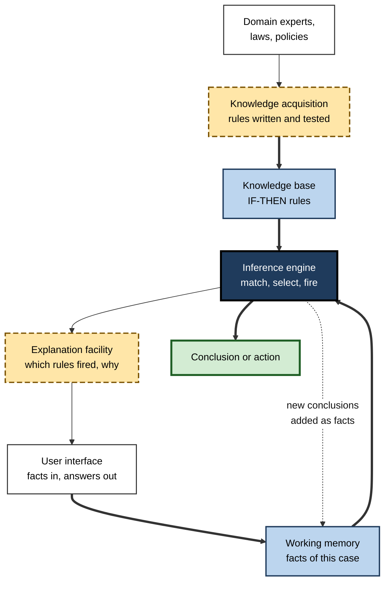
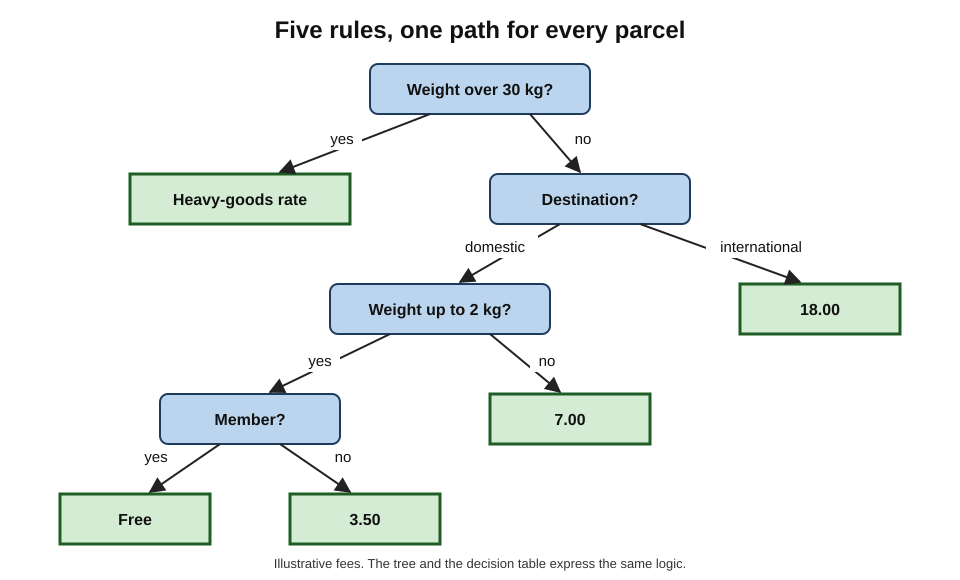
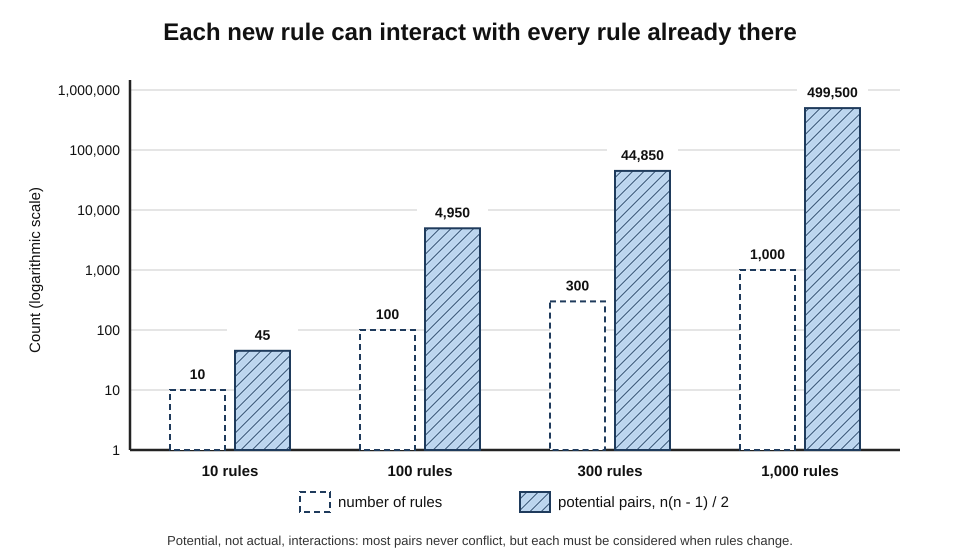
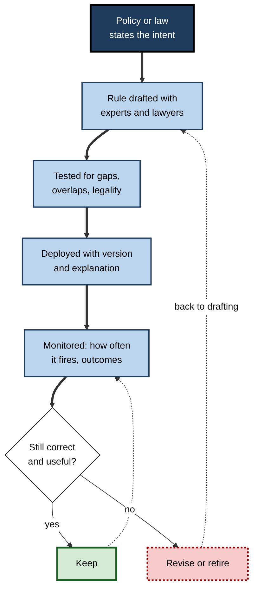

# C.3. Rule-based systems: if-then logic

"If the parcel weighs more than 30 kg, charge the heavy-goods rate." "If income exceeds the threshold, apply the higher tax band." "If the patient is on warfarin and a new prescription contains aspirin, raise an alert." Rules like these run payroll, tax returns, insurance quotes, firewalls and hospital alerts every second of every day. A machine that applies such rules automatically, and combines them to reach conclusions no single rule states, is the oldest working form of artificial intelligence — and still one of the most widely used.

> **Definition — Rule-based system:** an AI system whose behaviour is determined by explicit rules of the form IF *condition* THEN *action or conclusion*, written by people and applied automatically by a program to the facts of each case.

**Why it matters**

- Much of the automated decision-making that affects people's money, benefits and safety is rule-based, not learned.
- Rules are the main way laws, policies and regulations are turned into software.
- Their strengths — transparency, predictability, auditability — are exactly the weaknesses of learned systems, which is why the two are increasingly combined.
- Their failures, when they occur, are **failures of human design**, and can reach thousands of people identically.

---

## The If-Then Rule

### Anatomy of a rule

- **Condition** (also *antecedent* or *left-hand side*) — a test on the facts.
  - *e.g.* `order_value > 500 AND customer_type = "new"`.
- **Action or conclusion** (also *consequent* or *right-hand side*) — what follows if the test is true.
  - *e.g.* `require_manual_review = true`.
- **Facts** — the data about the current case.
  - *e.g.* order value 750; customer type new.
- **Firing** — a rule **fires** when its condition is true and its action is carried out.

> **Definition — Production rule:** an IF-THEN rule in a rule-based system; the term comes from Allen Newell and Herbert Simon's models of human problem-solving in the 1960s and 1970s.

> **Example:** IF *temperature > 38 °C* AND *cough present* THEN *suspect respiratory infection*. A second rule — IF *suspect respiratory infection* AND *age > 65* THEN *recommend same-day appointment* — uses the first rule's conclusion as its condition. Chains of such rules produce reasoning.

### Logic underneath

- Rules rest on **propositional and predicate logic** — the logic of true and false statements, and of statements about objects and their properties.
- The basic inference is **modus ponens**: from "if A then B" and "A", conclude "B".
- **Boolean operators** combine conditions: AND, OR, NOT.
- **Comparisons** test values: equal to, greater than, within a range, member of a list.

> **Watch out:** "IF A THEN B" does not license "IF B THEN A". Reasoning backwards from a conclusion to a cause — *affirming the consequent* — is a classic error in both human and machine rule design.

---

## How a Rule-Based System Is Built

### The components

- **Knowledge base** — the collection of rules, written by or with domain experts.
- **Working memory** — the facts about the current case, which grow as rules fire and add conclusions.
- **Inference engine** — the program that matches rules against facts, chooses which to fire, and repeats until done.
- **Explanation facility** — reports which rules fired and why, so a person can follow the reasoning.
- **User interface** — collects facts and presents conclusions.
- **Knowledge acquisition** — the process of eliciting rules from experts and documents.

> **Key point:** the separation of **knowledge** (the rules) from **reasoning** (the engine) is the central design idea. The same engine can run tax rules or medical rules; experts can change the rules without rewriting the program.

**Figure 1.** The architecture of a rule-based system.

### The recognise–act cycle

The inference engine runs a simple loop until no more rules apply or a goal is reached.

1. **Match** — find every rule whose condition is true for the current facts. These form the **conflict set**.
2. **Select** — if several rules match, choose one by a **conflict-resolution strategy**.
3. **Act** — fire the chosen rule: add a conclusion, change a fact or take an action.
4. **Repeat** — the new facts may make other rules true.

### Choosing between rules: conflict resolution

- **Priority (salience)** — rules carry explicit priorities; the highest fires first.
  - *e.g.* a sanctions-screening rule outranks a discount rule.
- **Specificity** — the rule with the more detailed condition wins.
  - *e.g.* "new customer **and** order over 500" beats "new customer".
- **Recency** — prefer rules matching the newest facts, keeping reasoning focused.
- **Rule order** — the first rule written wins; simple but fragile.
- **Refraction** — a rule may not fire twice on the same facts, preventing endless loops.

> **Mnemonic — "PSRRR — Priority, Specificity, Recency, Rule order, Refraction":** "Please Select Rules Responsibly, Really".

### Matching efficiently: the Rete algorithm

- A naive engine re-checks every rule against every fact on every cycle — far too slow with thousands of rules and facts.
- **Charles Forgy** developed the **Rete algorithm** (thesis 1979; published 1982), which builds a network of the conditions shared between rules and **remembers partial matches**, so only the effects of *changed* facts are recomputed.
- Rete and its successors still underlie many commercial and open-source rule engines.

---

## Two Directions of Reasoning

### Forward chaining: from facts to conclusions

- **Data-driven** — start with the known facts, fire every rule that applies, add the conclusions, repeat.
- Suited to **monitoring, configuration and classification**, where facts arrive and the system must work out what follows.

### Backward chaining: from a goal to the facts it needs

- **Goal-driven** — start with a hypothesis, find rules that would conclude it, and check (or ask for) the facts those rules require.
- Suited to **diagnosis and advice**, where the system tests specific hypotheses and asks only relevant questions.

| | Forward chaining | Backward chaining |
|---|---|---|
| Starting point | Known facts | A goal or hypothesis |
| Direction | Facts → conclusions | Goal → required facts |
| Questions to the user | Collected up front | Asked only when needed |
| Typical uses | Monitoring, configuration, alerts, pricing | Diagnosis, eligibility checks, advisory dialogue |
| Risk | Derives many irrelevant conclusions | Can miss conclusions not asked about |

### Worked example (illustrative): an insurance eligibility rule set

Four rules from a travel-insurance product:

- **R1:** IF *age ≥ 70* THEN *senior traveller*.
- **R2:** IF *senior traveller* AND *pre-existing heart condition* THEN *medical screening required*.
- **R3:** IF *medical screening required* AND *screening not completed* THEN *refer to underwriter*.
- **R4:** IF *trip length > 90 days* THEN *long-stay premium applies*.

Facts for one applicant: age 74; heart condition yes; screening not completed; trip 21 days.

**Forward chaining trace**

1. Match: only R1 is true (age 74). Fire R1 → add *senior traveller*.
2. Match: R2 now true. Fire R2 → add *medical screening required*.
3. Match: R3 now true. Fire R3 → add *refer to underwriter*.
4. Match: R4 is false (21 days). No rules remain → stop.

- **Conclusion:** refer to underwriter; standard premium.

**Backward chaining trace — goal: "refer to underwriter?"**

1. R3 concludes the goal; it needs *medical screening required* and *screening not completed*.
2. *Medical screening required* — R2 concludes it; it needs *senior traveller* and *heart condition*.
3. *Senior traveller* — R1 needs *age ≥ 70*. Ask: age? 74 → true.
4. Ask: heart condition? yes. Ask: screening completed? no.
5. Every sub-goal is satisfied → **goal proved**. Trip length was never asked.

**Figure 2.** Forward chaining fires rules from the facts; backward chaining works from the goal to the facts it needs.

```mermaid
%%{init: {'theme':'base','themeVariables':{'fontFamily':'Arial, Helvetica, sans-serif','fontSize':'15px','primaryColor':'#FFFFFF','primaryTextColor':'#111111','primaryBorderColor':'#222222','lineColor':'#333333','secondaryColor':'#F2F2F2','tertiaryColor':'#FFFFFF','clusterBkg':'#FAFAFA','clusterBorder':'#555555','edgeLabelBackground':'#FFFFFF','titleColor':'#111111'}}}%%
flowchart TD
    classDef core    fill:#1F3B5C,stroke:#000000,stroke-width:3px,color:#FFFFFF
    classDef key     fill:#BCD5EE,stroke:#1F3B5C,stroke-width:2px,color:#000000
    classDef detail  fill:#FFFFFF,stroke:#333333,stroke-width:1.5px,color:#000000
    classDef good    fill:#D3ECD3,stroke:#1E5E24,stroke-width:3px,color:#000000

    subgraph FWD["Forward chaining: facts first"]
        F1["Fact: age 74"]
        F2["R1 fires:<br/>senior traveller"]
        F3["R2 fires:<br/>screening required"]
        F4["R3 fires:<br/>refer to underwriter"]
        F1 ==> F2 ==> F3 ==> F4
    end
    subgraph BWD["Backward chaining: goal first"]
        B1["Goal: refer<br/>to underwriter?"]
        B2["Needs: screening required<br/>and not completed"]
        B3["Needs: senior traveller<br/>and heart condition"]
        B4["Ask: age, heart<br/>condition, screening"]
        B1 ==> B2 ==> B3 ==> B4
    end

    class F1,B4 detail
    class F2,F3,B2,B3 key
    class F4 good
    class B1 core
```

> **Watch out:** the two traces reach the same answer here, but in large rule sets they behave very differently. Forward chaining may fire hundreds of irrelevant rules; backward chaining asks only what it needs but must be given the right goal.

---

## Ways of Writing Rules Down

### Beyond plain IF-THEN lists

- **Decision tables** — rows of condition combinations mapped to outcomes; easy for business experts to read and check for gaps.
- **Decision trees (hand-built)** — a sequence of questions, each branch leading to further questions or a decision.
- **Scorecards** — points added for each attribute, with a threshold for the decision.
  - *e.g.* traditional credit scorecards; early-warning scores for deteriorating hospital patients.
- **Decision Model and Notation (DMN)** — a standard notation published by the Object Management Group (first version 2015) for business decision logic, using decision tables with defined "hit policies" for overlapping rules.
- **Rules as code** — governments drafting legislation alongside machine-executable versions of it, so that benefit or tax calculators match the law exactly; New Zealand's "Better Rules" work (from 2018) and France's open-source OpenFisca tax-and-benefit engine are well-known examples.

### Worked example (illustrative): a shipping-fee decision table

| Rule | Weight | Destination | Member? | Fee |
|---|---|---|---|---|
| 1 | ≤ 2 kg | Domestic | Yes | Free |
| 2 | ≤ 2 kg | Domestic | No | 3.50 |
| 3 | > 2 kg and ≤ 30 kg | Domestic | Any | 7.00 |
| 4 | ≤ 30 kg | International | Any | 18.00 |
| 5 | > 30 kg | Any | Any | Heavy-goods rate |

*Illustrative figures.*

- **Checking completeness:** every combination of weight band, destination and membership should hit exactly one row.
  - A parcel of exactly 2 kg? Rule 1 or 2 (≤ 2 kg) — covered.
  - An international member's 2 kg parcel? Rule 4 — covered; membership gives no discount abroad, which the business must confirm is intended.
- **Checking overlap:** rules 4 and 5 cannot both match, because one requires ≤ 30 kg and the other > 30 kg.
- **Conclusion:** a table makes **gaps and overlaps visible** in a way a long list of IF-THEN statements does not.

**Figure 3.** The same shipping rules drawn as a decision tree.

---

## Rules Under Uncertainty

### Certainty factors

- Real expertise is rarely a matter of certainty: "if these symptoms, then **probably** this infection".
- **MYCIN**, a system for diagnosing bacterial blood infections and recommending antibiotics, developed at Stanford in the 1970s with **Edward Shortliffe** as principal author, attached **certainty factors** (from −1 to +1) to its roughly 600 rules and combined them as rules fired.
- In a blinded evaluation published in 1979, MYCIN's recommendations on meningitis cases were rated at least as acceptable as those of the infectious-disease specialists on the panel — yet it was never used in routine care, because of concerns about responsibility, integration with clinical workflow and the computing of the time.

> **Watch out:** certainty factors were a pragmatic invention, not probability theory, and could give inconsistent results when rules interacted. Later systems moved to **Bayesian networks**, which handle uncertainty with the rules of probability.

### Fuzzy rules

- **Lotfi Zadeh (1965)** introduced **fuzzy logic**, in which statements can be partly true — a room can be "warm" to degree 0.7.
- Fuzzy rules — IF *temperature is warm* AND *humidity is high* THEN *fan speed is fast* — blend smoothly instead of switching abruptly.
- Used in control systems: washing machines, camera autofocus, and the **Sendai subway in Japan** (opened 1987), where fuzzy control of acceleration and braking gave smoother rides and saved energy.

> **Definition — Fuzzy logic:** a logic in which truth is a matter of degree between 0 and 1, allowing rules about vague categories such as "warm", "tall" or "risky".

---

## Strengths and Weaknesses

### Why rules are still chosen

- **Transparency** — every decision can be traced to the rules that produced it.
- **Auditability** — regulators and courts can examine exactly what the system does.
- **Determinism** — the same inputs always give the same outputs.
- **Little or no data needed** — knowledge comes from experts and documents, not from examples.
- **Exact encoding of policy** — a legal threshold can be implemented precisely.
- **Guarantees** — hard constraints ("never approve above the credit limit") can be enforced absolutely.

### Why rules break

- **Brittleness** — cases the authors did not foresee fall through the gaps or trigger the wrong rule.
- **The knowledge acquisition bottleneck** — the computer scientist **Edward Feigenbaum** observed that extracting knowledge from experts is slow and costly; much expertise is **tacit** and experts cannot state it as rules.
- **Combinatorial growth** — every new rule can interact with every existing one.
- **Maintenance burden** — rules must change whenever policies, products or laws change; old rules accumulate.
- **No perception** — rules cannot read handwriting, recognise faces or understand speech; those patterns are too complex to write down.
- **No learning** — a rule system does not improve from experience unless people rewrite it.

> **Formula — Pairwise rule interactions:** with *n* rules, the number of pairs that could interact is n(n − 1) ÷ 2. For 100 rules: 100 × 99 ÷ 2 = **4,950** pairs; for 1,000 rules: **499,500**.

**Figure 4.** As a rule base grows, potential interactions grow far faster than the rules themselves.

### A system that outgrew its authors

- **XCON** (originally R1), written by **John McDermott** at Carnegie Mellon University for Digital Equipment Corporation from 1980, configured customers' VAX computer orders — choosing compatible cabinets, cables and components.
- It was a celebrated commercial success, reported to save the company tens of millions of dollars a year.
- Its rule base grew from several hundred rules to many thousands, and a dedicated team was needed simply to maintain it as products changed — an early, vivid demonstration of the maintenance burden.

### Rules compared with learned systems

| | Rule-based system | Learned (machine-learning) system |
|---|---|---|
| Source of behaviour | Rules written by people | Patterns estimated from data |
| Data needed | Little or none | Usually a great deal |
| Transparency | High: each step traceable | Often low |
| Handles messy perception | No | Yes |
| Handles unforeseen cases | Poorly: falls through gaps | Sometimes: if similar to training data |
| Changing behaviour | Edit the rules | Retrain on new data |
| Characteristic failure | Brittle at the edges; rule conflicts | Learns the wrong pattern; drifts |

---

## Rules in Modern Practice

### Where rules still dominate

- **Tax, payroll and benefits** — calculations defined by law.
- **Insurance and lending policy** — eligibility thresholds and underwriting criteria, often alongside a learned risk score.
- **Fraud and anti-money-laundering** — rules such as "flag cash deposits just below the reporting threshold", running beside learned anomaly models.
- **Clinical decision support** — drug-interaction and allergy alerts.
- **Networks and security** — firewall rules; intrusion-detection signatures.
- **Software automation** — robotic process automation scripts that copy data between systems by fixed rules.
- **Guardrails for AI** — explicit rules that block or route certain outputs of learned systems, such as refusing to reveal personal data.

> **In practice:** in many banks, a learned model **scores** the risk of each transaction and a rule layer **decides** what to do — "block if score > 0.9 and amount > 1,000; challenge if score > 0.7" — because the rules can be explained to regulators and changed instantly by risk managers.

### Alert fatigue

- Rule-based alerts are cheap to add and hard to remove, so they accumulate.
- In hospitals, clinicians override the large majority of drug-interaction alerts, according to many studies — because most are irrelevant to the patient in front of them.
- Too many low-value alerts teach people to ignore all alerts, including the vital ones.

> **Definition — Alert fatigue:** desensitisation to warnings caused by a high volume of low-value alerts, leading people to miss or override important ones.

### Testing a rule base

Rule systems are software, and the same testing disciplines apply — with extra attention to the places where rules meet.

- **Boundary-value tests** — check values exactly at, just below and just above every threshold.
  - *e.g.* parcels of 1.99 kg, 2.00 kg and 2.01 kg; applicants aged 69, 70 and 71.
- **Combination tests** — check pairs of conditions that interact.
  - *e.g.* a senior traveller on a long trip, where two premiums might both apply.
- **Regression tests** — keep a library of past cases with known correct answers, and rerun it after every change.
- **Rule coverage** — record which rules each test fires; rules never fired by any test are untested.
- **Legal walk-throughs** — lawyers or policy owners trace worked cases through the rules and confirm the outcomes match the intent.

> **Watch out:** "less than" and "less than or equal to" are the commonest source of rule defects. A threshold written as > 30 kg in one rule and ≥ 30 kg in another leaves a 30 kg parcel matched twice — or not at all.

### Rules and language models

- **Rules as guardrails** — explicit rules check the input and output of a language model.
  - *e.g.* block any reply that contains an account number; route any message mentioning self-harm to a trained person.
- **Rules in the prompt versus rules in code** — an instruction written into a model's prompt ("never offer refunds above 100") is followed **most of the time**; the same rule enforced in code after the model replies is followed **every time**.
- **Language models drafting rules** — a model can convert policy text into draft decision tables, easing the knowledge acquisition bottleneck — but every drafted rule still needs testing and sign-off by a policy owner.
- **Language models explaining rules** — a model can turn a rule trace ("R1, R2, R3 fired") into a plain-language letter to the customer, provided the letter is checked against the trace.

> **Key point:** where a constraint is **non-negotiable** — legal, financial or safety-critical — enforce it with a deterministic rule outside the learned model. Instructions to a model are requests; rules in code are guarantees.

| | Rule in the prompt | Rule enforced in code |
|---|---|---|
| Reliability | Usually followed; can be bypassed or misread | Always applied to every output |
| Flexibility | Handles vague, open-ended instructions | Handles only precisely stated conditions |
| Auditability | Hard to prove it was applied | Each application can be logged |
| Best for | Tone, style, soft preferences | Limits, prohibitions, legal requirements |

### Designing good rule systems

1. **Start from the decision** — write down what is decided, by whom, and the consequences of error.
2. **Use tables, not tangles** — express rules as decision tables wherever possible.
3. **Test for gaps and overlaps** — every input combination should reach exactly one outcome.
4. **Version and date every rule** — record who changed what, when and why.
5. **Keep an explanation** — every decision should be traceable to rules a person can read.
6. **Review regularly** — retire rules that no longer fire or no longer reflect policy.
7. **Check legality and fairness** — a rule applied to everyone identically can be identically wrong for everyone.

> **Mnemonic — "DTTVERC — Decide, Table, Test, Version, Explain, Review, Check":** "Do Teams Test Very Elaborate Rules Carefully?"

**Figure 5.** The life cycle of a well-governed rule.

### Case study: Robodebt in Australia

- **Situation:** from 2016 the Australian government's welfare agency used an automated system to identify and recover alleged overpayments of income-support benefits.
- **The rule:** the system took a person's **annual** income from tax records, **averaged** it evenly across the year's fortnights, and compared each fortnight with the income the person had reported. Where averaged income exceeded reported income, a debt was presumed — and the burden fell on the individual to disprove it.
- **The flaw:** many recipients — casual and seasonal workers especially — earned unevenly, receiving benefits in fortnights with no work and earning in others. Averaging manufactured "overpayments" that never existed.
- **Scale:** debts were raised against hundreds of thousands of people; many paid sums they did not owe; the human toll included severe distress, and the scheme has been linked in public testimony to suicides.
- **Outcome:**
  - in 2019 the government conceded in court that debts raised on averaging alone were unlawful;
  - a class-action settlement valued at about 1.8 billion Australian dollars, including refunds and cancelled debts, was approved in 2021;
  - a Royal Commission reported in 2023, describing the scheme as "a crude and cruel mechanism, neither fair nor legal".
- **Lesson:**
  1. The system involved no learning at all — a single **hand-written rule** was applied automatically at scale.
  2. Transparency of logic did not prevent harm: the rule was simple and visible, yet its **assumption** (even earnings) was wrong for the people most affected.
  3. Removing human review and reversing the burden of proof turned a flawed rule into a mass injustice.

### Case study (illustrative): pruning a fraud rule base

- **Situation:** a payments firm had accumulated about 1,400 fraud rules over ten years.
- **Problem:** many rules overlapped; one in four legitimate high-value payments was being challenged; nobody could explain why some rules existed.
- **Actions:**
  1. Logged how often each rule fired and how often its flags proved to be real fraud.
  2. Retired rules that had not fired in a year or whose flags were almost never fraud.
  3. Replaced many narrow rules with a learned risk score plus a short rule layer for regulatory requirements and absolute limits.
  4. Introduced owners, versions and annual reviews for every remaining rule.
- **Result:** a few hundred rules remained; legitimate payments challenged fell sharply; fraud losses did not rise. *Illustrative figures.*
- **Lesson:** rule systems need **gardening**. Without measurement and ownership, they grow until no one understands them.

---

## Open Questions

- **Can rules and learning be combined without losing the best of each?**
  - Combining learned perception with rule-based guarantees is an active area of research and engineering; it is unclear how far guarantees survive when the inputs come from an imperfect learned component.
- **How far can law become code?**
  - Some legal rules are precise thresholds; others use deliberately open terms such as "reasonable". Encoding the first is straightforward; encoding the second risks fixing a meaning the law left open.
- **Can large language models write and maintain rule bases?**
  - Language models can draft rules from policy text, potentially easing the knowledge acquisition bottleneck — but the drafts must be verified, and errors are hard to spot in large rule sets.
- **Where should human discretion remain?**
  - Automated rules give consistency; discretion allows mercy and judgement for unusual cases. The right balance in public administration is contested.

---

## Summary

- A **rule-based system** applies explicit **IF-THEN rules**, written by people, to the facts of each case.
- Its components are a **knowledge base**, **working memory**, an **inference engine**, an **explanation facility** and a **user interface**; separating knowledge from reasoning is the key design idea.
- The engine runs a **match–select–act** cycle, choosing between rules by **conflict resolution** (priority, specificity, recency, rule order, refraction); the **Rete algorithm** makes matching efficient.
- **Forward chaining** reasons from facts to conclusions; **backward chaining** from a goal to the facts it needs.
- Rules can be written as **decision tables, hand-built trees, scorecards, DMN models** or **rules as code**.
- Uncertainty was handled by **certainty factors** (MYCIN) and **fuzzy logic** (Zadeh), and later by probability.
- Rules are **transparent, auditable, deterministic, data-light and exact**; they are also **brittle**, slow to build (the **knowledge acquisition bottleneck**), prone to **interaction and maintenance problems** and unable to perceive or learn.
- Rules dominate tax, benefits, policy, compliance, alerts and AI guardrails; poorly governed rule bases cause **alert fatigue**, and a single wrong rule applied at scale — **Robodebt** — can cause mass harm.

---

## Self-Check

1. Define a rule-based system and name the parts of a rule.
2. What is the role of the inference engine, and why is it kept separate from the knowledge base?
3. Describe the match–select–act cycle.
4. Name four conflict-resolution strategies and explain one.
5. What problem does the Rete algorithm solve?
6. Contrast forward and backward chaining, with a suitable use for each.
7. Using the travel-insurance rules, which facts would backward chaining never ask for, and why?
8. Why are decision tables useful for checking rule sets?
9. What were certainty factors, and why were they replaced?
10. How does fuzzy logic differ from ordinary true/false logic? Give one real application.
11. Explain the knowledge acquisition bottleneck.
12. How many potential pairwise interactions exist in a base of 300 rules?
13. Why was Robodebt a failure of rule design rather than of machine learning, and what three lessons does it teach?
14. A hospital's clinicians override nearly all drug alerts. Diagnose the problem and propose a remedy.
15. When would you choose rules over a learned model, and when the reverse?

### Answer Key

1. A system that applies explicit IF-THEN rules, written by people, to case facts. Parts: a condition (antecedent) tested against facts and an action or conclusion (consequent).
2. It matches rules to facts, selects which to fire and carries out actions, repeating until done. Keeping it separate lets experts change the rules without reprogramming, and lets one engine serve many domains.
3. Match: find all rules whose conditions are true (the conflict set). Select: pick one by a conflict-resolution strategy. Act: fire it, changing or adding facts. Repeat until no rule applies or the goal is reached.
4. Priority, specificity, recency, rule order, refraction. Specificity: when two rules match, the one with the more detailed condition fires, so exceptions override general rules.
5. Re-checking every rule against every fact on each cycle is slow; Rete builds a network of shared conditions and stores partial matches, so only changes are recomputed.
6. Forward: from facts to all conclusions that follow — suited to monitoring and configuration. Backward: from a goal to the facts it requires — suited to diagnosis and eligibility dialogues.
7. Trip length, because no rule on the path to "refer to underwriter" depends on it. Backward chaining asks only for facts relevant to the goal.
8. They lay out every combination of conditions, making missing combinations (gaps) and double matches (overlaps) visible, and are readable by business experts.
9. Numbers from −1 to +1 expressing confidence in rules and conclusions, combined as rules fired. They were not grounded in probability theory and could behave inconsistently, so Bayesian methods replaced them.
10. Truth is a degree between 0 and 1, so vague categories blend smoothly. Example: fuzzy control of acceleration and braking on the Sendai subway from 1987.
11. Eliciting knowledge from experts is slow and costly, and much expertise is tacit — experts cannot express it as rules — limiting how much can be encoded.
12. 300 × 299 ÷ 2 = 44,850.
13. It used a single hand-written averaging rule, not a learned model. Lessons: transparent logic can still rest on a false assumption; automation applies one error to everyone at scale; removing human review and reversing the burden of proof turns errors into injustice.
14. Alert fatigue: too many low-value alerts. Remedy: measure override rates per rule; retire or downgrade rarely useful alerts; tailor alerts to patient context; reserve interruptive alerts for severe interactions; review regularly.
15. Rules when logic is defined by law or policy, transparency and guarantees are required, data are scarce, or constraints must be absolute. Learned models when the pattern is too complex to write down (perception, language), data are plentiful and some error is tolerable. Often both, with rules governing a learned score.

---

## Glossary

| Term | Meaning |
|---|---|
| Alert fatigue | Desensitisation to warnings caused by many low-value alerts. |
| Antecedent | The condition part of an IF-THEN rule. |
| Backward chaining | Goal-driven reasoning from a hypothesis to the facts needed to prove it. |
| Certainty factor | A number from −1 to +1 expressing confidence in a rule or conclusion, as used in MYCIN. |
| Conflict resolution | The strategy for choosing which of several matching rules to fire. |
| Conflict set | The set of rules whose conditions are true at a given moment. |
| Consequent | The action or conclusion part of an IF-THEN rule. |
| Decision Model and Notation (DMN) | A standard notation for business decision logic, centred on decision tables. |
| Decision table | A table mapping combinations of conditions to outcomes. |
| Explanation facility | The component that reports which rules fired and why. |
| Forward chaining | Data-driven reasoning from known facts to all conclusions that follow. |
| Fuzzy logic | Logic in which truth is a matter of degree between 0 and 1. |
| Inference engine | The program that matches, selects and fires rules. |
| Knowledge acquisition bottleneck | The difficulty and cost of extracting rules from experts. |
| Knowledge base | The collection of rules in a rule-based system. |
| Modus ponens | The inference from "if A then B" and "A" to "B". |
| Production rule | An IF-THEN rule in a rule-based system. |
| Refraction | A conflict-resolution principle preventing a rule firing twice on the same facts. |
| Rete algorithm | An efficient method for matching many rules against many facts by storing partial matches. |
| Rules as code | Drafting laws and policies alongside machine-executable versions. |
| Salience | An explicit priority attached to a rule. |
| Working memory | The facts about the current case, updated as rules fire. |
