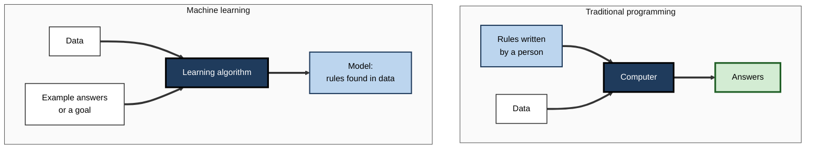
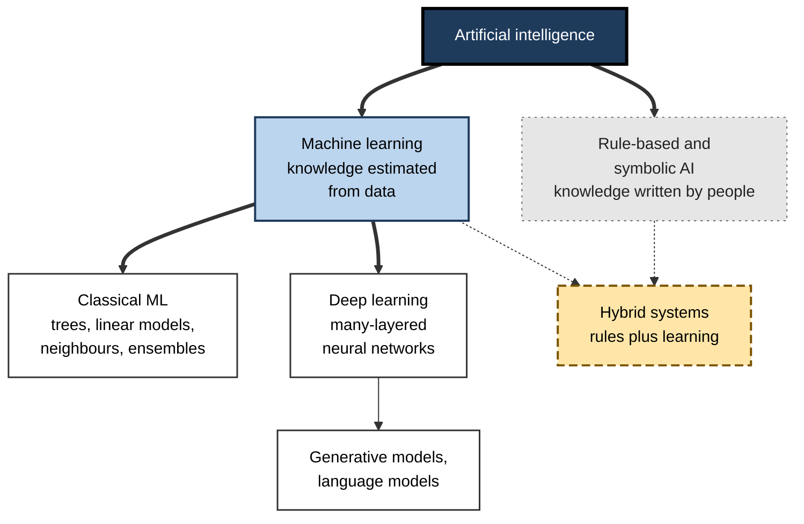
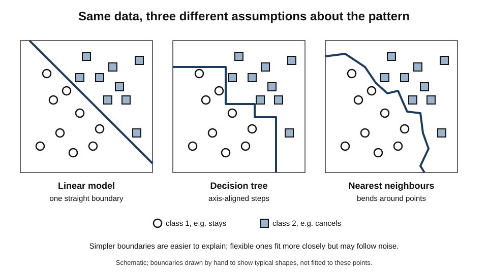
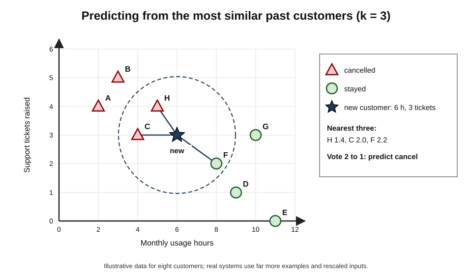
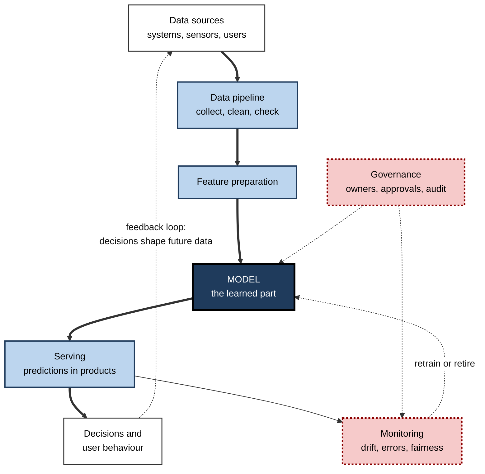

# C.4. Machine learning: learning from data

In the early 2000s, email providers fought spam with hand-written rules: block messages containing "free money", block senders on a list. Spammers simply changed their wording. The approach that won was different in kind: show a program thousands of messages already marked spam or not, and let it **work out for itself** which patterns of words separate the two — then let it keep adjusting as new spam arrives. That shift, from writing the rules to letting a program find them in examples, is machine learning.

> **Definition — Machine learning (ML):** the branch of AI in which systems improve their performance at a task by finding patterns in data, rather than by following rules written for them in advance.

> **Definition — Model:** the product of machine learning — a mathematical function, with settings estimated from data, that maps inputs (such as an email's words) to outputs (such as "spam" or "not spam").

**Why it matters**

- Most AI in use today — recommendations, fraud scores, demand forecasts, speech recognition, translation, chatbots — is built by machine learning.
- It made possible tasks that nobody could describe in rules, such as recognising faces or understanding speech.
- It changes **who writes the logic**: the behaviour of an ML system comes as much from its **data** as from its programmers — with large consequences for quality, fairness and accountability.

---

## A Different Way of Making Software

### Programming versus learning

- **Traditional programming:** a person writes the rules; the computer applies them to data to produce answers.
- **Machine learning:** a person supplies data **and the answers** (or a goal); the computer produces the rules — the model — which are then applied to new data.

**Figure 1.** Traditional programming and machine learning reverse the roles of rules and answers.

> **Key point:** in machine learning, the **data is the specification**. If the examples are biased, outdated or mislabelled, the model faithfully learns the bias, the outdatedness or the errors.

### The classic definitions

- **Arthur Samuel**, an IBM researcher, built a draughts (checkers) program in the 1950s that improved by playing against itself, and used the phrase "machine learning" in a 1959 paper describing it.
  - He is often quoted as defining the field as giving computers "the ability to learn without being explicitly programmed".
- **Tom Mitchell (1997):** a program learns from experience *E* with respect to tasks *T* and performance measure *P* if its performance at *T*, as measured by *P*, improves with *E*.

> **Watch out:** the "without being explicitly programmed" quotation is widely attributed to Samuel but does not appear word for word in his 1959 paper; it is a later paraphrase. The idea is his; the exact words probably are not.

> **Example — Mitchell's definition applied to a spam filter:** *T* = sorting incoming email; *P* = percentage of messages correctly sorted; *E* = a collection of emails users have marked as spam or not.

### Why learning beat rules for many tasks

- **Tasks people cannot describe** — nobody can write down the rules for recognising a friend's face or a spoken word; people do it without knowing how.
- **Tasks that change** — fraud and spam patterns shift; a learned model can be retrained on new examples instead of being rewritten by hand.
- **Tasks with too many factors** — a credit model may weigh hundreds of variables, beyond what anyone could balance in rules.
- **Personalisation** — a different model of preferences for each of millions of users is impossible to hand-write.

> **Example:** in 2002 the programmer Paul Graham described a statistical spam filter that learned word probabilities from a user's own spam and legitimate mail, and reported catching the great majority of spam with very few false alarms. Such learned filters quickly replaced keyword rules across the industry.

---

## Machine Learning Among the Types of AI

### Where it sits

- **AI** — the broad field of building systems that perform tasks associated with intelligence.
- **Machine learning** — the part of AI that learns from data.
- **Deep learning** — the part of machine learning that uses large neural networks with many layers.
- **Rule-based AI** — the main part of AI that does **not** learn; its knowledge is written by people.

**Figure 2.** Machine learning within the wider family of AI approaches.

### Machine learning and statistics

- The two fields share methods — regression, for instance, belongs to both.
- **Leo Breiman (2001)**, a statistician, described "two cultures":
  - the **data-modelling culture** — assume a model of how the data were generated, estimate it, and interpret its parameters;
  - the **algorithmic culture** — treat the data-generating process as unknown and judge a method by how well it **predicts** new data.
- Machine learning grew mainly from the second culture: **prediction first**, explanation second.

| | Classical statistics | Machine learning |
|---|---|---|
| Main goal | Explain relationships; test hypotheses | Predict accurately on new cases |
| Typical models | Few parameters, interpretable | Often many parameters, flexible |
| Judged by | Fit, significance, validity of assumptions | Accuracy on data not used for building |
| Typical data | Designed samples, experiments | Large, observational, often messy |
| Characteristic risk | Wrong assumptions about the data | Learning patterns that do not generalise or are not causal |

> **Watch out:** a model that predicts well does not explain **why**. A churn model may show that customers who phone support churn more — but calling support does not cause churn, and discouraging calls would not help.

---

## The Main Families of Learning

Machine learning is usually divided by the **kind of feedback** available. The mechanics of each are a subject in themselves; here they are placed side by side.

- **Supervised learning** — learning from examples paired with correct answers (labels).
  - *e.g.* past loan applications marked "repaid" or "defaulted".
- **Unsupervised learning** — finding structure in data without answers.
  - *e.g.* grouping customers into segments by purchasing behaviour.
- **Self-supervised learning** — creating answers from the data itself, such as hiding a word and predicting it.
  - *e.g.* the way large language models learn from text.
- **Reinforcement learning** — learning by trial and error from rewards and penalties.
  - *e.g.* a program learning a game by playing it.

| | Supervised | Unsupervised | Self-supervised | Reinforcement |
|---|---|---|---|---|
| Feedback | Correct answers for each example | None | Answers derived from the data itself | Rewards for actions over time |
| Typical output | Prediction or classification | Groups, patterns, anomalies | General-purpose representations | A strategy for acting |
| Labelling cost | High | None | None | Designing the reward |
| Business example | Fraud scoring | Customer segmentation | Pretraining a language model | Dynamic pricing, robotics |

> **Mnemonic — "SUSR — Supervised, Unsupervised, Self-supervised, Reinforcement":** "Some Users Seek Rewards".

---

## A Tour of Classical Models

Before deep learning, and still today for much business data, a handful of model families do most of the work. Each makes a different **assumption** about what the pattern looks like — its **inductive bias**.

> **Definition — Inductive bias:** the assumptions built into a learning method that lead it to prefer some patterns over others when the data alone do not decide.

### Linear models

- **Idea:** the output is a weighted sum of the inputs.
  - *e.g.* house price ≈ base + (price per square metre × area) + (premium per bedroom × bedrooms).
- **Linear regression** predicts numbers; **logistic regression** predicts probabilities of a category.
- **Strengths:** fast, stable, interpretable — each weight says how much an input matters.
- **Weakness:** cannot capture curved or interacting patterns unless they are built in by hand.

### Decision trees

- **Idea:** a sequence of yes/no questions on the inputs, learned from data.
  - *e.g.* "Contract under 12 months?" → "More than three support calls?" → "high churn risk".
- **Strengths:** easy to read; handles mixed data types; captures interactions.
- **Weakness:** a single tree is unstable — small changes in data can change it a great deal.

### Ensembles of trees

- **Idea:** combine many trees so their errors cancel out.
  - **Random forests** (Leo Breiman, 2001) — many trees, each built on a random sample of data and inputs; they vote.
  - **Gradient boosting** — trees built in sequence, each correcting the errors of those before.
- **Strengths:** among the most accurate methods for **tabular data** — rows and columns, as in spreadsheets and databases.

> **Key point:** for structured business data — customer records, transactions, sensor readings — tree ensembles frequently match or beat deep learning. A 2022 NeurIPS benchmark study by Léo Grinsztajn and colleagues found tree-based models still outperformed deep networks on typical medium-sized tabular datasets.

### Nearest neighbours

- **Idea:** to classify a new case, find the most similar past cases and copy their answer.
- **Strengths:** simple; no training step; naturally adapts as new examples are added.
- **Weakness:** slow with huge datasets; sensitive to how "similarity" is measured.

### Probabilistic models

- **Idea:** model the probability of each outcome given the inputs.
  - **Naive Bayes** — assumes inputs are independent given the class; crude but effective for text, as in early spam filters.
- **Strengths:** handles uncertainty explicitly; fast.

### Support vector machines

- **Idea:** find the boundary between classes with the widest possible margin.
- Popular from the late 1990s to the early 2010s, especially for text and image classification, before deep learning overtook them for perception tasks.

### Neural networks

- **Idea:** layers of simple connected units whose connection strengths are learned.
- At large scale these become **deep learning**, the basis of modern vision, speech and language systems.

**Figure 3.** Different model families draw different kinds of boundary between the same two classes.

### The model families compared

| Family | Shape of pattern assumed | Interpretability | Data needed | Typical use |
|---|---|---|---|---|
| Linear and logistic | Straight-line (additive) effects | High | Small to large | Credit scoring, pricing, baselines |
| Decision tree | Nested yes/no splits | High for small trees | Small to medium | Explainable rules, triage |
| Tree ensemble | Many combined splits | Medium (with tools) | Medium to large | Fraud, churn, demand on tabular data |
| Nearest neighbours | Similar cases share answers | Medium: can show neighbours | Medium | Recommendations, simple classification |
| Naive Bayes | Independent evidence adds up | Medium | Small to large | Text filtering |
| Neural network | Learned layered features | Low | Large | Images, audio, language |

> **Remember:** there is **no best model in general**. The **no free lunch theorem** (David Wolpert, 1996) shows that, averaged over all possible problems, no learning method beats any other; a method wins only when its assumptions fit the problem at hand.

---

## Worked Example (illustrative): Learning From Neighbours

A subscription business wants to predict whether a new customer will cancel within three months. It has eight past customers, described by **monthly usage hours** and **support tickets raised**, each marked with what happened.

| Customer | Usage hours | Tickets | Outcome |
|---|---|---|---|
| A | 2 | 4 | Cancelled |
| B | 3 | 5 | Cancelled |
| C | 4 | 3 | Cancelled |
| D | 9 | 1 | Stayed |
| E | 11 | 0 | Stayed |
| F | 8 | 2 | Stayed |
| G | 10 | 3 | Stayed |
| H | 5 | 4 | Cancelled |

*Illustrative figures.*

**New customer:** 6 usage hours, 3 tickets. Use **three nearest neighbours** (k = 3).

1. **Measure distance** to each past customer with ordinary straight-line distance: √((hours difference)² + (tickets difference)²).
   - To C: √((6 − 4)² + (3 − 3)²) = √4 = **2.0**
   - To H: √((6 − 5)² + (3 − 4)²) = √2 ≈ **1.4**
   - To F: √((6 − 8)² + (3 − 2)²) = √5 ≈ **2.2**
   - To G: √((6 − 10)² + 0²) = **4.0**
   - To A, B, D, E: all larger than 2.2.
2. **Pick the three nearest:** H (1.4), C (2.0), F (2.2).
3. **Vote:** H cancelled, C cancelled, F stayed → **2 to 1: predict "cancel"**.
4. **Report confidence honestly:** two of three neighbours — a weak majority from only eight examples.

**Figure 4.** The new customer and its three nearest past customers.

- **What was "learned":** nothing was programmed about churn. The prediction came entirely from **the examples** and the assumption that **similar customers behave similarly**.

> **Watch out:** usage hours range up to 11 and tickets only up to 5, so hours dominate the distance. Real systems **rescale** inputs so that no variable dominates merely because of its units — a choice that changes the answer.

---

## Why Machine Learning Took Off

Most of the core ideas of machine learning are decades old. Their rise to dominance from the 2000s came from a convergence of forces.

- **Data** — the internet, smartphones, sensors and digitised business records produced examples on a scale never before available.
  - *e.g.* billions of labelled photos, clicks, transactions and translations.
- **Computing power** — cheaper processors, cloud computing and, from around 2010, graphics processors repurposed for the arithmetic of learning.
- **Better algorithms** — practical advances such as tree ensembles, support vector machines and, later, deep networks that could be trained reliably.
- **Open tools** — free software libraries let practitioners build models in a few lines of code instead of writing algorithms from scratch.
  - *e.g.* scikit-learn for classical models; TensorFlow and PyTorch for deep learning.
- **Shared benchmarks and competitions** — public datasets and contests made progress measurable and comparable.
  - *e.g.* the Netflix Prize; the ImageNet image-recognition challenge; the Kaggle competition platform.
- **Commercial pull** — online advertising, search and e-commerce rewarded even small gains in prediction with very large revenues.

> **Mnemonic — "DCAOBC — Data, Compute, Algorithms, Open tools, Benchmarks, Commercial pull":** "Data Centres And Open Benchmarks Count".

> **Key point:** machine learning's success is as much an **economic and infrastructural** story as an intellectual one. Where data, compute or commercial incentive are lacking — rare diseases, small languages, small firms — progress is slower.

### Reading a machine-learning claim

When a vendor, colleague or news report claims that "the model is 95% accurate", the experienced reader asks:

1. **Accurate on what data?** — data from the same source as training, or genuinely new cases?
2. **Compared with what?** — a simple baseline may already be 93% accurate; if 95% of cases are negative, a model that always says "no" scores 95%.
3. **Which errors?** — missing a fraud and blocking a genuine customer have very different costs.
4. **For whom?** — is accuracy similar across groups, regions and customer types?
5. **Since when?** — when was it last checked, and has the world changed since?

> **Watch out:** a single accuracy figure almost never tells the whole story. The baseline, the error types and the population matter more than the headline number.

---

## Machine Learning in an Organisation

### The model is the small part

**Study card — Sculley and colleagues at Google (2015), "Hidden technical debt in machine learning systems"**

- **Observation:** in real ML systems, the learning code is a **small fraction** of the whole.
- **The rest:** data collection, data verification, feature extraction, configuration, serving infrastructure, monitoring, and the processes around them.
- **Risks identified:**
  - **entanglement** — changing one input changes everything ("changing anything changes everything");
  - **hidden feedback loops** — a model's decisions influence the data it is later retrained on;
  - **undeclared consumers** — other systems silently depend on a model's outputs.
- **Conclusion:** ML offers quick wins but accumulates **technical debt** — future costs of maintenance — faster than ordinary software.

**Figure 5.** A production machine-learning system: the model is one component among many.

> **Definition — MLOps:** the practices for building, deploying, monitoring and maintaining machine-learning models reliably in production — by analogy with DevOps for ordinary software.

### When to choose machine learning

- **Choose ML when:**
  - the pattern is too complex or too changeable to write as rules;
  - there are plenty of relevant, representative examples;
  - some error is tolerable, or can be caught;
  - the pattern is expected to persist.
- **Choose rules when:**
  - the logic is defined by law or policy;
  - decisions must be exactly explainable;
  - data are scarce;
  - absolute guarantees are needed.
- **Choose both when:** a learned score must be governed by explicit limits — the commonest design in banking, insurance and healthcare.

> **In practice:** experienced teams begin with the **simplest baseline** — a rule of thumb or a linear model — and adopt a complex model only if it beats the baseline by enough to justify its extra cost, opacity and maintenance.

### Case study: the Netflix Prize

- **Situation:** in 2006 Netflix offered one million US dollars to anyone who could improve the accuracy of its film-rating predictions by 10% over its own system, releasing about 100 million anonymised ratings.
- **What happened:**
  - tens of thousands of teams competed over three years;
  - progress came from **combining** many models — ensembles of hundreds of predictors;
  - in 2009 the team **BellKor's Pragmatic Chaos** reached the 10% threshold and won, narrowly ahead of a rival that matched its score but submitted later.
- **The twist:** Netflix later explained that it adopted only a couple of the techniques from earlier progress; the full winning ensemble was not put into production because the further accuracy gains did not justify the **engineering effort**, and because its business had shifted from DVDs by post towards streaming, where what people watched mattered more than how they rated it.
- **A further cost:** researchers showed that some users in the "anonymised" data could be re-identified by matching against public film reviews, and a planned second contest was cancelled in 2010 after a privacy lawsuit.
- **Lesson:**
  1. Benchmark accuracy is not business value — **operational cost** and **changing objectives** decide what is deployed.
  2. Data released for learning carries **privacy** risks even after names are removed.
  3. Ensembles win competitions; simpler models often win in production.

### Case study (illustrative): a demand forecast that learned the wrong lesson

- **Situation:** a grocery chain trained a model on three years of sales to forecast daily demand per store.
- **Problem:** the model's forecasts for a promoted product were far too high in a week with no promotion.
- **Diagnosis:** in the training data, that product had **always** been promoted when sales were high; the model had learned "this product sells well" rather than "promotions sell this product", and the promotion flag had been left out of the inputs.
- **Actions:**
  1. Added promotion, price and holiday information as inputs.
  2. Tested forecasts on weeks with and without promotions separately.
  3. Required planners to review forecasts for products with recent promotional history.
- **Result:** forecast errors on promoted products fell substantially; waste of fresh stock declined. *Illustrative.*
- **Lesson:** a model learns only from the **information it is given**. Missing context becomes a hidden rule.

---

## Strengths, Limits and Debates

### What machine learning brings

- **Handles complexity** — hundreds of interacting factors.
- **Adapts** — retrain when the world changes.
- **Scales** — personalised predictions for millions.
- **Discovers** — finds patterns people had not suspected.

### What it costs

- **Data dependence** — needs plentiful, relevant, well-labelled data.
- **Opacity** — complex models are hard to explain.
- **Generalisation risk** — a model can fit its examples yet fail on new cases; checking this honestly is a discipline of its own.
- **Inherited bias** — models reproduce patterns in historical decisions, including unfair ones.
- **Feedback loops** — predictions influence the future data, sometimes reinforcing errors.
  - *e.g.* predictive policing sends officers where past arrests were made, generating more recorded arrests there.

> **Watch out:** "the algorithm decided" is never a full explanation. People chose the data, the objective, the model, the threshold and the use. Responsibility stays with them.

### Debates at the frontier

- **Data-centric versus model-centric** — the computer scientist **Andrew Ng** has argued since 2021 that, for many applications, improving data quality yields more than refining models.
- **Simple versus complex** — the statistician **Cynthia Rudin (2019)** argued that for high-stakes decisions, inherently interpretable models should be used instead of explaining black boxes after the fact, and that they often lose little accuracy.
- **Small versus foundation models** — organisations increasingly adapt very large pretrained models rather than training their own from scratch; whether this suits specialised, regulated tasks is debated.

---

## Open Questions

- **How much data is enough, and of what kind?**
  - Scale has driven progress, but high-quality data is finite and costly; how to learn more from less remains open.
- **Can models learn causes rather than correlations?**
  - Causal machine learning is growing, but most deployed models still predict from associations.
- **Will interpretable models keep pace with complex ones?**
  - The trade-off between accuracy and interpretability is real in some tasks and illusory in others; mapping which is which is unfinished.
- **How should feedback loops be governed?**
  - When predictions shape the data they are retrained on, models can entrench past patterns; standard safeguards are still emerging.

---

## Summary

- **Machine learning** builds systems that improve at a task by finding patterns in **data**, producing a **model** that maps inputs to outputs.
- It **reverses** traditional programming: data plus answers produce the rules. The **data is the specification**.
- Samuel (1959) introduced the term; **Mitchell (1997)** defined learning by task, experience and performance measure.
- ML suits tasks people **cannot describe**, that **change**, that involve **many factors** or need **personalisation**.
- It sits inside AI beside **rule-based** approaches and contains **deep learning**; it grew from Breiman's **algorithmic culture** of prediction.
- Feedback divides it into **supervised, unsupervised, self-supervised and reinforcement** learning.
- Classical families — **linear models, trees, tree ensembles, nearest neighbours, naive Bayes, support vector machines, neural networks** — differ in **inductive bias**; tree ensembles remain strong on **tabular data**; the **no free lunch theorem** rules out a universally best method.
- In organisations, the model is a **small part** of an ML system; **technical debt**, feedback loops and monitoring dominate (**MLOps**).
- The **Netflix Prize** showed that benchmark gains are not business value and that "anonymised" data can be re-identified.

---

## Self-Check

1. Define machine learning and model.
2. How does machine learning reverse the roles of rules and data in traditional programming?
3. State Mitchell's definition and apply it to a fraud-detection system.
4. Give four reasons why learning beat hand-written rules for many tasks.
5. Explain Breiman's two cultures and which one machine learning grew from.
6. Distinguish the four families of learning by the feedback they use.
7. What is inductive bias? Give the inductive bias of a linear model and of nearest neighbours.
8. Why are tree ensembles still widely used, despite deep learning?
9. What does the no free lunch theorem imply for choosing a model?
10. Repeat the nearest-neighbour example with k = 1. What is the prediction, and why might k = 1 be risky?
11. Why does rescaling inputs matter for nearest neighbours?
12. Summarise the "hidden technical debt" argument.
13. What three lessons does the Netflix Prize teach?
14. A hospital wants to predict readmissions with a complex model. Name four questions you would ask before agreeing.
15. Explain how a feedback loop can make a model's errors self-reinforcing, with an example.

### Answer Key

1. Machine learning: AI in which systems improve at a task by finding patterns in data rather than following hand-written rules. Model: the learned function mapping inputs to outputs.
2. Traditionally, people write rules and the computer applies them to data to get answers. In ML, people supply data and example answers (or a goal), and the algorithm produces the rules — the model.
3. A program learns from experience E for task T measured by P if P improves with E. Fraud: T = flagging fraudulent transactions; P = share of fraud caught at a given false-alarm rate; E = past transactions labelled fraud or genuine.
4. Some tasks cannot be described in rules (faces, speech); patterns change (spam, fraud); too many factors interact; personalisation for millions of users is impossible by hand.
5. Data-modelling: assume a generating model, estimate and interpret it. Algorithmic: treat the process as unknown and judge methods by predictive accuracy. ML grew from the algorithmic culture.
6. Supervised: correct answers per example. Unsupervised: no answers — find structure. Self-supervised: answers derived from the data itself. Reinforcement: rewards for actions over time.
7. The assumptions a method uses to prefer some patterns over others. Linear: effects add up in straight lines. Nearest neighbours: similar cases have similar answers.
8. They are accurate on tabular business data — often matching or beating deep learning — and are fast, need less data and can be explained with standard tools.
9. No method is best on all problems; choose a method whose assumptions fit the problem, and compare candidates empirically against a simple baseline.
10. The nearest single neighbour is H (distance 1.4), which cancelled → predict "cancel". Risky because one example, possibly unusual or mislabelled, decides the outcome; the prediction is unstable.
11. Distance treats every unit equally, so a variable with a large numerical range dominates. Rescaling lets each variable contribute in proportion to its relevance, not its units.
12. In real ML systems the learning code is a small fraction; data pipelines, configuration, serving and monitoring make up most of the work. Entanglement, hidden feedback loops and undeclared consumers create maintenance costs that grow faster than in ordinary software.
13. Benchmark accuracy is not business value — engineering cost and changing objectives decide deployment; "anonymised" data can be re-identified; ensembles win contests while simpler models often win in production.
14. Is the data representative of current patients and of this hospital? Does it predict better than a simple baseline? Can clinicians understand and challenge its output? How will it be monitored for drift and bias, and what happens to patients it flags (does acting on it change future data)?
15. When a model's decisions shape the data it is later retrained on, its initial patterns are confirmed. Predictive policing sends officers where past arrests were recorded; more patrols produce more recorded arrests there, and retraining strengthens the original allocation.

---

## Glossary

| Term | Meaning |
|---|---|
| Algorithmic culture | Breiman's term for judging methods by predictive accuracy rather than by a model of how data arise. |
| Decision tree | A model that predicts by a learned sequence of yes/no questions. |
| Ensemble | A combination of many models whose predictions are pooled. |
| Feedback loop | A situation in which a model's outputs influence the data it is later trained on. |
| Gradient boosting | An ensemble method building trees in sequence, each correcting earlier errors. |
| Inductive bias | The assumptions that lead a learning method to prefer some patterns over others. |
| Label | The correct answer attached to a training example. |
| Linear model | A model whose output is a weighted sum of its inputs. |
| Logistic regression | A linear model that outputs the probability of a category. |
| Machine learning | AI that improves at tasks by finding patterns in data. |
| MLOps | Practices for deploying, monitoring and maintaining ML models in production. |
| Model | The learned function mapping inputs to outputs. |
| Naive Bayes | A probabilistic classifier assuming inputs are independent given the class. |
| Nearest neighbours | A method that predicts by copying the answers of the most similar past cases. |
| No free lunch theorem | The result that no learning method is best across all possible problems. |
| Random forest | An ensemble of decision trees built on random samples, which vote. |
| Reinforcement learning | Learning by trial and error from rewards. |
| Self-supervised learning | Learning from answers created from the data itself. |
| Supervised learning | Learning from examples paired with correct answers. |
| Support vector machine | A classifier finding the widest-margin boundary between classes. |
| Tabular data | Data arranged in rows and columns, as in spreadsheets and databases. |
| Technical debt | Future maintenance costs created by expedient design choices. |
| Unsupervised learning | Finding structure in data without correct answers. |
