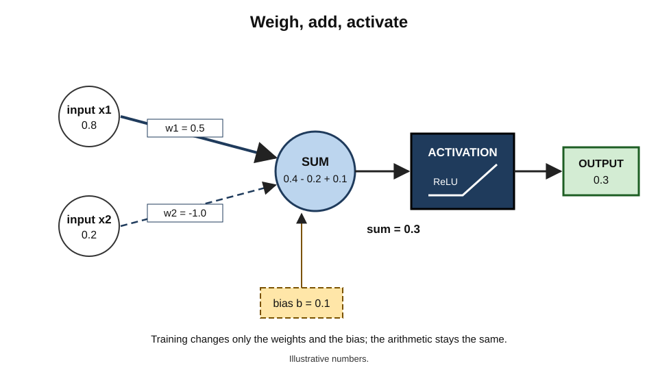
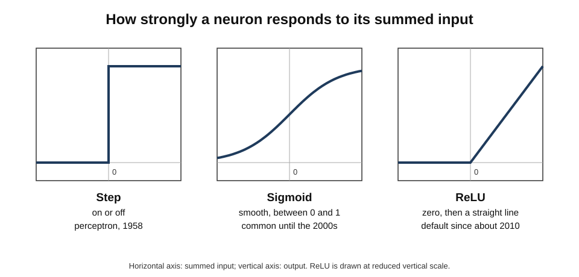
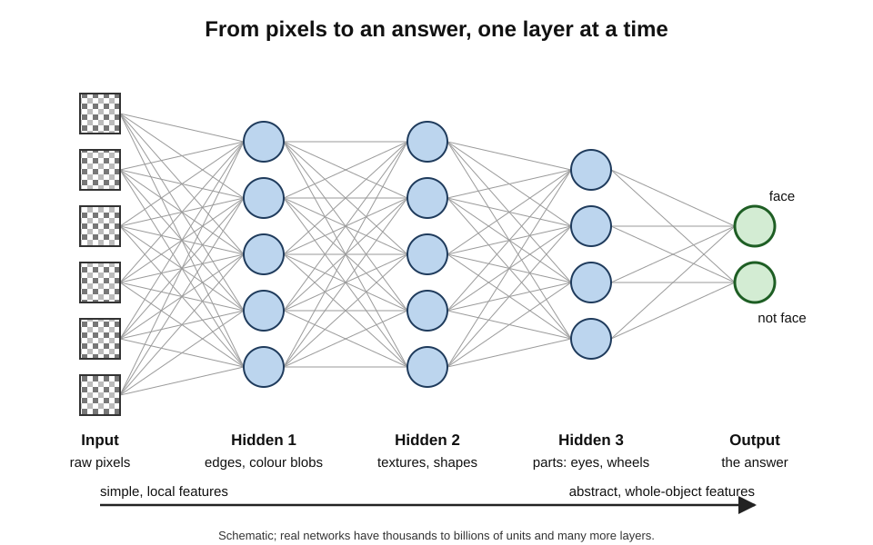
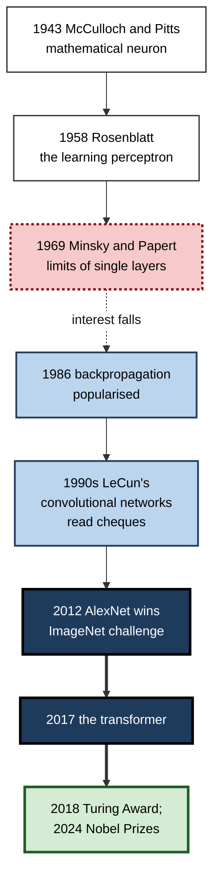
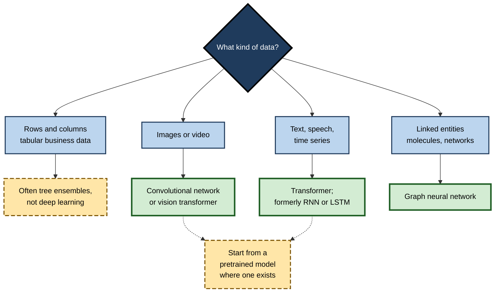

# C.5. Deep learning: neural networks explained simply

Nobody can write down the rules for recognising a handwritten "7". Some people cross it, some do not; some slant it, some curl the top. Yet a child learns to read any "7" after seeing a few dozen, and so — after seeing many thousands — does a deep neural network. Since around 2012, networks of this kind have become the engine behind face unlock, voice assistants, machine translation, medical-image analysis and the chatbots that write fluent prose.

> **Definition — Artificial neural network:** a computing system made of many simple connected units ("neurons") arranged in layers, in which each connection has a strength (a "weight") that is adjusted during training so the network maps inputs to the desired outputs.

> **Definition — Deep learning:** machine learning with neural networks that have many layers, each layer transforming the output of the one before into a more abstract representation.

**Why it matters**

- Deep learning made machines competent at **perception** — seeing, hearing, reading — which had resisted rule-based and classical methods for decades.
- It is the basis of almost every headline AI system of the 2010s and 2020s.
- Its characteristic strengths (handling raw, messy data at scale) and weaknesses (opacity, data hunger, odd failures) shape how AI must be used and governed.

---

## The Artificial Neuron

### A loose borrowing from biology

- **Biological neurons** receive signals through branching dendrites; if the combined input is strong enough, they fire a signal along the axon to other neurons.
- **Warren McCulloch and Walter Pitts (1943)** proposed a mathematical neuron: inputs, a threshold, and an output of 1 or 0.
- **Frank Rosenblatt (1958)** built the **perceptron**, a neuron whose weights could be learned from examples, and demonstrated it recognising simple shapes.

> **Watch out:** artificial neurons are inspired by biology only loosely. Real neurons are vastly more complex, and the brain does not learn in the way most artificial networks do. "Works like the brain" is a metaphor, not a description.

### What one neuron computes

1. **Multiply** each input by its **weight** — how much that input matters, and in which direction.
2. **Add** the results together, plus a **bias** — a baseline that shifts the neuron's sensitivity.
3. **Pass** the total through an **activation function**, which decides how strongly the neuron responds.

> **Formula — One neuron:** output = activation(w₁x₁ + w₂x₂ + … + b). Example: inputs x₁ = 0.8, x₂ = 0.2; weights w₁ = 0.5, w₂ = −1.0; bias b = 0.1. Sum = (0.5 × 0.8) + (−1.0 × 0.2) + 0.1 = 0.4 − 0.2 + 0.1 = **0.3**. With the ReLU activation (keep positives, set negatives to zero) the output is **0.3**; with the sigmoid activation it is about **0.57**.

**Figure 1.** One artificial neuron: weighted inputs are summed with a bias and passed through an activation function.

### Activation functions

- **Step** — output 1 if the sum exceeds a threshold, else 0; used in the original perceptron.
- **Sigmoid** — a smooth S-curve between 0 and 1; popular until the 2000s.
- **Tanh** — an S-curve between −1 and 1.
- **ReLU (rectified linear unit)** — zero for negative inputs, the input itself for positive ones; simple and fast, and from about 2010 the default in deep networks because it trains more easily.

**Figure 2.** Three activation functions: step, sigmoid and ReLU.

> **Key point:** the activation function is what makes networks **non-linear**. Without it, any number of layers would collapse into a single weighted sum, able to draw only straight-line boundaries.

---

## From One Neuron to Deep Networks

### Layers

- **Input layer** — receives the raw data.
  - *e.g.* 784 numbers for a 28 × 28-pixel single-channel (shades of grey) image of a digit.
- **Hidden layers** — transform the data step by step; "hidden" because their values are not directly observed.
- **Output layer** — produces the answer.
  - *e.g.* ten numbers, one for each digit 0–9, read as probabilities.
- **Deep** — having many hidden layers: tens in the 2010s, often a hundred or more in today's largest systems.

### Learning features automatically

- In classical machine learning, people designed the **features** — measurable properties — by hand.
  - *e.g.* edge counts or colour histograms for images.
- In deep learning, the network **learns its own features** in its hidden layers.
- In image networks, studies visualising what each layer responds to — notably by **Matthew Zeiler and Rob Fergus (2013)** — showed a **hierarchy**:
  - early layers → edges and colour blobs;
  - middle layers → textures and simple shapes;
  - later layers → parts (eyes, wheels) and whole objects.

> **Definition — Representation learning:** learning, from raw data, the features that make a task easier, instead of having people design them.

**Figure 3.** A deep network transforms raw pixels into increasingly abstract features before giving its answer.

### Training in brief

Training starts with random weights. The network makes predictions on training examples; a **loss** measures how wrong they are; **backpropagation** — popularised by **David Rumelhart, Geoffrey Hinton and Ronald Williams (1986)** — works out how much each weight contributed to the error, and each weight is nudged slightly in the direction that reduces it (**gradient descent**). Repeated over millions of examples, the nudges add up to competence.

### Counting parameters

> **Formula — Parameters in a fully connected layer:** (inputs × outputs) weights + outputs biases. A digit classifier with 784 inputs, one hidden layer of 128 neurons and 10 outputs has (784 × 128 + 128) + (128 × 10 + 10) = 100,480 + 1,290 = **101,770** parameters.

- **For scale:**
  - the 2012 image network AlexNet had about **60 million** parameters;
  - the language model GPT-3 (2020) had **175 billion**;
  - later frontier models are larger still, though developers increasingly do not publish exact figures.

### Why depth helps

- **The universal approximation theorem** (George Cybenko, 1989; Kurt Hornik, 1991): a network with just **one** hidden layer, given enough neurons, can approximate any continuous function as closely as desired.
- **But** "enough neurons" may be astronomically many. **Depth** lets a network build complex functions by **composing** simple ones — edges into shapes into objects — far more economically.

> **Watch out:** the theorem says a suitable network **exists**; it says nothing about whether training will **find** it, or how much data that needs.

---

## A Short History

**Figure 4.** Key moments in the history of neural networks.

- **1969 setback:** **Marvin Minsky and Seymour Papert**, in *Perceptrons*, proved that a single-layer perceptron cannot compute some simple functions, such as "exclusive or" (XOR: true if exactly one input is true). Multi-layer networks could, but nobody yet knew how to train them well; interest and funding fell away.
- **1980s revival:** backpropagation made multi-layer training practical.
- **1990s application:** **Yann LeCun**'s convolutional networks read handwritten digits; a system built on them was used to read a large share of cheques in the United States by the late 1990s.
- **2000s:** neural networks were unfashionable; a small community — including **Hinton**, **LeCun** and **Yoshua Bengio** — persisted.
- **2012 breakthrough:** **AlexNet** (Alex Krizhevsky, Ilya Sutskever and Hinton), trained on graphics processors, cut the error rate in the ImageNet image-recognition challenge to about 15%, against about 26% for the next-best entry.
- **Recognition:** Bengio, Hinton and LeCun shared the 2018 Turing Award; **John Hopfield** and Hinton received the **2024 Nobel Prize in Physics** for foundational work on neural networks; the same year's chemistry prize went partly to Demis Hassabis and John Jumper for AlphaFold, a deep-learning system.

> **Key point:** most of the core ideas existed by the early 1990s. What changed after 2010 was **data** (large labelled collections such as ImageNet), **compute** (graphics processors) and **engineering refinements** (ReLU, better initialisation, regularisation).

---

## The Main Architectures

An **architecture** is the pattern in which neurons are connected. Each builds in assumptions suited to a kind of data.

### Fully connected (feedforward) networks

- Every neuron in one layer connects to every neuron in the next.
- **Good for:** small, fixed-size inputs; the final stages of larger networks.
- **Weakness:** ignores structure — treats neighbouring pixels the same as distant ones.

### Convolutional neural networks (CNNs)

- Small **filters** slide across an image, detecting the same pattern (an edge, a corner) wherever it appears.
- **Weight sharing** — one filter's weights are reused across the whole image, so far fewer parameters are needed.
- **Good for:** images, video, some audio; dominant in computer vision through the 2010s.

> **Example:** a 3 × 3 filter that responds to vertical edges uses just 9 weights (plus a bias), yet scans every position of a million-pixel photograph.

### Recurrent neural networks (RNNs) and LSTMs

- Process sequences one step at a time, carrying a **memory** of what came before.
- **Long short-term memory (LSTM)** networks, introduced by **Sepp Hochreiter and Jürgen Schmidhuber (1997)**, added gates that let memory persist over longer sequences.
- **Good for:** speech, text, time series — dominant in speech recognition and translation until the late 2010s.
- **Weakness:** slow (step-by-step) and still struggles with very long-range dependencies.

### Transformers

- Introduced in **"Attention Is All You Need" (Vaswani and colleagues at Google, 2017)**.
- **Attention** lets every element of a sequence look directly at every other element and weigh its relevance.
  - *e.g.* in "the trophy did not fit in the suitcase because **it** was too big", attention helps link "it" to "trophy".
- Processes whole sequences in parallel, making it efficient on modern hardware and able to scale to enormous sizes.
- **Good for:** language above all, and increasingly images, audio, video, proteins and robot control. It is the architecture of today's large language models.

> **Definition — Attention:** a mechanism by which a network computes, for each element of its input, how much to draw on every other element.

### Other important families

- **Autoencoders** — compress inputs into a small code and reconstruct them; used for anomaly detection and compression.
- **Graph neural networks** — operate on networks of connected entities.
  - *e.g.* molecules, transport networks, social networks.
- **Diffusion models and other generative networks** — learn to create new images, audio or video.

| Architecture | Built-in assumption | Typical data | Strength | Weakness |
|---|---|---|---|---|
| Fully connected | None about structure | Small fixed-size inputs | Simple, general | Many parameters; ignores structure |
| Convolutional | Local patterns repeat across space | Images, video | Efficient, robust to position | Weaker at long-range relations |
| Recurrent / LSTM | Order matters; memory of the past | Speech, text, time series | Natural for sequences | Slow; limited long-range memory |
| Transformer | Any element may relate to any other | Text, and now most modalities | Scales superbly; long context | Compute grows quickly with length |
| Graph network | Entities and their links | Molecules, networks | Handles irregular structure | Harder to scale |

**Figure 5.** Choosing a neural architecture by the structure of the data.

---

## Representations: What a Network "Knows"

### Embeddings

- Networks represent things — words, images, products, users — as long lists of numbers called **embeddings**.
- Similar things end up with **similar** embeddings, close together in a high-dimensional space.
- **Word2vec (Tomas Mikolov and colleagues at Google, 2013)** showed that word embeddings learned from text captured relationships: the vector for "king" minus "man" plus "woman" lay close to "queen".

> **Definition — Embedding:** a learned list of numbers representing an item so that similar items have nearby representations.

> **Watch out:** the "king – man + woman ≈ queen" example is real but flattering; many such analogies work less neatly, and later studies showed embeddings also absorb social stereotypes present in text — for instance associating some occupations with one gender.

### Pretraining and reuse

- A network trained on a huge general dataset learns representations useful for many tasks.
- These **pretrained** models can be adapted to a specific task with far less data — the common route in industry today.

---

## Scale and Its Lessons

### The bitter lesson

- **Richard Sutton (2019)**, a founder of reinforcement learning, wrote "The Bitter Lesson": over seventy years, general methods that exploit **more computation** — search and learning — have repeatedly beaten methods built on human knowledge of the domain.
- Deep learning's progress since 2012 is often cited in support.

### Scaling laws

- Studies at OpenAI (**Jared Kaplan and colleagues, 2020**) found that language-model error falls in a smooth, predictable way as model size, data and computation increase.
- DeepMind's **"Chinchilla" study (Jordan Hoffmann and colleagues, 2022)** found many large models had been **under-trained**: for a fixed compute budget, a smaller model trained on more data — roughly twenty units of text ("tokens") per parameter — did better.

> **Key point:** scaling laws turned model building into something closer to engineering: organisations could forecast the benefit of a bigger training run before paying for it.

> **Watch out:** scaling laws describe a measured trend in **prediction error**, not a law of nature. Whether improvements in error translate into reliable reasoning, and how long the trend continues as high-quality data runs short, are contested.

---

## Strengths and Weaknesses

### Strengths

- **Raw, unstructured data** — images, sound, text — without hand-crafted features.
- **Scale** — performance keeps improving with more data and compute, for many tasks.
- **Transfer** — pretrained representations carry over to new tasks.
- **Multimodality** — one network can link words, images and sound.

### Weaknesses

- **Data and compute hunger** — training large models requires vast datasets, specialised chips and large amounts of energy.
- **Opacity** — millions or billions of weights do not explain themselves; this is the "black box" problem.
- **Adversarial fragility** — tiny, carefully designed changes to an input can flip the output.
- **Shortcut learning** — networks may latch onto background, texture or watermark cues instead of the intended features.
- **Poor calibration** — modern networks are often over-confident.
- **Catastrophic forgetting** — training on new tasks can erase old ones.

**Study card — Szegedy and colleagues (2014), "Intriguing properties of neural networks"**

- **Method:** took images that a high-performing image network classified correctly, and computed tiny pixel changes designed to mislead it.
- **Result:** changes **invisible to people** caused confident misclassification; the same altered images often fooled other networks too.
- **Follow-up:** Ian Goodfellow and colleagues (2015) showed a famous example — a photo of a panda, imperceptibly altered, classified as a gibbon with high confidence — and a fast method for creating such **adversarial examples**.
- **Conclusion:** high accuracy on ordinary images does not imply robustness; deep networks perceive differently from people.

> **Definition — Adversarial example:** an input deliberately altered, often imperceptibly, to make a model produce a wrong output.

### Looking inside: interpretability

- **Saliency maps** highlight which input pixels most influenced a decision — useful but sometimes misleading.
- **Probing** tests whether a concept (say, "is plural") can be read from a layer's values.
- **Mechanistic interpretability** tries to reverse-engineer the circuits inside networks; research since about 2022 has found that networks often store many concepts superimposed in the same neurons, making individual neurons hard to interpret.

---

## The Machinery Behind Deep Learning

### Why graphics processors

- Training and running a network is dominated by one operation: **multiplying large grids of numbers** (matrices).
- **Graphics processing units (GPUs)**, designed to colour millions of pixels in parallel for video games, perform thousands of such multiplications at once.
- **Specialised chips** followed — Google's **tensor processing units** (announced 2016) and many others — built solely for neural-network arithmetic.

> **Key point:** deep learning's rise was as much a **hardware** story as an algorithmic one. Access to large numbers of advanced chips now shapes which organisations, and which countries, can build the largest models.

### Training versus running

- **Training** a large model is a one-off (or occasional) cost: weeks of computation on thousands of chips.
- **Inference** — running the trained model to answer a request — costs far less per use, but is repeated billions of times.
  - For widely used systems, the **total** energy spent on inference can exceed that spent on training.
- **Making models smaller and cheaper to run:**
  - **quantisation** — storing weights with fewer digits;
  - **pruning** — removing connections that contribute little;
  - **distillation** — training a small "student" network to imitate a large "teacher".

> **Example:** face unlock and on-device dictation run small, compressed networks directly on phones, so images and voices need not leave the device — a design choice that improves both speed and privacy.

### Deep learning across industries

- **Healthcare** — reading scans and slides; predicting deterioration from monitoring data; protein structure prediction.
- **Finance** — detecting fraud in sequences of transactions; reading documents for compliance checks.
- **Retail and media** — recommendation; visual search ("find similar products"); content moderation.
- **Manufacturing** — visual inspection; predicting equipment failure from vibration and sound.
- **Transport** — perception for driver assistance and autonomous vehicles.
- **Science** — weather forecasting; materials discovery; analysing telescope and particle-physics data.

| | Deep learning | Classical machine learning |
|---|---|---|
| Best-suited data | Images, audio, text, video | Tables of numbers and categories |
| Feature design | Learned automatically | Often designed by people |
| Data needed | Large, unless a pretrained model is adapted | Small to large |
| Compute needed | High (specialised chips) | Low to moderate |
| Explaining a decision | Hard | Often easier |

---

## Deep Learning in Practice

### When to use it

- **Use deep learning when:**
  - data are **unstructured** — images, audio, free text;
  - large datasets, or a suitable pretrained model, exist;
  - the pattern is too complex for hand-designed features.
- **Prefer other methods when:**
  - data are **tabular** and moderate in size;
  - every decision must be fully explained;
  - data or compute are scarce.

> **In practice:** most organisations no longer train deep networks from scratch. They **adapt a pretrained model** — for vision, speech or language — with a modest set of their own examples, and spend most effort on data quality, evaluation and integration.

### Case study: AlphaFold and the protein-folding problem

- **Situation:** a protein's function depends on its three-dimensional shape, but determining that shape experimentally could take months or years per protein. Predicting shape from the amino-acid sequence had been an open problem for some fifty years.
- **The benchmark:** the biennial **CASP** competition, in which teams predict structures that have been determined experimentally but not yet published.
- **What happened:**
  - DeepMind's **AlphaFold 2**, a deep network built around attention mechanisms and trained on known structures, achieved accuracy at CASP14 (2020) comparable to experimental methods for a large share of targets — far ahead of other entrants;
  - in 2021–22 DeepMind and the European Bioinformatics Institute released predicted structures for over 200 million proteins, nearly all those known to science.
- **Result:** structural biologists adopted the predictions widely as starting points; Hassabis and Jumper shared the 2024 Nobel Prize in Chemistry.
- **Caveats:** predictions are less reliable for some protein types, for proteins that change shape, and for interactions between molecules; experimental confirmation remains necessary for many uses.
- **Lesson:** deep learning excels where there is a **well-defined target**, a **large body of high-quality data** and an **objective benchmark** — and it changes a field most when its outputs are trusted *and* checked.

### Case study (illustrative): defect detection on a production line

- **Situation:** a manufacturer of glass bottles relied on human inspectors to spot cracks and bubbles; misses reached customers.
- **Actions:**
  1. Fitted cameras and collected about 5,000 images, of which a few hundred showed defects.
  2. Adapted a pretrained convolutional network rather than training one from scratch.
  3. Added synthetic variation (rotations, lighting changes) to make up for scarce defect images.
  4. Set the alert threshold to favour catching defects, accepting more false alarms for humans to check.
- **Result:** missed defects fell markedly; inspectors moved to reviewing flagged bottles. *Illustrative figures.*
- **Side effect:** a change of bottle colour months later caused a surge of false alarms until new images were added.
- **Lesson:** pretrained networks make deep learning feasible with modest data — but the system remains **tied to the conditions** it was adapted for.

---

## Open Questions

- **Why do deep networks generalise so well?**
  - Networks with far more parameters than training examples should, by classical theory, memorise rather than generalise; why they usually do not is only partly understood.
- **Can networks be made truly interpretable?**
  - Progress in mechanistic interpretability is real but covers small parts of large models.
- **Will scaling continue to pay?**
  - Data, energy and cost limits are approaching for the largest models; whether new architectures or methods will be needed is debated.
- **Can networks learn as efficiently as people?**
  - Children learn from far fewer examples; closing this gap may require different principles.
- **How close is the analogy to the brain?**
  - Some neuroscientists find deep networks useful models of parts of the visual system; others stress the differences.

---

## Summary

- An **artificial neuron** multiplies inputs by **weights**, adds a **bias** and applies an **activation function**; a **neural network** connects many neurons in **layers**.
- **Deep learning** uses many layers, which **learn their own features** — from edges to objects in images (**representation learning**).
- Training adjusts weights to reduce error using **backpropagation** and **gradient descent**.
- History: **McCulloch and Pitts (1943)**, **Rosenblatt's perceptron (1958)**, **Minsky and Papert's critique (1969)**, **backpropagation (1986)**, **LeCun's convolutional networks**, **AlexNet (2012)**, the **transformer (2017)**; Turing Award 2018 and Nobel Prizes 2024.
- Architectures embody assumptions: **fully connected**, **convolutional** (local repeated patterns), **recurrent/LSTM** (sequences), **transformers** (attention: anything relates to anything), **graph networks**.
- Networks represent items as **embeddings**; **pretrained** models are adapted for new tasks.
- **Scale** — data, parameters, compute — has driven progress (**bitter lesson**, **scaling laws**), but its limits are debated.
- Weaknesses: **data and compute hunger, opacity, adversarial fragility, shortcut learning, poor calibration, catastrophic forgetting**.
- Use deep learning for **unstructured data** with ample data or pretrained models; prefer simpler methods for moderate **tabular** data or where full explanation is required.

---

## Self-Check

1. Describe what a single artificial neuron computes.
2. Compute the output of a neuron with inputs 1.0 and 0.5, weights 0.4 and 0.6, bias −0.5, using ReLU.
3. Why is a non-linear activation function essential?
4. What is representation learning, and what hierarchy of features did image-network visualisations reveal?
5. What did Minsky and Papert show in 1969, and why did it matter?
6. What three factors made the 2012 breakthrough possible?
7. How many parameters does a fully connected network with 100 inputs, 50 hidden neurons and 2 outputs have?
8. What does the universal approximation theorem say, and what does it not say?
9. Compare convolutional networks, recurrent networks and transformers by their built-in assumptions.
10. What is attention? Give an example of what it helps with.
11. What is an embedding, and what is one limitation of the "king – man + woman" example?
12. Summarise the bitter lesson and the Chinchilla finding.
13. What are adversarial examples, and what do they reveal?
14. A firm with 20,000 rows of customer data wants a deep network to predict churn. What would you advise?
15. What made AlphaFold successful, and what caveats remain?

### Answer Key

1. It multiplies each input by a weight, sums the results with a bias, and passes the total through an activation function to produce its output.
2. (0.4 × 1.0) + (0.6 × 0.5) − 0.5 = 0.4 + 0.3 − 0.5 = 0.2; ReLU(0.2) = **0.2**.
3. Without it, stacked layers reduce to a single weighted sum — a linear function — which can draw only straight-line boundaries, however many layers there are.
4. Learning useful features from raw data instead of designing them by hand. Early layers detect edges and colour blobs; middle layers textures and shapes; later layers parts and whole objects.
5. That a single-layer perceptron cannot compute some simple functions such as XOR. Multi-layer networks could, but there was no good training method yet, so interest and funding fell for years.
6. Large labelled datasets (ImageNet), cheap parallel computation (graphics processors) and engineering refinements (such as ReLU and regularisation).
7. (100 × 50 + 50) + (50 × 2 + 2) = 5,050 + 102 = **5,152**.
8. A network with one hidden layer and enough neurons can approximate any continuous function. It does not say how many neurons are needed, whether training will find the right weights, or how much data is required.
9. Convolutional: local patterns repeat across space (images). Recurrent/LSTM: order matters and memory carries forward (sequences). Transformers: any element may relate to any other, weighted by attention (language and now most data types).
10. A mechanism computing how much each element should draw on every other. It helps link a pronoun such as "it" to the right noun earlier in a sentence.
11. A learned list of numbers placing similar items close together. The analogy example is flattering — many analogies work less neatly — and embeddings absorb social stereotypes from text.
12. Bitter lesson: general methods using more computation have repeatedly beaten hand-built domain knowledge. Chinchilla: for a fixed compute budget, smaller models trained on more data (around twenty tokens per parameter) beat larger, under-trained ones.
13. Inputs altered, often imperceptibly, to cause wrong outputs. They show that high accuracy does not imply robustness, and that networks perceive differently from people.
14. With moderate tabular data, a tree ensemble or logistic regression is likely to match or beat a deep network, more cheaply and more explainably. Start with a simple baseline; use deep learning only if it clearly adds value.
15. A well-defined target, a large body of high-quality structural data and an objective benchmark (CASP), plus an attention-based architecture. Caveats: weaker on some protein types, flexible proteins and interactions; experimental confirmation is still often needed.

---

## Glossary

| Term | Meaning |
|---|---|
| Activation function | The function applied to a neuron's weighted sum, making the network non-linear. |
| Adversarial example | An input deliberately altered to make a model err. |
| Architecture | The pattern of connections in a neural network. |
| Attention | A mechanism weighting how much each input element draws on every other. |
| Backpropagation | The method for working out how much each weight contributed to an error. |
| Bias (of a neuron) | A constant added to a neuron's weighted sum. |
| Convolutional neural network | A network using small shared filters that scan across images. |
| Deep learning | Machine learning with many-layered neural networks. |
| Embedding | A learned numerical representation in which similar items lie close together. |
| Gradient descent | Adjusting weights step by step in the direction that reduces error. |
| Hidden layer | A layer between input and output whose values are not directly observed. |
| LSTM | A recurrent network with gates that preserve memory over long sequences. |
| Neural network | Connected layers of simple computing units with adjustable weights. |
| Parameter | A number learned during training, such as a weight or bias. |
| Perceptron | Rosenblatt's early learning neuron. |
| Pretrained model | A network trained on general data, ready to be adapted to specific tasks. |
| Recurrent neural network | A network that processes sequences step by step with memory. |
| ReLU | Activation that outputs zero for negative inputs and the input itself for positive ones. |
| Representation learning | Learning useful features from raw data automatically. |
| Scaling laws | Empirical regularities linking model size, data and compute to error. |
| Transformer | An attention-based architecture processing whole sequences in parallel. |
| Universal approximation theorem | The result that one hidden layer can, in principle, approximate any continuous function. |
| Weight | The strength of a connection between neurons. |
