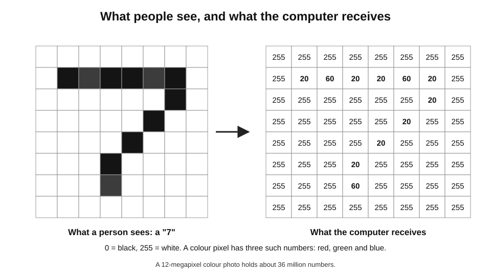
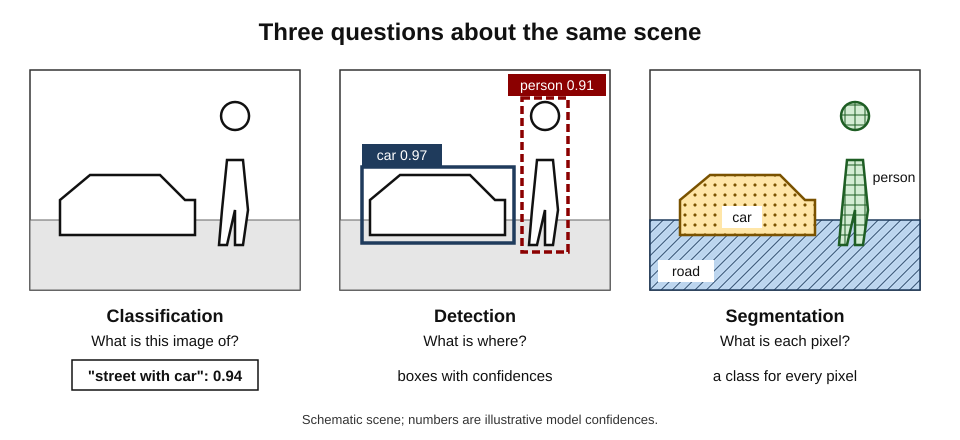
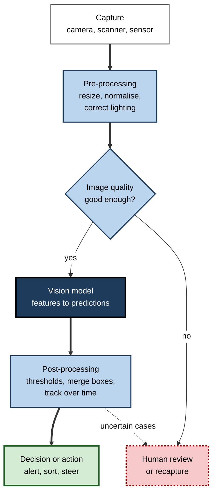
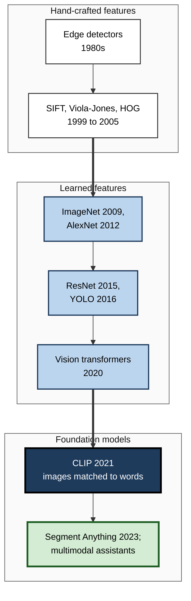
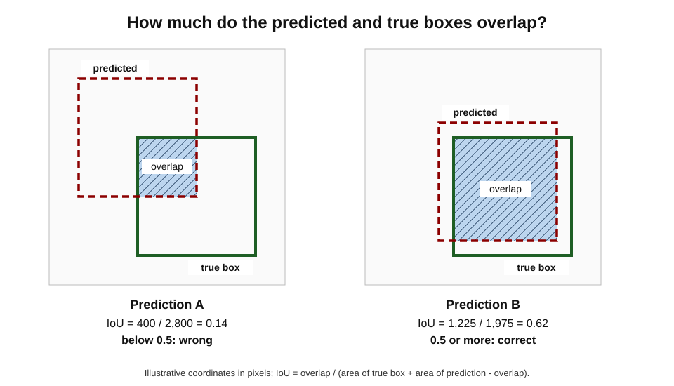
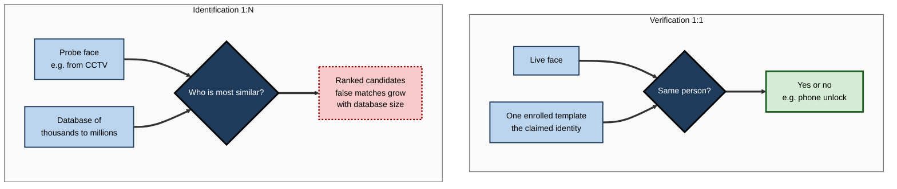

# C.6. Computer vision: teaching machines to see

A phone recognises its owner's face in the dark. A sorting centre reads handwritten addresses on a million parcels a day. A camera on a farm sprayer tells a weed from a crop seedling and sprays only the weed. A screening programme flags retinal photographs that show early signs of diabetic eye disease. In each case a machine has turned a grid of coloured dots into a judgement about the world — the core achievement of computer vision.

> **Definition — Computer vision:** the field of AI concerned with enabling machines to extract useful information from images and video — recognising, locating, measuring and tracking what they show.

**Why it matters**

- Vision is the richest human sense; automating parts of it opens up medicine, manufacturing, transport, agriculture, retail and security.
- It was one of the first fields transformed by deep learning, and much of what is known about how modern AI succeeds and fails was learned there.
- Its uses in surveillance and identification raise some of the sharpest ethical and legal questions in AI.

---

## What a Machine Actually Sees

### An image is a grid of numbers

- A digital image is a grid of **pixels** (picture elements).
- In a single-channel (shades of grey) image each pixel is one number, typically 0 (black) to 255 (white).
- In a colour image each pixel has three numbers — **red, green and blue** intensities (**RGB**).
- A modest 12-megapixel phone photo is therefore about **36 million numbers**.

> **Key point:** the computer receives **no objects** — no faces, cars or tumours — only numbers. Everything else must be inferred.

**Figure 1.** To a computer, an image is only a grid of numbers.

### Why seeing is hard

The same object can produce wildly different numbers. A vision system must cope with:

- **Viewpoint** — a mug from above, from the side, from below.
- **Lighting** — midday sun, shadow, fluorescent light, night.
- **Scale** — a car filling the frame or a speck in the distance.
- **Occlusion** — a pedestrian half hidden behind a van.
- **Deformation** — a cat curled up or stretched out.
- **Background clutter** — an object camouflaged against a busy scene.
- **Variation within a class** — armchairs, office chairs and stools are all "chairs".

> **Mnemonic — "Very Light Snow Often Delays Busy Visitors":** Viewpoint, Lighting, Scale, Occlusion, Deformation, Background, Variation within a class.

> **Example:** in 1966 the Massachusetts Institute of Technology launched a "Summer Vision Project", proposing that students could build a significant part of a visual system over one summer. The problem proved to be one of the hardest in AI — an early lesson in Moravec's paradox: what is effortless for people can be extraordinarily hard for machines.

---

## The Tasks of Computer Vision

### From "what" to "where" to "exactly which pixels"

- **Image classification** — what is the main content?
  - *e.g.* "this X-ray shows pneumonia"; "this photo contains a dog".
- **Object detection** — what objects are present, and where? Output: labelled **bounding boxes**.
  - *e.g.* every pedestrian, car and cyclist in a street scene.
- **Semantic segmentation** — which class does each pixel belong to?
  - *e.g.* road, pavement, sky, building.
- **Instance segmentation** — which pixels belong to each individual object?
  - *e.g.* separating three overlapping people.
- **Keypoint and pose estimation** — where are specific points?
  - *e.g.* joints of a body for sports analysis or physiotherapy.
- **Tracking** — following objects from frame to frame in video.
- **Optical character recognition (OCR)** — reading text in images.
  - *e.g.* invoices, passports, number plates.
- **Face analysis** — detecting faces, and in some systems verifying or identifying people.
- **Depth and 3D reconstruction** — estimating distances and shapes.
  - *e.g.* building a 3D model of a room from phone video.

**Figure 2.** Classification, detection and segmentation answer progressively more detailed questions about the same scene.

| Task | Question answered | Output | Example use |
|---|---|---|---|
| Classification | What is this image of? | A label, often with a probability | Screening scans; sorting product photos |
| Detection | What is where? | Labelled boxes | Counting vehicles; spotting defects |
| Semantic segmentation | What is each pixel? | A class per pixel | Mapping roads; measuring tumour area |
| Instance segmentation | Which pixels are each object? | A mask per object | Robot picking; cell counting |
| Pose estimation | Where are the key points? | Coordinates of joints | Sports coaching; ergonomics |
| OCR | What text is written? | Characters and positions | Invoice processing; plate reading |

### Beyond ordinary cameras

- **Infrared and thermal** — heat; used in building inspection, night driving, medical screening.
- **X-ray, CT and MRI** — inside the body or luggage.
- **LiDAR** — laser pulses measuring distance; builds 3D "point clouds" for vehicles and mapping.
- **Satellite and aerial imagery** — crops, floods, deforestation, urban growth.
- **Microscopy** — cells and tissues in pathology and research.

---

## How a Vision System Works

### The pipeline

**Figure 3.** A typical computer vision pipeline, from capture to decision.

> **In practice:** much of the engineering effort in a working vision system goes into **capture and quality** — camera placement, lighting, lens cleaning, image checks — rather than the model. Poor images defeat good models.

### Two eras of method

**Hand-crafted features (1960s–about 2012)**

- Engineers designed mathematical detectors for useful patterns, then fed them to a classifier.
  - **Edge detectors** — such as John Canny's (1986), finding sharp changes in brightness.
  - **SIFT** (David Lowe, 1999 and 2004) — distinctive local features robust to scale and rotation, used to match views and stitch panoramas.
  - **Viola–Jones detector** (Paul Viola and Michael Jones, 2001) — fast face detection using simple rectangular brightness patterns; for years the basis of face-finding in digital cameras.
  - **HOG** (Navneet Dalal and Bill Triggs, 2005) — histograms of edge directions, effective for detecting pedestrians.
- **Strength:** understandable, fast. **Limit:** accuracy plateaued on complex, varied scenes.

**Learned features (from about 2012)**

- **ImageNet** — assembled by a team led by **Fei-Fei Li** at Princeton and Stanford and released in 2009 — eventually held over 14 million labelled images in more than 20,000 categories; its annual challenge used a 1,000-category subset.
- **AlexNet (2012)** — a convolutional neural network that cut the challenge's error rate dramatically and ended the hand-crafted era.
- **ResNet (Kaiming He and colleagues, 2015)** — "residual" shortcuts allowed networks of over 100 layers; it passed the roughly 5% top-five error that one researcher had measured for his own human performance on the task.
- **YOLO ("You Only Look Once", Joseph Redmon and colleagues, 2016)** — real-time object detection in a single pass.
- **Vision transformers (Alexey Dosovitskiy and colleagues, 2020)** — split images into patches and process them with attention, like words in a sentence.

> **Watch out:** "superhuman on ImageNet" meant beating a **single researcher's** estimate of his own error on a **specific** benchmark of 1,000 categories under artificial conditions. It did not mean machines see better than people in general.

### Foundation models for vision

- **CLIP (OpenAI, 2021)** — trained on some 400 million image–caption pairs from the internet to match pictures with descriptions.
  - Could classify images into categories **named in plain words** without task-specific training ("zero-shot").
- **Segment Anything (Meta, 2023)** — trained on over a billion segmentation masks; cuts out almost any object in an image when prompted with a click or box.
- **Multimodal language models** — accept images alongside text, answering questions about photos, charts and documents.

**Figure 4.** The evolution of computer vision methods.

---

## Measuring a Vision System

### Did it find the right thing in the right place?

- **Classification** — accuracy, and the balance between missed cases and false alarms.
- **Detection** — whether each predicted box overlaps a true object enough.

> **Definition — Intersection over union (IoU):** the area of overlap between a predicted box and the true box, divided by the area covered by either. 1 means perfect overlap; 0 means none.

> **Formula — IoU:** IoU = area of overlap ÷ area of union, where union = area A + area B − overlap.

### Worked example (illustrative): scoring a detected box

A model detects a parcel. Coordinates are in pixels, from top-left (x, y) to bottom-right.

1. **True box:** (30, 30) to (70, 70) → 40 × 40 = **1,600** px².
2. **Predicted box:** (10, 10) to (50, 50) → 40 × 40 = **1,600** px².
3. **Overlap:** (30, 30) to (50, 50) → 20 × 20 = **400** px².
4. **Union:** 1,600 + 1,600 − 400 = **2,800** px².
5. **IoU** = 400 ÷ 2,800 ≈ **0.14**.

- A common rule counts a detection as correct if IoU ≥ 0.5. Here the box is **wrong**, even though it touches the parcel.
- **Shifted prediction:** (25, 25) to (65, 65) → overlap (30, 30)–(65, 65) = 35 × 35 = 1,225; union = 3,200 − 1,225 = 1,975; IoU ≈ **0.62** → counted correct.

**Figure 5.** Intersection over union for two predicted boxes.

> **Watch out:** a benchmark score averages over many images. A system can score well overall yet fail badly on a **subgroup** — dark skin, night scenes, unusual products — that matters greatly in practice.

---

## Beyond Single Photographs

### Video

- Video adds **time**: systems must track objects from frame to frame, recognise actions ("a person falling", "a forklift reversing") and cope with motion blur.
- **Tracking** links detections across frames so that the same car or shopper keeps one identity.
- **Action recognition** classifies what is happening over a short clip.
- **Volume** is the practical challenge: a single camera produces tens of thousands of frames an hour, so many systems analyse video **on the device** and send only alerts or summaries.

### Seeing in three dimensions

- **Stereo vision** — two cameras, like two eyes, estimate depth from the small difference between their views.
- **Structure from motion** — many photographs of the same scene, taken from different positions, are combined into a 3D model; used in surveying, archaeology and film.
- **Learned 3D scene models** — methods such as **neural radiance fields (2020)** and **3D Gaussian splatting (2023)** reconstruct photorealistic scenes that can be viewed from new angles.
- **Depth from a single image** — networks trained on many examples estimate distance from one photograph, imperfectly but usefully.

### Medical imaging: a special case

- Medical images — X-rays, CT, MRI, ultrasound, retinal photographs, pathology slides — are among the most studied applications.
- **Regulation:** in most countries, software that informs diagnosis is a **medical device**. The US Food and Drug Administration's public list of AI-enabled devices had grown to well over a thousand by 2025, the large majority in **radiology**.
- **Typical roles:**
  - **triage** — moving likely urgent scans to the top of a radiologist's list;
  - **detection support** — marking regions for a clinician to check;
  - **measurement** — sizing tumours or heart chambers consistently;
  - **screening** — in a few approved uses, deciding which images need a specialist at all.
- **Evidence gap:** many systems have been validated on retrospective images from a few sites; fewer have been tested in prospective trials measuring patient outcomes.

> **Watch out:** a model that matches specialists on a curated test set may not improve care. The questions that matter are whether **clinicians plus the system** do better than clinicians alone, on **local** patients, without new harms such as over-diagnosis.

### Designing a vision project

1. **Define the decision** — what will be done differently because of the system's output?
2. **Control capture** — cameras, lighting, angles, resolution and cleaning.
3. **Collect representative images** — all sites, seasons, products, skin tones, equipment types.
4. **Label carefully** — clear definitions, trained labellers, checks on agreement between labellers.
5. **Start from a pretrained model** — adapt rather than train from scratch.
6. **Test on new conditions** — a different site or month, not only a random split of the same images.
7. **Measure by subgroup** — accuracy for each product, location and population.
8. **Plan for change** — monitoring, re-labelling and retraining when conditions shift.

> **Remember:** most of these steps concern **images and conditions**, not the model — which is where most vision projects succeed or fail.

### Privacy by design in vision

- **Process on the device** where possible, sending only results.
- **Blur or discard faces and number plates** not needed for the task.
- **Minimise retention** — keep footage only as long as needed.
- **Prefer counting to identifying** — a system that counts people in a station needs no identities.

---

## Faces: The Most Sensitive Application

### Detection, verification and identification

- **Face detection** — is there a face, and where? (Used by every phone camera to set focus.)
- **Face verification (1:1)** — is this the same person as the one enrolled?
  - *e.g.* unlocking a phone; matching a traveller to their passport photo at an e-gate.
- **Face identification (1:N)** — who, among many enrolled people, is this?
  - *e.g.* searching a photo against a database of millions.

**Figure 6.** Verification compares one face with one record; identification searches one face against many.

> **Key point:** identification is far riskier than verification. Each extra person in the database is another chance of a **false match**, and the person matched usually has no idea a search took place.

### Unequal accuracy

**Study card — Buolamwini and Gebru (2018), "Gender Shades"**

- **Design:** tested commercial gender-classification systems from three major companies on a balanced set of parliamentarians' photos from African and European countries, grouped by skin type and gender.
- **Results:**
  - error rates were lowest for lighter-skinned men — under 1% for the best systems;
  - error rates were highest for darker-skinned women — up to about **35%** for the worst system.
- **Follow-up:** after publication, the companies released updated systems with smaller gaps.
- **Conclusion:** aggregate accuracy can hide large disparities; the training and test data had under-represented darker-skinned women.

- **US National Institute of Standards and Technology (2019):** in a large evaluation of face-recognition algorithms, many showed false-match rates that differed markedly across demographic groups — often by factors of ten or more — though the best algorithms showed much smaller differences.

> **Watch out:** "facial recognition is biased" and "facial recognition is now accurate for everyone" are both oversimplifications. Accuracy varies **enormously by algorithm, image quality and use**; a top algorithm on good passport photos differs greatly from a weak one on grainy CCTV stills.

### Case study: a wrongful arrest in Detroit

- **Situation:** in January 2020, police in Detroit, Michigan, arrested Robert Williams at his home in front of his family for a shoplifting offence.
- **How it happened:** a grainy surveillance still was searched against a state database of photos using face-identification software; Williams's driving-licence photo was returned as a possible match, and he was then picked from a photo line-up by a person who had seen only the surveillance video.
- **Outcome:** he was held for about thirty hours before the charges were dropped; it was the first widely reported case in the United States of a wrongful arrest based on a face-recognition match. In a 2024 settlement, Detroit police agreed not to arrest people on the basis of face-recognition results alone, among other policy changes.
- **Lessons:**
  1. A **1:N search result is an investigative lead, not an identification**.
  2. Low-quality probe images sharply increase error.
  3. **Automation bias** turned a candidate list into a presumption of guilt; the surrounding procedure failed as much as the software.

---

## Where Vision Works, and Where It Fails

### Applications

- **Healthcare** — screening retinal photographs; flagging findings on X-rays and CT scans; counting cells in pathology slides.
- **Manufacturing** — inspecting welds, circuit boards, bottles and textiles for defects.
- **Agriculture** — detecting weeds for targeted spraying; estimating yields; monitoring livestock.
- **Retail and logistics** — reading barcodes and labels; shelf monitoring; parcel dimensioning.
- **Transport** — number-plate recognition; driver-assistance systems; autonomous vehicles.
- **Documents** — reading invoices, forms and identity documents.
- **Accessibility** — describing scenes and reading text aloud for blind and partially sighted people.
- **Environment** — tracking deforestation, floods and wildlife from satellite and camera-trap images.

### Characteristic failures

- **Shortcut learning** — classifying by background or context rather than the object.
  - *e.g.* in a 2018 study by Sara Beery and colleagues, models trained on camera-trap photos often failed on the same species photographed at new locations, partly because they had learned the backgrounds of the original sites.
- **Texture bias** — **Robert Geirhos and colleagues (2019)** showed that ImageNet-trained networks rely more on **texture** than shape: an image with a cat's outline filled with elephant skin was usually classified as an elephant, whereas people go by the shape.
- **Distribution shift** — new cameras, lighting, seasons or populations.
- **Adversarial attacks** — small stickers or patterns can mislead detectors.
  - *e.g.* researchers in 2017–18 showed that a few stickers on a stop sign could make a classifier read it as a speed-limit sign.
- **Rare cases** — unusual objects or situations seldom seen in training.

| | People | Current vision systems |
|---|---|---|
| Learning a new object | From a few examples | Usually many, unless a large pretrained model is adapted |
| Basis of recognition | Mainly shape, with context and knowledge | Often texture and context; shape less robustly |
| Consistency over volume | Tires; attention lapses | Same quality on the millionth image |
| Unusual situations | Reasons from general knowledge | Frequently fails silently |
| Fine detail at scale | Limited by attention | Can scan every pixel of every image |

### Case study: diabetic eye screening in Thai clinics

- **Situation:** Google Health researchers had developed a deep-learning system that detected diabetic retinopathy in retinal photographs with accuracy comparable to specialists in laboratory evaluations. Thailand's health ministry, facing a shortage of eye specialists, piloted it in community clinics.
- **What the field study found** (reported by Emma Beede and colleagues at the 2020 CHI conference on human factors in computing):
  - many photos were taken in rooms that could not be fully darkened, by busy nurses, producing images the system's quality check rejected — in some clinics, a substantial share of images;
  - rejected patients had to be referred to distant hospitals, a burden many could not bear;
  - slow internet connections delayed results for images uploaded to the cloud;
  - nurses sometimes had to explain to patients why the machine, not they, had refused the photograph.
- **Response:** the team worked with clinics on workflow and image-capture changes and continued the programme.
- **Lesson:** **laboratory accuracy is not clinical value**. A vision system's performance depends on the whole socio-technical setting — lighting, staff time, connectivity, referral pathways and patient circumstances.

---

## Open Questions

- **Will vision systems learn to see shapes and causes, not textures and contexts?**
  - Foundation models are more robust than earlier networks, but shortcut behaviour has not disappeared.
- **How should face identification be governed?**
  - Jurisdictions differ sharply — from bans on some police uses to widespread deployment — and evidence on benefits and harms is contested.
- **Can systems recognise when they do not understand a scene?**
  - Detecting truly novel inputs remains unreliable.
- **How much can vision learn from video and interaction rather than labelled photos?**
  - Learning from the physical world, as infants do, may be key to robust perception and to robotics.

---

## Summary

- **Computer vision** extracts information from images and video; to a machine an image is only a **grid of numbers** (pixels, RGB values).
- Vision is hard because of **viewpoint, lighting, scale, occlusion, deformation, background and within-class variation**.
- Core tasks: **classification, detection, semantic and instance segmentation, pose estimation, tracking, OCR, face analysis, depth and 3D**.
- Methods moved from **hand-crafted features** (edges, SIFT, Viola–Jones, HOG) to **learned features** (ImageNet, AlexNet, ResNet, YOLO, vision transformers) to **foundation models** (CLIP, Segment Anything, multimodal assistants).
- Detection is scored with **intersection over union**; benchmark averages can hide failures on **subgroups**.
- **Face verification (1:1)** differs fundamentally from **identification (1:N)**; error and risk grow with database size; accuracy varies across groups and algorithms (**Gender Shades**, NIST 2019).
- Characteristic failures: **shortcut learning, texture bias, distribution shift, adversarial attacks, rare cases**.
- Real-world value depends on **capture quality and the human setting**, as the Detroit arrest and Thai screening cases show.

---

## Self-Check

1. Explain what a computer receives when it "sees" a colour photograph.
2. List the seven sources of variation that make vision hard.
3. Distinguish classification, detection, semantic segmentation and instance segmentation.
4. Why did AlexNet mark the end of the hand-crafted-feature era?
5. What was new about CLIP?
6. Compute the IoU of a true box (0, 0)–(40, 40) and a predicted box (20, 0)–(60, 40).
7. Why can a high benchmark score mislead?
8. Distinguish face verification from face identification and explain why identification is riskier.
9. Summarise the Gender Shades study and its main lesson.
10. What is texture bias, and how was it demonstrated?
11. What went wrong in the Detroit wrongful arrest, beyond the software itself?
12. What does the Thai diabetic-retinopathy field study teach about deploying vision systems?
13. A factory plans a vision system to inspect parts. Name four things it should control or test before go-live.
14. Why is "superhuman performance on ImageNet" a weak argument that machines see better than people?

### Answer Key

1. A grid of pixels, each with three numbers for red, green and blue intensity — millions of numbers, with no objects or meanings given.
2. Viewpoint, lighting, scale, occlusion, deformation, background clutter and variation within a class.
3. Classification: one label for the image. Detection: labelled boxes for each object. Semantic segmentation: a class for every pixel. Instance segmentation: a separate mask for each individual object.
4. It learned its own features from a large dataset using a deep convolutional network and graphics processors, beating the best hand-engineered methods by a wide margin on ImageNet.
5. It learned to match images with natural-language captions from about 400 million pairs, so it could classify into categories named in words without task-specific training.
6. Each box: 40 × 40 = 1,600. Overlap: (20, 0)–(40, 40) = 20 × 40 = 800. Union: 3,200 − 800 = 2,400. IoU = 800 ÷ 2,400 ≈ **0.33** — below the usual 0.5 threshold.
7. It averages over many images, hiding failures on subgroups or conditions; and test images often resemble training images more than real-world ones do.
8. Verification asks whether a face matches one claimed identity (1:1); identification searches a face against a whole database (1:N). Identification is riskier because every additional record is another chance of a false match, and the subjects usually do not know a search occurred.
9. Commercial gender classifiers had under 1% error for lighter-skinned men but up to about 35% for darker-skinned women. Aggregate accuracy can hide large disparities caused by unrepresentative data.
10. A tendency to classify by surface texture rather than shape. Geirhos and colleagues showed images with a cat's shape and elephant-skin texture were mostly classified as elephants.
11. A low-quality image was searched against a large database; the candidate returned was treated as an identification; a weak line-up procedure confirmed it — automation bias and poor procedure, not only the algorithm.
12. Laboratory accuracy does not guarantee clinical value: lighting, staff workload, connectivity and referral burdens determined real outcomes.
13. Lighting and camera position; image-quality checks; performance on each defect type and part variant, using images from the actual line; a process for uncertain cases and for changes in parts, materials or line speed.
14. It compared the system with one researcher's own error estimate on a specific 1,000-category benchmark under artificial conditions; it says nothing about robustness, novel situations or shape-based understanding.

---

## Glossary

| Term | Meaning |
|---|---|
| Bounding box | A rectangle marking an object's location in an image. |
| CLIP | A 2021 model that learned to match images with text descriptions. |
| Computer vision | The field enabling machines to extract information from images and video. |
| Convolutional neural network | A network with small shared filters scanning across images. |
| Face identification | Searching a face against many enrolled faces (1:N). |
| Face verification | Checking whether a face matches one claimed identity (1:1). |
| ImageNet | A large labelled image dataset and benchmark that drove deep learning in vision. |
| Instance segmentation | Labelling the pixels of each individual object separately. |
| Intersection over union (IoU) | Overlap divided by union of predicted and true regions. |
| LiDAR | A sensor measuring distance with laser pulses to build 3D point clouds. |
| Object detection | Finding and labelling each object in an image with a box. |
| Optical character recognition (OCR) | Reading text from images. |
| Pixel | The smallest element of a digital image, holding intensity values. |
| Pose estimation | Locating key points such as body joints. |
| RGB | Red, green and blue intensity values that make up a colour pixel. |
| Semantic segmentation | Assigning a class to every pixel. |
| SIFT | A hand-crafted method for distinctive local image features. |
| Texture bias | A network's reliance on surface texture rather than shape. |
| Vision transformer | An architecture that processes image patches with attention. |
| Zero-shot classification | Classifying into categories not specifically trained on, using their names. |
