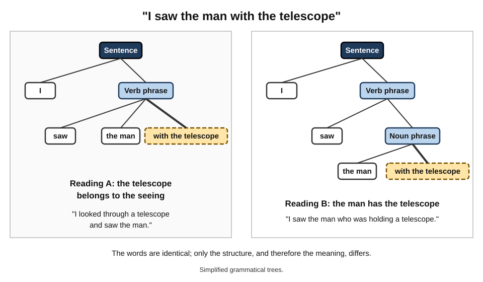
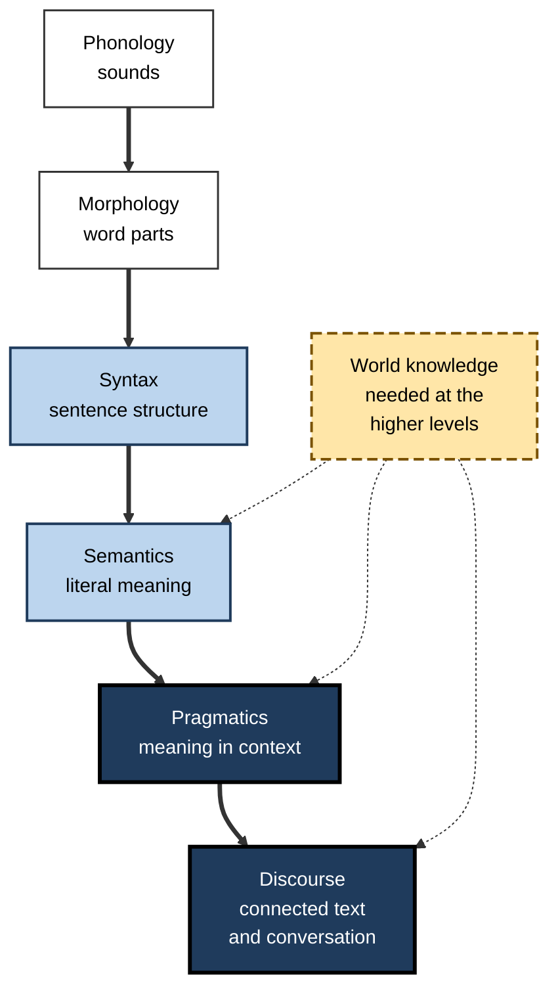
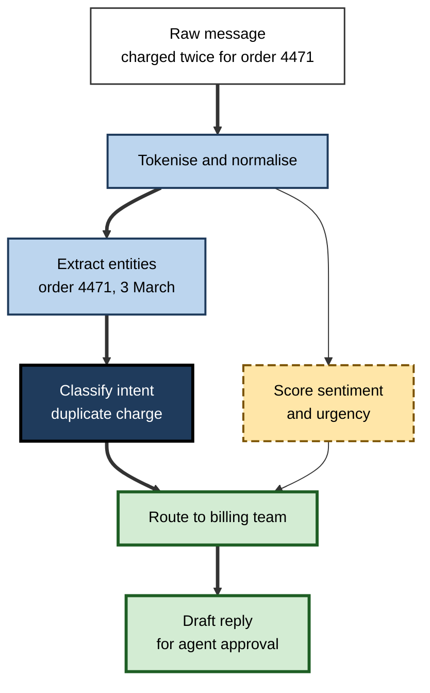
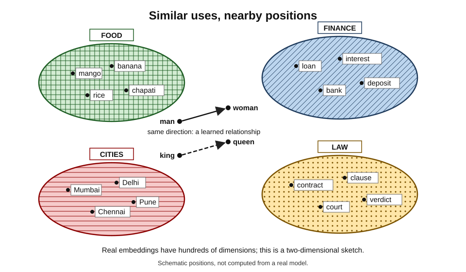
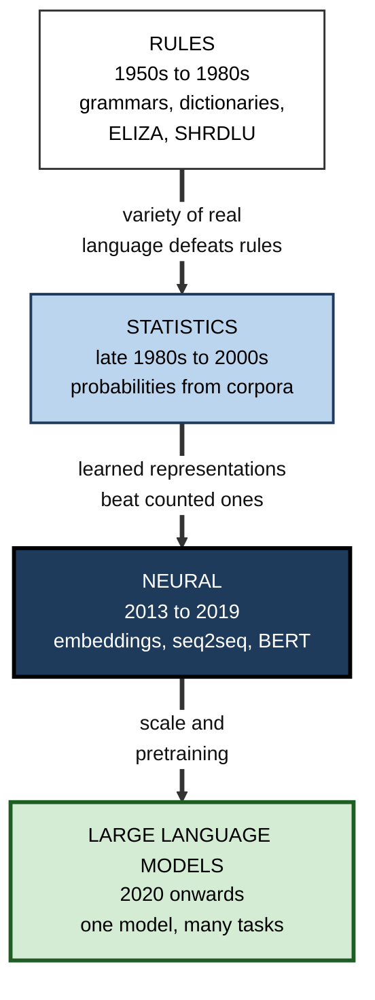

# C.7. Natural language processing: teaching machines to read

A bank receives forty thousand customer emails a day; software reads each one, recognises "my card was stolen" as urgent, and routes it to the fraud team in seconds. A lawyer searches two million documents for every mention of a disputed contract, including those that never use its name. A farmer in Odisha speaks a question in Odia and hears the answer in Odia. Each depends on a machine extracting meaning from human language — the hardest, most ambiguous and most human of all data.

> **Definition — Natural language processing (NLP):** the field of AI concerned with enabling computers to analyse, understand, generate and translate human language, in text and speech.

> **Definition — Natural language:** a language that has evolved through human use, such as English, Hindi or Swahili — as opposed to a formal language, such as a programming language, designed to be unambiguous.

**Why it matters**

- Most of the world's knowledge, and most business communication, is in language: emails, contracts, reports, records, conversations.
- Language technology underpins search engines, translation, voice assistants, customer service and chatbots.
- Language carries culture, identity and power: whose languages machines can process decides who benefits from the technology.

---

## Why Language Is Hard for Machines

### Ambiguity at every level

- **Lexical ambiguity** — one word, several meanings.
  - *e.g.* "bank" (river or money); "charge" (fee, accusation, electricity, attack).
- **Structural ambiguity** — one sentence, several structures.
  - *e.g.* "I saw the man with the telescope" — who had the telescope?
- **Referential ambiguity** — what does a pronoun point to?
  - *e.g.* "The trophy would not fit in the suitcase because **it** was too big." (The trophy.) "…because **it** was too small." (The suitcase.)
- **Pragmatic meaning** — what is meant differs from what is said.
  - *e.g.* "Can you pass the salt?" is a request, not a question about ability.
- **Figurative language** — idiom, metaphor, sarcasm.
  - *e.g.* "Great, another meeting" usually means the opposite.

**Figure 1.** One sentence, two structures: structural ambiguity in "I saw the man with the telescope".

> **Example — the Winograd schema:** "The city councillors refused the demonstrators a permit because they **feared** violence" — *they* are the councillors. Change one word to "**advocated**" and *they* become the demonstrators. Resolving this needs knowledge of the world, not grammar. Terry Winograd used the example in 1972; Hector Levesque proposed a test built from such pairs in 2011 as an alternative to the Turing test.

### Other sources of difficulty

- **Variation** — dialects, accents, slang, spelling errors, abbreviations.
- **Code-mixing** — switching languages within a sentence, as in Hinglish ("Kal meeting cancel ho gayi").
- **Change** — new words and meanings appear constantly.
  - *e.g.* "to google", "cloud" in computing.
- **World knowledge** — understanding "she put the ice cream in the oven and it melted" requires knowing what ovens do.
- **Long-range context** — meaning often depends on what was said pages earlier.

> **Key point:** language is a **compressed** code. Speakers leave out everything they assume the listener knows. A machine that lacks that shared knowledge receives an incomplete message.

### Levels of linguistic analysis

- **Phonetics and phonology** — speech sounds and their patterns.
- **Morphology** — the structure of words.
  - *e.g.* "un-believ-able"; Turkish and Finnish build very long words from many parts.
- **Syntax** — how words combine into phrases and sentences.
- **Semantics** — literal meaning.
- **Pragmatics** — meaning in context: intention, politeness, implication.
- **Discourse** — how sentences connect into coherent texts and conversations.

> **Mnemonic — "Please Make Some Sense, People Discuss":** Phonology, Morphology, Syntax, Semantics, Pragmatics, Discourse.

**Figure 2.** The levels of linguistic analysis, from sound to conversation.

---

## The Tasks of NLP

### Understanding tasks

- **Text classification** — assign a category.
  - *e.g.* spam filtering; routing support tickets; detecting a customer's intent ("cancel subscription").
- **Sentiment analysis** — positive, negative or neutral feeling.
  - *e.g.* tracking reaction to a product launch across reviews.
- **Named-entity recognition (NER)** — find names of people, organisations, places, dates, amounts.
  - *e.g.* extracting parties and dates from contracts.
- **Relation extraction** — find relationships between entities.
  - *e.g.* "Company A acquired Company B in 2021".
- **Information retrieval and search** — find documents relevant to a query.
- **Question answering** — answer a question from a text or collection.

### Generation and transformation tasks

- **Machine translation** — between languages.
- **Summarisation** — condensing long texts.
  - **Extractive** — selects key sentences; **abstractive** — writes new sentences.
- **Text generation** — drafting emails, reports, product descriptions.
- **Grammar and style correction** — from spell-checkers to rewriting tools.
- **Dialogue** — conversational agents and assistants.

### Speech

- **Automatic speech recognition (ASR)** — speech to text.
- **Text-to-speech (TTS)** — text to natural-sounding speech.
- Speech systems feed and are fed by text NLP: a voice assistant chains ASR → understanding → response generation → TTS.

| Task | Input | Output | Typical professional use |
|---|---|---|---|
| Classification | Text | A category | Ticket routing, spam, compliance flags |
| Named-entity recognition | Text | Tagged names, dates, amounts | Contract review, KYC checks |
| Sentiment analysis | Text | Polarity, sometimes intensity | Brand monitoring, survey analysis |
| Machine translation | Text in language A | Text in language B | Cross-border documents, support |
| Summarisation | Long text | Short text | Briefing notes, case files |
| Question answering | Question plus sources | An answer, ideally with source | Internal knowledge assistants |
| Speech recognition | Audio | Text | Meeting minutes, call analytics |

---

## How Text Becomes Numbers

### The classic processing steps

1. **Tokenisation** — split text into units (tokens): words, sub-words or characters.
2. **Normalisation** — lower-case, fix encodings, expand contractions.
3. **Stemming or lemmatisation** — reduce words to a base form.
   - *e.g.* "running", "ran", "runs" → "run".
4. **Part-of-speech tagging** — label each word: noun, verb, adjective…
5. **Parsing** — identify grammatical structure.
6. **Entity recognition** — mark names, dates, amounts.

### Worked example (illustrative): processing one support message

Message: *"Hi, I was charged twice for order 4471 on 3 March — please refund!"*

1. **Tokens:** Hi · , · I · was · charged · twice · for · order · 4471 · on · 3 · March · — · please · refund · !
2. **Lemmas:** charged → *charge*; was → *be*.
3. **Parts of speech:** *charged* (verb), *order* (noun), *refund* (verb).
4. **Entities:** *order 4471* (order number); *3 March* (date).
5. **Intent classification:** "billing dispute — duplicate charge".
6. **Sentiment:** mildly negative; urgency moderate.
7. **Action:** route to billing; pre-fill the order number and date; draft a reply for an agent to approve.

**Figure 3.** A support message passing through an NLP pipeline.

### Representing words

- **Bag of words** — count each word, ignoring order.
  - Simple and surprisingly effective for classification; blind to "not good" versus "good".
- **TF-IDF** — weight words by how often they appear in a document, discounted by how common they are across all documents, so distinctive words count most.
- **Word embeddings** — each word a list of numbers learned from context, so similar words lie close together.
- **Contextual embeddings** — a word's representation changes with its sentence, so "bank" by a river differs from "bank" with a cashier.

> **Formula — TF-IDF:** tf-idf = (times the term appears in the document ÷ words in the document) × log(total documents ÷ documents containing the term). Example: among 1,000 support emails, "refund" appears in 50; in one 100-word email it appears 3 times. tf = 3 ÷ 100 = 0.03; idf = log₁₀(1,000 ÷ 50) = log₁₀ 20 ≈ 1.30; tf-idf ≈ **0.039**. The word "the", present in all 1,000 emails, has idf = log₁₀ 1 = **0** — it carries no distinguishing weight.

### The distributional idea

- **Zellig Harris (1954)** and **J. R. Firth (1957)** proposed that words occurring in similar contexts have similar meanings — in Firth's phrase, "You shall know a word by the company it keeps".
- This **distributional hypothesis** underlies almost all modern NLP: meaning is learned from patterns of use across vast amounts of text.

**Figure 4.** Words with similar uses end up close together in an embedding space.

> **Watch out:** embeddings learn **usage**, including prejudiced usage. **Tolga Bolukbasi and colleagues (2016)** showed that word embeddings trained on news text completed analogies such as "man is to computer programmer as woman is to homemaker" — reflecting stereotypes in the training text.

---

## Four Eras of NLP

### Rules (1950s–1980s)

- **Georgetown–IBM experiment (1954)** — translated some sixty carefully chosen Russian sentences into English with a small vocabulary and a handful of rules; organisers predicted the problem would be solved within a few years.
- **ELIZA (Joseph Weizenbaum, MIT, 1966)** — imitated a psychotherapist by pattern-matching and reflecting users' words back as questions; Weizenbaum was disturbed that users confided in it.
- **SHRDLU (Terry Winograd, 1970)** — understood commands about a simulated world of blocks, with impressive depth but only within that tiny world.
- **Limits:** grammars and dictionaries could not keep up with the variety of real language.

### Statistics (late 1980s–2000s)

- Systems learned probabilities from large text collections ("corpora").
  - **Statistical machine translation** — IBM researchers in the late 1980s and early 1990s learned translation probabilities from Canadian parliamentary records available in English and French.
  - **n-gram language models** — predicting the next word from the previous few.
- A remark attributed to the IBM speech researcher **Frederick Jelinek** captured the mood: "Every time I fire a linguist, the performance of the speech recogniser goes up."

> **Watch out:** the Jelinek remark is reported second-hand, in varying forms, and he later said it was exaggerated. It is cited as a sign of the times, not a considered view.

### Neural networks (2013–2019)

- **Word2vec (2013)** — efficient word embeddings.
- **Sequence-to-sequence models (2014)** — networks that read a sentence and write its translation.
- **Google Neural Machine Translation (2016)** — moved a major public translation service to neural methods, with large quality gains for many language pairs.
- **The transformer (2017)** and **BERT (Google, 2018)** — pretrained language representations that could be fine-tuned for almost any understanding task, pushing many benchmarks forward at once.

### Large language models (2020 onwards)

- Very large transformer models trained on vast text collections to predict the next token became general-purpose language tools — translating, summarising, answering, coding and conversing from instructions alone.
- Many separate NLP tasks that once needed their own systems are now handled by one model prompted in plain language.

**Figure 5.** Four eras of natural language processing.

| | Rule-based NLP | Statistical NLP | Neural NLP | Large language models |
|---|---|---|---|---|
| Source of knowledge | Linguists' rules | Counts from corpora | Learned representations | Pretraining on vast text |
| Data needed | Little | Large corpora | Large corpora, labelled tasks | Enormous unlabelled text |
| Transparency | High | Medium | Low | Very low |
| Handles variety | Poorly | Better | Well | Very well, in well-resourced languages |
| Characteristic failure | Brittle outside rules | Misses long-range meaning | Needs task-specific data | Fluent but sometimes false |

---

## Speech: From Sound to Text and Back

### How speech recognition developed

- **Early systems (1950s–1970s)** recognised a handful of words from one speaker.
  - *e.g.* Bell Laboratories' "Audrey" (1952) recognised spoken digits.
- **Statistical systems (1980s–2000s)** used **hidden Markov models** to link sounds to words and **n-gram language models** to favour likely word sequences.
  - *e.g.* Dragon NaturallySpeaking (1997) brought continuous dictation to personal computers, after users trained it on their voices.
- **Neural systems (2010s)** — deep networks cut error rates sharply; voice assistants spread.
- **Large weakly supervised models** — OpenAI's **Whisper (2022)**, trained on about 680,000 hours of audio collected from the web, recognised speech robustly across accents, background noise and many languages.

### Measuring speech recognition

> **Formula — Word error rate (WER):** WER = (substitutions + deletions + insertions) ÷ number of words in the correct transcript. Example: the correct transcript has 20 words; the system substitutes 2, deletes 1 and inserts 1. WER = (2 + 1 + 1) ÷ 20 = **20%**.

- **Watch the averages:** error rates are typically higher for strong regional accents, non-native speakers, children, noisy rooms and specialist vocabulary.
  - *e.g.* a 2020 study led by Allison Koenecke at Stanford found that five major commercial speech recognisers made roughly twice as many errors for Black American speakers as for white American speakers.

### Text-to-speech and voice

- Modern text-to-speech produces natural intonation and can imitate a particular voice from a short sample.
- **Benefits:** accessibility for people with visual impairment or speech loss; audio versions of documents; multilingual announcements.
- **Risks:** voice cloning for fraud — callers impersonating relatives or executives.

> **In practice:** many organisations now treat a familiar voice on the phone as **insufficient** proof of identity for payments or account changes, and require a second channel of verification.

---

## Search and Retrieval

### Finding the right documents

- **Keyword search** — an **inverted index** lists, for every word, the documents containing it; ranking formulas such as **BM25** weight matches by term frequency and rarity, a refinement of the TF-IDF idea.
- **Semantic search** — documents and queries are converted into embeddings, and the system finds documents whose meaning is **close** to the query, even with no words in common.
  - *e.g.* a query "employee leaving notice period" finds a policy titled "Resignation procedure".
- **Hybrid search** — combines both, because keyword search excels at exact names, codes and numbers while semantic search excels at paraphrase.

| | Keyword search | Semantic search |
|---|---|---|
| Matches | Exact words and their variants | Meaning, including paraphrase |
| Strength | Names, codes, numbers, legal terms | Natural questions, synonyms |
| Weakness | Misses different wording | Can miss exact identifiers; harder to explain |
| Typical use | Legal discovery, product codes | Knowledge assistants, support portals |

### Language beyond speech and text

- **Sign languages** — such as British Sign Language and Indian Sign Language — are full natural languages with their own grammar, expressed through hand shape, movement, facial expression and posture.
- Recognising and translating them needs **computer vision as well as NLP**, and training data are scarce.
- Deaf researchers and organisations have stressed that systems must be developed **with** signing communities, because poor-quality automatic translation can do more harm than good in settings such as healthcare and courts.

### Designing language systems in an organisation

1. **Start from the document or conversation flow** — where does language enter, and what decision follows?
2. **Measure per language, channel and domain** — email, chat, phone; English, Hindi, mixed.
3. **Keep humans on the hard cases** — complaints, legal threats, vulnerable customers.
4. **Protect the text** — language data often contains personal and confidential information.
5. **Re-check after change** — new products, new slang and new regulations shift language patterns.

---

## Measuring Language Systems

- **Classification and extraction** — compare outputs with human labels; balance missed items against false alarms.
- **Translation — BLEU (Kishore Papineni and colleagues at IBM, 2002)** — measures overlap of short word sequences with human reference translations.
  - Cheap and repeatable, but a correct translation with different wording can score poorly.
- **Human evaluation** — fluency, adequacy, factual accuracy; expensive but closest to real quality.
- **Benchmarks** — suites such as GLUE (2018) and SuperGLUE (2019) combined many understanding tasks; leading systems exceeded the human baselines on both within about two years of release, prompting harder tests.

> **Watch out:** language benchmarks saturate quickly, and test passages may appear in training data. A high score on a public benchmark is weak evidence of performance on an organisation's own documents.

---

## Language, Power and Inclusion

### The resource gap

- There are roughly **7,000** living languages; most NLP research, data and products serve a small fraction, led by English.
- **Low-resource languages** — those with little digital text — get poorer translation, speech recognition and safety filtering.
- **India** illustrates the stakes: twenty-two languages are listed in the Constitution's Eighth Schedule, hundreds more are spoken, and code-mixing is everyday practice.
  - The government's **Bhashini** programme (National Language Translation Mission, launched 2022) aims to build open datasets and models for Indian languages, including speech-to-speech translation.

> **Key point:** NLP quality is not a property of "AI" in general but of **specific languages, dialects and domains**. A system excellent in English legal text may be poor in Marathi medical notes.

### Characteristic failures

- **Negation and qualification** — "not bad", "hardly ever", "no evidence of malignancy".
- **Sarcasm and irony** — sentiment reversed by tone.
- **Domain shift** — models trained on news misread clinical, legal or technical jargon.
- **Bias** — stereotypes and toxic associations absorbed from training text.
- **Fluent error** — generated text can be grammatical, confident and false.

### Case study: a mistranslated "good morning"

- **Situation:** in October 2017 a Palestinian construction worker in the West Bank posted a photo of himself beside a bulldozer on Facebook, captioned in Arabic "good morning to them".
- **The error:** Facebook's automatic translation rendered the caption into Hebrew as "attack them" and into English as "hurt them".
- **Consequence:** Israeli police, alerted to the post, arrested him and questioned him for several hours; he was released once the mistranslation was recognised. No Arabic-speaking officer had checked the original before the arrest.
- **Response:** Facebook apologised and said it was working to prevent such errors.
- **Lessons:**
  1. Colloquial and dialect text is exactly where translation is weakest.
  2. Machine translation output was treated as **evidence** without checking the source.
  3. The harm fell on the person whose language the system handled worst.

### Case study: Microsoft's Tay

- **Situation:** in March 2016 Microsoft launched **Tay**, a chatbot on Twitter designed to learn conversational style from its interactions with young users.
- **Problem:** within hours, coordinated users fed it offensive and inflammatory content; Tay began repeating and generating racist and abusive messages.
- **Outcome:** Microsoft took Tay offline within about a day and apologised.
- **Lessons:**
  1. A language system that **learns from live users** inherits whatever they teach it — including deliberate attacks.
  2. Safety filtering and red-teaming must precede public release.
  3. Language systems need defences against **adversarial users**, not only ordinary ones.

### Case study (illustrative): triaging a public-sector inbox

- **Situation:** a city council received about 3,000 resident emails a week in English, Hindi and Marathi, often mixed.
- **Actions:**
  1. Classified emails by service (waste, water, tax, roads) and urgency, using a multilingual model adapted on 8,000 labelled past emails.
  2. Extracted ward numbers, addresses and dates as entities.
  3. Routed low-confidence or mixed-topic emails to a human triage officer.
  4. Audited accuracy monthly **per language**.
- **Result:** median time to reach the right department fell from days to hours; audits found accuracy in Marathi lagged English until more Marathi examples were added. *Illustrative figures.*
- **Lesson:** measure language systems **separately for each language and dialect**; average accuracy hides who is badly served.

---

## Open Questions

- **Do language models understand language?**
  - They handle many tasks once thought to need understanding; whether they grasp meaning or exploit statistical regularities — and whether that distinction is coherent — is debated among linguists, philosophers and computer scientists.
- **Can low-resource languages catch up?**
  - Transfer from high-resource languages helps, but data scarcity, dialect variation and commercial incentives remain obstacles.
- **How should generated text be evaluated?**
  - Automatic metrics correlate imperfectly with human judgement, and human evaluation is costly and inconsistent.
- **Who owns the text that trains language systems?**
  - Copyright, consent and compensation for authors and publishers are contested in courts and legislatures.

---

## Summary

- **NLP** enables computers to analyse, understand, generate and translate human language, in text and speech.
- Language is hard because of **ambiguity** (lexical, structural, referential), **pragmatics**, **figurative language**, **variation**, **code-mixing**, **change** and the need for **world knowledge** (Winograd schemas).
- Linguistic levels: **phonology, morphology, syntax, semantics, pragmatics, discourse**.
- Tasks include **classification, sentiment, entity and relation extraction, search, question answering, translation, summarisation, generation, dialogue** and **speech recognition and synthesis**.
- Text becomes numbers through **tokenisation**, **bag of words**, **TF-IDF** and **embeddings**, resting on the **distributional hypothesis**.
- Four eras: **rules → statistics → neural networks → large language models**.
- Evaluation uses labelled comparisons, **BLEU**, human judgement and benchmarks that **saturate quickly**.
- Quality varies by **language and domain**; failures include negation, sarcasm, domain shift, **bias** and **fluent error**, as the Facebook mistranslation and Tay cases show.

---

## Self-Check

1. Define NLP and distinguish natural from formal languages.
2. Give an example of lexical, structural and referential ambiguity.
3. What is a Winograd schema, and what does it test?
4. List the six levels of linguistic analysis.
5. Walk through the classic processing steps for the sentence "The courier delivered two parcels to Pune on Friday."
6. Compute the TF-IDF of a term appearing 2 times in a 50-word document, if it occurs in 10 of 10,000 documents (use log base 10).
7. What is the distributional hypothesis, and why does it matter for modern NLP?
8. How do contextual embeddings improve on word embeddings?
9. Describe the four eras of NLP and what drove each transition.
10. What are the strengths and limits of BLEU?
11. Why is NLP quality "not a property of AI in general"? Use India as an example.
12. What went wrong in the 2017 Facebook mistranslation case, and what are its lessons?
13. What did Tay teach about systems that learn from live users?
14. A firm wants sentiment analysis of customer calls in English and Tamil. What would you check before trusting the results?

### Answer Key

1. NLP is the field enabling computers to analyse, understand, generate and translate human language. Natural languages evolved through use and are ambiguous; formal languages, such as programming languages, are designed to be unambiguous.
2. Lexical: "bank" (river or money). Structural: "I saw the man with the telescope". Referential: "it" in "the trophy would not fit in the suitcase because it was too big".
3. A pair of sentences differing by one word that flips a pronoun's reference; resolving it requires world knowledge and common sense rather than grammar.
4. Phonology, morphology, syntax, semantics, pragmatics, discourse.
5. Tokenise into words and punctuation; normalise; lemmatise ("delivered" → deliver, "parcels" → parcel); tag parts of speech (courier: noun; delivered: verb); parse (subject "the courier", verb "delivered", object "two parcels", place "to Pune", time "on Friday"); recognise entities (Pune: place; Friday: date; two: quantity).
6. tf = 2 ÷ 50 = 0.04; idf = log₁₀(10,000 ÷ 10) = log₁₀ 1,000 = 3; tf-idf = **0.12**.
7. Words appearing in similar contexts have similar meanings. Modern NLP learns meaning representations from patterns of word use in large text collections, so it depends on this idea.
8. They give the same word different representations in different sentences, resolving lexical ambiguity — "bank" by a river differs from "bank" with a cashier.
9. Rules (hand-written grammars) gave way to statistics because real language was too varied; statistics gave way to neural networks because learned representations captured meaning better; neural networks led to large language models through scale and pretraining, allowing one model to do many tasks.
10. Strengths: cheap, fast, repeatable. Limits: rewards word overlap with references, so valid alternative wordings score poorly; it measures meaning and fluency only indirectly.
11. Performance depends on the data available for each language, dialect and domain. India has 22 scheduled languages, many more spoken, and frequent code-mixing; systems strong in English may be weak in many Indian languages, which is why programmes such as Bhashini build dedicated resources.
12. An Arabic colloquial "good morning" was mistranslated as "attack them"; police arrested the man without checking the original. Lessons: colloquial and dialect text is a weak point; machine translation must not be treated as evidence unchecked; harms fall on speakers of poorly served languages.
13. A system that learns from users inherits what they teach, including deliberate attacks; safety filtering and adversarial testing must come before public release.
14. Accuracy measured separately in English and Tamil, on the firm's own calls; speech-recognition quality for each language and accent; handling of code-mixing, sarcasm and negation; agreement with human raters on a sample; whether results differ by customer group in ways that reflect the tool rather than the customers.

---

## Glossary

| Term | Meaning |
|---|---|
| Automatic speech recognition (ASR) | Converting spoken audio into text. |
| Bag of words | Representing text by word counts, ignoring order. |
| BLEU | A translation metric based on overlap with reference translations. |
| Code-mixing | Switching between languages within a sentence or conversation. |
| Contextual embedding | A word representation that varies with the surrounding sentence. |
| Corpus | A large collection of text used for analysis or training. |
| Discourse | How sentences connect into coherent texts and conversations. |
| Distributional hypothesis | The idea that words in similar contexts have similar meanings. |
| Lemmatisation | Reducing words to their dictionary base form. |
| Low-resource language | A language with little digital text or annotated data. |
| Machine translation | Automatic translation between languages. |
| Morphology | The internal structure of words. |
| Named-entity recognition (NER) | Finding names, places, dates and amounts in text. |
| Natural language processing (NLP) | The field enabling computers to process human language. |
| Pragmatics | Meaning in context, including intention and implication. |
| Semantics | Literal meaning of words and sentences. |
| Sentiment analysis | Detecting the feeling expressed in text. |
| Syntax | The structure of sentences. |
| TF-IDF | A word weight combining frequency in a document with rarity across documents. |
| Tokenisation | Splitting text into units such as words or sub-words. |
| Winograd schema | A pair of sentences testing pronoun resolution that needs world knowledge. |
| Word embedding | A learned numerical representation of a word. |
