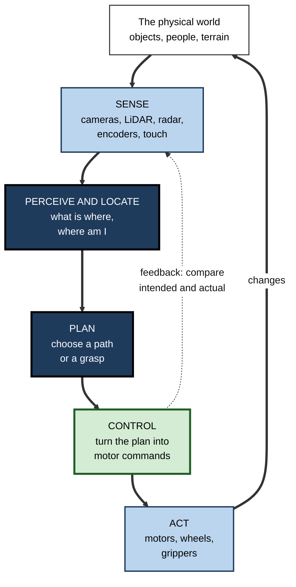
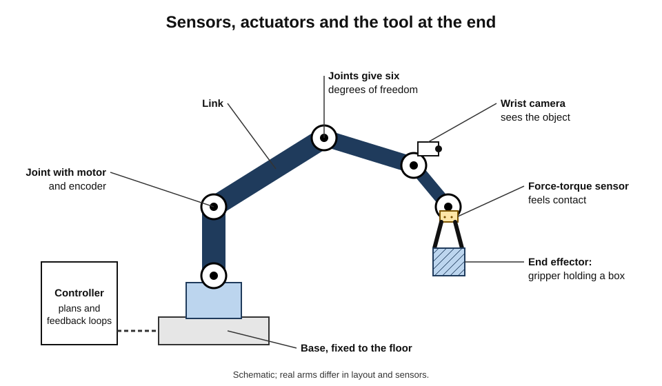
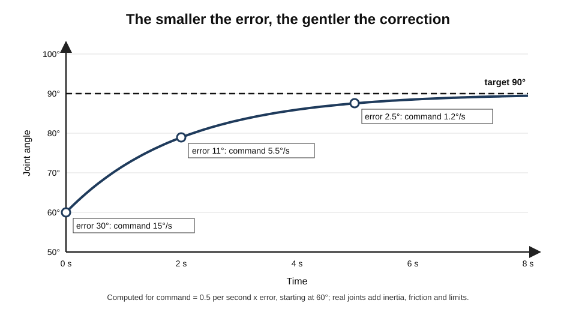
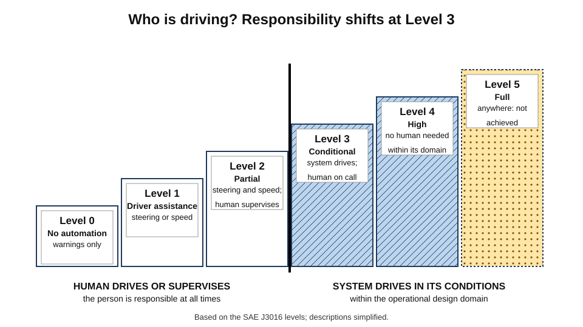
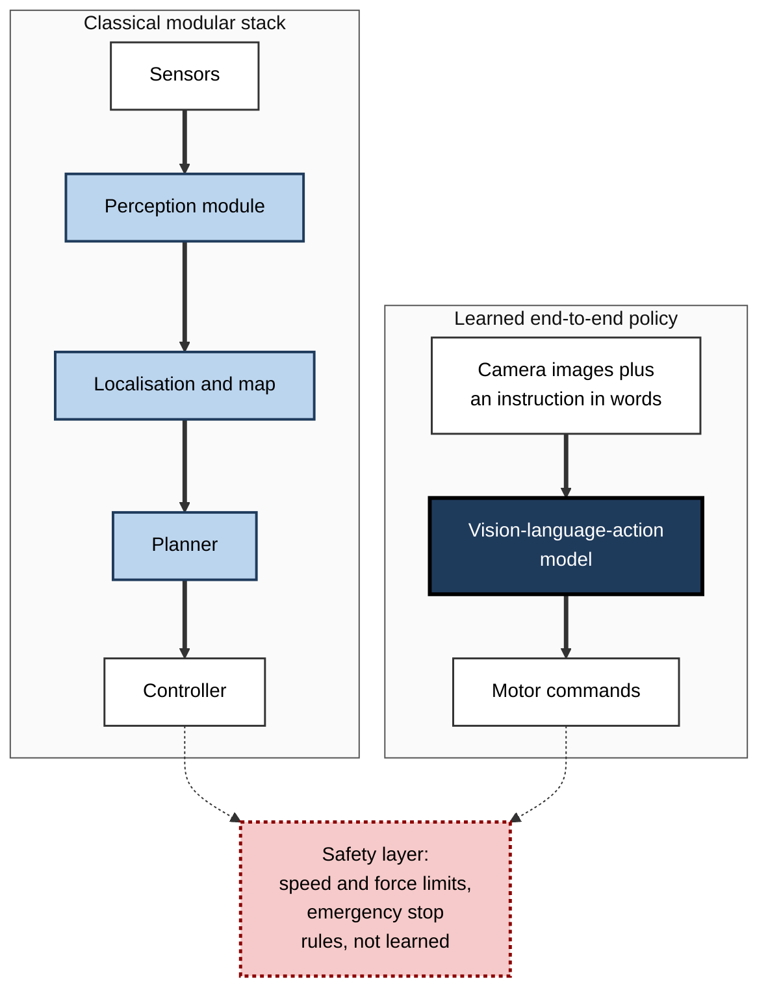
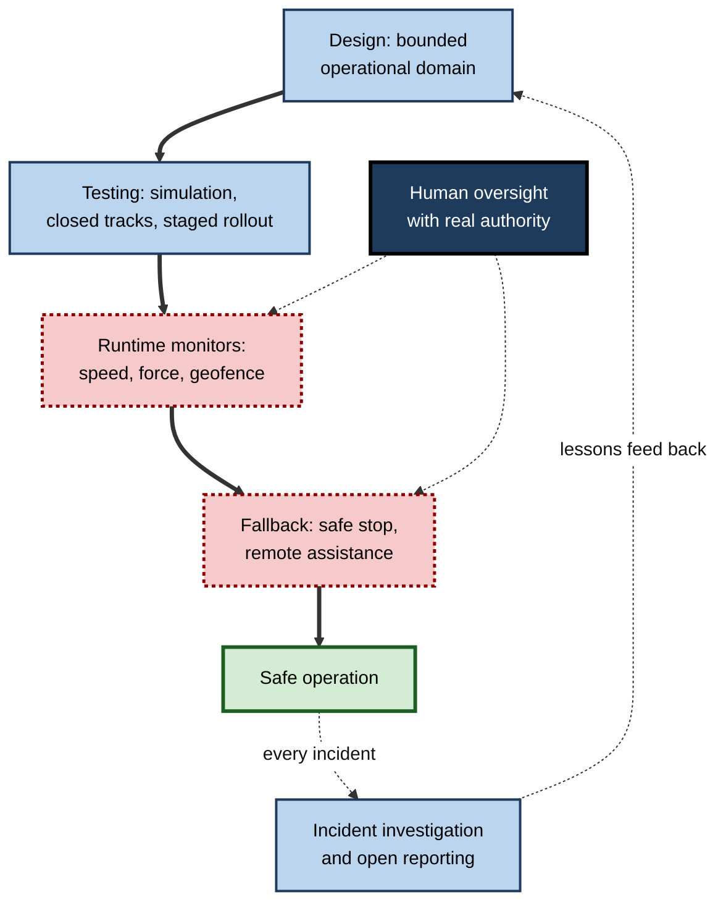

# C.8. Robotics and physical AI

In a fulfilment centre, squat orange robots slide under shelving units and carry them to human pickers. In an operating theatre, a surgeon at a console steers instruments inside a patient through incisions a centimetre wide. On the streets of several American cities, cars with nobody in the driver's seat carry hundreds of thousands of paying passengers a week. Each machine must do something no chatbot does: act on the physical world, where mistakes break things and hurt people, and where nothing is ever exactly as expected.

> **Definition — Robot:** a machine that senses its environment, processes that information, and acts physically on the world through moving parts, with some degree of autonomy.

> **Definition — Physical AI (embodied AI):** AI that perceives, reasons and acts through a physical body — a robot arm, a vehicle, a drone, a humanoid — rather than only producing text, images or predictions.

**Why it matters**

- Most economic activity — manufacturing, logistics, agriculture, construction, care — is physical; software-only AI touches it only indirectly.
- Physical action raises the stakes: errors cause injury, damage and death, not just wrong answers.
- Robotics is where the limits of AI are most visible — and where some of the most active research and investment now lies.

---

## What Makes a Robot

### Three capabilities

- **Sensing** — measuring the world and the robot's own state.
- **Thinking** — interpreting sensor data and deciding what to do.
- **Acting** — moving joints, wheels, grippers or tools.

**Figure 1.** The sense–think–act cycle repeats many times a second.

### Sensors

- **Proprioceptive** — the robot's own state.
  - **Encoders** — joint angles and wheel rotations.
  - **Inertial measurement units (IMUs)** — acceleration and rotation, for balance and orientation.
  - **Force and torque sensors** — how hard a joint or gripper is pushing.
- **Exteroceptive** — the outside world.
  - **Cameras** — colour images; pairs of cameras give depth.
  - **LiDAR** — laser distance measurements forming 3D point clouds.
  - **Radar** — distance and speed, robust in rain and fog.
  - **Ultrasonic sensors** — short-range distance, as in parking sensors.
  - **Tactile sensors** — touch and slip at the fingertips.

### Actuators and bodies

- **Actuators** — electric motors (most common), hydraulics (high force, as in heavy machinery), pneumatics (light, compliant grippers).
- **Degrees of freedom** — the number of independent ways a robot can move.
  - *e.g.* a typical industrial arm has **six**, enough to place a tool at any position and orientation within reach; a human arm and hand together have many more.
- **End effector** — the tool at the end of an arm: gripper, suction cup, welding torch, paint nozzle.

**Figure 2.** The anatomy of a robot arm.

### Kinds of robot

- **Industrial arms** — fixed in place, fast and precise; welding, painting, assembly.
- **Collaborative robots ("cobots")** — designed to work safely beside people, limiting speed and force.
- **Mobile robots** — wheeled platforms in warehouses, hospitals and homes.
- **Autonomous vehicles** — cars, lorries, tractors, delivery robots.
- **Drones** — aerial robots for inspection, mapping, agriculture and delivery.
- **Legged and humanoid robots** — walk on uneven ground; humanoids are designed to use spaces and tools built for people.
- **Surgical and medical robots** — mostly **teleoperated** (controlled by a surgeon), not autonomous.

---

## The Core Problems of Robotics

### Perception

- Turning sensor data into a usable picture of the world — objects, obstacles, people, free space.
- Uses the methods of computer vision, plus **sensor fusion** — combining cameras, LiDAR and radar so each covers the others' weaknesses.

### Localisation and mapping

- **Localisation** — where am I?
- **Mapping** — what does the environment look like?
- **SLAM (simultaneous localisation and mapping)** — building a map while locating oneself within it; a central achievement of robotics research since the late 1980s, now used in robot vacuums, drones and phone augmented-reality apps.

### Planning

- **Path planning** — finding a collision-free route.
  - The **A\* search algorithm** (Peter Hart, Nils Nilsson and Bertram Raphael, 1968) was developed for **Shakey**, the robot built at the Stanford Research Institute from 1966 — the first mobile robot to reason about its own actions — and remains a standard route-finding method.
- **Motion planning** — planning the movement of a whole body or arm, avoiding self-collision.
- **Task planning** — sequencing steps.
  - *e.g.* open the drawer, pick the cup, place it on the tray.

### Control

- Making motors produce the planned motion precisely, despite friction, loads and disturbances.
- **Feedback control** — continually measure the error between where the robot is and where it should be, and correct it.

> **Definition — Feedback control:** a method in which a system repeatedly measures the difference between its target and its actual state and adjusts its action to reduce that difference.

> **Formula — Proportional control:** command = Kp × error, where Kp is a gain. Example: a joint should reach 90°; it is at 60°; error = 30°. With Kp = 0.5 per second, the commanded speed is 0.5 × 30 = **15° per second**. As the joint approaches 90°, the error shrinks and so does the command — the motion slows smoothly to a stop.

**Figure 3.** Proportional control: the joint approaches its target ever more slowly as the error shrinks.

- **PID control** — adds an **integral** term (to remove persistent small errors) and a **derivative** term (to damp overshoot). PID controllers run inside most motors, drones and industrial processes.

### Manipulation

- Grasping and handling objects of varied shape, weight, softness and friction.
- **Why it is hard:** small errors in position or force cause drops, crushes or slips; objects deform; the hand hides the object from the camera.

> **Key point:** **Moravec's paradox** is sharpest in robotics. A program can beat the world chess champion, but a robot that can reliably fold a crumpled shirt, empty an unfamiliar dishwasher or tidy a child's bedroom is still a research goal.

### Problems compared

| Problem | Question | Typical methods | Typical failure |
|---|---|---|---|
| Perception | What is around me? | Vision models, sensor fusion | Missed or misclassified object |
| Localisation and mapping | Where am I; what is the layout? | SLAM, GPS, wheel odometry | Drift; lost in featureless spaces |
| Planning | What path or sequence? | Search (A\*), sampling planners, learned policies | Stuck; unsafe or inefficient path |
| Control | How do I execute it precisely? | PID, model-predictive control | Overshoot; oscillation; instability |
| Manipulation | How do I grasp and handle it? | Grasp planning, learning from demonstration | Drop, crush, slip |

---

## Levels of Autonomy

### Driving automation

The **SAE J3016** standard, first published in 2014 by the engineering body SAE International, defines six levels of driving automation.

| Level | Name | Who drives? | Example |
|---|---|---|---|
| 0 | No automation | Human; warnings only | Lane-departure warning |
| 1 | Driver assistance | Human, with steering **or** speed support | Adaptive cruise control |
| 2 | Partial automation | System steers and controls speed; human supervises constantly | Motorway assist systems |
| 3 | Conditional automation | System drives in limited conditions; human must take over when asked | Approved traffic-jam pilots on some motorways |
| 4 | High automation | System drives within a defined area or conditions; no human needed there | Robotaxis in mapped city zones |
| 5 | Full automation | System drives anywhere a human could | Not achieved |

**Figure 4.** The six levels of driving automation: responsibility shifts from person to system at Level 3.

> **Watch out:** many cars marketed with "autopilot" or "self-driving" features are **Level 2** — the driver remains responsible at every moment. Confusing Level 2 with Level 4 has contributed to fatal crashes.

> **Definition — Operational design domain (ODD):** the conditions — roads, places, weather, times, speeds — within which an automated system is designed to operate safely.

---

## A Short History

- **1961 — Unimate**, the first industrial robot, began handling hot die-cast parts at a General Motors plant in New Jersey.
- **1966–72 — Shakey** at the Stanford Research Institute combined vision, planning and movement.
- **1980s — behaviour-based robotics:** **Rodney Brooks** at MIT argued that robots should be built from layers of simple reactive behaviours, not grand internal models — the "subsumption architecture".
- **2000 — the da Vinci surgical system** cleared for general laparoscopic surgery in the United States.
- **2002 — the Roomba** robot vacuum brought robots into millions of homes.
- **2004–07 — DARPA challenges:** in the 2004 Grand Challenge across the Mojave Desert, no vehicle finished; the best travelled about 12 km of a roughly 240 km course. In 2005, five vehicles finished, led by Stanford's **Stanley**; in 2007 vehicles navigated a mock urban environment.
- **2012 — Amazon acquired Kiva Systems**, whose shelf-carrying robots transformed warehouse picking.
- **2010s–2020s — learning-based robotics:** simulation, reinforcement learning and imitation learning; then foundation models for robot control.

---

## From Hand-Built Pipelines to Learned Robot Brains

### The classical modular stack

- Separate modules for perception, localisation, planning and control, each engineered and tested on its own.
- **Strengths:** interpretable, verifiable, debuggable; dominant in industry and in most autonomous vehicles.
- **Weakness:** each module is hand-designed for expected situations; errors pass silently between modules; adapting to new tasks is slow.

### Learning to act

- **Reinforcement learning** — the robot learns by trial and error, usually in **simulation** first, because physical trials are slow and risky.
- **Sim-to-real transfer** — training in simulation, then transferring to the real robot.
  - **Domain randomisation** — varying colours, friction, lighting and masses in simulation so the real world looks like "just another variation".
  - *e.g.* in 2019 OpenAI trained a robot hand in simulation, with heavy randomisation, to manipulate and solve a Rubik's cube — slowly and with frequent drops, but a landmark in dexterity.
- **Imitation learning** — learning from human demonstrations, by teleoperation or video.

### Vision-language-action models

- **Google DeepMind's RT-2 (2023)** — a model built from a vision-language model that outputs robot actions as if they were words, letting robots follow instructions involving objects and concepts never seen in robot training data.
- **2024–26** — a wave of **robot foundation models** from laboratories and companies, including Physical Intelligence's π0, Figure's Helix, Google DeepMind's Gemini Robotics and NVIDIA's openly released GR00T models, aiming at general-purpose manipulation across many robot bodies.
- **The data problem:** there is no robotic equivalent of the internet's text. Efforts such as **Open X-Embodiment (2023)** pooled demonstrations from many robot types across more than twenty institutions to build shared training sets.

> **Definition — Vision-language-action (VLA) model:** a model that takes camera images and natural-language instructions as input and outputs robot actions directly.

**Figure 5.** Two ways of building a robot's control system.

| | Classical modular stack | Learned end-to-end policy |
|---|---|---|
| How behaviour is specified | Engineered modules and rules | Learned from demonstrations and trial and error |
| New tasks | Re-engineer modules | Potentially from new data or instructions |
| Interpretability | High: inspect each module | Low |
| Verification and certification | Established methods | Largely unsolved |
| Typical use in 2026 | Factories, most vehicles, warehouses | Research, pilots, flexible manipulation |

> **In practice:** commercial systems are increasingly **hybrids** — learned components for perception and dexterous manipulation, wrapped in engineered planning, monitoring and hard safety limits.

---

## Robots at Work

### Where robots are established

- **Manufacturing** — the International Federation of Robotics reported more than half a million industrial robots installed worldwide in 2023, over half of them in China; South Korea has long had the highest density of robots per manufacturing worker.
- **Logistics** — mobile robots move shelves, totes and pallets; sorting systems handle parcels.
- **Agriculture** — automated milking; GPS-guided tractors; targeted weeding and spraying.
- **Healthcare** — teleoperated surgery; pharmacy automation; hospital delivery robots.
- **Inspection** — drones and crawlers examine bridges, pipelines, wind turbines and power lines.
- **Homes** — vacuum and lawn-mowing robots.

### Working beside people

- **Safety standards:** ISO 10218 for industrial robots; **ISO/TS 15066 (2016)** for collaborative operation, setting limits on force and pressure when a robot contacts a person.
- **Four modes of collaboration** recognised in the standards:
  - **safety-rated monitored stop** — the robot halts when a person enters;
  - **hand guiding** — a person moves the robot directly;
  - **speed and separation monitoring** — the robot slows as people approach;
  - **power and force limiting** — contact is allowed but kept below injury thresholds.

> **Mnemonic — "SHSP — Stop, Hand-guide, Separate, Power-limit":** "Safe Humans Stay Protected".

### Humanoids: promise and caution

- **The case for:** factories, warehouses and homes are built for human bodies; a humanoid could in principle use existing tools and spaces without redesign.
- **The state in 2026:** several companies are running paid pilots in factories and warehouses, and production is scaling into the thousands of units a year; most deployments involve narrow, repetitive tasks, often with remote human assistance.
- **The case for caution:** wheeled robots and fixed arms are cheaper, faster and more reliable for most current tasks; dexterous manipulation in unstructured homes remains unsolved.

> **Watch out:** humanoid demonstration videos are often teleoperated, sped up or selected from many attempts. Ask whether a demonstration was **autonomous**, **real-time** and **typical**.

### Worked example (illustrative): is a task ready for a robot?

A distribution centre scores candidate tasks from 1 (poor) to 3 (good) on four factors.

| Task | Structured environment | Object variety (3 = little) | Cost of error (3 = low) | Volume | Total |
|---|---|---|---|---|---|
| Moving pallets between fixed docks | 3 | 3 | 2 | 3 | **11** |
| Picking any of 50,000 products from bins | 2 | 1 | 3 | 3 | **9** |
| Unloading mixed parcels from lorries | 1 | 1 | 2 | 3 | **7** |
| Assisting staff with occasional heavy lifts | 1 | 2 | 1 | 1 | **5** |

*Illustrative figures.*

1. **Automate first** the highest scorer — a structured, repetitive, high-volume task.
2. **Pilot** mid-scorers with human fallback; bin-picking of very varied products is now feasible for many items, not all.
3. **Defer** low scorers; unstructured, rare or safety-critical tasks remain hard.

- **Conclusion:** structure, variety, error cost and volume predict robotic success better than the sophistication of the robot.

---

## The Economics and Engineering of Deployment

### Simulation and digital twins

- **Simulation** lets engineers test robots on millions of virtual scenarios — including dangerous or rare ones — before real trials.
  - *e.g.* autonomous-vehicle developers replay recorded near-misses with variations: a child running out a second earlier, a lorry braking harder.
- **Digital twin** — a continuously updated virtual model of a real factory, warehouse or machine, used to plan layouts, test robot programmes and predict bottlenecks before changing the physical site.

> **Definition — Digital twin:** a virtual replica of a physical system, kept in step with real data, used to simulate and plan changes before making them.

> **Watch out:** a simulation is only as good as its model of reality. Friction, lighting, sensor noise and human behaviour are hard to simulate faithfully, which is why staged real-world trials remain essential.

### Does a robot pay for itself?

> **Formula — Simple payback period:** payback (years) = total cost of the robot system ÷ annual net saving. Example: a picking cell costs 150,000 including integration and training; it saves 75,000 a year in labour and errors, minus 15,000 a year in maintenance and supervision — net 60,000. Payback = 150,000 ÷ 60,000 = **2.5 years**. *Illustrative figures.*

- **Costs often underestimated:**
  - **integration** with existing conveyors, software and safety systems — frequently more than the robot itself;
  - **re-engineering** of processes and layouts;
  - **downtime** while the robot is commissioned and tuned;
  - **skills** — technicians to maintain and re-programme.
- **Benefits often overlooked:**
  - consistency and quality;
  - fewer injuries from heavy or repetitive work;
  - ability to run extra shifts.

### Drones, fields and homes

- **Drones** — inspection of power lines, wind turbines and bridges; mapping for construction and mining; crop spraying; deliveries of medical supplies in some regions, such as blood and vaccines to remote clinics in Rwanda by the company Zipline since 2016.
- **Agriculture** — robotic milking systems in which cows choose when to be milked; camera-guided sprayers that treat only weeds; robotic fruit picking, still limited by delicate handling.
- **Homes** — robot vacuums and lawnmowers are common; general household robots that tidy, cook or care remain largely experimental.
- **Care** — robots for lifting, companionship or reminders are being trialled in ageing societies such as Japan; evidence on acceptance and benefit is mixed, and the ethics of substituting machines for human contact are debated.

| | Industrial arm | Mobile warehouse robot | Robotaxi | Humanoid (2026) |
|---|---|---|---|---|
| Environment | Fixed cell, fenced or monitored | Mapped warehouse floor | Public roads within a mapped zone | Factories and warehouses in pilots |
| Variety of tasks | Low: one programmed task | Low to medium | Medium: driving in many situations | Aims to be high |
| Maturity | Decades of use | Large-scale since the 2010s | Commercial in limited cities | Early commercial pilots |
| Main risk | Contact injuries | Collisions, congestion | Road accidents, rare events | Falls, contact, unproven reliability |

---

## Safety, Failure and Responsibility

### Case study: the Uber test-vehicle crash in Tempe, Arizona

- **Situation:** on 18 March 2018, an Uber test vehicle operating in autonomous mode, with a safety driver aboard, struck and killed Elaine Herzberg as she walked a bicycle across a road at night — the first recorded pedestrian death involving a self-driving car.
- **Findings of the US National Transportation Safety Board (2019):**
  - the system detected her about **six seconds** before impact but repeatedly changed its classification of her — vehicle, bicycle, other — and did not predict her path;
  - the software did not account for pedestrians crossing outside crosswalks;
  - the vehicle's emergency braking had been disabled during autonomous operation, relying on the safety driver;
  - the safety driver was looking down at a phone streaming a television programme;
  - the board also cited an inadequate safety culture and oversight at the company's testing programme.
- **Aftermath:** Uber suspended testing and later sold its self-driving unit; the safety driver was charged and later pleaded guilty to a lesser offence.
- **Lessons:**
  1. Perception failures and missing assumptions ("pedestrians use crosswalks") combine.
  2. **Human supervisors of automation lose vigilance** — a predictable failure, not just an individual one.
  3. Safety is a property of the **whole system and organisation**, not of the software alone.

### Case study: robotaxis at scale

- **Situation:** Waymo, part of Alphabet, began fully driverless public service in Phoenix in 2020 and expanded city by city.
- **Scale by 2026:** according to the company, paid driverless rides in more than a dozen US cities exceeded half a million a week by the autumn of 2026, from a fleet of several thousand vehicles.
- **Safety evidence:** analyses published by Waymo researchers, comparing millions of driverless miles with human benchmarks for the same roads, reported substantially fewer injury-causing crashes.
- **Setbacks in the sector:** in October 2023 a robotaxi operated by a rival company, Cruise, dragged a pedestrian — who had first been struck by a human-driven car — about six metres after stopping; California suspended its permit, and its parent company later ended the robotaxi business.
- **Caveats:**
  - much of the safety evidence comes from the operators themselves, though some has been peer-reviewed;
  - operations are **Level 4** within mapped operational design domains, with remote assistance for difficult situations;
  - rare events — the long tail — dominate public trust.
- **Lesson:** physical AI can reach commercial scale when the **operational domain is bounded**, data are accumulated over billions of simulated and millions of real miles, and failures are investigated openly. A single badly handled incident can halt a programme.

**Figure 6.** Layers of safety around a physical AI system.

### Responsibility

- When a robot causes harm, responsibility may lie with the **manufacturer**, the **software developer**, the **operator**, the **owner** or a **supervising human** — and legal systems are still adapting.
- Product-liability law, sector regulators (for vehicles, medical devices, machinery) and new AI-specific rules increasingly overlap.

---

## Open Questions

- **Will robot foundation models generalise as language models did?**
  - Early results are promising, but physical data are scarce and costly, and the world's variety is vast.
- **How can learned robot behaviour be certified as safe?**
  - Established certification relies on predictable, inspectable designs; learned policies resist both.
- **Are humanoids the right form?**
  - Proponents point to human-built environments; sceptics to cost, energy and the success of specialised machines.
- **How much remote human help is hidden inside "autonomous" systems?**
  - Many deployments rely on remote operators for difficult moments; how much, and whether it scales, is often undisclosed.
- **What happens to work as physical AI spreads?**
  - Effects on warehouse, driving, manufacturing and care jobs are uncertain and contested.

---

## Summary

- A **robot** senses, thinks and acts physically; **physical AI** is AI expressed through a body.
- Robots combine **sensors** (proprioceptive and exteroceptive), **computation** and **actuators**; arms are described by **degrees of freedom** and **end effectors**.
- The core problems are **perception**, **localisation and mapping (SLAM)**, **planning** (A\*), **control** (feedback, PID) and **manipulation**; Moravec's paradox is sharpest here.
- **SAE J3016** defines six driving-automation levels; **Level 2** keeps the human responsible; **Level 4** operates within an **operational design domain**.
- History: **Unimate (1961)**, **Shakey**, **behaviour-based robotics**, **da Vinci**, **Roomba**, **DARPA challenges**, **Kiva**.
- Methods are shifting from **modular stacks** to **learned policies** — reinforcement learning, **sim-to-real**, **imitation learning** and **vision-language-action models** — usually inside engineered safety layers.
- Robots are established in **manufacturing, logistics, agriculture, surgery and inspection**; **cobot** standards limit force and speed; humanoids are in early commercial pilots.
- The **Uber Tempe crash** and the **robotaxi** experience show that safety is a property of the whole system and organisation.

---

## Self-Check

1. Define robot and physical AI.
2. Describe the sense–think–act cycle and the role of feedback.
3. Distinguish proprioceptive from exteroceptive sensors, with two examples of each.
4. What is SLAM, and where is it used?
5. A joint is at 20° and should be at 80°. With Kp = 0.4 per second, what speed does proportional control command? What happens as the joint nears 80°?
6. Why is manipulation so difficult for robots?
7. Explain SAE Levels 2, 3 and 4 and why confusing them is dangerous.
8. What is an operational design domain?
9. Compare a classical modular robot stack with a learned end-to-end policy.
10. What is sim-to-real transfer, and how does domain randomisation help?
11. What is a vision-language-action model, and what limits its development?
12. Name the four collaborative-operation modes in robot safety standards.
13. What did the NTSB find in the Tempe crash, and what are the systemic lessons?
14. A hospital considers a humanoid robot for patient lifting. What questions should it ask?

### Answer Key

1. A robot is a machine that senses, processes information and acts physically with some autonomy. Physical AI is AI that perceives and acts through a physical body.
2. Sensors measure the world; perception and planning interpret it and decide; control turns plans into motor commands; actuators act. Feedback compares intended and actual states each cycle and corrects errors.
3. Proprioceptive: the robot's own state — joint encoders, inertial measurement units. Exteroceptive: the environment — cameras, LiDAR.
4. Simultaneous localisation and mapping: building a map while locating oneself in it. Used in robot vacuums, drones, autonomous vehicles and phone augmented reality.
5. Error = 60°; command = 0.4 × 60 = **24° per second**. As the joint approaches 80° the error shrinks, so the commanded speed falls and the joint slows smoothly to its target.
6. Objects vary in shape, weight, softness and friction; small errors in position or force cause drops, crushes or slips; objects deform; the hand obscures the camera's view.
7. Level 2: the system steers and controls speed but the human must supervise constantly. Level 3: the system drives in limited conditions and the human must take over when asked. Level 4: the system drives without a human within a defined domain. Treating Level 2 as self-driving leads drivers to stop supervising, which has contributed to fatal crashes.
8. The conditions — places, roads, weather, times, speeds — within which an automated system is designed to operate safely.
9. Modular: separate engineered perception, localisation, planning and control modules — interpretable and verifiable but slow to adapt. End-to-end: a learned model maps images and instructions to actions — flexible and potentially general, but opaque and hard to certify.
10. Training a robot's behaviour in simulation, then transferring it to the real robot. Domain randomisation varies simulated conditions widely, so the real world looks like one more variation and the policy is robust to it.
11. A model taking camera images and language instructions and outputting robot actions. Limited by scarce, costly robot data — there is no robotic equivalent of internet text — and by the difficulty of verifying safety.
12. Safety-rated monitored stop, hand guiding, speed and separation monitoring, power and force limiting.
13. The system detected the pedestrian about six seconds before impact but misclassified her repeatedly and did not predict her path; it did not anticipate jaywalkers; emergency braking was disabled; the safety driver was distracted; safety culture was weak. Lessons: perception gaps and wrong assumptions combine; human supervisors of automation lose vigilance; safety belongs to the whole system and organisation.
14. Is the task autonomous or teleoperated? What force limits and certifications apply to contact with patients? What is the record on reliability and falls? How does it handle unusual body sizes and medical equipment? Who is liable for injury? Would a specialised lifting device be safer and cheaper?

---

## Glossary

| Term | Meaning |
|---|---|
| A\* search | A widely used algorithm for finding shortest paths, developed for the Shakey robot. |
| Actuator | A component that produces motion, such as a motor. |
| Cobot | A collaborative robot designed to work safely beside people. |
| Degrees of freedom | The number of independent ways a robot can move. |
| Domain randomisation | Varying simulated conditions widely so learned behaviour transfers to reality. |
| End effector | The tool at the end of a robot arm. |
| Feedback control | Repeatedly correcting action based on the difference between target and actual state. |
| Imitation learning | Learning behaviour from demonstrations. |
| LiDAR | A sensor measuring distance with laser pulses. |
| Operational design domain (ODD) | The conditions within which an automated system is designed to operate. |
| Physical AI | AI that perceives and acts through a physical body. |
| PID control | Feedback control using proportional, integral and derivative terms. |
| Proprioception | Sensing of a robot's own state, such as joint angles. |
| Robot | A machine that senses, processes information and acts physically with some autonomy. |
| SAE J3016 | The standard defining six levels of driving automation. |
| Sensor fusion | Combining data from several sensors into one picture. |
| Sim-to-real transfer | Training in simulation and deploying on a real robot. |
| SLAM | Simultaneous localisation and mapping. |
| Teleoperation | Remote control of a robot by a person. |
| Vision-language-action model | A model mapping images and language instructions to robot actions. |
