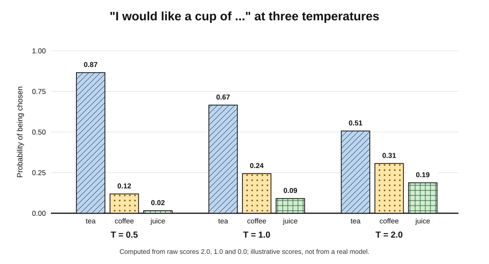
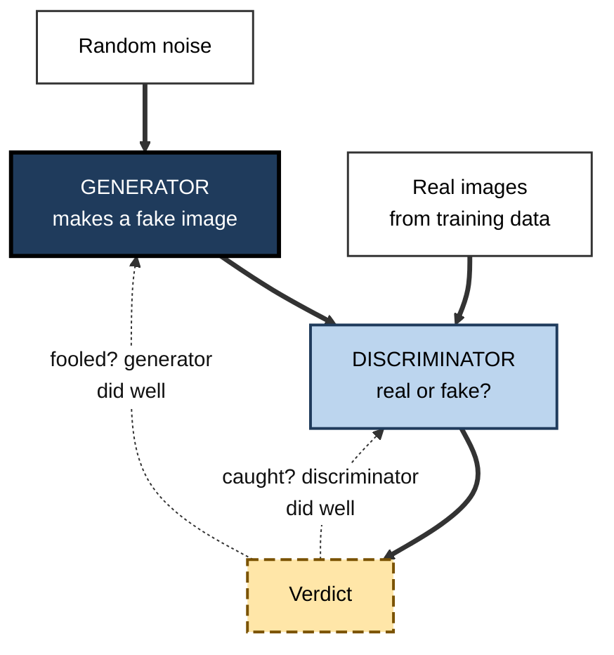
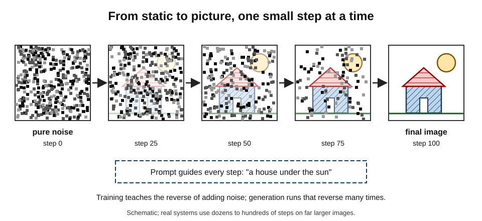
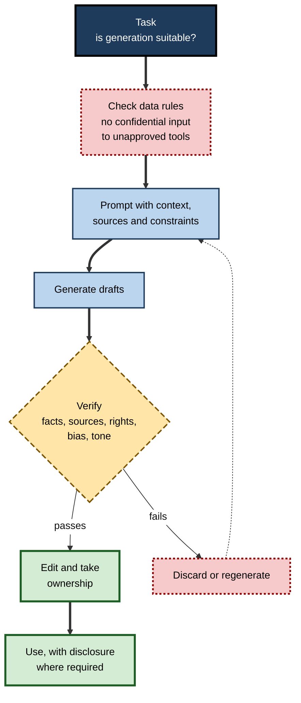

# C.9. Generative AI: creating new content

A marketing team needs forty product images in different settings by Friday; a model produces drafts in minutes. A developer types a comment describing a function, and working code appears beneath it. A customer-service centre answers in fluent Tamil, Bengali and English from one system. A biochemist asks for protein designs that bind a virus and receives candidates to test in the laboratory. Machines that **produce** text, images, sound, video, code and molecules — rather than only sorting or scoring them — are the most visible face of AI today.

> **Definition — Generative AI:** AI systems that create new content — text, images, audio, video, code, designs or data — resembling the examples they were trained on, usually in response to a prompt.

> **Definition — Prompt:** the input — an instruction, a question, an example, an image — that tells a generative system what to produce.

**Why it matters**

- Generative AI reached hundreds of millions of users within a few years of public release in 2022, faster than almost any earlier technology.
- It changes knowledge work — drafting, designing, coding, summarising — rather than only routine tasks.
- It creates new risks: fluent falsehood, synthetic media, disputes over training data and ownership, and questions of trust in anything seen or read.

---

## From Recognising to Generating

### Two kinds of model

- **Discriminative models** learn to **distinguish**: given an input, which label?
  - *e.g.* "is this email spam?"; "is this X-ray abnormal?"
  - Mathematically, they estimate **p(label | input)** — the probability of a label given the input.
- **Generative models** learn **what the data look like** — the patterns, structures and variations in the training examples — so they can produce new examples.
  - *e.g.* a new photo of a face that belongs to no one; a new paragraph in a given style.
  - Mathematically, they estimate **p(data)**, or **p(data | prompt)**, and **sample** from it.

> **Key point:** a generative model does not retrieve stored items. It has learned a compressed representation of the **patterns** in its training data, and creates new combinations by sampling from what is likely under those patterns.

**Figure 1.** A discriminative model maps an input to a label; a generative model maps a prompt to new content.

```mermaid
%%{init: {'theme':'base','themeVariables':{'fontFamily':'Arial, Helvetica, sans-serif','fontSize':'15px','primaryColor':'#FFFFFF','primaryTextColor':'#111111','primaryBorderColor':'#222222','lineColor':'#333333','secondaryColor':'#F2F2F2','tertiaryColor':'#FFFFFF','clusterBkg':'#FAFAFA','clusterBorder':'#555555','edgeLabelBackground':'#FFFFFF','titleColor':'#111111'}}}%%
flowchart TD
    classDef core    fill:#1F3B5C,stroke:#000000,stroke-width:3px,color:#FFFFFF
    classDef key     fill:#BCD5EE,stroke:#1F3B5C,stroke-width:2px,color:#000000
    classDef detail  fill:#FFFFFF,stroke:#333333,stroke-width:1.5px,color:#000000
    classDef good    fill:#D3ECD3,stroke:#1E5E24,stroke-width:3px,color:#000000
    classDef accent  fill:#FFE6A8,stroke:#7A5200,stroke-width:2px,stroke-dasharray:8 4,color:#000000

    subgraph DIS["Discriminative"]
        D1["Input<br/>a photo"]
        D2["Model estimates<br/>p of label given input"]
        D3["Label<br/>cat 0.96"]
        D1 ==> D2 ==> D3
    end
    subgraph GEN["Generative"]
        G1["Prompt<br/>a cat on a red sofa"]
        G2["Model has learned<br/>what images look like"]
        G3["Sample<br/>random choices"]
        G4["New content<br/>an image never seen"]
        G1 ==> G2 ==> G3 ==> G4
    end

    class D2,G2 core
    class D1,G1 detail
    class D3 key
    class G3 accent
    class G4 good
```

### Sampling: why the same prompt gives different answers

- Generation is **probabilistic**: at each step the model has a distribution over possible next pieces — words, pixels, notes — and **samples** one.
- The same prompt can therefore produce different outputs each time.
- Settings such as **temperature** control how adventurous the sampling is.

> **Formula — Temperature:** probability of option *i* = e^(score_i ÷ T) ÷ Σ e^(score_j ÷ T), where T is the temperature. Lower T sharpens the distribution towards the top option; higher T flattens it.

### Worked example: temperature and the next word

A model completing "I would like a cup of …" gives raw scores of **2.0** for "tea", **1.0** for "coffee" and **0.0** for "juice".

| Temperature | tea | coffee | juice | Behaviour |
|---|---|---|---|---|
| T = 0.5 | 0.87 | 0.12 | 0.02 | Nearly always "tea": predictable |
| T = 1.0 | 0.67 | 0.24 | 0.09 | Mostly "tea", sometimes others |
| T = 2.0 | 0.51 | 0.31 | 0.19 | Much more varied |

1. **At T = 1:** e² ≈ 7.39, e¹ ≈ 2.72, e⁰ = 1; total ≈ 11.11 → tea 7.39 ÷ 11.11 ≈ **0.67**.
2. **At T = 0.5:** scores become 4, 2, 0 → 54.6, 7.39, 1; total ≈ 63.0 → tea ≈ **0.87**.
3. **At T = 2:** scores become 1, 0.5, 0 → 2.72, 1.65, 1; total ≈ 5.37 → tea ≈ **0.51**.

**Figure 2.** The same scores turned into probabilities at three temperatures.

> **In practice:** low temperatures suit tasks with one right answer — extracting data, classifying, coding; higher temperatures suit brainstorming and creative variation. Even at the lowest settings, outputs can vary and can be wrong.

---

## The Main Families of Generative Model

### Autoregressive models

- Generate **one piece at a time**, each conditioned on everything produced so far.
  - *e.g.* text, token by token; code; music note by note.
- **Large language models** are autoregressive transformers trained to predict the next token on vast amounts of text.
- **Strength:** flexible, excellent for sequences. **Weakness:** errors compound; generation is sequential and can be slow for long outputs.

### Variational autoencoders (VAEs)

- **Diederik Kingma and Max Welling (2013)**: an encoder compresses each example into a small **latent** code; a decoder reconstructs it. The latent space is organised so that sampling a random point and decoding it yields a plausible new example.
- **Strength:** smooth, structured latent spaces. **Weakness:** outputs tend to be blurry; today mostly used as a component of larger systems.

> **Definition — Latent space:** a compressed internal space in which a model represents data; nearby points correspond to similar content.

### Generative adversarial networks (GANs)

- **Ian Goodfellow and colleagues (2014)**: two networks compete.
  - The **generator** produces fakes from random noise.
  - The **discriminator** tries to tell fakes from real examples.
  - Each improves against the other until the fakes are hard to tell apart.
- **Landmarks:** NVIDIA's StyleGAN (2018–19) produced photorealistic faces of non-existent people.
- **Strength:** sharp, fast generation. **Weakness:** unstable training; may produce only a narrow range of outputs ("mode collapse").

**Figure 3.** A generative adversarial network: generator and discriminator improve by competing.

### Diffusion models

- **Idea:** learn to **remove noise**.
  1. Training images are gradually corrupted with random noise until nothing but static remains.
  2. A network learns to reverse one small step of that corruption.
  3. To generate, start from pure noise and apply the learned reverse step many times, guided by the prompt, until an image emerges.
- **History:** proposed by **Jascha Sohl-Dickstein and colleagues (2015)**; made practical by **Jonathan Ho, Ajay Jain and Pieter Abbeel (2020)**; scaled in 2022 in systems such as DALL·E 2, Imagen and **Stable Diffusion** — the last released openly, running the process in a compressed latent space so it could run on ordinary graphics cards.
- **Now:** the dominant approach for images and, often combined with transformers, for video.

**Figure 4.** A diffusion model generates by removing noise step by step.

### The families compared

| Family | How it generates | Typical outputs | Strength | Weakness |
|---|---|---|---|---|
| Autoregressive | One piece at a time, conditioned on the past | Text, code, music | Flexible; long coherent sequences | Errors compound; sequential |
| VAE | Decodes a point sampled from a latent space | Images, components of larger systems | Smooth, structured latents | Blurry outputs |
| GAN | Generator trained against a discriminator | Faces, image-to-image translation | Sharp, fast | Unstable; limited variety |
| Diffusion | Iteratively removes noise | Images, video, audio | High quality and diversity | Many steps; compute-heavy |

> **Mnemonic — "All Very Good Designs":** Autoregressive, VAE, GAN, Diffusion.

---

## What Can Be Generated

- **Text** — drafts, summaries, translations, dialogue, reports.
- **Code** — completions, whole functions, tests, explanations.
- **Images** — illustrations, product shots, design variations, edits of existing photos.
- **Audio** — speech in chosen voices; music; sound effects.
- **Video** — short clips from text or images; since 2025, leading systems such as Google's Veo 3 and OpenAI's Sora 2 also generate synchronised sound and dialogue.
- **3D and design** — objects, scenes, engineering layouts.
- **Science** — candidate molecules, materials and proteins.
  - *e.g.* David Baker's laboratory used generative methods to design new proteins; he shared the 2024 Nobel Prize in Chemistry for computational protein design.
- **Synthetic data** — artificial records for testing software or training other models where real data are scarce or sensitive.

> **Definition — Multimodal model:** a model that accepts and/or produces more than one kind of data, such as text, images and audio together.

---

## Steering Generation

- **Prompting** — clear instructions, context, examples of the desired output, constraints on format and length.
- **Conditioning** — supplying an image, sketch, style reference or document for the output to follow.
- **Fine-tuning** — further training on an organisation's own examples to fix style, vocabulary or task.
- **Grounding** — supplying source documents at generation time so that answers draw on them, with citations.
- **Sampling settings** — temperature and related limits control variety.
- **Human feedback** — models adjusted to prefer outputs that people rate as helpful and harmless.

> **Remember:** a generative model is shaped by **what it was trained on**, **how it was adjusted**, **what it is given at the moment of use** and **how its output is sampled** — and each is a lever for control.

---

## Evidence on Usefulness

**Study card — Brynjolfsson, Li and Raymond (2023), customer support**

- **Setting:** over 5,000 customer-support agents at a software firm, with an AI assistant suggesting responses rolled out in stages.
- **Results:**
  - on average about **14% more issues resolved per hour**;
  - about **34%** improvement for the least experienced and lowest-skilled agents;
  - little measurable gain for the most experienced agents;
  - improvements in customer sentiment and lower staff attrition.
- **Conclusion:** the assistant appeared to spread the practices of top performers to newer staff.

**Study card — Noy and Zhang (2023), professional writing**

- **Design:** 453 college-educated professionals completed realistic writing tasks (press releases, reports, emails), with or without access to ChatGPT; published in *Science*.
- **Results:** time taken fell by about **40%**, and graders rated quality about **18%** higher.
- **Conclusion:** large gains on mid-level writing tasks, with inequality between workers reduced.

**Study card — Peng and colleagues (2023), programming**

- **Design:** developers asked to write an HTTP server in JavaScript, with or without GitHub Copilot.
- **Result:** the Copilot group finished about **56% faster**.

> **Watch out:** these studies measure **well-defined tasks** under controlled conditions, mostly with early-generation tools. Gains in real organisations depend on task fit, verification costs and redesign of work; some later field studies found smaller or uneven effects, and quality problems when outputs were not checked.

---

## Risks and Limits

### Fluent falsehood

- Generative models produce what is **plausible**, not what is **verified**; they can state false facts, invent citations and misquote sources with full confidence.
- **Example:** in 2023 lawyers in a New York federal case, *Mata v. Avianca*, filed a brief citing six court decisions that did not exist, generated by a chatbot; the court fined them and their firm.

### Ownership and training data

- Many models were trained on large collections of text and images gathered from the internet, including copyrighted work.
- Authors, artists, news organisations and image libraries have brought lawsuits in several countries; outcomes so far differ by jurisdiction and claim, and many cases are unresolved.
- Who owns generated output — and whether it can be protected by copyright at all — also varies by jurisdiction; the US Copyright Office has stated that material generated without sufficient human authorship cannot be registered.

### Memorisation and privacy

- **Nicholas Carlini and colleagues (2021)** showed that text from a language model's training data — including personal details — could sometimes be extracted word for word.

### Bias and homogenisation

- Image generators have been shown to depict professions in stereotyped ways — for example, high-status jobs mostly as men — reflecting and amplifying patterns in training data.
- Widespread use may make writing and design **more uniform**.

### Synthetic media and trust

- Realistic fake images, voices and video can be used for fraud, harassment and disinformation.
- **Provenance tools:**
  - **content credentials** — the C2PA standard, from a coalition of technology and media firms founded in 2021, attaches signed records of how a file was made and edited;
  - **watermarks** — invisible signals embedded in generated content, such as Google DeepMind's SynthID (2023);
  - **legal transparency duties** — the EU AI Act requires that AI-generated or manipulated content be marked as such, with these obligations applying from August 2026.

### Model collapse

- **Ilia Shumailov and colleagues (2024, *Nature*)** showed that models trained repeatedly on the outputs of earlier models progressively lose the rarer features of the original data and degrade.
- As generated content fills the internet, the supply of fresh human-made training data becomes a concern.

| Risk | What happens | Main safeguard |
|---|---|---|
| Fluent falsehood | Confident, invented facts and citations | Grounding in sources; human verification |
| Copyright and ownership | Disputes over training data and outputs | Licensed data; legal review; indemnities |
| Memorisation | Training data, including personal data, reproduced | Data filtering; output checks |
| Bias | Stereotyped or exclusionary outputs | Testing across groups; guidance; review |
| Synthetic media misuse | Fraud, deception, harassment | Provenance, watermarking, verification habits |
| Model collapse | Quality decline from training on generated data | Preserving and curating human-made data |

---

## Generative AI in Professional Practice

### A safe working pattern

**Figure 5.** A professional workflow for generative AI with verification before use.

> **Mnemonic — "VERIFY":** Validate facts, Examine sources, Rights cleared, Inclusive and unbiased, Fit for audience, Yours — the person using it is accountable.

### Case study: Air Canada's chatbot

- **Situation:** in 2022 a customer asked Air Canada's website chatbot about bereavement fares after his grandmother died. The chatbot told him he could book a full-fare ticket and claim a bereavement refund within 90 days.
- **Problem:** the airline's actual policy did not allow retroactive bereavement refunds; it refused his claim.
- **Outcome:** in February 2024 the British Columbia Civil Resolution Tribunal, in *Moffatt v. Air Canada*, held the airline liable for negligent misrepresentation and ordered it to pay the difference, about 800 Canadian dollars with fees and interest. The tribunal rejected the airline's argument that the chatbot was "a separate legal entity responsible for its own actions".
- **Lessons:**
  1. An organisation is **responsible for what its AI says** to customers.
  2. Customer-facing generation must be **grounded in the actual policy** and tested against it.
  3. Small errors at scale become legal and reputational liabilities.

### Case study (illustrative): generated imagery in a retail brand

- **Situation:** a fashion retailer's marketing team began generating lifestyle backgrounds for product photographs.
- **Benefits:** turnaround for campaign variants fell from weeks to days; photo-shoot costs for minor campaigns dropped. *Illustrative.*
- **Problems found in review:**
  - some generated models' hands and fabric patterns were distorted;
  - early outputs depicted a narrow range of body types and skin tones;
  - one background closely resembled a well-known photographer's style, raising rights concerns.
- **Actions:**
  1. Used a tool trained on licensed images, with contractual indemnity.
  2. Specified diversity explicitly in prompts and audited a sample of each campaign.
  3. Kept real product photographs for the product itself; generated only backgrounds.
  4. Labelled generated imagery in line with emerging rules.
- **Lesson:** generative tools speed production; **review, rights and representation** must be designed into the workflow.

---

## How Organisations Put Generative AI to Work

### Choosing use cases

- **Good early candidates:**
  - **drafting** where a person reviews — emails, reports, job descriptions, code;
  - **summarising** long material for a person who can check the source;
  - **search and question answering** over the organisation's own documents, with citations;
  - **transformation** — translating, reformatting, extracting fields from documents.
- **Poor early candidates:**
  - final, unreviewed decisions about people — hiring, credit, medical treatment;
  - facts that cannot be checked against a source;
  - public statements on legally sensitive matters.

> **Key point:** value comes where **checking is cheaper than creating**. If verifying an output takes as long as writing it, the gain disappears.

### Build, buy or adapt

- **Use a hosted service** — call a provider's model through an interface; fastest to start; data terms and costs must be checked.
- **Use an open-weight model** — models whose trained weights are published can be run on the organisation's own infrastructure, giving control over data at the price of operating effort.
- **Adapt** — prompt design and retrieval first; fine-tuning only when style or task demands it.
- **Build from scratch** — rarely justified outside very large organisations, given the cost of training.

| | Hosted service | Open-weight model, self-run | Fine-tuned model |
|---|---|---|---|
| Speed to start | Fastest | Moderate | Slower |
| Control of data | Depends on contract | High | Depends on where it runs |
| Operating effort | Low | High | Moderate to high |
| Best for | General drafting, pilots | Sensitive data, cost control at scale | Specialised style or tasks |

### Estimating running cost

> **Formula — Usage cost:** monthly cost ≈ requests per month × (input tokens × input price + output tokens × output price). Example: 100,000 requests a month, each with 2,000 input tokens and 500 output tokens, at 3 per million input tokens and 15 per million output tokens: input = 100,000 × 2,000 × 3 ÷ 1,000,000 = 600; output = 100,000 × 500 × 15 ÷ 1,000,000 = 750; total ≈ **1,350 a month**. *Illustrative prices.*

- **Hidden costs:** staff time for review, integration, monitoring, security and legal checks often exceed the model charges.

### Evaluating generated output

- **Define quality first** — accuracy against sources, completeness, tone, format, absence of prohibited content.
- **Build a test set** — real examples of the task with expert-approved answers or rubrics.
- **Rate systematically** — trained reviewers score samples against the rubric; track scores over time and after every change of model or prompt.
- **Automated checks** — format validation, citation checks, banned-term filters.
- **Model-graded evaluation** — using one model to grade another's output is cheap and scalable, but it shares blind spots and biases; spot-check it against human ratings.

> **Watch out:** a generative system can change behaviour when its provider updates the underlying model. Re-run evaluations after every update, not only at launch.

### Elements of a workplace policy

- **Approved tools** and the data that may be entered into each.
- **Prohibited uses** — such as unreviewed decisions about individuals.
- **Verification duties** — what must be checked before use, and by whom.
- **Disclosure** — when customers or readers must be told content was generated.
- **Intellectual property** — rules on inputs (others' copyrighted material) and on ownership of outputs.
- **Records** — what prompts and outputs are logged for audit.

---

## Open Questions

- **Will generated content remain distinguishable?**
  - Watermarks can be stripped and detectors are unreliable; provenance standards depend on wide adoption.
- **How will copyright law settle?**
  - Courts and legislatures are deciding whether training on copyrighted works is permitted, and on what terms; answers differ between countries.
- **What happens to creative and knowledge professions?**
  - Productivity gains are documented for some tasks; effects on employment, pay and skill development are uncertain.
- **Can models be made reliably truthful?**
  - Grounding and verification reduce errors but have not eliminated them.
- **Is the supply of human-made data sustainable?**
  - Model collapse research suggests that preserving fresh human data matters; how much generated data is safe to train on is unclear.

---

## Summary

- **Generative AI** creates new content — text, code, images, audio, video, designs, molecules, data — from **prompts**.
- **Discriminative** models estimate labels given inputs; **generative** models learn what data look like and **sample** new examples.
- **Temperature** controls the variety of sampling; outputs vary and can be wrong at any setting.
- Main families: **autoregressive** (one piece at a time — language models), **VAEs** (latent spaces), **GANs** (generator versus discriminator), **diffusion** (iterative denoising).
- Generation is steered by **prompting, conditioning, fine-tuning, grounding, sampling settings and human feedback**.
- Evidence shows sizeable gains on well-defined tasks — customer support, writing, coding — especially for **less experienced** workers, with caveats about real-world conditions.
- Risks: **fluent falsehood**, **copyright and ownership** disputes, **memorisation**, **bias and homogenisation**, **synthetic media**, **model collapse**; safeguards include grounding, verification, licensed data, provenance and labelling.
- Organisations are **accountable** for their AI's output, as *Moffatt v. Air Canada* showed.

---

## Self-Check

1. Define generative AI and distinguish it from discriminative AI.
2. Why does the same prompt produce different outputs?
3. Raw scores for three options are 3.0, 1.0 and 0.0. Compute the probability of the first option at T = 1.
4. What happens to the distribution as temperature rises and falls, and when would you use each?
5. Explain how a GAN works and one of its weaknesses.
6. Describe the forward and reverse processes of a diffusion model.
7. Compare autoregressive and diffusion models.
8. What is a latent space?
9. Summarise the customer-support study and what it suggests about who benefits most.
10. Why should productivity studies of generative AI be interpreted with care?
11. What is model collapse?
12. Name three provenance or labelling measures for synthetic content.
13. What did *Moffatt v. Air Canada* establish, and what are its lessons for organisations?
14. A consultant wants to paste a client's confidential financial data into a public chatbot to draft a report. Advise them.
15. Design a review step for a team generating marketing images.

### Answer Key

1. Generative AI creates new content resembling its training data, usually from a prompt. Discriminative AI assigns labels to inputs — estimating p(label | input) — rather than producing new examples.
2. Generation samples from a probability distribution at each step, so different choices can be made each time; settings such as temperature control how much variation occurs.
3. e³ ≈ 20.09, e¹ ≈ 2.72, e⁰ = 1; total ≈ 23.81; probability ≈ 20.09 ÷ 23.81 ≈ **0.84**.
4. Higher temperature flattens the distribution, giving more varied output — useful for brainstorming. Lower temperature sharpens it towards the top option — useful for extraction, classification and code.
5. A generator makes fakes from noise; a discriminator tries to tell fakes from real examples; each improves against the other. Weaknesses: unstable training and mode collapse — producing only a narrow range of outputs.
6. Forward: training images are progressively corrupted with noise until only static remains. Reverse: a network learns to undo one small step of noise; generation starts from pure noise and applies the reverse step repeatedly, guided by the prompt.
7. Autoregressive models generate one piece at a time conditioned on what came before, suiting text and code; errors can compound. Diffusion models refine a whole output over many denoising steps, suiting images and video; they need many steps and much compute.
8. A compressed internal space in which a model represents data; nearby points correspond to similar content, and sampling points can yield new examples.
9. Over 5,000 support agents with an AI assistant resolved about 14% more issues per hour on average, the least experienced about 34%, the most experienced little. The tool appeared to transfer top performers' practices to novices.
10. They test well-defined tasks under controlled conditions with early tools; real gains depend on task fit, checking costs and work redesign, and some field studies show smaller or uneven effects and quality problems.
11. The progressive degradation of models trained repeatedly on generated data, losing rare features of the original distribution.
12. Content credentials (C2PA), invisible watermarks (such as SynthID), and legal labelling duties (such as the EU AI Act's transparency obligations).
13. The airline was liable for its chatbot's misinformation; it could not treat the chatbot as a separate entity. Lessons: organisations own their AI's statements; customer-facing generation must be grounded in actual policy and tested; small errors at scale create liability.
14. Do not paste confidential data into an unapproved public tool: it may breach client confidentiality, contract terms and data-protection law, and data may be retained. Use an approved enterprise tool with appropriate data terms, anonymise where possible, and verify every figure in the draft against the source.
15. Before publication, a reviewer checks each image for distortions and product accuracy; confirms the tool's licence and that no image imitates an identifiable artist or person; audits representation across a campaign sample; confirms labelling of generated content; records approvals.

---

## Glossary

| Term | Meaning |
|---|---|
| Autoregressive model | A model that generates one piece at a time, each conditioned on what came before. |
| Content credentials | Signed records of how a digital file was created and edited (C2PA). |
| Diffusion model | A model that generates by iteratively removing noise. |
| Discriminative model | A model that estimates labels given inputs. |
| Fine-tuning | Further training a model on specific examples. |
| Generative adversarial network (GAN) | A generator and discriminator trained in competition. |
| Generative AI | AI that creates new content resembling its training data. |
| Grounding | Supplying source material at generation time so outputs draw on it. |
| Latent space | A compressed internal space representing data. |
| Mode collapse | A GAN failure in which outputs cover only a narrow range. |
| Model collapse | Degradation from training repeatedly on generated data. |
| Multimodal model | A model handling more than one kind of data. |
| Prompt | The input instructing a generative system what to produce. |
| Sampling | Choosing outputs at random according to a model's probabilities. |
| Synthetic data | Artificially generated data used in place of real data. |
| Temperature | A setting controlling how sharply or flatly probabilities are sampled. |
| Variational autoencoder (VAE) | A model that encodes data into a latent space and decodes samples from it. |
| Watermark | A hidden signal embedded in generated content to mark its origin. |
