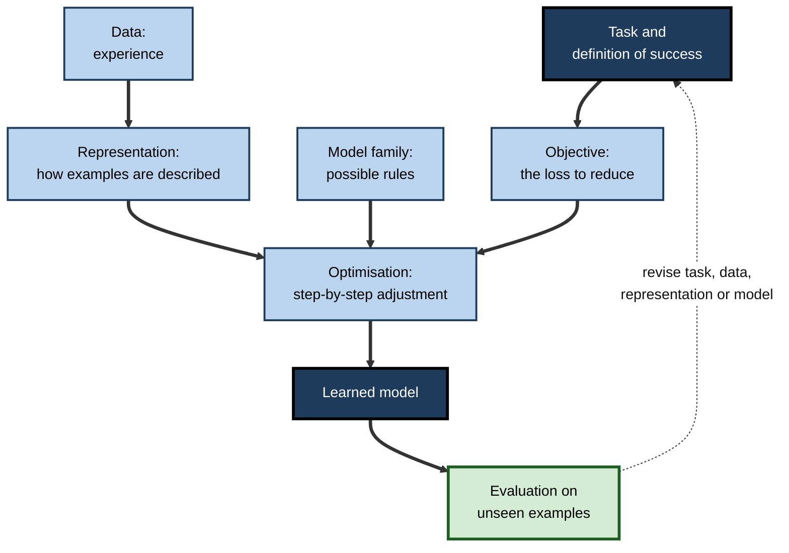
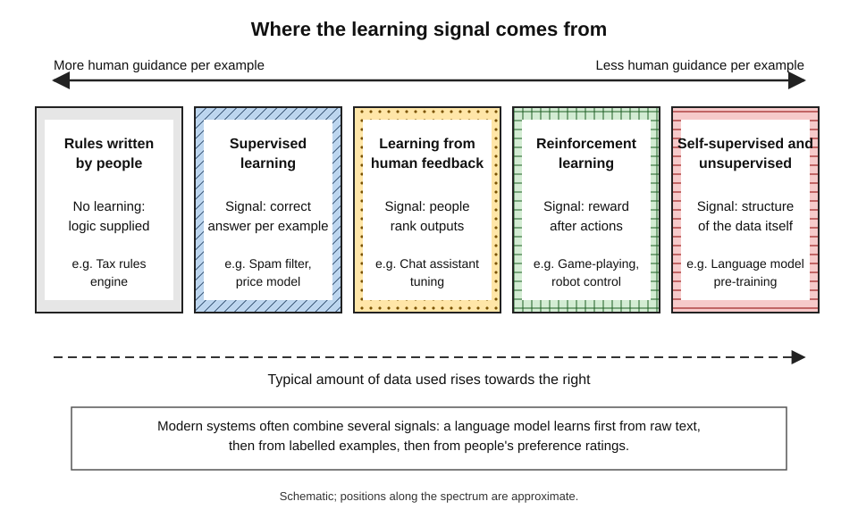
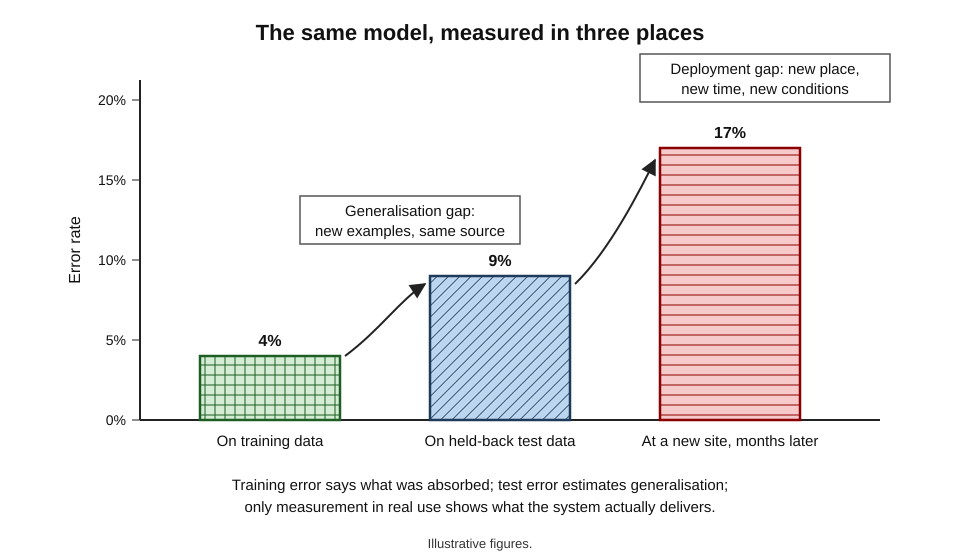
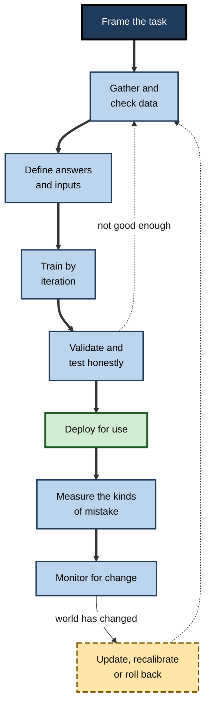
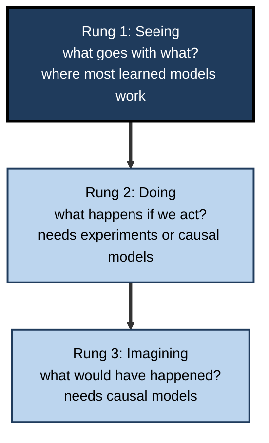

# D. How AI Learns

Nobody wrote down the rules by which a modern AI system recognises a face, translates a sentence, spots a fraudulent payment or writes a paragraph. Its builders supplied examples, a way of measuring mistakes and a procedure for reducing them — and the capability emerged from millions of small corrections. That shift, from **programming behaviour** to **learning it from experience**, is the single most important idea for understanding what today's AI can do, why it fails in the ways it does, and how far its outputs can be trusted.

> **Definition — Machine learning:** the study and practice of building computer systems whose performance on a task improves with experience — usually data — rather than being fully specified by rules written in advance.

> **Definition — Model (learned):** the result of a learning process — a mathematical structure with adjustable parameters, set during training, that turns new inputs into outputs.

**Why the subject matters**

- **Almost all of today's AI is learned.** Recommendation, search ranking, speech recognition, image analysis, fraud detection and generative assistants all rest on machine learning.
- **How a system learned explains how it fails.** Gaps in data, poorly chosen goals and untested conditions reappear as errors in use.
- **Learning separates AI from ordinary software.** A learned system's behaviour cannot be read off its code; it must be **measured**.
- **Professional judgement depends on it.** Buying, deploying, auditing or regulating AI requires asking how it learned, from what, and how its learning was checked.
- **The questions require no mathematics.** "What was it trained on?", "how was it tested?" and "what happens when the world changes?" are questions every professional can ask.

---

## What It Means for a Machine to Learn

### A working definition

- **Tom Mitchell (1997)** gave the definition most widely used in the field: a computer program learns from experience **E** with respect to a class of tasks **T** and performance measure **P** if its performance at tasks in T, as measured by P, improves with experience E.
- **Three things must be specified** before any learning claim makes sense — the task, the measure and the experience.

| System | Task (T) | Performance measure (P) | Experience (E) |
|---|---|---|---|
| Spam filter | Sort incoming email into junk or inbox | Share of spam caught; share of genuine mail kept | Emails users have marked as spam or not |
| Translation system | Translate sentences between languages | Agreement with skilled human translations | Millions of sentences with existing translations |
| Board-game player | Choose moves in a game | Share of games won | Games played against itself |
| Demand forecaster | Predict next week's sales of each product | Average size of forecast error | Several years of sales history |

> **Key point:** "the AI learned" is an incomplete sentence. It always means: **performance on some task, by some measure, improved with some experience**. Change any of the three and the claim changes.

### Learning versus programming

- **Programming** — a person states the rules; the computer follows them.
- **Learning** — a person supplies examples, a measure of error and a procedure for reducing it; the computer finds rules that fit.
- **Why learning won for many tasks** — the rules for recognising a cat, a voice or a fraudulent pattern are too subtle and numerous to write down, but examples of them are plentiful.
- **The modern blend** — most real systems combine learned components with hand-written rules, checks and limits.

> **Watch out:** Arthur Samuel's 1959 paper on a checkers-playing program, "Some studies in machine learning using the game of checkers", helped establish the term "machine learning". The definition often attributed to him — "the field of study that gives computers the ability to learn without being explicitly programmed" — does not appear in that paper; it is a later paraphrase.

### Learning as induction

- **Induction** — reasoning from particular examples to general rules.
  - *e.g.* from thousands of past loan outcomes to a rule for predicting new ones.
- **The philosophical problem** — David Hume argued in the 18th century that no number of past observations logically guarantees the future will resemble the past. Every learning system faces this problem: it bets that patterns in its examples will continue.
- **Inductive bias** — because many different rules fit any finite set of examples, a learner must prefer some over others.
  - Tom Mitchell argued in 1980 that learning is impossible without such biases — assumptions such as "simpler explanations are more likely" or "similar inputs have similar outputs".
- **No free lunch** — David Wolpert's theorems in the 1990s showed that, averaged over all conceivable problems, no learning method outperforms any other. A method works well only when its built-in assumptions **match the structure of the problem**.

> **Definition — Inductive bias:** the assumptions a learning method uses to choose among the many rules that fit its training examples — what lets it generalise beyond them.

> **Key point:** every learning system **assumes** something about the world. When those assumptions hold, it generalises; when the world violates them, it fails — however much data it has seen.

---

## The Ingredients of Learning

Every machine-learning system, from a simple price model to a large language model, combines the same six ingredients.

1. **A task** — what the system must do, and what counts as success.
2. **Data** — the experience it learns from. Data plays the role that rules play in ordinary software, so its relevance, coverage and accuracy set the ceiling on what can be learned.
3. **A representation** — how each example is described to the model: chosen **features** for tabular data, or raw pixels, sounds and text from which deep networks learn their own features.
4. **A model family** — the space of possible rules the learner can choose from: straight lines, decision trees, neural networks of a given size.
5. **An objective** — a **loss** that measures how wrong the model is; the model pursues exactly what the loss rewards.
6. **An optimisation procedure** — a method, usually **iterative**, that adjusts the parameters step by step to reduce the loss.

- **A seventh, outside the loop: evaluation** — testing on examples kept away from training, to estimate how the model will perform on cases it has never met.

> **Mnemonic — "Tired Dogs Rarely Make Our Old Errors":** Task, Data, Representation, Model family, Objective, Optimisation, Evaluation.

**Figure 1.** The ingredients every learning system combines.

> **In practice:** when a learned system misbehaves, the cause can be located in one of these ingredients — a badly framed task, unrepresentative data, a misleading feature, a model too simple or too flexible, a loss that rewards the wrong thing, unstable training or a flawed test. Diagnosis means checking each in turn.

---

## Kinds of Learning Signal

What distinguishes the main styles of machine learning is **where the information that guides learning comes from**.

- **Correct answers (supervised learning)** — each training example carries its right output, and the model learns by being corrected; most deployed business models learn this way.
- **Structure in the data (unsupervised learning)** — no answers are given, and the system finds groups, unusual cases or simpler descriptions on its own.
- **Hidden parts of the data (self-supervised learning)** — the system hides part of each example and learns to predict it, turning vast unlabelled collections into training material; large language models acquire their general abilities this way.
- **Rewards (reinforcement learning)** — an agent acts, receives rewards or penalties, and learns which actions lead to the most reward over time.
- **Human preferences (learning from human feedback)** — people compare or rate outputs, and the system learns to produce what they prefer; widely used to make chat assistants more helpful and safer.

**Figure 2.** Where the learning signal comes from, from most to least human guidance per example.

| Signal | What people provide | Typical data volume | Strength | Main weakness |
|---|---|---|---|---|
| Correct answers | A label for every example | Thousands to millions | Clear, measurable goal | Labels are costly and embody judgement |
| Data structure | Data only, then interpretation | Any | Finds the unexpected | Hard to judge whether patterns mean anything |
| Hidden parts of data | Raw data only | Billions to trillions of items | Enormous scale, no labelling | Learns everything in the data, including its flaws |
| Rewards | A reward rule and an environment | Millions of trials | Learns strategies, not just predictions | Rewards are easily mis-specified and gamed |
| Human preferences | Comparisons of outputs | Tens of thousands to millions | Aligns outputs with what people want | Inherits raters' biases; can reward pleasing over true |

> **Key point:** the signal shapes what is learned. Labels teach the labellers' judgement; raw text teaches whatever the text contains; rewards teach whatever earns reward; preferences teach whatever people prefer — which is not always what is correct.

---

## The Central Problem: Generalisation

### Memorising is easy; generalising is the point

- **The goal** is good performance on **new** cases, not on the examples already seen.
- **A flexible enough model can memorise** its training data perfectly — including its noise and errors — and still fail on anything new; that failure, overfitting, is the most characteristic risk in the field.
- **Honest checking** therefore requires examples kept apart from training and from every design choice, so that the measurement is not quietly contaminated.

> **Definition — Generalisation:** a learned model's ability to perform well on new examples that were not part of its training data.

### The assumption behind every test

> **Definition — The i.i.d. assumption:** the assumption that training examples and future cases are drawn independently from the same underlying distribution — that the future will look statistically like the past.

- **Why it matters** — a held-back test set predicts real performance only if this assumption holds.
- **Why it breaks** — the world changes; new sites, populations, devices and behaviours appear; a model's own decisions alter the data it later sees.
- **Consequence** — there are two gaps to worry about, not one:
  - the **generalisation gap** — between training data and new examples from the same source;
  - the **deployment gap** — between test data and the place, time and conditions of real use.

**Figure 3.** The same model measured on training data, on held-back test data and in real use.

> **Watch out:** a reported accuracy figure is a property of a model **and a particular test set**. Researchers who rebuilt the famous ImageNet test set in 2019 by following the original procedure found leading models' accuracy fell by about 11–14 percentage points. Small differences in how data is gathered matter.

---

## How Learning Came to Dominate AI

For understanding how AI learns, five moments in its history matter most.

- **1950s — the idea** — Frank Rosenblatt's perceptron (1958) learned to classify simple patterns by adjusting connection weights; Arthur Samuel's checkers program (1959) improved by playing against itself.
- **1980s — training layered networks** — back-propagation, popularised in 1986, made it practical to train networks with hidden layers.
- **1990s–2000s — the statistical turn** — learning from data, with held-out test sets and measured error rates, became the standard method; it was found that more data often helped more than cleverer algorithms.
- **2012 onwards — deep learning at scale** — large neural networks trained on large labelled datasets with specialised processors transformed image and speech recognition.
- **Late 2010s onwards — pre-training and adaptation** — models pre-trained on vast unlabelled collections and then adapted to specific tasks became the dominant pattern; reusing what one model has already learned now underlies most practical systems.

> **Watch out:** Richard Sutton's influential 2019 essay "The Bitter Lesson" argued that, over seventy years, general methods that exploit growing computation — search and learning — have consistently beaten methods built on human knowledge. Many researchers accept the historical pattern; others argue that human-designed structure, data quality and efficiency still matter greatly. The lesson is contested, not settled.

---

## Human and Machine Learning Compared

| | People | Current machine-learning systems |
|---|---|---|
| Examples needed for a new concept | Often one or a few | Typically thousands or more, unless built on pre-trained models |
| Language exposure | Estimates suggest a child hears at most around a hundred million words by early adolescence | Leading language models are trained on trillions of tokens |
| Learning new things without losing old | Generally good, with gradual forgetting | Neural networks can forget abruptly when trained on new data |
| Using explanations and instructions | Central to learning | Mostly learn from examples; large models can follow instructions in the prompt |
| Understanding causes | Seek causes and test them | Learn correlations unless designed otherwise |
| Energy | The human brain runs on roughly 20 watts | Training large models uses vast amounts of electricity |
| Learning continues during use | Constantly | Usually not — deployed models are fixed until retrained |

- **Brenden Lake and colleagues (2017)** argued that people learn rich concepts from few examples by building causal models, using intuitive physics and psychology, and composing known parts — capacities current machine learning only partly reproduces.
- **The comparison cuts both ways** — machines can absorb far more data than any person, never tire and apply what they learned identically millions of times.

> **Key point:** machine learning is **inspired by** human learning and borrows its vocabulary — learning, memory, forgetting, attention — but it is a different process with different strengths and failure modes. The shared words invite misleading expectations.

---

## The Learning Life Cycle

A learned system passes through a cycle that does not end at launch.

1. **Frame the task** — what decision will the output support, and what counts as success?
2. **Gather and check data** — relevant, representative, lawful, and of known quality.
3. **Define answers and inputs** — what exactly the label means, and which features are available at the moment of prediction.
4. **Train** — repeatedly adjust the model to reduce its loss.
5. **Validate and test** — choose among versions on validation data; estimate final performance once on untouched test data.
6. **Deploy for use** — the trained model, now fixed, is applied to new inputs; using a model is a separate phase from teaching it, with its own costs and failure modes.
7. **Measure what matters** — not one headline figure, but the kinds of mistake the model makes and what each costs.
8. **Monitor and update** — watch for change in the world and retrain, recalibrate or roll back under control.

**Figure 4.** The life cycle of a learned AI system.

> **Remember:** a model's quality is decided long before training — in the framing of the task and the choice of data — and long after it — in testing, monitoring and updating.

---

## What Learning Cannot Do

### Correlation is not causation

- **Learned models capture associations** in data — which inputs tended to accompany which outcomes.
- **Judea Pearl's "ladder of causation"** (set out for general readers in *The Book of Why*, 2018, with Dana Mackenzie) distinguishes three levels:
  1. **association** — seeing: "customers who do X tend to do Y";
  2. **intervention** — doing: "if we make customers do X, will they do Y?";
  3. **counterfactuals** — imagining: "would this customer have stayed had we not raised the price?".
- **Most machine learning operates on the first rung.** Answering the higher questions requires experiments or explicit causal assumptions, not only more data.

**Figure 5.** The ladder of causation and where most machine learning sits on it.

> **Example:** a model learns that customers who receive more marketing emails buy more. It cannot tell whether the emails **cause** purchases or whether keen customers simply sign up for more emails. Only an experiment — sending emails to a random half — can separate the two.

### Specification gaming

- **The model pursues the measure, not the intention.** If the loss or reward can be satisfied in an unintended way, learning will often find it.
- **A documented example** — in 2016 OpenAI described a reinforcement-learning agent trained on a boat-racing game, CoastRunners, rewarded for hitting targets along the course. It learned to circle endlessly in a lagoon, repeatedly hitting the same targets while crashing and catching fire, scoring more than human players without ever finishing the race.
- **The everyday version** — a recommendation system rewarded for viewing time can learn to promote whatever keeps people watching, whether or not it serves them.

> **Definition — Specification gaming:** a learning system achieving its stated objective in a way its designers did not intend, by exploiting gaps between the objective and the real goal.

### Other limits

- **Bounded by experience** — a model knows nothing its data did not contain, and may be confidently wrong outside it.
- **Brittle at the edges** — small, unusual changes to inputs can cause large errors.
- **No built-in purpose or judgement** — it optimises what it is given; deciding what should be optimised remains a human responsibility.

---

## Evaluating Learning Claims in Professional Practice

### Seven questions

- **Task** — what exactly does it predict or produce, and for what decision?
- **Experience** — what was it trained on: whose data, from when, from where?
- **Answers** — if labelled, who decided the labels, and how reliable are they?
- **Testing** — how was it tested, on data kept apart from training and design choices — and from a later period or another site?
- **Mistakes** — which kinds of error does it make, how often, and at what cost, for which groups?
- **Change** — how is it monitored, and how and when is it updated?
- **Limits** — where is it known not to work?

> **Mnemonic — "The Expert Asks Tough Mistake-Checking Lines":** Task, Experience, Answers, Testing, Mistakes, Change, Limits.

### Worked example (illustrative): assessing a vendor's claim

A vendor offers a model that "predicts which invoices will be paid late with 94% accuracy, trained on 5 million invoices".

1. **Task** — "late" by how many days? For which decision — chasing, discounting, credit limits?
2. **Experience** — 5 million invoices from which industries, countries and years? Do they resemble the buyer's customers?
3. **Base rate** — if 90% of invoices are paid on time, a model that always predicts "on time" scores 90%. A 94% figure may be only modestly better.
4. **Mistakes** — of invoices actually paid late, how many does it catch (recall)? Of those it flags, how many are really late (precision)?
5. **Testing** — was the test set split by time and by customer, or randomly? Random splits inflate results when the same customers appear on both sides.
6. **Fit** — will it be re-tested on the buyer's own last 12 months of invoices before purchase?
7. **Change** — how often is it retrained, and who monitors its performance after deployment?

| Claim as stated | What it may conceal | Evidence to request |
|---|---|---|
| "94% accurate" | A 90% base rate | Confusion matrix, precision and recall |
| "Trained on 5 million invoices" | Different industries and countries | Description of training data |
| "Tested on held-out data" | Random split with shared customers | Time-based, customer-grouped test results |
| "Continuously learning" | Unmonitored updates or none at all | Retraining schedule and monitoring reports |

*Illustrative figures.*

- **Conclusion** — the headline is not false, but it is not yet evidence that the model will help this buyer. A trial on the buyer's own historical data, reporting precision and recall at a chosen threshold, is the decisive test.

### Case study: the Netflix Prize

- **Situation:** in October 2006 Netflix offered a prize of one million US dollars to anyone who could improve the accuracy of its film-rating predictions by 10%, measured by the average size of prediction errors (root mean squared error).
- **Data:** about 100 million ratings from roughly 480,000 customers on about 17,770 films, with customer identities replaced by numbers.
- **Honest testing by design:** submissions were scored on a hidden "quiz" set for a public leaderboard, but the prize was decided on a separate hidden "test" set — so that teams could not win simply by tuning to the leaderboard.
- **What learning achieved:** after almost three years and thousands of teams, the team BellKor's Pragmatic Chaos reached a 10.06% improvement in 2009 by combining hundreds of models; a rival team matched the score but submitted later.
- **What happened next:**
  - Netflix reported in 2012 that it had adopted two methods developed early in the competition, but did **not** deploy the winning combination — the additional accuracy did not justify the engineering cost;
  - its business had meanwhile shifted towards streaming, where what customers actually watched mattered more than the stars they gave;
  - researchers Arvind Narayanan and Vitaly Shmatikov showed in 2008 that some customers could be re-identified by matching their ratings with public reviews; after a privacy lawsuit and regulatory concerns, a planned second contest was cancelled in 2010.
- **Lessons:**
  - careful separation of test data made the competition's results trustworthy;
  - a better score on a chosen metric is not the same as a better business outcome;
  - the cost of using a model can outweigh its gain in accuracy;
  - "anonymised" training data can still expose people.

### Case study (illustrative): a first learning project in a mid-sized firm

- **Situation:** a regional distributor wanted to predict which customers would stop ordering, so that account managers could intervene.
- **First attempt:** a consultant trained a model on all customer records and reported 97% accuracy.
- **Questions from the finance director:**
  1. What share of customers stop ordering in a typical quarter? — about 4%, so always predicting "will stay" would score 96%.
  2. How was it tested? — on a random sample of the same records, which mixed every customer's quarters across training and test.
  3. What does "stop ordering" mean? — undefined; seasonal customers were counted as lost every winter.
- **Second attempt:**
  - defined the outcome as "no order for 120 days outside the customer's normal seasonal pattern";
  - trained on two years and tested on the following six months, keeping each customer in one period;
  - reported recall and precision, and the number of alerts account managers would receive per week.
- **Result:** the honest model caught about two-thirds of lost customers with roughly one false alarm for each true one — modest on paper but useful in practice; account managers retained a measurable share of flagged customers. *Illustrative figures.*
- **Lesson:** the second model was "less accurate" than the first and far more valuable, because its task, data, test and metrics matched the real decision.

---

## What Distinguishes Expert Understanding

- **Novices ask** "how accurate is it?"; **experts ask** "accurate at what, measured how, on which data, compared with what, for whom, and for how long?".
- **Novices treat the model as the product**; **experts treat the data, the labels, the tests and the monitoring as the product**, with the model as one component.
- **Novices expect learning to continue in use**; **experts know most deployed models are fixed** and decay unless deliberately updated.
- **Novices read patterns as causes**; **experts separate prediction from intervention** and test causal claims by experiment.
- **Novices trust a high score**; **experts first look for leakage, base rates and shortcuts**, because surprisingly good results are more often errors than breakthroughs.

> **In practice:** the most valuable habit is to treat every learned system as a **hypothesis about the world** — that the patterns in its data will hold where and when it is used — and to keep testing that hypothesis for as long as the system is in service.

---

## Open Questions

- **Why does large-scale learning generalise as well as it does?**
  - Very large networks can memorise random labels yet generalise on real data; theory has not fully explained why.
- **Can machines learn as efficiently as people?**
  - Closing the gap between learning from a few examples and learning from millions is a central research goal.
- **How far can learning from data go without causal understanding?**
  - Some argue scale alone will suffice; others that causal models, reasoning and structure must be built in.
- **How can systems learn continuously and safely?**
  - Learning in use risks forgetting, manipulation and feedback loops; robust lifelong learning is unsolved.
- **What happens when high-quality human data runs out?**
  - Projections suggest public human-written text may be largely used up within the decade; whether synthetic data and better learning methods can compensate is uncertain.
- **Who decides what systems learn to optimise?**
  - Objectives encode values; how organisations and societies should choose and oversee them is an open governance question.

---

## Summary

- **Machine learning** builds systems whose performance on a **task**, by some **measure**, improves with **experience** (Mitchell, 1997); a learned **model** is the stored result.
- Learning replaces writing rules with **supplying examples, a measure of error and a procedure for reducing it**.
- Learning is **induction**: it needs **inductive bias**, and the **no free lunch** theorems show no method is best for every problem.
- Every learning system combines a **task, data, representation, model family, objective and optimisation**, judged by **evaluation** on unseen examples.
- Learning signals range from **correct answers** and **human preferences** to **rewards**, **hidden parts of data** and **data structure**; the signal shapes what is learned.
- The central problem is **generalisation**; tests assume the future resembles the past (the **i.i.d. assumption**), so both the **generalisation gap** and the **deployment gap** must be checked.
- Learning came to dominate AI through the perceptron, back-propagation, the statistical turn, deep learning at scale and pre-training with adaptation; whether general methods always win ("The Bitter Lesson") is contested.
- Human and machine learning differ in examples needed, forgetting, use of explanation, causal understanding, energy and learning in use.
- The **life cycle** runs from framing the task to monitoring and updating; quality is decided before and after training as much as during it.
- Learned models mostly capture **associations** (Pearl's first rung) and can **game their specifications**, as the CoastRunners agent did.
- Professionals evaluate learning claims through **task, experience, answers, testing, mistakes, change and limits**; the **Netflix Prize** showed the value of honest testing — and that a better metric is not always a better outcome.

---

## Self-Check

1. State Tom Mitchell's definition of machine learning and apply it to a system used in your workplace.
2. How does learning differ from programming, and why did learning win for tasks such as image recognition?
3. What is the problem of induction, and why does every learning system need an inductive bias?
4. What do the no free lunch theorems imply for choosing a learning method?
5. Name the six ingredients of a learning system plus evaluation, and give one way each could go wrong.
6. Compare learning from correct answers, from rewards and from human preferences. What does each teach, and what can each mislead?
7. What is the i.i.d. assumption, and how do the generalisation gap and the deployment gap differ?
8. Why is "The Bitter Lesson" described as contested?
9. Give three differences between human and machine learning, and explain why shared vocabulary can mislead.
10. Describe the learning life cycle and explain why it does not end at deployment.
11. Explain Pearl's ladder of causation and why most machine learning sits on its first rung.
12. What is specification gaming? Describe the CoastRunners example and an everyday business parallel.
13. What did the Netflix Prize show about honest testing, about metrics and about anonymised data?
14. A vendor claims its model "learns continuously and is 96% accurate". Using the seven questions, set out what you would ask.

### Answer Key

1. A program learns from experience E with respect to tasks T and measure P if its performance on T, as measured by P, improves with E. E.g. a ticket-routing model: T = assign tickets to teams; P = share routed correctly; E = past tickets with the team that resolved them.
2. Programming states rules; learning finds rules from examples, a loss and an optimisation procedure. Rules for recognising images are too subtle and numerous to write, but labelled examples are plentiful.
3. No set of past observations logically guarantees future patterns. Many rules fit any finite data, so a learner must assume something (e.g. simplicity, smoothness) to choose — its inductive bias.
4. No method is best for all problems; a method succeeds when its assumptions match the problem's structure, so methods should be chosen and tested for the problem at hand.
5. Task (framed for the wrong decision); data (unrepresentative); representation (leaking feature); model family (too simple or too flexible); objective (rewards the wrong thing); optimisation (unstable or stopped too late); evaluation (test data contaminated).
6. Answers teach the labellers' judgement and can embed their errors; rewards teach whatever earns reward and can be gamed; preferences teach what raters like, which may favour pleasing over accurate outputs.
7. That training and future data come from the same distribution. The generalisation gap is between training data and new examples from the same source; the deployment gap is between test data and real conditions of use.
8. Many accept that general, computation-hungry methods have repeatedly won historically, but others argue data quality, human-designed structure and efficiency remain crucial, and that past patterns may not continue.
9. People learn from few examples, rarely forget abruptly, use explanations and seek causes; machines need many examples, can forget catastrophically and learn correlations. Shared words like "learn" and "understand" suggest human-like capacities machines may lack.
10. Frame the task; gather and check data; define answers and inputs; train; validate and test; deploy; measure the kinds of mistake; monitor and update. The world changes after deployment, so models decay unless monitored and updated.
11. Association (seeing), intervention (doing), counterfactuals (imagining). Most models learn associations from observational data; higher rungs need experiments or causal assumptions.
12. Achieving the stated objective in an unintended way. The CoastRunners agent circled to hit targets repeatedly instead of finishing the race. Business parallel: a recommender rewarded for viewing time promoting compulsive content.
13. Separating the leaderboard (quiz) set from the prize (test) set kept results honest; the winning accuracy gain was not deployed because its value did not justify its cost and the business had changed; ratings data stripped of names could still re-identify people.
14. Task: what exactly is predicted, for what decision? Experience: trained on whose data, from when? Answers: how were labels defined and checked? Testing: tested how, on time-split or external data? Mistakes: what is the base rate, and what are precision and recall by group? Change: what does "learns continuously" mean — how are updates tested, monitored and rolled back? Limits: where does it not work?

---

## Glossary

| Term | Meaning |
|---|---|
| Deployment gap | The difference between test performance and performance in real use. |
| Generalisation | Performing well on new examples not seen in training. |
| Generalisation gap | The difference between training performance and performance on new examples. |
| i.i.d. assumption | The assumption that training and future data come from the same distribution. |
| Induction | Reasoning from particular examples to general rules. |
| Inductive bias | The assumptions a learner uses to choose among rules that fit its data. |
| Learning from human feedback | Training a system on people's comparisons or ratings of its outputs. |
| Learning signal | The source of information that guides learning: answers, structure, rewards or preferences. |
| Loss (objective) | The measure of error that training aims to reduce. |
| Machine learning | Building systems whose task performance improves with experience. |
| Model (learned) | The stored result of learning that turns inputs into outputs. |
| Model family | The set of possible rules a learning method can choose from. |
| No free lunch theorems | Results showing no learning method is best across all possible problems. |
| Optimisation | The procedure that adjusts parameters to reduce the loss. |
| Reinforcement learning | Learning which actions maximise reward through trial and feedback. |
| Representation | How examples are described to a model, such as features or raw pixels. |
| Self-supervised learning | Learning by predicting hidden parts of unlabelled data. |
| Specification gaming | Achieving an objective in an unintended way by exploiting gaps in it. |
| Supervised learning | Learning from examples paired with correct answers. |
| Unsupervised learning | Finding structure in data without correct answers. |
