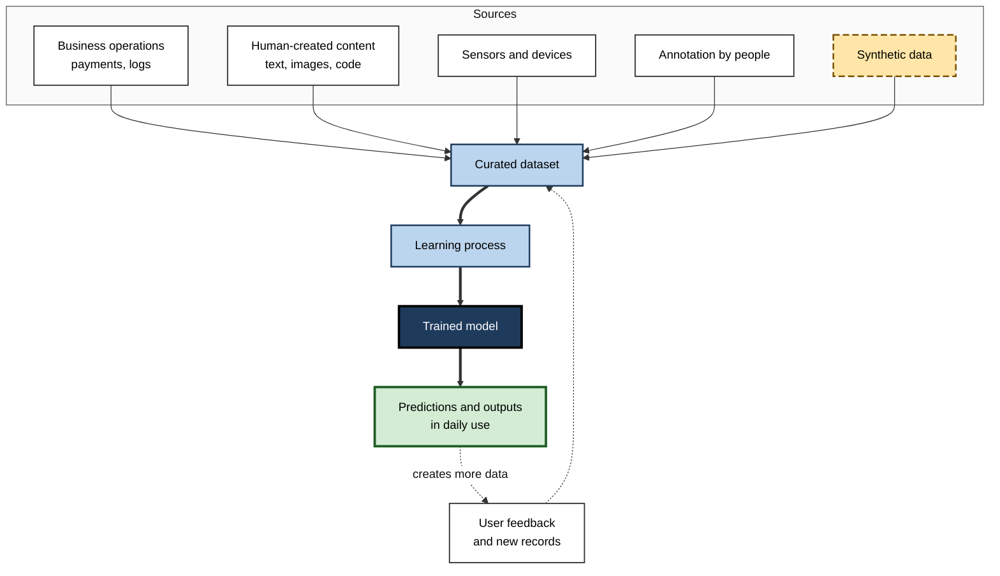
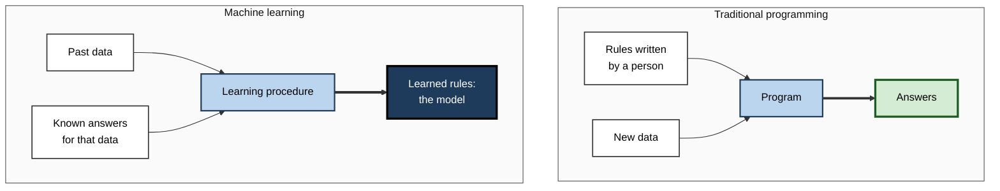
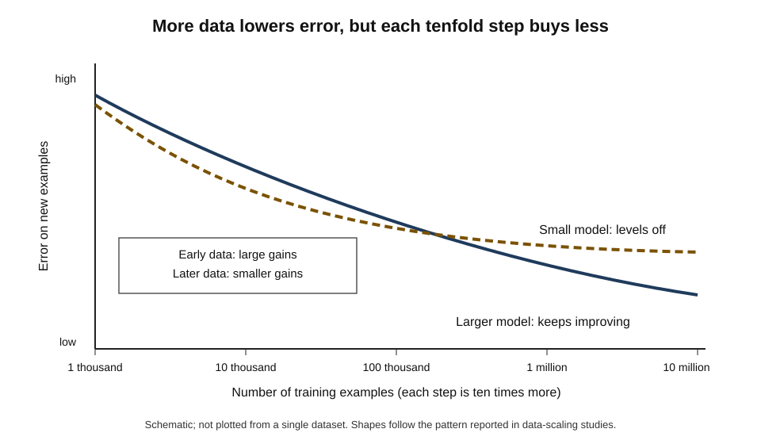
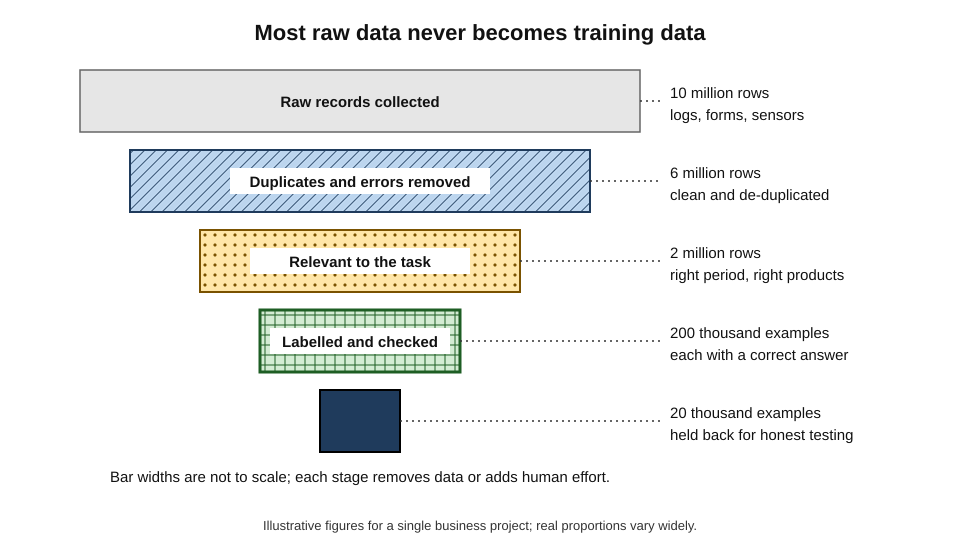
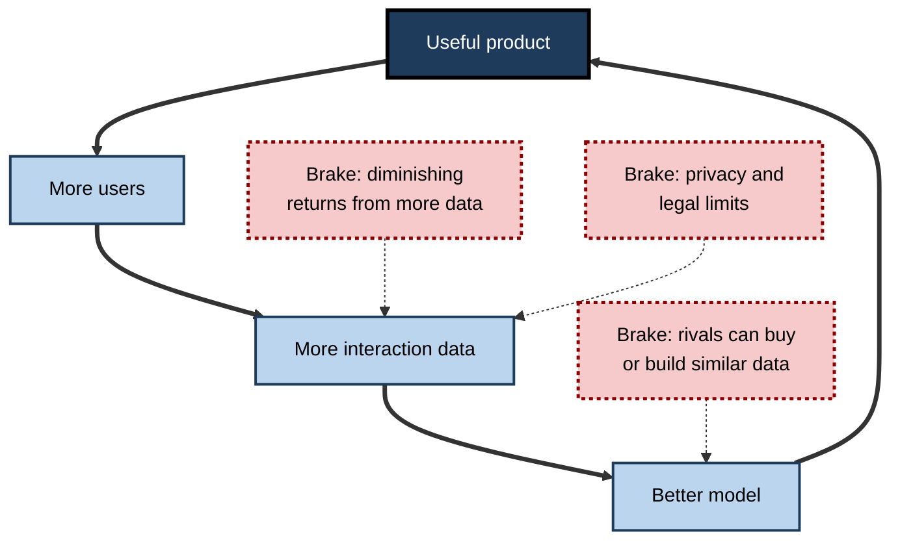
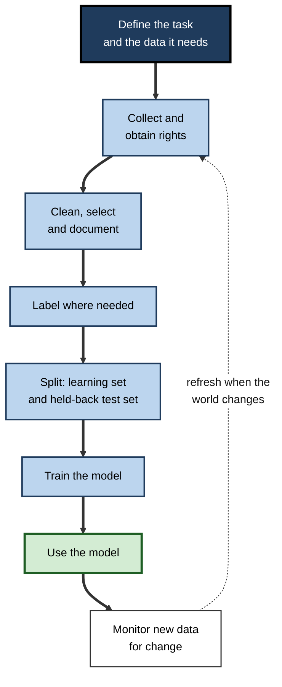

# D.1. Data as the fuel of AI

A spam filter has never been told what spam is; it has seen millions of emails that people marked as junk. A translation service has never studied grammar; it has absorbed vast quantities of text that human translators had already produced. A fraud-detection system has no theory of crime; it has records of past transactions, some of which turned out to be fraudulent. In each case the capability of the system came from **examples**, and without them it would be capable of nothing.

> **Definition — Data (in AI):** recorded observations of the world — numbers, text, images, sounds, measurements, clicks — stored in a form a computer can process.

> **Definition — Training data:** the collection of examples from which a learning system extracts the patterns it will later use to make predictions or produce outputs.

**Why it matters**

- **It explains where AI capability comes from.** A modern AI system is mostly the product of its data; the program that learns is comparatively generic.
- **It explains AI's characteristic failures.** Gaps, errors and skews in the data reappear as gaps, errors and skews in behaviour.
- **It shapes who can build AI.** Organisations with relevant, plentiful and well-governed data hold an advantage that money alone cannot buy quickly.
- **It frames the big public questions** — consent, copyright, privacy and fairness are, at root, questions about data.
- **It gives every professional a practical test:** asking "what was this trained on?" is often the quickest way to judge whether an AI output deserves trust.

---

## What Data Is

### From observations to records

- **Observation** — something noticed about the world.
  - *e.g.* a customer bought two items at 18:42; a scanner recorded an image of a lung; a thermostat measured 21.5 °C.
- **Record** — the observation written down in a fixed format.
  - *e.g.* one row in a sales table; one image file; one line in a log.
- **Example** (also *data point*, *instance* or *sample*) — one record used for learning.
- **Variable** (also *attribute* or *field*) — one property recorded for every example.
  - *e.g.* price, date, postcode, pixel brightness.
- **Dataset** — a collection of examples assembled for a purpose.

> **Definition — Dataset:** an organised collection of examples, usually sharing the same variables, assembled to train, test or analyse a system.

> **Key point:** data is never the world itself. It is a **selection** from the world, made by someone, for some purpose, with some instrument — and every one of those choices shapes what an AI system can learn.

### Kinds of data

- **Structured (tabular) data** — rows and columns with defined meanings.
  - *e.g.* bank transactions, patient records, inventory tables, spreadsheets.
- **Text** — emails, documents, chat logs, web pages, code.
- **Images** — photographs, scans, satellite pictures, medical images.
- **Audio** — speech, music, machine sounds.
- **Video** — sequences of images with sound.
- **Time series and sensor data** — measurements taken repeatedly over time.
  - *e.g.* heart-rate readings, engine vibration, electricity demand.
- **Graph or network data** — entities and the links between them.
  - *e.g.* who follows whom on a social platform; which accounts send money to which.
- **Behavioural or interaction data** — what people do in a product.
  - *e.g.* clicks, scrolls, purchases, ratings, time spent watching.

| | Structured data | Unstructured data |
|---|---|---|
| Typical form | Tables with named columns | Text, images, audio, video |
| Meaning of each value | Defined in advance (a "price" column holds prices) | Must be inferred (which pixels form a face?) |
| Share of organisational data | Smaller | Usually much larger |
| Traditional tools | Databases, spreadsheets, statistics | Historically hard to use at scale |
| AI methods that changed the picture | Tree-based and statistical models | Deep neural networks and large language models |

> **Watch out:** "unstructured" does not mean "without structure". Language has grammar and images have shapes; the structure is simply not laid out in labelled columns, so the system must discover it.

### Where data comes from

- **Operational by-product** — data created as a side-effect of running a business.
  - *e.g.* payments, delivery scans, call-centre recordings, website logs.
- **Human creation** — content people produce for their own reasons.
  - *e.g.* books, news articles, forum posts, photographs, open-source code.
- **Sensors and devices** — cameras, microphones, telematics, wearables, industrial equipment.
- **Deliberate collection** — surveys, experiments, clinical trials, field recordings.
- **Annotation** — people adding answers or descriptions to existing data.
  - *e.g.* marking which emails are spam; drawing boxes around pedestrians in road images.
- **Licensing and purchase** — data bought from or shared by other organisations.
- **Synthetic generation** — data produced by simulations or by other AI models.
- **User feedback** — signals created when people use an AI system.
  - *e.g.* a thumbs-up on a chatbot answer; correcting an autocorrect suggestion.

**Figure 1.** How data from many sources becomes a model's capability.

---

## Why Data Is the Fuel

### From written rules to learned patterns

Traditional software follows instructions a programmer writes. Machine learning reverses the arrangement: the programmer supplies examples and a learning procedure, and the system works out the rules itself.

- **Traditional programming**
  - **Input:** rules + data → **output:** answers.
  - *e.g.* "if the email contains 'lottery winner', move it to junk."
- **Machine learning**
  - **Input:** data + answers → **output:** rules (a model).
  - *e.g.* thousands of emails already marked spam or not spam → a model that scores new emails.
- **Tom Mitchell's definition (1997):** a computer program learns from experience E with respect to tasks T and performance measure P if its performance on T, as measured by P, improves with E.
  - In practice, **experience E is data.**

> **Definition — Model:** the stored result of learning — a mathematical structure, often holding millions or billions of adjustable numbers, that turns new inputs into outputs.

**Figure 2.** Traditional programming compared with machine learning.

> **Key point:** in machine learning the data plays the role that the programmer's rules play in ordinary software. Change the data and the system's "rules" change with it.

### The fuel metaphor and its limits

- **Origin of the slogan:** the British mathematician and marketer Clive Humby is credited with saying in 2006 that "data is the new oil"; in 2017 *The Economist* ran a cover story arguing that data had become the world's most valuable resource.
- **Where the metaphor works**
  - Data powers the system — without it, nothing runs.
  - Raw data must be **refined** (cleaned, organised, labelled) before use.
  - Control of supply confers economic power.
- **Where it breaks down**
  - **Data is not used up.** The same dataset can train many models; oil burns once.
  - **Data is non-rival.** Two firms can hold copies at once.
  - **Value depends on context.** Hospital records are priceless for a diagnostic model and useless for a music recommender.
  - **Data can go stale.** Last decade's shopping behaviour may mislead a model today.
  - **Data carries people.** Much of it describes individuals, with rights and interests attached.

| | Oil | Data |
|---|---|---|
| Consumed when used | Yes | No — can be reused indefinitely |
| Can be copied | No | Yes, at almost no cost |
| Value | Similar wherever it is burned | Depends on the task and the context |
| Ageing | Stable for long periods | Often loses relevance as the world changes |
| Rights of third parties | Mainly property rights | Privacy, consent, copyright and fairness |

> **Watch out:** the slogan encourages hoarding — collecting everything "in case it is useful". Data that is irrelevant, unlawful or poorly understood adds cost and risk without adding capability.

---

## How Much Data Is Enough?

### More data often beats a cleverer method

**Study card — Banko and Brill (2001), Microsoft Research**

- **Task:** choosing the right word from easily confused sets in a sentence.
  - *e.g.* "their" or "there"; "principal" or "principle".
- **Design:** several different learning methods were trained on text collections ranging from about a million words up to a billion words.
- **Results:**
  - every method improved steadily as the training text grew;
  - the gap between the best and worst method was smaller than the gain from adding more data;
  - the ranking of the methods changed as the data grew, so a verdict reached on small data did not hold on large data.
- **Conclusion:** for some language tasks, investing in more data paid off more than investing in a cleverer algorithm.

- **"The unreasonable effectiveness of data" (2009):** three Google researchers — Alon Halevy, Peter Norvig and Fernando Pereira — argued that for messy human problems such as translation and speech, simple models trained on enormous amounts of web data tended to outperform elaborate hand-built theories.
- **The lesson that followed:** a large share of AI's progress since the late 2000s has come from finding, assembling and processing far more data, together with the computing power to learn from it.

> **Watch out:** "more data beats better algorithms" is a tendency observed in particular tasks, not a law. With poor data, the wrong task or a model too small to absorb it, extra data can add little or nothing.

### Diminishing returns and scaling laws

- **Diminishing returns** — the first thousands of examples teach the most; each further batch adds less.
  - Early examples cover the common cases; later ones mostly repeat them, adding only rarer cases.
- **Model capacity matters** — a small model saturates: beyond a point it cannot absorb more patterns, so more data stops helping.
  - The reverse also holds: with very little data, a large model has too much freedom and can do no better — sometimes worse — than a small one. Large models pay off only when fed enough data.
- **Scaling laws** — in 2020 researchers at OpenAI (Jared Kaplan and colleagues) reported that the error of language models fell in a smooth, predictable way as model size, data and computing power grew together.
- **Balancing model and data** — in 2022 DeepMind researchers (Jordan Hoffmann and colleagues) trained a model called **Chinchilla** with 70 billion adjustable parameters on about 1.4 trillion tokens of text.
  - It outperformed a much larger model trained on less data.
  - Their analysis suggested that many earlier large models had been **under-fed** with data relative to their size — roughly twenty tokens of text per parameter was their compute-efficient ratio.

> **Definition — Token:** a small unit of text — often a word or part of a word — used by language models as their basic unit of input and output.

> **Formula — Power-law scaling (simplified):** error ≈ a × N^(−b), where N is the amount of training data and a and b are constants found by experiment. Example with illustrative figures: if a = 1 and b = 0.1, multiplying N by 10 multiplies the error by 10^(−0.1) ≈ 0.79 — about a 21% reduction. A further tenfold increase gives the same proportional cut, so each step costs ten times more data for the same relative gain.

**Figure 3.** Error typically falls as training data grows, with diminishing returns.

### How big real datasets are

| Dataset or model | Type of data | Approximate size |
|---|---|---|
| MNIST handwritten digits (1998) | Small monochrome images of handwritten digits | 70,000 images (60,000 for training, 10,000 for testing) |
| ImageNet competition set (2010s) | Labelled photographs, 1,000 categories | About 1.2 million training images |
| Full ImageNet | Labelled photographs, over 20,000 categories | About 14 million images |
| GPT-3 (2020) | Web text, books, encyclopaedia | About 300 billion tokens seen in training |
| Chinchilla (2022) | Text | About 1.4 trillion tokens |
| Llama 3 (2024) | Text | Over 15 trillion tokens, as reported by Meta |

- **What the table shows:** in about two decades, the data behind leading systems grew by many orders of magnitude.
- **What it does not show:** most business AI is trained on thousands to millions of examples, not trillions — and does well because the task is narrow.

### What decides how much data a task needs

- **Complexity of the pattern** — distinguishing cats from dogs needs fewer examples than describing any scene in words.
- **Number of outcomes** — two classes (fraud or not) need less than two thousand classes (every bird species).
- **Noise** — the more random variation, the more examples needed to see the signal through it.
- **Variety of conditions** — lighting, accents, handwriting styles, seasons, customer types.
- **Rarity of what matters** — fraud may be one transaction in thousands; the model needs enough *fraud* examples, not just enough transactions.
- **Starting point** — a model that already learned general patterns elsewhere needs far less new data.
- **Required reliability** — a playful photo filter tolerates errors that a medical device cannot.

> **Watch out:** folk rules such as "you need ten examples per variable" or "always at least 1,000 rows" have no general basis. The honest answer is empirical: train on increasing amounts of data and watch whether performance on unseen examples is still improving.

### Worked example (illustrative): is more data worth buying?

A legal-services firm is training a model to route incoming documents into twelve categories. It has 5,000 labelled documents and can pay to label more.

| Labelled documents used | Accuracy on unseen documents |
|---|---|
| 1,000 | 71% |
| 2,000 | 78% |
| 4,000 | 83% |
| 5,000 (all available) | 84% |

*Illustrative figures.*

1. **Read the curve** — doubling from 1,000 to 2,000 gained 7 points; doubling from 2,000 to 4,000 gained 5.
2. **Project forward** — on this trend, doubling to about 10,000 might add only a few more points.
3. **Find where errors come from** — inspection shows most mistakes involve two rare categories with fewer than 100 examples each.
4. **Decide** — rather than labelling 5,000 more random documents, label 600 documents from the two weak categories.
5. **Result** — accuracy rises to 88% for a fraction of the cost.

> **Remember:** the question is rarely "how much data?" but "**more of which data?**" The most valuable additions fill the gaps where the model fails.

---

## What Makes Data Valuable

A terabyte of irrelevant records is worth less than a few thousand well-chosen examples. Value comes from a combination of properties.

- **Relevance** — the data reflects the task the model will face.
  - *e.g.* call recordings from the same product line and customer base.
- **Volume** — enough examples to see stable patterns.
- **Coverage** — the full range of situations, including rare and difficult ones.
- **Representativeness** — groups and conditions appear in proportions that suit the use.
- **Answers available** — for many tasks, each example must carry the correct outcome.
- **Accuracy** — values and answers are correct.
- **Freshness** — the data reflects the world as it now is.
- **Lawful and documented** — collected with a proper basis, with its origin and limits recorded.

> **Mnemonic — "Really Valuable Customers Rarely Ask About Fees Later":** Relevance, Volume, Coverage, Representativeness, Answers, Accuracy, Freshness, Lawfulness.

> **Key point:** volume is only one of eight. Many failed AI projects had plenty of data and too little of the *right* data.

### Refining raw data

Raw data rarely arrives ready to learn from. Each refining step removes material or adds human effort.

- **Collect** — gather records from systems, sensors or partners.
- **Clean** — remove duplicates, fix formats, handle missing values, discard corrupted records.
- **Select** — keep only what matches the task: right period, right products, right population.
- **Label** — attach correct answers where the task needs them.
- **Document** — record what the data contains, how it was gathered and what it cannot represent.
- **Split** — keep a portion aside that the model never sees during learning, so that it can be tested honestly.

**Figure 4.** How a large volume of raw records shrinks into a training-ready dataset.

> **In practice:** practitioners widely report that preparing data takes more time than building models. The proportion varies by project and survey, but the direction is consistent: the unglamorous work of gathering and refining examples dominates real AI projects.

### Data, information and knowledge

- **Data** — raw recorded values.
  - *e.g.* "2025-03-14, store 18, item 4402, quantity 3".
- **Information** — data organised to answer a question.
  - *e.g.* "umbrella sales in store 18 tripled last week".
- **Knowledge** — understanding that supports action.
  - *e.g.* "umbrella demand rises sharply after forecasts of heavy rain; stock up before them".
- **What a model does** — compresses vast data into something that *behaves* like knowledge — useful patterns for prediction — without the explicit understanding a person would have.

> **Watch out:** a model's patterns are statistical associations found in data. They can be extremely useful and still be wrong about causes — a model may "know" that umbrella sales and taxi bookings rise together without knowing that rain drives both.

---

## Data as a Strategic Asset

### The data flywheel

A product that uses AI can generate the data that improves its own AI.

1. **A useful product** attracts users.
2. **Users create data** — searches, clicks, corrections, purchases.
3. **The data improves the model** — better rankings, recommendations or predictions.
4. **A better model** makes the product more useful, attracting more users.

**Figure 5.** The data flywheel and the forces that slow it.

> **Definition — Data network effect:** the situation in which a product becomes more valuable as more people use it, because their use generates data that improves the product.

> **Watch out:** data advantages are often weaker than they appear. Venture investors at Andreessen Horowitz argued in 2019 that most data "moats" erode, because of diminishing returns, because rivals can acquire comparable data, and because the newest data matters most. Durable advantages tend to come from data that is **unique, continually refreshed and tied to a specific task**.

### Proprietary, public and licensed data

- **Public data** — open datasets, government statistics, the open web.
  - Cheap and plentiful, but available to every competitor; quality and rights vary.
- **Proprietary data** — records an organisation generates itself.
  - Unique and closely matched to its problems, but often messy and siloed.
- **Licensed data** — paid access to another party's collection.
  - Since 2023 several publishers and online platforms have signed licensing deals with AI developers for access to their text.
- **Partnership data** — pooled across organisations.
  - *e.g.* banks sharing fraud signals; hospitals pooling anonymised images.

### The costs of data

- **Acquisition** — sensors, surveys, licences, partnerships.
- **Storage and processing** — infrastructure to keep and move large volumes.
- **Labelling** — human time, often from specialists such as clinicians or lawyers.
- **Governance** — consent, security, retention, access control, audit.
- **Risk** — breaches, legal challenges, reputational damage.
- **Opportunity cost** — time spent on data instead of other work.

| | Collecting more data | Improving existing data |
|---|---|---|
| Typical action | New sources, more users, more labelling | Fixing errors, filling gaps, clarifying definitions |
| When it helps most | Model is still improving with volume | Errors cluster in specific cases or labels are inconsistent |
| Main costs | Acquisition, storage, consent | Expert review time |
| Main risk | More noise and more legal exposure | Effort spent on data that does not limit performance |

---

## When the Fuel Runs Low

### The limits of human-written text

**Study card — Epoch AI (Pablo Villalobos and colleagues, 2024)**

- **Question:** will large language models run out of public human-written text to learn from?
- **Method:** estimated the total stock of usable public text and projected how fast training datasets were growing.
- **Findings:**
  - the effective stock of quality-adjusted public text was estimated at around **300 trillion tokens**, with wide uncertainty;
  - if trends continued, leading models would use it up **between about 2026 and 2032**.
- **Conclusion:** data, not only computing power, may become a binding constraint — pushing developers towards private data, repeated passes over data, better use of each example and synthetic data.

> **Watch out:** such projections depend on assumptions about data quality, reuse and future methods. The direction — high-quality human text is finite — is widely accepted; the dates are uncertain.

### Synthetic data

> **Definition — Synthetic data:** artificially generated data, produced by simulation or by an AI model, used in place of or alongside real data.

- **Where it helps**
  - **Rare events** — simulated crashes for self-driving systems; rare faults in machinery.
  - **Privacy** — realistic but artificial patient or customer records for testing.
  - **Balancing** — extra examples of under-represented cases.
  - **Teaching specific skills** — a strong model writes worked solutions for a smaller model to learn from.
- **Where it harms**
  - It can only contain what the generator already "knows".
  - Errors and biases of the generator are copied and amplified.
- **Model collapse** — a 2024 study in *Nature* (Ilia Shumailov and colleagues) showed that when models were trained repeatedly on data produced by earlier models, rare patterns disappeared first and outputs grew narrower and more distorted over generations.

> **Key point:** synthetic data is a supplement and a tool, not a free replacement for contact with the real world. Mixing it with fresh real data, and checking it, avoids most of the damage.

### Doing more with less

- **Reusing earlier learning** — starting from a model already trained on related data drastically reduces the new data required.
- **Augmentation** — creating variations of existing examples.
  - *e.g.* rotating or cropping images; adding background noise to speech.
- **Active learning** — the model indicates which unlabelled examples would teach it most, and people label only those.
- **Learning without answers** — some methods learn structure from raw data alone, saving labelling effort.

---

## Data, Rights and Responsibility

Because data usually describes people or is created by them, using it raises questions of permission and fairness.

- **Personal data and consent** — data-protection laws such as the EU's General Data Protection Regulation require a lawful basis for processing personal data.
- **Purpose and minimisation** — data collected for one purpose cannot always be reused for another; collect only what is needed.
  - This sits in tension with the "more data is better" instinct.
- **Copyright** — authors, artists and news organisations have challenged the use of their work for training.
  - *e.g.* in December 2023 *The New York Times* sued OpenAI and Microsoft over the use of its articles.
  - How copyright applies to training is still being decided in courts and legislatures.
- **Representation** — if some groups are absent or misdescribed in the data, the system will serve them worse.
- **Hidden labour** — much labelling is done by low-paid workers, sometimes reviewing distressing content.

> **In practice:** responsible teams keep a written record of each dataset — where it came from, on what legal basis, what it covers, what it omits and who may use it — so that questions about rights can be answered before a model is built, not after it is challenged.

---

## Data in Professional Practice

### Questions to ask about any AI system's data

- **Source** — what data was it trained on, and who collected it?
- **Match** — does that data resemble the situations where it will be used — same population, same period, same conditions?
- **Coverage** — are the rare but important cases present?
- **Currency** — how old is the data, and has the world changed since?
- **Correctness** — how were the answers in the data obtained, and how reliable are they?
- **Rights** — was it collected lawfully and with appropriate permission?
- **Feedback** — will the system's own outputs flow back into its future training data?

> **Mnemonic — "Smart Managers Can Catch Costly Risks First":** Source, Match, Coverage, Currency, Correctness, Rights, Feedback.

**Figure 6.** The life cycle of data in an AI system.

### Case study (illustrative): the delivery-time model that learned the wrong city

- **Situation:** a parcel company built a model to predict delivery times and show customers a promised arrival window.
- **Data used:** three years of delivery records from its largest city depot — over four million deliveries.
- **Problem:** when rolled out nationally, promised windows in rural regions were missed far more often than in the city.
- **Diagnosis:**
  1. almost all training examples came from dense urban routes with short distances between stops;
  2. rural deliveries — long drives, unpaved roads, farm addresses — were barely represented;
  3. the model had plenty of data, but almost none that **matched** rural conditions.
- **Actions:**
  - added one year of records from twelve rural depots;
  - added variables describing route length and road type;
  - kept separate test sets for urban and rural deliveries so that each was checked on its own.
- **Result:** rural predictions improved markedly; the overall figure barely moved, because rural deliveries were a small share of the total.
- **Lesson:** four million examples of the wrong kind did less than a few hundred thousand of the right kind. **Relevance and coverage beat raw volume.**

### Recognising data problems from the outside

- **Performance varies sharply by group, region or time period** → uneven coverage.
- **The system is confident and wrong on unusual cases** → rare cases missing.
- **Quality declines months after launch** → data no longer matches the world.
- **Outputs echo stereotypes or old practices** → the past encoded in the data is being repeated.
- **Vendors cannot say what the model was trained on** → the buyer cannot judge fitness for purpose.

> **In practice:** in procurement, ask vendors for a description of the training data, the populations it covers and evaluation results on data like the buyer's own. A system that performs well on someone else's data has not yet shown it will perform well on yours.

---

## Open Questions

- **How long can data growth continue?**
  - Public high-quality text is finite; whether private data, synthetic data and better learning per example can sustain progress is unresolved.
- **How much synthetic data is safe?**
  - Some studies show collapse when models feed on their own outputs; others show benefits when synthetic data is filtered and mixed with real data. The safe proportions are not established.
- **Who should be paid for training data?**
  - Licensing markets, court rulings and legislation are still forming, and differ between countries.
- **Can models learn as efficiently as people?**
  - A child learns language from far fewer words than a large language model needs; closing this gap is an active research goal.
- **How can the value of a single dataset be measured?**
  - Methods exist to estimate how much each example contributes, but they are costly and not yet routine.

---

## Summary

- **Data** — recorded observations — is what modern AI learns from; **training data** is the set of examples a model extracts patterns from.
- Data comes in **structured** and **unstructured** forms and from operations, human creation, sensors, annotation, licensing, synthesis and user feedback.
- **Machine learning reverses programming:** data and answers go in; rules — the **model** — come out.
- The **"data is the new oil"** metaphor is partly apt (data must be refined; control confers power) and partly misleading (data is reusable, copyable, context-dependent and can go stale).
- **More data often helps more than a cleverer method** (Banko and Brill, 2001), but with **diminishing returns**; **scaling laws** describe smooth gains as data, model size and computing grow, and Chinchilla showed many models were under-fed with data.
- How much data a task needs depends on complexity, outcomes, noise, variety, rarity, starting point and required reliability; measure it empirically.
- Value lies in **relevance, volume, coverage, representativeness, answers, accuracy, freshness and lawfulness** — not volume alone.
- Data can create a **flywheel**, but data advantages often erode.
- Public human text may be largely used up between about **2026 and 2032**; **synthetic data** helps but risks **model collapse**.
- Data raises questions of **consent, purpose, copyright, representation and hidden labour**.
- Professionals should always ask about a system's data: **source, match, coverage, currency, correctness, rights and feedback**.

---

## Self-Check

1. Define data and training data in the context of AI.
2. Give three examples each of structured and unstructured data from a workplace you know.
3. Explain how machine learning reverses the relationship between rules and data found in traditional programming.
4. Give two ways in which data resembles oil and three ways in which it does not.
5. Describe the Banko and Brill (2001) study and the conclusion drawn from it. What is its main limitation as a general rule?
6. What are diminishing returns in data, and why does a small model level off sooner than a large one?
7. Using the simplified scaling formula with b = 0.1, by roughly what percentage does error fall when data increases tenfold?
8. What did the Chinchilla study suggest about earlier large language models?
9. List the eight properties that make data valuable and explain why volume alone is insufficient.
10. What is the data flywheel, and why do data advantages often prove weaker than expected?
11. What is model collapse, and what does it imply for synthetic data?
12. A vendor claims its hiring tool was "trained on millions of CVs". What further questions should a buyer ask before relying on it?
13. A model trained on one country's medical images is to be used in another. Which data concerns arise, and how should they be checked?

### Answer Key

1. Data: recorded observations of the world in computer-processable form. Training data: the set of examples from which a learning system extracts the patterns it uses to make predictions.
2. Structured: sales transactions, payroll records, inventory tables. Unstructured: email text, scanned contracts, recorded customer calls.
3. Traditional programs take rules written by people plus data and produce answers. Machine learning takes data plus known answers and produces the rules — the model — so changing the data changes the behaviour.
4. Like oil: it powers the system; it must be refined before use; control of supply brings economic power. Unlike oil: it is not consumed when used; it can be copied cheaply; its value depends on the task; it goes stale; it carries people's rights.
5. Several learning methods for choosing between confusable words were trained on text from about a million to a billion words. All improved with more data, and the gain from data exceeded the differences between methods. Limitation: it held for that task and its data; with poor data, a small model or a different task, more data may not help.
6. Each additional batch of data adds fewer new patterns, because the common cases are already covered. A small model has limited capacity to store patterns, so it saturates and cannot exploit more data.
7. 10^(−0.1) ≈ 0.79, so error falls by about 21%.
8. That many were too large for the amount of data they were trained on; a smaller model trained on more data (about 1.4 trillion tokens for 70 billion parameters) performed better for the same computing budget.
9. Relevance, volume, coverage, representativeness, answers available, accuracy, freshness, lawfulness. Vast data that is irrelevant, outdated, inaccurate, unrepresentative or missing rare cases can teach the wrong patterns or leave key situations unlearned.
10. A useful product attracts users whose activity produces data that improves the model, which makes the product more useful. Advantages erode because of diminishing returns, because rivals can buy or build similar data, because legal limits restrict use, and because fresh data matters most.
11. The progressive loss of rare patterns and growing distortion when models are trained repeatedly on outputs of earlier models. Synthetic data should supplement, not replace, real data, and be filtered and checked.
12. Whose CVs, from which industries, countries and periods; how "good hire" was defined and recorded; whether past hiring biases are embedded; how performance was checked on candidates like the buyer's; whether consent and data-protection obligations were met; how the model is monitored after deployment.
13. Concerns: different equipment, patient populations, disease prevalence and clinical practices; possible gaps for groups absent from the original data; legal limits on moving data. Check by testing on a held-back set of local images, reporting results by subgroup and site, and adding local examples if performance falls.

---

## Glossary

| Term | Meaning |
|---|---|
| Active learning | Letting a model choose which unlabelled examples people should label next. |
| Augmentation | Creating modified copies of existing examples to enlarge a dataset. |
| Data | Recorded observations of the world in a form a computer can process. |
| Data flywheel | A cycle in which product use generates data that improves the product. |
| Data network effect | Product value rising with use because use produces improving data. |
| Dataset | An organised collection of examples assembled for a purpose. |
| Diminishing returns | Each additional unit of data producing a smaller improvement. |
| Example | One record used for learning; also called a data point, instance or sample. |
| Model | The stored result of learning that turns new inputs into outputs. |
| Model collapse | Degradation when models are trained repeatedly on earlier models' outputs. |
| Scaling law | A regular relationship between model error and data, model size or computing. |
| Structured data | Data organised in rows and columns with defined meanings. |
| Synthetic data | Artificially generated data used in place of or alongside real data. |
| Token | A small unit of text, such as a word or word-part, processed by language models. |
| Training data | The examples from which a learning system extracts its patterns. |
| Unstructured data | Text, images, audio and video without predefined columns of meaning. |
| Variable | A property recorded for every example; also called an attribute or field. |
