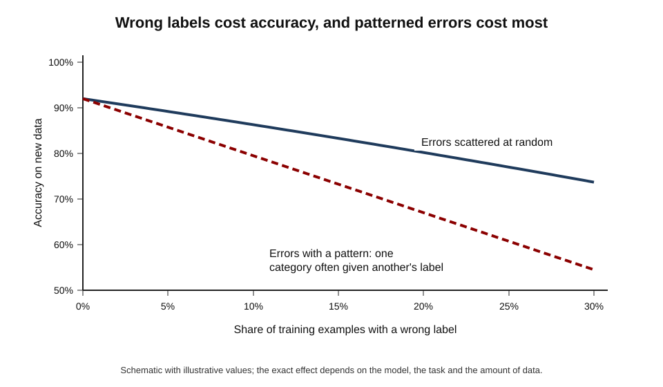
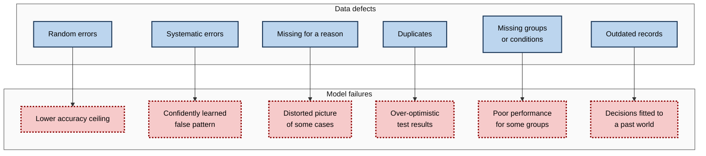
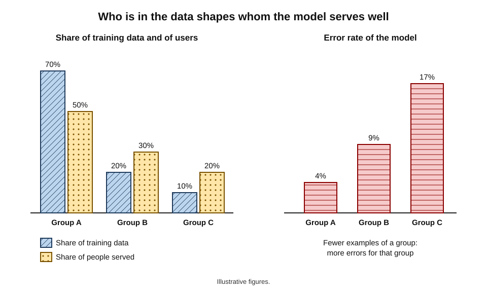
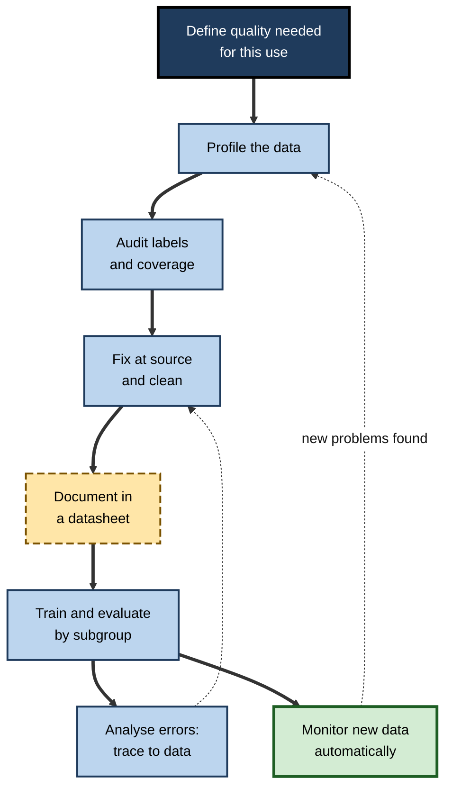

# D.10. Data quality and its impact on AI accuracy

A satellite navigation system with a ten-year-old map will confidently direct a driver into a road that no longer exists. A recipe with one measurement misprinted — a tablespoon of salt instead of a teaspoon — ruins the dish however skilled the cook. AI systems are the same: the model may be excellent, but it can only be as accurate as the data it learned from. Errors, gaps and distortions in the data become errors, gaps and distortions in every prediction, delivered at scale and with confidence.

> **Definition — Data quality:** the degree to which data is fit for a particular purpose — accurate, complete, consistent, timely, representative and correctly labelled for the task it will be used for.

> **Definition — Garbage in, garbage out:** the principle, dating from the early days of computing, that flawed input produces flawed output however good the processing.

**Why it matters**

- **Data quality often limits accuracy more than the model does.** Improving the data frequently gains more than changing the algorithm.
- **AI amplifies data problems.** A rule-based system fails where its rules fail; a learned system absorbs every quirk of its data and reproduces it across millions of decisions.
- **The damage is often invisible.** A model trained on flawed data can pass its tests — which share the same flaws — and fail only in use.
- **It is where fairness problems often begin.** Groups that are missing or misrecorded in data are served worse by the model.
- **Everyone who handles data affects it.** Form designers, clerks, engineers and managers all shape the quality of what AI will learn from.

---

## What Data Quality Means

### Fitness for purpose

- **Quality is relative to use.** Postcodes accurate to the district are fine for regional sales forecasts and useless for delivery routing.
- **The same dataset can be good for one model and bad for another.**
- **Researchers' view** — Richard Wang and Diane Strong's 1996 study of data consumers argued that quality has many dimensions beyond accuracy, as judged by those who use the data.

### Dimensions of quality

- **Accuracy** — values match reality.
  - *e.g.* the recorded income is the customer's actual income.
- **Completeness** — required values are present.
  - *e.g.* no blank diagnosis fields.
- **Consistency** — the same thing is recorded the same way across records and systems.
  - *e.g.* "UK", "U.K." and "United Kingdom" not mixed; the same unit everywhere.
- **Validity** — values follow the expected format and range.
  - *e.g.* no ages of 212; no dates of 31 February.
- **Uniqueness** — each real entity appears once.
  - *e.g.* the same customer not stored under three slightly different names.
- **Timeliness** — data is current enough for the use.
  - *e.g.* stock levels updated hourly, not monthly, for a replenishment model.
- **Representativeness** — the data covers the populations and conditions the model will meet, in suitable proportions.
- **Label correctness** — the answers attached to examples are right.
- **Provenance** — it is known where data came from and how it was changed.

> **Mnemonic — "A Careful Clerk Validates Unusual Transactions, Reporting Late Payments":** Accuracy, Completeness, Consistency, Validity, Uniqueness, Timeliness, Representativeness, Label correctness, Provenance.

| Dimension | Question to ask | Typical defect | Effect on a model |
|---|---|---|---|
| Accuracy | Is it true? | Typing errors, faulty sensors | Learns false relationships |
| Completeness | Is it all there? | Missing values, missing records | Biased learning if gaps are not random |
| Consistency | Is it recorded the same way? | Mixed units, codes or formats | Treats the same thing as different |
| Uniqueness | Does each entity appear once? | Duplicates | Over-weights some cases; leaks into test data |
| Timeliness | Is it current? | Outdated records | Learns yesterday's world |
| Representativeness | Does it cover who and what matters? | Missing groups, settings or seasons | Poor performance for those groups |
| Label correctness | Are the answers right? | Mislabelled examples | Learns the mistakes; distorted evaluation |

---

## How Poor Data Damages a Model

### Random errors blur the signal

- **What they are** — mistakes scattered without pattern: occasional typos, sensor glitches, careless labels.
- **Effect** — the model has to see through extra noise; it needs more data to reach the same accuracy, and its accuracy ceiling falls.
- **Partial resilience** — with large datasets, many learning methods tolerate a modest rate of random errors.

### Systematic errors teach the wrong pattern

- **What they are** — errors that follow a pattern.
  - *e.g.* one hospital records weight in pounds and the others in kilograms; one annotator labels every ambiguous case "negative"; a sensor reads 2 °C too high after a firmware update.
- **Effect** — the model learns the pattern as if it were true.
- **Why worse** — more data does not wash systematic errors out; it reinforces them.

**Figure 1.** How wrong labels reduce accuracy, and why patterned errors are worst.

### Missing data is rarely random

- **Missing completely at random** — gaps unrelated to anything; the least harmful.
- **Missing for a reason** — gaps related to the outcome or to a group.
  - *e.g.* income left blank more often by self-employed applicants; symptoms recorded less often for patients seen in a rush.
- **Effect** — the model learns from a distorted picture; "missing" itself may become a misleading signal.
- **Common mistakes**
  - **Dropping incomplete records** — discards whole groups.
  - **Filling gaps with averages** — hides real differences and can create false patterns.

> **Definition — Missing not at random:** a situation in which whether a value is missing depends on the value itself or on characteristics related to the outcome, so that ignoring or crudely filling the gaps biases learning.

### Duplicates and default values

- **Duplicates** — inflate the importance of some cases and, if they fall into both training and test sets, make the model look better than it is.
- **Default and placeholder values** — "01/01/1900" for unknown birth dates; "999" for missing measurements; "Other" as the first item in a drop-down.
  - The model treats them as real values.
  - *e.g.* a model may learn that people born in 1900 behave in distinctive ways.

**Figure 2.** How different data defects turn into different model failures.

---

## Representativeness

A dataset can be accurate record by record and still be badly wrong as a whole, because of **who and what it contains**.

- **Under-representation** — too few examples of some groups, places, conditions or times.
  - *e.g.* a voice assistant trained mostly on some accents; a crop-disease model trained on images from one region's farms.
- **Over-representation** — some groups dominate, so the model optimises for them.
- **Missing conditions** — night-time images, winter roads, holiday trading, rare machine states.
- **Historical skew** — data reflecting past decisions that themselves excluded or disadvantaged groups.

**Figure 3.** Groups under-represented in training data tend to receive higher error rates.

- **A widely cited demonstration** — the 2018 "Gender Shades" study by Joy Buolamwini and Timnit Gebru at MIT found that commercial face-analysis systems classifying gender made errors of up to about 35% for darker-skinned women, compared with under 1% for lighter-skinned men; the systems had been trained and benchmarked on collections dominated by lighter-skinned faces.

> **Key point:** average accuracy can hide failure. A model that is 95% accurate overall may be 99% accurate for the majority and 70% for a minority — and the average will look excellent.

> **In practice:** report performance **separately for each important group, site and condition**, not only overall. Gaps in subgroup results are often the first visible sign of a representativeness problem in the data.

---

## The Evidence on Data Quality

**Study card — Northcutt, Athalye and Mueller (2021), MIT, presented at NeurIPS**

- **Question:** how many labels are wrong in the standard test sets used to compare AI models?
- **Method:** an algorithm flagged likely errors in ten widely used test sets (images, text, audio); human reviewers checked the flagged items.
- **Findings:**
  - an average of about **3.3%** of test labels across the ten datasets were wrong;
  - about **6%** of the ImageNet validation set — almost 3,000 images — had wrong labels;
  - with corrected labels, the **ranking** of some models changed — in some cases simpler models outperformed more complex ones that had apparently fitted the original noisy labels.
- **Conclusion:** even the most scrutinised datasets in AI contain meaningful label errors, and those errors can change which model appears best.

**Study card — Sambasivan and colleagues (2021), Google Research, presented at the CHI conference**

- **Title:** "Everyone wants to do the model work, not the data work".
- **Method:** interviews with 53 AI practitioners in India, East and West Africa and the United States, working on high-stakes applications such as health, conservation and finance.
- **Key concept:** **data cascades** — compounding problems that start with data issues and surface later as costly failures.
- **Findings:**
  - about **92%** of practitioners had experienced at least one data cascade;
  - cascades were triggered by poor data collection practices, conflicts with domain experts, physical-world changes such as weather or equipment, and inadequate documentation;
  - data work was undervalued compared with model work, poorly rewarded and often done last.
- **Conclusion:** data quality problems are less a technical failing than an **organisational** one — a matter of incentives, roles and practices.

> **Definition — Data cascade:** a chain of problems that begins with an upstream data issue and causes compounding, often delayed, failures in a model and its use.

**Figure 4.** How a data cascade starts upstream and surfaces as a costly failure in use.

```mermaid
%%{init: {'theme':'base','themeVariables':{'fontFamily':'Arial, Helvetica, sans-serif','fontSize':'15px','primaryColor':'#FFFFFF','primaryTextColor':'#111111','primaryBorderColor':'#222222','lineColor':'#333333','secondaryColor':'#F2F2F2','tertiaryColor':'#FFFFFF','clusterBkg':'#FAFAFA','clusterBorder':'#555555','edgeLabelBackground':'#FFFFFF','titleColor':'#111111'}}}%%
flowchart TD
    classDef core    fill:#1F3B5C,stroke:#000000,stroke-width:3px,color:#FFFFFF
    classDef key     fill:#BCD5EE,stroke:#1F3B5C,stroke-width:2px,color:#000000
    classDef detail  fill:#FFFFFF,stroke:#333333,stroke-width:1.5px,color:#000000
    classDef caution fill:#F6CACA,stroke:#8B0000,stroke-width:2.5px,stroke-dasharray:3 3,color:#000000

    subgraph TRG["Triggers"]
        T1["Poor data<br/>collection practices"]
        T2["Conflicts with<br/>domain experts"]
        T3["Physical-world changes:<br/>weather, equipment"]
        T4["Inadequate<br/>documentation"]
    end
    U["Upstream data issue"]
    H["Unnoticed during<br/>model building"]
    S["Model passes tests<br/>sharing the same flaw"]
    F["Failure surfaces in use"]
    R["Costly rework:<br/>recollect data, retrain"]

    T1 --> U
    T2 --> U
    T3 --> U
    T4 --> U
    U ==> H ==> S ==> F ==> R
    R -. "late discovery<br/>multiplies the cost" .-> U

    class T1,T2,T3,T4 detail
    class U core
    class H,S key
    class F,R caution
```

### Case study: COVID-19 detection from chest images

- **Situation:** in 2020 hundreds of research groups rapidly built machine-learning models to diagnose COVID-19 or predict its course from chest X-rays and CT scans.
- **Review:** Michael Roberts and colleagues at the University of Cambridge, publishing in *Nature Machine Intelligence* in March 2021, systematically reviewed the published models.
- **Finding:** of **62** models that passed their initial quality screening, they judged **none** to be of potential clinical use.
- **Data problems identified:**
  - **"Frankenstein" datasets** — public collections assembled from other collections, so the same images appeared more than once, sometimes in both training and test data;
  - **mismatched comparison groups** — in some studies, images of healthy or non-COVID patients came from different sources from the COVID images, so models could learn the source rather than the disease;
  - one widely used non-COVID set consisted of chest images of **children**, so a model could learn to tell children from adults;
  - **small samples** and poorly documented origins.
- **Lesson:** under time pressure, models were built on data whose quality and provenance were not checked. The models measured what the datasets contained — not what doctors needed.

---

## Measuring and Improving Data Quality

### Profiling: looking before learning

- **Summaries** — counts, ranges, averages, distributions of every field.
- **Missing values** — how many, where, and for whom.
- **Unusual values** — impossible ages, negative quantities, default dates.
- **Duplicates** — exact and near-duplicate records.
- **Consistency checks** — codes, units, spellings across sources.
- **Label audits** — expert review of a random sample of labels.
- **Coverage checks** — counts per group, site, season and condition.

> **Formula — Completeness and duplicate rates (illustrative figures):** completeness = records with the field present ÷ all records. If 47,500 of 50,000 records have an income value, completeness = **95%**. Duplicate rate = duplicate records ÷ all records; 1,200 duplicates in 50,000 = **2.4%**.

**Worked example (illustrative): profiling a loan dataset before training**

| Check | Finding | Interpretation | Action |
|---|---|---|---|
| Missing income | 5% overall, 22% among self-employed | Missing for a reason | Add a "self-employed" flag; collect income differently; do not drop these records |
| Birth dates | 3,100 records dated 01/01/1900 | Placeholder for unknown | Treat as missing, not as real |
| Currency field | Two branches record in thousands | Systematic unit error | Convert to one unit |
| Duplicate applicants | 2.4% appear twice under name variants | Uniqueness problem | Merge; keep each applicant in one data split |
| Region coverage | Northern region has 300 records of 50,000 | Under-represented | Collect more or restrict use; report its results separately |
| Label audit | 4% of "defaulted" labels were restructured loans later repaid | Label definition unclear | Rewrite label definition; relabel |

*Illustrative figures.*

### Improving data

- **Fix at the source** — better forms, validation at entry, sensor calibration, clear definitions.
- **Clean systematically** — standardise formats and units; resolve duplicates; treat placeholders as missing.
- **Handle missing data thoughtfully** — understand why values are missing; use methods suited to the reason; flag missingness explicitly.
- **Review labels** — expert audits; agreement checks; algorithms that flag likely label errors for human review.
- **Fill coverage gaps** — collect data for under-represented groups and conditions.
- **Monitor continuously** — automatic checks on every new batch of data before it reaches a model.

### Documentation

- **Datasheets for datasets** — Timnit Gebru and colleagues proposed in 2018 that every dataset come with a document describing its motivation, composition, collection process, preprocessing, intended uses, distribution and maintenance — like the datasheets that accompany electronic components.
- **Why it matters** — users of the data can judge fitness for purpose; problems can be traced; limitations are known before a model is built.

> **Definition — Datasheet for a dataset:** a structured document recording why a dataset was created, what it contains, how it was collected and processed, what it should and should not be used for, and how it is maintained.

**Figure 5.** A continuous cycle for keeping data fit for an AI system.

### Where label errors come from

- **Ambiguous guidelines** — annotators interpret unclear instructions differently.
- **Genuinely ambiguous cases** — some examples could reasonably carry more than one label.
- **Fatigue and speed** — crowd workers paid per item, or experts labelling at the end of a long shift, make more mistakes.
- **Automatic labels** — labels taken from search results, file names, billing codes or another model carry those sources' errors.
- **Changing definitions** — a category redefined halfway through a project leaves old and new labels mixed.
- **Class confusion** — similar categories ("refund" and "billing"; "wolf" and "husky") are confused systematically, producing the patterned errors that do most damage.

> **Remember:** label errors are rarely random. They cluster in **hard cases, similar categories and periods of change** — exactly where a model most needs good examples.

### Quality at the scale of the web

Large language and image models learn from billions of documents and images gathered from the internet, where record-by-record checking is impossible. Quality is managed statistically instead.

- **Filtering** — removing pages that are spam, machine-generated, malformed or in unwanted languages, often using simple quality classifiers.
- **Deduplication** — removing repeated and near-repeated documents.
  - A 2021 study by Katherine Lee and colleagues at Google found that common training collections contained many duplicated passages, and that deduplicating them made language models less prone to reproducing memorised text and needed fewer training steps for the same quality.
- **Removing harmful content** — filtering toxic material and personal information, with the risk of also removing legitimate text about sensitive subjects or from particular communities.
- **Balancing sources** — weighting encyclopaedias, books, code and conversation so that no single source dominates.
- **Decontamination** — removing benchmark test questions from training data so that evaluations remain honest.

> **Watch out:** automatic filters make their own errors. Filters trained to recognise "high-quality" text have been found to remove disproportionate amounts of dialect and minority-community writing, so quality filtering can quietly reduce representativeness.

---

## Data-Centric AI

> **Definition — Data-centric AI:** an approach that improves AI systems mainly by systematically improving the data — its labels, coverage and consistency — while keeping the model largely fixed.

- **The idea** — popularised by Andrew Ng from 2021, who argued that for many practical applications, model architectures had become mature and the main gains now lay in better data.
- **Typical moves**
  - make label definitions consistent;
  - fix or remove mislabelled examples;
  - add examples where the model fails;
  - remove irrelevant or misleading examples.
- **The contrast** — "model-centric" work holds the data fixed and searches for a better model.

| | Model-centric approach | Data-centric approach |
|---|---|---|
| What is changed | The algorithm, architecture and settings | The labels, coverage and consistency of data |
| What is held fixed | The dataset | The model |
| Typical question | "Which model scores higher on this data?" | "What in this data is causing the errors?" |
| Strength | Exploits advances in methods | Fixes problems no model can see past |
| Typical weakness | Optimises to flawed data | Needs domain experts' time |

> **Watch out:** "data-centric" and "model-centric" are emphases, not rival schools. Strong teams do both — but the data side is the one most often neglected.

### Worked example (illustrative): two ways to spend a month

A team's model for classifying insurance claim photographs is 82% accurate. It has one month.

| | Option A: better model | Option B: better data |
|---|---|---|
| Work done | Try five newer architectures; tune settings | Rewrite label guidelines for two confused categories; relabel 4,000 images; add 1,500 night-time photographs |
| Accuracy after one month | 84% | 89% |
| Effect on the weakest category | 61% → 63% | 61% → 81% |

*Illustrative figures.*

- **Why B wins here** — error analysis had shown that most mistakes came from inconsistent labels and missing night-time images; no model could learn what the data did not show consistently.
- **When A might win** — if labels are clean and coverage good, and the current model is clearly too simple.

---

## Data Quality in Professional Practice

### Case study (illustrative): the readmission model that learned the paperwork

- **Situation:** a hospital group built a model to predict which patients would be readmitted within 30 days, so that nurses could arrange extra follow-up.
- **Development result:** good accuracy on held-back data from the same hospitals.
- **Problem in use:** at one hospital, the model flagged far fewer high-risk patients than clinicians expected.
- **Diagnosis:**
  1. that hospital had changed its discharge software 18 months earlier; several diagnosis fields were now recorded as free text rather than codes, so they appeared "missing" to the model;
  2. the model had learned that missing diagnosis codes indicated **lower** risk — because in the older data, missing codes mostly belonged to brief, routine admissions;
  3. readmissions to **other** hospitals were not recorded at all, so some patients labelled "not readmitted" had in fact been readmitted elsewhere.
- **Actions:**
  - mapped free-text diagnoses back to codes; added explicit "recorded as free text" flags;
  - linked readmission data across the regional health network to correct labels;
  - added automatic checks for sudden changes in the share of missing values per hospital.
- **Result:** flagged patients at the affected hospital rose to expected levels; label corrections also improved accuracy across the group. *Illustrative figures.*
- **Lesson:** a change in **how data is recorded** can silently change what a model "sees". Monitoring data quality is as necessary as monitoring model accuracy.

### Who owns data quality?

- **Data producers** — the people and systems that create records: form design, entry checks, sensor maintenance.
- **Data stewards** — those responsible for definitions, standards and documentation.
- **AI teams** — profiling, auditing, cleaning and monitoring data used by models.
- **Domain experts** — judging whether labels and values make sense.
- **Leadership** — valuing and resourcing data work, which is often invisible and unrewarded.

### Questions to ask about any AI system

- **How was data quality checked before training, and by whom?**
- **What share of values were missing, and why?**
- **How were labels checked, and what was the measured error rate?**
- **Which groups, sites and conditions are thinly represented?**
- **Is there a datasheet or equivalent documentation?**
- **How is the quality of new incoming data monitored?**

> **In practice:** before approving an AI project, ask to see the **data profile**: a summary of missing values, unusual values, duplicates, coverage by group and the results of a label audit. A team that cannot produce one has not yet looked closely at its data.

---

## Open Questions

- **How can label errors be found reliably at scale?**
  - Algorithms can flag suspects, but confirmation needs human review, which is costly in specialist fields.
- **How much data quality is "enough"?**
  - The effect of a given error rate depends on the model, the task and the kind of error; general thresholds do not exist.
- **How should data work be valued?**
  - Studies show it is undervalued in organisations and research; how to reward it is an open organisational question.
- **Can representativeness be achieved without intrusive data collection?**
  - Checking coverage by group often requires recording sensitive characteristics, which raises privacy concerns.

---

## Summary

- **Data quality** is fitness for purpose; **garbage in, garbage out** applies with extra force to AI, which absorbs and amplifies data problems.
- Dimensions: **accuracy, completeness, consistency, validity, uniqueness, timeliness, representativeness, label correctness, provenance**.
- **Random errors** blur the signal; **systematic errors** teach false patterns and are not washed out by more data; **missing data** is rarely random; **duplicates** and **placeholder values** mislead models and tests.
- **Representativeness** decides whom a model serves well; average accuracy can hide subgroup failure, as "Gender Shades" (2018) showed.
- Evidence: about **3.3%** of labels in ten benchmark test sets were wrong, enough to change model rankings (Northcutt and colleagues, 2021); **92%** of practitioners interviewed had experienced **data cascades** (Sambasivan and colleagues, 2021); of 62 COVID-19 imaging models, none was judged clinically useful, largely because of data problems (Roberts and colleagues, 2021).
- Label errors cluster in hard cases, similar categories and periods of change; at web scale, quality is managed by **filtering, deduplication, harmful-content removal, source balancing and decontamination** — filters themselves can reduce representativeness.
- Improve quality by **profiling**, **auditing labels and coverage**, **fixing at source**, **cleaning**, **documenting with datasheets** and **monitoring** new data.
- **Data-centric AI** improves data while holding the model fixed; it often beats model changes when errors trace to data.
- Data quality is an **organisational** responsibility shared by producers, stewards, AI teams, experts and leaders.

---

## Self-Check

1. Define data quality and explain why it is "fitness for purpose".
2. List the nine dimensions of data quality and give an example defect for three of them.
3. Why are systematic errors more harmful than random errors, and why does more data not fix them?
4. Explain why missing data is rarely random, with an example, and why dropping incomplete records can be harmful.
5. A dataset records unknown birth dates as 01/01/1900. What can go wrong, and what should be done?
6. Why can a model with 95% average accuracy still be unacceptable? What should be reported instead?
7. Summarise the Northcutt and colleagues (2021) findings and why they matter for choosing models.
8. What is a data cascade? What triggered cascades in the Sambasivan and colleagues (2021) study?
9. Describe two data problems identified in the review of COVID-19 imaging models.
10. Of 80,000 records, 72,000 have a value for "employment status" and 1,600 are duplicates. Calculate completeness and the duplicate rate.
11. What is a datasheet for a dataset, and what should it contain?
12. Compare model-centric and data-centric approaches. When would each be preferred?
13. In the readmission case, why did the model treat missing codes as a sign of low risk, and how was the problem detected and fixed?
14. A manager proposes buying a more advanced model because accuracy has plateaued at 80%. What should be examined first?

### Answer Key

1. The degree to which data suits a particular use — accurate, complete, consistent, timely, representative and correctly labelled for that task. The same data can be adequate for one use and inadequate for another.
2. Accuracy, completeness, consistency, validity, uniqueness, timeliness, representativeness, label correctness, provenance. Examples: completeness — blank fields; uniqueness — duplicate customers; timeliness — monthly stock data used for hourly decisions.
3. Systematic errors follow a pattern the model learns as if true; adding more data with the same pattern reinforces it, whereas random errors partly average out.
4. Values are often missing for reasons linked to groups or outcomes (e.g. income blank more often for self-employed applicants). Dropping such records removes whole groups and distorts what the model learns.
5. The model treats the placeholder as a real date and may learn false patterns about "people born in 1900". Treat it as missing and flag it.
6. The average can conceal much worse performance for minority groups, sites or conditions. Report performance for each important subgroup.
7. About 3.3% of labels in ten benchmark test sets were wrong (about 6% of ImageNet validation), and correcting them changed model rankings — so "best model" claims can reflect fitting noisy labels.
8. A compounding chain of failures starting from upstream data issues. Triggers included poor data collection, conflicts with domain experts, physical-world changes and inadequate documentation.
9. "Frankenstein" datasets with duplicated images across training and test sets; comparison groups from different sources (including children's images), so models learned the source or age rather than disease.
10. Completeness = 72,000 ÷ 80,000 = 90%. Duplicate rate = 1,600 ÷ 80,000 = 2%.
11. A structured record of a dataset's motivation, composition, collection, preprocessing, intended and unsuitable uses, distribution and maintenance.
12. Model-centric changes the model with data fixed; data-centric improves labels, coverage and consistency with the model fixed. Data-centric when error analysis traces mistakes to data; model-centric when data is clean and the model clearly too limited.
13. In older data, missing codes mainly belonged to routine admissions, so "missing" predicted low risk; after a software change, serious cases also appeared missing. It was detected when flags at one hospital fell below clinicians' expectations, and fixed by mapping free text to codes, adding flags, correcting labels across hospitals and monitoring missing-value rates.
14. Error analysis: which cases are wrong and why; label consistency and audit results; coverage of weak categories and conditions; missing and placeholder values; recent changes in data recording. Only if these are sound should a new model be the priority.

---

## Glossary

| Term | Meaning |
|---|---|
| Completeness | The share of required values that are present. |
| Consistency | Recording the same thing in the same way across records and systems. |
| Data cascade | A compounding chain of failures that starts with an upstream data issue. |
| Data-centric AI | Improving AI mainly by improving data while holding the model fixed. |
| Deduplication | Removing repeated or near-repeated records or documents. |
| Data profiling | Summarising and checking every field of a dataset before use. |
| Data quality | Fitness of data for a particular purpose. |
| Datasheet for a dataset | A structured document describing a dataset's origin, contents and proper uses. |
| Duplicate | A record repeating an entity already present. |
| Garbage in, garbage out | The principle that flawed input yields flawed output. |
| Label error | An example whose attached answer is wrong. |
| Missing not at random | Missingness related to the value itself or to the outcome. |
| Placeholder value | A stand-in value, such as 01/01/1900, used when the real value is unknown. |
| Provenance | The recorded origin and processing history of data. |
| Representativeness | How well data covers the populations and conditions a model will meet. |
| Systematic error | An error that follows a consistent pattern. |
| Timeliness | Whether data is current enough for its use. |
| Validity | Whether values follow the expected format and range. |
