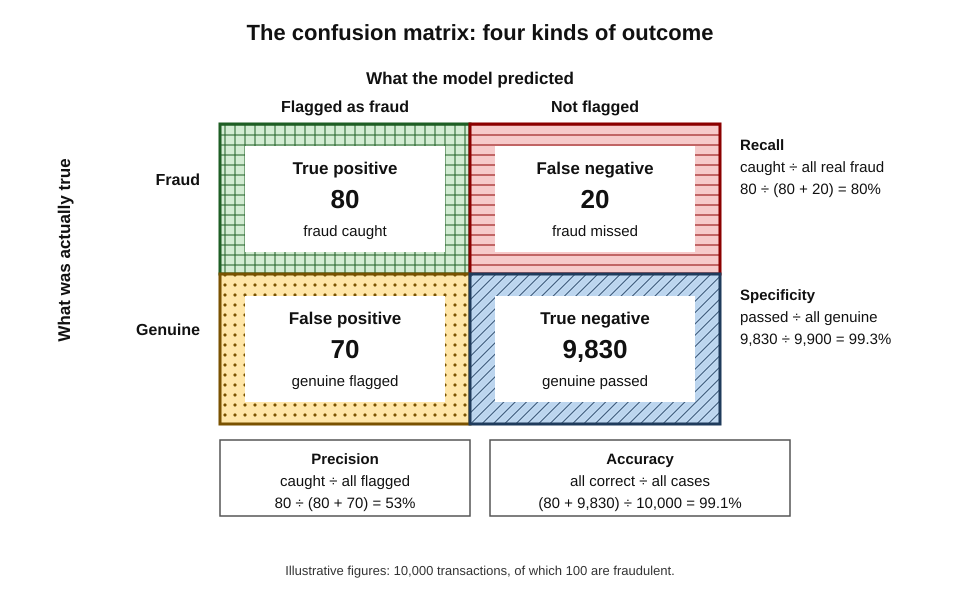
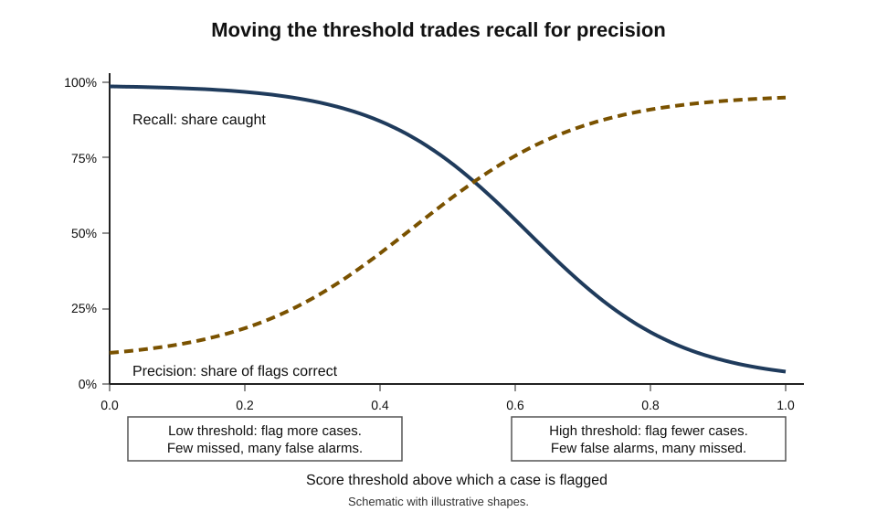
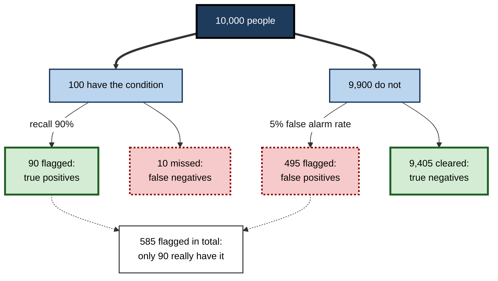
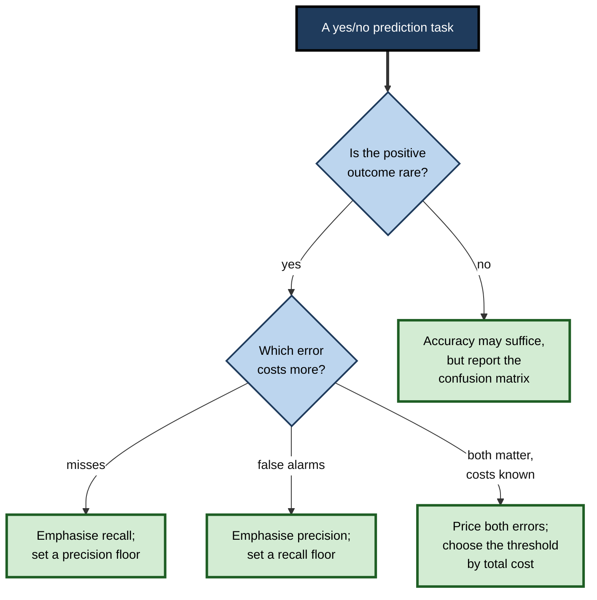
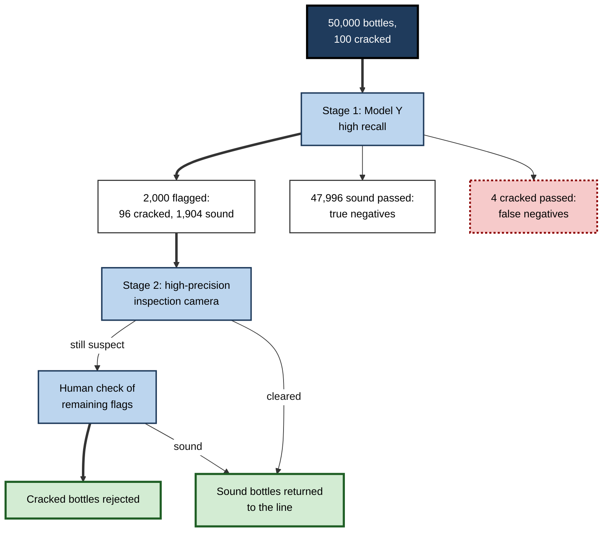

# D.11. Model evaluation metrics: accuracy, precision, recall

Imagine a test for a rare disease that affects one person in a hundred. A "test" that simply declares everyone healthy is right 99 times out of 100 — **99% accurate** — and completely useless, because it never finds a single patient. The same trap waits in every AI system that looks for rare things: fraud, defects, security attacks, cancers, fake reviews. Whether a model is good depends on **which mistakes it makes**, how often, and what each mistake costs — and that requires more than one number.

> **Definition — Evaluation metric:** a number that summarises how well a model's outputs match the correct answers on a set of test examples, from a particular point of view.

**Why it matters**

- **Metrics decide which model is chosen.** The wrong metric can rank a useless model above a valuable one.
- **Metrics hide trade-offs.** Catching more fraud means more false alarms; fewer false alarms means more missed fraud. A single figure conceals the choice.
- **Metrics depend on context.** The same model can look excellent or poor depending on how common the outcome is.
- **Claims are made in metrics.** Vendors, researchers and journalists report "95% accuracy"; understanding what that does and does not mean is basic AI literacy.
- **The choice is not technical alone.** Deciding which errors matter more is a business, ethical and sometimes legal judgement.

---

## Why One Number Is Not Enough

### The accuracy paradox

> **Definition — Accuracy:** the share of all predictions that are correct.

**Worked example (illustrative): the model that never finds fraud**

A card issuer processes 10,000 transactions, of which **100 are fraudulent** (1%).

| | Model A: flags nothing | Model B: a real fraud model |
|---|---|---|
| Fraud caught | 0 of 100 | 80 of 100 |
| Genuine payments wrongly flagged | 0 | 70 |
| Correct predictions | 9,900 | 9,910 |
| Accuracy | **99.0%** | **99.1%** |

*Illustrative figures.*

1. **Accuracy barely separates them** — 99.0% versus 99.1%.
2. **Yet Model A is worthless** — it catches no fraud at all.
3. **Model B catches 80%** of fraud, at the cost of 70 false alarms.
4. **The lesson** — when the outcome of interest is rare, accuracy is dominated by the easy majority and says almost nothing about what matters.

> **Definition — Class imbalance:** a situation in which one outcome is far more common than another in the data — for example 99 genuine transactions for every fraudulent one.

> **Watch out:** "our model is 99% accurate" is meaningless without the **base rate**. If 99% of cases are negative, a model that always says "negative" achieves the same score.

---

## The Confusion Matrix

Every prediction of a yes/no question falls into one of four boxes.

- **True positive (TP)** — predicted yes, actually yes. *Fraud caught.*
- **False positive (FP)** — predicted yes, actually no. *A genuine payment wrongly blocked.* Also called a **false alarm** or **Type I error**.
- **False negative (FN)** — predicted no, actually yes. *Fraud missed.* Also called a **miss** or **Type II error**.
- **True negative (TN)** — predicted no, actually no. *A genuine payment correctly allowed.*

> **Definition — Confusion matrix:** a table counting a model's true positives, false positives, false negatives and true negatives on a test set — the raw material from which most classification metrics are calculated.

**Figure 1.** A confusion matrix for a fraud model, with the main metrics calculated from it.

> **Mnemonic — "Positive or Negative is the guess; True or False is the verdict":** the second word says what the model predicted; the first says whether it was right.

---

## The Core Metrics

### Precision: when the model says yes, how often is it right?

> **Definition — Precision (positive predictive value):** of all cases the model flagged as positive, the share that really were positive.

> **Formula — Precision:** TP ÷ (TP + FP). Example: 80 ÷ (80 + 70) = **53%** — just over half of the flagged payments were really fraud.

- **Matters most when false alarms are costly.**
  - *e.g.* a spam filter: a genuine email lost in the junk folder may be a job offer.
  - *e.g.* automated content removal: wrongly deleting legitimate posts harms users and trust.

### Recall: of the real positives, how many were found?

> **Definition — Recall (sensitivity, true positive rate):** of all cases that really were positive, the share the model correctly flagged.

> **Formula — Recall:** TP ÷ (TP + FN). Example: 80 ÷ (80 + 20) = **80%** — four in five frauds were caught.

- **Matters most when misses are costly.**
  - *e.g.* cancer screening: a missed tumour can be fatal.
  - *e.g.* safety inspections: an undetected structural crack can cause a disaster.

> **Mnemonic — "Precision is about the Pile; Recall is about the Real":** precision judges the pile of flagged cases; recall judges how much of the real positives was found.

### Specificity: of the real negatives, how many were cleared?

> **Definition — Specificity (true negative rate):** of all cases that really were negative, the share the model correctly left unflagged.

> **Formula — Specificity:** TN ÷ (TN + FP). Example: 9,830 ÷ (9,830 + 70) = **99.3%**.

- **Common in medicine** — sensitivity and specificity are the standard pair for describing diagnostic tests.

### The F1 score: a balance of precision and recall

> **Definition — F1 score:** the harmonic mean of precision and recall — a single number that is high only when both are high.

> **Formula — F1:** 2 × precision × recall ÷ (precision + recall). Example: 2 × 0.53 × 0.80 ÷ (0.53 + 0.80) ≈ **0.64**.

- **Why the harmonic mean** — it punishes imbalance: precision 1.0 with recall 0.1 gives F1 ≈ 0.18, not the 0.55 an ordinary average would suggest.
- **Variants** — the **F-beta** score weights recall more heavily (beta above 1) or precision more heavily (beta below 1).

| Metric | Question it answers | Formula | Matters most when |
|---|---|---|---|
| Accuracy | How often is the model right overall? | (TP + TN) ÷ all | Classes are balanced and errors cost about the same |
| Precision | When it says yes, is it right? | TP ÷ (TP + FP) | False alarms are costly |
| Recall | Does it find the real positives? | TP ÷ (TP + FN) | Misses are costly |
| Specificity | Does it clear the real negatives? | TN ÷ (TN + FP) | Wrongly flagging negatives is costly |
| F1 | Are precision and recall both good? | 2PR ÷ (P + R) | A single balanced summary is needed for a rare class |

> **Key point:** precision and recall look at the **positive** class from two directions — the flagged pile and the real positives. A model can be strong on one and weak on the other; reporting both is the minimum for any task with a rare outcome.

---

## The Threshold Trade-off

### From score to decision

- **Most classifiers output a score**, often between 0 and 1.
- **A threshold turns the score into a decision** — flag if the score is above, say, 0.5.
- **Moving the threshold changes every metric**:
  - **lower threshold** → more cases flagged → recall rises, precision falls;
  - **higher threshold** → fewer cases flagged → precision rises, recall falls.

**Figure 2.** Precision and recall as the decision threshold changes.

**Worked example (illustrative): choosing a threshold for the fraud model**

The same 10,000 transactions (100 fraudulent). A missed fraud costs on average 500; a false alarm — customer inconvenience and staff review — costs on average 10.

| Threshold | Flagged | Fraud caught | Precision | Recall | Cost of misses | Cost of false alarms | Total cost |
|---|---|---|---|---|---|---|---|
| 0.3 | 600 | 95 | 16% | 95% | 2,500 | 5,050 | **7,550** |
| 0.5 | 150 | 80 | 53% | 80% | 10,000 | 700 | 10,700 |
| 0.7 | 70 | 60 | 86% | 60% | 20,000 | 100 | 20,100 |
| 0.9 | 30 | 28 | 93% | 28% | 36,000 | 20 | 36,020 |

*Illustrative figures, in a single currency unit.*

1. **Count the errors at each threshold** — misses = 100 − caught; false alarms = flagged − caught.
2. **Price them** — misses × 500; false alarms × 10.
3. **Choose the lowest total** — here a **low threshold (0.3)**, despite its poor precision, because misses are 50 times more expensive than false alarms.
4. **Check capacity** — 600 flags a day must be reviewable by the fraud team; if not, the threshold is constrained by staffing.
5. **Reconsider if costs change** — if false alarms drove customers away, a higher threshold might win.

> **Remember:** the "best" threshold is not a property of the model. It depends on the **costs of each kind of error** and on the **capacity** to act on the flags.

### Summarising across all thresholds

- **Precision–recall curve** — plots precision against recall as the threshold moves; useful when the positive class is rare.
- **ROC curve** (receiver operating characteristic) — plots recall against the false positive rate (1 − specificity) as the threshold moves.
  - The term comes from radar signal detection during the Second World War.
- **AUC** (area under the ROC curve) — a single number from 0.5 (no better than chance) to 1.0 (perfect ranking).

> **Definition — AUC (area under the ROC curve):** the probability that the model gives a randomly chosen positive case a higher score than a randomly chosen negative case.

> **Watch out:** AUC measures how well a model **ranks** cases, not how good its decisions are at any particular threshold. With very rare positives, a high AUC can coexist with poor precision. For rare-event tasks, inspect the precision–recall curve as well.

---

## Base Rates: Why the Same Model Looks Different in Different Places

### Precision depends on how common the outcome is

**Worked example (illustrative): the same screening model in two settings**

A model has recall 90% and specificity 95%. It is used on 10,000 people in two settings.

| | Setting 1: general population | Setting 2: specialist clinic |
|---|---|---|
| Share with the condition | 1% | 20% |
| People with the condition | 100 | 2,000 |
| Correctly flagged (90% of them) | 90 | 1,800 |
| People without the condition | 9,900 | 8,000 |
| Wrongly flagged (5% of them) | 495 | 400 |
| Total flagged | 585 | 2,200 |
| Precision | 90 ÷ 585 ≈ **15%** | 1,800 ÷ 2,200 ≈ **82%** |

*Illustrative figures.*

- **Identical model, identical recall and specificity** — yet in the general population, more than five in six positive flags are false alarms.
- **The reason** — when a condition is rare, even a small false-positive rate applied to the large healthy majority swamps the true positives.

> **Definition — Base rate:** how common an outcome is in the population being assessed — also called prevalence.

**Figure 3.** The same model applied to 10,000 people when the condition affects 1% of them.

- **Natural frequencies** — the psychologist Gerd Gigerenzer showed that people, including doctors, reason far more accurately about such problems when figures are given as counts of people ("90 of 585") rather than as percentages and conditional probabilities.
- **The base-rate fallacy** — Daniel Kahneman and Amos Tversky's research in the 1970s showed that people tend to ignore base rates when judging probabilities, focusing instead on the test's apparent accuracy.

> **In practice:** when a model moves to a new population — a different country, customer segment or clinic — its **precision will change** even if its recall and specificity do not. Always recompute the expected number of true and false flags for the new base rate.

---

## Choosing the Right Metric

### Start from the cost of each error

| Application | Costlier error | Metric to emphasise | Typical design |
|---|---|---|---|
| Cancer screening | Missed cancer (false negative) | Recall | Low threshold; human follow-up of flags |
| Spam filtering | Lost genuine email (false positive) | Precision | High threshold; junk folder kept reviewable |
| Card fraud | Usually missed fraud, but limited by customer friction | Recall with a precision floor | Threshold set by costs and review capacity |
| Automated content removal | Wrongly removing lawful speech | Precision | Human review before removal of borderline cases |
| Shortlisting job candidates | Wrongly rejecting a good candidate | Recall, checked by group | Model narrows, people decide |

**Figure 4.** Choosing which metric to emphasise.

### Metrics for many categories

- **Per-class precision and recall** — each category is treated in turn as "positive" and all others as "negative".
- **Macro-averaging** — average the per-class figures, giving every category equal weight; rare categories count as much as common ones.
- **Micro-averaging** — pool all predictions first; dominated by the common categories.
- **Top-k accuracy** — counts a prediction as correct if the right answer is among the model's k most likely choices.
  - *e.g.* the ImageNet competition reported **top-5 error**: the share of images whose correct label was not among the model's five guesses.

**Worked example (illustrative): routing complaints into three teams**

| Team | Complaints in test set | Correctly routed | Recall |
|---|---|---|---|
| Billing | 800 | 760 | 95% |
| Technical | 150 | 120 | 80% |
| Legal | 50 | 20 | 40% |
| All | 1,000 | 900 | — |

*Illustrative figures.*

1. **Overall accuracy** — 900 ÷ 1,000 = **90%**, which also equals micro-averaged recall.
2. **Macro-averaged recall** — (95% + 80% + 40%) ÷ 3 ≈ **72%**.
3. **Reading the gap** — the model is good at the common category and poor at the rare one; the legal complaints, possibly the most consequential, are mostly misrouted.

> **Key point:** when the categories differ in size and importance, report **per-class results** and a **macro average**. A high overall figure can hide a category the model almost never gets right.

### Metrics for numbers

- **Mean absolute error (MAE)** — the average size of errors, in the original units.
- **Root mean squared error (RMSE)** — like MAE but punishing large errors more.
- **Mean absolute percentage error (MAPE)** — the average error as a percentage of the true value; misleading when true values are near zero.

> **Formula — Regression metrics (illustrative figures):** true demand 100, 120, 80, 150; forecasts 110, 115, 95, 120. Errors 10, −5, 15, −30. MAE = (10 + 5 + 15 + 30) ÷ 4 = **15**. RMSE = √((100 + 25 + 225 + 900) ÷ 4) = √312.5 ≈ **17.7**. MAPE = (10% + 4.2% + 18.8% + 20%) ÷ 4 ≈ **13.2%**.

### Calibration: do the scores mean what they say?

> **Definition — Calibration:** the agreement between a model's predicted probabilities and actual frequencies — among cases scored 0.8, about 80% should turn out positive.

- **Why it matters** — when scores are used as probabilities (risk of default, chance of rain, likelihood of readmission), a miscalibrated model misleads even if it ranks cases well.
- **How to check** — group cases by predicted score and compare each group's average score with its actual rate.
- **Example** — a weather forecaster is well calibrated if it rains on about 30% of the days for which a 30% chance was forecast.

### Metrics by group

- **Overall metrics can hide group differences** — a model can have high overall recall and much lower recall for one group.
- **Report the confusion matrix and key metrics for each important group.**
- **Different fairness ideas correspond to equalising different metrics across groups** — equal recall, equal precision, equal false positive rates. Research in 2016–2017 (by Jon Kleinberg and colleagues, and by Alexandra Chouldechova) showed that when base rates differ between groups, several of these cannot all be satisfied at once, so a choice must be made.

---

## A Real Case of Metrics Revealing the Truth

### Case study: an external check of a widely used sepsis alert

- **Situation:** sepsis — a life-threatening response to infection — is a leading cause of hospital deaths, and early treatment saves lives. A proprietary sepsis prediction model supplied with a major electronic health-record system was in use at hundreds of US hospitals.
- **Study:** Andrew Wong and colleagues at the University of Michigan, publishing in *JAMA Internal Medicine* in 2021, evaluated the model on about 38,000 hospitalisations at their own institution.
- **Findings:**
  - the AUC was about **0.63**, substantially lower than the performance reported by the developer;
  - at the alert threshold in use, the model **missed about two-thirds** of patients who developed sepsis — low recall;
  - it generated alerts for about **18% of all hospitalised patients**, and only around one alert in eight concerned a patient with sepsis — low precision;
  - many of the cases it did catch had already been recognised and treated by clinicians.
- **Implications:**
  - low precision creates **alert fatigue** — clinicians learn to ignore frequent false alarms;
  - low recall gives false reassurance;
  - developer-reported metrics had not transferred to this hospital's population and practices.
- **Lesson:** a single headline metric reported by a vendor is not enough. **Independent, local evaluation** reporting recall, precision and the volume of alerts at the actual threshold is essential before relying on a model.

### Case study (illustrative): choosing a defect detector for a factory line

- **Situation:** a manufacturer compared two vision models for detecting cracked bottles; about 2 bottles in 1,000 are cracked.
- **Vendor claims:** Model X "99.8% accurate"; Model Y "96% accurate".
- **Independent test on 50,000 bottles (100 cracked):**
  - Model X: flagged 20 bottles, 15 cracked — precision 75%, **recall 15%**; accuracy 99.8%.
  - Model Y: flagged 2,000 bottles, 96 cracked — precision about 5%, **recall 96%**; accuracy about 96%.
- **Diagnosis:** Model X's accuracy came almost entirely from the 49,900 sound bottles; it missed 85% of cracks. Model Y caught nearly all cracks but flagged 4% of all bottles.
- **Decision:** cracked bottles reaching customers could cause injury; recall was paramount. The firm adopted Model Y with a **second-stage check** — flagged bottles routed to a slower, high-precision inspection camera and then to a human.
- **Result:** cracks reaching customers fell sharply; the second stage removed most false alarms before they cost production time. *Illustrative figures.*
- **Lesson:** the "less accurate" model was the right choice. **Accuracy rewarded the wrong behaviour** for a rare-defect task; recall, precision and a two-stage design matched the real costs.

**Figure 5.** A two-stage inspection: a high-recall first stage followed by high-precision checks (illustrative).

---

## Metrics in Professional Practice

### Reporting a classifier properly

- **The base rate** in the test data.
- **The confusion matrix** at the threshold that will actually be used.
- **Precision and recall** (or sensitivity and specificity), not accuracy alone.
- **The threshold** and how it was chosen.
- **Results by important subgroup.**
- **The number of test examples**, so uncertainty can be judged.
- **Calibration**, if scores are interpreted as probabilities.

> **Mnemonic — "Brave Teams Prefer Their Scores Nicely Checked":** Base rate, Table (confusion matrix), Precision and recall, Threshold, Subgroups, Number of examples, Calibration.

### Questions to ask when shown a metric

- **What is the base rate?** How does the model compare with always predicting the majority outcome?
- **Precision and recall at which threshold?**
- **How many alerts will this produce per day, and how many will be real?**
- **What does each kind of error cost, and who bears it?**
- **Do the figures hold for our population, and for each group within it?**

> **Watch out:** metrics are also targets, and targets get gamed. A team rewarded for recall alone can flag everything; one rewarded for precision alone can flag almost nothing. Pair every target metric with a floor on its partner.

---

## Open Questions

- **How should errors be priced when the costs are human?**
  - The cost of a missed diagnosis or a wrongful flag is not easily put in money; who should set the trade-off is an ethical and political question.
- **Which fairness metric should apply where?**
  - Because several cannot hold at once when base rates differ, the choice depends on context and values, and remains contested in law and policy.
- **How should generative AI be measured?**
  - Free-text answers, images and code do not fit a confusion matrix; evaluation relies on benchmarks, human ratings and model-based judges, each with weaknesses.
- **How can metrics remain valid after deployment?**
  - Base rates and behaviour shift over time, so a metric measured once can quietly become misleading.

---

## Summary

- **Accuracy** — share correct overall — misleads with **class imbalance**; a model that never finds a rare outcome can still be "99% accurate".
- The **confusion matrix** counts **true positives, false positives, false negatives and true negatives**.
- **Precision** = TP ÷ (TP + FP): how often a flag is right. **Recall** = TP ÷ (TP + FN): how many real positives are found. **Specificity** = TN ÷ (TN + FP). **F1** balances precision and recall.
- Moving the **threshold** trades recall for precision; choose it by the **costs of each error** and the **capacity** to act. **Precision–recall** and **ROC** curves summarise all thresholds; **AUC** measures ranking, not decisions.
- **Base rates** drive precision: the same model can have 15% precision in a general population and 82% in a specialist clinic. Natural frequencies make this clear.
- With many categories, report **per-class** results and **macro averages**, which weight rare categories equally; **micro averages** and overall accuracy are dominated by common ones. **Top-k accuracy** counts the right answer among the first k guesses.
- Emphasise **recall** when misses are costly, **precision** when false alarms are costly; use **MAE, RMSE, MAPE** for numbers, check **calibration** for probabilities, and report metrics **by group**.
- An independent evaluation of a widely used sepsis model found an AUC of about 0.63, about two-thirds of cases missed and alerts on 18% of patients — showing why local evaluation is essential.
- Report base rate, confusion matrix, precision and recall, threshold, subgroups, sample size and calibration.

---

## Self-Check

1. Why can a model be 99% accurate and useless? Give an example.
2. Define the four cells of the confusion matrix using a medical-screening example.
3. A model flags 200 emails as spam; 180 are spam. There were 300 spam emails in total. Calculate precision and recall.
4. For the same spam case, why might precision be more important than recall?
5. Calculate F1 for precision 0.9 and recall 0.6. Why is it lower than the simple average?
6. Explain what happens to precision and recall when the threshold is lowered.
7. Using the threshold worked example, explain why a low threshold was chosen despite poor precision. What could change that choice?
8. What does AUC measure, and what does it not measure?
9. A test has recall 80% and specificity 90%. In 1,000 people, 5% have the condition. How many flags are true and how many false? What is the precision?
10. What are natural frequencies, and why do they help?
11. Calculate MAE and RMSE for true values 50, 60, 70 and predictions 55, 50, 70.
12. What is calibration, and why does it matter for a model that reports a "risk of default"?
13. Summarise the findings of the external sepsis-model evaluation and its lesson for buyers.
14. A vendor offers a hiring screen "92% accurate". List the information needed to judge it.

### Answer Key

1. When the positive outcome is rare, predicting "negative" for everyone scores the base rate. A test declaring everyone free of a disease with 1% prevalence is 99% accurate and finds no patients.
2. True positive: has the disease, flagged. False positive: healthy, flagged. False negative: has the disease, not flagged. True negative: healthy, not flagged.
3. Precision = 180 ÷ 200 = 90%. Recall = 180 ÷ 300 = 60%.
4. A false positive sends a genuine, perhaps important, email to the junk folder, while a missed spam message is a minor nuisance.
5. 2 × 0.9 × 0.6 ÷ 1.5 = 0.72. The harmonic mean is pulled towards the lower value, so imbalance is penalised (simple average 0.75).
6. More cases are flagged: recall rises (fewer missed), precision usually falls (more false alarms).
7. Misses cost 50 times more than false alarms, so total cost was lowest at 0.3. A change in relative costs (e.g. false alarms driving customers away) or limited review capacity could favour a higher threshold.
8. The probability that a random positive is scored higher than a random negative — ranking quality across thresholds. It does not measure performance at the threshold actually used, nor precision when positives are rare.
9. 50 have it: 40 flagged (true). 950 do not: 95 flagged (false). Precision = 40 ÷ 135 ≈ 30%.
10. Expressing probabilities as counts of people ("40 of 135"), which makes base rates visible and leads to more accurate reasoning than percentages.
11. Errors 5, −10, 0. MAE = 15 ÷ 3 = 5. RMSE = √((25 + 100 + 0) ÷ 3) = √41.7 ≈ 6.45.
12. Agreement between predicted probabilities and actual frequencies. If a "20% risk" really means 35%, lending decisions, pricing and provisions based on it will be wrong even if the ranking of applicants is sound.
13. AUC about 0.63, about two-thirds of sepsis cases missed at the threshold in use, alerts on about 18% of patients with roughly one in eight correct. Lesson: require independent, local evaluation with recall, precision and alert volume at the real threshold.
14. Base rate of suitable candidates; confusion matrix at the threshold used; precision and recall; how "suitable" was defined (the label); results by gender, ethnicity, age and disability; number of test cases; whether results were checked on candidates like ours; calibration if scores are shown as probabilities.

---

## Glossary

| Term | Meaning |
|---|---|
| Accuracy | Share of all predictions that are correct. |
| AUC | Area under the ROC curve; probability a random positive outranks a random negative. |
| Base rate | How common an outcome is in the population assessed. |
| Calibration | Agreement between predicted probabilities and actual frequencies. |
| Class imbalance | One outcome being far more common than another. |
| Confusion matrix | A table of true positives, false positives, false negatives and true negatives. |
| F1 score | Harmonic mean of precision and recall. |
| False negative | A real positive the model failed to flag. |
| False positive | A real negative the model wrongly flagged. |
| Macro-average | The average of per-class metrics, weighting each class equally. |
| Mean absolute error | Average size of numerical prediction errors. |
| Micro-average | A metric computed by pooling all predictions across classes. |
| Natural frequencies | Probabilities expressed as counts of cases. |
| Precision | Share of flagged cases that are truly positive. |
| Recall (sensitivity) | Share of real positives the model flags. |
| ROC curve | Plot of recall against false positive rate across thresholds. |
| Root mean squared error | Square root of the average squared error; punishes large errors. |
| Specificity | Share of real negatives the model correctly leaves unflagged. |
| Threshold | The score above which a case is flagged as positive. |
| Top-k accuracy | Share of cases where the correct answer is among the model's k most likely choices. |
| True negative | A real negative correctly left unflagged. |
| True positive | A real positive correctly flagged. |
