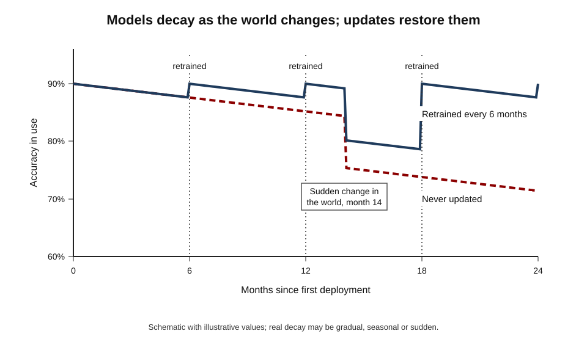
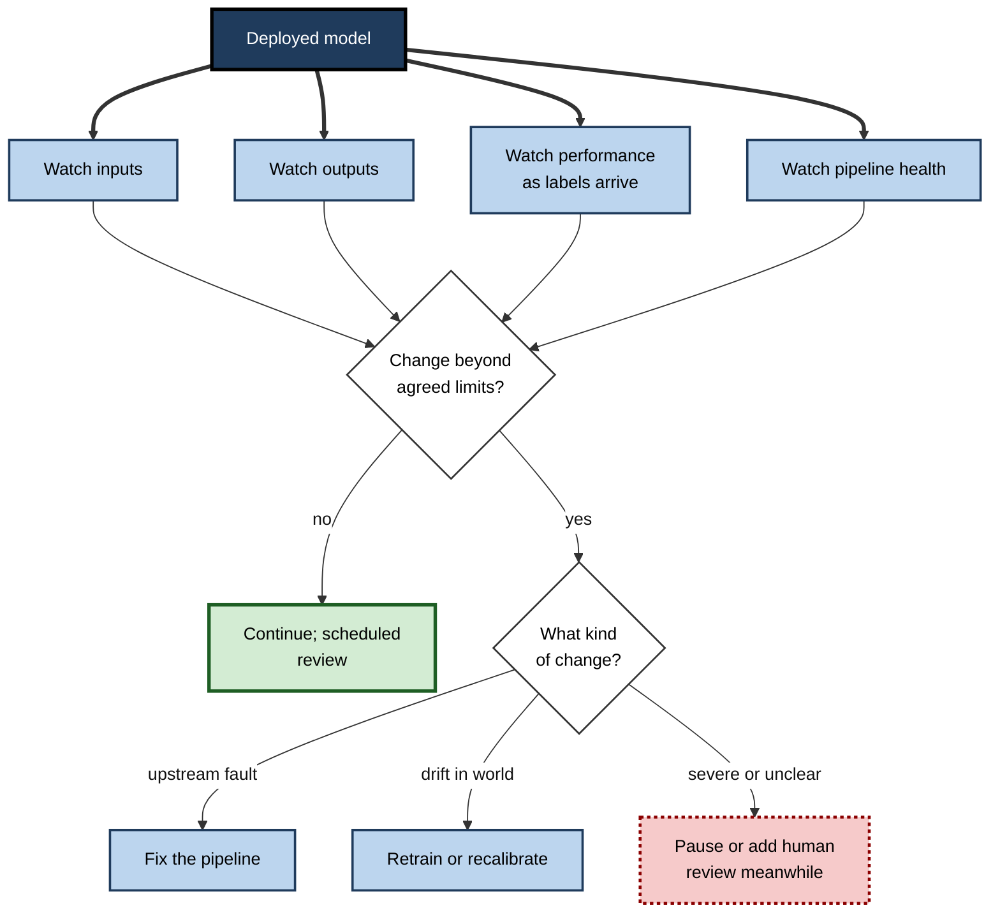
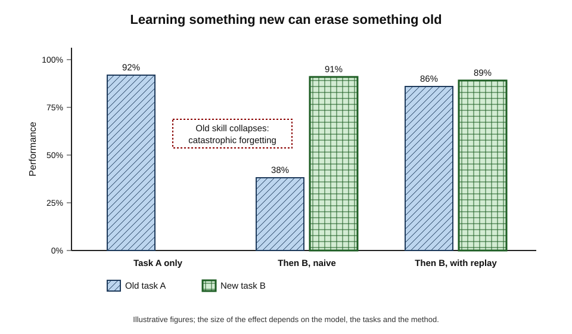
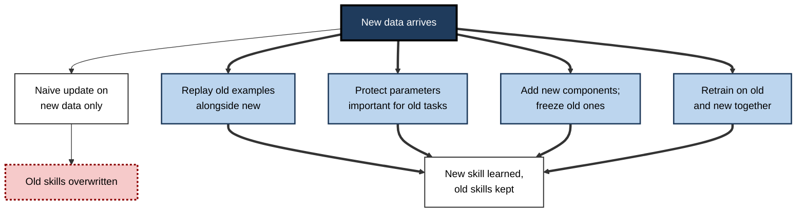
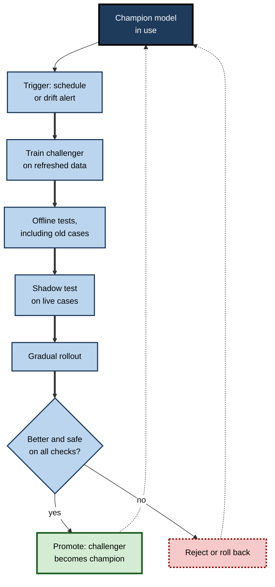

# D.12. Continual learning and model updates over time

In March 2020, within a few weeks, people stopped commuting, emptied supermarket shelves of flour and toilet paper, and moved their shopping online. Models that forecast demand, flagged unusual card payments or recommended products had learned from a world that had suddenly disappeared, and many began to misfire. Nothing in the models had changed; **the world had**. A trained model is a snapshot of the past, and keeping AI useful means noticing when that snapshot no longer matches the present — and updating it without breaking what still works.

> **Definition — Continual learning:** the ability of an AI system to keep learning from new data over time, adapting to change while retaining what it learned before.

> **Definition — Model decay (model drift):** the gradual or sudden decline in a deployed model's performance because the data it meets in use no longer resembles the data it was trained on.

**Why it matters**

- **Every deployed model ages.** Customer behaviour, fraud tactics, prices, language, regulations and equipment all change.
- **Decay is often silent.** A model keeps producing confident outputs while their quality falls, and the correct answers that would reveal the decline may arrive months later.
- **Updating is risky.** A new version can fix one problem and create others, or forget skills the old version had.
- **Learning from live use is double-edged.** It keeps models current but opens them to manipulation and self-reinforcing feedback.
- **Governance depends on it.** Regulators and customers increasingly expect AI systems to be monitored, versioned and updated under control.

---

## Why Models Go Stale

### A frozen model in a moving world

- **Training fixes the parameters** — a deployed model applies what it learned, unchanged.
- **The world keeps moving** — so the gap between training data and live data grows.
- **Result** — performance measured at launch overstates performance months later.

**Figure 1.** Performance over two years for a model never updated and a model retrained every six months.

### Kinds of change

> **Definition — Data drift (covariate shift):** a change in the distribution of a model's inputs — the kinds of cases it sees — while the relationship between inputs and outcomes may stay the same.

> **Definition — Concept drift:** a change in the relationship between inputs and outcomes, so that the same input now means something different.

> **Definition — Label shift (prior shift):** a change in how common each outcome is, such as fraud becoming twice as frequent.

- **Data drift** — new kinds of customers, devices, products or conditions.
  - *e.g.* a credit model built on salaried applicants now sees many gig-economy workers.
- **Concept drift** — the rules of the game change.
  - *e.g.* fraudsters change tactics, so patterns that once signalled fraud now look normal; a phrase acquires new slang meaning.
- **Label shift** — the balance of outcomes changes.
  - *e.g.* during a recession, defaults rise across all applicant types.
- **Upstream changes** — the data pipeline itself changes.
  - *e.g.* a form field is redefined, a sensor is replaced, a unit changes from miles to kilometres.
- **Patterns over time**
  - **Gradual** — slow change in tastes or demographics.
  - **Sudden** — a pandemic, a new law, a competitor's launch.
  - **Seasonal and recurring** — holidays, weather, financial year-ends.

| Type of change | What changes | Example | How it shows | Typical response |
|---|---|---|---|---|
| Data drift | The mix of inputs | New customer segment appears | Input statistics move | Retrain with new data; check coverage |
| Concept drift | What inputs mean for the outcome | Fraudsters change tactics | Accuracy falls once labels arrive | Retrain on recent data; rethink features |
| Label shift | How common outcomes are | Default rate doubles | Prediction rates no longer match reality | Recalibrate; adjust thresholds |
| Upstream change | The data pipeline | Field redefined, sensor replaced | Sudden jumps in input values or missing data | Fix the pipeline before retraining |

> **Key point:** different kinds of change need different responses. Retraining on corrupted data from a broken pipeline makes things worse; fixing the pipeline comes first.

### Case study: Google Flu Trends

- **Idea:** in 2008 Google launched Flu Trends, which estimated influenza activity in the United States from the volume of flu-related search queries; a 2009 paper in *Nature* described a model that tracked official figures from the US Centers for Disease Control and Prevention (CDC) closely and one to two weeks sooner.
- **What happened:** the model was not adequately updated as the world changed. In the 2012–2013 flu season it estimated more than **double** the proportion of doctor visits for influenza-like illness that the CDC recorded.
- **Analysis:** David Lazer and colleagues, writing in *Science* in 2014 under the title "The parable of Google Flu", found the system had overestimated flu prevalence in 100 of 108 weeks from August 2011.
- **Causes identified:**
  - **changing search behaviour** — media coverage of flu prompted searches by people who were not ill;
  - **changes to the search engine itself** — new features such as suggested searches altered what people typed, so the inputs drifted for reasons unrelated to flu;
  - **an original model fitted to many search terms** — some correlated with flu season by coincidence, such as winter-related searches;
  - **infrequent updating** and no routine combination with fresh official data.
- **Result:** Google stopped publishing the estimates in 2015.
- **Lesson:** a model built on a changing data source must be **monitored against ground truth and updated**. The authors noted that combining the search signal with recent CDC data would have performed much better.

---

## Detecting Change

### What to monitor

- **Inputs** — are the distributions of key features moving?
  - *e.g.* average transaction size, share of mobile users, proportion of missing values.
- **Outputs** — is the model's behaviour shifting?
  - *e.g.* share of cases flagged, average score, distribution of predicted classes.
- **Performance** — when correct answers arrive, is accuracy, precision or recall falling?
  - Often **delayed**: whether a loan defaults may take a year to learn.
- **Business outcomes** — are the decisions the model supports still producing results?
  - *e.g.* conversion rates, fraud losses, customer complaints.
- **Data pipeline health** — schema changes, failed feeds, sudden jumps or gaps.

> **Definition — Model monitoring:** continuously tracking a deployed model's inputs, outputs, performance and business effects in order to detect problems and decide when to update it.

### Measuring input drift

> **Formula — Population stability index (PSI):** PSI = Σ (actual share − expected share) × ln(actual share ÷ expected share), summed over bins of a feature or score. Example with illustrative figures: a score's three bins held 30%, 40% and 30% of cases at training and 20%, 40% and 40% now. PSI = (0.20 − 0.30) × ln(0.20 ÷ 0.30) + 0 + (0.40 − 0.30) × ln(0.40 ÷ 0.30) ≈ 0.041 + 0 + 0.029 = **0.07**.

- **Common conventions in credit scoring** — PSI below about 0.1 is read as stable, 0.1–0.25 as a moderate shift worth investigating, above about 0.25 as a significant shift.
  - These thresholds are industry habits, not statistical laws.

**Figure 2.** A monitoring loop that turns signs of change into decisions.

> **Watch out:** input drift does not always hurt performance, and performance can fall without obvious input drift (concept drift). Monitoring inputs gives early warning; only checking against real outcomes confirms a problem.

---

## Ways to Update a Model

### From scheduled retraining to learning on the fly

- **Scheduled retraining** — retrain at fixed intervals (weekly, monthly, quarterly) on recent data.
  - Simple and predictable; may react too slowly to sudden change, or retrain needlessly when nothing has changed.
- **Triggered retraining** — retrain when monitoring detects drift or performance loss.
  - Responsive; depends on good monitoring and on labels arriving in time.
- **Incremental (online) learning** — update parameters continuously as each new example or small batch arrives.
  - Very responsive; hard to test, easy to corrupt and prone to drifting in unwanted directions.
- **Fine-tuning on new data** — adjust an existing model with recent examples rather than retraining from scratch.
  - Cheaper; risks forgetting older patterns.
- **Full retraining** — rebuild from scratch on a refreshed dataset.
  - Cleanest; most costly.
- **Recalibration** — keep the model, adjust how its scores map to probabilities or decisions.
  - Suits label shift; quick.

> **Definition — Online learning:** updating a model continuously, example by example or in small batches, as new data arrives during use.

| Approach | Responsiveness | Cost | Ease of testing before release | Main risk |
|---|---|---|---|---|
| Scheduled retraining | Moderate | Moderate | High | Slow to react to sudden change |
| Triggered retraining | High | Variable | High | Depends on monitoring and label delay |
| Online learning | Very high | Low per update | Low | Manipulation, unnoticed drift, forgetting |
| Fine-tuning on recent data | High | Low | Moderate | Forgetting older patterns |
| Full retraining | Moderate | High | High | Time and computing cost |
| Recalibration | High | Very low | High | Fixes only shifts in outcome rates |

### How much history to keep

- **All history** — maximum data; old patterns may no longer apply.
- **Sliding window** — only the most recent period, such as the last 12 months.
  - Responsive; loses rare patterns and seasonal knowledge.
- **Weighted history** — all data, with recent examples counting more.
- **Seasonal awareness** — keep enough history to include each season, holiday and year-end at least once.

**Worked example (illustrative): choosing a retraining policy for a fraud model**

| Option | Retraining cost per year | Estimated fraud losses per year | Total |
|---|---|---|---|
| Never retrain | 0 | 4.2 million | 4.2 million |
| Retrain quarterly | 80,000 | 2.9 million | 2.98 million |
| Retrain monthly | 240,000 | 2.5 million | 2.74 million |
| Monthly plus triggered retraining on drift alerts | 300,000 | 2.2 million | **2.50 million** |

*Illustrative figures, in a single currency unit.*

1. **Price the decay** — losses rise as the model falls behind new tactics.
2. **Price the updates** — data preparation, computing, testing and approval.
3. **Compare totals** — here frequent, monitoring-triggered updates pay for themselves many times over.
4. **Check feasibility** — monthly retraining requires fraud labels to be confirmed within weeks; if confirmation takes months, the monthly schedule cannot be met.

> **Remember:** how often to update depends on **how fast the world changes**, **how quickly correct answers arrive** and **what each update costs and risks**.

---

## The Problem of Forgetting

### Catastrophic forgetting

> **Definition — Catastrophic forgetting:** the tendency of a neural network trained on new data to lose, abruptly and extensively, what it had learned from earlier data.

**Study card — McCloskey and Cohen (1989)**

- **Design:** a neural network learned simple arithmetic facts in sequence — first all sums involving 1 ("1 + 1", "1 + 2", …), then all sums involving 2.
- **Result:** after training on the twos, the network's knowledge of the ones was largely **destroyed** — far more severely than people forget in comparable learning.
- **Conclusion:** because the same connections store everything, adjusting them for new knowledge overwrites old knowledge. Michael McCloskey and Neal Cohen named the problem "catastrophic interference".

**Figure 3.** Catastrophic forgetting, and how replaying old examples prevents it.

### The stability–plasticity dilemma

- **Plasticity** — the ability to learn new things.
- **Stability** — the ability to keep what is already known.
- **The dilemma** — a system flexible enough to learn quickly tends to overwrite; a system stable enough to keep everything tends to learn slowly. The neuroscientist Stephen Grossberg framed this trade-off in the 1980s.
- **How brains may cope** — the "complementary learning systems" theory (James McClelland, Bruce McNaughton and Randall O'Reilly, 1995) proposed that the hippocampus learns new experiences quickly and gradually replays them to the neocortex, which integrates them slowly without overwriting.

> **Definition — Stability–plasticity dilemma:** the trade-off between a learning system's ability to absorb new information and its ability to retain old information.

### Methods that reduce forgetting

- **Replay (rehearsal)** — mix stored or generated old examples with new ones during training.
  - Directly inspired by the brain's replay; effective but requires keeping or regenerating old data.
- **Protecting important parameters** — penalise changes to parameters that mattered most for earlier tasks.
  - *e.g.* **elastic weight consolidation**, introduced by James Kirkpatrick and colleagues at DeepMind in 2017, allowed a network to learn several Atari video games in sequence with much less forgetting.
- **Adding new capacity** — give each new task its own extra components while freezing the old.
  - Avoids overwriting; the model grows over time.
- **Retraining on combined data** — the simplest and most common practical answer: retrain on old and new data together.

**Figure 4.** Strategies for learning new things without losing old ones.

---

## The Risks of Learning From Live Data

### Manipulation

- **Data poisoning** — deliberately feeding a learning system misleading examples so that it learns harmful behaviour.
- **Microsoft's Tay (2016)** — a chatbot launched on Twitter in March 2016 was designed to learn from its conversations. Coordinated users taught it to post offensive and inflammatory messages, and Microsoft took it offline within about a day.
- **Lesson** — a system that learns directly from the public learns from whoever is most determined to teach it.

### Feedback loops

> **Definition — Feedback loop (in AI):** a cycle in which a model's outputs influence the data it is later trained on, so that its errors or biases reinforce themselves.

- **Recommendations** — a system shows popular items, which get more clicks, which makes them look more popular.
- **Predictive policing** — Danielle Ensign and colleagues showed in 2018 how a system that sends police where past crime was recorded can generate more recorded crime there, "confirming" its own predictions regardless of underlying crime rates.
- **Credit and fraud** — applicants rejected by a model never generate repayment data, so the model never learns whether it was wrong about them.

> **Watch out:** a model updated on data its own decisions shaped can grow **more confident and more wrong** at the same time. Breaking the loop requires deliberately collecting some data the model did not choose — for example by occasionally exploring alternatives or auditing decisions.

### Case study: Zillow Offers

- **Situation:** the US property company Zillow ran Zillow Offers, buying homes directly using algorithmic price estimates and reselling them, aiming to profit from scale.
- **What happened:** in 2021, during a fast-moving housing market, the company bought many homes at prices higher than it could later sell them for.
- **Outcome:** in November 2021 Zillow announced it would wind down Zillow Offers. It recorded a write-down of about **304 million dollars** on homes bought in the third quarter of 2021 and planned to cut about a quarter of its workforce.
- **The company's explanation:** its chief executive said the unpredictability in forecasting home prices "far exceeds what we anticipated".
- **Interpretation:** predicting prices three to six months ahead in a market changing faster than ever before proved far harder than the models assumed; operational capacity limits and pandemic conditions added to the losses.
- **Lesson:** a model's reliability in a stable period says little about its reliability when conditions shift quickly. Decisions that **commit large sums on forecasts** need monitoring, limits on exposure and the ability to slow down when the world changes.

> **Watch out:** the Zillow case is often described simply as "the algorithm failed". The company's own account points to a mix of forecasting difficulty, rapid market change and operational constraints; the precise contribution of each has not been publicly established.

---

## Updating Large Language Models

### Keeping knowledge current

- **Knowledge cut-off** — a language model knows nothing after its training data ends.
- **New versions** — developers periodically train or substantially update models; each version has a later cut-off and different behaviour.
- **Fine-tuning** — adapting a model to new information or styles with additional training.
- **Retrieval** — supplying current documents at the moment of use, so answers can draw on information the model was never trained on; often the cheapest way to stay current.

### When updates change behaviour

**Study card — Chen, Zaharia and Zou (2023), Stanford University and University of California, Berkeley**

- **Question:** do widely used chatbot models behave consistently over time?
- **Design:** compared the March 2023 and June 2023 versions of GPT-3.5 and GPT-4 on tasks including mathematics problems, sensitive questions and code generation.
- **Findings:** behaviour changed substantially between versions on several tasks — some improved, some worsened; for example, the share of directly runnable code generated fell for both models.
- **Debate:** other researchers argued that some reported declines reflected changes in answer **format** rather than in underlying ability, and questioned parts of the evaluation.
- **Conclusion:** whatever the precise causes, a model accessed as a service can change without users retraining anything; organisations depending on it need to **re-test after updates**.

> **In practice:** organisations building on external models increasingly **pin** a specific model version, keep a standing set of test cases, and re-run them before switching to a new version — treating a model upgrade like any other change to critical software.

---

## Governing Model Updates

### Versions, challengers and rollback

- **Versioning** — every model version recorded with its data, code, settings, evaluation results and approval.
- **Champion–challenger** — the current model (champion) keeps running while a new candidate (challenger) is tested in parallel; the challenger replaces it only if it proves better.
- **Shadow testing** — the challenger scores live cases without its outputs being used.
- **Gradual rollout** — the new version serves a small share of traffic first.
- **Rollback** — the previous version can be restored quickly if problems appear.
- **Change log** — what changed, why, and with what measured effect.

**Figure 5.** A controlled life cycle for updating a deployed model.

### Regulation and accountability

- **Post-market monitoring** — the European Union's AI Act requires providers of high-risk AI systems to monitor their performance after they are placed on the market.
- **Planned changes in medical devices** — the US Food and Drug Administration has issued guidance on "predetermined change control plans", allowing manufacturers of AI-enabled medical devices to describe in advance how a model will be updated and validated, rather than seeking fresh approval for every change.
- **Accountability** — when a decision is challenged, the organisation must be able to say **which version** made it and **what that version was trained on**.

### Case study (illustrative): a demand forecast after a sudden shift

- **Situation:** a grocery retailer's demand-forecasting model was retrained quarterly on two years of history.
- **Shock:** a nationwide public-health emergency changed buying patterns within days — staples surged, fresh food and impulse lines fell, online orders tripled.
- **Problem:** forecasts were badly wrong for weeks; the next scheduled retraining was two months away, and two years of "normal" history outweighed a few weeks of new data.
- **Actions:**
  1. monitoring alerts on forecast error triggered an emergency review;
  2. planners overrode the model for the most affected product lines;
  3. the team retrained on a short sliding window weighted towards the latest weeks, with a flag for the new period;
  4. once conditions stabilised, it moved back to longer history with the emergency period labelled, so the model could learn from it without treating it as normal.
- **Result:** forecast error returned towards normal levels within about a month of the shock. *Illustrative figures.*
- **Lesson:** sudden change calls for **human judgement, a faster update path and careful choice of history** — not simply waiting for the next scheduled retrain.

### Questions to ask about any deployed model

- **When was it last trained, and on data up to what date?**
- **How is it monitored — inputs, outputs, performance, business results?**
- **How quickly do correct answers arrive to check it?**
- **What triggers an update, and how is a new version tested before release?**
- **Can it be rolled back, and is every version recorded?**
- **Does it learn from its own decisions, and how are feedback loops prevented?**

> **Mnemonic — "Watchful Managers Quickly Test, Roll back, Learn":** When trained, Monitoring, Quick answers, Triggers and testing, Rollback and records, Learning from own decisions.

---

## Open Questions

- **Can models learn continuously without forgetting or drifting?**
  - Methods such as replay and parameter protection help in research settings, but true lifelong learning in deployed systems remains unsolved.
- **How should continuously changing models be approved?**
  - Regulatory systems were built for fixed products; how to certify a system that keeps changing is still being worked out.
- **How can feedback loops be detected early?**
  - Self-reinforcing effects often appear only after long periods; reliable early indicators are lacking.
- **How should providers communicate model updates?**
  - Users of AI services often cannot tell when a model has changed; norms for disclosure and version stability are not settled.

---

## Summary

- A deployed model is a **snapshot of the past**; **model decay** follows when the world changes.
- Change takes the forms of **data drift** (new kinds of inputs), **concept drift** (new meaning of inputs), **label shift** (new outcome rates) and **upstream changes** (broken or redefined pipelines); it can be gradual, sudden or seasonal.
- **Google Flu Trends** overestimated flu in 100 of 108 weeks from August 2011 because search behaviour and the search engine changed while the model was not adequately updated.
- **Monitoring** watches inputs, outputs, performance (often delayed) and business results; measures such as the **population stability index** flag input drift.
- Update by **scheduled** or **triggered retraining**, **online learning**, **fine-tuning**, **full retraining** or **recalibration**, choosing how much history to keep; update frequency depends on how fast the world changes, how fast labels arrive and the cost and risk of updates.
- Neural networks suffer **catastrophic forgetting** (McCloskey and Cohen, 1989) — the **stability–plasticity dilemma**; **replay**, **parameter protection**, **added capacity** and **combined retraining** reduce it.
- Learning from live data risks **poisoning** (Tay, 2016) and **feedback loops**; **Zillow Offers** (2021) showed the cost of committing large sums on forecasts in a fast-changing market.
- Language models have **knowledge cut-offs** and change between **versions**; pin versions and re-test after updates.
- Govern updates with **versioning, champion–challenger testing, shadow testing, gradual rollout, rollback and change logs**, in line with growing regulatory expectations.

---

## Self-Check

1. Define continual learning and model decay. Why do deployed models decay even though they do not change?
2. Distinguish data drift, concept drift and label shift, with an example of each.
3. Why should an upstream pipeline change be fixed before retraining?
4. Summarise the Google Flu Trends case and the main causes of its failure.
5. List four things to monitor in a deployed model and explain why performance monitoring is often delayed.
6. Calculate the PSI for two bins with expected shares 50% and 50% and actual shares 40% and 60%. How would it usually be read?
7. Compare scheduled retraining, triggered retraining and online learning.
8. What are the trade-offs between keeping all history and using a sliding window?
9. Describe the McCloskey and Cohen (1989) experiment and what it showed.
10. Explain the stability–plasticity dilemma and two methods that reduce catastrophic forgetting.
11. What happened to Microsoft's Tay, and what does it illustrate?
12. Explain how a feedback loop can make a model more confident and more wrong. Give an example.
13. What lessons does the Zillow Offers case teach about forecasting models in changing markets, and why should simple explanations be treated with care?
14. A company uses an external language model service for customer emails. What should it do to manage the risk of model updates?

### Answer Key

1. Continual learning: learning from new data over time while retaining earlier knowledge. Model decay: performance decline as live data diverges from training data. Models stay fixed while customers, tactics, prices and conditions change.
2. Data drift: more gig-economy applicants in a credit model. Concept drift: fraudsters change tactics so old signals mean something else. Label shift: default rates rise in a recession.
3. Retraining on corrupted or redefined data teaches the model the fault; repairing the pipeline restores meaningful inputs first.
4. Flu Trends estimated flu activity from searches; it overestimated flu in 100 of 108 weeks from August 2011 and more than doubled CDC figures in 2012–2013. Causes: media-driven searches, search-engine changes altering inputs, coincidental search terms in the original model and inadequate updating against official data.
5. Inputs, outputs, performance and business outcomes (and pipeline health). Correct answers often arrive late — for example, whether a loan defaults may not be known for months.
6. (0.40 − 0.50) × ln(0.8) + (0.60 − 0.50) × ln(1.2) ≈ 0.0223 + 0.0182 ≈ 0.04 — below 0.1, conventionally read as stable.
7. Scheduled: fixed intervals, predictable, may react slowly. Triggered: in response to detected drift, responsive but dependent on monitoring and labels. Online: continuous updating, very responsive but hard to test and vulnerable to manipulation and drift.
8. All history maximises data but may include outdated patterns; a sliding window is responsive but may lose rare and seasonal patterns. Weighting recent data is a compromise.
9. A network learned arithmetic facts involving 1, then facts involving 2; learning the twos largely destroyed knowledge of the ones, showing catastrophic interference in networks that store everything in shared connections.
10. The trade-off between learning new information and retaining old. Methods: replaying old examples during new training; protecting parameters important for old tasks (elastic weight consolidation); adding new components; retraining on combined data.
11. A 2016 chatbot that learned from Twitter conversations was taught offensive content by coordinated users and taken offline within about a day — illustrating data poisoning and the risk of learning directly from the public.
12. The model's outputs shape its future training data, so its choices appear confirmed. Predictive policing: patrols sent where crime was recorded record more crime there, reinforcing the prediction regardless of true crime rates.
13. Forecast reliability in stable periods does not carry over to rapid change; large financial commitments based on forecasts need monitoring, exposure limits and the ability to slow down. The company's own account cites forecasting difficulty, market speed and operational constraints together, so "the algorithm failed" oversimplifies.
14. Pin a specific model version; keep a standing set of test cases; re-run them before adopting new versions; monitor outputs in use; keep records of which version produced which emails; maintain human review for sensitive cases; plan for deprecation.

---

## Glossary

| Term | Meaning |
|---|---|
| Catastrophic forgetting | Abrupt loss of earlier knowledge when a network is trained on new data. |
| Champion–challenger | Testing a new model version against the current one before replacing it. |
| Concept drift | A change in the relationship between inputs and outcomes. |
| Continual learning | Learning from new data over time while retaining earlier knowledge. |
| Data drift | A change in the distribution of a model's inputs. |
| Data poisoning | Deliberately feeding a learning system misleading examples. |
| Elastic weight consolidation | A method that protects parameters important for earlier tasks. |
| Feedback loop | A model's outputs shaping its future training data. |
| Label shift | A change in how common each outcome is. |
| Model decay | Decline in a deployed model's performance as conditions change. |
| Model monitoring | Tracking a deployed model's inputs, outputs, performance and effects. |
| Online learning | Updating a model continuously as new data arrives. |
| Population stability index | A measure of how much a distribution has shifted between two periods. |
| Recalibration | Adjusting how a model's scores map to probabilities or decisions. |
| Replay | Mixing old examples with new ones during training to prevent forgetting. |
| Rollback | Restoring a previous model version. |
| Sliding window | Training only on the most recent period of data. |
| Stability–plasticity dilemma | The trade-off between learning new information and retaining old. |
| Versioning | Recording each model version with its data, code, settings and results. |
