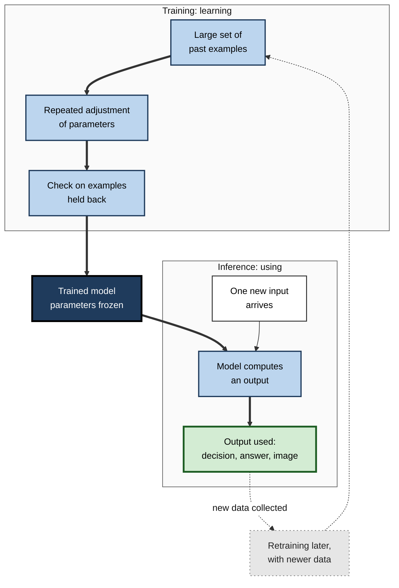
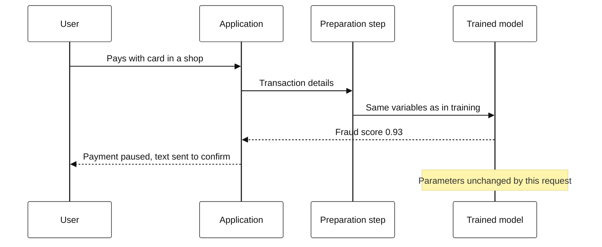
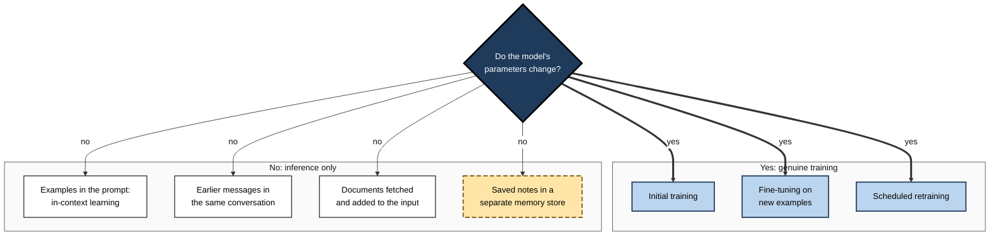
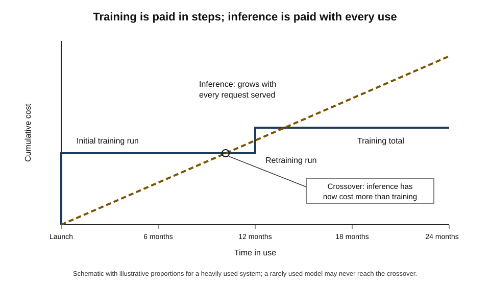
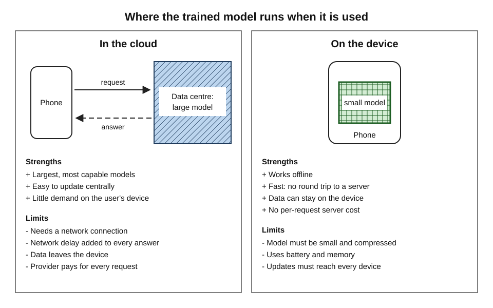
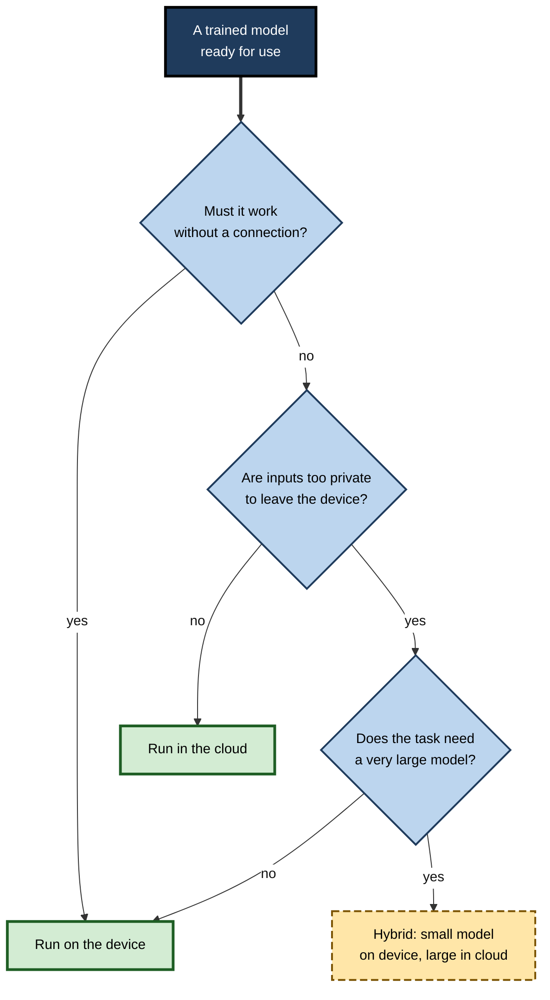

# D.2. Training vs. inference: learning vs. using

A medical student spends years absorbing textbooks, cases and supervised practice; a qualified doctor then sees patients, applying what was learned in minutes per consultation. The years of study are expensive and happen once; the consultations are quick and happen thousands of times. Every AI system has the same two lives — a period in which it **learns** and a much longer period in which it is **used** — and confusing the two lies behind many misunderstandings about what AI can and cannot do.

> **Definition — Training:** the phase in which a learning system is exposed to data and its internal settings are adjusted until it performs a task well.

> **Definition — Inference:** the phase in which a trained model is applied to new inputs to produce outputs — predictions, classifications, text or images — without changing what it has learned.

**Why it matters**

- **It corrects a common belief.** Most AI systems do not learn from each conversation or transaction; they apply what was fixed during training.
- **It explains cost.** Training is a large, occasional investment; inference is a small cost paid every time the system is used — and for popular systems the second often exceeds the first.
- **It explains speed.** Training can take weeks; inference must often finish in a fraction of a second.
- **It explains why knowledge goes out of date.** A model knows only what was in its training data, up to the moment training stopped.
- **It shapes design decisions** — where a model runs, how large it can be, how it is updated and what it costs to operate.

---

## Two Lives of an AI System

### The student and the examination

- **Training resembles studying.**
  - Many examples are worked through.
  - Mistakes are noticed and corrected.
  - The learner's internal understanding changes.
- **Inference resembles sitting an examination — repeatedly.**
  - A new question arrives.
  - The learner answers using what is already known.
  - Nothing new is learned from the question itself.
- **The analogy's limit** — a human examinee may still learn something during an examination; a typical deployed model does not, because its learned settings are locked.

> **Definition — Parameters (weights):** the adjustable numbers inside a model whose values are set during training and which determine how inputs are turned into outputs. Large modern models have billions of them.

> **Key point:** training **changes the parameters**; inference **uses the parameters**. That single difference explains most of what follows.

**Figure 1.** The two phases in the life of an AI model.

### The two phases compared

| | Training | Inference |
|---|---|---|
| Purpose | Find good parameter values | Apply them to new inputs |
| Data | Large historical dataset, often with known answers | One input, or a batch, usually without answers |
| What changes | Parameters, repeatedly | Nothing inside the model |
| How often | Once, then occasional retraining | Continuously — every request |
| Time per run | Hours to months | Milliseconds to seconds, sometimes minutes |
| Computing per run | Enormous | Small, but multiplied by every use |
| Who notices it | The development team | Every user |
| Typical failure | Learns the wrong patterns | Meets inputs unlike anything seen in training |

---

## What Happens During Training

### Adjusting the parameters

- **Start** — the model's parameters begin as random or as values learned earlier on another task.
- **Try** — the model produces outputs for a batch of training examples.
- **Compare** — the outputs are compared with the correct answers and the size of the error is measured.
- **Adjust** — every parameter is nudged slightly in the direction that would have reduced the error.
- **Repeat** — over the whole dataset, often many times.
- **Stop** — when performance on examples held back from training stops improving.

> **Watch out:** "training" in AI is not like training an employee with a briefing. It is millions or billions of small numerical corrections, driven entirely by measured error on examples.

### What comes out

- **A model artefact** — a file, or set of files, holding the final parameter values together with a description of the model's structure.
  - *e.g.* a fraud model of a few megabytes; a large language model of hundreds of gigabytes.
- **Records of the process** — which data, which settings and which test results produced this version.
- **Checkpoints** — snapshots saved during training, so that a long run can resume after a failure or an earlier, better version can be recovered.

> **Definition — Model artefact:** the stored output of training — the parameter values and structure — that is loaded and run at inference time.

### The scale of training

- **Small business models** — a demand forecast or churn model may train in minutes on an ordinary computer.
- **Image and speech models** — hours to days on specialised processors.
- **Frontier language models** — weeks to months on many thousands of specialised chips, at a reported cost of tens or hundreds of millions of dollars.
- **Specialised hardware**
  - **GPUs** (graphics processing units) — designed for video games, found in the late 2000s to suit the repetitive arithmetic of neural networks.
  - **TPUs** (tensor processing units) — chips designed by Google specifically for machine-learning arithmetic.

> **In practice:** because training is expensive and slow, organisations treat each training run like a small project — with a defined dataset, a recorded configuration, an evaluation before release and a version number.

---

## What Happens During Inference

### A single prediction

- **Receive input** — a transaction, an image, a sentence, a set of sensor readings.
- **Prepare it** — convert it into the same format used in training.
  - *e.g.* resize the image; split text into tokens; compute the same variables from the transaction.
- **Compute** — pass it through the model's fixed parameters.
  - Often called a **forward pass**: the input flows through the model's layers in one direction.
- **Return output** — a score, a label, a number, a generated sentence or image.
- **Act** — the surrounding software uses the output: blocks a payment, shows a recommendation, displays text.

> **Definition — Forward pass:** one computation of a model's output from an input, using the current parameters, with no learning taking place.

**Figure 2.** What happens when a user's request reaches a deployed model.

### Speed: latency and throughput

> **Definition — Latency:** the time between a request arriving and its answer being returned.

> **Definition — Throughput:** the number of requests a system can answer per unit of time.

- **Why latency matters**
  - Card payments must be approved in well under a second.
  - Voice assistants feel broken if replies lag.
  - Self-driving systems must react within fractions of a second.
- **Why throughput matters**
  - A search engine or chatbot may serve millions of requests an hour.
- **The tension** — grouping requests into batches raises throughput (the hardware works more efficiently) but makes each request wait longer.

### Real-time and batch inference

| | Real-time (online) inference | Batch (offline) inference |
|---|---|---|
| When outputs are produced | Immediately, per request | On a schedule, for many inputs at once |
| Typical latency | Milliseconds to seconds | Minutes to hours |
| Example | Fraud check on a card payment | Overnight scoring of every customer's risk of leaving |
| Infrastructure | Always-on service | Scheduled job |
| Cost profile | Pays for readiness at peak load | Pays only while the job runs |

> **Example:** a streaming service may compute each viewer's recommendation list in a nightly batch, then use real-time inference only to re-rank the list when the viewer opens the app.

---

## Using Is Not Learning

### Why the parameters stay fixed

- **Predictability** — a model that changes with every input could drift in unexpected and untested ways.
- **Safety** — malicious users could deliberately teach it bad behaviour.
- **Testing** — only a fixed model can be evaluated and approved before release.
- **Cost** — adjusting billions of parameters for every request would be prohibitively expensive.
- **Accountability** — a decision can be traced to a specific, recorded model version.

> **Watch out:** a common belief is that a chatbot "learns" from each conversation. During the conversation, its parameters do not change. What it may do is (1) take earlier messages in the same conversation into account, (2) store notes in a separate memory feature, or (3) have conversations collected — subject to the provider's policies — for use in a **later** training run.

### Learning within the prompt: in-context learning

- **What it is** — large language models can follow examples or instructions placed in the input itself.
  - *e.g.* given three examples of formal emails rewritten as informal ones, the model rewrites a fourth in the same style.
- **Origin of the term** — the 2020 paper introducing GPT-3, titled "Language models are few-shot learners", showed that a sufficiently large model could perform new tasks from a handful of examples supplied in the prompt.
- **Why it is still inference** — the model's parameters do not change; the examples shape the output only while they are in the input.
- **What happens afterwards** — once the conversation ends, the "learning" is gone; a new conversation starts from the same fixed model.

> **Definition — In-context learning:** a model's ability to adapt its outputs to examples or instructions contained in its current input, without any change to its parameters.

**Figure 3.** Which kinds of "learning" change a model and which do not.

### The knowledge cut-off

- **Training data stops at a date** — the latest material collected before training began.
- **The model knows nothing later** — unless that information is supplied at inference time.
  - *e.g.* asked about last week's election results, a model trained a year ago can only guess, unless a search result is added to its input.
- **Adding knowledge without retraining**
  - **Retrieval-augmented generation** — at inference time, relevant documents are fetched from a search index or company database and placed in the model's input.
  - The model's parameters are unchanged; the answer draws on the supplied documents.

> **Definition — Knowledge cut-off:** the date after which a model's training data contains no information, so that later events are unknown to it.

> **Definition — Retrieval-augmented generation (RAG):** supplying a language model, at inference time, with relevant documents retrieved from an external source so that its answer can draw on information it was not trained on.

> **Key point:** to give a model **new knowledge**, either retrain it (slow, costly, lasting) or supply the knowledge in its input at inference time (fast, cheap, temporary).

---

## The Economics of Training and Inference

### One large bill, then many small ones

- **Training cost** — paid at the start and at each retraining.
  - Computing time, data preparation, engineering effort, evaluation.
- **Inference cost** — paid every time the model is used.
  - Computing per request × number of requests.
- **For a little-used model** — training dominates.
- **For a heavily used model** — inference soon dominates, because tiny per-request costs are multiplied by millions or billions of requests.

**Study card — Patterson and colleagues (2022), Google and the University of California, Berkeley**

- **Question:** how much energy does machine learning use at a large technology company, and in which phase?
- **Data:** Google's own records of machine-learning energy use over 2019–2021.
- **Finding:** roughly **three-fifths** of the energy Google used for machine learning went on **inference** and two-fifths on **training**.
- **Conclusion:** public attention focused on the energy of training giant models, but for widely used systems the everyday cost of using them is at least as important.

> **Watch out:** the split varies greatly between organisations and over time. A research laboratory that trains many experimental models may spend most on training; a consumer service with billions of users may spend most on inference. The Google figures describe one company in one period.

**Figure 4.** How training and inference costs accumulate over a model's working life.

### Worked example (illustrative): the true cost of a customer-service model

A retailer is choosing between two language models to answer customer queries. It expects 2 million queries a month for two years.

| | Large model | Small model |
|---|---|---|
| One-off cost to adapt and test | 40,000 | 40,000 |
| Inference cost per 1,000 queries | 6.00 | 0.50 |
| Monthly inference cost (2 million queries) | 12,000 | 1,000 |
| Two-year inference cost | 288,000 | 24,000 |
| Two-year total | 328,000 | 64,000 |
| Share of queries resolved without a human | 82% | 74% |

*Illustrative figures, in a single currency unit.*

1. **Count total cost** — over two years, inference is nearly 90% of the large model's total cost.
2. **Count the value** — the large model resolves 8 percentage points more queries: 160,000 more a month.
3. **Price the difference** — if a human-handled query costs 1.00, the large model saves about 160,000 a month in staff time, against 11,000 extra inference cost.
4. **Decide** — the large model is worth its higher inference cost here; with fewer queries, or cheaper human handling, the answer could reverse.

> **Remember:** judge an AI system by **total cost over its working life**, not by the cost of building it — and weigh that cost against the value of better outputs.

### Making inference cheaper

- **Distillation** — a large "teacher" model trains a smaller "student" model to imitate its outputs.
  - Geoffrey Hinton, Oriol Vinyals and Jeff Dean described the method in 2015.
  - *e.g.* in 2019 Hugging Face reported that DistilBERT kept about 97% of the language-understanding performance of the BERT model it imitated while being 40% smaller and 60% faster.
- **Quantisation** — storing parameters with fewer digits of precision.
  - *e.g.* using 8-bit or 4-bit numbers instead of 32-bit; the model shrinks several-fold with usually small losses in quality.
- **Pruning** — removing parameters that contribute little.
- **Caching** — storing answers to frequent identical requests.
- **Routing** — sending easy requests to a small model and only hard ones to a large model.

> **Definition — Distillation:** training a smaller model to reproduce the outputs of a larger one, so that most of the capability is kept at a fraction of the inference cost.

> **Definition — Quantisation:** reducing the numerical precision of a model's parameters to make it smaller and faster at inference.

### Spending more at inference to think harder

- **The traditional pattern** — invest heavily in training, then make inference as cheap and fast as possible.
- **The newer pattern** — some language models, beginning with OpenAI's o1 series in September 2024, are designed to spend extra computation at inference time.
  - They generate long internal chains of intermediate reasoning before answering.
  - Accuracy on difficult mathematics, science and coding problems improved as more inference computation was allowed.
- **Consequence** — the cost of a single answer is no longer fixed; harder questions can cost far more and take longer.

> **Definition — Test-time (inference-time) compute:** computation spent while answering a request, as opposed to during training; increasing it can improve the quality of answers from some models.

---

## Where Inference Runs

| | Cloud inference | On-device (edge) inference |
|---|---|---|
| Location of the model | Provider's data centre | The user's phone, car, camera or machine |
| Model size possible | Very large | Small or compressed |
| Needs a connection | Yes | No |
| Speed | Includes network delay | No network delay |
| Privacy | Inputs leave the device | Inputs can stay local |
| Who pays for computing | Provider, per request | The device owner, through hardware and battery |
| Updating the model | Once, centrally | Must be pushed to every device |

**Figure 5.** Inference in the cloud compared with inference on the device.

- **Typical on-device uses** — face unlock, keyboard suggestions, offline translation, camera scene detection, factory-floor quality checks.
- **Typical cloud uses** — large chatbots, image generation, search, enterprise analytics.
- **Hybrid designs** — a small on-device model handles common or private requests; harder ones go to the cloud.
  - *e.g.* a phone detects a wake word locally and sends speech to a server only after it hears it.

> **In practice:** the choice of where to run inference is driven by four questions — **how fast** must answers be, **how private** are the inputs, **how large** must the model be, and **who pays** for each request.

**Figure 6.** Choosing where a model should run at inference time.

---

## When Training and Use Diverge

### Training–serving skew

> **Definition — Training–serving skew:** a difference between how data is prepared or what data looks like during training and during inference, causing a model to perform worse in use than in testing.

- **Different preparation code** — a variable computed one way in the training pipeline and slightly differently in the live system.
  - *e.g.* "average spend" computed over 30 days in training but over 7 days in production.
- **Information not available in time** — training used data that, in live use, arrives only after the decision must be made.
  - *e.g.* a model trained with the final delivery date cannot have that date when predicting at the moment of order.
- **Different input sources** — training on high-quality studio photographs, then receiving blurred phone pictures.
- **Changing world** — inputs drift away from what training data contained.

> **Watch out:** a model can pass every test before release and still fail on the first day of use — not because it learned badly, but because the inputs it receives are not prepared the way its training inputs were.

### Protecting the transition from training to use

- **Single preparation code** — the same code computes inputs for training and for inference.
- **Shadow deployment** — the new model runs alongside the old one on live inputs, but its outputs are only recorded, not acted on.
- **Gradual rollout** — a small share of traffic goes to the new model first.
- **A/B testing** — users are randomly assigned to old and new models and outcomes compared.
- **Monitoring** — inputs and outputs are watched for changes from training patterns.
- **Rollback** — the previous model version can be restored quickly.

### Case study (illustrative): the fraud model that worked only in testing

- **Situation:** a card issuer trained a new fraud model on two years of transactions. In testing it caught substantially more fraud than the old model with fewer false alarms.
- **Problem:** in its first week of live use it blocked an unusual number of genuine payments and missed several fraud patterns it had caught in testing.
- **Diagnosis:**
  1. the training data computed a customer's "distance from home" using the billing address recorded at month-end;
  2. the live system used the address held at the moment of payment, which for recently moved customers was out of date;
  3. a "merchant risk" variable in training had been calculated using fraud reports filed weeks **after** the transactions — information the live system could not have.
- **Actions:**
  - rebuilt the preparation steps so that training and inference used identical code;
  - removed variables that depended on information unavailable at decision time;
  - retrained, then ran the new model in shadow mode for a month before switching.
- **Result:** live performance matched test performance closely; customer complaints about blocked payments fell back below the old model's level.
- **Lesson:** a model is only as good as the match between **what it saw when learning** and **what it sees when used**.

---

## Training and Inference in Professional Practice

### Questions to ask about a deployed system

- **Version** — which model version produced this output, and when was it trained?
- **Cut-off** — what is the latest information it could know?
- **Updating** — does it change with use, or only when retrained? How often is it retrained?
- **Inputs** — are live inputs prepared the same way as training inputs?
- **Speed and cost** — what is the latency, and what does each use cost?
- **Location** — where does inference run, and where do the inputs go?
- **Feedback** — are user interactions used for later training, and with what consent?

> **Mnemonic — "Very Careful Users Inspect Several Linked Facts":** Version, Cut-off, Updating, Inputs, Speed and cost, Location, Feedback.

### Common misreadings by non-specialists

- **"It will get better the more we use it."**
  - Only if usage data is collected, checked and used for retraining — a deliberate process with its own costs and risks.
- **"It remembered what I told it last week."**
  - Usually a separate memory feature storing text, not a change to the model.
- **"Training is the expensive part."**
  - True for rarely used models; for heavily used ones, inference often costs more over time.
- **"It knows the latest information."**
  - Only if retrieval or search is attached; otherwise its knowledge stops at the cut-off.

> **In practice:** when an AI system makes a mistake, the first diagnostic question is whether the error came from **training** (it learned the wrong thing) or from **inference** (it received an input unlike its training data, or prepared differently). The remedies differ completely: retraining for the first, fixing inputs or adding guardrails for the second.

---

## Open Questions

- **Should deployed models learn continuously?**
  - Continuous updating would keep models current but makes testing, safety and accountability much harder; practical methods remain limited.
- **How will the training–inference balance shift?**
  - Models that "think longer" at inference move cost from training to use; how far this trend goes, and its energy implications, is uncertain.
- **Where is the line between in-context learning and real learning?**
  - Researchers still debate what large models actually do when they appear to learn from examples in a prompt.
- **How small can capable models become?**
  - Distillation and quantisation have shrunk models dramatically; the limits of on-device capability are not known.
- **How should inference energy be reported?**
  - There is no agreed standard for measuring and disclosing the energy and emissions of everyday AI use.

---

## Summary

- **Training** adjusts a model's **parameters** using data; **inference** applies the fixed parameters to new inputs.
- Training is occasional, slow and costly per run; inference is continuous, fast and cheap per request — but multiplied by every use.
- Training produces a **model artefact**: stored parameter values plus structure, versioned and evaluated before release.
- Inference involves preparing an input, a **forward pass** and acting on the output; it is judged by **latency** and **throughput**, and runs in **real time** or in **batches**.
- Deployed models usually **do not learn from use**: fixed parameters give predictability, safety, testability and accountability. **In-context learning**, conversation history and memory features change outputs without changing parameters.
- Models have a **knowledge cut-off**; **retrieval-augmented generation** supplies new information at inference time.
- For heavily used systems, **inference cost often exceeds training cost**; at Google in 2019–2021 roughly three-fifths of machine-learning energy went on inference.
- **Distillation, quantisation, pruning, caching and routing** make inference cheaper; newer models deliberately spend more **test-time compute** to reason.
- Inference can run **in the cloud, on the device or in hybrid designs**, chosen by speed, privacy, model size and cost.
- **Training–serving skew** makes models fail in use despite passing tests; identical preparation code, shadow deployment, gradual rollout and monitoring guard against it.

---

## Self-Check

1. Define training and inference, and state the single difference in what happens to a model's parameters.
2. Give three reasons why most deployed models do not update their parameters during use.
3. A user says a chatbot "learned my preferences". List three mechanisms that could explain this without any change to the model's parameters.
4. What is in-context learning, and why is it classed as inference?
5. Explain the knowledge cut-off and two ways of giving a model information about later events.
6. Distinguish latency from throughput and explain why batching affects them differently.
7. When would batch inference be preferred to real-time inference? Give a business example.
8. Summarise the Patterson and colleagues (2022) finding and explain why it should not be generalised to every organisation.
9. Using the worked example, explain why the cheaper model might still be the wrong choice.
10. Describe distillation and quantisation and the trade-off each involves.
11. What is test-time compute, and how does it change the economics of a single answer?
12. A hospital wants an AI tool to analyse images in clinics with unreliable internet. Where should inference run, and why?
13. Define training–serving skew and give two concrete causes.
14. A new model performed well in testing but poorly in its first week of use. Outline a diagnosis and the safeguards that should have been in place.

### Answer Key

1. Training is the phase in which a model's parameters are adjusted using data; inference is the application of the trained model to new inputs. In training the parameters change; in inference they stay fixed.
2. Predictability (no untested drift); safety (users cannot deliberately teach bad behaviour); testability and accountability (a fixed, recorded version can be approved and traced); cost of updating huge numbers of parameters per request.
3. Earlier messages in the same conversation are part of its input; a separate memory feature stores notes and inserts them into later inputs; the provider used past conversations in a later training run.
4. A model's ability to adapt outputs to examples or instructions within its current input. It is inference because the parameters do not change and the effect vanishes when the input is gone.
5. The date after which the training data contains no information. Options: retrain or fine-tune on newer data; supply new information at inference time, for example by retrieval-augmented generation or search.
6. Latency is the time for one answer; throughput is how many answers per unit time. Batching improves hardware efficiency and so throughput, but each request may wait for the batch, increasing latency.
7. When results are not needed instantly and many inputs can be scored together cheaply — for example, overnight scoring of every customer's likelihood of cancelling a subscription for the next day's retention campaign.
8. Over 2019–2021 about three-fifths of Google's machine-learning energy went on inference and two-fifths on training. It reflects one company with enormous user numbers; organisations with many experiments and few users may spend most on training.
9. Because the large model resolves more queries, and the staff time saved can far exceed its higher inference cost. Total cost must be weighed against total value, not compared alone.
10. Distillation trains a small model to imitate a large one — cheaper inference for some loss of capability. Quantisation stores parameters at lower precision — smaller and faster, usually with a small loss of quality.
11. Computation spent while answering; some models reason longer to answer harder questions better. The cost and time of a single answer become variable and can be much higher for difficult requests.
12. On the device or on a local machine in the clinic, because the internet is unreliable and medical images are sensitive; this requires a model small enough to run locally, perhaps with cloud processing for non-urgent second opinions when a connection is available.
13. A mismatch between training-time and inference-time data or preparation. Causes: different code computing the same variable; variables that use information unavailable at decision time; different input sources such as studio versus phone photographs.
14. Compare live inputs with training inputs; check whether variables are computed identically; look for information used in training that is unavailable at decision time; check for a shift in the input population. Safeguards: shared preparation code, shadow deployment, gradual rollout, monitoring and quick rollback.

---

## Glossary

| Term | Meaning |
|---|---|
| A/B testing | Randomly assigning users to two versions and comparing outcomes. |
| Batch inference | Producing outputs for many inputs at once on a schedule. |
| Checkpoint | A saved snapshot of a model's parameters during training. |
| Distillation | Training a smaller model to imitate a larger one. |
| Edge inference | Running a model on the user's own device rather than a server. |
| Forward pass | One computation of an output from an input using fixed parameters. |
| In-context learning | Adapting outputs to examples in the current input without changing parameters. |
| Inference | Applying a trained model to new inputs to produce outputs. |
| Knowledge cut-off | The date after which a model's training data holds no information. |
| Latency | Time between a request and its answer. |
| Model artefact | The stored parameters and structure produced by training. |
| Parameters (weights) | Adjustable numbers inside a model, set during training. |
| Quantisation | Reducing the numerical precision of parameters to shrink a model. |
| Real-time inference | Producing an output immediately for each request. |
| Retrieval-augmented generation | Adding retrieved documents to a model's input at inference time. |
| Shadow deployment | Running a new model on live inputs without acting on its outputs. |
| Test-time compute | Computation spent while answering a request. |
| Throughput | Number of requests answered per unit of time. |
| Training | Adjusting a model's parameters using data until it performs a task well. |
| Training–serving skew | Mismatch between training-time and inference-time data or preparation. |
