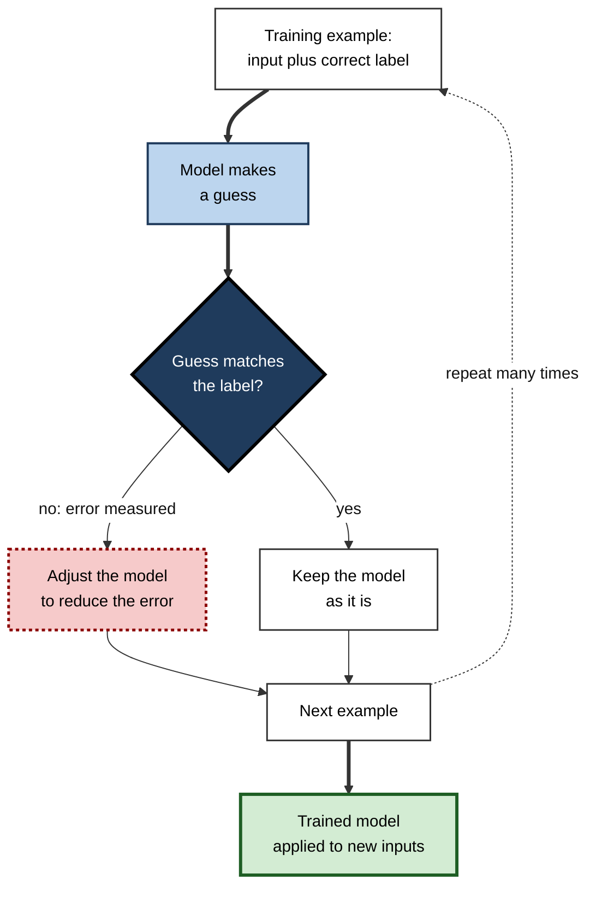
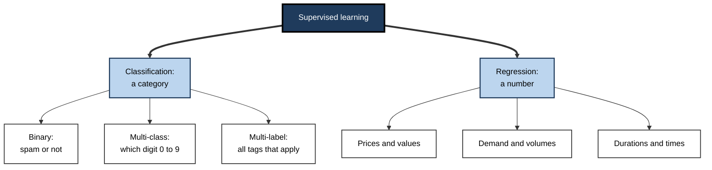
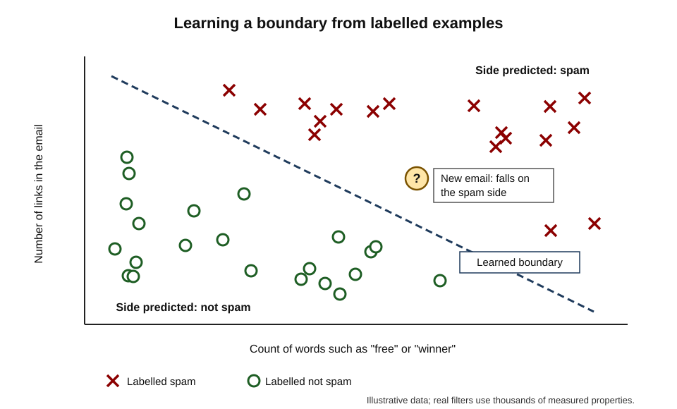
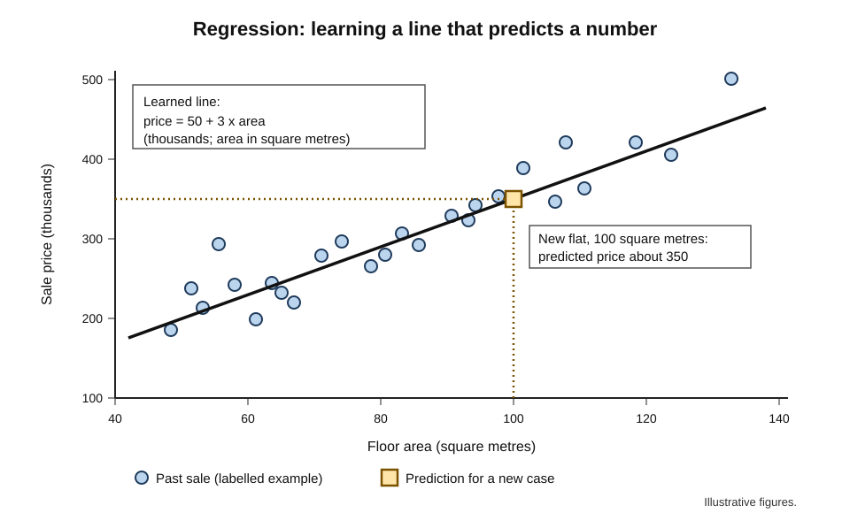
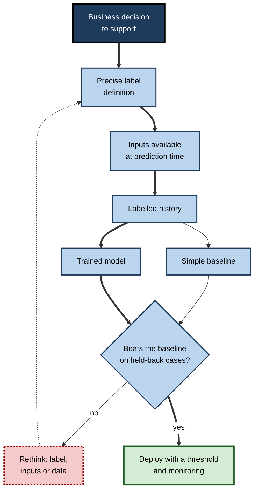

# D.3. Supervised learning explained with examples

A child is shown a picture book: "this is a dog", "this is a cat", "this is a dog again". After enough pages the child points at an unfamiliar animal in the park and says "dog" — correctly. Nobody gave the child a definition of a dog; the child learned from **examples paired with the right answer**. Most of the AI that people meet every day — spam filters, fraud alerts, credit scores, photo tagging, speech-to-text — learned in essentially the same way.

> **Definition — Supervised learning:** a way of building AI in which a system learns from examples that each come with the correct answer, so that it can produce the right answer for new examples it has never seen.

**Why it matters**

- **It is the workhorse of practical AI.** Most deployed business models — forecasting, risk scoring, classification of documents, images and speech — are supervised.
- **It makes performance measurable.** Because correct answers exist, accuracy can be checked objectively.
- **It explains AI's dependence on human judgement.** Someone must decide what the "right answer" is for every training example — and the model inherits that judgement.
- **It sets realistic expectations.** A supervised model can do only what its examples taught; it cannot answer a question it was never shown answers to.

---

## Learning With an Answer Key

### The three ingredients

- **Inputs** — the information available about each case.
  - *e.g.* the text of an email; the pixels of an image; the details of a loan application.
- **Correct outputs (labels)** — the answer for each case, known in advance.
  - *e.g.* "spam" or "not spam"; "cat"; "repaid" or "defaulted".
- **A learning procedure** — a method that searches for a rule linking inputs to outputs.
- **Result** — a model: a learned mapping from input to output that can be applied to new cases.

> **Definition — Label:** the correct answer attached to a training example — the output a supervised model is meant to learn to produce.

> **Definition — Generalisation:** a model's ability to give correct outputs for new examples that were not in its training data.

### Why "supervised"?

- The correct answers act like a **supervisor** or teacher marking the learner's work.
- During training the model guesses, the guess is compared with the label, and the model is adjusted to be less wrong next time.
- The name contrasts with **unsupervised** learning, where examples have no answers and the system must find structure on its own.

> **Key point:** supervised learning is **learning by correction**. Every training example says: "for this input, the right output is this."

**Figure 1.** The supervised learning cycle.

---

## Two Kinds of Question

### Classification: which category?

> **Definition — Classification:** a supervised task in which the output is a category chosen from a fixed set.

- **Binary classification** — two possible answers.
  - *e.g.* spam or not; fraud or genuine; tumour present or absent; customer will leave or stay.
- **Multi-class classification** — one answer from many.
  - *e.g.* which of 120 dog breeds; which department should handle a complaint; which digit 0–9 is written.
- **Multi-label classification** — several answers can apply at once.
  - *e.g.* a news article tagged "politics", "economy" and "Europe"; a photo containing "beach", "dog" and "sunset".
- **Scores behind the labels** — most classifiers output a **probability-like score**, and a threshold turns it into a decision.
  - *e.g.* "fraud score 0.93" → block if above 0.8.

### Regression: how much?

> **Definition — Regression:** a supervised task in which the output is a number on a continuous scale.

- *e.g.* the price a house will sell for; tomorrow's electricity demand; the number of days until a machine part fails; a patient's expected length of stay.
- **The name** comes from statistics, where "regression" originally described fitting a line through data; it now covers any numerical prediction.

| | Classification | Regression |
|---|---|---|
| Question asked | Which category? | How much, how many, how long? |
| Output | A label, usually with a score | A number |
| Example | Will this invoice be paid late: yes or no? | How many days late will it be paid? |
| What counts as an error | Choosing the wrong category | The distance between predicted and true value |
| Typical measure | Share of correct answers, and kinds of mistake | Average size of the error |

**Figure 2.** Common supervised tasks grouped by the kind of answer they produce.

> **Watch out:** the same business problem can often be framed either way. "Will the customer leave?" is classification; "how many months until the customer leaves?" is regression. The framing changes what labels are needed and what the model can tell decision-makers.

---

## Supervised Learning, Example by Example

### Example 1: a spam filter learns which words matter

- **Inputs:** the words in each email.
- **Labels:** "spam" or "not spam", supplied by users clicking "report spam" or "not spam".
- **What is learned:** how strongly each word, and combinations of words, point towards each label.

**Worked example (illustrative): counting the evidence**

| Word | Spam emails containing it (of 1,000) | Genuine emails containing it (of 1,000) | Ratio spam : genuine | What the filter learns |
|---|---|---|---|---|
| "winner" | 400 | 10 | 40 : 1 | Strong sign of spam |
| "invoice" | 150 | 100 | 1.5 : 1 | Weak sign of spam |
| "meeting" | 20 | 300 | 1 : 15 | Strong sign of genuine mail |

*Illustrative figures.*

1. **Count** — in the labelled examples, how often each word appears in each class.
2. **Weigh** — a word much more common in spam becomes evidence for spam, and the reverse.
3. **Combine** — a new email containing "winner" but also "meeting" receives evidence in both directions; the filter adds up the evidence from all its words.
4. **Decide** — if the combined evidence passes a threshold, the email goes to the junk folder.
5. **Update** — as users keep reporting mail, new labelled examples arrive and the filter is retrained, so it can follow spammers' changing vocabulary.

> **In practice:** the earliest widely used learning spam filters in the late 1990s and early 2000s worked much like this, using probabilities of words in each class. Modern filters add thousands of other signals — sender reputation, links, layout, timing — but the supervised principle is unchanged.

**Figure 3.** A learned boundary separating labelled spam from genuine email, used to classify a new message.

> **Definition — Decision boundary:** the dividing line, or surface, that a classification model learns between regions of input space assigned to different categories.

### Example 2: predicting a price by fitting a line

- **Inputs:** a flat's floor area.
- **Labels:** the price each past flat actually sold for.
- **What is learned:** a line through the data — a rule of the form "price = starting amount + rate × area".

**Worked example (illustrative): a one-variable price model**

1. **Plot** past sales: each point is one flat — area along the bottom, price up the side.
2. **Fit** the line that keeps the points as close to it as possible. Suppose learning finds: **price = 50 + 3 × area** (thousands; area in square metres).
3. **Predict** for a new 100 m² flat: 50 + 3 × 100 = **350 thousand**.
4. **Check the error** on a past sale: a 80 m² flat sold for 300; the line predicted 50 + 240 = 290 — an error of 10 thousand.
5. **Improve** by adding inputs: location, floor, age, condition. Each becomes another term with its own learned rate.

> **Formula — Linear model:** prediction = b + w₁x₁ + w₂x₂ + … + wₙxₙ, where the x's are inputs, the w's are learned weights and b is a learned starting value. Example: 50 + 3 × 100 = 350.

**Figure 4.** Regression: a line learned from past sales predicts the price of a new flat.

> **Watch out:** the learned rate of "3 thousand per square metre" describes how price and area moved together **in the training data**. It does not mean adding a square metre to a particular flat would raise its value by exactly that amount — larger flats may also be in different areas or newer buildings.

### Example 3: recognising images

- **Inputs:** an image — to a computer, a grid of numbers giving the brightness of each pixel.
- **Labels:** what each image shows, typed by people.
  - *e.g.* the ImageNet competition used about 1.2 million training photographs, each assigned one of 1,000 categories by human annotators.
- **What is learned:** a deep neural network learns, layer by layer, to detect edges, then textures and shapes, then object parts, then whole objects — without anyone specifying these features.
- **Why supervision is essential here:** nobody could write rules defining "a cat" in pixels; but thousands of labelled cat pictures let the model find its own internal description.

### Example 4: learning from the most similar past cases

- **The idea:** to decide a new case, find the most similar past cases with known outcomes and follow the majority.
- **Name:** **nearest-neighbour** classification — one of the simplest supervised methods, and easy to explain.

**Worked example (illustrative): a small-business loan**

A lender compares a new applicant with the five most similar past applicants (by revenue, years trading, sector and existing debt).

| Past applicant | Similarity to new applicant | Outcome (label) |
|---|---|---|
| A | Very close | Repaid |
| B | Very close | Repaid |
| C | Close | Defaulted |
| D | Close | Repaid |
| E | Fairly close | Repaid |

*Illustrative figures.*

1. **Find neighbours** — the five most similar labelled cases.
2. **Vote** — four repaid, one defaulted.
3. **Predict** — "likely to repay", with an estimated chance of about 4 in 5.
4. **Explain** — the lender can show which past cases drove the decision.

> **Key point:** whatever the method — word counts, lines, neural networks or similar cases — supervised learning always does the same thing: it uses examples **with answers** to find a rule that produces answers for **new** examples.

---

## What a Supervised Model Actually Learns

### A mapping, not understanding

- **A function** — a learned way of turning inputs into outputs.
- **Patterns of association** — which input characteristics tended to accompany which labels.
- **No reasons** — the model does not know *why* a word signals spam or *why* an area raises a price.
- **No knowledge beyond the task** — a model that classifies dog breeds knows nothing about dogs' behaviour, diet or history.

> **Watch out:** supervised models find **correlations**, not causes. A model may learn that customers who contact support often are likely to leave — but that does not mean reducing support contacts would keep them.

### Generalising, not memorising

- **The goal** is correct answers on **new** cases, not on training cases.
- **Memorisation** would be easy and useless — storing every training example and its label would score perfectly on them and fail on anything new.
- **Checking** — practitioners always test on examples held back from training, to see how well the model generalises.

### Learning shortcuts

- **What happens:** models seize on whatever input pattern best predicts the label in the training data — even if it is irrelevant to the real task.
- *e.g.* if most training photos of wolves have snow in the background, a model may learn "snow → wolf".
- **Why it matters:** the shortcut works on similar data and fails abruptly when the pattern breaks.
- **Defence:** varied training data and testing on deliberately different conditions.

> **Definition — Shortcut learning:** a model's reliance on easy, incidental patterns in training data that predict the label there but do not reflect the real task.

---

## Where the Answers Come From

The defining requirement of supervised learning — a correct answer for every training example — is also its main cost.

- **Human annotation** — people label examples on purpose.
  - *e.g.* drawing boxes around pedestrians; transcribing speech; marking contract clauses.
- **Expert labelling** — specialists provide answers.
  - *e.g.* radiologists grading scans; lawyers classifying documents. Accurate but expensive and slow.
- **Natural outcomes** — the label arrives later as a recorded fact.
  - *e.g.* whether a loan was repaid; whether a customer cancelled; actual sales figures.
- **Implicit signals** — behaviour taken as a label.
  - *e.g.* a click taken to mean "relevant"; a skipped song taken to mean "disliked".
- **Existing records** — labels created for other purposes.
  - *e.g.* diagnosis codes in hospital billing; past case decisions.

| | Human annotation | Natural outcomes | Implicit signals |
|---|---|---|---|
| Example | Annotators mark spam | Loan repaid or defaulted | User clicked a result |
| Cost | High per example | Low, but slow to arrive | Very low |
| Speed | Days to weeks | Months to years | Immediate |
| Typical weakness | Disagreement between annotators | Only observed for cases that were approved | Clicks do not equal satisfaction |

> **Watch out:** labels from natural outcomes can be incomplete in a hidden way. A lender knows whether **approved** loans were repaid, but never learns what would have happened to **rejected** applicants — so a model trained on its records learns only from the people the old process accepted.

---

## A Landmark Example from Medicine

**Study card — Gulshan and colleagues (2016), Google and collaborating clinicians, published in *JAMA***

- **Task:** detect referable diabetic retinopathy — eye damage from diabetes — in photographs of the retina.
- **Training data:** about 128,000 retinal images, each graded several times by a panel of 54 licensed ophthalmologists and senior ophthalmology residents.
- **Labels:** the panel's majority grade for each image.
- **Test:** two separate sets of roughly 10,000 and 1,700 images, graded by a panel of board-certified ophthalmologists.
- **Results:** at a high-specificity setting, the model detected about 87–90% of referable cases while correctly clearing about 98% of healthy eyes — comparable to the ophthalmologists in the study.
- **Conclusion:** with large numbers of expert-labelled examples, supervised learning could match specialist performance on a narrowly defined visual diagnosis.

### Case study: from the laboratory to clinics in Thailand

- **Situation:** Google researchers studied the system's deployment in eleven clinics in Thailand, reported at a human–computer interaction conference in 2020 (Emma Beede and colleagues).
- **Problem:** performance in real clinics depended on conditions that the laboratory study had controlled.
  - Many images taken by nurses in poorly lit rooms were judged by the system to be of insufficient quality, and it declined to grade them.
  - Uploads were slowed by unreliable internet connections.
  - Patients whose images were rejected sometimes had to be referred elsewhere, at cost and inconvenience.
- **Diagnosis:** the model had learned from high-quality images; the clinic images looked different. The supervised model was accurate **on data like its training data**, but the operational setting produced different data.
- **Actions:** the researchers worked with clinic staff on image capture and workflow; the study argued for designing around real conditions before deployment.
- **Lesson:** a supervised model's accuracy is a property of the model **and the data it receives**. Laboratory accuracy is a starting point, not a guarantee.

---

## Strengths and Limits

### Strengths

- **Clear goal** — the labels define exactly what success means.
- **Measurable** — accuracy on held-back labelled data can be reported objectively.
- **Powerful** — with enough good examples, it can match or exceed human performance on narrow tasks.
- **Flexible** — the same approach works for text, images, sound, numbers and combinations.
- **Mature** — methods, tools and practices are well established.

### Limits

- **Labels are expensive** — especially when experts are needed.
- **Labels embody judgement** — biased, inconsistent or poorly defined labels produce biased, inconsistent or poorly defined models.
- **Only what was asked** — the model learns the labelled task and nothing else.
- **Rare cases are hard** — if few examples of an outcome exist, the model learns it poorly.
- **The world moves** — when conditions change, examples from the past may stop describing the present.
- **Shortcuts** — models can succeed for the wrong reasons.

| | Rules written by people | Supervised learning | Learning without labels |
|---|---|---|---|
| What people provide | The rules themselves | Examples with answers | Examples only |
| Works best when | Logic is known and stable | The answer is known for many past cases | Structure is unknown and answers absent |
| Main cost | Expert time writing rules | Collecting and labelling examples | Interpreting what was found |
| Main risk | Missing cases the rules did not foresee | Learning the labellers' errors and shortcuts | Finding patterns that mean nothing useful |

> **Key point:** supervised learning trades the impossible job of **writing down the rules** for the hard but possible job of **writing down the answers**.

---

## Supervised Learning in Professional Practice

### Turning a business problem into a supervised task

1. **State the decision** — what will be done differently with a prediction?
   - *e.g.* "contact customers likely to leave before their renewal date."
2. **Define the label precisely** — what exactly counts as the outcome, measured when?
   - *e.g.* "did not renew within 30 days of contract end."
3. **Choose the inputs** — only information available **at the moment of prediction**.
4. **Gather labelled history** — enough past cases of each outcome.
5. **Set a baseline** — what would a simple rule or current practice achieve?
   - *e.g.* "contact everyone whose usage fell by half."
6. **Train and compare** — does the model beat the baseline on held-back cases?
7. **Decide the threshold** — how high must a score be to act, given the cost of each kind of mistake?
8. **Deploy and monitor** — check that performance holds and labels keep arriving.

> **Mnemonic — "Decisions Demand Clear Goals, Simple Tests, Then Monitoring":** Decision, Define the label, Choose inputs, Gather history, Set a baseline, Train and compare, Threshold, Monitor.

**Figure 5.** From business decision to deployed supervised model.

### Case study (illustrative): triaging insurance claims

- **Situation:** a motor insurer received about 40,000 claims a month. Experienced handlers spent much of their time on simple claims that could have been paid immediately.
- **Goal:** route straightforward claims to fast-track payment and complex or suspicious ones to senior handlers.
- **Label definition:** a claim was "simple" if, in the past, it had been paid in full within ten days with no investigation and no later dispute.
- **Inputs:** claim type, vehicle details, policy age, damage photographs, the claimant's description — all available when the claim arrived.
- **Training data:** three years of closed claims, about 1.2 million, with their outcomes.
- **First result:** in testing, the model identified simple claims accurately. But reviewers noticed it rated almost every claim from one region as "complex".
- **Diagnosis:** for two years, a regional office had routinely investigated every claim regardless of merit. Its claims were labelled "not simple" because of **office practice**, not claim characteristics.
- **Actions:**
  - redefined the label for that region using only claims where investigation found an actual problem;
  - added reviewers' spot-checks of the model's fast-track decisions;
  - kept a human approval step for claims above a set value.
- **Result:** about a third of claims were fast-tracked; average settlement time for them fell from weeks to days; senior handlers' time shifted to complex cases. *Illustrative figures.*
- **Lesson:** the model learned the labels faithfully — including a quirk of past practice. **The label definition is the most consequential design decision in supervised learning.**

### Questions to ask about any supervised system

- **What exactly is the label, and who or what produced it?**
- **Would those labels be agreed by independent experts?**
- **Were the training cases like the cases it will meet?**
- **How does it compare with a simple baseline or current practice?**
- **Which kinds of mistake does it make, and what do they cost?**
- **How will new labels be collected to keep it current?**

---

## Open Questions

- **How can the cost of labels be reduced without losing quality?**
  - Methods that learn from mostly unlabelled data, or that ask for labels only where most useful, are advancing, but expert labels remain the bottleneck in fields such as medicine and law.
- **What should be done when experts disagree?**
  - For many tasks — grading tumours, judging hate speech — qualified people disagree; whether to train on majority votes, on the disagreement itself or on expert consensus is unsettled.
- **How far does laboratory accuracy transfer to real settings?**
  - Repeated experience, as in the Thailand deployment, shows performance can fall in new conditions; predicting how much in advance is still difficult.
- **Will supervised learning remain central?**
  - Large models now learn mostly from unlabelled data and are only refined with labels; the balance between the approaches continues to shift.

---

## Summary

- **Supervised learning** builds models from examples paired with correct answers (**labels**), aiming at **generalisation** to new cases.
- It is **learning by correction**: guess, compare with the label, adjust, repeat.
- **Classification** predicts categories (binary, multi-class, multi-label), usually via a score and threshold; **regression** predicts numbers.
- Examples: **spam filters** weigh evidence from words; **price models** fit lines through past sales; **image recognisers** learn features from labelled pictures; **nearest-neighbour** methods follow the majority of similar past cases.
- Models learn **mappings and correlations**, not reasons or causes; they can learn **shortcuts** that fail when conditions change.
- Labels come from **human annotation, experts, natural outcomes, implicit signals and existing records**, each with distinctive costs and weaknesses — including outcomes observed only for cases the old process accepted.
- **Gulshan and colleagues (2016)** showed specialist-level retinal screening from about 128,000 expert-labelled images; the **Thailand deployment** showed real-world data can differ from laboratory data.
- Strengths: clear goal, measurable, powerful, flexible, mature. Limits: label cost, inherited judgement, narrow scope, rare cases, a changing world, shortcuts.
- In practice: define the decision and the label precisely, use only inputs available at prediction time, beat a baseline on held-back data, choose thresholds by error costs and monitor.

---

## Self-Check

1. Define supervised learning and explain why it is called "supervised".
2. Distinguish classification from regression, with one example of each from a workplace you know.
3. What is the difference between binary, multi-class and multi-label classification?
4. In the spam worked example, why is "invoice" only weak evidence while "meeting" is strong evidence?
5. Using the price model "price = 50 + 3 × area", predict the price of a 120 m² flat. Why should the rate of 3 not be read as a causal effect?
6. How does nearest-neighbour classification decide a new case, and what advantage does it offer for explaining decisions?
7. Why is memorising the training data useless, and how do practitioners check for genuine generalisation?
8. What is shortcut learning? Give an example of how it could arise in a recruitment model.
9. Compare human annotation, natural outcomes and implicit signals as sources of labels.
10. Why might a loan model trained only on approved applications be misleading?
11. Summarise the Gulshan and colleagues (2016) study and the lesson of the later deployment in Thailand.
12. In the insurance case, what caused the regional anomaly, and what general lesson does it teach?
13. A manager wants "a model that predicts which employees will be high performers". Identify three problems with the label and propose a better-defined task.

### Answer Key

1. Building a model from examples that each include the correct answer, so that it can produce correct answers for new examples. The labels act as a supervisor marking the model's guesses during training.
2. Classification outputs a category (e.g. whether a support ticket is urgent); regression outputs a number (e.g. how many hours a ticket will take to resolve).
3. Binary: one of two answers. Multi-class: one of many mutually exclusive answers. Multi-label: any number of answers can apply at once.
4. "Invoice" appears at similar rates in spam and genuine mail (ratio 1.5 : 1), so it barely separates them; "meeting" is fifteen times more common in genuine mail, so it strongly indicates a genuine message.
5. 50 + 3 × 120 = 410 thousand. The rate describes how price and area varied together in past sales; larger flats may also differ in location, age or quality, so the rate mixes these effects.
6. It finds the most similar past cases with known outcomes and takes the majority (or weighted) answer. Decisions can be explained by pointing to the specific past cases that drove them.
7. Memorisation scores perfectly on training examples and fails on new ones, which are what matter. Practitioners test on examples held back from training.
8. Reliance on an incidental pattern that predicts the label in training data but not in reality. A recruitment model might learn that candidates from certain universities or with certain hobbies were hired more often, rather than learning job-relevant ability.
9. Annotation: costly per example, fairly quick, subject to annotator disagreement. Natural outcomes: cheap but slow and only observed for some cases. Implicit signals: almost free and immediate, but a weak stand-in for what is actually wanted.
10. Outcomes are known only for applicants the old process approved; the model never learns about those it rejected, so it inherits the old process's blind spots and may misjudge applicants unlike past approvals.
11. A model trained on about 128,000 retinal images, each graded by several ophthalmologists, detected referable diabetic retinopathy with sensitivity and specificity comparable to specialists in the study. In Thai clinics, poorer lighting, image quality and connectivity led to many images being rejected — accuracy depended on receiving data like the training data.
12. A regional office investigated every claim, so its claims were labelled "not simple" because of office practice. Lesson: models learn labels faithfully, including quirks of past processes, so label definitions must be examined.
13. "High performer" is vague; past ratings may reflect manager bias; outcomes depend on team, role and opportunity; and the model might replicate existing inequities. Better: a precisely defined, role-specific, measurable outcome — for example, "will a new sales hire reach quota within 12 months" — checked for bias, used to target support rather than to exclude people.

---

## Glossary

| Term | Meaning |
|---|---|
| Binary classification | Classification with two possible answers. |
| Classification | A supervised task whose output is a category. |
| Decision boundary | The learned dividing line between regions assigned to different categories. |
| Generalisation | Producing correct outputs for examples not seen in training. |
| Label | The correct answer attached to a training example. |
| Linear model | A model whose prediction is a weighted sum of inputs plus a starting value. |
| Multi-class classification | Choosing one answer from many categories. |
| Multi-label classification | Assigning any number of applicable categories. |
| Nearest-neighbour classification | Predicting from the outcomes of the most similar past cases. |
| Regression | A supervised task whose output is a number. |
| Shortcut learning | Relying on incidental patterns that predict labels in training data but not in reality. |
| Supervised learning | Learning from examples paired with correct answers. |
| Threshold | The score above which a classifier's output is turned into a positive decision. |
