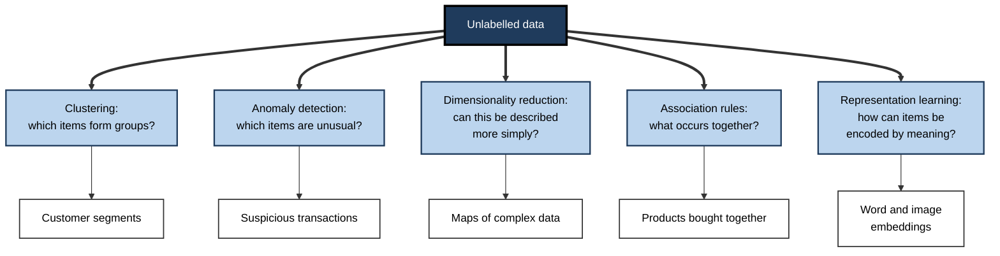
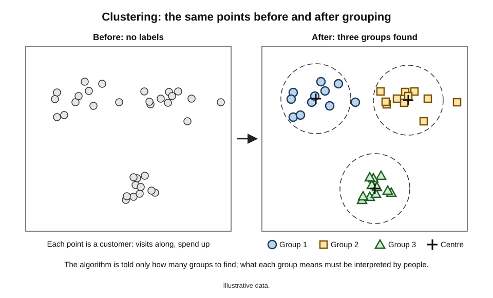
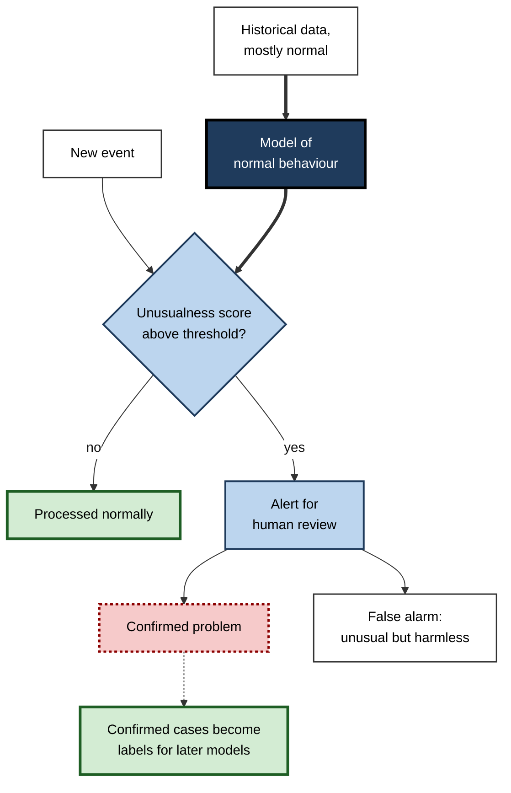
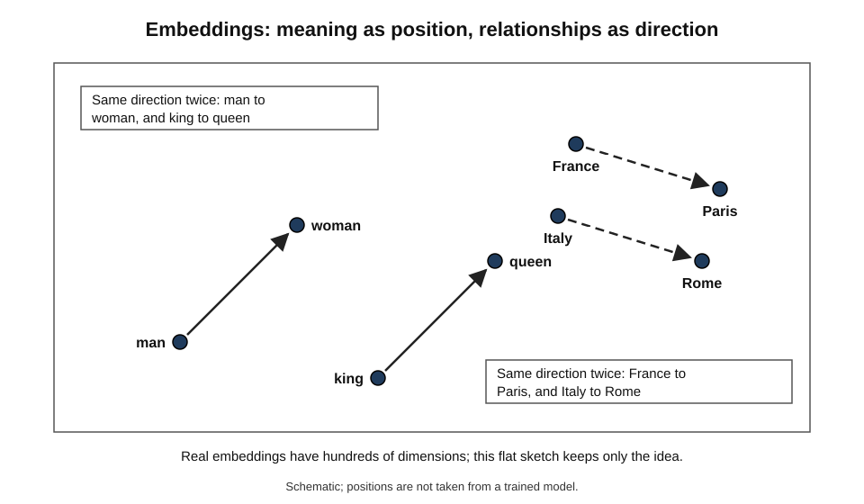
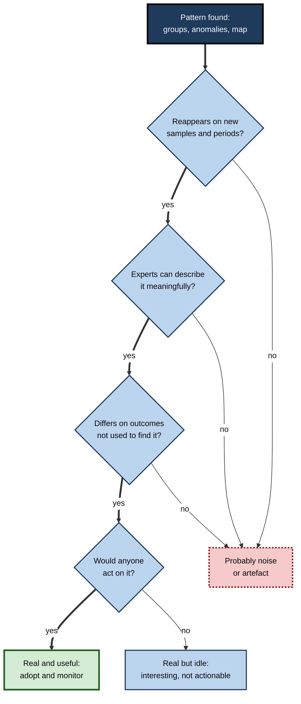

# D.4. Unsupervised learning: finding hidden patterns

Tip a jar of mixed buttons onto a table and ask someone to sort them. Nobody says what the categories are, yet within minutes there are piles — large and small, metal and plastic, two holes and four. A retailer facing millions of customers, a bank facing billions of transactions and a scientist facing thousands of gene measurements are in the same position: there are no answers attached to the data, only the data itself. **Unsupervised learning** is the family of methods that finds the piles.

> **Definition — Unsupervised learning:** a way of building AI in which a system is given data **without correct answers** and discovers structure in it — groups, unusual cases, simpler descriptions or things that occur together.

**Why it matters**

- **Most data has no labels.** Labelling is slow and costly; unlabelled records are abundant.
- **Sometimes nobody knows the answer.** The categories may not yet exist — new customer types, new disease subtypes, new kinds of fraud.
- **It supports exploration.** Before deciding what to predict, analysts need to know what is in the data.
- **It underpins modern AI.** Large language and image models learn first from enormous unlabelled collections, by methods that grew out of the unsupervised tradition.
- **It is easy to misread.** Unsupervised methods always produce *some* pattern; judging whether it means anything is a professional skill.

---

## Learning Without an Answer Key

### What changes when the labels disappear

- **In supervised learning** — every example says "for this input, the right output is this"; errors can be measured exactly.
- **In unsupervised learning** — there is no "right output"; the system looks for regularities in the inputs themselves.
- **The role of the human shifts** — from *supplying answers before* learning to *interpreting results after* it.

| | Supervised learning | Unsupervised learning |
|---|---|---|
| Training examples | Inputs with correct answers | Inputs only |
| Question asked | "What is the answer for this case?" | "What structure is in this data?" |
| Output | Predictions of a defined label | Groups, scores of unusualness, simpler descriptions, associations |
| How success is judged | Accuracy against known answers | Usefulness, stability and expert interpretation |
| Typical use | Spam filtering, price prediction | Customer segmentation, anomaly alerts, data exploration |
| Main risk | Learning the labellers' errors | Finding patterns that mean nothing |

> **Key point:** unsupervised learning does not answer a question the user asked. It **proposes** structure, which people must then examine, name and test.

### The core idea: similarity

- Almost every unsupervised method rests on a notion of **similarity** — which examples resemble each other.
- **Distance** is the usual measure: examples are treated as points, each variable a direction, and nearby points are similar.
  - *e.g.* two customers with similar visit frequency and similar spend are "close".
- **The choice of variables decides the answer** — measure customers by age and income and one set of groups appears; measure them by products bought and a different set emerges.

> **Watch out:** variables measured on large scales dominate distances. If spend is in pounds (values in the hundreds) and visits are counts (values below ten), spend will decide almost everything unless the variables are first put on comparable scales.

**Figure 1.** The main families of unsupervised learning and the questions they answer.

---

## Finding Groups: Clustering

> **Definition — Clustering:** dividing a set of examples into groups (clusters) so that examples in the same group are more similar to each other than to examples in other groups.

### How k-means works

The best-known clustering method, **k-means**, was described by Stuart Lloyd at Bell Labs in 1957 (published in 1982) and named by James MacQueen in 1967. The user chooses *k*, the number of groups.

1. **Place** k starting centres, often at randomly chosen examples.
2. **Assign** every example to its nearest centre.
3. **Move** each centre to the average position of the examples assigned to it.
4. **Repeat** steps 2 and 3 until assignments stop changing.

> **Mnemonic — "PAMR" ("Pam, repeat"):** Place, Assign, Move, Repeat.

### Worked example (illustrative): two groups of shoppers

Six customers are described by visits per month and average spend per visit.

| Customer | Visits per month | Average spend |
|---|---|---|
| A | 1 | 20 |
| B | 2 | 25 |
| C | 1 | 30 |
| D | 8 | 80 |
| E | 9 | 90 |
| F | 10 | 85 |

*Illustrative figures.*

1. **Place** (k = 2) — by bad luck, the starting centres are customers A (1, 20) and B (2, 25), both in the low group.
2. **Assign** — C is nearer B; D, E and F are also nearer B (B is slightly closer to them than A). Groups: {A} and {B, C, D, E, F}.
3. **Move** — centre 1 stays at (1, 20); centre 2 moves to the average of B, C, D, E, F: visits (2 + 1 + 8 + 9 + 10) ÷ 5 = 6, spend (25 + 30 + 80 + 90 + 85) ÷ 5 = 62 → (6, 62).
4. **Assign again** — B and C are now far nearer centre 1 than (6, 62); D, E and F stay with centre 2. Groups: {A, B, C} and {D, E, F}.
5. **Move again** — centre 1 → (1.3, 25); centre 2 → (9, 85).
6. **Assign again** — nothing changes. **Stop.**

- **What emerged:** "occasional low spenders" and "frequent high spenders" — groups nobody defined in advance.
- **What the method did not do:** name the groups, judge whether two is the right number, or say why the groups differ.

**Figure 2.** The same unlabelled points before and after clustering into three groups.

> **Watch out:** k-means always returns exactly k groups — even when the data has no real groups at all. Ask it for five clusters of random noise and it will produce five, each with a tidy centre.

### Other ways to cluster

- **Hierarchical clustering** — repeatedly merges the closest examples or groups into larger groups, producing a tree.
  - The tree can be "cut" at any height to give more or fewer groups.
  - Common in biology, where nested groupings are natural.
- **Density-based clustering** — finds regions where examples are packed closely, separated by sparse regions.
  - Can find groups of any shape and leaves isolated points unassigned as "noise".
  - *e.g.* the DBSCAN method, published in 1996.
- **Soft clustering** — each example belongs to every group with some probability, rather than to exactly one.
  - *e.g.* a customer who is 70% "bargain hunter" and 30% "premium buyer".

### How many groups?

- **No single right answer** — the "best" number depends on purpose.
  - A marketing team may want four segments it can act on; a scientist may want every distinct subtype.
- **Helpful signals**
  - **Diminishing improvement** — adding groups always makes them tighter; look for the point where extra groups add little (the "elbow").
  - **Separation** — measures such as the **silhouette score** compare how close each example is to its own group versus the nearest other group.
  - **Stability** — real groups reappear when the method is rerun on different samples of the data.
  - **Usefulness** — can each group be described, and would it be treated differently?

> **Key point:** the number of clusters is a **decision**, informed by measures but made for a purpose — not a fact discovered in the data.

---

## Spotting the Unusual: Anomaly Detection

> **Definition — Anomaly detection:** identifying examples that differ markedly from the bulk of the data, on the assumption that rare, unusual cases may signal problems or opportunities.

- **The logic** — learn what "normal" looks like from mostly ordinary data; flag whatever departs from it.
- **Why unsupervised** — the anomalies of interest are often new: a fraud technique never seen before, a fault mode not yet recorded.
- **Uses**
  - **Finance** — unusual card transactions, unusual trading.
  - **Cybersecurity** — unusual network traffic or log-in patterns.
  - **Industry** — vibration or temperature signatures before machine failure.
  - **Healthcare** — unusual readings in monitoring data.
  - **Data quality** — records that are probably errors.
- **Approaches**
  - **Distance** — far from all other examples.
  - **Density** — in a sparsely populated region.
  - **Reconstruction** — a model trained to compress and rebuild normal data rebuilds unusual data poorly; a large rebuilding error flags an anomaly.
  - **Isolation** — unusual points can be separated from the rest with few random cuts (the "isolation forest" method, 2008).

**Figure 3.** How unsupervised anomaly detection turns unusual cases into reviewed alerts.

> **Watch out:** "unusual" is not the same as "bad". A first purchase abroad, a record-breaking sales day and a new customer type are all anomalies. Without review, anomaly detection floods teams with false alarms — and fraudsters who imitate normal behaviour pass unnoticed.

---

## Simplifying: Dimensionality Reduction

> **Definition — Dimensionality reduction:** re-describing data that has many variables using far fewer, while keeping as much of the important variation as possible.

- **The problem** — a customer may be described by 500 variables, a gene sample by 20,000; nobody can look at that many at once, and many variables repeat each other.
- **The shadow analogy** — a three-dimensional object casts a two-dimensional shadow; chosen well, the shadow still shows the object's shape.
- **Principal component analysis (PCA)**
  - Introduced by Karl Pearson in 1901 and developed by Harold Hotelling in 1933.
  - Finds new combined directions in the data — the first capturing the most variation, the second the most remaining, and so on.
  - *e.g.* in a survey of many related satisfaction questions, the first component may amount to "overall satisfaction".
- **Maps for viewing data**
  - Methods such as **t-SNE** (Laurens van der Maaten and Geoffrey Hinton, 2008) and **UMAP** (2018) place high-dimensional examples on a flat map so that neighbours stay neighbours.
  - Widely used to view clusters of cells, documents or images.
- **Uses**
  - **Visualisation** — seeing structure in complex data.
  - **Compression** — storing or transmitting less.
  - **Noise removal** — discarding minor variation.
  - **Preparation** — giving a supervised model fewer, cleaner inputs.

> **Watch out:** on t-SNE and UMAP maps, the **sizes** of clusters and the **distances between** clusters are often not meaningful; only "who is near whom" is reasonably reliable. Striking pictures from these methods are frequently over-interpreted.

---

## Finding What Goes Together: Association Rules

> **Definition — Association rule:** a pattern of the form "when X occurs, Y tends to occur too", found by counting co-occurrences in large collections of transactions.

- **Origin** — Rakesh Agrawal and colleagues at IBM formalised the mining of such rules from supermarket transaction data in 1993; the efficient **Apriori** method followed in 1994.
- **Uses** — product placement, "frequently bought together" suggestions, bundling, cross-selling, finding co-occurring symptoms or faults.
- **Three measures**
  - **Support** — how often X and Y occur together, as a share of all transactions.
  - **Confidence** — of transactions with X, the share that also have Y.
  - **Lift** — how much more often Y occurs with X than it does overall.

> **Formula — Support, confidence, lift (illustrative figures):** in 1,000 baskets, 100 contain nappies, 80 contain beer and 40 contain both. Support = 40 ÷ 1,000 = 4%. Confidence (nappies → beer) = 40 ÷ 100 = 40%. Beer appears in 80 ÷ 1,000 = 8% of all baskets, so lift = 40% ÷ 8% = **5** — beer is five times more likely in a basket that contains nappies.

> **Watch out:** the famous story that a supermarket discovered beer and nappies were bought together on Friday evenings, and moved them side by side, is largely a legend. Its origins trace to a 1990s retail-analytics project, but accounts disagree, and there is no reliable record of a store rearranging shelves because of it. It survives because it illustrates the idea neatly.

- **Lift matters more than confidence** — "people who buy bread also buy milk" has high confidence simply because almost everyone buys milk; lift near 1 shows bread adds no information.

---

## Learning Representations

### Embeddings: meaning as position

> **Definition — Embedding:** a list of numbers representing an item — a word, sentence, image, product or person — learned so that similar items receive similar lists.

- **The linguistic idea** — the British linguist J. R. Firth wrote in 1957 that "you shall know a word by the company it keeps": words used in similar contexts tend to have similar meanings.
- **Word2vec (2013)** — Tomas Mikolov and colleagues at Google trained a simple network, on billions of words of unlabelled text, to predict words from their neighbours.
  - Each word ended up as a point in a space of a few hundred dimensions.
  - Related words were near each other; some relationships appeared as consistent directions.
  - *e.g.* the arithmetic "king − man + woman" landed near "queen".
- **Why this counts as learning without labels** — nobody told the system what any word meant; its "teacher" was the text itself.

**Figure 4.** A sketch of an embedding space in which meaning is position and relationships are directions.

> **Watch out:** embeddings also learn the **associations present in their text**, including stereotypes. A 2016 study (Tolga Bolukbasi and colleagues) showed that word embeddings trained on news text completed analogies such as "man is to computer programmer as woman is to homemaker". Patterns found without labels are patterns of the data — not neutral truths.

### Self-supervised learning

> **Definition — Self-supervised learning:** learning from unlabelled data by hiding part of each example and training the system to predict the hidden part, so that the data supplies its own answers.

- **How it works** — create a task from the raw data itself.
  - *e.g.* hide a word and predict it; predict the next word; hide part of an image and reconstruct it.
- **Why it is powerful** — it turns the vast supply of unlabelled data into training material with automatic "answers".
- **Where it sits** — technically it trains like supervised learning, but needs no human labels, so it is often grouped with unsupervised learning.
- **Its significance** — today's large language models learn their general abilities this way, by predicting the next token across enormous text collections, before any human-labelled refinement.

**Study card — Le and colleagues (2012), Google and Stanford University**

- **Design:** a very large neural network, trained on about 16,000 processor cores for several days, viewed 10 million still frames taken from YouTube videos.
- **No labels:** the network was trained only to compress and reconstruct the images; nobody told it what any image contained.
- **Result:** some units in the network responded strongly to particular concepts that had never been named — one responded selectively to **cat faces**, another to human faces and bodies.
- **Conclusion:** given enough unlabelled data, a network can form internal detectors for meaningful concepts by itself. The finding was widely reported as "Google's computer that learned to recognise cats".

---

## Is the Pattern Real?

Because there is no answer key, judging an unsupervised result is harder than judging a supervised one — and more important.

- **Internal measures** — how tight and separated are the groups? How much variation is kept?
  - Necessary but not sufficient: tidy-looking structure can be meaningless.
- **Stability** — does the pattern reappear on a different sample, a different time period or a different method?
- **Interpretability** — can domain experts describe each group or anomaly in meaningful terms?
- **External validation** — do the groups differ on something **not used** to build them?
  - *e.g.* customer segments found from purchases also differ in later loyalty; tumour groups found from gene activity also differ in survival.
- **Actionability** — would anyone act differently because of it?

> **Mnemonic — "In Seeing Is Everything, Act" (ISIEA):** Internal measures, Stability, Interpretability, External validation, Actionability.

**Figure 5.** Testing whether an unsupervised pattern is real and useful.

> **Key point:** structure that cannot survive a fresh sample, an expert's scrutiny and a test against outcomes it was not built from should be treated as an artefact of the method, however attractive it looks.

---

## Unsupervised Learning in Practice

### Comparing the main techniques

| Technique | Question answered | Example output | Common pitfall |
|---|---|---|---|
| Clustering | Which items form natural groups? | Five customer segments | Always finds the requested number of groups |
| Anomaly detection | Which items are unusual? | Ranked list of suspicious transactions | Unusual is not the same as harmful |
| Dimensionality reduction | Can this be described more simply? | A two-dimensional map of 20,000 variables | Over-reading distances on the map |
| Association rules | What occurs together? | "Frequently bought together" pairs | Confusing popularity with association |
| Embeddings | How can items be encoded by meaning? | Similar-product search | Inheriting stereotypes from the data |

### Combining unsupervised and supervised learning

- **Explore first** — clustering and mapping reveal what is in the data before a prediction task is chosen.
- **Features from structure** — cluster membership or embedding values become inputs to a supervised model.
- **Labels from anomalies** — alerts confirmed by investigators become labelled examples for a later supervised fraud model.
- **Pre-training** — learning general representations from unlabelled data, then refining with a small labelled set.
- **Semi-supervised learning** — using a few labelled examples alongside many unlabelled ones.

> **Definition — Semi-supervised learning:** learning from a small set of labelled examples together with a large set of unlabelled ones.

### Case study: discovering subtypes of breast cancer

- **Situation:** by the late 1990s, breast cancer was classified mainly by what pathologists saw under the microscope; tumours that looked alike could behave very differently.
- **Study:** in 2000, Charles Perou, Therese Sørlie and colleagues at Stanford University and in Norway, publishing in *Nature*, measured the activity of thousands of genes in breast tumour samples.
- **Method:** hierarchical clustering grouped tumours by the similarity of their gene-activity patterns — **without** being told any diagnosis or outcome.
- **Finding:** distinct groups emerged, later named **luminal**, **basal-like**, **HER2-enriched** and **normal-like** subtypes.
- **External validation:** follow-up work in 2001 showed the subtypes differed in patient survival — an outcome that played no part in forming the groups.
- **Impact:** molecular subtypes became part of how breast cancer is understood and researched, and gene-expression tests derived from this line of work now inform treatment decisions.
- **Lesson:** unsupervised learning can reveal categories that experts had not defined — when the discovered groups are validated against outcomes they were not built from.

### Case study (illustrative): segments that nobody could use

- **Situation:** an online retailer clustered two million customers on 140 behavioural variables and obtained eleven segments.
- **Problem:** the marketing team could not tell several segments apart, and campaigns targeted at them performed no better than untargeted ones.
- **Diagnosis:**
  1. variables were not put on comparable scales, so a few large-valued spending variables dominated;
  2. eleven was chosen because the measures improved slightly, not because eleven groups were meaningful;
  3. segments were never checked for stability — rerunning on the next month's data reshuffled about a third of customers.
- **Actions:** variables were rescaled and reduced; the team settled on five segments that reappeared consistently across months, each described in a sentence and tied to a distinct campaign.
- **Result:** campaign response improved measurably over untargeted mailing; segment descriptions became part of planning. *Illustrative figures.*
- **Lesson:** an unsupervised result is valuable only when it is **stable, describable and actionable**.

> **In practice:** experienced analysts present clusters with their **evidence of stability**, a **plain-language description** of each group and at least one **outcome the groups were not built from** on which they differ. Without these, a segmentation is a picture, not a finding.

---

## Open Questions

- **How should unsupervised results be evaluated?**
  - Without labels there is no single objective score; agreed standards for judging structure remain elusive.
- **Do the categories found by algorithms exist in nature?**
  - Disease subtypes and customer segments may be real kinds, or convenient divisions of a continuous spread; the answer differs by field and is debated.
- **How much of modern AI's ability comes from self-supervision?**
  - Large models learn mostly by predicting hidden parts of data; exactly what they learn that way, and its limits, are active research questions.
- **How can learned representations be cleaned of stereotypes?**
  - Methods to remove biased associations from embeddings have been proposed, but studies suggest the bias often persists in less visible forms.

---

## Summary

- **Unsupervised learning** finds structure in data **without correct answers**; people interpret the results afterwards.
- It rests on **similarity**, usually measured as **distance**; the choice and scaling of variables decide what is found.
- **Clustering** forms groups; **k-means** places, assigns, moves and repeats; hierarchical, density-based and soft clustering are alternatives. The number of groups is a **decision**, not a discovery — and k-means will split even random noise.
- **Anomaly detection** learns normal behaviour and flags departures; unusual is not the same as harmful, so review is essential.
- **Dimensionality reduction** (PCA, t-SNE, UMAP) re-describes many variables with few; map distances are easily over-read.
- **Association rules** find co-occurrence using **support, confidence and lift**; the beer-and-nappies story is largely legend.
- **Embeddings** encode meaning as position (word2vec, 2013); they inherit associations, including stereotypes, from their data.
- **Self-supervised learning** hides part of the data and predicts it, powering modern large models; Le and colleagues (2012) showed a network forming a cat detector from unlabelled video frames.
- Judge patterns by **internal measures, stability, interpretability, external validation and actionability**.
- **Perou and colleagues (2000)** discovered breast cancer subtypes by clustering gene activity, validated later against survival.

---

## Self-Check

1. Define unsupervised learning and explain how the human's role differs from supervised learning.
2. Why is similarity central to unsupervised learning, and how can the choice and scaling of variables change the result?
3. Describe the four steps of k-means.
4. In the worked example, why did the first assignment produce one group of one customer, and how did the method recover?
5. Why is the number of clusters a decision rather than a discovery? Name three signals that inform it.
6. What does anomaly detection assume, and why does it generate false alarms?
7. Explain principal component analysis using the shadow analogy. What should not be read from a t-SNE map?
8. In 2,000 baskets, 200 contain pasta, 300 contain sauce and 120 contain both. Calculate support, confidence (pasta → sauce) and lift. Interpret the lift.
9. What is an embedding, and what did word2vec show? What risk did the 2016 analogy study reveal?
10. How does self-supervised learning create "answers" from unlabelled data?
11. Summarise the Le and colleagues (2012) study and what it showed.
12. In the breast cancer case, why was the survival difference such important evidence?
13. A consultant presents nine customer clusters from a single run of k-means as "the natural segments of your market". What questions should be asked before accepting this?

### Answer Key

1. Learning structure from data without correct answers. In supervised learning people supply answers before training; in unsupervised learning they interpret and test the structure after it is found.
2. Methods group or flag examples by how close they are; different variables define different notions of "close", and variables on large scales dominate distances unless rescaled.
3. Place k starting centres; assign each example to the nearest centre; move each centre to the average of its examples; repeat until assignments stop changing.
4. Both starting centres were in the low group, and B was slightly nearer the high spenders than A, so B captured almost everyone. Moving centre 2 to the average of its members pulled it towards the high spenders, so the next assignment separated the groups correctly.
5. Data rarely contains a single "true" number of groups; the right number depends on purpose. Signals: the elbow of diminishing improvement, separation measures such as the silhouette score, stability across samples, and usefulness.
6. That normal behaviour dominates the data and rare departures may indicate problems. Many unusual events are harmless, so alerts include false alarms; and anomalies designed to look normal are missed.
7. Like a well-chosen shadow of a 3-D object, PCA finds a few combined directions that keep most of the variation. On t-SNE maps, cluster sizes and distances between clusters are often not meaningful.
8. Support = 120 ÷ 2,000 = 6%. Confidence = 120 ÷ 200 = 60%. Sauce overall = 300 ÷ 2,000 = 15%, so lift = 60 ÷ 15 = 4: sauce is four times more likely in a basket with pasta than in a basket chosen at random.
9. A learned list of numbers placing similar items close together. Word2vec learned word positions from unlabelled text, with relationships appearing as directions (king − man + woman ≈ queen). The 2016 study showed embeddings absorb stereotypes from their training text.
10. It hides part of each example — a word, the next token, an image patch — and trains the model to predict it; the hidden part is the answer.
11. A very large network trained without labels on 10 million YouTube frames developed units that responded selectively to cat faces and human faces, showing that networks can form concept detectors from unlabelled data.
12. Survival was not used to form the groups, so the difference showed the clusters captured real biological differences rather than artefacts of the method.
13. Were variables scaled? Why nine? Do the clusters reappear on other samples and periods, and with other methods? Can each be described in plain language? Do they differ on outcomes not used to form them? Would each be treated differently?

---

## Glossary

| Term | Meaning |
|---|---|
| Anomaly detection | Identifying examples that differ markedly from the bulk of the data. |
| Association rule | A pattern "when X occurs, Y tends to occur", found by counting co-occurrences. |
| Cluster | A group of examples more similar to each other than to examples in other groups. |
| Clustering | Dividing examples into groups by similarity. |
| Confidence | Share of transactions containing X that also contain Y. |
| Dimensionality reduction | Re-describing many variables with far fewer while keeping important variation. |
| Embedding | A learned list of numbers placing similar items close together. |
| Hierarchical clustering | Building a tree of nested groups by repeatedly merging the closest ones. |
| k-means | Clustering by repeatedly assigning examples to the nearest of k centres and moving the centres. |
| Lift | How much more often Y occurs with X than overall. |
| Principal component analysis | Finding combined directions capturing the most variation in data. |
| Self-supervised learning | Learning by predicting hidden parts of unlabelled data. |
| Semi-supervised learning | Learning from a few labelled and many unlabelled examples. |
| Silhouette score | A measure comparing closeness to one's own cluster with closeness to the nearest other cluster. |
| Support | Share of all transactions containing both X and Y. |
| Unsupervised learning | Discovering structure in data without correct answers. |
