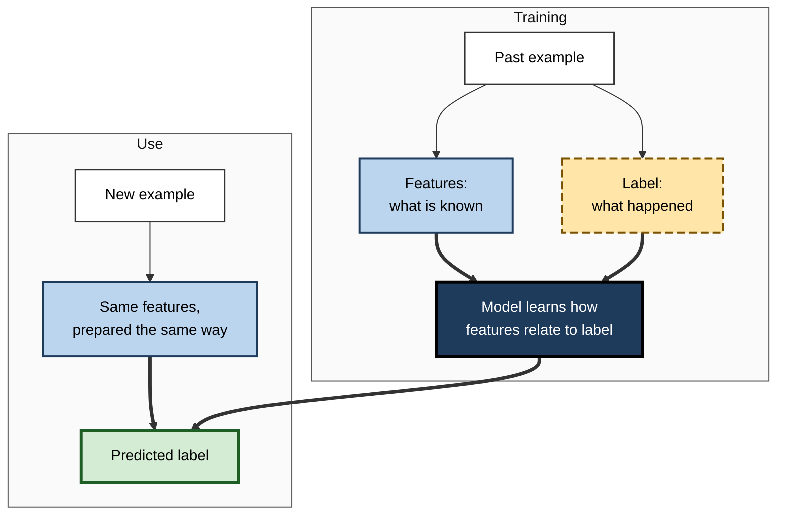
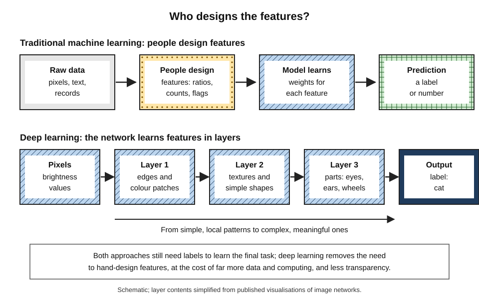
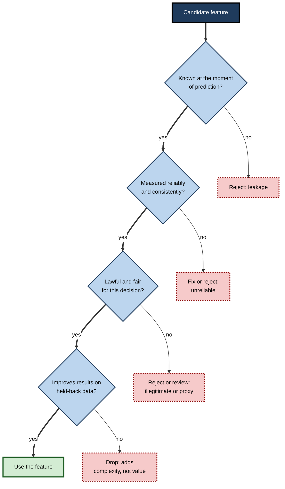
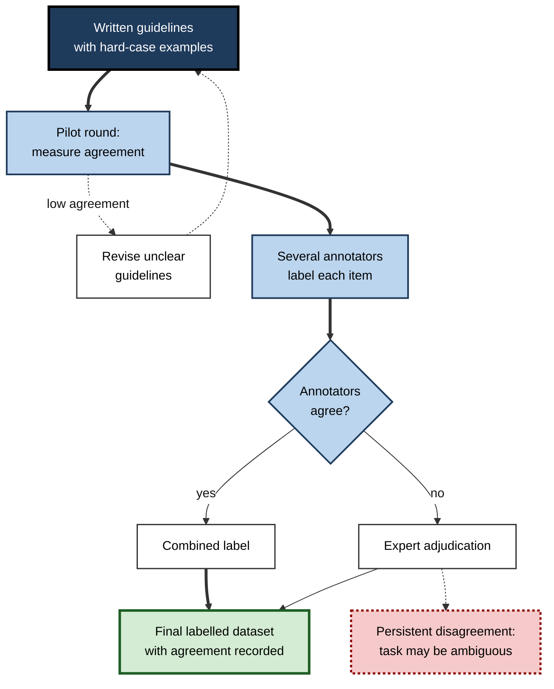
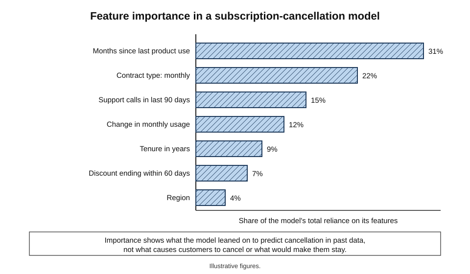

# D.5. Labels, features, and what they mean

An experienced estate agent walks through a flat and names a price within minutes, weighing a handful of facts — bedrooms, floor area, street, condition, distance to the station — to produce one answer. A machine-learning model does the same thing literally. The facts it weighs are its **features**; the answer it is trained to give is its **label**. Almost every question about what a model has learned, and whether to trust it, is a question about these two things.

> **Definition — Feature:** a measurable property of an example that a model uses as input — for instance floor area, account age, the words in an email or the pixels in an image.

> **Definition — Label (target):** the outcome a supervised model is trained to predict for each example — the "right answer" attached to it during training.

**Why it matters**

- **Features decide what a model can notice.** A model cannot use information it is not given — and will use whatever it is given, relevant or not.
- **Labels decide what a model is actually optimising.** A model learns to predict the label as defined, which may differ from what people really care about.
- **Most serious AI failures trace back here** — to a missing feature, a misleading feature or a label that measured the wrong thing.
- **They are where human judgement enters.** Choosing features and defining labels are design decisions, not technical details.
- **Non-specialists can question them.** Asking "what does it look at?" and "what exactly was it trained to predict?" requires no mathematics.

---

## Inputs and Answers

### The anatomy of a training example

- **Example** — one case: a customer, a transaction, a patient, an image.
- **Features** — the properties describing it.
  - Also called *inputs*, *attributes*, *predictors*, *variables* or, in statistics, *independent variables*.
- **Label** — the outcome to predict.
  - Also called the *target*, *outcome*, *response* or *dependent variable*.
- **Feature vector** — the list of feature values for one example, in a fixed order.
- **Prediction** — the model's output for an example; in training it is compared with the label.

> **Definition — Feature vector:** the ordered list of an example's feature values, in the form a model takes as input.

**Worked example (illustrative): three rows of a subscription dataset**

| Customer | Months subscribed | Contract type | Support calls (90 days) | Usage change | Label: cancelled within 60 days? |
|---|---|---|---|---|---|
| 1041 | 3 | Monthly | 4 | −60% | Yes |
| 1042 | 28 | Annual | 0 | +5% | No |
| 1043 | 14 | Monthly | 1 | −10% | No |

*Illustrative figures.*

- **Four features** describe each customer; **one label** records what happened.
- **Training** — the model studies thousands of such rows to learn how feature values relate to the label.
- **Use** — for a new customer, the label is unknown; the model predicts it from the features.

**Figure 1.** How features and labels flow through training and use.

> **Key point:** features describe what is **known at the moment of decision**; the label describes what **turned out to be true**. Keeping that time order straight is one of the most important disciplines in machine learning.

---

## Kinds of Features

### Numbers and categories

- **Numerical features** — quantities.
  - **Continuous** — any value in a range: temperature, price, time since last purchase.
  - **Discrete** — counts: number of logins, number of children.
- **Categorical features** — one of a set of named values.
  - **Nominal** — no natural order: country, product type, payment method.
  - **Ordinal** — ordered categories: satisfaction "low / medium / high"; education level.
- **Binary features** — yes/no flags: "has a mortgage", "opened the last email".
- **Date and time features** — timestamps, usually converted into more useful forms.
  - *e.g.* hour of day, day of week, month, "days since last visit", "is a public holiday".
- **Text, images, audio** — raw content, turned into numbers by counting words, reading pixel values or learning embeddings.

| Feature type | Example | How a model typically receives it | Common pitfall |
|---|---|---|---|
| Continuous | Annual income | The number, often rescaled | Extreme values distort learning |
| Discrete count | Logins last month | The count | Zero may mean "none" or "not recorded" |
| Nominal category | Payment method | One yes/no column per category | Rare categories with too few examples |
| Ordinal category | Satisfaction level | Ordered numbers or yes/no columns | Treating "high = 3" as three times "low = 1" |
| Date | Signup date | Derived parts: month, weekday, age | Using the raw date lets a model learn the calendar, not behaviour |
| Text | Complaint description | Word counts or embeddings | Wording that reveals the outcome |

### Turning categories into numbers

Models compute with numbers, so categories must be encoded.

- **One-hot encoding** — one yes/no column for each category.
  - *e.g.* contract type with three values becomes three columns: "monthly", "annual", "two-year"; a monthly customer has 1, 0, 0.
  - Avoids implying an order that does not exist.
- **Ordinal encoding** — ordered numbers for ordered categories.
  - *e.g.* low = 1, medium = 2, high = 3.
  - Implies equal steps — sometimes acceptable, sometimes misleading.
- **Embeddings** — learned number lists for categories with very many values.
  - *e.g.* each of 50,000 products receives a list of numbers placing similar products close together.

> **Watch out:** encoding a nominal category as numbers — France = 1, Germany = 2, Italy = 3 — tells many models that Italy is "more" than France and that Germany lies "between" them. One-hot encoding avoids this false arithmetic.

### Scaling numerical features

- **The issue** — features on large scales (income in thousands) can swamp features on small scales (number of children) in methods that use distances or gradual adjustment.
- **The remedy** — rescale features to comparable ranges, for example so each has an average of zero and a standard spread of one.
- **Not always needed** — tree-based methods, which split on thresholds, are largely unaffected by scale.

---

## Where Features Come From

### Raw and engineered features

> **Definition — Feature engineering:** creating new, more informative features from raw data, usually using knowledge of the domain.

- **Raw features** — values as recorded: each transaction amount, each timestamp.
- **Engineered features** — values computed to expose a pattern.
  - **Aggregates** — total spend in the last 30 days; number of failed log-ins this week.
  - **Ratios** — debt to income; returns to purchases.
  - **Changes** — usage this month versus the previous three months.
  - **Time since** — days since last order; months since last claim.
  - **Flags** — "purchase made abroad"; "account details changed in last 24 hours".
  - **Combinations** — "new device **and** large transfer **and** unusual hour".

> **Example:** a fraud model given only raw transaction amounts learns little. Given "amount compared with this customer's usual spending", "distance from the customer's usual location" and "minutes since the card was last used in another country", it can spot what investigators look for.

- **Why engineering helps** — it puts domain knowledge into a form the model can use, so the model needs fewer examples to discover it.
- **Pedro Domingos (2012)**, in a widely read article for practitioners, argued that among all the factors deciding whether a machine-learning project succeeds, the features used are "easily the most important".

### Features the model learns itself

- **Deep learning changed the picture** — given raw pixels, sound or text, deep neural networks learn their own features in successive layers.
  - In image networks, early layers respond to edges and colour patches; middle layers to textures and shapes; later layers to object parts.
  - Visualisations of trained image networks, such as those published by Matthew Zeiler and Rob Fergus in 2014, showed this layered progression.
- **What this removes** — the need for people to design features for images, sound and language.
- **What it costs** — far more data and computing, and features that are hard for people to inspect.
- **Where hand-made features still matter** — tabular business data, small datasets and settings that require explanation.

**Figure 2.** Hand-designed features compared with features learned in layers.

> **Definition — Representation learning:** a model learning, from raw data, its own internal features that are useful for a task.

---

## Good Features and Bad Features

### What makes a feature good

- **Predictive** — related to the label in a way that holds beyond the training data.
- **Available in time** — known at the moment the prediction will be made.
- **Reliable** — measured consistently, with few errors or gaps.
- **Stable** — defined and collected the same way over time.
- **Legitimate** — lawful, ethical and acceptable to use for this decision.
- **Understandable** — its meaning can be explained to the people affected.

> **Mnemonic — "Please Always Remember Simple Legal Uses":** Predictive, Available in time, Reliable, Stable, Legitimate, Understandable.

### Features that mislead

- **Leaking features** — contain information about the label that would not be available in real use.
  - *e.g.* "account closed date" in a model predicting whether an account will close; "treatment given" in a model predicting the diagnosis that prompted it.
  - Produce spectacular test results and useless real predictions.
- **Spurious features** — correlated with the label in the training data by accident.
  - *e.g.* a scanner model that learns the brand of hospital equipment because one hospital had sicker patients.
- **Proxy features** — stand in for something it would be unlawful or unfair to use.
  - *e.g.* postcode or first name acting as a stand-in for ethnicity.
  - Removing a protected characteristic does not stop a model reconstructing it from proxies.
- **Unstable features** — change meaning when a form, system or policy changes.
  - *e.g.* a "customer segment" code redefined by marketing every year.
- **Feedback features** — reflect earlier decisions by the same kind of system.
  - *e.g.* "number of times flagged for review" in a model deciding whom to flag.

**Worked example (illustrative): screening features for a cancellation model**

| Candidate feature | Predictive? | Available at prediction time? | Legitimate? | Decision |
|---|---|---|---|---|
| Usage change over three months | Yes | Yes | Yes | Keep |
| Support calls in last 90 days | Yes | Yes | Yes | Keep |
| "Cancellation request received" flag | Extremely | No — it is the outcome | — | Remove: leakage |
| Customer's age | Somewhat | Yes | Questionable for this use | Review with legal and ethics advice |
| Account manager's name | Yes, in past data | Yes | Unstable; reflects staffing | Remove |

*Illustrative figures.*

**Figure 3.** Checks a candidate feature should pass before a model may use it.

---

## Labels: Defining the Answer

### A label is a definition, not a fact

Most real outcomes do not arrive neatly labelled. Someone must decide what counts.

- **"Fraud"** — a chargeback? A customer's complaint? A case confirmed by investigators? A criminal conviction?
- **"Churn"** — cancelled the contract? Stopped using the product? Did not renew within 30 days? Within 90?
- **"Good employee"** — high rating from a manager? Promotion? Staying three years? Hitting targets?
- **"Sick"** — a diagnosis code? A test result above a threshold? A specialist's judgement?

Each choice produces a different model, because each label rewards different patterns.

> **Definition — Operational definition:** a precise, measurable rule stating exactly how an outcome is determined for each example — what counts, measured how, over what time window.

### Proxy labels

> **Definition — Proxy label:** a measurable outcome used in place of the outcome actually of interest because the real one is hard or impossible to observe.

- **Why proxies are used** — the true outcome is slow, expensive or unobservable.
  - *e.g.* "clicked" stands in for "found useful"; "arrested" stands in for "committed a crime"; "healthcare spending" stands in for "health need".
- **The danger** — the model becomes very good at predicting the proxy, including every way in which the proxy differs from the real goal.

**Study card — Obermeyer, Powers, Vogeli and Mullainathan (2019), *Science***

- **System studied:** a widely used commercial algorithm in US healthcare that identified patients for extra care-management support.
- **Label used:** future **healthcare costs** — a proxy for future **health need**.
- **Finding:** at the same risk score, Black patients were considerably sicker than white patients.
  - Less money had historically been spent on Black patients with the same level of illness, reflecting unequal access to care.
  - So predicting cost systematically under-estimated their need.
- **Size of the effect:** the authors estimated that correcting the disparity would raise the share of Black patients automatically identified for extra help from about **18% to about 47%**.
- **Response:** working with the manufacturer, the researchers showed that changing the label to combine cost with direct measures of health greatly reduced the bias.
- **Conclusion:** the algorithm did exactly what it was trained to do. The problem lay in the **label** — a reasonable-looking proxy that encoded an existing inequality.

> **Key point:** a model optimises the label it is given, not the intention behind it. Every gap between the proxy and the real goal becomes a gap in the model's behaviour.

### Choosing the time window

- **Labels need a horizon** — "will cancel" must mean "within some period".
  - Short horizons give quicker, fresher labels but miss slow outcomes.
  - Long horizons capture more but delay learning and make data older.
- **Example** — a loan "default" label may be defined as 90 days overdue within the first 12 months; defaults after month 12 are then invisible to the model.

---

## Where Labels Come From — and How Far to Trust Them

### Annotation by people

- **Guidelines** — a written specification telling annotators exactly how to decide, with examples of hard cases.
- **Annotators** — crowd workers for everyday judgements; trained specialists for expert ones.
  - *e.g.* the ImageNet collection of photographs was labelled largely through Amazon Mechanical Turk, a crowdsourcing platform.
- **Multiple labels per item** — several annotators label the same example; their answers are combined.
- **Adjudication** — a senior reviewer settles disagreements.
- **Quality checks** — hidden test items with known answers; spot audits.

**Figure 4.** A typical annotation process for producing reliable labels.

### Measuring agreement

> **Definition — Inter-annotator agreement:** the extent to which different annotators give the same label to the same examples — a measure of how well defined and reliable the labels are.

- **Raw agreement** — the share of items labelled the same — is misleading, because some agreement happens by chance.
- **Cohen's kappa** (Jacob Cohen, 1960) corrects for chance.

> **Formula — Cohen's kappa:** κ = (observed agreement − chance agreement) ÷ (1 − chance agreement). Example with illustrative figures: two annotators label 100 posts as "abusive" or "not". They agree on 85 (observed = 0.85). Annotator 1 says "abusive" for 60%, annotator 2 for 50%, so chance agreement = 0.6 × 0.5 + 0.4 × 0.5 = 0.50. κ = (0.85 − 0.50) ÷ (1 − 0.50) = **0.70**.

- **Interpreting kappa** — 1 is perfect agreement, 0 is no better than chance; commonly quoted bands treat values above about 0.6 as substantial, but such bands are conventions, not laws.
- **What low agreement means** — not necessarily careless annotators; often a vague definition or a genuinely ambiguous task.

> **Watch out:** "ground truth" sounds absolute, but labels are human or institutional judgements. If experts agree only moderately on a task — grading some tumours, judging whether speech is hateful — no model can be meaningfully "more accurate" than that agreement allows, and claims of superhuman accuracy deserve scrutiny.

### Other sources of labels

- **Recorded outcomes** — repayment, cancellation, sales, test results.
  - Objective-looking but shaped by process: only approved loans have repayment outcomes.
- **Behavioural signals** — clicks, purchases, watch time.
  - Cheap and plentiful, but measure attention rather than value.
- **Existing records** — billing codes, case outcomes, audit findings.
  - Created for other purposes, with their own incentives and errors.
- **Rules and heuristics** — "weak supervision": several imperfect rules label data automatically, and their combined votes become noisy labels.
- **Model-generated labels** — a strong model labels data for a weaker one; fast, but errors propagate.

| | Human annotation | Recorded outcomes | Behavioural signals |
|---|---|---|---|
| What it captures | A person's judgement under guidelines | What happened in the world | What users did |
| Typical bias | Annotators' assumptions and culture | The process that decided who was observed | Attention, habit and position effects |
| Cost | High | Low | Very low |
| Delay | Days to weeks | Months to years | Immediate |
| Best check | Agreement between annotators | Understanding how the outcome was recorded | Comparison with direct measures of satisfaction |

---

## What Features and Labels Mean

### What a model's reliance shows

- **Feature importance** — measures of how much a model's predictions depend on each feature.
- **What it shows** — which inputs the model leaned on to predict the label **in its training data**.
- **What it does not show**
  - **Cause** — a feature can predict without causing.
  - **Remedy** — changing the feature may not change the outcome.
  - **Completeness** — an important cause may be absent from the features altogether.

**Figure 5.** Which features a cancellation model relied on most.

> **Example:** a model finds "months since last product use" the strongest predictor of cancellation. That does not mean that sending a reminder to use the product would prevent cancellations — disengaged customers may have already decided to leave. Testing an intervention requires an experiment, not a feature ranking.

> **Watch out:** feature importance can be misleading when features are correlated. If "tenure" and "age" move together, a model may rely on either, and importance may be split between them or assigned arbitrarily to one.

### The label defines the meaning of the score

- A churn score means "estimated chance of **this label** being true" — not "chance the customer is unhappy".
- A risk score in hiring means "similarity to people **labelled** good hires in the past" — not "quality of candidate".
- A fraud score means "resemblance to cases **labelled** fraud" — which depends on what investigators chose to investigate.

> **Remember:** to interpret any model output, translate it back into the label's operational definition: "the model estimates the probability that **[label, as defined]** will occur, given **[features available]**."

---

## Labels and Features in Professional Practice

### Writing a label specification

**Worked example (illustrative): turning "fraud" into a usable label**

1. **State the decision** — "decide in real time whether to pause a card payment."
2. **Draft the outcome** — "the transaction was fraudulent."
3. **Make it observable** — "the cardholder reported the transaction as unauthorised, **or** investigators confirmed it as fraud."
4. **Exclude confusions** — "excluding disputes about goods not received and 'friendly fraud' (cardholders disputing purchases they made)."
5. **Fix the time window** — "reported within 60 days of the transaction."
6. **Record the limits** — "fraud that was never reported is labelled 'not fraud'; the label under-counts fraud on rarely checked accounts."

> **Example — final label:** "1 if the transaction was reported by the cardholder as unauthorised or confirmed by investigators as fraud within 60 days, excluding merchant disputes and friendly fraud; otherwise 0."

### Case study (illustrative): a support-ticket model that learned the wrong urgency

- **Situation:** a software company trained a model to flag urgent support tickets, using two years of tickets labelled by the priority agents had assigned.
- **Problem:** after launch, several outages reported by small customers were rated low priority, while routine questions from large accounts were rated urgent.
- **Diagnosis:**
  1. the label was **agent-assigned priority**, a proxy for real urgency;
  2. agents had routinely raised priority for large accounts, because of a service agreement, whatever the problem;
  3. the strongest feature was "customer contract value" — the model had learned to predict **account size**, not technical severity.
- **Actions:**
  - redefined the label: "urgent" if the ticket was later linked to a confirmed outage, data loss or security incident;
  - had engineers relabel a sample of 3,000 tickets under written guidelines, measuring agreement (κ about 0.8);
  - removed contract value as a feature, handling service agreements by a separate, explicit rule.
- **Result:** outages from small customers were now flagged; agreement between the model and engineers' severity judgements rose markedly. *Illustrative figures.*
- **Lesson:** the model had faithfully learned what the old label measured. **Fixing the label fixed the model.**

### Questions to ask about any model

- **Label** — what exactly was it trained to predict, defined how, over what period?
- **Proxy gap** — how does that label differ from what the organisation actually cares about?
- **Label source** — who or what produced the labels, and how much did they agree?
- **Features** — what information does it use, and was all of it available when predictions are made?
- **Proxies in features** — could any feature stand in for a protected characteristic?
- **Meaning of the output** — what does a score of 0.8 mean, in the label's terms?

> **In practice:** mature teams keep a **data dictionary** — a document listing every feature with its definition, source, timing and owner — and a **label specification** stating the operational definition, its known gaps and agreement measurements. Both are reviewed before training, not after a complaint.

---

## Open Questions

- **How should models learn from disagreement?**
  - Collapsing several annotators' views into one "correct" label discards information; research on training with the full spread of judgements is growing but not standard practice.
- **Can proxies ever be made safe?**
  - Most valuable outcomes are only observable through proxies; how to measure and bound the proxy gap in advance is unsettled.
- **How much should features be explainable?**
  - Learned features in deep networks are powerful but opaque; whether high-stakes decisions should require human-understandable features is debated in law and ethics.
- **How can label quality be audited at scale?**
  - Automated methods can flag suspect labels, but deciding which are truly wrong still needs human review.

---

## Summary

- **Features** are the measurable inputs a model uses; the **label** is the outcome it is trained to predict. A **feature vector** lists an example's feature values.
- Features describe what is **known at decision time**; labels describe what **turned out to be true**.
- Features may be **numerical** (continuous, discrete), **categorical** (nominal, ordinal), **binary**, **date-based** or raw content; categories are encoded (one-hot, ordinal, embeddings) and numbers often rescaled.
- **Feature engineering** builds informative features from raw data using domain knowledge; **deep learning** learns layered features itself, at the cost of data, computing and transparency.
- Good features are **predictive, available in time, reliable, stable, legitimate and understandable**; bad ones **leak**, are **spurious**, act as **proxies**, are **unstable** or reflect **feedback**.
- A label is an **operational definition**, not a fact; **proxy labels** — as in the Obermeyer and colleagues (2019) healthcare study — carry their gaps into the model.
- Label reliability is measured by **inter-annotator agreement** such as **Cohen's kappa**; "ground truth" is human judgement.
- **Feature importance** shows reliance, not cause or remedy; every score means "probability of the label as defined, given these features".
- In practice: write **label specifications** and **data dictionaries**, and question labels, proxies, sources and feature timing.

---

## Self-Check

1. Define feature, label and feature vector, using an example from a workplace you know.
2. Why must features describe only what is known at the moment of prediction?
3. Classify each as continuous, discrete, nominal, ordinal or binary: number of dependants; blood type; customer satisfaction rating; body temperature; "owns a car".
4. Why is one-hot encoding preferred to numbering for nominal categories?
5. What is feature engineering? Give three engineered features for a model predicting late invoice payment.
6. How does deep learning change the role of feature engineering, and what are the costs?
7. Explain leaking, spurious and proxy features, with an example of each.
8. Why is a label "a definition, not a fact"? Write an operational definition of "customer churn".
9. Summarise the Obermeyer and colleagues (2019) study and explain why the problem lay in the label.
10. Two annotators agree on 90 of 100 items. Each labels 50% of items as positive. Calculate Cohen's kappa and interpret it.
11. Why should "ground truth" be treated with caution in tasks where experts disagree?
12. A model's top feature for predicting employee resignation is "number of days of annual leave taken". What can and cannot be concluded?
13. A recruitment model is trained to predict "hired" using past hiring decisions. Identify the label problem and propose a better label.

### Answer Key

1. Feature: a measurable input property (an invoice's amount). Label: the outcome to predict (paid more than 30 days late: yes/no). Feature vector: the ordered list of an invoice's feature values (amount, customer age, previous late payments, …).
2. Because the model will be used at that moment; features available only later would be missing in real use, so a model relying on them would perform far worse in practice than in testing (leakage).
3. Dependants: discrete. Blood type: nominal. Satisfaction rating: ordinal. Temperature: continuous. Owns a car: binary.
4. Numbering implies an order and arithmetic relations between categories that do not exist; one-hot encoding gives each category its own yes/no column.
5. Creating more informative features from raw data with domain knowledge. Examples: share of the customer's previous invoices paid late; days between invoice date and the customer's usual payment run; change in the customer's average days-to-pay over six months.
6. Deep networks learn their own features from raw data, removing much hand design for images, sound and text. Costs: more data and computing, and features that are hard to inspect or explain.
7. Leaking: carries information about the outcome not available in real use ("refund issued" when predicting complaints). Spurious: accidentally correlated in training data (scanner brand predicting disease). Proxy: stands in for a protected characteristic (postcode for ethnicity).
8. Because someone must decide what counts, measured how, over what period; different choices produce different models. E.g. "a customer who does not renew within 30 days after contract end, or who cancels before it, excluding customers moving to another of our products."
9. A US healthcare algorithm used future costs as a proxy for health need. Because less had historically been spent on Black patients with equal illness, it under-estimated their need; at equal scores they were sicker. Correcting it would have greatly increased the share of Black patients flagged. The algorithm predicted its label well — the label was the problem.
10. Observed = 0.90. Chance = 0.5 × 0.5 + 0.5 × 0.5 = 0.50. κ = (0.90 − 0.50) ÷ 0.50 = 0.80 — strong agreement well beyond chance.
11. Labels reflect human judgement; where experts agree only moderately, the "truth" itself is uncertain, so measured accuracy is capped by label reliability and claims of exceeding experts may reflect agreement with one labeller's habits.
12. That leave-taking predicted resignation in past data. It does not follow that leave causes or prevents resignation — people planning to leave may use up leave, or leave may reflect workload or team culture. An intervention would need an experiment.
13. "Hired" encodes past recruiters' decisions, including any biases, and says nothing about performance. Better: a job-relevant outcome such as performance against defined, role-specific criteria after a year, checked for bias, with awareness that it is observed only for people who were hired.

---

## Glossary

| Term | Meaning |
|---|---|
| Categorical feature | A feature taking one of a set of named values. |
| Cohen's kappa | A measure of agreement between two annotators, corrected for chance. |
| Data dictionary | A document defining every feature, its source, timing and owner. |
| Feature | A measurable property of an example used as model input. |
| Feature engineering | Creating informative features from raw data using domain knowledge. |
| Feature importance | A measure of how much a model's predictions depend on each feature. |
| Feature vector | The ordered list of an example's feature values. |
| Ground truth | The labels treated as correct; in practice, human or institutional judgements. |
| Inter-annotator agreement | The extent to which annotators give the same labels to the same items. |
| Label (target) | The outcome a supervised model is trained to predict. |
| Leaking feature | A feature carrying outcome information unavailable at prediction time. |
| Nominal feature | A categorical feature with no natural order. |
| One-hot encoding | Representing a category as a set of yes/no columns, one per value. |
| Operational definition | A precise, measurable rule for determining an outcome. |
| Ordinal feature | A categorical feature with a natural order. |
| Proxy feature | A feature that stands in for a characteristic it would be wrong to use. |
| Proxy label | A measurable outcome used in place of the outcome of real interest. |
| Representation learning | A model learning its own useful internal features from raw data. |
| Spurious feature | A feature correlated with the label by accident in the training data. |
| Weak supervision | Labelling data automatically with several imperfect rules. |
