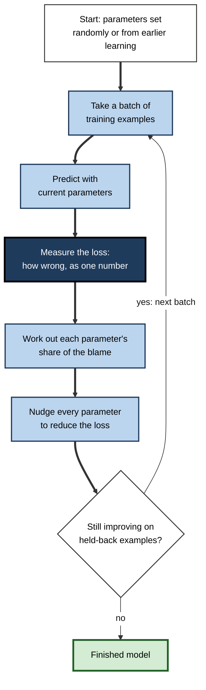
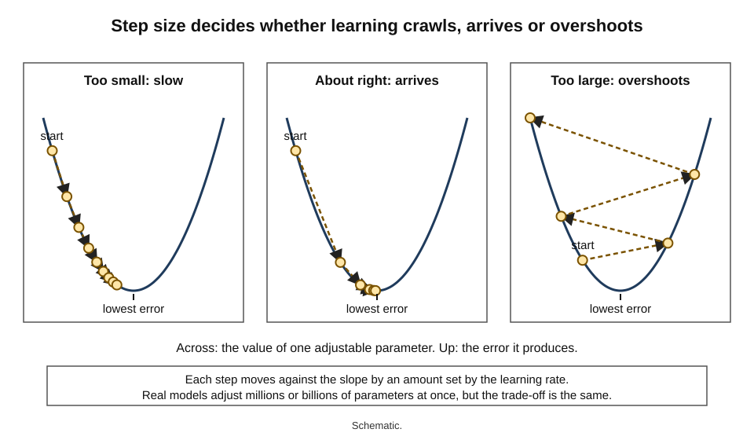
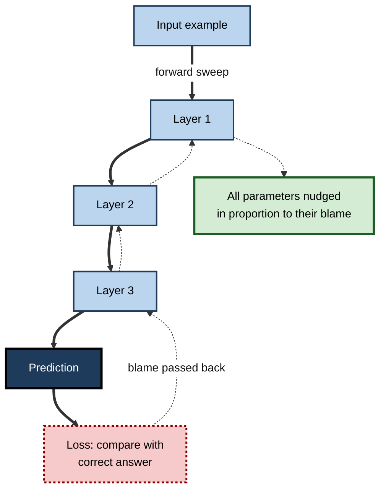
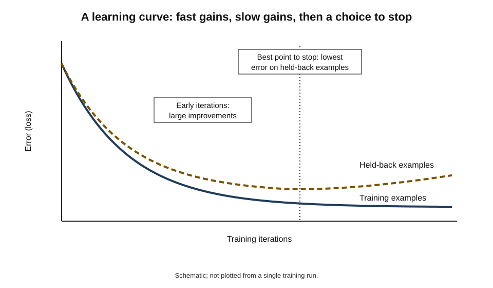
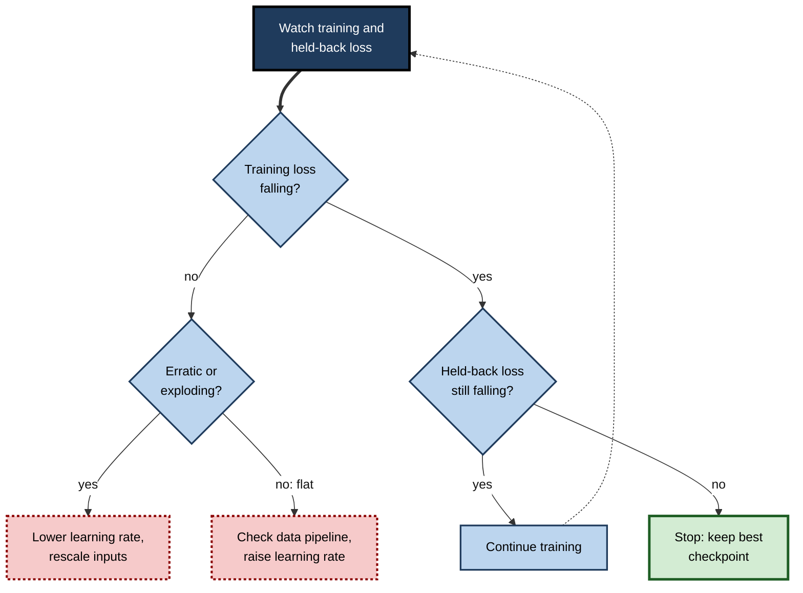
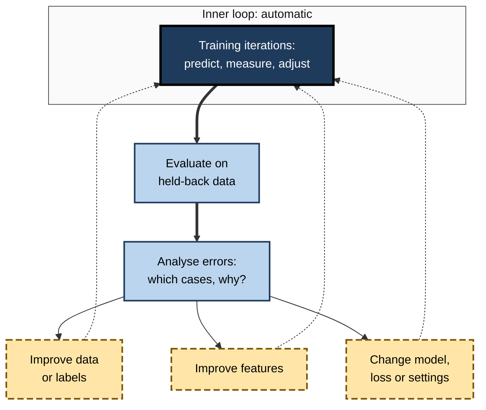

# D.6. How a model improves through iterations

A person adjusting an unfamiliar shower turns the tap, feels the water, and turns again — a large turn when the water is freezing, a small one when it is nearly right. Nobody calculates the correct position in advance; the right setting is reached by **repeated small corrections guided by how wrong things currently are**. A machine-learning model learns in exactly this way, except that it adjusts millions or billions of "taps" at once, and repeats the cycle millions of times.

> **Definition — Iteration (in training):** one cycle in which a model makes predictions, measures how wrong they are and adjusts its parameters to be slightly less wrong.

> **Definition — Optimisation:** the process of searching for the parameter values that make a model's error as small as possible.

**Why it matters**

- **It demystifies "learning".** A model does not reason its way to knowledge; it is nudged, step by step, towards lower error.
- **It explains why training takes time and money.** Each step is small; good models need enormous numbers of them.
- **It explains common failures** — training that stalls, that becomes unstable, or that goes on too long and starts to memorise.
- **It shows what a model is really optimising** — the error measure chosen by its designers, which may or may not match what users care about.
- **It frames how whole AI projects improve** — through an outer loop of evaluation, diagnosis and retraining that mirrors the inner loop of training itself.

---

## Learning as Repeated Correction

### The four-step cycle

1. **Predict** — run the current model on a batch of training examples.
2. **Measure** — compare predictions with the correct answers and compute a single number for how wrong they are: the **loss**.
3. **Adjust** — change every parameter a little in the direction that would reduce the loss.
4. **Repeat** — with the next batch, until the loss stops improving meaningfully.

> **Mnemonic — "Please Measure And Repeat" (PMAR):** Predict, Measure, Adjust, Repeat.

**Figure 1.** The training loop by which a model improves.

> **Key point:** nothing in this loop "understands" the task. Improvement emerges entirely from measuring error and reducing it, over and over.

---

## Measuring Wrongness: the Loss

> **Definition — Loss (loss function, cost function):** a formula that turns the gap between a model's predictions and the correct answers into a single number; lower is better, and training aims to make it as small as possible.

### Loss for numbers

- **Squared error** — square each prediction's error and average.
  - Large errors are punished far more than small ones.
- **Absolute error** — average the size of each error, ignoring sign.
  - Treats all errors in proportion; less dominated by a few large misses.

> **Formula — Mean squared error:** average of (prediction − true value)². Example with illustrative figures: predictions 310, 290, 405 for true prices 300, 300, 400 give errors 10, −10, 5; squares 100, 100, 25; mean = 225 ÷ 3 = **75**.

### Loss for categories

- **The idea** — a classifier outputs a probability for the correct class; the loss is small when that probability is high and very large when it is near zero.
- **Cross-entropy (log loss)** — loss = − log(probability given to the correct answer).
  - Being **confidently wrong** is punished heavily, which pushes models to be cautious when unsure.

> **Formula — Cross-entropy for one example:** loss = − ln(p), where p is the probability assigned to the correct class. If the model gives the correct class p = 0.9, loss = − ln 0.9 ≈ **0.11**. If it gives p = 0.1, loss = − ln 0.1 ≈ **2.30** — about twenty times worse.

| | Squared error | Absolute error | Cross-entropy |
|---|---|---|---|
| Used for | Predicting numbers | Predicting numbers | Predicting categories |
| Treatment of large errors | Punished very heavily | Punished in proportion | Confident wrong answers punished very heavily |
| Sensitivity to outliers | High | Lower | Not applicable in the same way |
| Typical example | House prices | Delivery times with occasional extreme delays | Spam detection, image labels |

> **Watch out:** the loss is a **design choice**, and the model optimises it literally. A forecasting model trained on squared error will work hard to avoid rare huge misses; one trained on absolute error will aim for the typical case. Neither knows that a stock-out costs a shop more than surplus stock unless the loss is designed to say so.

---

## Finding the Way Downhill: Gradient Descent

### The hillside in fog

- **The landscape** — imagine every possible setting of the parameters laid out as a landscape, with height equal to the loss.
- **The goal** — reach the lowest valley.
- **The difficulty** — the landscape cannot be seen; only the slope underfoot can be felt.
- **The strategy** — take a step in the steepest downhill direction, feel the slope again, step again.

> **Definition — Gradient:** the slope of the loss with respect to each parameter — how much, and in which direction, the loss would change if that parameter were increased slightly.

> **Definition — Gradient descent:** an optimisation method that repeatedly moves parameters a small step in the direction opposite to the gradient, so that the loss decreases.

- **History** — the French mathematician Augustin-Louis Cauchy described the method of steepest descent in 1847; it became the engine of modern machine learning more than a century later.

> **Formula — Gradient descent update:** new value = old value − learning rate × slope. Example: a parameter at 0.50 with slope +2.0 and learning rate 0.1 becomes 0.50 − 0.1 × 2.0 = **0.30**.

### Worked example (illustrative): learning one number by hand

A model predicts y = w × x. The training data are three points: x = 1, 2, 3 with true y = 2, 4, 6. (The correct answer is w = 2, but the model does not know that.) Loss is mean squared error; learning rate is 0.05; the model starts at w = 0.

- **The slope** for this data works out at about 9.33 × (w − 2): negative when w is too small, positive when too large.

| Iteration | w before | Slope | Change (− 0.05 × slope) | w after | Loss after |
|---|---|---|---|---|---|
| Start | — | — | — | 0.000 | 18.67 |
| 1 | 0.000 | −18.67 | +0.933 | 0.933 | 5.31 |
| 2 | 0.933 | −9.96 | +0.498 | 1.431 | 1.51 |
| 3 | 1.431 | −5.31 | +0.266 | 1.697 | 0.43 |
| 4 | 1.697 | −2.83 | +0.142 | 1.838 | 0.12 |

*Illustrative figures, rounded.*

1. **Large slope, large step** — at the start the model is very wrong, so it moves fast.
2. **Shrinking steps** — as it nears the answer the slope flattens, and steps shrink automatically.
3. **Steady convergence** — each iteration roughly halves the remaining distance to w = 2.
4. **Loss falls fast, then slowly** — from 18.67 to 0.12 in four steps; further steps bring ever smaller gains.

> **Watch out:** the model never "jumps" to w = 2, even though a person could see the answer. Gradient descent only ever knows the local slope — which is precisely why it scales to problems with billions of parameters, where nobody could see the answer.

### The learning rate

> **Definition — Learning rate:** a setting that controls how big a step gradient descent takes on each iteration.

- **Too small** — steady but painfully slow; training may run out of time or budget first.
  - In the worked example, a rate of 0.01 would cut the remaining error by only about a tenth per step.
- **About right** — rapid, stable progress.
- **Too large** — steps overshoot the valley and land higher on the far side; the loss bounces or explodes.
  - In the worked example, a rate of 0.25 would send w from 0 to about 4.7, then to about −1.6, then further away each time.

**Figure 2.** How the learning rate decides whether gradient descent crawls, arrives or overshoots.

- **Schedules** — practitioners often start with small steps (a "warm-up"), use larger steps while far from the goal, and shrink the steps later ("decay") to settle precisely.
- **Adaptive methods** — optimisers such as **momentum** (keep moving in a consistent direction, like a rolling ball) and **Adam** (Diederik Kingma and Jimmy Ba, 2014) adjust step sizes for each parameter automatically. Adam became a default choice for training neural networks.

> **Definition — Hyperparameter:** a setting chosen by people before or during training — such as the learning rate, batch size or number of iterations — as opposed to a parameter learned from data.

---

## Adjusting Billions of Parameters at Once

### Sharing out the blame: back-propagation

- **The problem** — a large network has millions or billions of parameters, all contributing to every error. Which ones should change, and by how much?
- **The answer** — **back-propagation** works backwards from the error through the network's layers, calculating each parameter's share of the blame — its gradient — efficiently, in a single backward sweep.
- **The analogy** — after a team misses a deadline, tracing back through hand-offs to find how much each step contributed to the delay, and improving each in proportion.

**Study card — Rumelhart, Hinton and Williams (1986), *Nature***

- **Contribution:** showed how back-propagation of errors could train neural networks with hidden layers — layers between input and output.
- **Demonstrations:** networks learned internal representations nobody had programmed, such as features of family relationships from examples.
- **Significance:** made multi-layer networks practical to train; the same principle trains today's largest models.
- **Context:** related ideas had appeared earlier, notably in work by Paul Werbos in the 1970s, but the 1986 paper brought the method into wide use.

> **Definition — Back-propagation:** a method for calculating, efficiently, how much each parameter in a layered network contributed to the error, so that gradient descent can adjust all of them.

**Figure 3.** The forward and backward sweeps of one training iteration in a layered network.

### Batches and epochs

- **Full-batch learning** — compute the slope using every training example before each step.
  - Accurate, but one step may take hours on a large dataset.
- **Stochastic gradient descent** — estimate the slope from a single random example, or a small random batch, and step immediately.
  - Rooted in a 1951 method of stochastic approximation by Herbert Robbins and Sutton Monro.
  - Each step is noisier, but there are vastly more of them — and the noise can even help escape poor regions.
- **Mini-batches** — the practical compromise: batches of tens to thousands of examples.

> **Definition — Batch:** the group of training examples used to compute one update of the parameters.

> **Definition — Epoch:** one complete pass through the entire training dataset.

> **Formula — Updates in a training run:** updates = (examples ÷ batch size) × epochs. Example: 1,000,000 examples with batches of 1,000 give 1,000 updates per epoch; 10 epochs give **10,000 updates**.

| | Full batch | Stochastic (single example) | Mini-batch |
|---|---|---|---|
| Examples per update | All | One | Tens to thousands |
| Accuracy of each slope estimate | Exact for the training data | Very noisy | Moderately noisy |
| Updates per pass through data | One | One per example | Many |
| Use of specialised hardware | Limited by memory | Inefficient | Efficient |
| Typical use today | Small problems | Rare in pure form | Standard practice |

**Study card — Krizhevsky, Sutskever and Hinton (2012), the "AlexNet" image network**

- **Task:** classify 1.2 million photographs into 1,000 categories in the ImageNet competition.
- **Training:** mini-batch gradient descent with momentum; roughly **90 passes** through the training set, taking **five to six days** on two graphics processors.
- **Model size:** about 60 million parameters.
- **Result:** a top-5 error rate of about 15%, far ahead of the next entry at about 26%.
- **Significance:** demonstrated that iterative training of large networks on large data, with suitable hardware, could transform performance — a turning point for deep learning.

---

## When to Stop

### Signs that training has done its work

- **Convergence** — the loss stops falling meaningfully.
- **Plateau** — the loss is flat for a long period, sometimes followed by renewed improvement.
- **Held-back performance stops improving** — the model is no longer getting better on examples it does not train on.
  - Continuing would improve training loss while performance on new examples stalls or worsens — the start of memorising.
- **Budget** — time, money or energy runs out.

> **Definition — Convergence:** the point at which further iterations no longer meaningfully reduce the loss.

**Figure 4.** A learning curve: error falling over training iterations, with a best point to stop.

> **Definition — Early stopping:** ending training at the point where performance on held-back examples is best, rather than when training error is lowest.

### Valleys, ridges and saddles

- **Local minima** — valleys that are not the deepest.
  - A long-standing worry: gradient descent might get stuck in one.
- **Saddle points** — places flat in some directions and sloping in others, like a mountain pass.
  - Research on large networks (for example by Yann Dauphin and colleagues, 2014) argued that in very high-dimensional landscapes, saddle points and flat regions are a more common obstacle than poor local minima.
- **The practical picture** — for large networks, many different parameter settings reach similarly low loss; finding *a* good valley matters more than finding *the* deepest.

> **Watch out:** "the model found the optimal solution" is rarely literally true. Training finds a **good enough** setting by a particular path; different random starting points can produce models with similar accuracy but different behaviour on unusual cases.

---

## What Iterations Look Like in Practice

### Watching a training run

- **Training loss curve** — should fall; erratic spikes suggest instability.
- **Held-back loss curve** — should fall with it; a widening gap signals memorising.
- **Loss becomes "not a number"** — numerical overflow, usually from a learning rate too high or badly scaled inputs.
- **Loss not falling at all** — learning rate too low, a bug in data preparation, or labels unrelated to inputs.
- **Checkpoints** — saved snapshots allow rewinding to the best point.

**Figure 5.** Common decisions while monitoring a training run.

### Tuning hyperparameters

- **Why it is needed** — no formula gives the best learning rate, batch size or number of layers for a new problem.
- **How it is done** — train many versions with different settings and compare them on held-back data.
  - **Grid search** — try every combination from a list.
  - **Random search** — try random combinations; James Bergstra and Yoshua Bengio showed in 2012 that this is often more efficient than a grid.
  - **Guided search** — use results so far to choose promising settings next.
- **Cost** — each trial is a full or partial training run; tuning can multiply total computing many times over.

> **In practice:** teams record every run — data version, code version, hyperparameters, random seed and results — so that a good model can be reproduced exactly and a bad one diagnosed. Without such records, "it worked last week" cannot be investigated.

---

## The Outer Loop: Improving the Whole System

Training is an inner loop that adjusts parameters. Around it sits an outer loop, run by people, that adjusts everything else.

1. **Train** a model.
2. **Evaluate** it on held-back data.
3. **Analyse the errors** — which cases does it get wrong, and why?
4. **Improve** whatever limits performance: more or better data, clearer labels, better features, a different model or loss.
5. **Retrain** and compare with the previous version.

**Figure 6.** The outer loop of improvement around the inner training loop.

> **Key point:** the inner loop is mechanical and fast; the outer loop is human, slow and where most of the real gains come from. Error analysis — looking closely at actual mistakes — is the most valuable and most neglected step.

### Worked example (illustrative): one turn of the outer loop

A model classifying customer emails into eight topics scores 86% on held-back emails.

1. **Collect the errors** — 140 misclassified emails from the held-back set.
2. **Group them** — 60 involve "billing" versus "refund"; 35 are in languages other than English; 25 have unclear labels; 20 are miscellaneous.
3. **Estimate the gains** — fixing billing/refund confusion could recover up to 60 errors; labels for these two categories turn out to overlap in the guidelines.
4. **Act** — rewrite the guideline to separate billing and refund; relabel 2,000 affected emails.
5. **Retrain and re-evaluate** — accuracy rises to 90%; the non-English emails become the next target.

*Illustrative figures.*

> **Remember:** before changing the model, look at its mistakes. The fix is often in the **data or labels**, not the algorithm.

### Case study (illustrative): the forecast that would not settle

- **Situation:** a grocery chain's data team trained a neural network to forecast daily sales for 30,000 products.
- **Problem:** training loss fell for an hour, then spiked and became "not a number"; restarts failed in the same way.
- **Diagnosis:**
  1. sales quantities ranged from single units to tens of thousands — inputs were not rescaled;
  2. the learning rate copied from a tutorial on a different problem was too large for this data;
  3. occasional data errors — a product recorded as selling a million units in a day — produced enormous gradients.
- **Actions:**
  - rescaled inputs and predicted the logarithm of sales instead of raw sales;
  - lowered the learning rate and added a warm-up period;
  - capped extreme gradients ("gradient clipping") and removed obvious data errors.
- **Result:** training converged smoothly within a few hours; forecast error on held-back weeks fell below the existing statistical method.
- **Lesson:** unstable training is usually a symptom of **badly scaled data, extreme values or an unsuitable learning rate**, not of a fundamentally wrong model.

---

## Iteration in Professional Practice

### What non-specialists should understand

- **Training is search, not instruction** — the model is found by trial and correction, not written.
- **The loss is the real objective** — what the designers chose to measure is what the model pursues.
- **More iterations are not always better** — beyond a point, extra training memorises rather than learns.
- **Results depend on choices** — learning rate, data order and random starting points can change a model's behaviour on unusual cases.
- **Real progress comes from the outer loop** — error analysis, better data and clearer labels.

### Questions to ask about a model's development

- **What loss was minimised, and does it reflect real costs of errors?**
- **How was the stopping point chosen?**
- **How many versions were tried, and how was the final one selected?**
- **Were results checked on data not used for any of those choices?**
- **Is the training run reproducible from its records?**

> **In practice:** when a vendor reports that a model "was trained for 100 epochs", the useful follow-up is not about the number but about the **stopping rule** and the **held-back evidence** that the final version generalises.

---

## Open Questions

- **Why does gradient descent work so well on huge networks?**
  - Theory predicted difficulties with non-convex landscapes; the practical success of large-scale training is only partly explained.
- **Can models learn with far fewer iterations?**
  - Humans often learn from a few examples; reducing the iterations and data needed is a major research goal.
- **How should the loss reflect human values?**
  - Turning complex goals — helpfulness, fairness, safety — into a single number to minimise is hard and contested.
- **How much do random choices matter?**
  - Different seeds and data orders can produce models with similar average accuracy but different individual predictions; the implications for fairness and reliability are still being worked out.

---

## Summary

- Models improve by **iteration**: **predict, measure, adjust, repeat** — **optimisation** towards lower error.
- The **loss** turns error into one number: **squared** or **absolute error** for numbers, **cross-entropy** for categories, which heavily punishes confident mistakes. The loss is a design choice the model pursues literally.
- **Gradient descent** steps against the **gradient** (slope): new value = old value − learning rate × slope; steps shrink naturally as the slope flattens near the goal.
- The **learning rate** must be neither too small (slow) nor too large (overshoot); schedules and adaptive optimisers such as **momentum** and **Adam** help.
- **Back-propagation** (popularised by Rumelhart, Hinton and Williams, 1986) assigns blame to every parameter efficiently.
- Training uses **mini-batches**; an **epoch** is one full pass; updates = examples ÷ batch size × epochs. AlexNet (2012) trained for about 90 epochs over five to six days.
- Stop at **convergence** or, better, by **early stopping** at the best held-back performance; saddle points and plateaus, more than bad local minima, slow large networks.
- Monitor curves, tune **hyperparameters** by search, and record every run.
- Around the inner training loop sits the human **outer loop** of evaluation, error analysis and improvement of data, labels, features and models — where most real gains are made.

---

## Self-Check

1. Describe the four steps of a training iteration.
2. What is a loss function? Why is it described as a design choice?
3. Calculate the mean squared error for predictions 12, 18, 25 against true values 10, 20, 25.
4. A classifier gives the correct class probability 0.5 on one example and 0.01 on another. Calculate the cross-entropy loss for each and explain the difference.
5. Explain gradient descent using the hillside-in-fog analogy.
6. A parameter is 1.2, its slope is −3 and the learning rate is 0.1. What is its new value?
7. In the one-parameter worked example, why do the steps shrink even though the learning rate stays the same?
8. What happens when the learning rate is too small and too large? What do schedules and adaptive optimisers do?
9. What problem does back-propagation solve, and why was the 1986 paper significant?
10. A dataset has 200,000 examples, the batch size is 500 and training runs for 20 epochs. How many parameter updates occur?
11. Explain early stopping and why training loss alone is a poor guide to when to stop.
12. Why are saddle points considered more important than local minima in very large networks?
13. A team's model is stuck at 80% accuracy. Describe how the outer loop should be used before changing the algorithm.
14. A training run's loss suddenly becomes "not a number". List three likely causes and remedies.

### Answer Key

1. Predict on a batch with current parameters; measure the loss against correct answers; adjust every parameter slightly to reduce the loss; repeat with the next batch.
2. A formula turning prediction errors into one number to minimise. It is a design choice because different losses value errors differently (large versus typical, over- versus under-prediction), and the model optimises whatever is chosen.
3. Errors 2, −2, 0; squares 4, 4, 0; mean = 8 ÷ 3 ≈ 2.67.
4. − ln 0.5 ≈ 0.69; − ln 0.01 ≈ 4.61. Assigning almost no probability to the correct answer — being confidently wrong — is punished far more heavily.
5. The loss is a landscape whose height cannot be seen, only felt as the slope underfoot; gradient descent repeatedly steps in the steepest downhill direction, re-measuring the slope each time, until it reaches a valley.
6. 1.2 − 0.1 × (−3) = 1.5.
7. The step equals learning rate × slope, and the slope shrinks as the parameter nears the value with lowest loss, so steps shrink automatically.
8. Too small: very slow progress. Too large: overshooting, oscillation or divergence. Schedules vary the rate over training (warm-up, decay); adaptive optimisers adjust step sizes for each parameter.
9. Working out how much each of many parameters in a layered network contributed to the error. The 1986 paper showed it could train networks with hidden layers that learned useful internal representations, making deep networks practical.
10. 200,000 ÷ 500 = 400 updates per epoch × 20 = 8,000 updates.
11. Ending training when performance on held-back examples is best. Training loss keeps falling as the model memorises, even when its performance on new examples has stopped improving or begun to worsen.
12. In high dimensions, most flat points are saddles — downhill in some directions — and large flat regions slow progress; many low valleys are similarly good, so poor local minima are a smaller practical problem.
13. Collect and group held-back errors, identify the largest groups and their causes (unclear labels, missing data for certain cases, missing features), fix the biggest cause, retrain and compare. Change the algorithm only if errors do not trace to data, labels or features.
14. Learning rate too high (lower it, add warm-up); unscaled inputs with very large values (rescale or transform); extreme values or data errors producing huge gradients (clean data, clip gradients).

---

## Glossary

| Term | Meaning |
|---|---|
| Adam | A widely used optimiser that adapts step sizes for each parameter. |
| Back-propagation | Efficient calculation of each parameter's contribution to the error in a layered network. |
| Batch | The examples used to compute one parameter update. |
| Convergence | The point at which further iterations no longer meaningfully reduce the loss. |
| Cross-entropy | A loss for classification that heavily punishes confident wrong answers. |
| Early stopping | Ending training when held-back performance is best. |
| Epoch | One complete pass through the training data. |
| Error analysis | Examining a model's actual mistakes to find their causes. |
| Gradient | The slope of the loss with respect to each parameter. |
| Gradient descent | Repeatedly moving parameters against the gradient to reduce the loss. |
| Hyperparameter | A setting chosen by people, such as the learning rate or batch size. |
| Iteration | One cycle of predicting, measuring loss and adjusting parameters. |
| Learning rate | The setting that controls the size of each gradient-descent step. |
| Local minimum | A valley in the loss landscape that is not the lowest. |
| Loss function | A formula turning prediction errors into one number to minimise. |
| Mean squared error | The average of squared prediction errors. |
| Momentum | An optimisation technique that keeps moving in a consistent direction. |
| Optimisation | Searching for parameter values that minimise the loss. |
| Saddle point | A point flat in some directions and sloping in others. |
| Stochastic gradient descent | Updating parameters using slopes estimated from small random samples. |
