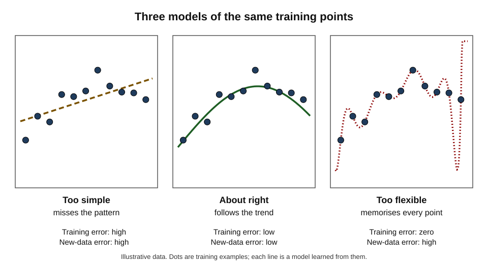
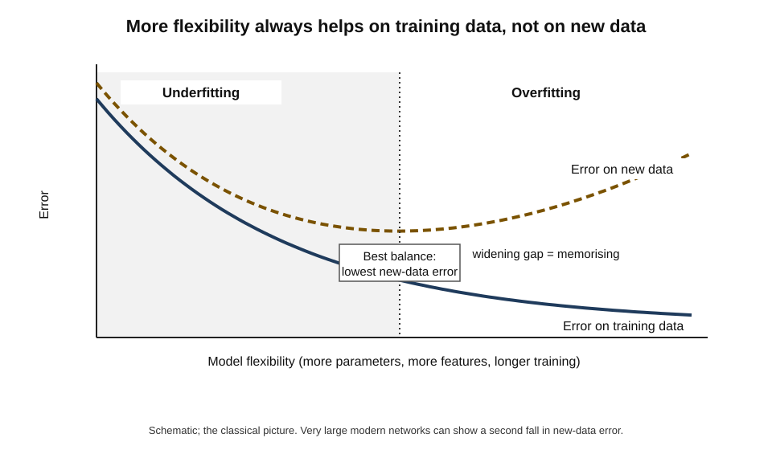
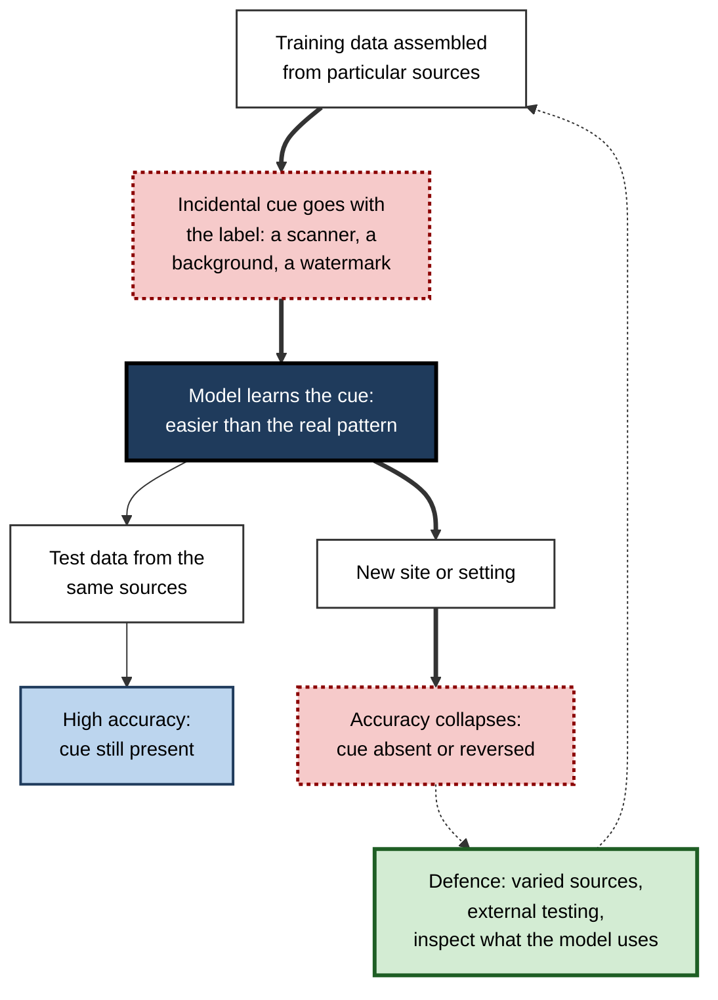
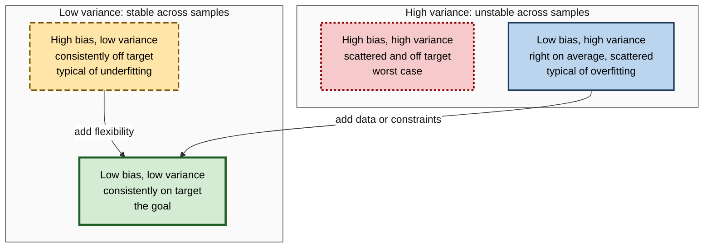
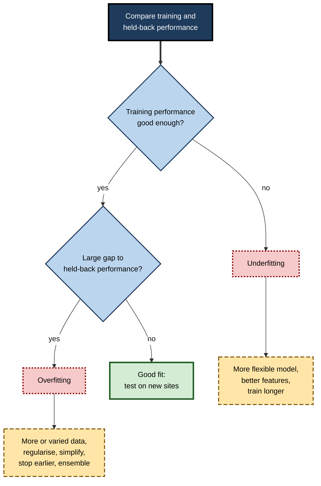

# D.7. Overfitting: when AI memorises instead of learning

A student who memorises the answers to last year's examination paper can score full marks on that paper — and fail completely when the questions change. A suit tailored to fit a shop mannequin perfectly may fit no living customer. A theory that explains every past coincidence usually predicts nothing. Machine-learning models fall into the same trap: given enough flexibility, they can fit their training examples perfectly by **memorising** them, including their accidents and errors, and then fail on the new cases that matter.

> **Definition — Overfitting:** the situation in which a model learns the details and noise of its training data so closely that it performs well on that data but poorly on new data.

> **Definition — Underfitting:** the opposite failure, in which a model is too simple or too little trained to capture the real pattern, so it performs poorly even on its training data.

**Why it matters**

- **It is the central risk in machine learning.** The purpose of learning is to handle new cases; overfitting defeats that purpose while looking like success.
- **It hides behind impressive numbers.** An overfitted model can report near-perfect accuracy — on the data it has already seen.
- **It explains many real-world disappointments** — systems that excel in development and falter in hospitals, markets and customer operations.
- **It is not only a machine problem.** Analysts, traders and managers overfit too, whenever they build explanations that fit the past too neatly.
- **Recognising it requires no mathematics** — only the habit of asking how a model performs on data it has never seen.

---

## Memorising Versus Learning

### Two students

- **The memoriser**
  - Stores each practice question with its answer.
  - Perfect on familiar questions; lost on unfamiliar ones.
  - Also memorises the mistakes in the answer sheet.
- **The learner**
  - Extracts the principles behind the answers.
  - Slightly imperfect on practice questions; competent on new ones.
  - Ignores one-off quirks that do not fit the pattern.

> **Key point:** the aim of training is not to fit the training data, but to **generalise** — to capture the pattern that will hold for data not yet seen. Fitting the training data is only a means to that end.

### Signal and noise

- **Signal** — the real, repeatable relationship between inputs and outcomes.
  - *e.g.* larger flats tend to sell for more.
- **Noise** — the random, unrepeatable variation around it.
  - *e.g.* one flat sold cheaply because the owner needed cash quickly; one record was mistyped.
- **A good model** captures the signal and ignores the noise.
- **An overfitted model** treats noise as if it were signal — learning rules like "flats on the third floor of this particular street sell for 12% less", based on a single unusual sale.

**Figure 1.** Underfitting, a good fit and overfitting on the same training points.

| | Underfitting | Good fit | Overfitting |
|---|---|---|---|
| Model's flexibility | Too little | Suited to the pattern | Too much for the data available |
| Training error | High | Low | Very low, often near zero |
| Error on new data | High | Low | High |
| Gap between the two | Small | Small | Large |
| What it has learned | Too little of the signal | The signal | The signal plus the noise |
| Typical remedy | More flexible model, better features | — | More data, simpler model, constraints |

---

## Recognising Overfitting

### The generalisation gap

> **Definition — Generalisation gap:** the difference between a model's performance on its training data and its performance on new, held-back data.

- **Small gap, good performance** — the model generalises.
- **Small gap, poor performance** — the model underfits.
- **Large gap** — the model overfits; it knows the training data far better than the world.

**Worked example (illustrative): reading four candidate models**

| Model | Accuracy on training data | Accuracy on held-back data | Gap | Diagnosis |
|---|---|---|---|---|
| A — simple rules | 71% | 70% | 1 point | Underfitting: consistent but weak |
| B — moderate model | 88% | 86% | 2 points | Good fit |
| C — large model | 97% | 84% | 13 points | Overfitting |
| D — very large model | 100% | 79% | 21 points | Severe overfitting: memorised |

*Illustrative figures.*

1. **Do not rank by training accuracy** — that would choose D, the worst model on new data.
2. **Rank by held-back accuracy** — B is best.
3. **Read the gap** — C and D have learned things that are not true of new data.
4. **Consider the next step** — C might become the best model if given more data or constraints.

> **Watch out:** a model reporting **100% accuracy** on its training data is not a triumph but a warning. Real data contains noise and labelling errors; perfect agreement with it usually means the model has memorised them.

### Other warning signs

- **Performance collapses on a new site, period or population.**
- **The model is extremely confident on cases that are genuinely ambiguous.**
- **Tiny changes to inputs produce large changes in outputs.**
- **The model relies on strange or very specific features** — an ID number, a timestamp, a watermark.
- **Results are much better than published work or expert expectations** — often a sign of a flaw rather than a breakthrough.

---

## Why Overfitting Happens

### Too much flexibility for too little data

- **Flexibility (capacity)** — how many different patterns a model can represent, roughly reflected in its number of adjustable parameters.
- **The basic rule** — the more flexible the model relative to the amount of data, the easier it is to fit noise.
  - *e.g.* a curve with 11 adjustable terms can pass exactly through any 11 points, whatever they are.
- **Too many features** — with hundreds of features and few examples, some features will correlate with the label purely by chance.
- **Training too long** — models typically learn the broad pattern first and the noise later; continuing training past the best point drifts into memorisation.

> **Definition — Model capacity:** the range of patterns a model is able to represent; higher capacity allows more complex patterns and also makes overfitting easier.

**Figure 2.** Training error and new-data error as a model becomes more flexible.

### How much data is enough to avoid overfitting?

- **What matters is the rare outcome** — a dataset of 20,000 customers with 200 cancellations has, for learning purposes, about 200 informative examples of cancellation.
- **A famous rule of thumb** — in medical statistics, a 1996 simulation study led by Peter Peduzzi suggested at least **ten outcome events per candidate variable** for logistic regression models; the "ten events per variable" rule spread widely.
- **Its revision** — later work, notably by Richard Riley and colleagues from 2019 onwards, showed the rule is too simple: the sample needed depends on how common the outcome is, how strong the predictors are and how precise the predictions must be. They proposed calculating the required size for each study instead.
- **For flexible models** — neural networks and large tree ensembles generally need far more examples per variable than simple regression models to avoid overfitting.

> **Formula — Events per variable (illustrative figures):** events per variable = number of cases with the outcome ÷ number of candidate features. A churn dataset with 600 cancellations and 400 candidate features has 600 ÷ 400 = **1.5** — far below even the old rule of thumb, signalling a high risk of overfitting.

> **Watch out:** a large total number of rows can create false confidence. Overfitting risk depends on the number of examples of the **outcome that matters** relative to the model's flexibility, not on the size of the table.

### Choosing the model too many times

- **Hidden overfitting** — trying many models, features and settings, and keeping whichever scores best on the same check data.
  - Eventually something fits that data's quirks by chance.
- **Human version** — an analyst testing hundreds of hypotheses and reporting the one that "worked".
- **Remedy** — keep a final test set untouched until the very end.

### Learning the wrong thing: shortcuts

- **Shortcut learning** — a model finds an easy feature that happens to predict the label in the training data but is irrelevant to the real task.
- **Why it is a kind of overfitting** — the shortcut is a quirk of how the training data was assembled; it does not hold elsewhere.
- **Robert Geirhos and colleagues (2020)** gathered many such cases in deep learning and argued that shortcuts are a general tendency: networks pick whatever cue separates the labels most easily.
- **A deliberate demonstration** — in 2016, Marco Tulio Ribeiro and colleagues purposely trained a classifier on photographs in which every wolf appeared against snow and every husky did not. It learned "snow means wolf", and the researchers used it to test whether people could spot such reasoning with an explanation tool.

**Figure 3.** How a shortcut gets learned and then fails.

### Case study: a pneumonia detector that recognised hospitals

- **Study:** John Zech and colleagues, publishing in *PLOS Medicine* in 2018, trained deep neural networks to detect pneumonia on chest X-rays using images from several US hospital systems.
- **What looked good:** within the hospital systems used for training, the model performed well.
- **What went wrong:** performance was markedly worse when it was tested on images from a hospital system it had not seen.
- **Diagnosis:**
  - the networks could identify **which hospital system** an X-ray came from almost perfectly, from subtle features of equipment and image processing;
  - the hospitals had very different rates of pneumonia among their patients;
  - so "which hospital is this from?" was itself a useful predictor of pneumonia in the training data — a shortcut;
  - the researchers also found the model could detect features linked to how sick patients were imaged, such as portable scanners used for those too ill to move.
- **Lesson:** a model can achieve high accuracy by learning **where data came from** rather than **what it shows**. Testing on data from new sites is essential before trusting medical AI.

---

## The Bias–Variance Trade-off

### Two kinds of error

> **Definition — Bias (statistical):** error from a model's simplifying assumptions — the tendency to miss the real pattern in the same way whatever data it is trained on.

> **Definition — Variance (statistical):** error from a model's sensitivity to the particular training sample — the tendency to learn very different things from slightly different data.

- **The darts analogy**
  - **High bias, low variance** — darts tightly grouped, but away from the bull's-eye: consistently wrong.
  - **Low bias, high variance** — darts scattered around the bull's-eye: right on average, wrong each time.
  - **Low bias, low variance** — tightly grouped on target: the goal.
  - **High bias, high variance** — scattered and off-target: the worst case.
- **The link to fitting** — simple models tend to have high bias and underfit; flexible models tend to have high variance and overfit.
- **Origin of the framing** — a 1992 paper by Stuart Geman, Elie Bienenstock and René Doursat, "Neural networks and the bias/variance dilemma", made the trade-off central to machine learning.

**Figure 4.** The four combinations of bias and variance.

> **Formula — Decomposition of prediction error (for squared error):** expected error = bias² + variance + irreducible noise. Example with illustrative figures: a model with bias² = 4, variance = 9 and noise = 2 has expected error 15; a simpler model with bias² = 7, variance = 3 and the same noise has expected error 12 — the "worse" model is better overall.

> **Key point:** the noise term cannot be removed by any model. Chasing it — trying to predict the unpredictable — is exactly what overfitting is.

---

## Remedies

### Getting more and better data

- **More examples** — noise averages out; the signal becomes clearer.
- **More varied examples** — different sites, times, groups and conditions, so that shortcuts stop working.
- **Augmentation** — realistic variations of existing examples.
  - *e.g.* flipping, cropping or re-lighting images; paraphrasing text; adding background noise to audio.
- **Cleaner labels** — fewer errors for the model to memorise.

### Constraining the model

- **Simpler models** — fewer parameters, fewer features.
- **Feature selection** — keeping only features with a clear, stable relationship to the outcome.
- **Regularisation** — adding a penalty for complexity to the loss, so the model prefers simpler explanations.

> **Definition — Regularisation:** any technique that discourages a model from fitting noise, typically by penalising complexity during training.

> **Formula — Weight penalty (L2 regularisation):** total loss = prediction loss + λ × (sum of squared weights). Example with illustrative figures: with prediction loss 0.40, weights 3 and −2 and λ = 0.01, total = 0.40 + 0.01 × (9 + 4) = **0.53**. Large weights cost extra, so the model keeps them small unless they truly earn their place.

- **Dropout** — during training, randomly switch off a share of a network's units at each step, so that no unit can rely on particular others.
  - Introduced by Geoffrey Hinton's group; described fully by Nitish Srivastava and colleagues in 2014.
- **Early stopping** — end training when performance on held-back data is best.

### Combining models

- **Ensembles** — train many models and average their predictions; individual quirks cancel out.
- **Bagging** — train each model on a different random resample of the data.
- **Random forests** — Leo Breiman (2001) combined many decision trees, each grown on resampled data with random subsets of features; random forests became one of the most reliable methods for tabular data.

| Remedy | How it reduces overfitting | Main cost |
|---|---|---|
| More data | Noise averages out; patterns become clearer | Collection and labelling |
| Augmentation | Teaches the model to ignore irrelevant variation | Must be realistic, or it teaches the wrong thing |
| Simpler model | Less capacity to memorise | Risk of underfitting |
| Regularisation | Penalises unnecessary complexity | Penalty strength must be tuned |
| Dropout | Prevents units relying on each other | Slower training |
| Early stopping | Halts before memorisation begins | Needs a reliable held-back set |
| Ensembles | Averages away individual models' quirks | More computing; harder to explain |

**Figure 5.** Diagnosing a fitting problem and choosing a remedy.

---

## Surprises from Modern Deep Learning

### Networks that can memorise anything

**Study card — Zhang, Bengio, Hardt, Recht and Vinyals (2017)**

- **Question:** why do huge neural networks, with far more parameters than training examples, generalise at all?
- **Design:** standard image networks were trained on image collections in which the labels had been **replaced at random**, so there was no real pattern to learn.
- **Result:** the networks still reached **zero training error** — they memorised every random label — while performance on new images was, of course, no better than chance.
- **Implication:** these networks have the capacity to memorise their whole training set. When trained on real labels, they generalise anyway — so classical measures of capacity cannot explain why.
- **Conclusion:** the authors argued that understanding generalisation in deep learning required "rethinking" the classical picture.

### Double descent

- **The classical picture** — new-data error falls, then rises as flexibility grows: a U-shape.
- **The modern observation** — Mikhail Belkin and colleagues (2019) showed that if flexibility keeps growing past the point where the model can fit the training data exactly, new-data error can **fall again**.
- **Why** — among the many ways to fit the data perfectly, training methods tend to find smooth, simple ones.
- **Consequence** — very large models can generalise well despite fitting training data almost perfectly.

> **Watch out:** double descent does **not** mean overfitting has stopped mattering. It occurs under particular conditions — very large models, suitable training methods, often large data. For the small and medium-sized models used in most business settings, and for small datasets, the classical warning holds. Explanations of double descent are still being refined.

### Memorisation in large language models

- **Verbatim memorisation** — large language models can reproduce passages of their training text word for word.
- **Nicholas Carlini and colleagues (2021)** extracted hundreds of verbatim sequences from the GPT-2 model, including names, phone numbers and email addresses that appeared in its training data.
- **Why it matters**
  - **Privacy** — personal data can leak.
  - **Copyright** — copyrighted text can be regurgitated.
  - **Evaluation** — a model may "solve" a test because the test questions appeared in its training data — a form of contamination that inflates scores.

---

## Overfitting Beyond Machines

### People overfit too

- **Superstition** — a lucky shirt "explains" a winning streak.
- **Management fads** — a success story from one company becomes a universal rule.
- **Post-hoc explanation** — analysts construct detailed stories for last quarter's numbers that predict nothing about the next.
- **Over-tuned plans** — a project template refined around one past project fits no other.

### Backtest overfitting in finance

- **The practice** — testing a trading strategy on historical prices before using it.
- **The trap** — trying many strategy variants and keeping the best-performing one on the same history.
- **The warning** — David Bailey, Jonathan Borwein, Marcos López de Prado and Qiji Jim Zhu showed in 2014 that, with enough variants tried, a strategy with excellent historical results can be found even in purely random price data — and will perform no better than chance afterwards.

### Case study (illustrative): the campaign model that knew last year too well

- **Situation:** a retail bank built a model to choose which customers to invite for a credit-card upgrade. It used 400 features and one year of campaign results — about 20,000 customers, of whom 600 accepted.
- **Development result:** on the data used to build it, the model identified acceptors with extraordinary precision.
- **Live result:** the next campaign's response rate was barely higher than random selection.
- **Diagnosis:**
  1. 400 features and only 600 positive examples — many features matched acceptors by coincidence;
  2. the team had tried dozens of model versions, choosing each time by results on the same check data;
  3. the strongest feature was "visited branch in March" — last year's campaign had been promoted in branches in March.
- **Actions:**
  - reduced the features to 25 with plausible, stable relationships to acceptance;
  - added regularisation and evaluated on a separate, untouched set of customers from a different quarter;
  - ran the next campaign as a controlled test against random selection.
- **Result:** the simpler model scored lower in development but delivered a clear, repeatable lift in live response rates. *Illustrative figures.*
- **Lesson:** **too many features, too few positive examples and repeated selection on the same data** is the classic recipe for overfitting.

---

## Overfitting in Professional Practice

### Red flags in any AI claim

- **Only training or development performance is reported.**
- **Performance is suspiciously high** — far above experts or published results.
- **No testing on data from new sites, periods or populations.**
- **Many models were tried and the best one reported**, with no untouched final test.
- **Few examples of the important outcome** relative to the number of features.
- **The vendor cannot explain what the model relies on.**

> **Mnemonic — "Only Suspicious Numbers Make Fools Vulnerable":** Only training results, Suspiciously high, No new-site testing, Many models tried, Few positive examples, Vague about features.

### Questions to ask

- **How was performance measured on data the model never saw — and never influenced the choice of model?**
- **How large is the gap between training and held-back performance?**
- **Has it been tested at another site, in another period or with another population?**
- **How many positive examples did it learn from, and how many features does it use?**
- **What does the model rely on, and do those features make sense?**

> **In practice:** in regulated fields such as medicine, evaluators increasingly expect **external validation** — testing at institutions that supplied no training data — before a model is trusted. The same expectation is a sound default for any consequential business model.

---

## Open Questions

- **Why do very large models generalise?**
  - Zero training error on random labels and double descent show the classical theory is incomplete; a full explanation is still sought.
- **How can shortcuts be detected before deployment?**
  - Explanation tools and stress tests help, but there is no reliable way to know that a model has learned the intended pattern rather than a cue no one has noticed.
- **How much memorisation is acceptable?**
  - Some memorisation of facts is useful; memorisation of personal or copyrighted text is harmful. Drawing and enforcing the line is unresolved.
- **How should benchmarks resist contamination?**
  - As models train on ever more of the internet, keeping test questions out of training data is increasingly difficult.

---

## Summary

- **Overfitting** is learning the training data's noise and quirks so closely that performance on new data suffers; **underfitting** is failing to capture the real pattern at all.
- The goal is **generalisation**: capturing **signal**, not **noise**.
- The **generalisation gap** — training versus held-back performance — reveals overfitting; 100% training accuracy is a warning.
- Causes: too much **capacity** for the data, too many features, training too long, **repeated model selection** on the same data, and **shortcut learning** — as when a pneumonia model learned to recognise hospitals (Zech and colleagues, 2018).
- Overfitting risk depends on **examples of the rare outcome** relative to model flexibility; the old "ten events per variable" rule has been revised in favour of calculating the sample needed for each problem.
- The **bias–variance trade-off**: simple models err consistently (bias), flexible models err erratically (variance); expected error = bias² + variance + irreducible noise.
- Remedies: **more and varied data**, **augmentation**, **simpler models**, **feature selection**, **regularisation**, **dropout**, **early stopping**, **ensembles** such as random forests.
- Modern deep learning complicates the picture: networks can memorise random labels (Zhang and colleagues, 2017), and **double descent** shows error can fall again at very high capacity — but the classical warning still holds for most practical models.
- Large language models can **memorise** training text, raising privacy, copyright and evaluation concerns.
- People overfit too — superstition, post-hoc stories and **backtest overfitting** in finance.
- In practice, demand **untouched test data**, **external validation** and an explanation of what the model relies on.

---

## Self-Check

1. Define overfitting and underfitting, and explain each with a non-technical analogy.
2. Distinguish signal from noise, with a business example of each.
3. What is the generalisation gap, and how does it distinguish underfitting from overfitting?
4. Why should a model reporting 100% training accuracy be treated with suspicion?
5. In the four-model worked example, why is model B preferred to model D?
6. List four causes of overfitting.
7. How can choosing among many models on the same check data cause overfitting even if each model is reasonable?
8. Explain shortcut learning using the pneumonia case study.
9. Explain bias and variance with the darts analogy. Which is typical of underfitting and which of overfitting?
10. A model has bias² = 2, variance = 10, noise = 3; another has bias² = 5, variance = 4, noise = 3. Which has lower expected error?
11. Calculate total loss under L2 regularisation for prediction loss 0.25, weights 2, 1 and −3, and λ = 0.05.
12. Summarise the Zhang and colleagues (2017) random-label study and its significance.
13. What is double descent, and why does it not make overfitting irrelevant?
14. A vendor's fraud model shows 99% accuracy in development on data from one bank, using 600 features. List the questions you would ask before buying it.

### Answer Key

1. Overfitting: learning the training data's noise so closely that new-data performance suffers — like memorising last year's exam answers. Underfitting: failing to capture the real pattern — like learning only "the answer is usually C".
2. Signal: repeatable relationships (customers with falling usage tend to cancel). Noise: one-off variation (a customer cancelled because they moved abroad; a mistyped record).
3. The difference between training and held-back performance. Underfitting: small gap, poor performance. Overfitting: large gap, good training performance but worse held-back performance.
4. Real data contains noise and label errors; perfect agreement usually means these were memorised, so performance on new data will be lower.
5. B has the highest held-back accuracy (86% versus 79%); D's perfect training accuracy reflects memorisation.
6. Too much capacity for the data; too many features relative to examples; training too long; repeated selection on the same check data; shortcut features in how data was assembled.
7. Each comparison gives chance a new opportunity; the version that wins may simply fit the check data's quirks, so its reported score is optimistic.
8. Models learned to recognise which hospital system an X-ray came from; because pneumonia rates differed by hospital, that cue predicted the label in training data but failed at a new hospital.
9. Bias: darts grouped but off target (consistent error) — typical of underfitting. Variance: darts scattered around the target (inconsistent error) — typical of overfitting.
10. First: 2 + 10 + 3 = 15. Second: 5 + 4 + 3 = 12. The second has lower expected error.
11. Sum of squared weights = 4 + 1 + 9 = 14; penalty = 0.05 × 14 = 0.70; total = 0.25 + 0.70 = 0.95.
12. Networks trained on randomly assigned labels reached zero training error, showing they can memorise anything; since they generalise on real labels, classical capacity measures cannot explain deep learning's generalisation.
13. New-data error falling again as capacity grows beyond the point of fitting training data exactly. It arises in particular conditions (very large models, suitable training, often large data) and does not protect typical business models or small datasets.
14. How did it perform on data from other banks and later periods? What is the gap between training and held-back performance? How many fraud cases did it learn from? How many models were tried, and was there an untouched test set? Which features drive it, and are they available and stable in our systems? Will it be validated on our own historical data before purchase?

---

## Glossary

| Term | Meaning |
|---|---|
| Augmentation | Creating realistic variations of training examples. |
| Backtest overfitting | Selecting a strategy that fits historical data by chance among many tried. |
| Bias (statistical) | Error from a model's simplifying assumptions. |
| Bias–variance trade-off | The tension between consistent error from simple models and erratic error from flexible ones. |
| Double descent | New-data error falling again as capacity grows beyond exact fitting. |
| Dropout | Randomly switching off units during training to reduce overfitting. |
| Early stopping | Ending training when held-back performance is best. |
| Ensemble | A combination of several models whose predictions are averaged. |
| Events per variable | Number of cases with the outcome divided by the number of candidate features. |
| External validation | Testing a model on data from sites or periods that supplied no training data. |
| Generalisation | Performing well on new data not seen in training. |
| Generalisation gap | The difference between training and held-back performance. |
| Model capacity | The range of patterns a model can represent. |
| Noise | Random, unrepeatable variation in data. |
| Overfitting | Learning training data's noise so closely that new-data performance suffers. |
| Random forest | An ensemble of decision trees grown on resampled data and random feature subsets. |
| Regularisation | Techniques that discourage fitting noise, often by penalising complexity. |
| Shortcut learning | Relying on incidental cues that predict labels in training data only. |
| Signal | The real, repeatable relationship in data. |
| Underfitting | Failing to capture the real pattern, even on training data. |
| Variance (statistical) | Error from sensitivity to the particular training sample. |
