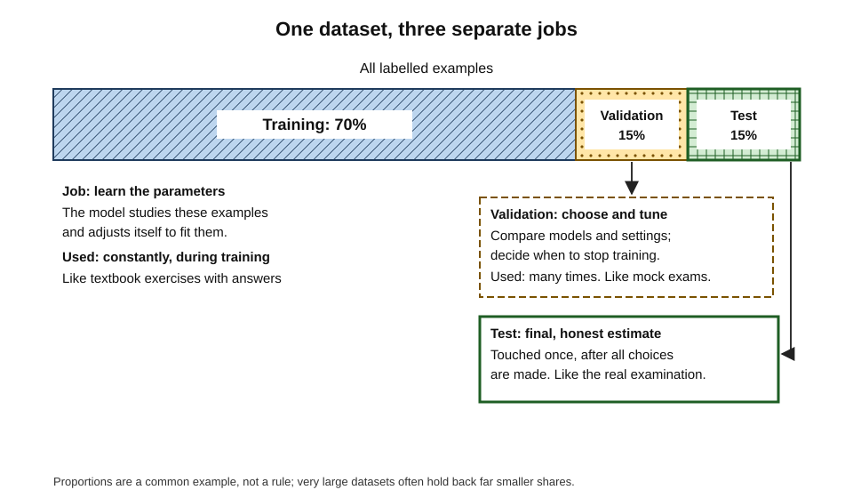
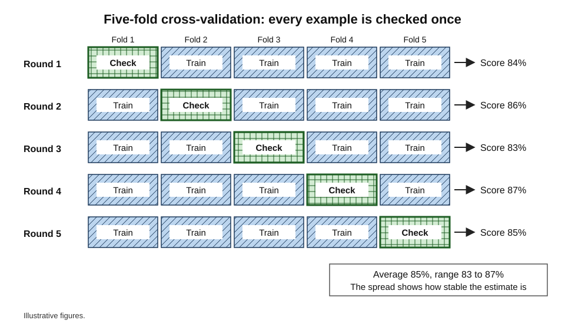
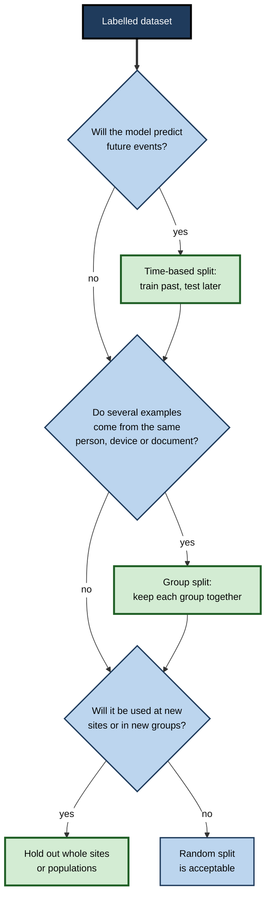
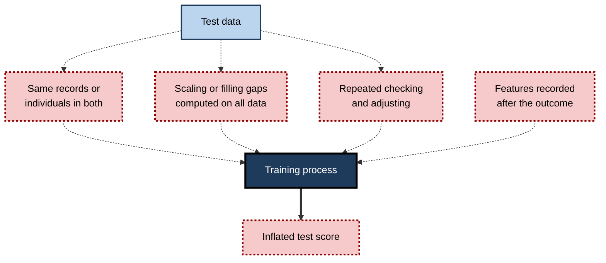
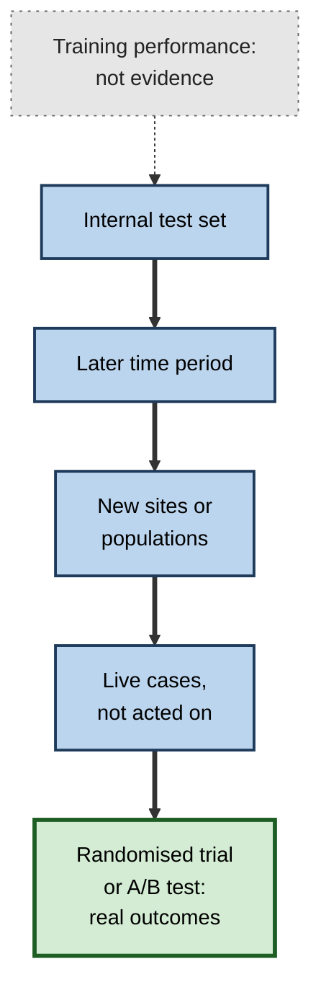

# D.8. Validation and test sets: checking AI honestly

A teacher who hands out the examination questions as homework will see excellent results — and learn nothing about what the class can do. A driving examiner who always uses the same route will pass candidates who have memorised that route. Checking an AI system has the same trap. A model must be judged on examples it has **never seen and never influenced**, or its scores describe its memory rather than its ability. Validation and test sets are the discipline that keeps the check honest.

> **Definition — Held-out data:** examples deliberately kept away from a model during training, so that its performance on them estimates how it will perform on genuinely new cases.

> **Definition — Test set:** a portion of held-out data used once, at the end of development, to give a final, unbiased estimate of a model's performance.

**Why it matters**

- **Every reported AI accuracy figure depends on it.** A number is only as trustworthy as the separation between the data that built the model and the data that judged it.
- **Leaks are common and subtle.** Information can slip from test data into training in ways that even experienced teams miss.
- **Science has been affected.** Reviews have found flawed separation behind exaggerated results in hundreds of published studies.
- **It protects decisions.** Organisations that buy, deploy or regulate AI need estimates that will hold up in the real world.
- **The questions are simple to ask.** "What was it tested on, and could that data have influenced the model?" requires no technical training.

---

## Why Honest Checking Is Needed

### The only question that matters

- **Training performance** answers: how well does the model fit what it has seen?
- **Real-world performance** answers: how well will it work on what it has not seen?
- **Only the second matters**, and it cannot be measured directly before deployment.
- **Held-out data** is the stand-in: examples that play the role of "the future" during development.

> **Key point:** a held-out set is a **simulation of the future**. It is only useful if it resembles the future the model will face and if the model has had no chance to peek at it.

### Three ways a check can be dishonest

- **Testing on training data** — measures memory, not ability.
- **Testing on data that shaped choices** — the model was tuned until it did well on these very examples.
- **Testing on data unlike real use** — the right separation, but the wrong kind of examples.

---

## Three Sets, Three Jobs

### Training, validation and test

> **Definition — Training set:** the examples a model learns from — the data used to adjust its parameters.

> **Definition — Validation set:** held-out examples used during development to compare models, tune settings and decide when to stop training.

- **Training set** — the textbook exercises, studied constantly.
- **Validation set** — the mock examinations, used repeatedly to decide how to study.
- **Test set** — the real examination, sat once.

**Figure 1.** Dividing a dataset into training, validation and test portions, each with its own job.

| | Training set | Validation set | Test set |
|---|---|---|---|
| Job | Learn parameters | Choose models and settings | Estimate final performance |
| Seen by the learning process | Constantly | Indirectly, through choices | Never |
| How often used | Every iteration | Many times | Once |
| Analogy | Textbook exercises | Mock examinations | The real examination |
| What goes wrong if misused | — | Its score becomes optimistic | The final estimate becomes meaningless |

> **Watch out:** the names are not used consistently. Some teams and papers say "validation" for what is here called "test", or use "test" for both. When reading any result, ask **which** data produced it and **whether** that data influenced any decision.

### Why a separate validation set is needed

- **Choices are a form of learning.** Every time a team tries a setting, sees a score and keeps the better option, information flows from the scored data into the model.
- **After many choices**, the model is partly fitted to the validation set.
- **So a further, untouched test set** is needed to give a final estimate free of that influence.

### How much to hold back

- **Common proportions** — 70/15/15 or 80/10/10 for training/validation/test.
- **Very large datasets** — millions of examples allow far smaller shares, such as 98/1/1, because 1% is still a large number.
- **Small datasets** — holding back enough for a reliable test leaves too little for training; cross-validation helps.
- **What really matters** — the **number** of test examples, especially of the important outcome, not the percentage.

> **Formula — Uncertainty of a measured accuracy:** standard error ≈ √(p × (1 − p) ÷ n), where p is the measured accuracy and n the number of test examples. A 95% margin is about ±2 standard errors. Example: accuracy 90% on 1,000 examples gives √(0.9 × 0.1 ÷ 1,000) ≈ 0.0095, so about **±1.9 percentage points**. On 100 examples the margin is about **±6 points**.

**Worked example (illustrative): is the new model really better?**

| | Old model | New model |
|---|---|---|
| Test examples | 200 | 200 |
| Accuracy | 86% | 89% |
| Approximate 95% margin | ±4.9 points | ±4.4 points |

*Illustrative figures.*

1. **The difference** is 3 points.
2. **The margins** are each over 4 points, and the ranges overlap heavily.
3. **Conclusion** — on 200 examples, the improvement could easily be chance.
4. **Remedy** — test both on a larger set, or on the **same** examples and count where they disagree, which gives a more sensitive comparison.

> **Remember:** a small test set gives a **noisy** estimate. Report the number of test examples alongside every accuracy figure.

### Enough of the outcome that matters

- **The trap** — a test set of 10,000 transactions sounds large, but if only 1 in 1,000 is fraud, it contains about **10 frauds**; any estimate of how well fraud is caught rests on those 10.
- **The remedy** — size the test set by the number of examples of the **important outcome**, not by the total.
  - *e.g.* to estimate the share of frauds caught to within about ±10 points, a few hundred fraud cases are needed in the test set.
- **When nothing goes wrong** — a system that makes no errors in a test does not have an error rate of zero.

> **Formula — The rule of three:** if no failures are observed in n independent test cases, the 95% upper bound on the true failure rate is approximately 3 ÷ n. Example: a model that misses no tumours in 300 test scans could still miss up to about 3 ÷ 300 = **1%** of tumours in use.

> **Watch out:** "no errors in testing" is common in small evaluations of safety-critical systems. The rule of three shows how weak that evidence is: proving a failure rate below 1 in 10,000 with this kind of test needs about 30,000 clean cases.

### Choices that need a test of their own

- **Nested cross-validation** — when cross-validation is used both to tune settings and to estimate performance, an inner loop tunes and an outer loop estimates, so that the estimate is not contaminated by the tuning.
- **Pre-registration** — in science, researchers increasingly record their analysis plan, including the test procedure, before seeing the results; the same discipline protects AI evaluations from being adjusted until they look good.
- **Holding back a "lockbox"** — some teams seal a final dataset that no one may examine until the model is frozen, with access recorded.

---

## Cross-Validation

> **Definition — k-fold cross-validation:** a method that divides data into k equal parts (folds), trains k times — each time holding back a different fold for checking — and averages the k scores.

1. **Divide** the data into k folds, often 5 or 10.
2. **Train** on all folds but one; **check** on the remaining fold.
3. **Repeat** so that each fold is held back once.
4. **Average** the scores, and note their spread.

**Figure 2.** Five-fold cross-validation, in which every example is used for checking exactly once.

- **Advantages**
  - Uses all data for both training and checking.
  - The spread across folds shows how stable the estimate is.
- **Costs** — k training runs instead of one.
- **Stratification** — each fold keeps the same mix of outcomes as the whole dataset; important when an outcome is rare.
- **What cross-validation does not replace** — a final untouched test set when many choices have been made, and checks on genuinely new conditions.

> **Watch out:** cross-validation inherits every flaw of how the data is split. If related examples — the same patient, the same customer, consecutive days — fall into different folds, every fold leaks, and the average is confidently wrong.

---

## Splitting the Right Way

A random split is honest only if the examples are independent of each other and the future will resemble the past. Often neither is true.

### Kinds of split

- **Random split** — examples assigned to sets by chance.
  - Suitable when examples are independent and conditions stable.
- **Time-based split** — train on the past, test on later periods.
  - Essential for forecasting, fraud, credit and anything that changes over time.
  - *e.g.* train on 2022–2023, validate on early 2024, test on late 2024.
- **Group split** — all examples from the same person, device, document or account go into the same set.
  - *e.g.* several scans from one patient must not appear in both training and test sets — or the model can recognise the patient rather than the disease.
- **Site or population split** — test on hospitals, regions or customer groups not seen in training.
  - The strongest internal check of whether a model travels.

| Split type | Protects against | Typical use | Risk if ignored |
|---|---|---|---|
| Random | Nothing beyond basic memorisation | Independent, stable examples | Fine only when its assumptions hold |
| Time-based | Using the future to predict the past; change over time | Forecasting, fraud, credit | Scores far better than real use |
| Group | Recognising the same individual twice | Patients, customers, devices, documents | Model learns identities, not patterns |
| Site or population | Hidden local quirks and shortcuts | Medicine, multi-country products | Fails on first new site |

**Figure 3.** Choosing how to split data for an honest check.

> **Key point:** the held-out set must differ from the training set **in the same way the future will differ** — later in time, new people, new places.

---

## Leakage: When the Test Is Secretly Seen

> **Definition — Data leakage:** any way in which information that would not be available in real use — especially information about the test examples or the outcome — enters the model's training, making performance estimates over-optimistic.

### How leaks happen

- **Target leakage** — a feature contains the answer, or information recorded only after the outcome.
  - *e.g.* "number of collection calls" in a model predicting loan default; the calls happen *because* of default.
- **Duplicates across sets** — the same or nearly the same example appears in training and test data.
  - *e.g.* the same image saved at two sizes; the same customer complaint forwarded twice.
- **Preparation using all the data** — rescaling, filling missing values or selecting features using statistics computed over training **and** test data together.
  - The test data has quietly shaped the training process.
- **Temporal leakage** — training on data from after the period being predicted.
- **Group leakage** — the same individuals in training and test sets.
- **Test reuse** — repeatedly checking against the test set and adjusting, until it becomes a second validation set.

> **Mnemonic — "The Dog Pinched The Group's Tea":** Target, Duplicates, Preparation, Temporal, Group, Test reuse.

**Figure 4.** Common paths by which test information leaks into training.

**Study card — Kapoor and Narayanan (2023), Princeton University, published in *Patterns***

- **Question:** how widespread is leakage in scientific research that uses machine learning?
- **Method:** surveyed published reviews and critiques across many fields that had identified leakage.
- **Findings:**
  - leakage had been documented in **17 fields** — including medicine, neuroscience, political science and software engineering — affecting at least **294 papers**;
  - the authors proposed a taxonomy of eight types of leakage and a "model info sheet" for authors to document how they prevented it.
- **Conclusion:** leakage is a leading cause of a reproducibility problem in machine-learning-based science; methods developed for engineering competitions often do not carry over to scientific use.

### Case study: civil war prediction

- **Situation:** several published political-science studies reported that machine-learning models such as random forests predicted the onset of civil wars far better than traditional statistical models.
- **Investigation:** Sayash Kapoor and Arvind Narayanan re-examined prominent studies as part of their leakage work.
- **Finding:** the claimed superiority depended on errors in how data was prepared and separated — including preparation steps that let information from test data influence training.
- **After correction:** the complex models no longer substantially outperformed the older statistical approach.
- **Lesson:** a dramatic improvement over established methods should prompt a search for leakage **before** it prompts celebration.

---

## Wearing Out the Test Set

### Adaptive overfitting

- **The mechanism** — each look at test results, followed by a change, leaks a little information. Over hundreds of looks, models become tuned to the particular test examples.
- **Competitions** — on platforms such as Kaggle, a public leaderboard scores submissions on part of the test data; final rankings use a hidden part. Entrants who tuned heavily to the public board often drop sharply when the hidden results are revealed — a familiar "leaderboard shake-up".
- **A principled response** — Cynthia Dwork and colleagues proposed in 2015, in *Science*, a "reusable holdout" that limits how much information each check reveals, allowing a test set to be reused more safely.

**Study card — Recht, Roelofs, Schmidt and Shankar (2019)**

- **Question:** after a decade of research tuned to the ImageNet test set, have models overfitted to it?
- **Method:** built a **new** test set by following the original collection process as closely as possible, then evaluated a wide range of published models on it.
- **Findings:**
  - accuracy dropped by about **11–14 percentage points** on the new set;
  - but the **ranking** of models was largely preserved — better models on the old set were still better on the new one.
- **Interpretation:** the authors attributed the drop mainly to the new images being slightly "harder" — small differences in how data is collected — rather than to repeated reuse of the old test set.
- **Lesson:** even a careful replication of the data-gathering process changes performance noticeably. Reported accuracy belongs to a **particular test set**, not to the task in general.

### When the test leaks into the training data

- **Benchmark contamination** — large language models are trained on vast amounts of internet text, which may include published test questions and answers.
- **Effect** — high scores may reflect memorised answers rather than ability.
- **Responses** — new test questions written after a model's training cut-off, private test sets, checks for verbatim recall.

> **Definition — Benchmark:** a standard dataset and scoring method used to compare models on a task.

> **Watch out:** **Goodhart's law** — in the anthropologist Marilyn Strathern's phrasing, "when a measure becomes a target, it ceases to be a good measure" — applies with full force to benchmarks. A field that optimises for one test set for years gradually learns that test set.

---

## Beyond the Test Set

A test set, however honest, is still drawn from historical data. Stronger evidence comes from checks that increasingly resemble real use.

1. **Internal validation** — validation and test splits of the development data.
2. **Temporal validation** — testing on a later period.
3. **External validation** — testing at sites, organisations or populations that supplied no training data.
4. **Prospective validation** — running the model on live cases as they arrive, without acting on it, and comparing with outcomes.
5. **Controlled trial or A/B test** — randomly using the model for some cases and not others, and comparing real outcomes.

**Figure 5.** A ladder of evidence for how well a model will work in practice.

> **In practice:** in medicine, reporting guidelines for prediction models (such as TRIPOD, first published in 2015) ask authors to state how models were validated, and regulators increasingly expect external validation. Business deployments benefit from the same habit: an **A/B test** or controlled roll-out is the only way to learn whether a model improves real outcomes, not just predictions.

---

## Validation in Professional Practice

### Case study (illustrative): the churn model that knew the future

- **Situation:** a telecoms company built a model to predict which customers would cancel in the next three months.
- **Development result:** with a random split of two years of customer-months, held-out accuracy was excellent.
- **Live result:** in its first quarter, the model barely beat a simple rule based on contract end dates.
- **Diagnosis:**
  1. the random split mixed months; the model trained on a customer's March record while being tested on the same customer's February record — **group and temporal leakage**;
  2. a feature counting "retention offers received" was recorded by the retention team **after** customers called to cancel — **target leakage**;
  3. missing values had been filled using averages computed on the full dataset — **preparation leakage**.
- **Actions:**
  - re-split by time: train on months 1–18, validate on 19–21, test on 22–24, with each customer's records kept within one period;
  - removed features recorded after the prediction date;
  - moved all preparation inside the training data only.
- **Result:** the honest held-out accuracy was markedly lower — and matched live performance closely. The team could now improve the model knowing its true starting point. *Illustrative figures.*
- **Lesson:** an honest, lower number is worth more than an inflated one; only the honest number predicts what will happen.

### Questions to ask about any reported performance

- **On what data** was this measured, and how was it separated from training data?
- **Did that data influence any choice** — model, features, settings, stopping point?
- **How was it split** — randomly, by time, by group, by site?
- **How many examples**, and how many of the important outcome?
- **Has it been checked** on a later period or a new site?
- **Could any feature contain information** recorded after the outcome?

> **Mnemonic — "Do Data Habits Hide Costly Faults?":** Data used, Decisions influenced, How split, How many, Checked elsewhere, Future-information features.

### Red flags

- **Accuracy far above established methods or expert performance.**
- **No description of how test data was separated.**
- **A random split for a forecasting task.**
- **Several records per person with no mention of group splitting.**
- **Only one test set, reused throughout development.**
- **Results that collapse at the first new site.**

---

## Open Questions

- **How can leakage be detected automatically?**
  - Some checks — duplicate detection, timing audits — can be automated, but many leaks depend on knowing how data was recorded, which requires domain knowledge.
- **How long can a benchmark stay useful?**
  - Heavily used test sets gradually lose their value; how to refresh them without breaking comparisons over time is unresolved.
- **How should large language models be evaluated when their training data is unknown?**
  - Contamination is hard to rule out; private and freshly written tests help but are costly.
- **What level of validation should the law require?**
  - Regulators are still deciding how much external and prospective evidence different kinds of AI system must provide.

---

## Summary

- **Held-out data** simulates the future; a model must be judged on data it has **never seen and never influenced**.
- **Training set** — learns parameters; **validation set** — chooses models and settings; **test set** — final estimate, used once. Names vary, so always ask which data produced a figure.
- Hold back enough examples; the uncertainty of accuracy ≈ √(p(1 − p)/n); small test sets give noisy estimates. Size test sets by the number of **rare outcomes**; by the **rule of three**, zero failures in n cases still allows a failure rate up to about 3 ÷ n.
- **k-fold cross-validation** rotates the held-out fold and averages scores; it inherits any flaw in how data is split.
- Use **time-based**, **group** and **site** splits when the future differs from the past in those ways.
- **Leakage** — target, duplicates, preparation on all data, temporal, group and test reuse — inflates results; Kapoor and Narayanan (2023) found it in at least 294 papers across 17 fields, including civil war prediction.
- Test sets **wear out** through repeated use; Recht and colleagues (2019) found 11–14-point drops on a new ImageNet test set, with rankings preserved. **Benchmark contamination** threatens language-model evaluation; Goodhart's law applies.
- Stronger evidence climbs a ladder: **internal → temporal → external → prospective → randomised trial or A/B test**.

---

## Self-Check

1. Why must a model be evaluated on data it has never seen?
2. Describe the jobs of the training, validation and test sets, using the examination analogy.
3. Why is a separate test set needed if a validation set already exists?
4. Calculate the approximate 95% margin for an accuracy of 80% measured on 400 examples.
5. Two models score 91% and 93% on 150 test examples. Can the second be declared better? What would make the comparison more convincing?
6. Explain 5-fold cross-validation. What does the spread of fold scores reveal?
7. Why is a random split inappropriate for a sales-forecasting model?
8. A hospital dataset contains several scans per patient. What split is needed, and why?
9. Name six forms of leakage and give an example of one.
10. Summarise Kapoor and Narayanan's (2023) findings and the civil war case.
11. What is adaptive overfitting, and how does a leaderboard shake-up illustrate it?
12. What did Recht and colleagues (2019) find, and what does it say about reported accuracy figures?
13. What is benchmark contamination, and why is it a particular problem for large language models?
14. Place these in order of strength as evidence: A/B test; training accuracy; external validation; internal test set; prospective validation.
15. A vendor reports 97% accuracy for a credit-risk model "on held-out data". List the questions you would ask.

### Answer Key

1. Because the purpose is to perform on new cases; performance on seen data measures memory, and the model may have learned quirks that will not recur.
2. Training: textbook exercises the model studies constantly to fit its parameters. Validation: mock examinations used repeatedly to choose models, settings and stopping points. Test: the real examination, sat once for a final estimate.
3. Choices made using validation results tune the model to the validation data, so its validation score becomes optimistic; an untouched test set gives an estimate free of that influence.
4. √(0.8 × 0.2 ÷ 400) = √0.0004 = 0.02; 95% margin ≈ ±4 percentage points.
5. Not confidently: the margins (about ±4–5 points) exceed the 2-point difference. Use a larger test set, or compare both on the same examples and count disagreements.
6. Divide data into five folds; train on four and check on the fifth, rotating so each fold is held back once; average the scores. The spread shows how stable the estimate is.
7. Forecasting predicts the future; a random split lets the model learn from later periods when predicting earlier ones, giving scores that real use cannot match. Use a time-based split.
8. A group split keeping all of a patient's scans in one set, so the model cannot score well by recognising patients seen in training.
9. Target leakage, duplicates across sets, preparation using all data, temporal leakage, group leakage, test reuse. Example: "account closed date" used to predict account closure.
10. Leakage was documented in 17 fields affecting at least 294 papers, with eight types identified. In civil war prediction, claims that machine-learning models greatly outperformed statistical models depended on leakage-related errors; once corrected, the advantage largely disappeared.
11. Gradual tuning to a test set through repeated checking and adjustment. Entrants tuned to a public leaderboard often fall when ranked on hidden test data, showing they had fitted the public portion.
12. Accuracy fell by about 11–14 points on a newly collected ImageNet test set, though rankings held. Reported accuracy belongs to a specific test set; small differences in data collection change it.
13. Test questions and answers appearing in a model's training data, so scores reflect memorisation. Language models train on vast, poorly documented web text, making contamination likely and hard to rule out.
14. Training accuracy < internal test set < external validation < prospective validation < A/B test.
15. How was held-out data separated — by time, by customer? Did it influence any choices? How many defaults were in it? Were any features recorded after the lending decision? Was preparation done on training data only? Has it been tested on a later period and on lenders or regions like ours? Is there evidence from live use?

---

## Glossary

| Term | Meaning |
|---|---|
| A/B test | Randomly applying two versions and comparing real outcomes. |
| Adaptive overfitting | Gradual tuning to a test set through repeated checks and adjustments. |
| Benchmark | A standard dataset and scoring method for comparing models. |
| Benchmark contamination | Test items appearing in a model's training data. |
| Cross-validation | Rotating which part of the data is held back and averaging the scores. |
| Data leakage | Information unavailable in real use entering training and inflating estimates. |
| External validation | Testing at sites or populations that supplied no training data. |
| Fold | One of the equal parts into which data is divided for cross-validation. |
| Group split | Keeping all examples from the same individual or source in one set. |
| Nested cross-validation | Cross-validation with an inner loop for tuning and an outer loop for estimating performance. |
| Rule of three | With zero failures in n cases, the 95% upper bound on the failure rate is about 3 ÷ n. |
| Held-out data | Examples kept away from training to estimate performance on new cases. |
| Prospective validation | Running a model on live cases without acting on it and comparing with outcomes. |
| Stratification | Keeping the mix of outcomes the same in every set or fold. |
| Target leakage | A feature containing the outcome or information recorded after it. |
| Test set | Held-out data used once for a final performance estimate. |
| Time-based split | Training on earlier data and testing on later data. |
| Training set | The examples a model learns its parameters from. |
| Validation set | Held-out data used to choose models, settings and stopping points. |
