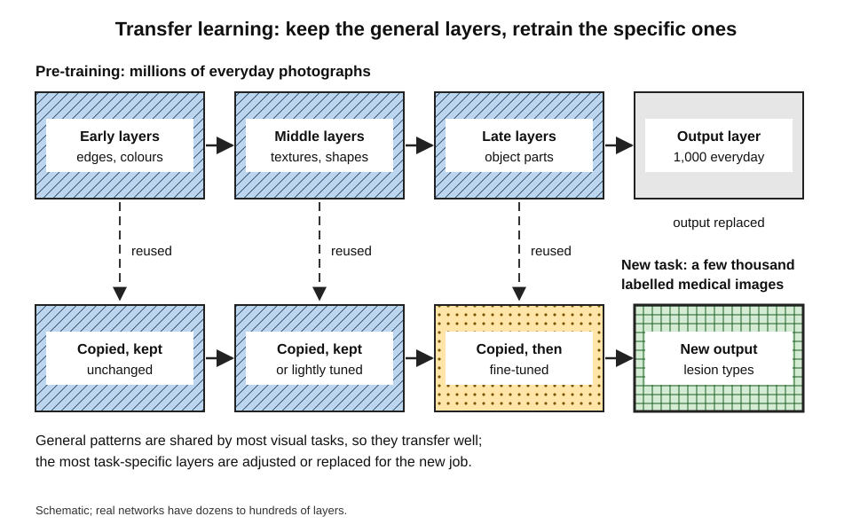
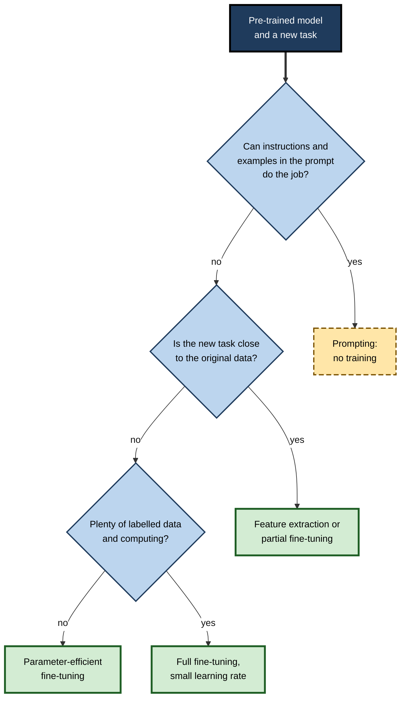
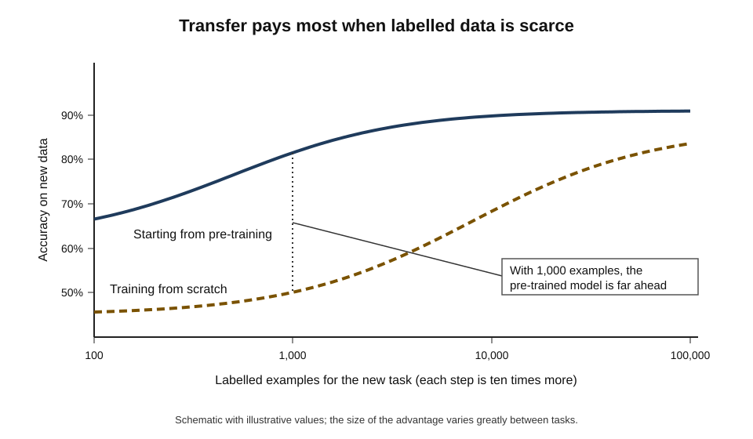
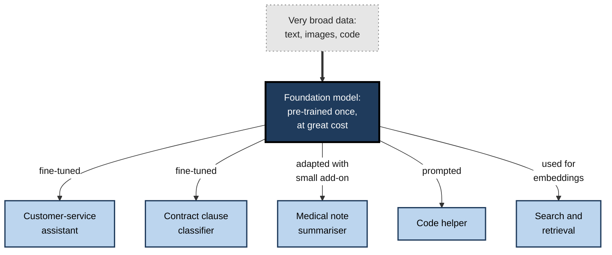
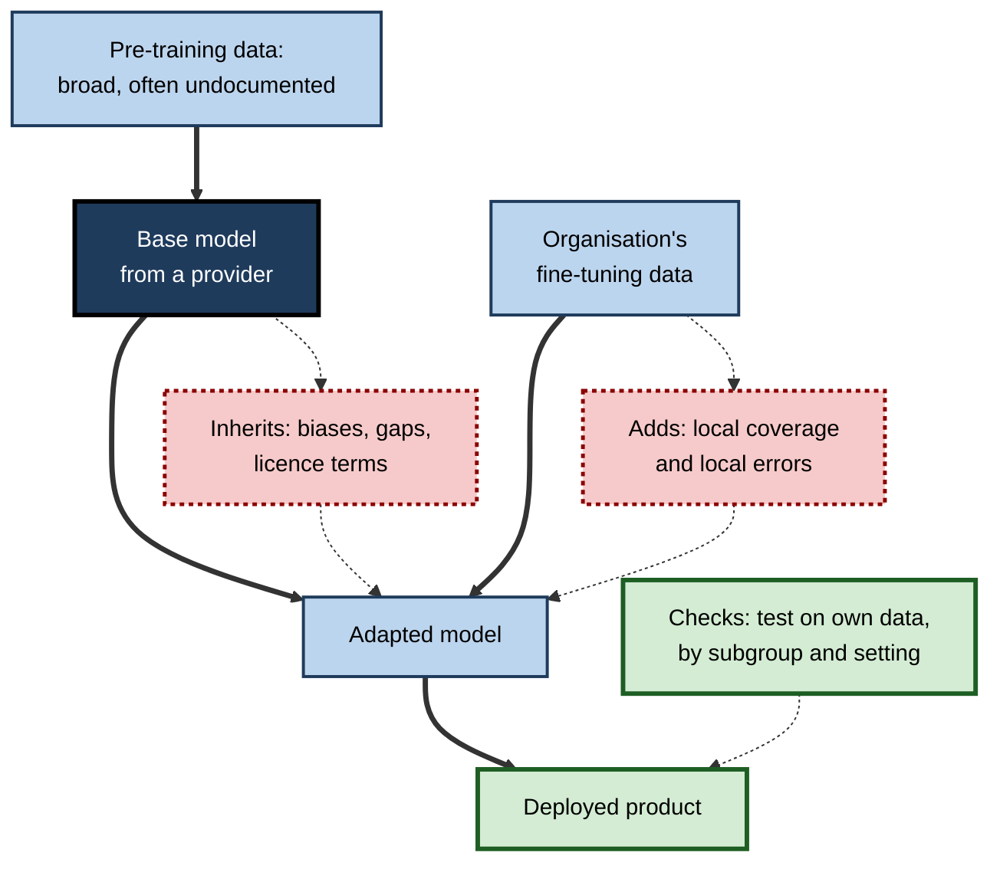

# D.9. Transfer learning: reusing what AI already knows

A professional pianist sits at a church organ for the first time. The pedals and stops are new, but reading music, finger technique, rhythm and phrasing all carry over; within weeks the pianist plays competently, where a complete beginner would need years. Modern AI works in the same way. Instead of learning every task from nothing, a model that has already learned general patterns from vast amounts of data is **reused** and adjusted for a new task — often with only a few hundred or a few thousand new examples.

> **Definition — Transfer learning:** reusing knowledge a model gained on one task or dataset as the starting point for learning a different but related task.

> **Definition — Pre-training:** the first, large-scale training of a model on broad data, intended to produce general-purpose knowledge that can later be adapted.

**Why it matters**

- **It made AI practical for most organisations.** Few have millions of labelled examples or the computing budget to train large models from scratch; nearly all can adapt an existing one.
- **It is how today's AI is built.** Large language and image models are pre-trained once, at great cost, and adapted for countless specific uses.
- **It changes the economics of data.** A few thousand good examples can achieve what once required millions.
- **It creates a supply chain.** Adapted models inherit strengths, weaknesses, biases and legal terms from the models they were built on.
- **It explains surprising failures** — a model adapted from the wrong starting point, or to a very different setting, can perform worse than expected.

---

## Reusing What Was Learned

### The idea from human learning

- **Transfer in psychology** — Edward Thorndike and Robert Woodworth studied in 1901 how practice in one skill affects performance in another; they found transfer depends on how much the tasks share.
- **Positive transfer** — earlier learning helps: a Spanish speaker learning Italian.
- **Negative transfer** — earlier learning interferes: a driver used to driving on the left struggling on the right.
- **The machine version** — the same logic applies: what a model learned transfers to the extent that the new task shares structure with the old.

### Why start from something already learned?

- **Scarce labels** — the new task may have only hundreds or thousands of labelled examples.
  - *e.g.* rare diseases; a company's own contract types; a new product's defects.
- **Cost** — pre-training a large model may take weeks on thousands of specialised chips; adapting it may take hours on one.
- **Time** — a usable model in days instead of months.
- **Quality** — general knowledge from broad data often makes the adapted model more robust than one trained only on a small, narrow dataset.

> **Key point:** transfer learning splits learning into two stages — **expensive and general** (pre-training, done once) and **cheap and specific** (adaptation, done many times).

---

## How Transfer Works

### General layers and specific layers

- **Layered learning** — deep networks learn simple, general patterns in early layers and complex, task-specific ones in later layers.
  - In image networks: edges and colours → textures and shapes → object parts → whole objects.
  - In language models: word pieces → grammar and phrases → meanings, facts and styles.
- **What transfers** — the early and middle layers capture patterns shared by many tasks; they can be reused almost unchanged.
- **What must change** — the final layers, which are tuned to the original task's specific outputs.

**Study card — Yosinski, Clune, Bengio and Lipson (2014)**

- **Question:** how general or specific are the features learned at each layer of an image network?
- **Design:** image networks were trained on two halves of the ImageNet categories; layers were copied from one network to another, either frozen or fine-tuned, and performance was measured.
- **Results:**
  - **first-layer features were general** — useful whatever the task;
  - features became **more specific in later layers**;
  - transferability fell as the original and new tasks became **less similar**;
  - but even features from fairly distant tasks were **better than random starting points**, and fine-tuning transferred layers improved performance further.
- **Conclusion:** transfer works because much of what networks learn early is general; the more similar the tasks, the more layers can be reused.

**Figure 1.** Reusing the general layers of a pre-trained network for a new task.

### Off-the-shelf features

- **A 2014 demonstration** — researchers at KTH Royal Institute of Technology in Stockholm (Ali Sharif Razavian and colleagues) took features from a network trained on ImageNet and used them, unchanged, as inputs to simple classifiers on many other visual tasks.
- **Finding** — these "off-the-shelf" features matched or beat many methods specially designed for those tasks.
- **Consequence** — starting from an ImageNet-trained network became the default for almost any image problem.

---

## Ways to Transfer

> **Definition — Fine-tuning:** continuing to train a pre-trained model on data for a new task, so that its parameters adjust to that task.

> **Definition — Feature extraction:** using a pre-trained model, unchanged, to turn inputs into informative features, and training only a small new model on top.

- **Feature extraction (frozen model)**
  - Keep all pre-trained layers fixed; train only a new output layer.
  - Needs the least data and computing; least able to adapt.
- **Partial fine-tuning**
  - Keep early layers fixed; adjust later layers and the new output.
  - A balance between stability and adaptation.
- **Full fine-tuning**
  - Adjust every parameter, usually with a small learning rate so as not to destroy what was learned.
  - Most flexible; needs more data and computing; risks forgetting general knowledge.
- **Parameter-efficient fine-tuning**
  - Add a small number of new trainable parameters and leave the original model frozen.
  - *e.g.* **LoRA** (low-rank adaptation), described by Edward Hu and colleagues at Microsoft in 2021, reported cutting the number of trainable parameters for adapting a very large language model by a factor of about 10,000.
  - Many adapted versions can share one base model, each adding only a small file.
- **Adapting without training**
  - Large language models can be steered by instructions and examples placed in the prompt, with no parameter changes at all.

| | Feature extraction | Partial fine-tuning | Full fine-tuning | Parameter-efficient fine-tuning |
|---|---|---|---|---|
| Parameters changed | New output only | Later layers and output | All | A small added set |
| Labelled data needed | Least | Moderate | Most | Little to moderate |
| Computing cost | Lowest | Moderate | Highest | Low |
| Ability to adapt to a very different task | Limited | Good | Highest | Good |
| Risk of losing general knowledge | None | Low | Highest | Low |

**Figure 2.** Choosing how to adapt a pre-trained model.

---

## How Much Data Transfer Saves

**Figure 3.** Accuracy against the number of labelled examples, with and without a pre-trained starting point.

### Worked example (illustrative): classifying product defects

A manufacturer wants to classify photographs of circuit boards into five defect types. It has 1,500 labelled images.

| Approach | Labelled images used | Training time | Accuracy on held-back images |
|---|---|---|---|
| Train a network from scratch | 1,500 | 6 hours | 64% |
| Feature extraction from an ImageNet model | 1,500 | 20 minutes | 83% |
| Fine-tune the later layers of the same model | 1,500 | 1 hour | 91% |
| Train from scratch with 50,000 images (hypothetical) | 50,000 | 3 days | 90% |

*Illustrative figures.*

1. **From scratch**, 1,500 images are far too few for a network to learn what edges, textures and shapes look like.
2. **Feature extraction** reuses those general patterns immediately; only the defect decision is learned.
3. **Fine-tuning** adjusts the later layers to the look of circuit boards — more effective still.
4. **The comparison** — fine-tuning on 1,500 images matches what training from scratch would need tens of thousands of images to reach.

> **Remember:** transfer learning matters most when **labelled data is scarce** and the new task **shares structure** with the pre-training data. With abundant data and a very different task, its advantage shrinks.

---

## A Landmark Application

### Case study: skin cancer classification at Stanford

- **Situation:** skin cancer is common, and early detection of melanoma saves lives; access to dermatologists is limited in many places.
- **Approach:** Andre Esteva, Brett Kuprel and colleagues at Stanford University, publishing in *Nature* in 2017, started from an image network (Inception v3) **pre-trained on about 1.3 million everyday ImageNet photographs**.
- **Adaptation:** they fine-tuned it on about **129,000 clinical images** covering more than **2,000 skin diseases**.
- **Test:** on biopsy-proven images, the model was compared with **21 board-certified dermatologists** on two key distinctions — carcinomas versus benign lesions, and melanomas versus benign moles.
- **Result:** the model performed on a par with the dermatologists on both tasks.
- **Why transfer mattered:** 129,000 medical images is large for medicine but small for training such a network from nothing; the general visual knowledge from everyday photographs made the result possible.
- **Caveats raised later:** most training images came from lighter-skinned patients, raising concerns about performance on darker skin; the comparison used photographs rather than full clinical examinations.
- **Lesson:** transfer learning can bring specialist-level performance within reach of modest datasets — but the adapted model still reflects the coverage of its **own** fine-tuning data.

---

## Foundation Models

> **Definition — Foundation model:** a large model pre-trained on very broad data that can be adapted to a wide range of downstream tasks.

- **The term** was introduced in 2021 by researchers at Stanford University (Rishi Bommasani and colleagues), in a report on the opportunities and risks of such models.
- **Language**
  - **ULMFiT** (Jeremy Howard and Sebastian Ruder, 2018) showed that pre-training a language model on general text, then fine-tuning, worked well for text classification with few labels.
  - **BERT** (Jacob Devlin and colleagues, Google, 2018) was pre-trained on large text collections and then fine-tuned; it set new records on eleven language-understanding tasks.
  - Large generative language models are pre-trained by predicting the next word across enormous text collections, then adapted for conversation, coding or specialist domains.
- **Images and beyond** — similar foundation models exist for images, speech, protein structures and combinations of text and images.

**Figure 4.** One foundation model adapted for many uses.

| | Training from scratch | Adapting a foundation model |
|---|---|---|
| Data needed for the task | Large | Small to moderate |
| Computing for the task | High | Low to moderate |
| Time to a working model | Weeks to months | Hours to days |
| Control over what the model learned | Full | Limited to the adaptation |
| Knowledge of the training data | Complete | Often partial or none |
| Dependence on a provider | None | Licence, access and updates |

---

## When Transfer Fails or Harms

### Domain shift

> **Definition — Domain shift:** a difference between the kind of data a model was trained on and the kind it meets in a new task or setting.

- **Small shifts** — from photographs of cars to photographs of lorries: transfer works well.
- **Large shifts** — from colour photographs to X-rays, from news text to medical notes, from English to a low-resource language: less transfers, and fine-tuning must do more.

### Negative transfer

> **Definition — Negative transfer:** the situation in which starting from a pre-trained model leads to worse performance than starting from scratch, because what it learned conflicts with the new task.

- **When it happens** — the tasks share little structure, or the pre-trained model's assumptions mislead.
- **Example** — a sentiment model trained on product reviews treating "unpredictable" as negative; in film reviews, "an unpredictable plot" is praise.

**Study card — Raghu, Zhang, Kleinberg and Bengio (2019), "Transfusion"**

- **Question:** how much does ImageNet pre-training actually help on medical imaging tasks?
- **Design:** compared large standard networks pre-trained on ImageNet with the same networks and smaller, simpler networks trained from scratch, on retinal images and chest X-rays.
- **Findings:**
  - for these tasks, pre-training gave **little performance benefit**;
  - small, simple networks trained from scratch performed **comparably** to large pre-trained ones;
  - pre-training did make training **converge faster**, and some benefits came from the scale of the pre-trained weights rather than their specific content.
- **Conclusion:** the value of transfer depends on how similar the domains are and how much task data exists; it should be tested, not assumed.

### Forgetting and inheritance

- **Catastrophic forgetting** — aggressive fine-tuning can overwrite general knowledge, leaving a model good at the new task and worse at everything else.
- **Inherited flaws** — biases, errors and gaps in the pre-training data carry into every adapted model.
  - *e.g.* stereotyped associations learned from web text appear in fine-tuned classifiers.
- **Unknown provenance** — the adapting organisation often cannot see what the base model was trained on.
- **Licence and access** — base models come with terms on commercial use, modification and redistribution; a provider may change or withdraw a model.
- **Security** — a compromised base model can carry hidden behaviours into everything built on it.

**Figure 5.** The model supply chain and what each stage inherits.

> **Watch out:** a fine-tuned model is only partly "yours". Its behaviour on cases your fine-tuning data did not cover is decided mostly by a base model whose training data you may never see.

---

## Narrowing the Gap Between Domains

When the base model's data and the new task differ markedly, several techniques bring them closer before, or instead of, ordinary fine-tuning.

### Continued pre-training on the new domain

- **The idea** — before fine-tuning on a small labelled set, continue the base model's original kind of training on a large amount of **unlabelled** text or images from the new domain.
- **Why it works** — the model absorbs the vocabulary, style and patterns of the domain, which labelled examples alone are too few to teach.

**Study card — Lee and colleagues (2019), Korea University, "BioBERT"**

- **Starting point:** the general-purpose BERT language model, pre-trained on encyclopaedia and book text.
- **Adaptation:** continued pre-training on a large collection of biomedical research abstracts and full-text articles — without labels.
- **Evaluation:** fine-tuned on standard biomedical tasks — recognising names of diseases, genes and drugs; extracting relations between them; answering biomedical questions.
- **Result:** the domain-adapted model outperformed the original BERT on these tasks, with the largest gains where specialist vocabulary mattered most.
- **Conclusion:** a general model can be made a much better starting point for a specialist field by first letting it read that field's unlabelled literature.

### Transfer across languages

- **Multilingual models** — pre-trained on text in many languages at once.
- **Cross-lingual transfer** — fine-tuned on labelled examples in one language, such a model can often perform the same task in other languages it has seen in pre-training, without labels in those languages.
  - A 2019 study by Telmo Pires and colleagues at Google found that multilingual BERT transferred surprisingly well between languages, including between languages written in different scripts, though less well between languages with very different structures.
- **Why it matters** — labelled data exists mainly in a few widely used languages; cross-lingual transfer extends tools to languages with little labelled data.
- **Caveat** — performance usually falls for languages poorly represented in pre-training, so speakers of those languages are served worse.

### Transfer across sound and the physical world

- **Speech** — models pre-trained on large amounts of unlabelled audio can be fine-tuned with very little transcribed speech.
  - *e.g.* Facebook AI's wav2vec 2.0 (2020) reported usable speech recognition on a standard benchmark after fine-tuning on as little as ten minutes of transcribed audio, following pre-training on tens of thousands of hours of unlabelled speech.
- **Robotics: from simulation to reality** — training robots in the physical world is slow and risky, so many are trained in simulation and transferred.
  - **The reality gap** — simulated physics, lighting and textures differ from the real world.
  - **Domain randomisation** — varying colours, lighting, friction and object shapes randomly in simulation so that the real world looks like "just another variation"; researchers at OpenAI used this in 2017 to transfer object detectors trained only on simulated images to a real robot.

### Zero-shot and few-shot use

> **Definition — Zero-shot learning:** performing a task without any task-specific training examples, relying entirely on what was learned in pre-training and on a description of the task.

> **Definition — Few-shot learning:** performing a task after seeing only a handful of examples, either in fine-tuning or placed in a prompt.

- **Example of zero-shot** — a model pre-trained on images paired with captions can classify a photo as "a photo of a heron" without ever being trained on a heron classifier, by matching the image to the description.
- **When it suffices** — common categories, tasks well described in words, tolerance for some errors.
- **When it does not** — specialist categories, strict accuracy requirements, subtle distinctions the base model never learned.

| | Zero-shot | Few-shot | Fine-tuning on thousands of examples |
|---|---|---|---|
| Task-specific examples | None | A handful | Thousands or more |
| Effort to set up | Minutes | Hours | Days to weeks |
| Typical accuracy on specialist tasks | Lowest | Moderate | Highest |
| Flexibility to change the task | Highest | High | Low — retraining needed |
| Best suited to | Exploration, common tasks | Prototypes, moderate needs | Production use with strict requirements |

> **Key point:** the more the target task resembles what the base model already knows, the less task-specific data is needed — down to none at all. The less it resembles it, the more the adaptation must supply.

---

## Transfer Learning in Professional Practice

### Choosing a starting point

- **Similarity** — how close is the base model's training data to the new task?
- **Size** — larger models transfer more knowledge but cost more to run.
- **Licence** — may it be used commercially, modified, deployed on own servers?
- **Documentation** — is there a description of its training data, known limitations and evaluations?
- **Stability** — will the provider keep the version available, or change it without notice?
- **Fit with data rules** — can sensitive data be used for fine-tuning under applicable law and contracts?

> **Mnemonic — "Smart Staff Love Documented, Stable Foundations":** Similarity, Size, Licence, Documentation, Stability, Fit with data rules.

### Case study (illustrative): adapting a language model for contract review

- **Situation:** a law firm wanted to flag unusual indemnity clauses in commercial contracts.
- **Data:** 2,400 clauses labelled by senior associates as "standard", "unusual — review" or "high risk".
- **First attempt:** prompting a general-purpose language model with instructions and a few examples.
  - Result: reasonable on obvious cases, inconsistent on subtle drafting differences the firm cared about.
- **Second attempt:** parameter-efficient fine-tuning of an open-licence model on the 2,400 labelled clauses, run on the firm's own servers so that client documents never left them.
  - Result: agreement with senior associates rose substantially on held-back clauses.
- **Problems found in testing:**
  1. the model performed poorly on contracts governed by another jurisdiction's law, which were rare in the fine-tuning data — **domain shift**;
  2. after fine-tuning, the model's general summarising ability had degraded — **forgetting**, acceptable here because the firm used it for one task only.
- **Actions:** added 300 labelled clauses from the under-represented jurisdiction; restricted use to the jurisdictions tested; recorded the base model version and licence.
- **Result:** the tool became a first-pass reviewer, with every flag checked by a lawyer. *Illustrative figures.*
- **Lesson:** transfer made a useful model possible from a few thousand examples — but its reliability extended only as far as its fine-tuning data.

### Questions to ask about an adapted model

- **What base model was used, which version, and under what licence?**
- **What is known about the base model's training data?**
- **How much data was used to adapt it, and does it cover the cases that matter?**
- **Was it tested on held-back data from the real setting, broken down by important subgroups?**
- **Has it lost abilities it needs in addition to the new task?**
- **What happens if the base model is changed or withdrawn?**

> **In practice:** organisations increasingly keep a register of the base models they depend on — like a list of software suppliers — so that a problem discovered in one base model can be traced to every product built on it.

---

## Open Questions

- **How can transferability be predicted before trying?**
  - Measures of task similarity exist, but whether transfer will help for a given pair of tasks is still largely discovered by experiment.
- **How should inherited biases be detected and corrected?**
  - Fine-tuning can reduce some inherited problems and leave others hidden; reliable auditing of base models is an active field.
- **Should a few large foundation models underpin most AI?**
  - Shared base models are efficient but concentrate influence and create common points of failure; the policy implications are debated.
- **How can models be adapted without forgetting?**
  - Methods that add knowledge while preserving general ability help but do not fully solve the problem.

---

## Summary

- **Transfer learning** reuses what a model learned on one task as the starting point for another; **pre-training** builds general knowledge once, **adaptation** specialises it cheaply.
- It mirrors human transfer (Thorndike and Woodworth, 1901): it helps to the extent that tasks share structure.
- Early layers learn **general** patterns and later layers **specific** ones (Yosinski and colleagues, 2014); off-the-shelf ImageNet features proved powerful across visual tasks.
- Adaptation methods: **feature extraction**, **partial** and **full fine-tuning**, **parameter-efficient fine-tuning** such as LoRA, and **prompting** without training.
- Transfer saves most when **labelled data is scarce** and domains are **similar**; Esteva and colleagues (2017) reached dermatologist-level classification by fine-tuning an ImageNet model on about 129,000 clinical images.
- **Foundation models** — such as BERT and large generative language models — are pre-trained on broad data and adapted for many uses.
- Transfer can fail through **domain shift** and **negative transfer**; Raghu and colleagues (2019) found little benefit from ImageNet pre-training on some medical imaging tasks.
- Adapted models **inherit** biases, gaps, licence terms and risks from their base models, and fine-tuning can cause **forgetting**.
- Domain gaps narrow through **continued pre-training** (BioBERT, 2019), **cross-lingual transfer**, speech pre-training, **domain randomisation** from simulation to reality, and **zero-shot** or **few-shot** use when tasks resemble what the model already knows.
- In practice, choose base models by similarity, size, licence, documentation, stability and data rules, and test adapted models on real, local data.

---

## Self-Check

1. Define transfer learning and pre-training, and explain the two-stage economics they create.
2. Give a human example of positive and of negative transfer, and the corresponding risk for AI.
3. Why do early layers of a network transfer better than late layers? Summarise the evidence from Yosinski and colleagues (2014).
4. Distinguish feature extraction, full fine-tuning and parameter-efficient fine-tuning.
5. When would prompting be preferred to fine-tuning?
6. In the defect-classification worked example, why did training from scratch on 1,500 images perform so poorly?
7. Describe the Esteva and colleagues (2017) study and the role transfer learning played in it. What caveat applies?
8. What is a foundation model? Give two examples of how one might be adapted.
9. What is domain shift, and how does its size affect transfer?
10. Explain negative transfer with an example.
11. What did the "Transfusion" study find, and what lesson does it teach?
12. List four risks an organisation inherits when adapting a third-party base model.
13. A hospital plans to fine-tune a general image model on 800 local scans to detect a rare condition. What should it check before deployment?

### Answer Key

1. Transfer learning reuses a model's knowledge from one task for another; pre-training is the broad initial training that creates that knowledge. Pre-training is expensive and done once; adaptation is cheap and done many times.
2. Positive: a Spanish speaker learning Italian. Negative: a left-side driver driving on the right. For AI: a pre-trained model may carry assumptions that mislead in a new task.
3. Early layers learn general patterns (edges, colours) shared by most tasks; later layers learn task-specific combinations. Yosinski and colleagues found first-layer features general, later ones specific, transferability falling with task dissimilarity, and even distant transfer better than random starting points.
4. Feature extraction: freeze the model, train only a new output. Full fine-tuning: adjust all parameters for the new task. Parameter-efficient fine-tuning: freeze the model and train a small set of added parameters.
5. When the task can be described by instructions and a few examples, data or computing for training is unavailable, or flexibility to change the task quickly matters more than peak accuracy.
6. A network needs many examples to learn basic visual patterns from nothing; 1,500 images are too few, so it learns poorly and overfits.
7. An ImageNet-pre-trained network was fine-tuned on about 129,000 clinical images and matched 21 dermatologists on two key distinctions. Pre-training supplied general visual knowledge that the medical data alone could not. Caveat: under-representation of darker skin, and photo-based rather than full clinical comparison.
8. A large model pre-trained on broad data and adapted to many tasks. Examples: fine-tuned as a customer-service assistant; used with a small add-on to summarise medical notes.
9. A difference between training data and new-task data. Small shifts allow most knowledge to transfer; large shifts leave less to reuse and require more adaptation.
10. Pre-training leading to worse results than starting from scratch, e.g. a sentiment model from product reviews treating "unpredictable" as negative in film reviews, where it is praise.
11. On some medical imaging tasks, ImageNet pre-training gave little performance benefit; small networks from scratch did comparably, though pre-training sped convergence. Transfer's value must be tested for each domain.
12. Biases and gaps from undocumented pre-training data; licence restrictions; dependence on a provider who may change or withdraw the model; security risks from a compromised base model.
13. Whether 800 scans include enough cases of the rare condition; performance on held-back local scans, by scanner type and patient subgroup; external validation if possible; comparison with clinicians; the base model's licence and documentation; signs of domain shift from the base model's data; a plan for monitoring and clinician oversight.

---

## Glossary

| Term | Meaning |
|---|---|
| Base model | The pre-trained model from which an adapted model is built. |
| Catastrophic forgetting | Loss of earlier knowledge when a model is trained on new data. |
| Continued pre-training | Further unlabelled training of a base model on data from a new domain. |
| Cross-lingual transfer | Performing a task in one language after training on labelled data in another. |
| Domain randomisation | Varying simulated conditions randomly so that learning transfers to the real world. |
| Domain shift | A difference between training data and the data met in a new task or setting. |
| Feature extraction | Using a frozen pre-trained model to produce inputs for a small new model. |
| Few-shot learning | Performing a task after seeing only a handful of examples. |
| Fine-tuning | Continuing to train a pre-trained model on new-task data. |
| Foundation model | A large model pre-trained on broad data and adaptable to many tasks. |
| LoRA | Low-rank adaptation: a parameter-efficient fine-tuning method. |
| Negative transfer | Pre-training making performance worse than starting from scratch. |
| Parameter-efficient fine-tuning | Adapting a frozen model by training a small set of added parameters. |
| Pre-training | Large-scale initial training to build general-purpose knowledge. |
| Transfer learning | Reusing knowledge from one task as the starting point for another. |
| Zero-shot learning | Performing a task with no task-specific training examples. |
