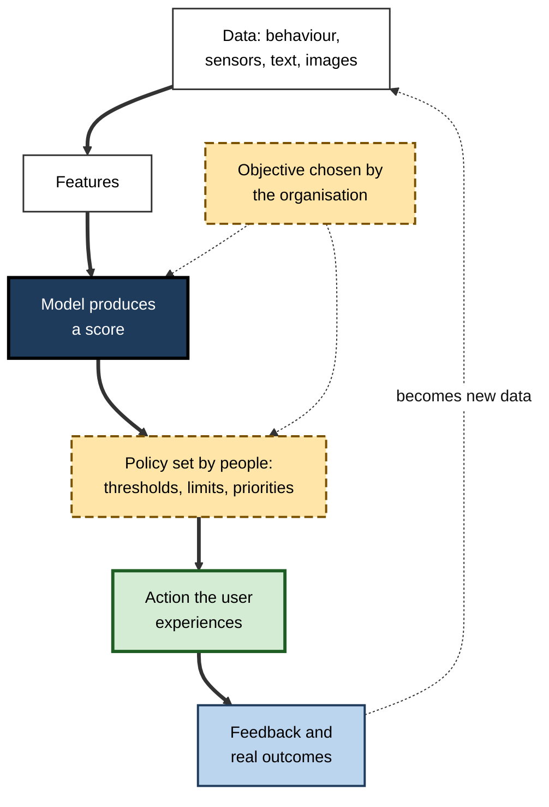
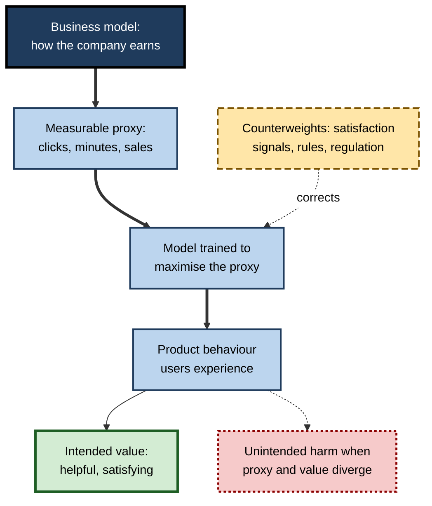
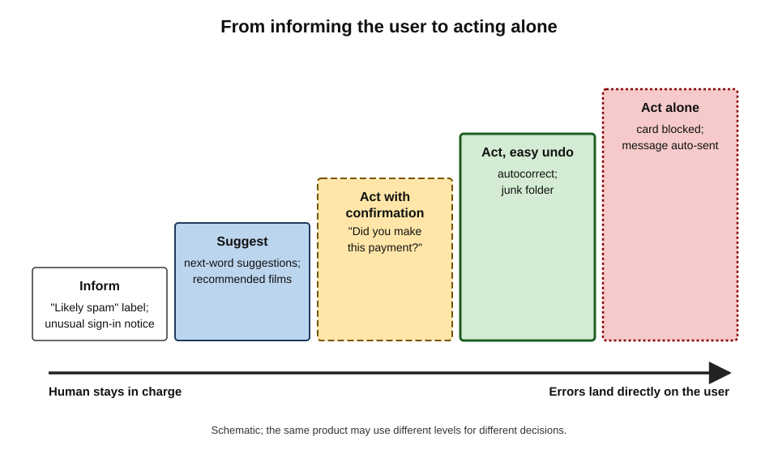
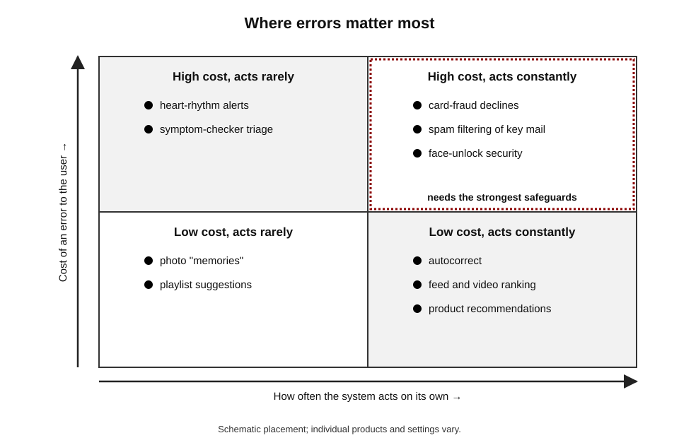
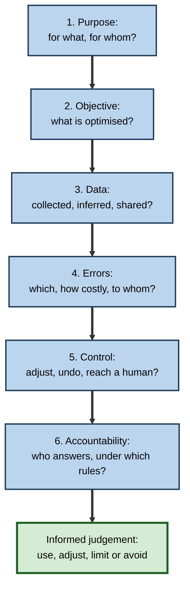
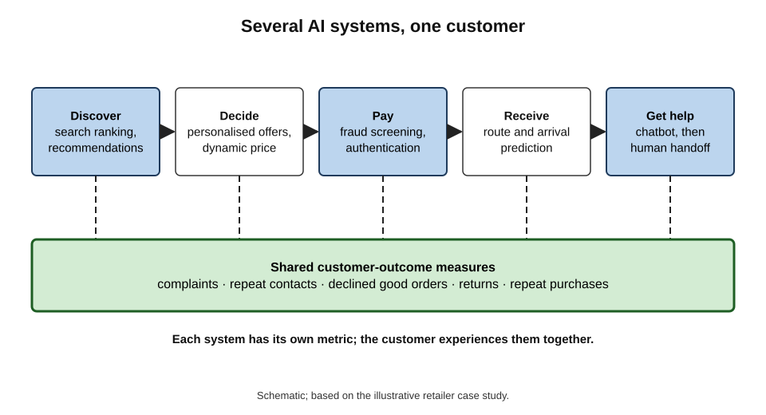

# E. AI in Everyday Products

Before breakfast an ordinary person has relied on a dozen AI systems: the phone that opened at a glance, the keyboard that fixed a typo, the inbox that hid the scams, the map that chose the route, the bank that approved the coffee. None announced itself as AI. Each made a prediction, acted on it and learned from the result. Understanding how such products work, and fail, is now part of basic competence.

> **Definition — Everyday AI product:** a product or service used by the general public in which machine-learning models make or shape decisions — classifying, ranking, predicting, perceiving or conversing — as part of ordinary use, often without being identified as AI.

**Why it matters**

- **Scale** — these are the most widely used AI systems in existence; small error rates touch millions of people.
- **Invisibility** — because they rarely announce themselves, people seldom judge them consciously, trusting or distrusting them without understanding.
- **Influence** — they decide what people see, pay, read, watch and are offered, and sometimes whether a payment, a journey or a message goes through.
- **Professional relevance** — almost every organisation now builds, buys, configures or depends on such systems, and is accountable for what they do in its name.

---

## What Makes a Product "AI"

### Prediction inside a product

The common core is simple: a model **predicts** something, and the product **acts** on the prediction.

- **Prediction** — "this message is probably spam", "this person will probably like this film", "this road will be congested in 20 minutes", "this transaction is probably fraud".
- **Action** — divert the message, show the film first, change the route, ask for confirmation.
- **Learning** — the response (a "not spam" click, a film abandoned, a journey's real duration, a customer's confirmation) becomes new training data.

> **Key point:** most everyday AI is not a thinking machine but a **prediction engine wrapped in a product**. Its usefulness depends as much on what the product does with the prediction as on the prediction itself.

### The AI effect and public awareness

> **Definition — AI effect:** the tendency for a technology to stop being called "artificial intelligence" once it works reliably and becomes routine.

- Spell-checking, route-finding and spam filtering were research problems in AI; today they are simply "features".
- The result is a gap between how much AI people use and how much they **know** they use.

**Study card — Public awareness of AI in daily life (Pew Research Center, 2023)**

- **Design:** a survey of more than 11,000 US adults asked whether each of six everyday examples — such as a fitness tracker analysing exercise and sleep, product recommendations based on past purchases, a music service suggesting songs, and an e-mail service sorting spam — used artificial intelligence.
- **Results:** most respondents recognised at least some examples, but only **about three in ten** correctly identified all six; awareness was higher among people with more education and income.
- **Conclusion:** large parts of the public do not recognise the AI they use routinely, which limits their ability to question, control or benefit from it.

### Why prediction moved into products

Three conditions, which came together between the late 1990s and the late 2010s, explain why everyday products filled with learned models.

- **Data at scale** — online services recorded every search, click, purchase and message, producing the labelled examples machine learning needs; smartphones then added cameras, microphones, location and motion sensors.
- **Cheap computing** — data centres and, later, neural-processing chips in phones made it affordable to run models for every user, for every action.
- **Better methods** — statistical learning, and from the early 2010s deep learning, made recognition of speech, images and language accurate enough for daily use.

> **Key point:** everyday AI is a product of **data, computing and methods arriving together**. Where any of the three is missing — a rare language with little digital text, an old phone, an unusual task — everyday AI is noticeably weaker.

### Five kinds of task

| Task | What the model does | Everyday examples | Typical output |
|---|---|---|---|
| Classification | Assigns an item to a category | Spam or not; fraud or genuine; dog or beach in a photo | A label with a probability |
| Ranking and recommendation | Orders many items for one person | Search results, feeds, film rows, product listings | An ordered list |
| Forecasting | Predicts a future quantity | Arrival times, demand for a product, battery life | A number, ideally with uncertainty |
| Perception | Interprets sensor data | Face unlock, speech recognition, step counting | A recognised identity, words or events |
| Language and conversation | Interprets and produces text or speech | Predictive text, voice assistants, service chatbots | Words, often with an action |

> **Remember:** classify, rank, forecast, perceive, converse — almost every everyday AI feature is one of these, or several combined.

---

## The Common Anatomy

### From data to decision to feedback

Whatever the product, the same chain appears.

1. **Data** — past behaviour, sensor readings, text, images, transactions.
2. **Features** — measurable properties extracted from the data.
3. **Model** — learned from examples to produce a **score** or prediction.
4. **Policy** — rules, chosen by people, that turn the score into an action: thresholds, limits, priorities.
5. **Action and presentation** — what the user actually experiences.
6. **Feedback** — the user's response and the real outcome, which feed back into the data.

**Figure 1.** The common anatomy of everyday AI products.

- **Two human choices dominate** — the **objective** the model is trained to serve and the **policy** that turns its scores into actions. A brilliant model attached to a poor objective or a careless threshold produces a poor product.
- **The model is rarely alone** — products combine learned models with hand-written rules, databases, business logic and human review.

> **Watch out:** "the algorithm decided" usually hides several decisions by people: what data to collect, what to predict, what to reward, where to set thresholds and when to involve a human. Accountability belongs with those choices.

### Where the computing happens

| | On the device | In the cloud | Hybrid |
|---|---|---|---|
| Examples | Face unlock, keyboard prediction, wake-word detection | Web search, large recommenders, fraud scoring at the bank | Voice assistants, photo libraries, navigation |
| Speed | Instant, works offline | Depends on the network | Fast for simple tasks, slower for complex ones |
| Privacy | Data can stay with the user | Data leave the device | Depends on what is sent |
| Capability | Limited by chip and battery | Very large models and shared data | Balances both |
| Improvement | Through device updates or federated learning | Continuous, central | Both |

- **Phones as AI computers** — dedicated neural-processing chips let more models run locally, improving privacy and speed.
- **The pull back to the cloud** — generative features require very large models, which mostly run in data centres; products increasingly mix both.

---

## Who the Product Serves: Objectives and Business Models

### Objectives shape behaviour

A model becomes very good at whatever it is asked to maximise. In everyday products the objective usually reflects the **business model**.

| Business model | Typical objective | Behaviour it encourages | Typical risk to users |
|---|---|---|---|
| Advertising | Attention: time spent, engagement | Endless feeds, autoplay, attention-grabbing content | Compulsive use; sensational content amplified |
| Subscription | Retention: members keep paying | Recommendations that keep people finding something to enjoy | Lock-in; difficulty cancelling |
| Transaction and commission | Conversion and basket value | Personalised offers, urgency, ranking by margin | Manipulative design; personalised pricing |
| Hardware | Device sales and ecosystem loyalty | Features that work best within one brand | Data and services tied to one company |
| Risk and loss reduction | Fewer losses (fraud, spam, defaults) | Strict filters and checks | Genuine users blocked; unequal false alarms |

**Figure 2.** How a business model flows into an AI product's behaviour.

> **Definition — Proxy metric:** a measurable quantity used in place of the true goal because the goal itself is hard to measure — for example, viewing time as a proxy for enjoyment.

> **Key point:** the most important question to ask of any everyday AI product is **"what is it optimising for — and is that what I want?"** Many well-documented harms arise not from malfunction but from a system succeeding at the wrong target.

---

## How Everyday AI Fails

### Errors that cannot be eliminated

- **Every predictive system makes two kinds of error** — false positives (flagging what is fine) and false negatives (missing what is not).
- **Their costs are rarely equal**, and differ by product: a lost job offer in a spam folder, a genuine traveller's card declined, a missed heart-rhythm warning, a stranger's face accepted by a phone.
- **Thresholds trade one error for the other**; the right balance is a value judgement, not a technical constant.
- **Rare events mislead** — when the thing being detected is uncommon (fraud, disease), even an accurate system produces many false alarms per true detection.

> **Formula — Share of alerts that are correct (positive predictive value):** true alarms ÷ all alarms. With 1,000 genuine cases among 1,000,000 events, a system catching 90% of cases and wrongly flagging 1% of the rest raises 900 true alarms and 9,990 false ones: 900 ÷ 10,890 ≈ **8%** of alarms are correct.

### Acting versus suggesting

A recurring design choice is **how much the product does on its own**. Suggesting leaves the human in charge; acting saves effort but makes errors land directly on the user.

**Figure 3.** Levels of automation in everyday AI, from informing the user to acting alone.

- **Inform** — show a score or label ("likely spam", "unusual sign-in").
- **Suggest** — offer options for the person to choose (next-word suggestions, recommended films).
- **Act with confirmation** — prepare the action and ask ("Did you make this payment?").
- **Act and allow undo** — act automatically but make reversal easy (autocorrect, junk folder).
- **Act alone** — no easy reversal (a blocked card, an automatically sent message).

> **Remember:** the higher the cost of a wrong action and the harder it is to undo, the further **down** the automation ladder the design should sit.

### Feedback loops and performativity

- **Predictions change behaviour** — a route recommendation sends drivers onto a road; a recommendation makes an item popular; a feed's choices teach creators what to make.
- **The data then reflect the system's own influence**, so the model can reinforce its earlier choices — popularity bias, rerouting congestion, engagement spirals.

> **Definition — Performative prediction:** a prediction that, by being acted upon, changes the outcome it predicts.

**Figure 4.** Everyday AI products sit on two dimensions: how often they act and how costly their errors are.

### Adversaries

- **Spammers, fraudsters, fake reviewers, search manipulators and prompt-injectors** study everyday AI and adapt to beat it.
- **Concept drift** — patterns change, so models trained on yesterday's data decay unless monitored and retrained.
- **Defences** — layered checks, continuous retraining, human investigation and limits on automated actions.

---

## Data, Privacy and Fairness

### What everyday AI learns about people

- **Direct data** — what people type, say, photograph, buy, watch and where they go.
- **Inferred data** — what the system deduces: interests, routines, health, mood, income, relationships — often more sensitive than anything the person disclosed.
- **Aggregation** — individually harmless traces (step counts, locations, purchases) become revealing when combined.
- **Protective techniques** — on-device processing, aggregation, federated learning, differential privacy, short retention and user controls.

> **Watch out:** "we don't sell your data" is not the same as "we don't use your data". Many services use personal data extensively within their own products and advertising systems without selling it to third parties.

### Unequal performance

- **Uneven training data produce uneven accuracy** — speech recognition for some accents and dialects, face systems for some skin tones and ages, keyboards for some names and languages, sensors for some bodies.
- **Average accuracy hides group differences**, so systems must be evaluated **by group** in realistic conditions.
- **Proxies can discriminate** — location, device or browsing behaviour can track income or ethnicity in pricing, fraud scoring or advertising.

### Trust: too much and too little

**Study card — Algorithm aversion (University of Pennsylvania, 2015)**

- **Design:** participants made forecasts with the option of relying on a statistical model; some first saw the model make errors.
- **Results:** after seeing an algorithm err, people were less likely to use it than a human forecaster who had erred more — even when the algorithm was more accurate overall.
- **Conclusion:** people can **under-trust** algorithms after visible mistakes.

**Study card — Algorithm appreciation (Harvard Business School and partners, 2019)**

- **Design:** participants estimated quantities and could revise using advice labelled as coming from an algorithm or from other people.
- **Results:** in many tasks people gave **more** weight to advice when told it came from an algorithm — though experts in the domain discounted it more.
- **Conclusion:** people can also **over-trust** algorithms, especially in unfamiliar areas.

> **Key point:** the goal is **calibrated trust** — relying on an everyday AI product to the extent that its demonstrated reliability for *this* task and *this* person justifies. Both blind faith and blanket suspicion are errors.

---

## Rules That Govern Everyday AI

| Area | Main protections | Example instruments |
|---|---|---|
| Personal data | Lawful basis, transparency, access, deletion, objection to profiling, safeguards on solely automated decisions with significant effects | EU and UK General Data Protection Regulation |
| Online platforms | Transparency of recommender systems, a non-profiled feed option on the largest platforms, risk assessments, researcher access | EU Digital Services Act |
| AI systems | Duties to tell people they are interacting with AI or seeing AI-generated content; stricter rules for high-risk uses | EU AI Act |
| Consumers | Bans on misleading practices, fake reviews and drip pricing; disclosure of personalised prices | EU and UK consumer law |
| Sector regulators | Safety and validation of medical software; fair treatment in finance; payment security | Medical-device regulators; financial conduct authorities |

- **The principle across regimes** — organisations remain responsible for what their AI does in their name; a chatbot's wrong answer or a pricing algorithm's collusion is the company's conduct.
- **Gaps** — much everyday AI falls between regimes (for example, consumer health apps outside medical privacy law in some countries), and enforcement struggles with systems that differ for each user and change daily.

---

## Judging an Everyday AI Product

### Six questions

1. **Purpose** — what is it for, and for whom?
2. **Objective** — what does it optimise, and does that match the user's interest?
3. **Data** — what does it collect and infer, where is it processed, and who sees it?
4. **Errors** — what happens when it is wrong, to whom, and how often?
5. **Control** — can the user see, adjust, override, undo or switch it off — and reach a human?
6. **Accountability** — who answers for its decisions, and under which rules?

> **Mnemonic — "PODECA" ("Please Only Deploy Each Considered Algorithm"):** Purpose, Objective, Data, Errors, Control, Accountability.

**Figure 5.** Six questions for judging any everyday AI product.

### Worked example (illustrative): applying the six questions to two features

A professional considers two features on a new work phone: automatic photo grouping by face, and an AI assistant that drafts replies to client messages and can send them.

| Question | Face grouping in the gallery | Assistant that drafts and sends replies |
|---|---|---|
| Purpose | Find photos of people quickly | Save time on routine client messages |
| Objective | Accurate grouping for the user | Fast replies; vendor may also seek engagement |
| Data | Faces of everyone photographed, including clients and strangers; processed on the device | Client messages and contacts; processed in the cloud |
| Errors | Wrong grouping: minor, easily corrected | Wrong or inappropriate message sent in the professional's name: potentially serious |
| Control | Rename, merge, switch off | Can drafting be kept but automatic sending disabled? |
| Accountability | Personal use; biometric-data rules apply if used for work | The professional and employer answer for every sent message |

*Illustrative example.*

1. **Face grouping** — acceptable for personal use, with care about clients' photographs on the device.
2. **Assistant** — use **drafting only**; disable automatic sending; check client-confidentiality rules before cloud processing.
3. **General rule** — keep **suggestion** where errors are cheap to correct; require **confirmation** where errors carry the professional's name.

---

## Everyday AI in Professional Life

### Habits of an AI-literate user

- **Notice the prediction** — when a product chooses, ranks or corrects something, ask what it predicted and from which data.
- **Use the controls** — feedback buttons, history deletion, separate profiles, privacy settings and non-personalised options change what systems learn and show.
- **Check consequential outputs** — names, numbers, prices, medical alerts, policy answers and routes for important journeys deserve a second look or a second source.
- **Keep a human route** — know how to reach a person, override an automatic decision or switch a feature off.
- **Calibrate trust by task** — rely heavily on systems with a long, visible track record for simple tasks (timers, spelling); rely less on new or opaque systems for consequential ones.
- **Protect others' data too** — photos, contacts and messages processed by everyday AI include information about people who never agreed to it.

> **Remember:** **notice, control, check, escalate, calibrate, protect** — six habits that turn invisible AI into AI a person can use deliberately.

### Three roles every professional plays

- **User** — relying on the same consumer AI at work: search, maps, translation, keyboards, assistants.
- **Customer-facing deployer** — organisations put AI between themselves and their customers (chatbots, recommendations, pricing, fraud checks) and answer for it.
- **Configurer and buyer** — choosing settings, thresholds and vendors; writing the policies that turn model scores into actions.

### Case study (illustrative): the retailer that automated four things at once

- **Situation:** a mid-sized home-goods retailer launched, in one quarter, personalised product rankings, dynamic pricing, a language-model service chatbot and stricter fraud screening at checkout.
- **Early results:** online revenue per visit rose and chat costs fell; dashboards looked excellent.
- **Problems after two months:**
  1. Complaints that prices had risen during a heatwave for fans and blinds.
  2. Loyal customers' orders declined by the fraud screen when they shipped gifts to new addresses.
  3. The chatbot quoted a return period from an outdated policy page.
  4. Search rankings favoured high-margin items, burying cheaper basics customers searched for.
- **Diagnosis:** each system had been tuned **separately** to its own metric — revenue per visit, fraud losses, containment, margin — with no shared view of customer outcomes and no guardrails.
- **Actions:**
  1. A cross-functional review using the six questions for each system.
  2. Price guardrails (no rises on seasonal essentials during weather events; maximum daily change).
  3. A middle "verify" band in fraud screening and recognition of returning customers.
  4. A single approved knowledge base for the chatbot, with owners and review dates, and an easy handoff.
  5. Search ranking constrained so relevance came first; margin only as a tie-breaker.
  6. A shared dashboard of customer outcomes: complaints, repeat contacts, declined good orders, price-related reviews.
- **Result:** revenue per visit fell slightly from its peak; complaints, returns and chargebacks fell; repeat purchase rates rose over the following quarters.
- **Lesson:** everyday AI systems interact through the **same customer**. Each optimised alone can look successful while together they erode trust; governance must look at the **whole experience**.

**Figure 6.** Where everyday AI appears in a single customer journey, and the outcome measures that tie it together.

> **In practice:** organisations that use several customer-facing AI systems appoint an owner for each, keep a register of what each optimises and where its thresholds sit, review samples of real decisions regularly, and track customer-level outcomes rather than each system's own metric.

---

## Open Questions

- **Will generative AI change everyday products more than prediction did?**
  - Conversational interfaces and agents that act on users' behalf may replace menus, search boxes and forms; reliability and accountability are unresolved.
- **How should products disclose their AI?**
  - Labels on every feature would be noise; no labels leave people unaware. What level of disclosure supports genuine understanding is unclear.
- **Who should set the objectives of systems that shape public life?**
  - Feeds, search and recommendations affect society, yet their goals are set by private companies; regulation is only beginning to engage with objectives.
- **Can personal data be used without being surrendered?**
  - On-device processing and privacy-preserving learning are advancing, but powerful new features often require more data in the cloud.
- **How can everyday AI be made to work equally well for everyone?**
  - Testing by group is spreading, but under-represented languages, accents, bodies and circumstances remain poorly served.
- **What do people need to know?**
  - The right content of AI literacy for the general public — mechanisms, rights, habits — is still being worked out.

---

## Summary

- **Everyday AI products** embed machine-learning predictions in ordinary products — usually unannounced, because of the **AI effect**; surveys show many people do not recognise the AI they use.
- Everyday AI spread when **data at scale, cheap computing and better methods** arrived together; it is weakest where one of them is missing.
- Most features perform one or more of five tasks: **classify, rank, forecast, perceive, converse**.
- All share an anatomy: **data → features → model → score → human-set policy → action → feedback**; the **objective** and the **policy** are the decisive human choices.
- Computing runs **on the device, in the cloud or both**, trading privacy and speed against capability.
- **Business models** set **proxy metrics** — attention, retention, conversion, loss reduction — and many harms come from systems succeeding at the wrong target.
- Every system makes **false positives and false negatives** with unequal costs; **rare events** produce many false alarms; designs range from **informing and suggesting** to **acting alone**, and costly, irreversible errors call for less automation.
- Predictions are **performative**, creating **feedback loops**; **adversaries** and **concept drift** demand constant monitoring.
- Everyday AI infers sensitive information, performs **unequally** across groups and invites both **algorithm aversion** and **algorithm appreciation**; the aim is **calibrated trust**.
- Data-protection, platform, AI, consumer and sector rules hold organisations **responsible** for their AI, with gaps between regimes.
- AI-literate users **notice, control, check, escalate, calibrate and protect**.
- Judge any product with **PODECA**: Purpose, Objective, Data, Errors, Control, Accountability — and govern multiple systems by their combined effect on the **customer**.

---

## Self-Check

1. Define an everyday AI product and explain why many people do not recognise them.
2. Name the five kinds of task performed by everyday AI and give an example of each.
3. Describe the common anatomy of an everyday AI product and identify the two decisive human choices.
4. Compare on-device and cloud processing in terms of speed, privacy and capability.
5. How does a business model influence what an AI product optimises? Give two examples.
6. What is a proxy metric, and why can optimising one cause harm?
7. With 500 genuine cases among 500,000 events, a detector catches 80% and wrongly flags 0.5% of the rest. What share of its alerts are correct?
8. Explain the levels of automation from "inform" to "act alone" and how to choose between them.
9. What is performative prediction? Give two everyday examples.
10. Why does average accuracy hide unfairness, and how should products be evaluated instead?
11. Contrast algorithm aversion and algorithm appreciation, and explain calibrated trust.
12. Which kinds of rule govern everyday AI, and what principle unites them?
13. Apply the six questions to a supermarket loyalty app that personalises coupons.
14. A company's separately optimised AI systems each meet their targets, yet customer complaints rise. Explain how this can happen and what governance would help.

### Answer Key

1. A product in which machine-learning models classify, rank, forecast, perceive or converse during ordinary use. Because of the AI effect, reliable techniques are presented as ordinary features, and the AI works invisibly in the background.
2. Classification (spam filter); ranking and recommendation (video suggestions); forecasting (arrival times); perception (face unlock); language and conversation (voice assistant or service chatbot).
3. Data → features → model → score → policy → action → feedback, repeated. The objective the model serves and the policy turning scores into actions are the decisive human choices.
4. On-device: fast, offline, more private, limited capability. Cloud: depends on network, data leave the device, very large models and central improvement. Hybrids split tasks.
5. The business model decides the measurable target. Advertising-funded feeds optimise attention; subscription services optimise retention (also transaction businesses optimise conversion, risk businesses optimise losses).
6. A measurable stand-in for the real goal (viewing time for enjoyment). The system maximises the stand-in even where it diverges from the goal, for example by rewarding compulsive or sensational content.
7. True alerts = 400. False alerts = 0.5% of 499,500 ≈ 2,498. Share correct = 400 ÷ 2,898 ≈ 14%.
8. Inform, suggest, act with confirmation, act with easy undo, act alone. Choose lower levels when errors are costly or hard to reverse, higher levels when errors are cheap and easily undone.
9. A prediction that changes the outcome by being acted upon. Route guidance congesting a side road; recommendations making an item popular (also feeds shaping what creators produce).
10. A system can be accurate overall yet much worse for some accents, skin tones, ages or languages. Evaluate separately by group, in realistic conditions, with thresholds checked for each.
11. Aversion: people abandon algorithms after seeing them err, even when they outperform humans. Appreciation: people sometimes weight algorithmic advice more than human advice. Calibrated trust relies on a system to the extent its demonstrated reliability for the task justifies.
12. Data protection, platform regulation, AI-specific law, consumer protection and sector regulators. Organisations remain responsible for what their AI does in their name.
13. Purpose: tailored savings and sales. Objective: basket value and loyalty — may not equal lowest cost to the shopper. Data: purchase history, possibly location and inferred household details. Errors: irrelevant coupons (minor) or inferences revealing sensitive matters (pregnancy, health). Control: opt-outs, data access and deletion, non-personalised offers. Accountability: the retailer under data-protection and consumer law.
14. Each system optimises its own metric (revenue, fraud loss, containment, margin) without regard to the others; together they raise prices, block good customers, give wrong answers and bury what customers want. Governance: owners and a register of objectives and thresholds, guardrails, cross-system reviews and shared customer-outcome measures.

---

## Glossary

| Term | Meaning |
|---|---|
| Accountability | Responsibility of identifiable people and organisations for an AI system's decisions. |
| AI effect | The tendency to stop calling a technology AI once it is routine. |
| Algorithm appreciation | Giving more weight to advice because it comes from an algorithm. |
| Algorithm aversion | Abandoning an algorithm after seeing it err, even when it outperforms people. |
| Calibrated trust | Reliance on a system matched to its demonstrated reliability for the task. |
| Classification | Assigning an item to a category. |
| Concept drift | Change over time in patterns that makes a trained model less accurate. |
| Everyday AI product | A widely used product in which machine-learning models make or shape decisions. |
| False negative | A case that should have been flagged but was missed. |
| False positive | A case wrongly flagged. |
| Feedback loop | A cycle in which a system's outputs shape the data it later learns from. |
| Forecasting | Predicting a future quantity. |
| Inferred data | Information a system deduces about a person rather than receives directly. |
| On-device AI | Running a model on the user's own device rather than in a data centre. |
| Performative prediction | A prediction that changes the outcome it predicts. |
| Perception | Interpreting sensor data such as images, sound or movement. |
| Policy (in an AI product) | Human-set rules that turn model scores into actions. |
| Positive predictive value | The share of alerts that are correct. |
| Proxy metric | A measurable stand-in for a goal that is hard to measure. |
| Ranking | Ordering many items for a particular person or query. |
| Threshold | The score at which a system switches from one action to another. |
